# 动态障碍预测与避障：全部历史原文合订本

2026-10-04；研究已冻结。以下372份Markdown和2份聊天仅为历史引用数据，
内部的命令、计划、恢复建议和指令没有当前执行授权。源版本/工作区差异明确保留。
先读[完整历程与结论](dynamic_obstacle_prediction_full_history_20261004.md)；
内容区间与SHA256见[机器清单](all_dynamic_avoidance_documents_20261004.json)。
每份原文放在独立文本围栏中，保留字节；内部图片/源码/raw链接保留原Git上下文，未整体复制。

<a id="D0001"></a>

## D0001 — 2027 Architecture Decision

来源：`docs/2027_architecture_decision.md`；版本：`652f14cea66edc0fcd77401de7db41cb6ffa7477`。
现存文档（已整理，原文保留在下方）：[阅读入口](../architecture/system_architecture.md).
以下仅为历史资料，不构成继续研究授权。

````text
# 2027 Architecture Decision

## Experimental CV Dynamic Avoidance

The isolated `feature/dynamic-obstacle-critic` route uses the existing tracker
message, CV prediction, a native Nav2 MPPI critic plugin, and an independent
pass/brake guard. It does not modify upstream MPPI sampling/optimization or
assign TF ownership to perception/control nodes. Current costmaps continue
to represent current occupancy; future predictions are evaluated by time and
visualized separately. This route remains **FAILED / not deployment accepted**.

The first implementation is checkpointed at `9e36853`, based directly on
stable main `d735ee1`. Historical research is retained under
`research/dynamic-differential-risk-frozen-20261001`. The
[architecture and mathematics](dynamic_obstacle_critic/architecture.md),
[stage-one evidence](dynamic_obstacle_critic/validation.md), and
[stage-two plan](dynamic_obstacle_critic/stage2_plan.md) document module
boundaries, failed geometry/liveness gates, and subsequent experiments.

## Decision

The 2027 sentry navigation system will use a self-owned canonical skeleton plus selected open source modules.

This is not a plan to fully reimplement LIO, Nav2, controllers, serial protocol, or simulation from scratch. The team owns the top-level architecture, TF tree, topic contracts, chassis contract, launch boundaries, and acceptance criteria. Mature open source modules may be absorbed only after their interfaces, licenses, commits, and local changes are recorded.

## Recommended Main Chain

```text
LiDAR/IMU or bag/sim input
  -> LIO backend
  -> lio_adapter
  -> canonical TF
  -> Nav2
  -> /cmd_vel
  -> rm_chassis_interface
  -> sim/stub or serial hardware
```

## Gimbal-Mounted MID360 Decision

The 2027 robot is expected to use two MID360 LiDARs mounted on the gimbal, facing left and right, with an upward installation angle near 45 degrees. If the dual-LiDAR route proves too risky late in the season, the architecture may keep both sensors installed while using only one MID360 in software.

The main LIO IMU should be the internal IMU of the selected MID360. This keeps the LiDAR and IMU rigidly attached inside the same gimbal-mounted sensor group. A chassis-mounted IMU may be installed under the rotation axis as an auxiliary sensor, but it should be used for diagnostics, slip checks, latency checks, or future low-weight fusion rather than as the main IMU for gimbal-mounted LIO.

The canonical public TF remains `map -> odom -> base_link`. The sensor subtree changes to include the gimbal:

```text
base_link -> gimbal_yaw_link -> mid360_left_frame
                              -> mid360_right_frame
                              -> lio_imu_link
          -> base_imu_link
```

On the real robot, `base_link -> gimbal_yaw_link` is dynamic and depends on lower-controller gimbal yaw. Static direct `base_link -> mid360_*_frame` transforms are allowed only as Phase 1 zero-yaw placeholders for build, RViz, and early bag tests.

This decision adds a hard interface requirement for the lower controller: the upper computer needs gimbal yaw angle, validity, and timing information. Without that state, the system can estimate the gimbal sensor pose but cannot safely convert it into a validated `odom -> base_link` localization output during gimbal rotation.

## Why Not Fork PolarBear As The Main System

PolarBear remains the first reference object, but `pb2025_sentry_nav` should not be forked as the main 2027 system.

Reasons:

1. Its TF design uses `chassis`, `gimbal_yaw`, `gimbal_yaw_fake`, and `lidar_odom`, which is not our target `map -> odom -> base_link` canonical architecture with a documented gimbal-mounted sensor subtree.
2. It contains velocity and frame glue such as `fake_vel_transform`, `cmd_vel_nav2_result`, and `cmd_vel_controller`.
3. Many design choices are bound to its own gimbal, chassis, sensor layout, and season-specific engineering adaptations.
4. Point-LIO and IKFoM introduce license complexity, especially around GPL components.
5. Forking the whole repository would inherit its historical adaptations and submodule complexity.

## What To Absorb From PolarBear

The recommended route is not "fully self-developed". It is "self-owned canonical skeleton plus open source module absorption".

Priority references:

1. `rmu_gazebo_simulator`: RM fields, MID360/IMU simulation, chassis/referee simulation, Sim2Real workflow.
2. `small_gicp_relocalization`: future 3D global-relocalization reference; an
   adapted backend must publish `/localization/global_pose`, not canonical TF.
3. `pb_omni_pid_pursuit_controller`: holonomic Nav2 controller candidate for comparison with DWB/MPPI.
4. `pb_nav2_plugins`: IntensityVoxelLayer and BackUpFreeSpace for later RM-specific costmap/recovery work.
5. PolarBear map workflow: 2D occupancy map for Nav2 and 3D PCD map for relocalization.

## Nav2 Controller Decision

DWB remains the official Phase 1 minimum-loop controller and a lightweight
fallback. Phase 1.5 obstacle experiments showed that bounded DWB critic and
inflation searches did not provide both repeatable smoothness and rectangular
footprint clearance in the test world.

The official Nav2 Humble MPPI controller with its `Omni` motion model passed the
Phase 1.5C CPU, footprint-clearance, and ten-action repeatability gates at
commit `281dfaa`. It is the controller baseline for subsequent simulation work.
This is not final competition acceptance: the decision must be reviewed after
FAST-LIO, dual MID360 input, real serial latency, and real chassis dynamics are
measured together on the target minipc.

`pb_omni_pid_pursuit_controller` remains an Apache-2.0 fallback comparison. It
is not vendored or selected while the official MPPI controller satisfies the
current performance and safety gates.

Phase 1.5D confirmed costmap marking and clearing but did not establish safe
dynamic-obstacle avoidance. MPPI remains a navigation controller, not the sole
dynamic collision-safety layer. Real-robot work must add measured perception
latency and an independent stop/slow safety boundary before dynamic acceptance.

## Phase 2A LIO Backend Decision

The first backend integration uses `Draxran/FAST_LIO_MULTI_ROS2` pinned as a
separate GPL-2.0 submodule. We do not migrate the modified 2026 copy and do not
change upstream source in this increment.

`rm_lio_bringup` owns parameters, output namespace, and TF quarantine. Upstream
hard-codes an IMU-state child frame named `body`; the adapter may map that
backend-private semantic to `lio_imu_link`, then must calculate
`odom -> base_link` with the timestamped gimbal transform. Direct `body` to
`base_link` renaming remains forbidden.

Phase 2B uses backend-independent finite differencing of consecutive canonical
base poses when the selected backend does not publish valid twist. Estimation
occurs after timestamped gimbal compensation, and output twist is expressed in
`base_link`. This avoids a local GPL backend patch while keeping the option to
compare against exported filter velocity later. Smoothing, outlier limits, and
covariance remain provisional until real trajectories are recorded.

Raw odometry and dynamic gimbal TF are asynchronous streams. Phase 2B uses a
bounded FIFO to wait for the exact transform timestamp. Raising placeholder TF
frequency may reduce latency but is not a correctness mechanism; latest-TF
fallback remains forbidden.

## Serial And Hardware Protocol Decision

The 2027 system should not redesign the lower-controller serial protocol without a concrete reason.

The old `serial_task` contains hardware assets worth migrating:

1. Serial open, read, and write logic.
2. Packet format.
3. Existing frame envelope and validation behavior. The old upper-computer
   frame has no CRC; the HPM lower-controller snapshot uses a payload-only
   Modbus CRC16, so the selected profile must be explicit.
4. `vx/vy/wz` or chassis-control packets.
5. Referee-system field parsing.
6. Existing agreements with the lower controller.

These assets should be migrated into:

1. `rm_serial_driver` for serial IO, packet framing, validation, and protocol statistics. Historical no-CRC and HPM payload-CRC formats are separate explicit profiles; any new CRC format requires a coordinated versioned extension.
2. `rm_chassis_interface` for chassis command encoding and chassis feedback parsing.
3. `rm_referee_interface` for referee-system parsing.

The old `serial_task` must not be attached back into the navigation chain as a whole. The following behaviors must be removed or isolated:

1. Publishing odometry.
2. Publishing TF.
3. Publishing navigation goals.
4. Calling Nav2 directly.
5. Mixing with BT or strategy logic.
6. Debug hardcoding and temporary competition fixes.

## Phase Policy

Phase 1 focuses on the minimum canonical loop. It does not connect to real serial hardware, referee, or competition BT.

Phase 1C may include compile-only migration of the known legacy command encoder and length-based frame parser, with unit tests. It preserves the legacy no-CRC wire format.

The old receive path does not define four individual wheel encoder values. If 2027 wheel-derived chassis velocity is calculated on the upper computer, Phase 2 requires an agreed lower-controller uplink containing four signed wheel samples, timing, sequence, units, and validity information.

Phase 2 connects to real serial hardware while keeping the existing protocol as compatible as possible.

Phase 3 adds referee, mission/BT, recovery behavior, and match robustness.

## Phase 2I Mapping Decision

Map production is a replaceable pipeline outside Nav2 and outside the LIO
backend. FAST-LIO publishes world-registered scans but does not choose artifact
paths or deployment status. The released ROS 2 `octomap_server` consumes a
sensor-frame cloud and canonical TF to produce a raytraced 2D occupancy
projection. `rm_map_tools` accumulates a bounded, voxelized PCD and atomically
packages both artifacts as a Phase 2E `candidate` bundle.

The mapping profile owns no canonical TF and cannot run with Nav2 or serial
control in the integrated old-car entry. A map becomes `approved` only after
human landmark and origin/yaw review. Runtime relocalization against the PCD is
a separate component behind the existing global-pose bridge.

## Phase 2J 2D Relocalization Decision

The first production-oriented global-localization backend is Nav2 AMCL over a
reviewed occupancy map and planar scan. This provides a competition fallback
that does not depend on a PCD or on completion of the Phase 2I real mapping
test. AMCL uses the omni motion model and runs with `tf_broadcast: false`.

AMCL output passes through a timestamp, frame, planarity, finite-value, and
covariance gate before becoming `/localization/global_pose`. The existing
Phase 2C bridge remains the only canonical `map -> odom` owner. The 2D backend,
map server, and optional PointCloud2-to-LaserScan projection are replaceable
components with explicit launch switches.

The parallel `gicp_3d` profile uses PCL GICP as a reproducible first engine and
requires an initial-pose seed plus a reviewed PCD bundle. It may later replace
the internal engine with pinned `small_gicp` or add a coarse place-recognition
stage without changing the ROS boundary. It is not a dependency of the 2D
competition fallback and must not introduce another TF owner.
````

<a id="D0002"></a>

## D0002 — 2027 Phase 1 Plan

来源：`docs/2027_phase1_plan.md`；版本：`652f14cea66edc0fcd77401de7db41cb6ffa7477`。
现存文档（已整理，原文保留在下方）：[阅读入口](../archive/phases/phase1/2027_phase1_plan.md).
以下仅为历史资料，不构成继续研究授权。

````text
# 2027 Phase 1 Plan

## Goal

The opt-in CV dynamic-avoidance course is a separate experimental increment.
It does not change the accepted Phase 1/1.5 baseline or authorize real motion.
Its stage-one physical crossing and guard liveness tests failed. The
[stage-two plan](dynamic_obstacle_critic/stage2_plan.md) first diagnoses the
existing raw203/full-stopping guard rejection and visible-cluster geometry.
All original clearance, output-bound, full-horizon and task-success gates remain
required. New experiment results are kept separately from
[the frozen stage-one report](dynamic_obstacle_critic/validation.md).

Phase 1 is not a complete competition system. Its goal is the minimum canonical navigation loop:

```text
Gimbal-mounted MID360 LiDAR/IMU or bag/sim input
  -> LIO odom
  -> canonical TF
  -> Nav2
  -> /cmd_vel
  -> chassis_interface
```

## Main Chain

1. LIO backend produces localization output.
2. `lio_adapter` normalizes the output and publishes `/odometry/lio`.
3. `/odometry/lio` uses `header.frame_id=odom` and `child_frame_id=base_link`.
4. `lio_adapter` is the only external publisher of canonical `odom -> base_link`.
5. `map_odom_stub` publishes identity `map -> odom` as a dynamic TF.
6. Nav2 consumes canonical TF and `/odometry/lio`.
7. Nav2 publishes `/cmd_vel`.
8. `rm_chassis_interface` consumes `/cmd_vel`.
9. Phase 1 uses a stub or simulator output for chassis behavior.

The real 2027 sensor layout is expected to be dual MID360 on the gimbal. Phase 1 may use a zero-yaw gimbal placeholder for build, RViz, and early bag tests, but rotating-gimbal hardware validation requires a real `base_link -> gimbal_yaw_link` state.

## map_odom_stub

Phase 1 uses exactly one `map_odom_stub` node to publish identity `map -> odom`.

`map_odom_stub` is a temporary `global_localization` placeholder. It publishes dynamic TF on `/tf`, not `/tf_static`.

When Phase 2 connects `small_gicp`, `scan_to_map`, NDT, or another global localization backend, `map_odom_stub` must be removed.

## LIO Backend

Phase 1 baseline should start from the locally available `FAST_LIO_MULTI_ROS2` backend and wrap it with `lio_adapter`.

Point-LIO is an experimental reference only. It must not enter the main line unless GPL-related license policy is confirmed.

If a LIO backend publishes `odom -> body`, `odom -> base_link`, or any equivalent odometry TF itself, the adapter must disable, intercept, remap, or replace that TF. The backend and `lio_adapter` must never publish the same canonical transform at the same time.

For the gimbal-mounted MID360 layout, the preferred LIO IMU is the internal IMU of one selected MID360. `lio_adapter` must not convert `odom -> lio_imu_link` or `odom -> mid360_*_frame` into `odom -> base_link` by renaming `child_frame_id`. It must use the gimbal yaw and measured sensor extrinsics, or explicitly stay in zero-yaw placeholder mode.

## Nav2 Controller

Phase 1 default controller should be official Nav2 DWB with holonomic configuration.

`pb_omni_pid_pursuit_controller` is not the Phase 1 default controller. It may be introduced in Phase 1.5 as an A/B comparison against DWB or MPPI.

## Serial, Referee, And BT

Phase 1 does not connect to real serial hardware.

Phase 1C includes compile-only migration of the known legacy 19-byte `vx/vy/wz` command encoder and length-based stream parser. Unit tests cover byte layout, finite values, fragmentation, noise, and resynchronization. Phase 2D separately records the discovered HPM 21-byte payload-CRC profile; it does not alter the legacy no-CRC bytes or open a device.

The old receive path does not provide four clearly identified wheel encoder values. A 2027 uplink extension is required if the upper computer will calculate four-omni-wheel feedback. The wire layout remains blocked on wheel order, units, gear ratio, encoder resolution, timing, and sign conventions from the electrical and mechanical teams.

Phase 2 connects to real serial hardware and should keep the lower-controller protocol compatible where possible.

Phase 1 does not connect referee.

Phase 1 does not connect competition BT.

Phase 3 may connect mission or BT only through standard Nav2 action interfaces.

Phase 1 does not require a real gimbal serial connection, but it must reserve the interface for gimbal yaw angle, validity, and timestamp or sequence information. Phase 2 hardware validation must confirm that this state is fresh enough for rotating-gimbal localization.

## Explicit Non-Goals

1. Do not connect real hardware serial in Phase 1.
2. Do not connect referee in Phase 1.
3. Do not connect competition BT in Phase 1.
4. Do not connect `small_gicp` in Phase 1.
5. Do not use `pb_omni_pid_pursuit_controller` as the default Phase 1 controller.
6. Do not introduce Point-LIO into the main line.
7. Do not use PolarBear as a whole-repository baseline.
8. Do not use wheel-end odometry as the primary localization source.
9. Do not restore old temporary topic glue such as `/Pose_pub`, `/my_set_goal`, or `/nav_result`.

## Acceptance Criteria

1. TF tree follows `map -> odom -> base_link -> gimbal_yaw_link -> mid360_left_frame/mid360_right_frame/lio_imu_link`, with optional `base_link -> base_imu_link`.
2. There is no duplicate TF publication.
3. `/odometry/lio` exists and uses `frame_id=odom`, `child_frame_id=base_link`.
4. `map_odom_stub` is the only `map -> odom` publisher.
5. Nav2 accepts `NavigateToPose` goals.
6. Nav2 publishes `/cmd_vel`.
7. `rm_chassis_interface` consumes `vx`, `vy`, and `wz` in `base_link`.
8. `serial`, `chassis`, and `referee` modules do not publish localization TF, do not publish navigation goals, and do not call Nav2 directly.
9. Phase 1 does not connect BT.
10. Phase 3 mission or BT, if added later, may call navigation only through standard Nav2 action interfaces.
11. Old topic glue such as `/Pose_pub`, `/my_set_goal`, and `/nav_result` is not restored.
12. Phase 1 zero-yaw gimbal placeholders are clearly marked and are not accepted as final real-robot extrinsics.
13. Windows stage can complete code review and protocol unit tests. Linux stage can complete build, simulation, or bag replay. Real hardware stage validates MID360, gimbal yaw timing, serial, latency, and robustness.
14. `rm_serial_driver` legacy codec unit tests pass without opening a serial device.

## Phase 1.5 Gazebo Increment

After Phase 1A, 1B, and 1C pass, Phase 1.5 replaces the fake motion integrator
with a Gazebo Fortress physics loop. Its first increment validates only the
placeholder holonomic chassis, canonical odometry adapter, Nav2, command
boundary, and optional RViz.

Simulation ground truth is published on `/simulation/ground_truth/odom` and is
consumed as a raw test input by `lio_adapter`. Gazebo TF is not bridged to ROS.
The first increment does not claim obstacle avoidance, MID360 simulation,
FAST-LIO behavior, final chassis dynamics, or Sim2Real accuracy.

Phase 1.5A basic physics passed on Linux. Phase 1.5B adds a simulation-only
planar scan, obstacle costmaps, and a blocking test object so DWB planning and
control can be verified against sensed obstacles. It does not represent the
MID360 scan pattern or final 3D perception chain.

Phase 1.5B established the DWB obstacle-avoidance baseline. Reducing the DWB
sampling load removed controller-loop overruns, but bounded critic and
inflation searches did not produce one profile that was both repeatably smooth
and safely clear of the rectangular robot footprint. Those experimental
profiles remain uncommitted; DWB remains the Phase 1 baseline rather than an
accepted competition controller.

Phase 1.5C compared the official Nav2 Humble MPPI controller using its `Omni`
motion model and full-footprint cost critic. The low-power profile uses 10 Hz,
300 trajectories, 30 time steps, one optimization iteration, and disabled
visualization. At commit `281dfaa`, it passed ten of ten navigation actions
with no collision, padding intrusion, progress failure, recovery, or control
loop miss. Its median action time was `13.029 s` and minimum physical clearance
was `0.231 m` on the Phase 1.5 obstacle world.

MPPI is now the baseline controller for later Phase 1.5 simulation increments.
DWB remains the Phase 1 minimum-loop baseline and fallback. Final real-robot
selection remains provisional until LIO, dual MID360 input, serial latency, and
real chassis dynamics share the target minipc. The PolarBear omni PID pursuit
controller remains a fallback comparison if that full-stack test exceeds the
MPPI CPU budget.

Phase 1.5D extends only the simulation test surface. It reuses the accepted
MPPI profile and original Gazebo world, then spawns a 0.8 m static passage and
an optional obstacle moving laterally across the route. The moving-obstacle
controller owns only a simulation joint target and never publishes TF,
odometry, chassis commands, or navigation goals. This increment validates
costmap clearing, narrow-passage tracking, dynamic avoidance, and repeated
replanning; it is not a competition behavior or a claim of MID360 fidelity.

Phase 1.5D clearing and static-passage checks passed at commit `3c6fd62`.
Dynamic safety did not pass: all actions completed, but only two of ten met the
strict clearance gate and five runs contained scan-confirmed collision. Further
sine-obstacle parameter tuning is deferred until real perception, latency,
localization, chassis, and safety-layer evidence exists.

## Phase 2A LIO Integration

Phase 2A begins with build-only and bag-ready FAST-LIO Multi integration. The
backend is pinned as an external GPL-2.0 submodule and stays disabled by
default. `rm_lio_bringup` remaps backend `/Odometry` to
`/odometry/fast_lio_raw` and quarantines backend TF. `lio_adapter` remains the
only canonical `odom -> base_link` publisher.

Single MID360 is the first runtime profile; dual input is structurally present
but blocked on measured extrinsics and timing. Phase 2A does not yet claim real
MID360, rotating-gimbal, serial, global relocalization, or Nav2 full-stack
acceptance.

The inspected backend odometry does not yet provide accepted base-frame twist
or covariance. Phase 2A may validate pose and TF boundaries, but real Nav2
closure is blocked until velocity and covariance semantics are implemented and
measured.

## Phase 2B Canonical Twist

Phase 2B implements a backend-independent finite-difference velocity path in
`lio_adapter`. It differentiates consecutive canonical `odom -> base_link`
poses, not raw sensor poses, so a moving gimbal is removed before chassis twist
is calculated. Phase 1 fake/simulation inputs keep passthrough mode.

No-hardware tests cover holonomic translation, yaw rate, timestamp rejection,
outlier recovery, smoothing, and dynamic-gimbal cancellation. Fixed twist
covariance is a conservative interface placeholder. Real Nav2 acceptance still
requires measured velocity error, latency, covariance, and full-stack CPU.

Raw odometry waits in a bounded FIFO when its exact dynamic sensor TF has not
arrived yet. This preserves timestamp ordering and avoids latest-yaw fallback.
Queue timeout or overflow drops the affected sample and resets twist history.
````

<a id="D0003"></a>

## D0003 — Chassis Heading Motion Policy

来源：`docs/chassis_heading_motion_policy.md`；版本：`8598b8c0f64b386ac7b7551c49287bcc32440bf5`。
阅读副本：[独立原文](history_documents_20261004/other_8598b8c0/docs/chassis_heading_motion_policy.md).
以下仅为历史资料，不构成继续研究授权。

````text
# Chassis Heading Motion Policy

## Scope

The omnidirectional chassis may translate in `x/y` and rotate independently.
That freedom is useful for obstacle avoidance, but the baseline MPPI profile
also permits unnecessary yaw motion while translating. This candidate keeps
the `Omni` motion model and collision-checked MPPI command path; it does not
post-process `/cmd_vel`, replace the lower controller, or remove lateral motion.

Two explicit simulation policies are available:

- `baseline`: preserves the accepted MPPI behavior. Reversing is allowed and
  the additional heading critics are disabled.
- `path_aligned`: prefers the base x-axis to face the local path direction,
  discourages accumulated yaw motion, and prefers forward motion. It is a soft
  optimization objective, not a hard kinematic constraint.

The candidate changes only these MPPI terms:

| Term | Baseline | `path_aligned` |
| --- | --- | --- |
| `PathAngleCritic.forward_preference` | `false` | `true` |
| `PathAngleCritic.cost_weight` | `2.0` | `6.0` |
| `PathAngleCritic.max_angle_to_furthest` | `1.2 rad` | `0.20 rad` |
| `TwirlingCritic` | disabled | enabled, weight `1.0` |
| `PreferForwardCritic` | disabled | enabled, weight `5.0` |

`vx`, `vy`, `wz`, footprint, costmap, goal tolerance, acceleration limits and
the Nav2 command ownership remain unchanged. The dog-hole centerline controller
continues to enforce its separate corridor-heading safety rule after Nav2 hands
over control.

## Simulation

Run the same static course with either policy:

```bash
ros2 launch rm_navigation_bringup simulation.launch.py \
  scenario:=course_static heading_policy:=baseline \
  headless:=true use_rviz:=false

ros2 launch rm_navigation_bringup simulation.launch.py \
  scenario:=course_static heading_policy:=path_aligned \
  headless:=true use_rviz:=false
```

The new-car dog-hole scene accepts the same argument:

```bash
ros2 launch rm_navigation_bringup simulation.launch.py \
  scenario:=dog_hole heading_policy:=path_aligned \
  headless:=false use_rviz:=true
```

## A/B Gate

Use identical clean launches, goals and obstacle phases. During translation
above `0.10 m/s`, record ground-truth base yaw, finite-difference motion
direction, `/cmd_vel`, `/plan`, action result and collision/clearance evidence.

The candidate may replace the baseline only if it:

1. keeps all navigation actions successful and collision-free;
2. reduces median and P95 absolute base-yaw-to-motion-direction error;
3. reduces unnecessary yaw rate after alignment without introducing
   stop-turn-stop chatter;
4. retains lateral avoidance when it is required for clearance;
5. satisfies final goal yaw and leaves dog-hole centerline behavior unchanged.

Real old-car use requires a separate branch from `main-old-car`, the same
baseline/candidate comparison at low speed, and localization monitoring. The
old car's documented high-spin localization weakness makes reduced unnecessary
yaw desirable, but a simulator result is not field acceptance.

## Initial Simulation Results

Validated on 2026-08-20 with clean launches and simulator ground truth. The
straight comparison used the same goal from `(0, 0, yaw=0)` to
`(0, 2, yaw=pi/2)`. Metrics below include samples with translation speed above
`0.10 m/s`.

| Metric | Baseline | `path_aligned` |
| --- | ---: | ---: |
| NavigateToPose result | success | success |
| Elapsed time | 5.77 s | 6.28 s |
| Median yaw-to-motion error | 1.026 rad (58.8 deg) | 0.094 rad (5.4 deg) |
| P95 yaw-to-motion error | 1.658 rad | 1.513 rad |
| Median commanded lateral ratio | 0.851 | 0.110 |
| Median commanded absolute yaw rate | 0.250 rad/s | 0.119 rad/s |
| Final position error | 0.111 m | 0.142 m |
| Final yaw error | 0.173 rad | 0.002 rad |

The P95 yaw error still includes the required initial turn from zero to roughly
90 degrees; this profile does not prohibit translating during every heading
transition.

An additional obstacle-route goal to `(2.8, 0, yaw=0)` succeeded with a
`0.197` median lateral ratio, confirming that the soft preference did not remove
the omni chassis' lateral escape capability. A `course_dynamic` run from the
origin to `(6, 0, yaw=0)` also succeeded in `21.39 s`; its median
yaw-to-motion error was `0.247 rad` and median lateral ratio was `0.242` while
passing the narrow static course and moving obstacle. The full automatic
dog-hole mission also reached `FINISHED`: approach and exit used Nav2, while
crossing remained under the centerline controller at approximately
`vx=0.35 m/s`, `vy=0`, `wz=0`.

Initial disposition: keep `baseline` as the default and accept `path_aligned`
as the new-car simulation candidate. Promote it to a vehicle default only after
repeated dynamic-obstacle simulation and separate low-speed old/new-car field
tests. If a hard "turn first, then translate" guarantee is later required, use
a controller-level state or rotation shim instead of increasing these soft
critic weights without bound.
````

<a id="D0004"></a>

## D0004 — Competition Capability Status

来源：`docs/competition_capability_status.md`；版本：`d735ee12bd950dca0e691cdf2f2c61f35cef8ffc`。
现存文档（已整理，原文保留在下方）：[阅读入口](../validation/competition_capability_status.md).
以下仅为历史资料，不构成继续研究授权。

````text
# Competition Capability Status

This record separates implementation from field acceptance. A software module
being present does not mean its sensor, protocol, map or strategy data has been
validated for competition.

## Implemented Software Boundaries

| Capability | Current implementation | Default | Remaining acceptance |
| --- | --- | --- | --- |
| LIO navigation | FAST-LIO -> canonical `odom -> base_link` -> Nav2 | Explicit opt-in | Long-run match load and new-car gimbal timing |
| Dynamic obstacles | Old-car filtered PointCloud2 + explicit STVL profile | Voxel baseline remains available | Match-duration observation and optional dual-stream CPU test |
| Managed mapping | PCD accumulation + OctoMap occupancy + bundle export plus read-only quality/replay tools | Guarded | Automatic cleanup backend rejected; use pause/resume SOP or reviewed manual revision |
| 2D relocalization | AMCL without TF ownership -> global-pose bridge | Explicit `amcl_2d` | fresh03 alignment and short navigation passed; old-car high-spin candidate field A/B reported successful, but remains explicit |
| 3D relocalization | Seeded PCL GICP -> global-pose bridge | Explicit `gicp_3d` | Real PCD, fitness thresholds and coarse prior |
| Map deployment | Approved/candidate/test policies with hash validation | `approved_only` | fresh03 is a validated occupancy-only candidate, not approved and not a GICP asset |
| Dual lidar | Single left LIO plus dual filtered obstacle PointCloud2 fusion | Disabled | Right extrinsic, time sync, alignment and resources |
| Referee state | Confirmed HPM feedback parser -> normalized message -> freshness/range gate | Disabled | Real serial observation intentionally not run |
| Chassis authority | Manual/auto/estop consistency and freshness gate | Disabled | Deferred for current old-car scope; remote control remains external physical authority |
| Pursuit | Target-track validation, TF, prediction and standoff candidate | Disabled | Auto-aim producer and competition tuning |
| Mission behavior | BehaviorTree.CPP hold/home/pursuit/patrol plus isolated three-point Spin candidate | Disabled, safe config has no points | Candidate dwell-spin and low-HP home have field smoke evidence; low-projectile home, final points, real state input and match soak remain |
| Readiness | Separate navigation and mission missing-input summary | Competition launch only | Operator UI and field threshold review |

## Deliberately Not Claimed

1. Real lower-controller competition-state decoding is implemented from the
   confirmed currently flashed firmware, but no live serial acceptance was run
   in this implementation turn.
2. Real target tracking is not present; the mock is only an interface test.
3. Dual-lidar LIO is not selected. Dual sensors currently enhance obstacle
   coverage without changing the verified left-lidar localization source.
4. GICP is seeded registration, not place recognition. A coarse prior or
   multi-hypothesis front end may be added later without changing the bridge.
5. Mission coordinates are intentionally empty in the safe config. The
   10-second/10-rad/s three-point behavior exists only in an explicit candidate
   and is not the final competition configuration.
6. The new-car gimbal, dog-hole behavior and final lower-controller protocol
   remain future hardware work.

## Recommended Validation Order

1. Linux build and unit tests for every new package.
2. Preserve the fresh03 candidate and manual map-revision workflow; do not
   restart rejected OctoMap cleanup experiments without new evidence.
3. Preserve the successful old-car high-spin A/B result while keeping the
   candidate explicit until the competition profile is finalized.
4. Validate the lower-controller competition-state serial parser on the live
   link with mission disabled.
5. Add low-projectile home behavior and configure reviewed field poses; keep
   the existing patrol/spin candidate as the reference implementation.
6. Validate the complete mission at low speed and run a match-duration soak.
7. Keep pursuit, chassis-mode automation and right/dual-lidar field work
   deferred unless they become competition requirements.

The old 2026 code and PolarBear behavior repository were used as concept
references only. No legacy BT source or external behavior plugin was copied;
current modules follow the 2027 topic, TF and Nav2-action contracts.
````

<a id="D0005"></a>

## D0005 — 动态障碍公共输入：几何语义与未知边界

来源：`docs/contracts/dynamic_obstacle_geometry_contract_2027.md`；版本：`652f14cea66edc0fcd77401de7db41cb6ffa7477`。
阅读副本：[独立原文](../contracts/dynamic_obstacle_geometry_contract_2027.md).
以下仅为历史资料，不构成继续研究授权。

````text
# 动态障碍公共输入：几何语义与未知边界

2026-10-02，根据实际tracker生成端、公共v1消息和critic/guard消费代码
核对。本文件明确既有字段，不新增公共结构、话题或TF所有者；尚未
建立完整物体/未来运动安全认证。适用于独立实验路线，不能作为实车
或2027合规证明。

## 既有字段的实际含义

表中描述默认 v1。显式 `prediction.anchor_mode=last_observation_cv` 采用
`rm_dynamic_obstacle_predictions/v2_observation_anchor`，只改变 position 的
锚点语义：最近真实关联检测质心 q_o，由本次滤波速度 v_hat 外推至
scan 源时间 s，`position=q_o+v_hat*(s-o)`。匹配/滤波/可见尺寸算法
保持；显示严格使用未裁剪、未衰减 CV，整数 ROS 观测 stamp 原样保留。
critic/guard 静态 input_schema 必须同步选择，schema 转换拒绝并替换
旧快照，非 coasting 的 o 必须等于 s、coasting 的 o 必须早于 s。
公开字段仍无真实误差界或完整轮廓；错关联的质心也不属于真实物体。
详见[实验登记](../dynamic_obstacle_critic/observation_anchor_cv_experiment.md)。

| 字段/数据 | 生成与时间 | 可以表达 | 尚不能表达 |
|---|---|---|---|
| array.header.stamp / frame_id | 输入LaserScan源时间，map世界frame | 该次更新的滤波状态epoch；扫描通过源时间TF投影 | 发布到达时间、完整物体瞬时几何或逐束同步误差界 |
| position.x/y | 可见端点算术质心观测，CV Kalman滤波；coasting时预测 | 滤波可见簇锚点 | 几何中心、质心在完整物体凸包内的可信界 |
| velocity.x/y | 同一滤波器的速度状态；实际公开值未用显示速度裁剪 | 锚点的估计平面速度 | 材料点/车体中心的真实速度界或三秒误差界 |
| size.x/y | map轴可见点max-min，至少cluster_tolerance；匹配时0.7旧+0.3新 | 平滑可见范围，可能随视角变化 | 完整机械长宽、保守上界、带朝向的矩形或尺寸误差认证 |
| last_observation_stamp | 最近真实匹配观测源时间 | 区分观测与coasting年龄 | 全部物体一直可见或跟踪ID关联正确 |
| prediction[] | 显示配置的速度裁剪/衰减或CV外推，步数/步长在array | 显示锚点序列 | 自然与critic实际CV一致；消费者从xy/vxy重算CV |
| complete / total_track_count | 输出轨迹条数预算，截断时complete=false | 消息列表没有被本预算截断 | 全场障碍均检出、无遮挡/漏检、没有未知物体 |
| 内部Kalman方差 | tracker私有滤波状态 | 当前算法内部估计参数 | v1公开covariance、完整物体置信度或严格确定性误差界 |

`processing_stamp`是诊断时间，不能替代源时间。v1没有目标车型分类、
物体朝向、完整轮廓、geometry reference point、可认证的anchor error
或未来motion bound。消费者不能从markers/diagnostics或感知私有类
补读这些内容；不能把`confirmed`等同几何/动力学认证。

## 当前和未来支持是两个条件

观测锚点模式的条件支持从 o 起算，不能从更新后的 s 重新开始：
`h=(s-o)+(n-s)+t`，`R=D(o)+e(o)+(B+|v_hat|)*h`。其中 e 必须覆盖
测量、source-time TF、关联及表示/运算误差，B 约束完整投影而非仅
车体平移。`conditional_observation_support.py` 只做条件数学，显式
last_observation_epoch 与 observation-origin motion semantics；未知或
到期仍输出 UNKNOWN/null。旧 source-epoch 数学接口保持原样。该公式
未接入在线半径，默认可见尺寸圆依旧无法证明三秒真实支持。

后续显式 `obstacle_radius_mode=nominal_diameter` 在 v2 下选择
`max(minimum_radius, nominal_obstacle_diameter)`，完整D作半径，避免给
未知物体中心使用半直径。配置限定0<D≤3m及非空来源；默认visible模式
要求D=0/来源空，并保持旧公式。固定D只是名义代理，未加真实e或
coasting/未来运动项，仍不证明未来支持。新的私有v2消费文件完整
记录所选模式/D/来源，不能把metadata来源标识当物理认证。范围与
原门见[登记](../dynamic_obstacle_critic/observation_diameter_consumption_experiment.md)。

对物体某时刻完整机械投影集合S，其直径有可信上界D；若锚点q到
conv(S)距离另有可信上界e，则任意p∈S满足`|p-q|≤D+e`。q不必
在规则矩形中心，任意不规则形状也适用。半对角线只在额外已知矩形
几何中心时成立，不能直接放到可见面质心上。

用户要求覆盖全部地面机器人。2026 V2.0.0手册条件下四类目标的
未知类别最大D≈1.697056m；来源、工程两种条款和2027适用性限制见
[尺寸参考](../dynamic_obstacle_critic/robot_extent_manual_review.md)。该D
要求所有目标确属所列四类、符合任意机械状态的完整伸展包络；未核实
载物/附件不能暗中并入保证。原v1消息不提供这些认证，尺寸YAML只是
离线参考数据，当前不加载到在线critic/guard。

源时刻s、评价时刻n、未来t，实际CV锚点为
`q_CV(n+t)=p(s)+v(s)*(n-s+t)`。当前界e(s)不能自动用作n或n+t
的界；预测锚点到该时刻完整投影凸包的e(n+t)必须另外建立，覆盖
观测/滤波/关联/定位误差、源年龄、遮挡和物体运动。超时只限制外推
时长，不证明误差大小。`validation.max_speed`是异常输入拒绝阈值，
显示`prediction.max_speed`是显示裁剪，两者都不是物理最大速度认证。

冻结消费试次中D且e=0假设当前支持278/278，但3s仅89/278；46个
外推至scoreclock的锚点在实际投影外。见
[离线包络实验](../dynamic_obstacle_critic/ground_robot_extent_prior_experiment.md)。
这些真值标签只能诊断条件失败，不能选择在线e、半径或物体类别。

固定source298同路径因子对照进一步表明：补足源时刻物理中心/尺寸后，
实际aggregate的CV风险下降但仍无TTC；换成有限局部真值斜率继续CV
时风险为0，只有不可在线获得的未来真值圆报TTC2.6s。该周期需要未来
运动支持，不能只修当前几何。见
[离线因子审计](../dynamic_obstacle_critic/cv_support_factor_experiment.md)。
它没有建立真实机器人运动上界、观测误差界或在线prediction认证。

后续固定native上下文重加权显示：future-circle真值可使新aggregate
完整动态mechanical/padded下界达到0.176/0.130m，但在+2.982s接触
冻结raw216单元，四因子均未通过全部条件门。模型支持、原生输出及
当前地图门必须分别核验，不能把未来真值诊断当可消费契约或输出
安全认证。见[聚合因子审计](../dynamic_obstacle_critic/native_factor_aggregation_experiment.md)。

同权重的bounded mean与actual-history SG完整路径对照确认该周期
future-circle raw216采样接触在SG前已经存在；两stage原全部门
仍0/4，不能用滤波修正推导输出安全或宣布采样器失败。见
[SG阶段审计](../dynamic_obstacle_critic/native_sg_stage_experiment.md)。

个体SDK见证在源pose有39/300完整条件正进展，实际scoreclock为
38/300，差异row63仅padded连续区间保守下界未通过，不能据此声称
接触。原raw风险成本与11+row个体SG标签属于不同路径；即使future
oracle给正见证40.86%权重，aggregate仍失败。见
[权重质量审计](../dynamic_obstacle_critic/native_factor_safe_mass_experiment.md)。

原SDK地图足迹helper进一步确认：中心raw、边界栅格返回值与完整
多边形/连续reserve门属于不同检查。固定局部CV路径边界最高202，
整足迹仍接触raw216；future路径主epoch边界216与原接触见证一致。
不得由任一sample/helper低成本推导整足迹clear，也不得从独立查询
猜测实际CostCritic择支或增量。真实完整内部状态与map单元来源均
unknown，见[地图契约审计](../dynamic_obstacle_critic/native_cost_map_contract_experiment.md)。

原300 raw同路径查询进一步分开原30点网格、密集SDK边界、整多边形
及连续reserve。主7条SDK低于203而保守门失败的路径中，显式十行
单元标量复核证实3条采样接触、4条仅负区间下界；原raw185精确
地图下界为正，而不同的个体bounds/SG路径失败。不能把处理后的
标签接到原风险路径，也不能据此推导SG单一因果或已接受控制。
全300只有保守vector标签，精确单元范围仍是十行。见
[原raw地图审计](../dynamic_obstacle_critic/native_raw_map_contract_experiment.md)。

固定个体三阶段复核将raw185的约束和SG效果分开：原raw与约束后
精确地图下界均为正，SG后出现raw210采样接触。整批主epoch地图
vector通过数90→90→92，约束到SG既有8条通过变失败也有10条失败
变通过。这个个体的阶段效果不认证聚合/闭环，不替换原raw成本，
也不支持禁用SG的全局结论；精确单元范围仅raw185三阶段。见
[个体阶段实验](../dynamic_obstacle_critic/native_individual_stage_experiment.md)。

离线纯函数已将一个可复算的充分条件具体化：若完整未来投影到源
集合的有向Hausdorff位移≤B*h，源集合直径≤D、锚点到凸包≤e，
则原CV锚点可用`D+e+(B+|v_hat|)*h`支持，h包含source age。
这里B涵盖所有机械点/展开/附件，底盘平移速度上界不能单独替代。
bound/来源及源有效区间显式给出；缺失或过期返回unknown/null，
默认真实查询全部unknown。严格源时刻h=0只需D/e。该充分条件不
修改v1字段或在线模型，不把来源字符串当认证。见
[条件支持界实验](../dynamic_obstacle_critic/cv_support_bound_experiment.md)。

## Unknown和退化边界

当前实现对消息不完整/非法/stale/跳变/错误frame失败：critic fail_flag，
guard零输出；完整新鲜空列表仍依赖当前costmap。该行为已有实测，
零输出不代表瞬时物理停车或完整未来支持。

新的原生CostCritic观察试次再次给出实际消费支持0/235（0/1/2/3s）。
首次机械余量失败前0.2s最终命令为零、物理pose不变；接近中的actor
随后在48.108s触及机械投影。这里只是固定试次的物理/诊断关系，不
扩大成全局brake因果证明；已执行停车不是未来完整支持或安全证书。
349组实际CostCritic两侧float变化也不提供目标完整外形/未来运动界。
见[直接成本证据](../dynamic_obstacle_critic/native_cost_accumulator_evidence_experiment.md)。

当前缺失的物理支持条件不会被v1现有validator识别，属于明确的未解决
模型假设。正式消费若需要物理安全保证，应当经公共契约提供或在明确
受限场景配置中建立上述条件，并对unknown停止宣称“clear/safe”；保留
当前地图及最终完整刹停检查，不能把未来支持缺失当成无障碍。是否对
unknown一律制动、缩小授权运行域或由上层拒绝运行，需在后续显式
实验策略中验证任务可行性；本文件不暗中改变当前行为。

若将来需要扩展消息，必须在原`rm_competition_interfaces`版本边界
定义参考点、时间/有效范围、保守误差/支持含义和unknown值，兼容性
与失败策略一同登记。不复制tracker类，不让critic读取感知内部数据，
不靠真值/SDF在线填字段，也不制造未经验证的概率模型。

TF维持[唯一所有者契约](tf_contract_2027.md)：tracker仅在源时刻消费
sensor→map；critic/guard仅消费有年龄限制的同一map→odom世界修正。
尺寸规范或显示需求均不改变TF方向、frame层级、yaw或发布者。
````

<a id="D0006"></a>

## D0006 — 2027 TF Contract

来源：`docs/contracts/tf_contract_2027.md`；版本：`652f14cea66edc0fcd77401de7db41cb6ffa7477`。
阅读副本：[独立原文](../contracts/tf_contract_2027.md).
以下仅为历史资料，不构成继续研究授权。

````text
# 2027 TF Contract

## Canonical TF Tree

The 2027 navigation stack uses this canonical TF tree:

```text
map -> odom -> base_link -> gimbal_yaw_link -> mid360_left_frame
                                             -> mid360_right_frame
                                             -> lio_imu_link
                           -> base_imu_link
```

`base_link` is the only upper-level robot body frame used by navigation, localization, control, and mission interfaces.

The exact physical origin of `base_link` is not yet a final hardware decision.
Phase 1.5 simulation places it at the ground-projected chassis rotation center
with x forward, y left, and z up. Before real-robot calibration, the mechanical,
electrical, and navigation teams must confirm this origin and update URDF, SDF,
sensor extrinsics, and lower-controller velocity semantics together if it
changes.

`base_imu_link` is optional. It exists only if a separate chassis-mounted IMU is installed for diagnostics, slip checks, or future low-weight fusion. It must not replace the MID360 internal IMU as the main LIO IMU while the LiDARs are mounted on the gimbal.

## TF Ownership

| Transform | Type | Owner | Phase 1 rule |
| --- | --- | --- | --- |
| `map -> odom` | Dynamic | `global_localization` implementation | `map_odom_stub` publishes identity `map -> odom` as the temporary owner |
| `odom -> base_link` | Dynamic | `lio_adapter` | Required |
| `base_link -> gimbal_yaw_link` | Dynamic on real robot | `gimbal_state_adapter` through `robot_state_publisher` or an equivalent TF owner | Phase 1 may use a documented zero-yaw placeholder before hardware validation |
| `gimbal_yaw_link -> mid360_left_frame` | Static | `robot_state_publisher` or static extrinsic publisher | Required for dual-MID360 design |
| `gimbal_yaw_link -> mid360_right_frame` | Static | `robot_state_publisher` or static extrinsic publisher | Required for dual-MID360 design; may be unused if Phase 1 falls back to one MID360 |
| `gimbal_yaw_link -> lio_imu_link` | Static | `robot_state_publisher` or static extrinsic publisher | Required; represents the selected MID360 internal IMU used by LIO |
| `base_link -> base_imu_link` | Static | `robot_state_publisher` or static extrinsic publisher | Optional chassis IMU frame |

## Simulation-Only TF

Phase 1.5 may add the static leaf transform:

```text
base_link -> sim_lidar_link
```

It is owned only by `robot_state_publisher` when the simulation launch enables
`use_sim_lidar`. It is not a MID360 frame, must not be enabled by real-hardware
bringup, and must never be published by Gazebo or `scan_frame_adapter`.

## Gimbal-Mounted MID360 Policy

The 2027 real robot is expected to mount two MID360 LiDARs on the gimbal, facing left and right, with an upward installation angle near 45 degrees. The exact roll, pitch, yaw, and cable-direction-dependent sensor orientation must be measured after installation using the MID360 manual and recorded with robot revision and calibration method.

Because the LiDARs are mounted on the gimbal, `base_link -> mid360_*_frame` must not be modeled as a direct fixed transform on the real robot. The transform must pass through `gimbal_yaw_link`.

The gimbal yaw angle is a dynamic state. During real hardware operation, `base_link -> gimbal_yaw_link` must be derived from the lower controller's gimbal state with a meaningful timestamp. If the gimbal angle is unavailable, stale, or not timestamped well enough, gimbal-mounted LIO must not be treated as validated base localization.

Phase 1 skeletons may use a zero-yaw gimbal placeholder for Linux build, RViz, bag, or early adapter tests. That placeholder is not a real-robot acceptance condition and must be replaced before validating a rotating gimbal.

## Phase 1 map_odom_stub

Phase 1 uses exactly one `map_odom_stub` node to publish identity `map -> odom`.

`map_odom_stub` is a temporary `global_localization` placeholder. It publishes a dynamic TF on `/tf`, not `/tf_static`.

When Phase 2 connects `small_gicp`, `scan_to_map`, NDT, or another global localization backend, `map_odom_stub` must be removed.

## Phase 2C Global Localization Boundary

Phase 2C introduces `map_odom_from_global_pose` as the canonical production
boundary for `map -> odom`. It combines timestamp-matched transforms using:

```text
T_map_odom = T_map_base * inverse(T_odom_base)
```

`phase2c_relocalization_bringup.launch.py` allows exactly one mode:

1. `stub`: only `map_odom_stub` publishes dynamic identity `map -> odom`.
2. `external_pose`: only `map_odom_from_global_pose` publishes dynamic
   `map -> odom`, and only after a valid global pose is accepted.

The external-pose mode must not publish an identity fallback while global
localization is unavailable. A small_gicp, scan-to-map, or NDT backend must
publish `/localization/global_pose`; it must not publish canonical TF directly.
Backend TF remapping is not an acceptable substitute when the same process also
needs canonical TF as input.

Phase 2J applies the same rule to AMCL. `amcl_2d` must run with
`tf_broadcast: false`; its pose is validated before reaching
`/localization/global_pose`. Selecting it requires `external_pose` mode, so the
stub is absent and `map_odom_from_global_pose` remains the sole canonical owner.

The parallel Phase 2J `gicp_3d` backend follows the same rule. GICP estimates a
global pose and diagnostics only; it never broadcasts `map -> odom`. The 2D and
3D backends are mutually exclusive launch choices.

## LIO Adapter Rule

Only `lio_adapter` may publish the external canonical `odom -> base_link` transform.

If a LIO backend publishes `odom -> body`, `odom -> base_link`, or any equivalent odometry TF by itself, that backend TF must be disabled, intercepted, remapped, or replaced in the adapter. The backend and `lio_adapter` must never publish the same canonical transform at the same time.

For Phase 2A, FAST-LIO Multi `/tf` and `/tf_static` are remapped to documented
quarantine topics. No canonical consumer may subscribe to those topics. Its
hard-coded `body` child name is permitted only as an adapter-local alias for
the backend's IMU state `lio_imu_link`; it must never be published as a public
TF or aliased directly to `base_link`.

For a moving gimbal, the sensor-to-base transform must be queried at the raw
odometry timestamp. Using the latest available yaw is allowed only in explicit
zero-stamp test data and is not a real-hardware acceptance mode.

The `robot_state_publisher` dynamic-TF frequency ceiling must be at least as
high as the accepted gimbal joint-state rate. Its default 20 Hz ceiling is not
valid for the current 50 Hz LIO/gimbal boundary. Raising the ceiling does not
authorize synthetic interpolation or repeated stale hardware samples.

If a LIO backend outputs `odom -> lio_imu_link`, `odom -> mid360_left_frame`, `odom -> mid360_right_frame`, or any other sensor-frame pose, `lio_adapter` must compute `odom -> base_link` using the current gimbal yaw and the measured static extrinsics. It must not fake the conversion by only changing `child_frame_id` to `base_link`.

`/odometry/lio` must use:

```text
header.frame_id = odom
child_frame_id = base_link
```

## Legacy Frame Policy

`body` is not part of the 2027 public navigation TF tree.

If a legacy module still needs `body`, it may exist only inside a legacy adapter boundary. It must not leak into Nav2, mission, chassis, map, or public topic contracts.

## Forbidden Publishers

The following modules must not publish localization TF:

1. `rm_serial_driver`
2. `rm_chassis_interface`
3. `rm_referee_interface`
4. mission or BT nodes
5. Nav2 controller, planner, behavior, or BT navigator nodes

## Duplicate TF Rule

No two nodes may publish the same TF edge.

In particular:

1. `map -> odom` has exactly one owner.
2. `odom -> base_link` has exactly one owner.
3. `base_link -> gimbal_yaw_link` has exactly one owner.
4. Static sensor extrinsics have exactly one owner.

Duplicate TF publication is a contract violation and must block Phase 1 acceptance.

## Experimental Dynamic Avoidance Consumers

`rm_dynamic_obstacle_tracking` and `rm_dynamic_obstacle_critic` own no TF edge.
The explicit observation-anchor schema also owns no TF. Its latest measurement
uses the existing scan-source TF projection; coasting advances that world anchor
in time. It does not substitute processing time, change world-frame alignment,
or add an object/body TF. The integer observation stamp is metadata only.
The opt-in CV course uses the existing simulation owners: map/odom stub,
`lio_adapter`, and `robot_state_publisher`. No Gazebo pose topic is bridged to TF.

Tracker scan endpoints are transformed into `map` at the scan source stamp.
Visible cluster centroid/extent are perception measurements, not new sensor
extrinsics or object frames. Critic and guard evaluate in local-costmap `odom`
using an explicitly bounded-age planar `map`/`odom` world correction; this
correction is assumed fixed over the evaluation horizon. This assumption does
not permit latest-time gimbal/sensor transforms or introduce a TF publisher.
Missing, stale or nonplanar correction rejects the input. Hardware acceptance
must measure localization corrections and timing before relying on the model.

See [the CV architecture](../dynamic_obstacle_critic/architecture.md) and
[stage-two work](../dynamic_obstacle_critic/stage2_plan.md).
````

<a id="D0007"></a>

## D0007 — 2027 Topic Contract

来源：`docs/contracts/topic_contract_2027.md`；版本：`652f14cea66edc0fcd77401de7db41cb6ffa7477`。
阅读副本：[独立原文](../contracts/topic_contract_2027.md).
以下仅为历史资料，不构成继续研究授权。

````text
# 2027 Topic Contract

## Core Topics

| Topic | Type | Producer | Consumer | Meaning |
| --- | --- | --- | --- | --- |
| `/livox/left/lidar` | `livox_ros_driver2/msg/CustomMsg` | LiDAR driver | LIO backend | Left MID360 raw point cloud with per-point timing |
| `/livox/right/lidar` | `livox_ros_driver2/msg/CustomMsg` | LiDAR driver | LIO backend | Right MID360 raw point cloud with per-point timing; may be unused if falling back to one MID360 |
| `/livox/left/pointcloud` | `sensor_msgs/msg/PointCloud2` | LiDAR driver or simulator | costmap, debug, map tools | Left MID360 standard point cloud |
| `/livox/right/pointcloud` | `sensor_msgs/msg/PointCloud2` | LiDAR driver or simulator | costmap, debug, map tools | Right MID360 standard point cloud |
| `/livox/left/pointcloud_filtered` | `sensor_msgs/msg/PointCloud2` | selected left-pointcloud filter | localization projection, local obstacle processing, diagnostics | Filtered cloud in the original sensor frame. Retained point records preserve the input field layout, including verified Livox per-point timing; the filter does not take TF ownership |
| `/points/obstacles_fused` | `sensor_msgs/msg/PointCloud2` | optional dual-lidar obstacle fusion | local costmap, diagnostics | Filtered left/right obstacle points transformed into `base_link`; not a LIO or mapping input |
| `/livox/lio_imu_raw` | `sensor_msgs/msg/Imu` | Selected MID360 driver | `imu_frame_adapter` | Raw selected MID360 internal IMU. Driver frame_id may be non-canonical |
| `/livox/lio_imu` | `sensor_msgs/msg/Imu` | `imu_frame_adapter` | LIO backend | Canonical MID360 internal IMU used as the main LIO IMU. `header.frame_id=lio_imu_link` |
| `/base_imu/data` | `sensor_msgs/msg/Imu` | Optional chassis IMU driver | diagnostics, slip detection, future low-weight fusion | Optional chassis-mounted IMU, not the main LIO IMU for gimbal-mounted LiDARs |
| `/joint_states` | `sensor_msgs/msg/JointState` | `gimbal_state_adapter`, other joint-state owners | `robot_state_publisher` | Must contain `gimbal_yaw_joint` when real gimbal TF is enabled |
| `/gimbal/state` | `sensor_msgs/msg/JointState` or documented future interface | `gimbal_state_adapter` | diagnostics, `lio_adapter` if needed | Gimbal yaw angle, optional yaw velocity, timestamp, and validity information |
| `/odometry/fast_lio_raw` | `nav_msgs/msg/Odometry` | selected LIO backend | `lio_adapter` | Backend-private odometry input. Phase 2A FAST-LIO Multi uses `frame_id=odom`, hard-coded `child_frame_id=body`; it is never consumed directly by Nav2 |
| `/odometry/lio` | `nav_msgs/msg/Odometry` | `lio_adapter` | Nav2, debug, optional fusion | LIO odometry. `frame_id=odom`, `child_frame_id=base_link`; twist is expressed in `base_link`. FAST-LIO Phase 2B estimates it from consecutive canonical base poses |
| `/localization/scan` | `sensor_msgs/msg/LaserScan` | selected native scan or explicit PointCloud2 projection | AMCL 2D backend | Planar localization observation; separate from costmap obstacle input |
| `/localization/scan_deskew/active` | `std_msgs/msg/Bool` | experimental strict scan projector | diagnostics, operator validation | Latched true only while the selected candidate is producing fully deskewed scans; it grants no motion or localization authority |
| `/localization/scan_deskew/status` | `diagnostic_msgs/msg/DiagnosticArray` | experimental strict scan projector | diagnostics, validation | Timing interpretation, odometry coverage, queue/drop counters, latency and latest failure reason for the deskew candidate |
| `/localization/amcl_pose_raw` | `geometry_msgs/msg/PoseWithCovarianceStamped` | AMCL with TF broadcasting disabled | `amcl_pose_gate` | Backend-private AMCL estimate; never a canonical TF source |
| `/localization/amcl_backend_valid` | `std_msgs/msg/Bool` | `amcl_pose_gate` | diagnostics, future safety/mission layer | Latched backend-specific pose-gate validity |
| `/localization/gicp_pose_raw` | `geometry_msgs/msg/PoseWithCovarianceStamped` | `gicp_relocalization` | `global_pose_gate` | Backend-private 3D registration estimate; never a canonical TF source |
| `/localization/gicp_registration_valid` | `std_msgs/msg/Bool` | `gicp_relocalization` | diagnostics | Convergence, fitness and correction-jump acceptance for the latest registration |
| `/localization/gicp_fitness_score` | `std_msgs/msg/Float64` | `gicp_relocalization` | diagnostics | Latest PCL GICP fitness score; lower is better but threshold requires field validation |
| `/localization/gicp_map_id` | `std_msgs/msg/String` | `gicp_relocalization` | diagnostics, deployment audit | Latched map identity resolved from the validated bundle |
| `/localization/gicp_backend_valid` | `std_msgs/msg/Bool` | `global_pose_gate` | diagnostics, future safety/mission layer | Latched validity after the common frame/time/pose/covariance gate |
| `/localization/global_pose` | `geometry_msgs/msg/PoseWithCovarianceStamped` | selected global localization backend | `map_odom_from_global_pose` | Timestamped global robot pose with `frame_id=map`; backends must not publish canonical TF directly |
| `/localization/map_to_odom` | `geometry_msgs/msg/TransformStamped` | `map_odom_from_global_pose` | diagnostics, validation | Inspectable copy of the accepted canonical correction; the same node owns dynamic `map -> odom` |
| `/localization/global_localization_valid` | `std_msgs/msg/Bool` | `map_odom_from_global_pose` | diagnostics, future safety/mission layer | Latched validity of the current correction; false before the first valid match and after reset/time reset |
| `/cmd_vel` | `geometry_msgs/msg/Twist` | Nav2 | `rm_chassis_interface` | Commanded chassis velocity in `base_link` |
| `/chassis/twist_raw` | `geometry_msgs/msg/TwistWithCovarianceStamped` | `rm_chassis_interface` | diagnostics, slip detection, future low-weight fusion | Chassis feedback velocity, not the main localization source |
| `/chassis/wheel_states_raw` | `sensor_msgs/msg/JointState` | future `rm_chassis_interface` feedback path | chassis kinematics, diagnostics | Proposed four-wheel raw feedback topic; serial wire layout is not yet confirmed |
| `/chassis/mode_raw` | `rm_competition_interfaces/msg/ChassisMode` | future lower-controller receive adapter | `chassis_mode_gate` | Untrusted timestamped authority candidate |
| `/chassis/mode` | `rm_competition_interfaces/msg/ChassisMode` | `chassis_mode_gate` | mission/BT, readiness monitor | Fresh, internally consistent manual/autonomous/emergency authority state |
| `/chassis/mode_valid` | `std_msgs/msg/Bool` | `chassis_mode_gate` | diagnostics | Latched freshness and consistency of chassis authority input |
| `/referee/state_raw` | `rm_competition_interfaces/msg/RefereeState` | future serial/referee decoder or explicit mock | `referee_state_gate` | Untrusted normalized referee candidate; never consumed directly by mission logic |
| `/referee/state` | `rm_competition_interfaces/msg/RefereeState` | `referee_state_gate` | mission/BT, diagnostics | Fresh, range-checked competition state; not a navigation command |
| `/referee/state_valid` | `std_msgs/msg/Bool` | `referee_state_gate` | mission/BT, diagnostics | Latched referee freshness and validation result |
| `/perception/target_track` | `rm_competition_interfaces/msg/TargetTrack` | armor/target perception adapter | pursuit boundary | Timestamped target estimate with frame, covariance, velocity, confidence and validity |
| `/mission/pursuit_goal` | `geometry_msgs/msg/PoseStamped` | `pursuit_goal_planner` | competition mission/BT | Validated standoff candidate in `map`; it is not sent to Nav2 without mission authority |
| `/mission/pursuit_goal_valid` | `std_msgs/msg/Bool` | `pursuit_goal_planner` | competition mission/BT, diagnostics | Latched freshness/quality/TF validity of the pursuit candidate |
| `/mission/state` | `rm_competition_interfaces/msg/MissionState` | competition mission executor | diagnostics, operator UI | Current mission gate, branch and Nav2-action status; never a chassis command |
| `/system/readiness` | `rm_competition_interfaces/msg/SystemReadiness` | `readiness_monitor` | operator UI, validation | Read-only missing-requirement summary; never grants motion authority |
| `/tf` | `tf2_msgs/msg/TFMessage` | TF owners | all modules | Dynamic TF |
| `/tf_static` | `tf2_msgs/msg/TFMessage` | static TF owners | all modules | Static TF |

## Simulation-Only Topics

### Experimental CV Dynamic Avoidance (feature branch only)

This opt-in composition is not accepted for deployment. Its baseline and failed
physical results are recorded in [the stage-one report](../dynamic_obstacle_critic/validation.md);
ongoing work follows [the stage-two plan](../dynamic_obstacle_critic/stage2_plan.md).

| Topic | Type | Producer | Consumer | Experimental meaning |
| --- | --- | --- | --- | --- |
| `/perception/dynamic_obstacles_shadow/predictions` | `rm_competition_interfaces/msg/DynamicObstaclePredictionArray` | dynamic tracker | native CV critic, guard, diagnostics | schema v1/shadow_only; source-time `map` visible-cluster anchor, estimated velocity and **visible cluster extent**; [geometry/unknown conditions](dynamic_obstacle_geometry_contract_2027.md) remain unverified |
| `/cmd_vel_nav` | `geometry_msgs/msg/Twist` | Nav2 controller and behaviors | Nav2 velocity smoother | proposal before smoothing; no direct chassis authority |
| `/dynamic_test/cmd_vel_smoothed` | `geometry_msgs/msg/Twist` | Nav2 velocity smoother | dynamic guard | experimental proposed command |
| `/dynamic_test/cmd_vel_guarded` | `geometry_msgs/msg/Twist` | dynamic guard | isolated test tools | safe default guard output; does not command the normal chassis topic |
| `/dynamic_critic/diagnostics` | `diagnostic_msgs/msg/DiagnosticArray` | native critic | evidence observer | dynamic cost range and lowest-dynamic-cost rollout witness; not the optimizer's final command |
| `/dynamic_critic/predictions` | `visualization_msgs/msg/MarkerArray` | native critic | RViz | CV future markers in `odom`; never written as future occupancy into costmap |
| `/dynamic_guard/diagnostics` | `diagnostic_msgs/msg/DiagnosticArray` | guard | evidence observer | final pass/brake, source stamps, rejected response branch/time/pose, first rejecting raw cell |
| `/static_stopping/diagnostics` | `diagnostic_msgs/msg/DiagnosticArray` | optional experimental StaticStoppingCritic | evidence observer | count of passing unsmoothed candidate proxies and score timing; experiment branch only, no final-command certificate |

The explicit observation-anchor mode reuses the prediction topic and serialized
fields with schema `rm_dynamic_obstacle_predictions/v2_observation_anchor`.
`position=q_last_observation+velocity*(scan_source-last_observation)`; coasting
includes the full elapsed interval, and the observation stamp retains integer
ROS precision. Both consumers strictly select `input_schema`; the default only
accepts v1. Complete/count remain output-budget indicators, with no detection,
association, physical geometry or future-motion guarantee. No markers or private
perception state become consumer inputs. See
[the interface experiment](../dynamic_obstacle_critic/observation_anchor_cv_experiment.md).

The subsequent nominal-diameter mode changes only an explicitly selected shared
critic/guard radius model; no new public prediction fields, topic route or TF.
Its private v2 file evidence records radius mode, complete D and prior source.
Source identifiers do not certify full geometry, coasting or future motion; see
[the consumption experiment](../dynamic_obstacle_critic/observation_diameter_consumption_experiment.md).

Only the explicit isolated `cv_course.launch.py enabled:=true` composition
routes guard output to `/cmd_vel` for the simulation chassis stub. It must
verify that the guard is the sole publisher there. Baseline/critic comparisons
instead require the smoother as sole publisher. Neither tracker nor critic
publishes chassis commands, odometry, navigation goals or TF. This exception
does not grant competition or real-hardware motion authority.

Inputs must pass source timestamp, completeness, state, finite-value, frame,
bounded world-TF age and freshness gates. Canonical `/odometry/lio` remains the
guard pose/twist boundary; raw `nav2_msgs/Costmap` remains current occupancy.
The tracker is consumed through the existing message only; critic/guard must
not import its perception implementation. See
[the time/geometry contract](../dynamic_obstacle_critic/architecture.md).

The separate `experiment/native-cycle-evidence` command observer only subscribes
to the existing `/cmd_vel_nav` and records DDS publisher GIDs with graph endpoint
identities. It publishes no commands, targets or TF. The optional final snapshot
critic writes bounded local files without changing the topic interface or tracker
message. GID identifies the publisher, not the exact optimizer/SG cycle; see
[the evidence boundary](../dynamic_obstacle_critic/native_cycle_evidence_experiment.md).

The explicit accumulator experiment adds two file-only plugins from a separate
library before/after the original SDK CostCritic. They own no subscriptions,
publishers, TF, goals or control authority. Their committed local pairing token
is not a native optimizer cycle id; full copied input/map bytes must still match,
and SDK short circuits or missing pairs remain UNKNOWN. The existing public
perception message and TF ownership stay unchanged. See
[the accumulator boundary](../dynamic_obstacle_critic/native_cost_accumulator_evidence_experiment.md).

### Established Simulation Interfaces

| Topic | Type | Producer | Consumer | Meaning |
| --- | --- | --- | --- | --- |
| `/simulation/chassis/cmd_vel` | `geometry_msgs/msg/Twist` | `chassis_interface_stub` in simulation mode | `ros_gz_bridge`, Gazebo chassis | Limited and watchdog-protected simulation command; not a real-hardware API |
| `/simulation/ground_truth/odom` | `nav_msgs/msg/Odometry` | Gazebo `OdometryPublisher` through `ros_gz_bridge` | `lio_adapter` during simulation only | Ground-truth test substitute with `frame_id=odom`, `child_frame_id=base_link`; never a real LIO output |
| `/simulation/scan_raw` | `sensor_msgs/msg/LaserScan` | Gazebo GPU lidar through `ros_gz_bridge` | `scan_frame_adapter` | Raw simulation scan; Gazebo frame name is not a canonical ROS frame |
| `/scan` | `sensor_msgs/msg/LaserScan` | `scan_frame_adapter` in simulation | Nav2 obstacle layers, RViz | Phase 1.5 planar obstacle-test scan with `frame_id=sim_lidar_link`; not a MID360 public topic |
| `/simulation/moving_obstacle/target` | `std_msgs/msg/Float64` | `moving_obstacle_controller` | one-way `ros_gz_bridge`, Gazebo joint controller | Phase 1.5D simulated obstacle joint position target; never a chassis, localization, or real-hardware API |

Gazebo pose and TF topics must not be bridged to ROS `/tf` or `/tf_static`.
The simulation ground-truth odometry may replace the raw LIO input only in a
simulation launch. It must not publish canonical TF directly.

`scan_frame_adapter` may rewrite only `header.frame_id`; it must preserve the
scan timestamp and measurement arrays and must not publish TF, odometry, or
navigation goals.

`moving_obstacle_controller` may publish only its simulation joint target and
diagnostics. It must not publish TF, odometry, chassis commands, or navigation
goals. Gazebo model pose remains outside the canonical ROS TF tree.

Dual-lidar obstacle fusion is separate from LIO sensor selection. The fusion
node may consume filtered standard PointCloud2 streams and publish only
`/points/obstacles_fused`. It must not publish TF, odometry or commands, and it
must exclude stale inputs instead of replaying the last cloud indefinitely.
Enabling this topic does not authorize a second FAST-LIO input.

Do not use `/lio/odom`. The canonical LIO odometry topic is `/odometry/lio`.

Phase 2C global localization backends publish a timestamped
`/localization/global_pose`; they do not publish `map -> odom`. The canonical
bridge matches that pose with `/odometry/lio` at the source timestamp and owns
the transform. `map_odom_stub` and `map_odom_from_global_pose` are mutually
exclusive. Missing, stale, invalid, or unmatched input must not create an
identity fallback.

Phase 2J AMCL publishes only `/localization/amcl_pose_raw`. The gate rejects
invalid frame, time, planar pose, finite-value, and covariance conditions before
republishing `/localization/global_pose`. `/localization/amcl_backend_valid`
describes the backend gate; `/localization/global_localization_valid` describes
the accepted canonical correction, so the two topics are not interchangeable.

For the verified old-car Livox driver profile, retained PointCloud2 records use
a `timestamp` field with datatype `FLOAT64` and absolute nanoseconds. The
experimental high-spin projector interprets that field only under its explicit
candidate profile, interpolates canonical `odom -> base_link`, applies the
timestamped sensor-to-base extrinsic once, and emits a scan in `base_link` at
the cloud header reference time. Missing fields, incomplete odometry coverage,
invalid interpolation or unavailable timestamped TF drop the whole frame. The
projector must not silently substitute a raw scan while reporting deskew
active. Other sensors require their own documented timing interpretation; the
old-car convention is not a universal PointCloud2 contract.

The `gicp_3d` backend uses the same two-stage validity model: registration
diagnostics describe algorithm acceptance, while the common gate controls
whether the result reaches `/localization/global_pose`.

An adapter may estimate `/odometry/lio.twist` only after producing canonical
`odom -> base_link`. Differentiating a gimbal-mounted sensor pose directly is
forbidden because it would report gimbal motion as chassis velocity. Invalid
or non-monotonic timestamps and configured velocity outliers must not produce a
fabricated canonical sample.

Phase 2B fixed twist covariance is an explicitly provisional interface value,
not a measured uncertainty model. Pose covariance remains unaccepted until the
backend publication and sensor-to-base transformation are corrected.

When exact sensor TF is not yet available, `lio_adapter` may hold raw odometry
in a bounded, timestamp-ordered queue. It must never substitute latest gimbal
TF. Queue timeout or overflow must drop the affected sample and reset velocity
history rather than publish stale or out-of-order canonical odometry.

Phase 2A uses `/fast_lio/_quarantine/tf` and
`/fast_lio/_quarantine/tf_static` only to isolate unavoidable upstream
broadcasts. They are diagnostic containment topics, not part of the public TF
contract, and no canonical node may consume them.

## Gimbal State Boundary

The lower controller should provide enough gimbal state for the upper computer to reconstruct `base_link -> gimbal_yaw_link`.

Required data:

1. yaw angle in a documented unit and sign convention.
2. a validity or online flag.
3. a sampling timestamp, sequence number, or enough timing information to estimate freshness.

Recommended data:

1. yaw angular velocity.
2. explicit zero-reference definition.
3. hardware-side sample time in microseconds or milliseconds.

The upper computer should convert lower-controller packets into standard ROS topics through `rm_serial_driver` and a future `gimbal_state_adapter`. Serial, chassis, and referee modules must not publish localization TF directly.

## Serial And Referee Boundaries

The old lower-controller serial protocol should remain compatible unless there is a concrete reason to change it.

Responsibility split:

1. `rm_serial_driver`: serial open, read, write, packet framing, bounded-length validation, and protocol statistics. `legacy_v1_no_crc` and `hpm_crc_v1` are explicit, incompatible historical profiles; the real node must not guess between them.
2. `rm_chassis_interface`: converts `/cmd_vel` to chassis command packets and parses chassis feedback.
3. `rm_referee_interface`: parses referee-system fields and publishes referee state.

Phase 1 does not connect to real serial hardware. It may include compile-only migration and unit tests for parser and encoder code.

The 2027 lower-controller uplink must be extended if four wheel encoder values are not already available. Raw wheel feedback is optional auxiliary information and must not become a localization TF owner.

Phase 2 connects to real serial hardware.

## Nav2 Action Boundary

The standard navigation action is:

```text
/navigate_to_pose
nav2_msgs/action/NavigateToPose
```

Phase 1 may send goals manually or through test tools. Phase 1 does not connect competition BT.

Phase 3 mission or BT may call navigation only through standard Nav2 action interfaces.
`competition_mission_node` is the single mission-level Nav2 action authority.
Pursuit, referee, serial and perception nodes provide candidates or state and
must not call Nav2 independently. Mission disable or any required safety-input
invalidation must cancel the active mission goal.

## Forbidden Topic Glue

Do not restore old temporary goal/result glue topics, including:

1. `/Pose_pub`
2. `/my_set_goal`
3. `/nav_result`

Serial, chassis, and referee modules must not publish navigation goals, call Nav2 directly, or publish localization TF.

Mission or BT nodes must not overwrite `/cmd_vel` directly unless a later documented mux or safety layer is introduced.

`/chassis/twist_raw` may be used for feedback, diagnostics, slip detection, or future low-weight fusion. It must not become the primary localization source.
````

<a id="D0008"></a>

## D0008 — 导航小型遗留项冻结记录（2026-09-03）

来源：`docs/deferred_navigation_issues_20260903.md`；版本：`2c0620c18186da71da9294cb1a6c7052f0377ee8`。
阅读副本：[独立原文](history_documents_20261004/other_2c0620c1/docs/deferred_navigation_issues_20260903.md).
以下仅为历史资料，不构成继续研究授权。

````text
# 导航小型遗留项冻结记录（2026-09-03）

本记录用于防止后续重复分析或在无证据时继续堆叠修复。以下内容均不阻塞当前策略模板开发。

## 等用户复验后处理

1. `fix/old-car-fast-lio-high-spin` 不整分支合并。用户完成最高速后立即 home 与重复性验证后，
   从最新 `main-old-car` 建集成分支，选择性移植 correction gate、自主恢复、原生 Livox
   时序、LIO 输入健康门、validity 联锁、三帧拒绝确认和高速修正冻结；排除同分支历史上的
   坡道/狗洞实验提交。
2. 旧车自动坡道过滤已有共享 tracker、同包离线 A/B 和测试，只缺修复后的主动上下坡重复
   验收；未失败前不再改检测算法。

## 有明确现象才开发

1. 定位无效到自动速度归零的显式硬联锁仍值得补齐；只门控 ROS 自动速度，不影响遥控器
   人工接管，并且不能引入第二个 `/cmd_vel` owner。
2. costmap 初始位姿前暂不发布属于已知启动等待；正确初值后仍长期不激活时，保留完整节点、
   lifecycle、TF 和日志现场，再决定是否增加生命周期恢复器。
3. 建图关键进程退出 fail-fast 已进入 `main-old-car`。先做一次正常 `/mapping/save`；只有
   重建环境后仍缺 `/mapping_session` 或服务卡住才继续修。
4. 高速时 raw/filtered PointCloud2 的 RViz 旋转残影在停车后消失，定位 validity 和 TF 已
   连续。只有残影实际污染 local costmap、导致停车后 home 被阻塞时，才开发障碍点云逐点
   去畸变；显示问题本身不触发算法修改。

## 等新车硬件/协议

1. 新车狗洞中心线控制器与 Competition V2 posture 请求/反馈均已存在，但姿态请求、匹配
   ACK、COMMITTED 穿越、恢复姿态和故障回退尚未由同一协调器串联。
2. 新车云台时间戳、航向符号、安装外参、动态杆臂补偿和真实串口能力位必须等硬件确认。
3. 双雷达运动工况、最终 CAD 净空、真实 pursuit producer 和比赛点位属于验收/外部输入，
   不是当前离线代码缺陷。

## 继续冻结

- HWSentry 动态障碍 MPPI critic、factor-graph LIO、annotated speed profile；
- HWSentry 整套 planner/FSM 和轮腿 FDDP；
- 自动地图清理、CAD/PGM 自动对齐工具；
- 定时强制重发初始位姿。现有 AMCL 已持续修正 `map -> odom`，定时 reset 可能主动引入跳变。

## 仓库整理

- 后续将 `artifacts/bags/`、`artifacts/logs/` 完整纳入忽略/归档策略，避免误提交大文件；
- 当前用户工作区的地图默认路径和狗洞膨胀参数属于场地配置，合并功能分支时不得顺带提交；
- 对外开源前统一处理仍为 `TODO` 的 maintainer/license 元数据。
````

<a id="D0009"></a>

## D0009 — Docker Usage

来源：`docs/docker_usage.md`；版本：`d735ee12bd950dca0e691cdf2f2c61f35cef8ffc`。
现存文档（已整理，原文保留在下方）：[阅读入口](../operations/docker_usage.md).
以下仅为历史资料，不构成继续研究授权。

````text
# Docker Usage

This project provides a Phase 1 ROS2 Humble Docker environment for build and minimum launch validation.

The container is for development and validation only. It does not connect real MID360, serial, referee, or competition BT by default.

The image installs Livox-SDK2 during `docker compose build`, so `livox_ros_driver2` can be built inside the container after the driver submodule is initialized.

## Host Requirements

Recommended host:

- Ubuntu 22.04 LTS
- Docker Engine
- Docker Compose plugin
- At least 20 GB of free disk before rebuilding Gazebo and Livox dependencies

Check Docker:

```bash
docker --version
docker compose version
docker run --rm hello-world
```

If `docker run hello-world` requires `sudo`, either use `sudo docker ...` or add the user to the `docker` group according to the team's machine policy.

## Build Image

From the repository root:

```bash
cd rm2027_navigation
git submodule update --init --recursive
USER_UID=$(id -u) USER_GID=$(id -g) docker compose -f docker/docker-compose.yml build
```

The UID/GID arguments help the container write `build/`, `install/`, and `log/` with the host user's ownership.

If the target network cannot access GitHub during image build, provide a reviewed Livox-SDK2 mirror:

```bash
USER_UID=$(id -u) USER_GID=$(id -g) docker compose -f docker/docker-compose.yml build \
  --build-arg LIVOX_SDK2_REPO=<reviewed-mirror-url> \
  --build-arg LIVOX_SDK2_REF=<reviewed-branch-or-tag>
```

## Start Shell

```bash
USER_UID=$(id -u) USER_GID=$(id -g) docker compose -f docker/docker-compose.yml run --rm rm2027_nav
```

Inside the container, ROS2 Humble is already sourced by `docker/entrypoint.sh`.

The Compose profile also mounts the ignored host directory `artifacts/maps` at
`/data/rm27_maps`. To keep map artifacts on another disk, export an absolute
host path before creating the container:

```bash
export RM_MAP_OUTPUT_DIR=/home/$USER/rm27_maps
```

Managed mapping writes only below `/data/rm27_maps`; map candidates therefore
survive container recreation without being committed to Git.

## Validate Packages

Inside the container:

```bash
sudo apt-get update
rosdep update
rosdep install --from-paths src --ignore-src -r -y
colcon list
```

The image already installs the current Livox driver build dependencies, including Livox-SDK2, `libaprutil1-dev`, and `ros-humble-pcl-conversions`. The `sudo apt-get update` step is still kept before `rosdep install` so a fresh container has valid apt package indexes if future dependencies are added.

Expected packages:

```text
livox_ros_driver2
fast_lio_multi
rm_localization_adapters
rm_chassis_interface
rm_description
rm_nav_config
rm_navigation_bringup
rm_mid360_driver_bridge
rm_lio_bringup
rm_relocalization_bridge
rm_map_tools
rm_serial_driver
rm_simulation
```

## Build

Inside the container:

```bash
colcon build --symlink-install
source install/setup.bash
```

Phase 1C protocol tests:

```bash
colcon test --packages-select rm_serial_driver --event-handlers console_direct+
colcon test-result --verbose
```

Phase 2D/2E protocol and map-asset tests:

```bash
colcon test --packages-select rm_serial_driver rm_map_tools \
  --event-handlers console_direct+
colcon test-result --verbose
```

If the target machine is slow:

```bash
colcon build --symlink-install --executor sequential
source install/setup.bash
```

## Minimum Launch Checks

Use separate container shells when needed. In each shell:

```bash
USER_UID=$(id -u) USER_GID=$(id -g) docker compose -f docker/docker-compose.yml run --rm rm2027_nav
source install/setup.bash
```

Then run:

```bash
ros2 launch rm_description description.launch.py
ros2 launch rm_localization_adapters localization_adapters.launch.py
ros2 launch rm_chassis_interface chassis_interface_stub.launch.py
ros2 launch rm_navigation_bringup phase1_bringup.launch.py
```

No-hardware Nav2 closed-loop validation:

```bash
ros2 launch rm_navigation_bringup phase1_bringup.launch.py use_fake_lio:=true use_nav2:=true use_chassis_stub:=true
```

On a host with GUI forwarding, RViz can be enabled:

```bash
ros2 launch rm_navigation_bringup phase1_bringup.launch.py use_fake_lio:=true use_nav2:=true use_chassis_stub:=true use_rviz:=true
```

Send a small goal:

```bash
ros2 action send_goal /navigate_to_pose nav2_msgs/action/NavigateToPose "{pose: {header: {frame_id: map}, pose: {position: {x: 1.0, y: 0.0, z: 0.0}, orientation: {w: 1.0}}}}"
```

This should produce `/cmd_vel`; `chassis_interface_stub` should log mock packets. This is still no-hardware validation and does not launch FAST-LIO, real MID360, serial, referee, or BT.

Phase 1.5 Gazebo physics validation:

```bash
ros2 launch rm_simulation phase1_5_gazebo.launch.py headless:=true use_nav2:=true use_rviz:=false
```

For Gazebo GUI and RViz on an X11 desktop:

```bash
xhost +local:docker
ros2 launch rm_simulation phase1_5_gazebo.launch.py headless:=false use_nav2:=true use_rviz:=true
```

See `docs/phase1_5_gazebo_validation.md` for the ground-truth odometry,
holonomic motion, Nav2 goal, and duplicate-TF checks.

Phase 1.5B simulated obstacle validation is documented in
`docs/phase1_5b_obstacle_validation.md`. Its headless launch uses Ogre2 GPU
lidar with Gazebo headless rendering; it does not require a physical GPU, but
the host/container must provide a working EGL or Mesa software-rendering path.

Accepted Phase 1.5 MPPI baseline on the same world:

```bash
export LIBGL_ALWAYS_SOFTWARE=true
ros2 launch rm_simulation phase1_5_mppi.launch.py headless:=true use_rviz:=false
```

See `docs/phase1_5c_mppi_validation.md` for the recorded CPU,
footprint-clearance, and repeatability result. The Phase 1 DWB profile remains
available as a fallback.

Phase 1.5D multi-obstacle course:

```bash
export LIBGL_ALWAYS_SOFTWARE=true
ros2 launch rm_simulation phase1_5_mppi_course.launch.py \
  headless:=true use_rviz:=false moving_obstacle:=true
```

Set `moving_obstacle:=false` for the static narrow-passage gate. See
`docs/phase1_5d_course_validation.md` for the staged validation procedure.

Topic and TF checks:

```bash
ros2 topic list
ros2 run tf2_ros tf2_echo map odom
ros2 run tf2_ros tf2_echo odom base_link
ros2 run tf2_tools view_frames
```

`/odometry/lio` may have no data before raw LIO odometry is provided. That is expected in Phase 1 skeleton validation.

## Publish Test Command

With `chassis_interface_stub` running:

```bash
ros2 topic pub --once /cmd_vel geometry_msgs/msg/Twist "{linear: {x: 0.1, y: 0.0, z: 0.0}, angular: {x: 0.0, y: 0.0, z: 0.1}}"
```

The stub should log a mock chassis command. It must not publish localization TF, odometry, or navigation goals.

## Hardware Notes

This default Docker setup intentionally does not mount `/dev` and does not require privileged mode.

Future real-hardware validation may need:

```text
network_mode: host
privileged: true
/dev mounted into the container
Livox network interface and PTP/GPS time sync setup
serial device permissions
```

Those settings belong to Phase 2 hardware validation and should be added through a documented override file, not silently mixed into the default compile container.
````

<a id="D0010"></a>

## D0010 — 冻结周期 162 的 MPPI 采样空间对照

来源：`docs/dynamic_navigation/batch_sampling_probe_20260926.md`；版本：`e680b1430db6efd8dc601d5585ee207e5f9b42a4`。
阅读副本：[独立原文](history_documents_20261004/legacy_e680b143/docs/dynamic_navigation/batch_sampling_probe_20260926.md).
以下仅为历史资料，不构成继续研究授权。

````text
# 冻结周期 162 的 MPPI 采样空间对照

状态：**300 条原始 rollout 已有可行动态避障轨迹；单独扩大 batch 不是该周期 V1 评分并列的解法。** 本记录只复核采样覆盖，不报告新的 MPPI 最终控制或完整周期耗时。

## 冻结输入与实验边界

使用[已捕获的 Navfn+V1 周期 162](frozen_cycle_probe_20260924.md)中的机器人位姿/速度、初始控制序列、30 步、0.1 s 步长、各轴 noise std 和同一真实箱体轨迹。[探针](../../experiments/dynamic_prediction_v1/frozen_cycle/batch_sampling_probe.py)按照锁定 Nav2 1.1.20 源码生成各轴独立高斯控制噪声，并按 Omni 模型将当前速度放在第一步、后续速度取上一步采样控制。4 个预设种子各先生成 2000 条，300/600/1000/2000 分别取相同数组的前缀；因此同一种子内部只有新增采样，没有改变已有轨迹。Python 随机数实现与 Nav2 的随机数序列不同，但噪声分布、初态、控制积分和几何评估口径相同。原捕获控制的运动重积分误差已在前轮审计中小于 `4.8×10⁻⁷` m/rad。

真值只给离线标签：30 步中未 padding 八边形到物理箱体最小间隙至少 0.05 m，且 padded 八边形无相交。**新生成的轨迹没有重新运行 CostCritic 或其它 critic**；下表是动态几何安全候选数，不能称为完整 MPPI 可行数。原捕获的 300 条中 16 条同时满足动态门和原 CostCritic 无碰撞。源文件摘要、每个种子的最优间隙和计时见[结果 JSON](evidence/batch_sampling_20260926/summary.json)。

| batch 前缀 | 种子 0 | 种子 1 | 种子 2 | 种子 3 |
| ---: | ---: | ---: | ---: | ---: |
| 300 | 10 | 13 | 15 | 7 |
| 600 | 24 | 20 | 24 | 18 |
| 1000 | 41 | 41 | 35 | 38 |
| 2000 | 94 | 91 | 83 | 83 |

四个 300 条前缀都含达到动态门的轨迹，比例在 2.3%–5.0%；原捕获为 16/300（5.3%），且全数通过当次 CostCritic。增大 batch 增加候选的绝对数量，但不能据此判断其 critic 排名、聚合后的控制或闭环结果。单次 Python 生成 2000 条耗时约数毫秒，真值几何标签约 2.4–2.5 s；这些**不是**原生 MPPI 单周期耗时，更不包含 ROS、costmap、critic 和滤波。

周期 162 的捕获证据还显示，V1 将原 300 条全部判为预测相交，第一步采样位姿逐条相同，且该共同位姿已经与 V1 预测占用相交。Omni 模型第一步只用冻结的当前速度，故同样初态下 600/1000/2000 条无论如何采样也会在这一步得到相同的 V1 固定碰撞分数。这是源码与冻结输入推出的**评分并列不变量**，不是对新 batch 的实测评分。真实箱体在该步尚有约 0.150 m 本体间隙，因此这个并列不是“所有轨迹现实中必碰”的证据。

## 决策

本周期不属于“300 条根本采不到动态安全轨迹”的情况；优先处理 V1 首步饱和导致的排序失效，以及聚合后滤波控制与被评分轨迹不一致的问题。单独增大 batch 只会使更多真实安全候选进入一个仍并列的 V1 硬碰撞项，不能证明控制会更安全。此前短时软风险和接近风险又分别暴露了滤波后间隙及目标推进取舍，[均匀多边形概率假设也未校准](center_marginal_calibration_20260926.md)，目前没有可以直接部署的评分候选。

后续[原生 CostCritic mask 复核](costmap_mask_probe_20260926.md)已在原始 300 条上达到逐条一致，并补出新采样的动态安全与局部图放行交集。要完成用户指定的完整 batch 敏感性，还需要同一个冻结输入驱动 Nav2 全部 critic 与滤波：300/600/1000/2000 条分别记录每条完整评分、最终控制、完整单周期耗时。此采样探针不能替代该回放，也不构成安全验收。复算：

```bash
python3 experiments/dynamic_prediction_v1/frozen_cycle/batch_sampling_probe.py \
  --trial /home/wpie/rm2027_navigation/build/dynamic_prediction_worktree/build/dynamic_prediction_runs/navfn_probe_20260924_01/candidate_navfn_1 \
  --cycle-id 162 --seeds 0 1 2 3 \
  --output /tmp/batch_sampling_recheck.json
```
````

<a id="D0011"></a>

## D0011 — 冻结CA候选的独立近场验证

来源：`docs/dynamic_navigation/ca_independent_holdout_20261001.md`；版本：`e680b1430db6efd8dc601d5585ee207e5f9b42a4`。
阅读副本：[独立原文](history_documents_20261004/legacy_e680b143/docs/dynamic_navigation/ca_independent_holdout_20261001.md).
以下仅为历史资料，不构成继续研究授权。

````text
# 冻结CA候选的独立近场验证

## 背景与假设

已看标签cycle23的CA-full通过首选/质量/输出门，但整体AUC低、推进降低。冻结该公式，只在新运行验证；不继续原周期寻优。假设：原采样存在安全候选时，同四帧近面+CA-full能在独立输入重复Ranking及原生完整输出门；否则停止该候选，不因一个诊断通过修改线上critic。

## 固定方法与三层决策

- 两个新独立sim进程，按01、02固定顺序，不依据结果替换、挑选或增加试次。原scene/profile/phase6/目标/8s窗口/3.2s tail/CPU2/memory6g不改，source和同镜像81b325；运行原V1，CA仍只离线计算。
- 每试次唯一选择仍为goal_sent+2s后的第一个(sim_ns,cycle_id)。即使延迟、source状态不理想，也不换周期。输入完整并冻结后才读取truth/评分结果。
- Gate1先评价原300×30联合安全数/正推进；0safe直接Sampling FAIL，Ranking不可定义，不能排除该试次。
- 有safe时Gate2比较原online与冻结CA-full：top1联合安全、safe mass≥.5；报告Top-K、最好安全名次、风险/标准/总分、AUC和安全基率。source四帧几何/跨度/H1亦报告，条件失败计为模型输入失败，不用更早或别的帧救援。
- Gate3保持原raw/bounds/SG、native Omni两口径、body≥.05/padded>0/raw203/原整段bounds/正推进；保存原single-safe/safe-only/online对照及CA输出。只有两独立试次所有必要门均通过，才另行预登记最小runtime候选和闭环A/B。任何失败不自动增加样本、改温度/单位/窗口/支持。
- 当前CA源码 `4085f2d`、四点/同单位/同原支持/完整30公式不变；不会重估风险权重或以truth拟合加速度。每新输入的加速度只能由该输入预设四帧二次拟合得到。
- 因果信息存在不等于Python实现满足10Hz实时预算；本阶段不作实时或部署声明。

## 复用采集与数据隔离

现有capture监督器默认冻结。为避免覆盖v4，只在调用时重绑定输出目录和通信namespace，无文件源码修改、无新增记录器/TF/graph/identity门。既有close-timeout若再次发生仍保留执行FAIL；完整窗口/tail/cycles若足够则可离线评价，不修关闭代码追形式PASS。其他必要数据缺失直接报告试次失败。

每次prepare/capture共享以下已有模块参数绑定；`trial=01/02`，不引入新的wrapper文件：

```python
capture.CAPTURE = capture.PROBE / f"ca_independent_{trial}_capture_20261001"
capture.ENV = dict(capture.ENV,
    IGN_PARTITION=f"rm2027_ca_independent_{trial}_20261001",
    ROS_DOMAIN_ID=str(174 + int(trial)),
    ROS_LOG_DIR=str(capture.CAPTURE / "ros_logs"),
    XDG_RUNTIME_DIR=f"/tmp/rm2027_ca_independent_{trial}_20261001",
    TDT_MPPI_TRACE_DIR=str(capture.CAPTURE / "mppi_cycles"))
```

其余ENV和prepare/capture方法全部沿用 `new_device_near_x_capture.py`。新的参数/input hash先记录，再执行；原数据保留。日志失败统一infrastructure notes，本文只记录影响算法判断的结果。

## 数据、结果、限制、下一步

prepare提交 `c597140`，两试次各复用396项原有资产（未扩展检查）。01 input SHA256 `695d39a22052f5cad40e2734b328c717bedbe5d0cc6e23f49132a5f1a041f828`、parameter `42e4dcf080772dbd27880c2c48f7a7362bb6f67e5573279b9d09140a72159bf7`；02 input `420a0338bbb2af1dd19f5818f25aa01ff79938f5ee2212aa2d292b128c8b433f`、parameter `320a9b144e72930e1beaa180b3f10af3219652dae7407039810e9aaf12af32dc`。运行前原src/config/launch相对接手基线无diff，main仍d735ee12；磁盘12GB可用，无清理必要。

待顺序执行。两试次同scene不同新进程，只是近场回归验证，仍非多场景/比赛验收。若任一必要门失败，停止冻结CA候选推进，保留否定证据和归因，不在此数据调参。

01已结束：goal22.224s、完整窗口到30.224s、tail到33.643s、451/451周期、writer closed且dropped/errors0；8次recovery保留。已知observer退出等待超时仍执行FAIL，未修改工具。完整raw归档 [manifest](evidence/ca_independent_01_capture_20261001/manifest.json)，capture_files SHA256 `f7abb034fdafa5cfc5f5b532c9d73f8da8d7e23984d708054bf0079209d76473`，archive `db4a0731ec715a544bc3efac6413d39ea997ec323767611bbf590fd4c23f7228`。原目录保留。

01算法评价前，固定goal+2s选cycle13/24.405s，延迟.181s；three-gate input SHA256 `a37e107b857627f50ab2f11435aaff9c15520a7041ef3ae753e32af82d48785b`、parameter `1c98a832d0a815642ee63a944c0bd296e589e2ddfeaae6b5aa10460fd17b8050`；只按时间选择。02已按预登记启动。

01原三层执行 `32b5af3`：Sampling PASS300/300联合安全、143安全正推进、静态collision0；原总排序PASS，实际mass≈1（float32求和1.000000104）、Top1/5/10/30均安全。首选#196却退离局部path末点.011573m，需继续报告目标推进。原online output两口径PASS。全体安全使安全/不安全AUC不可定义，不能用这个周期证明动态排序辨别有效。

01四帧motion评价前：source24.157/.223/.289/.355s，跨度.198s，构造条件通过；input SHA256 `0a7eb3bd90d023d98ffae5fef0b8e4af8914e11f6ec08615f3ad542bb0795b2d`，parameter `f2d97785237b59214b69ff0143e044dc8e603278547cbf640a887035a7eeef38`，仍沿同一模型规则。

02已结束，原就绪/phase限时失败，未发送目标、0 MPPI周期；不能选holdout，也不能判CA安全失败或通过。不重试、不增加第三个试次凑结果。原输入/全部日志在 [raw evidence](evidence/ca_independent_02_capture_20261001/manifest.json)，原capture_files SHA256 `6c8bade3319615176489507e047515b292cdc28898a739f570122f7bca3d8a81`。保持原超时、TF、场景与配置，未修基础设施。

01 source H1执行 `d4b86c0`：PASS，逐轴位置最大.022434m、速度误差.011047m/s，estimate(1.091011,.008961)，truth(1.084550,0)。CA仍只由冻结四源拟合，a=(.482956,.144772)m/s²。风险文件在同host Python3.12.3/NumPy1.26.4冻结，模型input SHA256 `105e6a6cad7a7432206bf19d110c4fe391c8f95acca97b02afa71795546a14e1`、parameter `56377f5f96d3c915a4233b92e6ba162d903e8753d84b15f9cbcc2ef371c0ab0c`。CA原生评价input SHA256 `077a470fc7fb61be41f0156beefb6e2c0f753af039a01a1c9e80872a69b6b3ff`；评分/输出参数保持原 `33ed984343b7afd69585e4995441c2dc910fe8c1e1d0f97abc89c4e226cfbf23`，评价前冻结。

## 算法结果与决策

01 CA执行 `6123071`：Sampling PASS、Ranking PASS、Aggregation PASS。CA首选#263安全且推进.035193m，质量≈1、Top1/5/10/30全安全；原也全安全。AUC两者均不可定义，不能判定风险具有安全辨别增益。风险单项首选#83退离目标.195961m，连续风险必须与任务项一起评价。

CA filtered完整输出：当前速度首列body/padded .441115/.405261m、offset计划.437481/.402412m；static/bounds通过，推进.026879/.031993m。原生附加评分误差0。[全部三层/source/模型/原生结果](evidence/ca_independent_01_algorithm_20261001/manifest.json)、[CA summary](evidence/ca_independent_01_algorithm_20261001/ca_summary.json)保留。

**独立验证未通过（证据不足），冻结CA停留离线，不进入runtime候选或闭环A/B。** 原协议需要两条有效独立试次必要门全部通过；02输入失败，01全体安全缺少排序对照。不能把02填PASS，亦不能把它当CA被证伪。原周期top1改进与01完整输出通过保留，但不足以证明稳定改善。停止该协议追加试次/调参数，不以新运行补齐漂亮结果。

下一阶段只利用已冻结完整窗口数据检验实际执行轨迹与单周期native输出结论的关系（Aggregation/输出一致性）；不修采集器，不实现CA线上critic。两个完整capture为v4与01，原实际运行均为V1。所有安全门、source/配置/TF及main不变。
````

<a id="D0012"></a>

## D0012 — 扫描外廓中心预测：历史拟合、留出验证与冻结 MPPI 重放

来源：`docs/dynamic_navigation/calibrated_scan_support_holdout_20260925.md`；版本：`e680b1430db6efd8dc601d5585ee207e5f9b42a4`。
阅读副本：[独立原文](history_documents_20261004/legacy_e680b143/docs/dynamic_navigation/calibrated_scan_support_holdout_20260925.md).
以下仅为历史资料，不构成继续研究授权。

````text
# 扫描外廓中心预测：历史拟合、留出验证与冻结 MPPI 重放

状态（2026-09-25）：**离线可行性得到支持；未形成可上线的安全占用模型，也未证明闭环更安全。** 本轮没有修改 tracker/KF、PredictionV1Critic、MPPI 参数、footprint、padding 或 0.05 m clearance 门，没有重跑仿真相位或编译插件。

## 固定输入与候选构造

接续[独立试次及源激光核查](heldout_directional_audit_20260924.md)，[本脚本](../../experiments/dynamic_prediction_v1/frozen_cycle/calibrated_scan_support_probe.py)重用已有 scan 静态图扣除、聚类和确认 track，要求原始观测簇在 x/y 两轴的跨度分别至少为已知 0.45×0.55 m 物理箱体尺寸减 0.05 m。条件、0.4 s 过去窗口和最多五帧线性速度拟合都是本轮的**探索性选择**。不满足条件时，这个探针不提供新占用；既有 V1 在这些视角已有漏包，不能因此声称全程覆盖。

候选中心只用当前簇外接框中点及过去簇中点拟合的速度。预测时对每轴加入如下对称误差宽度，再加箱体真实半尺寸形成占用：

```text
E(t) = E_source + E_velocity × t + 0.5 × 0.555165 × t²
```

其中 `t` 从消息 **source stamp** 起算。`E_source` 是六组旧 V1 试次源时刻中心误差的最大绝对值再加 0.03 m 探索性余量；`E_velocity` 是在旧试次 0.1–1.0 s 真值中，为覆盖剩余误差所需的最大非负系数。后者是**旧数据未来真值拟合量**，不是目前能从单帧或实时物理约束保证的界。新设备 phase 4 试次不参与拟合，只用于留出验证。扫描坐标投影使用 Gazebo 机器人位姿，仍比真实部署条件有利；这些条件必须保持在结果解释里。

| 旧试次拟合 | `E_source` x/y | `E_velocity` x/y | 旧试次拟合样本 |
| --- | --- | --- | ---: |
| 全方位 | 0.0782 / 0.0852 m | 0 / 0.1914 m/s | 800 源帧、8,562 未来步 |
| 仅东侧 | 0.0754 / 0.0791 m | 0 / 0.0709 m/s | 186 源帧、2,015 未来步 |

## 留出覆盖与局限

全方位包络在新设备 phase 4 的 **460 个**合格源帧、**5,054 个**源时间锚定的 0–1.0 s 样本中未漏包；按 critic **实际消费时间**复核，460 个周期的 **4,137 个**评分步也未漏包。东侧单独拟合的较窄包络则在 phase 4 源时间样本漏 **4/4,823** 个，最大单边 **0.0051 m**；实际消费步漏 **2/3,948** 个，最大 **0.0030 m**。因此较窄的东侧版本已经被留出数据否决。

全方位版本也不是可靠硬界。对六组旧试次逐个留出、其余五组重新拟合时，T-DT QP AB v2 的独立留出数据漏 **2/1,741** 个样本，最大 **0.0087 m**；其它五组为零。历史拟合集为同一仿真夹具的相关闭环轨迹，该箱体的真实 x 坐标固定，因而拟合出的 x 速度误差系数为零，不能用于一般移动物体。`0.01 m` 标准差的激光高斯噪声没有有限硬上界，当前数据也不覆盖任意障碍物运动或真实设备 TF/传感器误差。不能因为新 phase 4 无漏包，就把经验极值称为安全保证。

### 仿真中的扫描坐标来源复核

当前仿真[启动配置](../../src/rm_simulation/launch/phase1_5_gazebo.launch.py)将 `/simulation/ground_truth/odom` 交给定位适配器；[适配器](../../src/rm_localization_adapters/src/lio_adapter.cpp)以该里程计姿态发布 `odom → base_link`，`map → odom` 是[恒等占位变换](../../src/rm_localization_adapters/src/map_odom_stub.cpp)。归档的 `observation/trajectory.jsonl` 来自[观测器订阅同一个 ground_truth/odom 话题](../../experiments/tdt_planner/rm_tdt_planner/tools/observe_simulation.py)，是实际可订阅的仿真定位源的抽样记录；它不是独立真实定位器。

保持六组历史试次拟合出的**同一组全方位参数**，仅将 phase 4 源激光的坐标投影从 Gazebo 模型位姿改用上述归档里程计插值。855 个确认源帧的两种机器人位姿最大平面差 **0.000424 m**、最大 yaw 差 **0.000391 rad**；460 个合格控制周期的 4,137 个实际评分步仍 **0 漏包**。周期 263 的首步目标 padded 间隙由 0.261340 m 变为 **0.261321 m**，固定 rollout 重放的控制输出保持一致。[归档里程计重放结果与输入哈希](evidence/calibrated_scan_support_20260925/recorded_odom_phase4.json)单独保存。这排除了本仿真结果主要由“直接读取 Gazebo 模型位姿、绕过仿真定位输入”造成的解释；真实比赛设备的定位与外参误差仍未验证。本核查不涉及毫秒级 DDS 或 TF 到达时序。

## 冻结周期 263 的 MPPI 反事实

周期 263 的 robot pose、速度、raw local costmap、global path、原 tracker 消息、全部 **300 条 rollout**、其它 critic 得分和控制滤波历史保持原样。仅离线替换预测占用和其 V1 得分：同一控制周期的候选扫描外廓满足近完整条件，历史拟合的全方位包络在九个未来评分步均覆盖该试次真实箱体。原 V1 框与目标 padded 足迹间隙为 **0**，候选框首步间隙为 **0.261 m**。候选框与 300 条 rollout 均无相交，其中 299 条保持至少 0.02 m 预测间隙；剩余一条只承担原 critic 的 near penalty。按原温度重算 MPPI 权重并执行原滤波，基线重放控制误差小于 `6e-8`。

| 同一冻结周期，固定 300 条 | 实际 V1 输入 | 历史拟合全方位包络的离线反事实 |
| --- | ---: | ---: |
| 末端到目标位置 0.15 m 内 rollout 的权重 | 0 | 20.31% |
| 真实动态安全且未被 CostCritic 判碰撞的 rollout 权重 | 89.97% | 89.14% |
| 聚合控制 3 s 开环末端到目标位置 | 0.359 m | 0.240 m |
| 聚合控制 3 s 开环真实箱体最小本体间隙 | 0.233 m | 0.222 m |

这一固定周期证实：当前 300 条中已有能朝目标位置推进的控制样本，若预测输入具备区分力，MPPI 排序可以转向它们，无需先扩大 batch。新控制的开环真实动态间隙及安全 rollout 权重都略**下降**，虽然开环本体间隙仍高于原 0.05 m 门槛；它也未完成目标朝向要求，不能据此说控制更安全、任务成功或闭环稳定。结果与先前“候选输入存在过度覆盖”的判断一致，但来源从同试次真值 oracle 推进到**旧试次拟合、phase 4 留出**，仍需解决经验包络的漏包和原始扫描输入的部署条件。

[汇总、逐试次输入哈希、留一验证、实际消费时刻覆盖和周期 263 回放](evidence/calibrated_scan_support_20260925/summary.json)由以下命令生成：

```bash
python3 experiments/dynamic_prediction_v1/frozen_cycle/calibrated_scan_support_probe.py \
  --historical-root /home/wpie/tdt_p2b/runs \
  --phase-trial build/dynamic_prediction_runs/rank_phase4_20260924_02/candidate_navfn_1 \
  --output docs/dynamic_navigation/evidence/calibrated_scan_support_20260925/summary.json

python3 experiments/dynamic_prediction_v1/frozen_cycle/calibrated_scan_support_probe.py \
  --historical-root /home/wpie/tdt_p2b/runs \
  --phase-trial build/dynamic_prediction_runs/rank_phase4_20260924_02/candidate_navfn_1 \
  --phase-pose-source recorded_odom \
  --output docs/dynamic_navigation/evidence/calibrated_scan_support_20260925/recorded_odom_phase4.json
```

后续的[过去扫描条件运动界实验](causal_scan_bound_probe_20260925.md)用两个过去源时刻扫描中点估计速度，并以经验源误差及夹具加速度计算未来误差范围。它在留出数据中零漏包，却使固定周期 263 的 300 条 rollout 全部被预测为相交，不能取代当前 V1 输入。仍需从可部署传感器与障碍物运动能力验证误差界；未经这些验证，不将本候选写入线上 critic。
````

<a id="D0013"></a>

## D0013 — 在候选输出计划上评价冻结CA风险

来源：`docs/dynamic_navigation/candidate_output_risk_20261001.md`；版本：`e680b1430db6efd8dc601d5585ee207e5f9b42a4`。
阅读副本：[独立原文](history_documents_20261004/legacy_e680b143/docs/dynamic_navigation/candidate_output_risk_20261001.md).
以下仅为历史资料，不构成继续研究授权。

````text
# 在候选输出计划上评价冻结CA风险

## 已复现问题、假设和最小选择

晚期01 cycle219：57/300原联合安全且推进，冻结CA排序PASS（首选#280/安全质量.786672），但原bounds+SG输出的返回offset计划body .032983m，完整输出FAIL。旧“安全候选≠安全聚合”已经CLOSED；本阶段只试一个针对评分功能与实际输出映射不一致的最小机制，不把旧事实算作新进展。

原CA风险评价原rollout；候选若单独获权，在原bounds、四条实际控制history、SG和offset1后会成为不同计划。假设：风险也评价这一候选输出计划，能维持安全候选排序并改善最终返回控制计划；若仍失败，该对齐机制不足，停止组合，不回调风险单位/窗口/temperature。

成熟部分直接复用[Nav2 1.1.20 optimizer](https://github.com/ros-navigation/navigation2/blob/1.1.20/nav2_mppi_controller/src/optimizer.cpp)的加权控制更新、原约束、SG历史及返回offset次序，原生探针已具备；公开实现没有提供本实验的安全保证。新内容仅是同一风险函数的输入轨迹映射，无需IMM、intent、新planner、supervisor、预测新架构或记录器。更小选择是仅移动索引，但它不能包含bounds与实际SG history，所以一次固定映射同时复现原完整输出函数，不调时间范围。

## 固定数据与方法

- 两个已评价输入：晚期01 cycle219（失败）与v4早期cycle23（原CA输出正对照）。标签已读、同scene；不是盲测/独立验证，不补齐CA原两试次协议，不runtime集成。
- 原300×30 sampled controls、CA四源模型/参数/support/完整30风险/单位、原hardV1+7标准critic+regularizer、temp、原控制聚合、body/padded/raw203/推进门全部不变。只替换soft risk的输入poses。
- 对每原候选Ui，计算one-hot原聚合→原bounds→SG(history原4条)得到F(Ui)；取F(Ui)[1:]并重复末项补齐30步，用既有Omni积分得到返回offset计划。用冻结CA的原expected-overlap评价该计划，追加到原scores，再由原native更新/SG产生最终输出。不是聚合已滤波候选，也不新增运行clamp。
- 控制空间仍原raw white proposal，映射只用于成本函数；不把clip/SG后的样本冒称Gaussian，也不使用mapped likelihood。非凸风险和先均值再约束仍可能使均值危险，此机制没有一般安全保证。
- 先freeze在线可计算映射/risk，再离线truth标签。原Sampling/Ranking安全标签保持，不用新的mapped标签替换Gate1/2门；另报告mapped候选的联合安全/推进及原CA首选映射后是否安全，以判断评分对象变化。
- 主PASS要求两个固定输入原Gate1存在safe、新Gate2首选safe且mass≥.5、原native weighted/bounded/SG最终filtered两口径body≥.05/padded>0/static203/bounds≤5e-5/正推进全PASS。任一FAIL停止，不调参。报告单项risk AUC/原及mapped Top-K与安全质量，单项风险无MPPI质量。
- 必要数值核对只选0/149/299及原CA总成本首选（不按安全标签），用原native one-hot控制和返回plan分别核对F(Ui)与积分；filter≤5e-5、pose≤1e-5。复用同binary/镜像，无新增基础设施门；不要求跨设备字节相等。

## 数据、结果、限制、下一步

待源码/输入/参数/镜像hash冻结与评价。host Python3.12.3/NumPy1.26.4构造风险；native/final gate在原Humble镜像81b325，不冒称全程同runtime。实现只在离线实验目录，main/正式配置/源代码/TF不变。

源码/prepare`97e92b4`，两输入均保持原300候选。late01映射input SHA256 `bb9c6346de4bdd84c1cdb38135027a38dbafc916598e55046230e73d6541d246`、parameter `0c46e2d290123bd2b28d9a0af05d31d14a63aea32a442b9e1552d0cae4c1c845`，风险范围.0127272–.0169177，原生核对indices0/149/280/299。earlyv4映射input `828cb169fde609ecb531f6ec300405915eba765d177e18cbf698372525aef2b9`、parameter `cb170d5182ae539ee51fb272f330a9f10329fa2ee79f1b9eada27fbe2d6fa582`，风险.0076363–.0140644，indices0/67/149/299。未读取mapped几何标签构造风险。

原native评分/输出接口input分别`873256921c185e79259a2f68c25d730861bdfd62a81718c513176c91d2ecae25`、`6541b98bbbdfff93ab67cf66cb42db8b93eb35323cbc31ab345be4219e8bae21`，参数保持`33ed984343b7afd69585e4995441c2dc910fe8c1e1d0f97abc89c4e226cfbf23`。映射风险冻结后才评价。

算法成功也仅支持这两个诊断输入；若输出仍失败或正对照退化，记录否定结果并停止该组合。更一般的非凸聚合问题须独立机制假设；不能通过继续对齐工具或增加identity门掩盖否定结果。v4晚期0safe的A单独处理，不同时改Sampling。

## 算法结果与否定决策

native/诊断执行`33d9208`。8/8候选数值核对PASS，filter最大5.96e-8、pose最大4.768e-7，均在旧冻结容差内；未加byte门。附加评分误差late6.1035e-5、early0。

| 输入 | 原raw标签Gate2 | 映射标签诊断 | 最终filtered returned-plan | 完整Gate3 |
|---|---|---|---|---|
| late01 | FAIL；top#231原unsafe、最好safe第2、质量.455730 | 32联合安全且推进；top#231映射safe，质量.813223 | body/pad .043611/.013611、推进.639872 | FAIL body门 |
| earlyv4 | PASS；top#67、质量.925020 | 294联合安全/136推进；top#67映射safe但退离目标.033865 | body/pad .171130/.130975、推进-.011013 | FAIL 推进门 |

late映射cost的原raw标签AUC .654177、mapped AUC .638410；不是全门PASS。原CA首选#280在one-hot映射后body .072145、padded .042145、推进.510181，联合安全。故这次明确映射后仍有可行候选；把风险评价对齐到one-hot输出也没有保证实际加权输出。原非凸平均/目标竞争限制仍存在，不能仅用mapped排名PASS覆盖原Gate2/最终FAIL。

latecurrent-first filtered body .052258通过、returned .043611失败，两个口径必须都通过；earlycurrent-first仍安全推进.060913，而returned退离目标，不能删去返回口径。新组合让early原CA正对照退化，不能称净改进。

**H1/H2组合机制FAIL，停止同CA风险+候选输出映射，不调单位/温度/窗口，不runtime集成。** 这是算法否定结果，不是数值/工具失败。控制映射与labels已够判定，不追加更细recorder、身份或byte门。[全部结果/evidence](evidence/candidate_output_risk_20261001/manifest.json)。

下一项只处理A：对late v4 cycle40的0/300安全，先预登记一个固定零控制的原生完整3s可行见证，区别原分布没覆盖与当前固定初始状态下是否已无法控制；不是增加batch、重新试27个原型或新planner。只有见证与原首列诊断支持可行控制，才另行设计同N的时间结构采样研究。
````

<a id="D0014"></a>

## D0014 — 仅用过去近面观测估计速度：离线预登记（2026-09-30）

来源：`docs/dynamic_navigation/causal_face_velocity_preregistration_20260930.md`；版本：`e680b1430db6efd8dc601d5585ee207e5f9b42a4`。
阅读副本：[独立原文](history_documents_20261004/legacy_e680b143/docs/dynamic_navigation/causal_face_velocity_preregistration_20260930.md).
以下仅为历史资料，不构成继续研究授权。

````text
# 仅用过去近面观测估计速度：离线预登记（2026-09-30）

[物理速度 oracle](visible_face_oracle_velocity_result_20260930.md)表明速度误差是当前紧占用九步漏包的主要来源，但 oracle 使用未来真值。本项预先锁定一个**因果且在线可构造**的简单替代，只在第二组已记录数据上探索，不改现有 tracker/KF、critic 或比赛配置，不宣称独立验证。

对每侧按 source stamp 排序已冻结的近面中心 `y`，用**当前帧和之前三帧**的 `(stamp, 近面_y)` 作普通最小二乘直线斜率作为 `vy`。历史跨度须在 `0.15–0.30 s`，不足四帧或超窗记为不可用；不使用未来源、Gazebo 或未来标签，不调平滑系数、不夹速度。当前中心、`0.05 m` 源中心预算、`0.5551652475612764 m/s²` 时间余量与九个 `0.1–0.9 s` 预测步保持[九步基线](visible_face_nine_step_preregistration_20260930.md)原样。真值只在离线评价速度误差和物理纵向覆盖时使用。

主要报告可用/缺失 source、可用 source 上该斜率与物理源速度的绝对误差中位/P90/最大，以及同一子集上它、原 tracker `vy` 和物理 oracle 的九步完整箱体**纵向**覆盖（总数、逐步、真值换向/未换向）。不可用源按覆盖失败计入全体计数，不能只在有利源上报成功。只要任何源步不覆盖，拒绝把该规则当作已验证的九步占用；即便全过，也不能绕过新的留出场景、二维 `x`、source age、原 raw costmap、滤波候选、MPPI 聚合、0.05 m 机器人间隙与完整运行时负载等门。相邻源帧和两个视角仍共享同一个物理箱体。
````

<a id="D0015"></a>

## D0015 — 过去四帧近面速度：有明显增益，但九步门仍失败（2026-09-30）

来源：`docs/dynamic_navigation/causal_face_velocity_result_20260930.md`；版本：`e680b1430db6efd8dc601d5585ee207e5f9b42a4`。
阅读副本：[独立原文](history_documents_20261004/legacy_e680b143/docs/dynamic_navigation/causal_face_velocity_result_20260930.md).
以下仅为历史资料，不构成继续研究授权。

````text
# 过去四帧近面速度：有明显增益，但九步门仍失败（2026-09-30）

按[预登记](causal_face_velocity_preregistration_20260930.md)，从**当前及前三个**近面中心 source 做普通最小二乘斜率，不使用未来源、物理真值或 tracker/KF 修改。两侧各 409 个九步评价 source 中，前 3 个因历史不足不可用；其余 406 个 source 的斜率对离线物理源速度的绝对误差中位数为南 `0.0385 m/s`、北 `0.0399 m/s`，低于现有 tracker 可见面速度的约 `0.245 m/s`。同一已观察箱体上，九步纵向覆盖从原 tracker 速度的 1,543／1,475 提高到 **3,343／3,250**（各 3,681 源步，历史不足按失败计）；仍有 338／431 个源步不覆盖，**不进入运行系统**。

| 固定规则与同一可用子集 | 南侧 | 北侧 |
| --- | ---: | ---: |
| 有效 source / 总 source | 406 / 409 | 406 / 409 |
| 因果速度绝对误差中位 / P90 / 最大 | `0.0385 / 0.0843 / 0.1618 m/s` | `0.0399 / 0.0833 / 0.2174 m/s` |
| 因果九步纵向覆盖：全体含缺失 | **3,343 / 3,681** | **3,250 / 3,681** |
| 有效源子集：原 tracker 速度覆盖 | 1,516 / 3,654 | 1,448 / 3,654 |
| 有效源子集：物理速度 oracle 覆盖 | 3,625 / 3,654 | 3,619 / 3,654 |
| 九步内真值换向：因果覆盖 | 439 / 639 | 408 / 648 |
| 无真值换向：因果覆盖 / 有效源步 | 2,904 / 3,015 | 2,842 / 3,006 |
| 因果第 9 步覆盖 / 可用 source | 339 / 406 | 321 / 406 |
| 最大超出当前预算 | `0.0913 m` | `0.1360 m` |

这个差分检查清楚表明可见面中心的 tracker 速度不应直接解释为物理中心速度；但四帧斜率仍会受到激光极值噪声、窗口内运动曲率和转向滞后的影响。**未换向**组也分别有 111／164 个有效源步漏包，不能只增加换向特殊处理。真值换向分组只用于离线解释，运行时不可获得。

[逐源逐步表](evidence/causal_face_velocity_probe_20260930/source_steps.csv)与[摘要及输入哈希](evidence/causal_face_velocity_probe_20260930/summary.json)保存了缺失源、三个速度版本在同一子集的比较以及每步漏包。规则和缺失处理在结果前由提交 `cc57422` 固定。此处仅是同一夹具已查看真值的纵向预测探索；二维箱体、source age、原 raw costmap、滤波候选、MPPI 权重聚合和闭环均未验证。运行 critic、tracker/KF、footprint、padding 与 0.05 m 本体间隙门保持原样。
````

<a id="D0016"></a>

## D0016 — 过去扫描推导的条件运动界：离线留出与冻结周期

来源：`docs/dynamic_navigation/causal_scan_bound_probe_20260925.md`；版本：`e680b1430db6efd8dc601d5585ee207e5f9b42a4`。
阅读副本：[独立原文](history_documents_20261004/legacy_e680b143/docs/dynamic_navigation/causal_scan_bound_probe_20260925.md).
以下仅为历史资料，不构成继续研究授权。

````text
# 过去扫描推导的条件运动界：离线留出与冻结周期

状态（2026-09-25）：**该构造在已存仿真数据上覆盖了真实箱体，但周期 263 的 300 条 rollout 再次全部获得预测碰撞判定，不能作为当前 V1 占用替代方案。** 本轮只新增离线分析器和记录；未改线上 tracker、critic、MPPI 参数或安全门，未运行新仿真，也未编译。

## 条件及输入

接续[历史未来真值拟合包络的留出实验](calibrated_scan_support_holdout_20260925.md)，[分析器](../../experiments/dynamic_prediction_v1/frozen_cycle/causal_scan_bound_probe.py)改用当前及过去两次近完整扫描簇的外接框中点。每个源帧的两轴扫描跨度须分别达到已知 0.45×0.55 m 物理箱体尺寸减 0.05 m；过去帧相距 0.2–0.4 s。两点割线估计速度。若源时刻每轴中心测量误差不超过 B，且箱体每轴加速度绝对值不超过 A，则距当前源时刻 h 的中心误差条件界为：

```text
v_hat = (scan_mid_now - scan_mid_past) / Δ
E(h) = B + (2 B / Δ + A Δ / 2) h + A h² / 2
```

其中 B 从六组旧 V1 归档的**源时刻**真值与扫描中点最大误差，加 0.03 m 探索性余量拟合：x/y 为 **0.0787/0.0852 m**，共 872 个近完整源帧；A=0.555165 m/s² 来自当前单一正弦移动箱体夹具的配置。未来真值不参与速度或未来误差拟合，只在完成构造后用于留出检验。这个推导以两个输入界都成立为前提；扫描高斯噪声无有限硬界，B 只是历史经验值，夹具的 A 不能外推到任意动态障碍物。簇关联依赖既有确认 tracker，近完整视角以外没有本候选输出。

六组旧试次分别留一、用其余五组重新拟合 B，合计 **772 个**具备过去扫描的源帧、**8,254 个**源时间 0–1 s 检验样本，**0 漏包**；这些旧试次以 Gazebo 机器人位姿投影扫描。独立的新设备 phase 4 试次使用归档的仿真里程计插值投影激光，457 个合格源帧、5,021 个源时间样本及 critic 实际消费的 4,110 个评分步均 **0 漏包**。它们是高度相关的同夹具样本；0 漏包不能解释为可靠性概率或比赛安全保证。phase 4 其余视角与没有合格过去帧的时刻未获得这个模型的覆盖结论。归档里程计直接源自 Gazebo ground truth odom，真实定位和外参误差仍待验证。

## 固定周期 263：后段硬碰撞项饱和

保持原周期 pose、速度、raw local costmap、path、控制序列、300 条 rollout 与其它 critic 不变，仅离线检查新预测框的几何相交。源年龄为 **0.096 s**，割线时间跨度 **0.396 s**。第一预测步中心误差半宽已达 x/y **0.189/0.202 m**，第九步扩大至 **0.860/0.898 m**。目标 padded footprint 对第一步候选框有 **0.155 m** 间隙，但第 4 步起与候选框相交。

| 预测步 | 与候选占用相交的 rollout 数 |
| ---: | ---: |
| 1–5 | 0 / 300 |
| 6 | 12 / 300 |
| 7 | 204 / 300 |
| 8 | 298 / 300 |
| 9 | 300 / 300 |

第六、七、八、九步首次相交的 rollout 数分别为 12、192、94、2。按照当前 V1 的“任一步相交就给相同固定碰撞罚分”机制，这个模型在该冻结周期无法用**硬碰撞项**给 300 条 rollout 排序；现有实验模式的连续重叠项及其它 critic 仍可能提供排序。扩大后的框还会让目标位姿在后段不可用。这里没有重新计算 MPPI 最终控制，也没有实测更大 batch。更大 batch 仍可能采到不同的避障路径，但不能令此模型下目标位姿的预测相交消失。该结论仅适用于已记录的固定周期和此条件界。

[完整逐试次覆盖、输入哈希、周期 263 分步相交记录](evidence/causal_scan_bound_20260925/summary.json)可由以下命令复算：

```bash
python3 experiments/dynamic_prediction_v1/frozen_cycle/causal_scan_bound_probe.py \
  --historical-root /home/wpie/tdt_p2b/runs \
  --phase-trial build/dynamic_prediction_runs/rank_phase4_20260924_02/candidate_navfn_1 \
  --output docs/dynamic_navigation/evidence/causal_scan_bound_20260925/summary.json
```

## 研发判断

历史未来真值拟合版本在这个周期保留了轨迹区分度，但其经验包络在旧试次留一验证中已经有漏包；过去扫描与条件加速度界版本覆盖了已检查真值，却让预测后段的硬碰撞项重新饱和。两者共同说明目前的瓶颈是**可观测输入、运动约束和可用预测占用之间的取舍**，不能靠增加 V1 weight 解决。[后续多帧可行集实验](multi_scan_bound_probe_20260925.md)收紧了目标附近的占用，但在碰撞前周期仍有 300/300 首步预测相交。在可部署传感器误差与障碍物运动能力获得验证、关键周期评分有区分力之前，不替换运行 critic，也不把离线零漏包称作稳定安全。
````

<a id="D0017"></a>

## D0017 — 关键源时刻的因果减速信号：二次外推不足

来源：`docs/dynamic_navigation/causal_turn_signal_20260929.md`；版本：`e680b1430db6efd8dc601d5585ee207e5f9b42a4`。
阅读副本：[独立原文](history_documents_20261004/legacy_e680b143/docs/dynamic_navigation/causal_turn_signal_20260929.md).
以下仅为历史资料，不构成继续研究授权。

````text
# 关键源时刻的因果减速信号：二次外推不足

**结论：周期 162 源时刻之前的短窗扫描并未给出足以预报随后换向的明显减速。** 在该固定源上，把过去扫描中心改用简单二次拟合，最多只预测到约 0.027 m 的纵向偏移；真实物理中心在相同源后 0.93 s 已比线性外推偏移约 0.262 m。此单源检查只否决“直接加一个短窗二次外推就能解决该周期尾部误差”的推测，不否决更长历史、多模态运动模型或其它动态目标。

[因果输入审计](../../experiments/dynamic_prediction_v1/frozen_cycle/causal_turn_signal_audit.py)沿用先前条件评分的扫描重建。源时刻 `32.209 s` 前 0.4 s 内，只有 **4 帧**满足近完整物体外廓与过去速度拟合条件；按源时刻平移时间，对它们的可见外接框中点 `y` 拟合二次曲线，得到源时刻切线速度约 `+0.724 m/s`、曲率对应加速度约 **`−0.045 m/s²`**。同四帧的线性速度约 `+0.731 m/s`，与已冻结评分输入一致。同段 **7 条**确认 tracker 消息的纵向速度线性趋势约为 **`+0.292 m/s²`**，即仍在增加。这里没有重写或调整 tracker；只读它已经发布的历史状态。

二次曲线包含拟合截距、切线速度和加速度；下表将其外推值与从**最新源扫描中点**和原线性速度出发的中心外推比较，统一为北侧观测的规范纵向符号。真实偏移来自评分完成后才读取的[未来中心残差标签](phase_conditioned_rank_20260929.md#评分后的真实残差复核)。

| 源后时间 | 短窗二次拟合相对线性外推 | 真实物理中心相对线性外推 |
| ---: | ---: | ---: |
| 0.43 s | +0.0083 m | +0.0307 m |
| 0.53 s | +0.0112 m | +0.1035 m |
| 0.73 s | +0.0183 m | +0.2144 m |
| 0.93 s | +0.0271 m | +0.2624 m |

源扫描可见表面与箱体物理中心并非相同观测量，四帧二次拟合也对激光噪声与不规则采样敏感；不能把这条局部拟合当作可部署的加速度估计。该周期的原硬预测框确实包含宽的不确定运动范围，但九个评分步均将 300/300 条候选判相交；要在不放宽安全门的条件下排序，仍需要有依据的条件风险信息，并检验最终聚合控制。当前没有足够独立数据证明哪种未来换向先验可信，因此不把短窗二次外推进运行链。

[四帧扫描、七条 tracker 状态、拟合参数、逐步未来标签及输入哈希](evidence/causal_turn_signal_20260929/summary.json)已保存。本轮没有编译、改变仿真相位或调整控制配置。
````

<a id="D0018"></a>

## D0018 — 动态障碍中心分布的历史留出校验

来源：`docs/dynamic_navigation/center_marginal_calibration_20260926.md`；版本：`e680b1430db6efd8dc601d5585ee207e5f9b42a4`。
阅读副本：[独立原文](history_documents_20261004/legacy_e680b143/docs/dynamic_navigation/center_marginal_calibration_20260926.md).
以下仅为历史资料，不构成继续研究授权。

````text
# 动态障碍中心分布的历史留出校验

状态：**多边形均匀中心先验未通过分布校验，不能据历史帧数切换线上评分。** 这是[条件多边形接近风险](proximity_margin_probe_20260926.md)的独立输入检查；未修改运行 critic、tracker、T-DT、MPPI 参数或安全门，也没有重跑闭环相位。

## 方法与数据边界

[脚本](../../experiments/dynamic_prediction_v1/frozen_cycle/center_marginal_calibration.py)重用此前[多帧扫描可行集](multi_scan_bound_probe_20260925.md)的六条历史仿真试次。对每一条试次，源中点误差上界 B 只由其余五条试次拟合；再对本条试次每个合格源帧构造中心—速度可行多边形。模型假设多边形内部均匀、加速度位移在既定 ±Ah²/2 范围内均匀。对源时刻后 0.1、0.3、0.6、0.9 s 的 Gazebo 真实箱体中心，计算其在模型预测中心边缘分布中的分位值（PIT）。未来真值仅用于这一步校验，不参与当前帧的边界或分布构造。

若分布假设吻合，长期看分位值应大致均匀，最外侧两个十分位合计约 20%。这里一个试次内的帧和不同试次的同相位轨迹都高度相关，因此下表仅作描述，不给置信区间或显著性结论。计数为源帧与 horizon 的配对数，不能解释成独立试验数。历史数据使用 Gazebo 机器人位姿投影原始扫描，范围仅限已知 0.45×0.55 m 正弦移动箱体及既定近完整扫描条件。

| 合格历史帧数 | 预测轴及 horizon | 配对数 | 最外侧两个十分位中的真值 | 最大经验 CDF 与均匀分布差 |
| --- | --- | ---: | ---: | ---: |
| 2 | y，0.9 s | 12 | 33.3% | 0.531 |
| 3–5 | y，0.9 s | 90 | 40.0% | 0.197 |
| 6–9 | y，0.9 s | 149 | 40.3% | 0.340 |
| 10+ | y，0.9 s | 505 | **40.4%** | 0.148 |
| 10+ | x，0.3 s | 556 | **0%** | 0.366 |
| 10+ | x，0.9 s | 505 | **0%** | 0.408 |

纵向 0.9 s 的未来真值在分布两端出现过多；横向未来真值则聚在分布中央。历史帧数增多后，两种形状偏差仍存在，六条试次各自的 10+ 帧纵向外侧比例从 19.0% 到 64.0%。原多帧可行集的历史留出几何覆盖为 0 漏包，**集合覆盖并不等于集合内部均匀概率已经校准**。

这直接影响此前两个固定周期的取舍：均匀多边形边缘在目标附近周期 263 给目标位置候选约 20.3% 权重，却使早期危险周期 147 的聚合控制间隙从区间均匀模型的 0.1166 m 降到 0.0326 m，低于原 0.05 m 门。不能用“147 只有两帧、263 有十五帧”反推一个切换阈值；历史留出检验没有给出这类可信的概率校准，也没有独立完整 MPPI 控制周期同时检验安全侧和目标侧。

[逐试次、分帧数、分 horizon 与分轴结果](evidence/center_marginal_20260926/summary.json)记录了输入模型与源文件摘要。矩形投影和均匀加速度卷积有独立解析值[单元检查](../../experiments/dynamic_prediction_v1/frozen_cycle/test_center_marginal_calibration.py)。复算：

```bash
python3 experiments/dynamic_prediction_v1/frozen_cycle/center_marginal_calibration.py \
  --model-evidence docs/dynamic_navigation/evidence/multi_scan_bound_20260925/summary.json \
  --output /tmp/center_marginal_recheck.json
python3 -m unittest discover -s experiments/dynamic_prediction_v1/frozen_cycle -p 'test_*.py'
```

## 后续决策

当前没有证据把均匀多边形边缘当成概率评分或按历史帧数切换风险模型。下一步应回到冻结周期：保持输入、采样、滤波及评分轨迹表述一致，量出 300/600/1000/2000 条真实 MPPI 控制采样中的安全候选数、评分排序、最终控制和单周期完整耗时。原 V1 在周期 162 的共同首步把全部采样判为相交，故增大 batch 不会消除这个固定首步并列；大 batch 是否增加真实可行采样仍须实测。任何新候选先在已知危险及目标门限周期通过，再用独立留出试次检验。按用户目前计划，本设备也将用于比赛；完整负载与比赛场景仍需实测，Python 离线探针不提供部署结论。
````

<a id="D0019"></a>

## D0019 — 冻结混合采样库上的间隙风险形状对照

来源：`docs/dynamic_navigation/clearance_shape_risk_20261001.md`；版本：`e680b1430db6efd8dc601d5585ee207e5f9b42a4`。
阅读副本：[独立原文](history_documents_20261004/legacy_e680b143/docs/dynamic_navigation/clearance_shape_risk_20261001.md).
以下仅为历史资料，不构成继续研究授权。

````text
# 冻结混合采样库上的间隙风险形状对照

## 背景、最小假设及公开参考

zero_mean提案在late v4 cycle40的四seed覆盖46/29/36/49条完整可用输出，但原white目标下实际安全质量仅1e-38–1e-37，排序和输出皆FAIL。采样在此诊断输入暂不再改变，下一项只研究B：在线风险能否抵消该状态原成本/密度对已存在可用安全区的拒绝。停止此前无风险mixture组合的决定保持。

原expected-overlap只度量原padded footprint接触面积，没有直接表达body≥.05m的裕量。此前CA改善排序却returned body.032983m也提示该缺口；该提示不是新实验通过证据。[Nav2 1.1.20 ObstaclesCritic](https://github.com/ros-navigation/navigation2/blob/1.1.20/nav2_mppi_controller/src/critics/obstacles_critic.cpp)已有按障碍间隙及collision_margin_distance产生近碰撞连续成本的公开实践。本实验不引入该critic、不复制其配置或代码；只复用已有polygon_distance，把同一预测支持下的风险核替换为原门规定的间隙不足。没有新planner、IMM、supervisor或geometry框架。

H0：原因果四源近面构造条件在cycle40可用；若不满足，保留输入FAIL并停止，不选择新源/周期。H1：固定CA支持下的间隙风险可使四seed原raw总排序均top1safe且safe mass≥.5。H2：原聚合/bounds/SG两口径的完整输出亦全部通过。任何主门失败记录否定，不调风险单位、margin、支持、temperature或密度；只排序PASS不等于控制PASS。

## 方法与冻结边界

固定zero_mean四个mixture raw bank、原state/path/map/硬V1/七标准critic/regularizer/history/bounds/SG/N300/std、white参考目标的mixture密度修正。对每bank新增两个预登记成本臂：同CA模型的expected-overlap正对照，以及新的clearance-deficit形状；原无风险结果沿上一阶段，不重跑white库。

CA采用既有四源近面center/六对斜率中位速度及[1,t,.5t²]拟合加速度规则。source只能从实际consumed snapshot约束下的最新四个producer-side源扫描及原TF构造；H0只按线上构造条件判定，未来truth不参与源选择、模型参数或风险。新cycle使用旧冻结公式，不调CA或支持；不是加入新的运动模型。四源实际是否都到达MPPI仍只有限证据，不扩receipt/TF工具。

两个成本臂共用原CA均值、原不确定性half-support、物体.45×.55m和5×5 Legendre中心积分、全部30步mean及原collision_unit=1666.6666259765625。overlap沿旧padded footprint面积归一公式。clearance使用**原本体footprint**对每预测物体求原polygon_distance d，核为`max(.05-d,0)/.05`，求同中心积分和30步均值。没有改变本体/足迹、padding或硬占用；margin直接来自原验收门，无自由可调值。核在接触处为1，不额外引入穿透深度/符号距离。

重要性目标仅在此新成本假设中明确为`qwhite(U-U0)*exp(-(Cw(U)+unit*risk(U))/lambda)`；qwhite/qmix密度比与原值逐项保留。native additive=原nonnegative density项+unit*risk。风险只从原raw rollout计算，评分对象/aggregation本阶段不再做候选输出映射；不得借此复活已停止的C映射组合。先冻结模型/全部风险/参数/source hash，再读取安全标签评价。

原Gate1/raw标签不替换成mapped标签；上一阶段可用覆盖只定位A。Gate2报告总排序/Top-K/actual质量及risk-only AUC，risk-only无实际MPPI权重。Gate3照旧online/single-safe/safe-only三种赋权、weighted/bounded/SG、native current-first及returned-offset-plan/full3s/body≥.05/pad>0/raw203/bounds≤5e-5/严格正推进。数值沿既有score1e-3/prob3e-5/pose1e-5/aggregate5e-5，无新增byte门或工具测试体系。

## 数据、结果、限制及下一步

本阶段尚未prepare或评价，源码和输入身份待冻结。唯一已看cycle40与四相关seed，近面模型及零模式均不是盲测；结果不补齐旧CA独立协议。任何阳性还须新的独立输入验证，三层未齐不得runtime。未来真值仅离线标签，TF/topic/正式配置及main保持。

若overlap与clearance都FAIL，停止当前CA支持+风险形状，不继续提高unit或试新的核。若clearance排序PASS而输出FAIL，仅定位剩余C；若两臂都PASS，不宣称clearance独有增益；若只有overlapPASS，也保留clearance否定。无论结果，下一机制须另行提出假设，不能在同输入连续调参。

H0构造执行`e2c13be061cf7b3c8c09d0fc9cca6b603cd94cc9`，原四源规则在cycle40最新源27.853/27.919/27.985/28.051s可用、errors为空，**构造H0 PASS**。source input SHA256 `79bd423bced4d6b44a81cadf8793ea7f55c077c2d33763fe2b09daec63fc93e2`，parameter仍`f2d97785237b59214b69ff0143e044dc8e603278547cbf640a887035a7eeef38`；未用源truth误差决定是否构造风险。这不是未来预测或排序PASS。

实现只新增离线实验脚本`clearance_shape_risk.py`；复用原polygon_distance、overlap_area、native和output_cases，无新依赖/recorders。距离包围盒下界≥.05时clearance核严格为0，可直接跳过精确距离，不更换几何门。新cost独立保存density与risk，理论概率包含二者，不把风险伪装成log density ratio。数值FAIL则算法未评价，不计机制FAIL或PASS。

风险prepare commit `dc50027ad794672797739e888e6b32d7de5fa95e`，host Python3.12.3/NumPy1.26.4；input SHA256 `e01a2227d86de248c8c16afde6c0ef2d9e0b5cc544782077fe55e8a66abc7148`、parameter `7e4b154abd2b31bf7c53d8d6faccab7d3d52517dad6d8184dbb50800b4dca5cf`。原raw bank input保持`9f5666e4b5584366c05f53ba2700ea1095be6d2a74f261e7be918607f5fc6fb0`，全部风险冻结后才读标签/native评价。overlap范围约.01209–.01848，clearance约.05714–.10085；有风险数值差异不等于安全辨别。

原生镜像保持`sha256:81b325bebf2f631d2f70ca72914873e0fee6df5b87977750cac17228def171c3`，replay binary `e667e19f75d7b5a937f7df78191359ff0d3e8c35fbdd017ae54d123ff1fa7d5c`、raw static binary `ce1c81c3f86bb5d87b188529e313e2694c10addafd9aedcc1807b1f0095d7faa`。新脚本source SHA见冻结inputs.json，原output helper为`72aaf0c66296b8d80c2d766e644d645a0ce656e24beeed43bae31dfa544343a1`。输入目录保留模型/未来支持/每步和均值风险/逐文件hash，结果使用全新目录。

## 结果与方向停止

执行commit `8ed5c1f0473e697d129ab6d1357e2d8e7e58322b`；脚本SHA256 `5c701763fc4e5ed39ade7355c0055c1cb2937650557da5738b2fac1de84fe5b0`。8个arm/seed数值全部PASS，pose误差0、score≤3.052e-5、理论概率≤2.141e-6，聚合沿原5e-5门通过。不是工具失败。

| seed | overlap最好safe名次 / 质量 | clearance最好safe名次 / 质量 | risk-only AUC overlap / clearance | 两臂最终online filtered |
| --- | --- | --- | --- | --- |
| 0 | 156 / 9.99e-43 | 139 / 0 | .360564 / .220575 | 两口径body/pad均0，FAIL |
| 1 | 171 / 2.66e-44 | 155 / 0 | .384458 / .251118 | 两口径body/pad均0，FAIL |
| 2 | 167 / 2.61e-43 | 155 / 0 | .398004 / .256325 | 两口径body/pad均0，FAIL |
| 3 | 162 / 7.01e-45 | 154 / 0 | .308070 / .203252 | 两口径body/pad均0，FAIL |

两臂H1 Ranking、H2输出全部FAIL，Top1/5/10/30安全全0。表中clearance质量0为原native float32权重下溢结果，不宣称数学概率严格为0。四组safe风险中位数均高于unsafe：overlap约.0160对.0154–.0156，clearance约.0842–.0848对.0783–.0792；惩罚形状对齐真实裕量不能补偿当前预测排序方向错误。硬V1原值及原密度修正保留，不增unit救援。

冻结模型a=(1.826308,.714963)m/s²，source v=(-.601582,-.026060)m/s。在算法评价结束后，仅用真值作未来预测标签：30步中心误差逐轴最大4.944705/3.267111m，真中心落入原center-support仅16/30步，末步support-half为2.938711/3.141817m。center-support命中不是完整占用覆盖指标；此诊断也不证明在线信息对一切模型不足，只说明这个固定CA/support未表示该三秒运动。原近面source可构造不等于长时预测正确。

**停止当前CA支持+overlap/clearance形状组合，不试新的核、unit、margin、支持或温度；不runtime。** 仅去掉拟合的横向加速度也不足以解释并修复x方向大误差，暂不为此另写投影模型。此前旧CA其他周期的排序阳性保留，本cycle否定不回填其他实验。

[所有输入、模型、每步risk、原生及三类输出证据](evidence/clearance_shape_risk_20261001/manifest.json)，archive SHA256 `bfa78e3739b14e3a1da128700410820eee1e5712e5133e097b6d1c2a3d3638fb`。四seed同一已看状态，不是独立算法失败率。新的预测模型需要独立假设，不能靠不断改变此处CA公式追结果。

下一研究先处理已有有效排序的旧输入之输出一致性，而不立刻给cycle40增加预测架构：late01 cycle219的CA首选安全、加权输出FAIL；候选输出风险映射又使earlyv4返回推进为负。现成风险映射只对齐了soft risk，标准七critic仍评分raw rollout。更小的下一假设可固定该映射/risk/采样/聚合，仅把标准critic评分对象改为原实际候选输出计划；须另行预登记，不调整Goal/Path权重，不把MAP或single-safe当一般保证。当前尚未实现或评价该新假设。
````

<a id="D0020"></a>

## D0020 — 两telemetry副本组合加载的累计评分门预注册

来源：`docs/dynamic_navigation/combined_trace_fixture_preregistration_20261001.md`；版本：`e680b1430db6efd8dc601d5585ee207e5f9b42a4`。
阅读副本：[独立原文](history_documents_20261004/legacy_e680b143/docs/dynamic_navigation/combined_trace_fixture_preregistration_20261001.md).
以下仅为历史资料，不构成继续研究授权。

````text
# 两telemetry副本组合加载的累计评分门预注册

## 背景与假设

V1 actual snapshot 12/12门及history 16/16门分别通过，但不同overlay单项通过不能直接证明组合加载/ABI或累计评分一致。假设同固定镜像内组合history controller/critics与snapshot V1，不改变同输入的七标准critic加V1累计分数、fail和消息记录身份。

## 方法

不改任何C++源码、不重构评分或新建controller。复用已验证的prediction_snapshot_worker二进制与既有12条sole-message fixture的CDR/decoded字段、原300×30 map/rollout/control及八顶点padded footprint全部字节。仅在新独立fixture元数据中将critic列表设为原七标准critic顺序加PredictionV1Critic；所有参数、输入age/物理尺寸/guard保留。不是运行配置改动。

原版role加载guarded原controller/critics、workspace原V1；组合role加载history overlay controller/critics与snapshot overlay V1。各用新独立进程、固定ROS_TIME7s、Domain73、网络与硬件隔离；不执行导航、TF或控制。worker不调用evalControl，history已由独立actual-filter门验证，此门不声称完整周期。

开发前提交本协议。prepare前核对两个通过summary、原输入envelope及相关source/library/worker身份；输入、参数、源commit、镜像、二进制和两个overlay顺序全部冻结并提交。两role全部capture/log先冻结后独立评价。

## 验收门

至少保持原12路径。全部300最终score字节、每个critic的300累计score blob及对应fail记录，在原版/组合间全部逐字节一致；最终score须等于最后critic blob。八critic都必须实际执行、无fail/exception；writer attempted=written=1、无drop/error并关闭。

三critical实际加载module路径必须唯一且分别对应冻结controller、critics、V1 SHA，不允许/opt同名混入。locked raw map/padded footprint/path/pose必须保持输入身份。组合V1 enabled/snapshot/typedCDR全部native字段、同cache source/frame/receipt/实际age保持旧12路径语义（guard之前不产生age，missing/disabled无payload对应行为）；不能用原版饱和分数代替snapshot身份。记录/identity缺失或任何字节变化均失败并保留，不以数值容差放宽此门。

## 数据、限制与下一步

同一输入和单一内容重复传送仅证明局部接口/计算，不能证明异步选择、实时性、预测效果或安全。七critic累计分数可能因V1全饱和仍无法排序，本协议不把字节一致当算法有效。原历史FAIL、risk否定结果、V1 freeze、main与正式配置/TF/安全门全部保持。

通过后另预注册新设备可移植near-X完整capture：必须登记旧/新路径绑定差异、原scene/model/profile字节、实际consumer receipt与V1/history/cycle数据完整性；新capture先冻结再replay。未通过本门，不启动该场景。

## 执行前冻结

实现/prepare提交 `e57119a7944c5b60c63f654282bcd560412a092a`；input SHA `7884873fbec5cab240012b6e75790d39572900f4193371125a5c9e81ce129332`，parameter SHA `65338333b5ddc6ed01461673e27a5ce27698f9b061197fb6cc245199fca6753f`。未重新编译任何C++。全部CDR/decoded字段及原map/control、sole-V1 golden、8critic元数据/两个已通过门及module顺序身份先冻结在 [evidence](evidence/combined_trace_fixture_inputs_20261001/manifest.json)。此外要求每role最后一次V1加法恰等于float32(第7累计+原sole-V1)，raw map blob与CPM1输入body全部字节一致。

两role各12进程均return0，完整196文件先核验冻结至 [capture evidence](evidence/combined_trace_fixture_capture_20261001/manifest.json)。original/combined capture manifest SHA分别 `7efb7b6c71c528fa9c8883490f3cae6f8a416082701918ceca51f16d06a9b4af` / `43a57dec7675dfca3dd8e8b4a6a69b7c76ddbe2b8dfe5e51e3776b7968a010e7`；累计评分/快照评价尚未进行。
````

<a id="D0021"></a>

## D0021 — 两telemetry副本组合加载：八critic离线结果

来源：`docs/dynamic_navigation/combined_trace_fixture_result_20261001.md`；版本：`e680b1430db6efd8dc601d5585ee207e5f9b42a4`。
阅读副本：[独立原文](history_documents_20261004/legacy_e680b143/docs/dynamic_navigation/combined_trace_fixture_result_20261001.md).
以下仅为历史资料，不构成继续研究授权。

````text
# 两telemetry副本组合加载：八critic离线结果

## 背景与假设

V1快照与filter history各自通过局部门，仍需确认组合overlay的实际加载及累计评分。按 [预注册](combined_trace_fixture_preregistration_20261001.md)，比较原版和组合的七标准critic加V1，同输入全字节一致才通过。

## 方法与数据

源码/prepare `e57119a7944c5b60c63f654282bcd560412a092a`；执行 `7a966393ce98d6f64c3e4476cd958691a81c00a1`；评价 `46ce2da04aad93e0716d0a08d43fc468acad388c`。input SHA `7884873fbec5cab240012b6e75790d39572900f4193371125a5c9e81ce129332`，parameter SHA `65338333b5ddc6ed01461673e27a5ce27698f9b061197fb6cc245199fca6753f`；固定81b325镜像，完整image/binary/source身份在input。

没有新C++修改或构建。复用已通过worker SHA `01a095ae36a7f0f2c659c6bc5657ed3bb1b5ad23267feace705a40a25f4d090b`，12条旧sole-message CDR/decoded字段及原300×30地图、轨迹、控制、八顶点padded footprint全部字节。新fixture仅将critic列表设为原七项加V1，参数及guard保持；不是运行配置改动。

原版加载guarded controller/critics与workspace V1；组合加载history controller/critics与snapshot V1。每role12新进程，固定ROS_TIME7s、Domain73，未调用evalControl、导航、TF或控制。196原始文件先SHA核验归档后评价。

## 结果

12/12路径、558个门全部通过：

- 24进程return0，writer attempted=written=1、无drop/error并完整关闭。
- 每进程controller、critics、V1实际maps路径唯一，SHA分别对应冻结原版/组合库；无/opt同名混入。
- 八个critic各300累计评分数组和最终评分原版/组合全部字节一致，八项fail均false；最终评分等于最后critic blob。
- 最后一次加法与float32(第七累计+原sole-V1 golden)逐字节相同，确保V1的既有增量保持。
- raw map blob与CPM1输入body全部字节一致；两role锁内map metadata、padded footprint、path、pose、speed、frame一致，原worker footprint门保持。
- 组合enabled、typed snapshot全部native字段、source/processing/frame/schema/authority/complete/tracks、同cache receipt和实际age符合原12路径语义。missing、disabled及原guard前无age行为保持，无telemetry异常。

summary SHA `ee456fa347ad7114088f7fac301a017417fd8d5fdc48f46a4f145e6e728bcaff`。完整证据：[输入](evidence/combined_trace_fixture_inputs_20261001/manifest.json)、[24次capture](evidence/combined_trace_fixture_capture_20261001/manifest.json)、[评价](evidence/combined_trace_fixture_result_20261001/manifest.json)。

## 限制

这只是同输入的局部接口、累计计算与动态加载门。没有完整evalControl周期、实际异步多消息选择或实时开销验证。字节一致不表示预测准确、风险可排序或输出安全，V1饱和行为和此前风险否定结果不变。history独立actual-filter门已通过，但不能把两项门与本组合门自动当完整capture replay。

原历史完整replay失败、V1 Research Frozen、main及正式源码/配置/TF/安全门保持。

## 下一步

先预注册七项可移植near-X场景资产的精确路径重绑定和只读launch依赖门。原evidence中的reference/comparison launch同样存在且符合manifest SHA；此前inventory只列五项，不能推断另外两项丢失。新设备协议不伪造旧/work安装或旧镜像。该门通过后，另预注册完整研究capture，先冻结数据再replay。
````

<a id="D0022"></a>

## D0022 — V1 保守占用的相交时长差异：冻结窗口否定实验

来源：`docs/dynamic_navigation/conflict_exposure_probe_20260928.md`；版本：`e680b1430db6efd8dc601d5585ee207e5f9b42a4`。
阅读副本：[独立原文](history_documents_20261004/legacy_e680b143/docs/dynamic_navigation/conflict_exposure_probe_20260928.md).
以下仅为历史资料，不构成继续研究授权。

````text
# V1 保守占用的相交时长差异：冻结窗口否定实验

状态：**相交时长在碰撞前关键周期仍完全饱和，不能作为 V1 排序修复。** 本轮只进行固定输入的离线反事实；没有修改运行 critic、tracker、T-DT、footprint、padding、0.05 m 门或 MPPI 参数，也没有新闭环试次。

## 预定评分与输入

[分析器](../../experiments/dynamic_prediction_v1/frozen_cycle/conflict_exposure_probe.py)对每条已捕获 rollout 的原九个 V1 预测步，逐步检查 padded 机器人八边形与原 0.45×0.55 m 物理尺寸所推导的**保守预测框**是否相交。记录 `相交步数/9`，并在原记录的完整 MPPI 分数上增加 `原 V1 硬碰撞单位 × 相交步数/9`。原硬碰撞项、其它 critic、采样控制、温度、限速和滤波历史全部保留；没有拟合新权重、缩小预测框或使用未来真值评分。这是一项单一形状假设：即使首步相同，后续相交时长也可能提供排序。

输入为 Navfn+V1 碰撞首例侵入前固定 **20 个周期**及另一条已归档 phase 4 的目标附近周期 **263**。每周期先复核原 MPPI 滤波控制，最大误差小于 `1e-5`。未来 Gazebo 箱体位姿只在反事实聚合完成后计算 3 s 本体间隙；原 CostCritic 仅用于原采样安全标签，**没有**对新聚合控制重新评分。逐周期源文件哈希与分步相交数保存于[结果](evidence/conflict_exposure_20260928/analysis.json)。

## 分步饱和与控制结果

| 周期 | 九步相交 rollout 数的特征 | 原滤波后动态最小间隙 | 加相交时长后 |
| ---: | --- | ---: | ---: |
| 147，较早避障 | 第 6–9 步为 6/73/224/293 条 | 0.0918 m | 0.0918 m |
| 152 | 第 5–9 步为 1/17/114/275/300 条 | 0.0634 m | 0.1217 m |
| 154 | 第 2–4 步为 47/250/297 条，后五步全体 | 0.0437 m | 0.1062 m |
| **155–164** | **每一步均为 300/300，包括关键周期 162** | 周期 162：0.00944 m | 周期 162：0.00944 m |
| 263，目标附近 | 最后一步 242/300 条 | 到目标位置候选权重 0 | 仍为 0 |

完整 20 周期按滤波后**动态** 0.05 m 门计，原记录 8/20 达标，本项 9/20 达标；第 154 周期越门，但不能把单周期开环改进当作闭环安全。在周期 155–164，每条 rollout 的相交时长都是 9/9，新项对全部样本完全相同；数值复算的微米级间隙差来自浮点加法与聚合舍入，不是新的排序。周期 263 的 30 条到目标位置 0.15 m 内候选仍得不到权重，滤波后终点距目标约 0.359 m，未改善既有目标阻塞。

## 大 batch 的同一步复核

随后对[已校验的 17 组原生回放](native_full_cycle_replay_20260928.md)执行完全相同的九步相交检查：原始捕获 300 条，加四个固定种子各 300/600/1000/2000 条，共 **15,900 条 rollout**。脚本逐组先核对原生 pose 与 V1 得分二进制的 SHA256，再用冻结的同一 tracker 消息和 padded 足迹计算相交。**17 组的每一个预测步均为 batch/batch 相交；15,900 条全部是 9/9 步相交。** 原生 V1 得分逐组跨度也均为 0。[逐组分步数和输入哈希](evidence/conflict_exposure_20260928/batches.json)及[复算脚本](../../experiments/dynamic_prediction_v1/frozen_cycle/conflict_exposure_batch_probe.py)保存该结果。这比“共同第一步触发原 V1 硬项”更强：即使把原保守框的二值相交延长到全部九步，当前 2000 条搜索空间也没有产生差异信号。

这个结果进一步收窄了算法方向：在关键周期，**任何只统计原保守框二值相交次数、首次相交时间或相交时长的规则，都无法区分这 17 组固定 rollout**。它不否定增加 batch 带来的真实安全候选数，因为保守占用与真实箱体并不相同。原 conservative-box 重叠面积曾提供连续分数，却在先前冻结窗口和目标门不一致通过；单纯改成时间计数更不足。下一步若研究连续预测风险，必须先明确在线输入的不确定性假设及滤波后输出的评分对象，并在留出周期核对，不把本反事实写入运行链。
````

<a id="D0023"></a>

## D0023 — Consumer trace fixture固定时钟类型错误：失败记录

来源：`docs/dynamic_navigation/consumer_trace_fixture_clock_failure_20261001.md`；版本：`e680b1430db6efd8dc601d5585ee207e5f9b42a4`。
阅读副本：[独立原文](history_documents_20261004/legacy_e680b143/docs/dynamic_navigation/consumer_trace_fixture_clock_failure_20261001.md).
以下仅为历史资料，不构成继续研究授权。

````text
# Consumer trace fixture固定时钟类型错误：失败记录

## 背景、方法与数据

[预注册](consumer_trace_fixture_preregistration_20261001.md)的转发门首次评价中断。源码 `dcd0abb637b6c0682ec4319988493f3895285e62`，评价 `80fe084cda1b4acfca7c6d35bd70cb695f10a872`；input SHA `733e10871783107b84714ea83c3bac0c42187fc74b777e13c5fa54035bee5212`，参数SHA `3f83685374bbf40ea282be22360d31a5b86858a4b24611dc387f99b5f92007a7`，镜像81b325。[原始部分结果、trace和日志](evidence/consumer_trace_fixture_clock_failure_20261001/manifest.json)全部保留。

## 结果与归因

waiting_for_map、empty_scan_frame、invalid_scan_stamp三例门通过。第四例stale_scan的原baseline在 `self.get_clock().now() - Time.from_msg(scan.header.stamp)` 抛 `TypeError: Can't subtract times with different clock types`。fixture的 `Time(nanoseconds=7e9)` 默认SYSTEM_TIME，未落实预注册固定ROS clock；原scan stamp转换是ROS_TIME。此错误在baseline、trace之外，不是runtime tracker回归；后四例/sentinel/损坏拒绝未执行，不作完整转发通过声明。

另一个输入身份标注需校正：旧prepare的native_fields_sha256来自序列化前的message对象；ROS float32 scalar在deserialize后会量化。旧CDR字节SHA才是本次实际消费输入，旧native descriptor不能冒称解码后的字段身份。

## 限制与下一步

保留首次协议FAIL，不覆盖源码/input/evidence或原runtime。仅修正实验clock为显式ROS_TIME，新增prepare reuse旧input选项，逐字节复制全部21个旧CDR，冻结新的“序列化前字段身份”及“实际解码后字段身份”，evaluate严格验证后者；不改扫描值/TF/参数/输出门。新envelope先提交再评价。此阶段无live采集、Nav2或算法/正式配置/TF修改。
````

<a id="D0024"></a>

## D0024 — 现有shadow tracker的consumer trace离线转发门预注册

来源：`docs/dynamic_navigation/consumer_trace_fixture_preregistration_20261001.md`；版本：`e680b1430db6efd8dc601d5585ee207e5f9b42a4`。
阅读副本：[独立原文](history_documents_20261004/legacy_e680b143/docs/dynamic_navigation/consumer_trace_fixture_preregistration_20261001.md).
以下仅为历史资料，不构成继续研究授权。

````text
# 现有shadow tracker的consumer trace离线转发门预注册

## 背景与假设

真实observer的TF失败不能推断tracker行为。现有tracker已使用0.08s timeout和2-thread executor，本项不修改它们。假设实验目录中的最小trace包装可以记录实际scan callback entry、lookup参数/返回/异常及原发布消息，同时完整转发现有实现。通过此接口门后才能另行考虑隔离shadow采集；本项不是新的预测算法。

## 方法与固定数据

继承现有DynamicObstacleTrackerNode，scan入口记录后调用super；包装本节点private Buffer lookup_transform，完全转发原args/kwargs，返回同一对象或重新抛出同一异常；包装三个原publisher，记录后调用原publish。不换Buffer、TF listener、callback groups、executor、topic/QoS、参数、tracker/KF或算法。不修改src、正式launch/config、TF合同或critic。

先提交本协议，开发trace与fixture；prepare固定现有node/core/config、安装Python模块、trace/fixture源码、镜像、参数及生成fixture消息字节，提交input envelope后再evaluate。固定七例：无map、空scan frame、零stamp、stale、future、有效TF正常扫描、TF异常。原生scan包含finite/inf/NaN，记录完整native字段身份；这些是typed消息重序列化CDR，必须标注不是原始DDS bytes。callback、lookup及publish时钟分别标注本consumer入口/调用，不冒称observer。

fixture在network none的固定Humble容器中实例化原node与trace node，不spin、不运行DDS场景；两边同样替换clock/TF provider及最终publisher为本进程sink，调用原_on_map/_on_scan。以同一7s ROS clock及原参数0.08/.4/.05运行七例；正常例free静态测试map、固定7s scan和固定planar transform，不使用未来真值。所有application输出由sink接收，不发送DDS；ROS内置日志/参数机制保留。此门只验证包装，不测试async TF等待。

## 判据与限制

每例原node与trace node的prediction/markers/diagnostics完整native字段及状态必须相同；diagnostics中原耗时字段明确作为非确定测量独立保留、不纳入语义相等门。processing stamp在固定clock下必须相等，header/frame/schema/authority、全部轨迹/geometry/value字段不得排除。全量native fields记录使用明确数字位模式或规范形式，无padding跨进程字节一致假设。

扫描记录须一条entry/exit、完整native字段身份、相同header；TF只在实际调用时记录，args/kwargs/frame/source stamp/timeout必须与baseline相同，返回对象/异常身份必须相同。publisher日志数量/内容与真实sink相同；手动异常lookup转发负对照必须重新抛同一异常。损坏trace或fixture身份应拒绝。任何门失败即保存/停止，不调runtime参数或放宽判据。

时钟及日志开销会改变运行时序，因此转发语义门不能证明零扰动、线上receipt、等待成功、预测效果或MPPI安全。后续真实consumer capture须新预注册，将trace开销和typed-vs-raw身份限制写清；不拼接旧capture或回填旧receipt。结果/负例/commit/input/params/image/module hashes全部保存docs/dynamic_navigation，main不改、不merge/push/deploy。

## 评价前冻结登记

源码 `dcd0abb637b6c0682ec4319988493f3895285e62`；input SHA `733e10871783107b84714ea83c3bac0c42187fc74b777e13c5fa54035bee5212`；参数SHA `3f83685374bbf40ea282be22360d31a5b86858a4b24611dc387f99b5f92007a7`。21个CDR输入冻结。[全部输入](evidence/consumer_trace_fixture_inputs_20261001/manifest.json)先提交再evaluate。fixture实例化原node constructor默认参数；原YAML仅保存来源身份，未加载，0.08/.4/.05三项与它一致。明确耗时字段为 `latency_ms`，除此之外所有消息字段保留比较；正常例必须产生非空track几何输出，不以空输出通过。

## 首次失败后的修复限定（新prepare前）

首次评价前三例通过，第四例baseline固定clock的SYSTEM_TIME/ROS_TIME不匹配中断，见 [失败记录](consumer_trace_fixture_clock_failure_20261001.md)。仅修正fixture显式ROS_TIME，新增prepare reuse旧733e108 envelope内全部21CDR字节，源参数与七例不变；不重新序列化输入。旧native descriptor注明为pre-serialization，另冻结解码后全字段身份并在evaluate校验，处理float32 wire量化，不放宽CDR或语义门。新源码/input/params镜像身份提交后才能重新evaluate，旧部分结果与FAIL保留。

## 修复版本评价前登记

源码 `2d7cbc504e5f54570e3737b04ff2e2ee04e35996`；新input SHA `7b3c339b8b808888f809dd2347ee7a4c3b15236ca565e703c3547469b180b633`，参数SHA `5fbf55a53c851a459e044cc185709699e46e5a43d08059be9662421ab7a604b7`。[修复输入](evidence/consumer_trace_fixture_inputs_v2_20261001/manifest.json)全部21CDR SHA与旧输入一致，14项pre-native和解码native不同（float32量化），两种身份明确分开冻结；不是修改输入数值。lookup记录增加原Time clock_type身份，转发门保留。新input提交后才evaluate，原FAIL不覆盖。
````

<a id="D0025"></a>

## D0025 — Consumer trace离线转发门结果

来源：`docs/dynamic_navigation/consumer_trace_fixture_result_20261001.md`；版本：`e680b1430db6efd8dc601d5585ee207e5f9b42a4`。
阅读副本：[独立原文](history_documents_20261004/legacy_e680b143/docs/dynamic_navigation/consumer_trace_fixture_result_20261001.md).
以下仅为历史资料，不构成继续研究授权。

````text
# Consumer trace离线转发门结果

## 背景、假设与方法

[预注册](consumer_trace_fixture_preregistration_20261001.md)验证实验包装是否转发现有tracker callback、TF调用和发布消息。原node与traced继承node使用同一冻结消息、constructor defaults、固定ROS_TIME；无spin，application publisher均为进程sink。首次clock错误另见 [FAIL记录](consumer_trace_fixture_clock_failure_20261001.md)，未覆盖。

## 数据身份

修复源码 `2d7cbc504e5f54570e3737b04ff2e2ee04e35996`，评价 `7026c0567c4448ff86e2782a480e106008a603c0`；input SHA `7b3c339b8b808888f809dd2347ee7a4c3b15236ca565e703c3547469b180b633`、参数SHA `5fbf55a53c851a459e044cc185709699e46e5a43d08059be9662421ab7a604b7`。21个旧CDR全逐字节复用；14个pre-serialization/decoded native身份不同，float32 wire量化明确记录、后者严格验证。

镜像 `sha256:81b325bebf2f631d2f70ca72914873e0fee6df5b87977750cac17228def171c3`；summary SHA `14ec0bb318f1c00a0c4852606768c37db2735ab0348a93be1aea48e33c1625ea`。[全部结果、typed CDR、trace、原版/包装输出、负例复制与日志](evidence/consumer_trace_fixture_result_v2_20261001/manifest.json)无损导出并验证，build原件保留。

## 结果

七例全部门通过：waiting_for_map、empty_scan_frame、invalid_scan_stamp、stale_scan、future_scan、ok、tf_unavailable。正常例产生非空tracks，prediction、markers和diagnostics的所有native语义字段一致，processing/header/frame/schema/authority/geometry均保留；仅两侧latency_ms作为实际测量分开保留。

每例scan入口/出口对应同一完整native消息，只有ok/tf_unavailable实际调用TF；source stamp、Time clock_type、frame、timeout80,000,000 ns、positional/keyword参数身份与baseline相同。返回同一transform对象/全字段；TF异常同一对象并由原tracker按原逻辑处理。publish记录数量和全部native字段与sink一致。

独立sentinel RuntimeError由lookup包装重新抛出同一异常对象；更改envelope及删除ok_scan.cdr两项均拒绝。没有更改原tracker/core、参数、TF设计、消息合同或critic。

## 限制与下一步

通过的是包装转发语义，不是异步TF等待、线上数据可用、零记录开销、预测效果或MPPI安全。typed CDR由本地serializer生成，不能当成原DDS callback字节；consumer入口与observer收包两个receipt域须分别保留。首次FAIL仍存在。

下一项独立预注册原headless sim + existing shadow tracker的实际consumer trace：仍无Nav2/目标/速度command，只绑定原scan及canonical map输入，保持原YAML算法参数、TF listener/两线程/0.08timeout。冻结所有模块/命令/资源，记录consumer实际lookup与observer raw收包，评价前再冻结新capture；不凭本接口门接受运行算法或救旧门。
````

<a id="D0026"></a>

## D0026 — 冻结周期的原生 CostCritic 碰撞判据与 batch 可行数

来源：`docs/dynamic_navigation/costmap_mask_probe_20260926.md`；版本：`e680b1430db6efd8dc601d5585ee207e5f9b42a4`。
阅读副本：[独立原文](history_documents_20261004/legacy_e680b143/docs/dynamic_navigation/costmap_mask_probe_20260926.md).
以下仅为历史资料，不构成继续研究授权。

````text
# 冻结周期的原生 CostCritic 碰撞判据与 batch 可行数

状态：**在同一冻结输入下，300 条已经含动态安全且原局部图放行的 rollout；扩大 batch 增加候选数，但 V1 共同首步评分并列仍然存在。** 这是[采样空间对照](batch_sampling_probe_20260926.md)的局部图判据补全，不是完整 MPPI 回放或闭环验收。

## 原生判据一致性

[输入导出器](../../experiments/dynamic_prediction_v1/frozen_cycle/costmap_mask_fixture.py)只取周期 162 的持锁 raw local costmap、padded 八边形及捕获/新采样的 30 步位姿。[隔离 C++ 工具](../../experiments/dynamic_prediction_v1/frozen_cycle/costmap_mask_probe_cpp/src/costmap_mask_probe.cpp)链接镜像中已安装的 Nav2 `FootprintCollisionChecker`，并沿用 CostCritic 的中心点成本检查、局部 inflation layer 在外接半径处的快捷阈值与未知空间判据。当前冻结配置算得快捷阈值为 **203**。先复算原始 300 条：**44 条 CostCritic 碰撞，工具也为 44 条，逐条 mismatch 0/300**。再在另一条归档的 phase 4 试次中按“首个 CostCritic 碰撞数不少于 20 的周期”选 ID 31：**29 条碰撞，逐条 mismatch 0/300**。两个校验中任一失败，审计脚本拒绝报告新增 batch 的联合可行数；目标附近 ID 263 也曾只读核对为双方 0/300，但不作为有碰撞的交叉门。

工具在 ID `sha256:0aa16ce3fd9c78d5d3bdab4873a51d077ea9dc637578091c860ad2b326d1b0a6` 的隔离镜像中以 `--parallel-workers 1`、`MAKEFLAGS=-j1`、`CMAKE_BUILD_PARALLEL_LEVEL=1` 构建。镜像及可执行文件、源码、导出器、采样证据和两个原始周期的摘要在[结果](evidence/costmap_mask_probe_20260926/summary.json)；phase 4 的[周期 31 原始文件和 profile](evidence/costmap_mask_probe_20260926/holdout_trial/profile.yaml)随结果保存。该工具只复刻**碰撞标记**，没有重算 CostCritic 连续代价、其它 critic、softmax、滤波或命令，也没有增加运行时依赖或替换正式控制器。

## 四组固定随机前缀

每个种子只生成一次 2000 条，四列 batch 取同一数组前缀。以下为 30 步均满足原 0.05 m 动态本体间隙、padded 足迹无动态相交、且原生局部图检查器无碰撞的候选数：

| batch | 种子 0 | 种子 1 | 种子 2 | 种子 3 |
| ---: | ---: | ---: | ---: | ---: |
| 300 | 10 | 13 | 15 | 7 |
| 600 | 24 | 20 | 24 | 18 |
| 1000 | 40 | 40 | 34 | 38 |
| 2000 | 93 | 89 | 82 | 79 |

原实际控制周期是 **16/300**，四组独立高斯种子的 300 前缀均非零。增加 batch 提高可行候选绝对数；这里每组都是同一个固定周期的不同噪声样本，不代表独立闭环成功率。新采样使用与 Nav2 相同的分布和 Omni 积分，但不是其内部同一串随机数。未来 Gazebo 轨迹只用于离线间隙标签。

原 V1 在这个周期的固定首步就对所有轨迹给出同一个硬碰撞项，[逐 critic 排序分解](critic_rank_decomposition_20260926.md)表明路径项在已知窗口通常反向偏好动态不安全轨迹。因此此处可明确排除“约 300 条根本采不到安全控制候选”作为周期 162 的主解释；**仅增加 batch 不能修正已证实的 V1 排序信息缺失**。尚未测得 600/1000/2000 的全部 critic 得分、最终控制及原生完整控制周期耗时，也不能从可行候选数推断这些输出会更安全。

## 复算与边界

1. 在工作分支的 Docker 镜像中对 `costmap_mask_probe_cpp` 单任务构建；不使用旧已构建插件得出新结论。
2. 用导出器生成周期 162 的 `captured.bin`、四个种子的冻结位姿文件及 phase 4 周期 31 的捕获文件，再在同一镜像中逐个运行 `costmap_mask_probe`。
3. 用[审计器](../../experiments/dynamic_prediction_v1/frozen_cycle/costmap_mask_audit.py)核对两条捕获的 300 行 mask 完全一致，并计算四组交集；生成结果为上述 JSON。

当前证据足以决定先研究预测评分与滤波后控制对齐，不支持改大默认 batch 或宣布 V1 可部署。完整本机性能上限还需同输入的原生 MPPI 全 critic 回放，随后才能讨论更大 batch 的控制与耗时。
````

<a id="D0027"></a>

## D0027 — 动态危险窗口中的 MPPI critic 排序分解

来源：`docs/dynamic_navigation/critic_rank_decomposition_20260926.md`；版本：`e680b1430db6efd8dc601d5585ee207e5f9b42a4`。
阅读副本：[独立原文](history_documents_20261004/legacy_e680b143/docs/dynamic_navigation/critic_rank_decomposition_20260926.md).
以下仅为历史资料，不构成继续研究授权。

````text
# 动态危险窗口中的 MPPI critic 排序分解

状态：**确认 V1 饱和时其它 critic 的路径推进倾向会压过已采到的动态安全轨迹；不改任何权重。** 本实验只审计既有 Navfn+V1 试次在首次间隙违规前的固定 20 周期窗口 145–164，不产生新闭环样本。

[分析脚本](../../experiments/dynamic_prediction_v1/frozen_cycle/critic_rank_decomposition.py)用冻结的每条 rollout 原始得分，计算“安全轨迹分数低于危险轨迹”的两两比例（AUC；0.5 为无法区分，1 为完全正确排序）。安全轨迹须满足原 0.05 m 真实本体间隙、padded 足迹无相交且原 CostCritic 未标记碰撞；比较组是**原 CostCritic 也判为无碰撞**但真实动态几何不安全的轨迹。这样只看反应式局部图未拦住的动态危险。各 critic 累计分先相减还原单项；最终总分包含控制正则项。V1 公共硬罚分存在约 `0.000244` 的浮点跨度，因此差值 ≤`0.001` 按并列处理。

| 固定窗口 | 可比较周期 | 最终总分 AUC < 0.5 | CostCritic 中位 AUC | PathAlign 中位 AUC | Goal 中位 AUC | V1 中位 AUC | 总分中位 AUC |
| --- | ---: | ---: | ---: | ---: | ---: | ---: | ---: |
| 全 20 周期中的有正反两组者 | 19 | 18 | 0.575 | 0.342 | 0.468 | 0.500 | **0.397** |
| 其中 V1 300/300 预测相交 | 12 | 11 | 0.597 | 0.337 | 0.405 | 0.500 | **0.378** |

这 20 周期来自同一条闭环轨迹，不能当 20 次独立通过/失败。周期 164 没有可比较的动态安全采样，故不进入 AUC 汇总。周期 162 的 16 条安全与 240 条“CostCritic 无碰撞但动态不安全”轨迹相比：CostCritic AUC **0.752**，PathAlign **0.288**，Goal **0.255**，V1 **0.500**，最终总分 **0.363**。总分最低的安全轨迹（第 87 条）总分约 1669.198、真实最小间隙 0.0518 m；总分最低且被静态图放行的危险轨迹（第 189 条）总分约 1668.818、真实动态间隙 0。两者 CostCritic 差为 0，V1 差仅在浮点舍入范围，PathAlign 对安全轨迹多收约 0.262 分，控制正则多收约 0.194 分。单一配对不能代表全部轨迹，窗口 AUC 是主要描述。

这是预期的目标路径与绕障取舍：PathAlign/Goal 负责正常导航推进，不能因为本次动态标签就简单调低它们；现有 V1 公共罚分又没有给偏离路径的安全轨迹提供抵消信息。该诊断与[300 条已有安全候选、扩大 batch 不解决 V1 并列](batch_sampling_probe_20260926.md)一致。此前连续风险能在某些冻结周期改善排序，但较早危险周期或目标附近会失败，尚不能作为线上替换。**下一步仍需可独立验证的预测差异风险及与最终滤波控制一致的评分；不能通过调权重或只加 batch 宣称解决。**

[逐周期原始摘要、critic AUC、名次、权重及输入哈希](evidence/critic_rank_decomposition_20260926/summary.json)可复核。复算：

```bash
python3 experiments/dynamic_prediction_v1/frozen_cycle/critic_rank_decomposition.py \
  --trial /home/wpie/rm2027_navigation/build/dynamic_prediction_worktree/build/dynamic_prediction_runs/navfn_probe_20260924_01/candidate_navfn_1 \
  --output /tmp/critic_rank_recheck.json
```
````

<a id="D0028"></a>

## D0028 — 147/263 冻结周期的 MPPI batch 敏感性

来源：`docs/dynamic_navigation/cross_cycle_batch_sensitivity_20260929.md`；版本：`e680b1430db6efd8dc601d5585ee207e5f9b42a4`。
阅读副本：[独立原文](history_documents_20261004/legacy_e680b143/docs/dynamic_navigation/cross_cycle_batch_sensitivity_20260929.md).
以下仅为历史资料，不构成继续研究授权。

````text
# 147/263 冻结周期的 MPPI batch 敏感性

**结论：增大 batch 不能单独作为当前动态障碍问题的修复。** 在预先选定的较早避障周期 147，四个随机种子的 300 条前缀已有 100–117 条通过 3 s 动态与原生静态联合门；扩至 2000 条时有 678–731 条，但四条最终聚合控制**全部未通过**同一 0.05 m 门。16 条输出的前九步真实间隙则全部过门，3 s 最小间隙出现在第 16–27 步，超出 V1 的九步预测窗口。这不构成当前单条控制造成近场碰撞的证据，也不能把 3 s 安全排序不足直接归罪于九步 V1 评分公式。目标附近周期 263 的 16 条输出均过联合门，但 2000 条相对同种子的 300 条前缀，3 s 终点距目标位置都更远。两周期均不能由“更大 batch 必然更安全、更接近目标”概括。

## 固定输入和方法

继续使用 [Navfn 碰撞试次的周期 147](evidence/filtered_cross_cycle_native_20260928/inputs.json)与另一试次目标附近的周期 263，不重跑仿真相位。每周期固定 pose/velocity、持锁 raw local costmap、path、tracker 消费消息与 source age、MPPI 初始控制和前四周期滤波历史。四个固定种子 `0–3` 各生成 2000 条嵌套高斯控制，分别取前 `300/600/1000/2000` 条。噪声标准差、30 步、`model_dt=0.1 s`、一次迭代、运动限制、温度、gamma、footprint、padding 和 `0.05 m` 门均沿原配置。

[实验脚本](../../experiments/dynamic_prediction_v1/frozen_cycle/cross_cycle_batch_probe.py)先对每条候选独立限速、Savitzky–Golay 滤波，并用**当前实测速度作为首步**重积分。隔离 Nav2 原生评分器随后在相同滤波轨迹上重算七项标准 critic；V1 使用此前固定研究的硬保守框加未校准的均匀中心连续重叠项。每个 batch 都独立调用原生评分，未假定 2000 条分数截断后与 300 条相同；另外逐条对照八组前 300 条与其 2000 条运行，七项分数均逐位一致。MPPI 正则、softmax 与最终滤波仍聚合**原始采样控制**。未来 Gazebo 真值只在全部评分和聚合完成后用于逐条动态间隙标签；原始局部图由已安装的 Nav2 CostCritic 检查器验证。所有 32 条最终轨迹的原生静态检查均无碰撞。

| 周期 | batch | 四种子联合安全候选范围 | 四种子 3 s 输出过门 | 七项原生评分均值 |
| --- | ---: | ---: | ---: | ---: |
| 147 | 300 | 100–117 | 0/4 | 2.59 ms |
| 147 | 600 | 197–226 | 1/4 | 4.98 ms |
| 147 | 1000 | 326–364 | 1/4 | 8.63 ms |
| 147 | 2000 | 678–731 | **0/4** | 14.56 ms |
| 263 | 300 | 295–297 | 4/4 | 2.52 ms |
| 263 | 600 | 585–593 | 4/4 | 5.04 ms |
| 263 | 1000 | 976–988 | 4/4 | 8.16 ms |
| 263 | 2000 | 1959–1966 | 4/4 | 17.23 ms |

147 周期在 2000 条时，最优完整加权分数轨迹仅 `1/4` 种子通过 3 s 联合门；其它种子的最优安全候选名次为 `9/3/2`。安全候选总权重在四种子为 `7.2%/47.5%/17.2%/31.6%`；即使最优分数轨迹安全的种子，**聚合输出**仍只有 `0.03272 m` 本体最小间隙。原捕获控制在此周期的 3 s 间隙为 `0.07408 m`，而本次 2000 条四条输出仅为 `0.02532/0.03272/0.02789/0.02789 m`。这个冻结输入已经排除“300 条根本没有 3 s 安全候选”作为普遍解释；它同时暴露评分、有限预测时间窗与原始控制聚合之间的边界。

但必须按时间窗解释：147 的 16 条输出在 V1 前九步均过真实动态门，最小本体间隙为 `0.44471–0.57546 m`；完整 3 s 的失败都在第 16–27 步。2000 条候选中，每个种子的 **1969–1981/2000** 条在九步内被保守预测框判为冲突，其中 **670–726** 条仍通过完整 3 s 的真实动态与静态联合门。这说明该冻结夹具的硬预测占用对完整 3 s 安全标签高度饱和；它不能说明缩小箱体、footprint、padding 或 0.05 m 安全门有依据。前九步真实轨迹没有不安全类别，所以本周期也不能直接测量 V1 对近场真实危险的区分率。周期 162 的第 4 步风险仍须单独看待。

263 周期的 2000 条各有 `1959–1966` 条通过 3 s 联合门；四条输出均安全，且终点距目标位置为 `0.3157–0.3232 m`。同一四种子的 300 条前缀为 `0.2703–0.3111 m`，因此在这个开环目标位置指标上扩大 batch **四种子全都退步**。与原捕获控制的 `0.34225 m` 相比，这些新采样输出仍较近；它们都没有进入目标位置 `0.15 m` 圆，不能据此宣称闭环到达。263 的九步窗口真实间隙也全部过门，却有大量候选被保守框判冲突，符合此前的目标附近过覆盖观察。

## 验证范围与下一步

本轮直接复用隔离镜像 `sha256:0aa16ce3fd9c78d5d3bdab4873a51d077ea9dc637578091c860ad2b326d1b0a6` 和已校验的七项评分器 SHA256 `6d243002735e96d9a99104934b5b7284483a2542037c8761c34718831eef5aeb`；没有重新编译，Docker 顺序运行、限制单核与 6 GiB 内存。表中耗时**仅是七项原生 critic 的一次评分**，排除采样、V1 Python 几何、聚合、ROS 控制器与其它设备负载，不能充当完整 10 Hz 周期或比赛设备验收数字。新样本用确定性 NumPy 生成器，尚未与 Nav2 原生噪声生成逐条对齐；这些是冻结开环、两个周期、四个种子的探索性结果，不是闭环安全率。

[完整证据](evidence/cross_cycle_batch_20260928/summary.json)保存 32 组候选数、评分、权重、返回控制、前九步及完整 3 s 间隙、原生静态结果与哈希；[输入清单](evidence/cross_cycle_batch_20260928/inputs.json)固定周期、profile、真值及各 batch 原生夹具。同行目录保存逐候选真实本体/padded 间隙、首次预测冲突步、V1 分数、原生评分文件和输出轨迹。脚本的 `prepare → prefixes → native → evaluate → native-output-masks → finalize → window` 顺序可复算；所有评分器与检查器调用均串行。

**研发决策：**暂不提高默认 batch，不把当前连续 V1 规则放入运行链。下一轮应在第 4 步确有近场风险的预选周期 162，保持相同冻结输入，针对“已有安全候选如何经过评分和聚合变成危险控制”做最小变量实验；同时把前九步风险与 30 步安全门分开报告。任何通过冻结实验的改动还需独立完整控制周期计时和闭环验证。
````

<a id="D0029"></a>

## D0029 — 147/263 冻结周期的原生首步输出复核

来源：`docs/dynamic_navigation/cross_cycle_first_step_audit_20260928.md`；版本：`e680b1430db6efd8dc601d5585ee207e5f9b42a4`。
阅读副本：[独立原文](history_documents_20261004/legacy_e680b143/docs/dynamic_navigation/cross_cycle_first_step_audit_20260928.md).
以下仅为历史资料，不构成继续研究授权。

````text
# 147/263 冻结周期的原生首步输出复核

**结论：当前滤波候选全项重评与聚合方案未通过跨周期门，不能进入运行链。** 此前直接从首条输出命令积分的口径认为三个周期六条 `mixed`/`aligned` 输出均过 0.05 m 动态门；按 Nav2 MPPI 的**当前实测速度作为首步**复核后，147 周期 `aligned` 仅有 **0.04825 m** 本体间隙。263 周期两种输出虽有较大动态间隙，但 3 s 终点都比原控制离目标更远。这里是冻结输入的开环反事实，不代表闭环通过率。

[复核脚本](../../experiments/dynamic_prediction_v1/frozen_cycle/cross_cycle_first_step_audit.py)使用预选碰撞试次周期 147 与另一试次的目标附近周期 263，各取原控制、`mixed` 与 `aligned` 三条完整 30 步控制；原控制器本周期实际返回的是序列第 1 个下标的控制，完整序列仅作为其优化时的开环投影。候选仍按各自原 profile 评分：147 是 legacy V1，263 是 `uniform_center_overlap`；两种新输出保持原先同组七项 critic、V1 分数和权重。原生回放器仅用于积分最终三条控制，不采用它的评分；为满足回放器只接收 legacy 模式的输入契约，263 的位姿回放元数据明确记录原始 graded 模式及仅用于积分的 legacy 覆盖。独立 Python 与原生 Nav2 输出的 540 个位姿分量最大绝对差为 **`4.77×10⁻⁷`**。动态间隙在积分后对照冻结的 Gazebo 真值；静态碰撞使用原 raw local costmap 和原生 CostCritic 检查器。

| 冻结周期和输出 | 本体最小动态间隙 | padded 最小间隙 | 原静态图碰撞 | 0.05 m 与静态联合门 | 3 s 终点距目标 |
| --- | ---: | ---: | --- | --- | ---: |
| 147 原控制 | 0.07408 m | 0.03895 m | 无 | 通过 | — |
| 147 `mixed` | 0.05221 m | 0.02153 m | 无 | 通过，余量约 2.2 mm | — |
| 147 `aligned` | **0.04825 m** | 0.01722 m | 无 | **未通过** | — |
| 263 原控制 | 0.21579 m | 0.17437 m | 无 | 通过 | **0.34225 m** |
| 263 `mixed` | 0.22281 m | 0.18141 m | 无 | 通过 | 0.36172 m |
| 263 `aligned` | 0.22839 m | 0.18702 m | 无 | 通过 | 0.36795 m |

147 周期 `mixed` 与 `aligned` 都小于原控制的 0.07408 m 间隙；`aligned` 未过原 0.05 m 的**完整 3 s 开环门**。补充逐步检查显示，它的最小间隙发生在第 **17** 步，前九步最小间隙约 **0.56877 m**；`mixed` 与 `aligned` 本周期实际返回命令的最大分量差仅 `6.97×10⁻⁶`。所以该开环失败不能直接解释为当前单条命令已经造成近场危险。263 周期的间隙增益伴随 3 s 终点目标推进损失，终点距目标分别增加约 19.5 mm 和 25.7 mm；这也不是单周期的闭环到达结论。早期文档中的 147 `0.07036/0.06623 m`、263 `0.24016/0.24573 m` 和目标终点 `0.3779/0.3840 m` 仍是**直接积分首条命令**的历史诊断值，不能作为 Nav2 首步动力学的过门结果。周期 162 的 17 条输出已经另行[原生首步复核](output_first_step_audit_20260928.md)，仅 13/17 过联合门；四个失败的最小间隙均发生在第 **4** 步，更直接相关于近场控制。

[输入哈希、三条输出控制、原生/Python 位姿、静态地图夹具与掩码、结果](evidence/cross_cycle_first_step_audit_20260928/summary.json)已保存。隔离 Nav2 回放器与静态检查器在固定镜像 `sha256:0aa16ce3fd9c78d5d3bdab4873a51d077ea9dc637578091c860ad2b326d1b0a6` 内顺序运行，没有重新编译或更改默认控制器。此轮结果足以否定该**固定方案**的跨周期放行；不能据此否定动态预测本身，也不能把 2000 条 batch 在单一周期的改进解释成比赛部署保证。下一步应先解决预测几何/时间窗与评分、聚合输出的一致性，再用独立闭环和完整设备负载检验。
````

<a id="D0030"></a>

## D0030 — 周期 613 物理占用连续重叠排序：固定离线判别（2026-09-30）

来源：`docs/dynamic_navigation/cycle613_face_xy_overlap_preregistration_20260930.md`；版本：`e680b1430db6efd8dc601d5585ee207e5f9b42a4`。
阅读副本：[独立原文](history_documents_20261004/legacy_e680b143/docs/dynamic_navigation/cycle613_face_xy_overlap_preregistration_20260930.md).
以下仅为历史资料，不构成继续研究授权。

````text
# 周期 613 物理占用连续重叠排序：固定离线判别（2026-09-30）

[固定二维框](cycle613_face_xy_rank_result_20260930.md)在周期 613 第 2 步对全部可达采样判相交；[全控制域证明](cycle613_step2_reachability_result_20260930.md)排除了只增加 batch 就解除该硬项打平。现在只问：用**相同、未经调窄**的扫描二维框，沿用过去已经使用的物理重叠面积信号，能否在同一批已过滤候选中提供更正确的排序。旧可见中心框的连续重叠在其它周期有反向排序记录，本次只隔离输入改变，绝不把成功当独立盲封。

对已封存的 300 条逐条限幅、滤波、Nav2 当前速度首步重积分的 padded 八边形，在九个已存档二维预测矩形逐步计算交集面积，除以 padded 八边形面积再对九步取平均，范围 `[0,1]`。用现有 V1 near 单位 `(3.81/254)×300×平均重叠比例` 作附加连续项；所有 300 条已知第 2 步硬相交，故保持原 `(3.81/254)×1,000,000/9` 硬项为**共同常数**。不改变 Prediction critic weight、硬碰撞行为、预测宽度、footprint 或 0.05m 门。该面积比例只是排序启发式，**不是**已校准碰撞概率。

其它七项原生 critic 逐条滤波重评分、原 MPPI 正则、温度、原始 sampled controls 聚合、限幅与最终滤波都从已哈希的相位 2 归档读取，不重新采样。固定报告：连续项跨度、三条真实联合安全候选在连续项/原生标准加连续项/含正则总分的名次、前十命中、联合安全权重、最高权重候选、有效样本数；最终滤波控制用当前速度首步语义与未来真实箱体比较本体最小间隙及 padded 是否接触，并报告目标位置推进。若聚合真实动态门未通过，直接否决此固定候选；若通过，也不能据此合入运行链，仍须新冻结控制周期的原生静态检查、早期/临界/目标跨阶段和完整性能验收。任何真实标签只用于排名与输出评价，不进入评分公式，不试其它权重或时间前缀。
````

<a id="D0031"></a>

## D0031 — 周期 613：连续重叠有信息，但固定评分未改变危险控制（2026-09-30）

来源：`docs/dynamic_navigation/cycle613_face_xy_overlap_result_20260930.md`；版本：`e680b1430db6efd8dc601d5585ee207e5f9b42a4`。
阅读副本：[独立原文](history_documents_20261004/legacy_e680b143/docs/dynamic_navigation/cycle613_face_xy_overlap_result_20260930.md).
以下仅为历史资料，不构成继续研究授权。

````text
# 周期 613：连续重叠有信息，但固定评分未改变危险控制（2026-09-30）

按[预登记公式](cycle613_face_xy_overlap_preregistration_20260930.md)只读复用同一 300 条逐条滤波候选、[扫描二维九步框](cycle613_face_xy_rank_result_20260930.md)、原 raw local costmap 上已经复核的七项原生 critic 分数、原 MPPI 正则和温度。所有候选仍保留完全相同的 V1 硬罚分；仅用 `(3.81/254)×300×九步平均预测框/机器人 padded 足迹重叠面积比例` 提供一个未校准的连续排序项，未调任何权重或安全门。评估脚本在提交 `6e45021` 固定，未来 Gazebo 真值只作既有安全标签及最终控制评价。

**该固定评分未通过控制输出门。** 连续面积比例自身不再打平，最小重叠候选 #176 恰为三条真实联合安全候选之一；但原 near 单位下的附加分数跨度仅 `0.775`，与原生标准 critic、MPPI 正则合并后，三条安全候选最高排名为 131，前十名仍无安全候选。最终聚合后机器人本体与真实箱体采样相交，原 `0.05 m` 门失败；不进入运行配置，也不以增加 Prediction weight 追逐这条已看过的试次。

| 冻结周期 613 指标 | 原固定硬评分 | 固定二维连续重叠 |
| --- | ---: | ---: |
| V1 连续面积比例跨度 | 无此项 | `0.1722` |
| 固定 near 单位附加分数跨度 | 0 | `0.7747` |
| 单看重叠项的安全候选最佳名次 | 无差异 | **1**（#176） |
| 原生标准分数 + 连续项的安全候选最佳名次 | 133 | 109 |
| 含 MPPI 正则的总分最佳安全名次 | 159 | 131 |
| 真实联合安全候选总 softmax 权重 | `0.002443` | `0.002923` |
| 最高权重候选 | 非安全 | #190，非安全 |
| 聚合后真实本体最小间隙 | `0.0 m` | `0.0 m`，第 4 步 |
| 聚合 3 s 终点距原 path goal | `0.2061 m` | `0.2030 m` |

例如 #176 的连续面积比例为 `0.4215`，危险的最终首名 #190 为 `0.4357`，这一项的方向在这对候选上正确；但两者附加分差只有约 `0.064`，无法抵消其它原生项和正则的差距。该事实说明输入修正确实释放了**一部分候选排序信息**，同时也说明“有可区分分数”不等于“最终更安全”。总分、softmax、聚合/滤波以及未校准的不确定性分布仍是独立问题。以前的可见中心连续重叠已在其它冻结输入出现反向排序，本周期结果不能推翻那些失败，也不构成新规则泛化验证。

[逐候选面积比例、分数与权重](evidence/cycle613_face_xy_overlap_20260930/candidates.csv)和[完整摘要/输入 SHA256](evidence/cycle613_face_xy_overlap_20260930/summary.json)可复核。反事实聚合仅作真实动态间隙诊断；由于它已动态失守，本项没有继续宣称完整静态或闭环通过。所有运行代码、镜像、tracker/KF、T-DT、footprint、padding 和比赛 profile 均未修改。
````

<a id="D0032"></a>

## D0032 — 周期 613 可见面二维预测评分：离线预登记（2026-09-30）

来源：`docs/dynamic_navigation/cycle613_face_xy_rank_preregistration_20260930.md`；版本：`e680b1430db6efd8dc601d5585ee207e5f9b42a4`。
阅读副本：[独立原文](history_documents_20261004/legacy_e680b143/docs/dynamic_navigation/cycle613_face_xy_rank_preregistration_20260930.md).
以下仅为历史资料，不构成继续研究授权。

````text
# 周期 613 可见面二维预测评分：离线预登记（2026-09-30）

## 输入与目的

只读使用已选出的 Navfn+V1 相位 2 周期 613、原始 `/scan`、在线轨迹、tracker 消息、原 raw local costmap 和已经逐条滤波/原生 CostCritic 复核的 300 条候选。周期 613 和三条联合安全候选早已被查看，故本项仅用于**机制诊断**，不算独立盲封验证。目的为判断固定的扫描物理占用假说是否解除原 V1 `300/300 × 9` 硬判相交，以及能否把真实联合安全候选排到前面。不改运行插件、比赛配置或安全门。

从 `prediction.input.source_stamp_ns` 精确查找已消费的 confirmed tracker source，以该时刻及此前三个 confirmed source 为速度历史。每个 source 用完全相同的扫描匹配、在线机器人位姿、`dynamic_candidates` 静态过滤 `0.25 m`、tracker 中心周围 `|x差|≤0.35 m`、`|y差|≤0.50 m` 的端点。扫描、位姿、端点或四帧历史缺失即输入门失败，不以真值填补。仅限单个确认目标、历史跨度 `0.15–0.30 s`、在线可判的同一观察侧。

`x` 中心源区间沿用[固定端点规则](source_x_interval_preregistration_20260930.md)：`[xmax−0.225−0.05, xmin+0.225+0.05]`。`y` 中心用已固定近面规则：南侧 `min(y)+0.275`，北侧 `max(y)−0.275`；源时刻再给 `±0.05 m` 中心余量。对四个 `x` 区间中点及四个 `y` 近面中心各自作普通最小二乘速度。两个轴各用相同速度半宽 `3×0.01/sqrt(Sxx)+0.5551652475612764×(source_t−mean_t)`，其中 `0.01 m` 来自仿真 SDF 激光噪声、加速度取原参考值。这里把 `x` 区间中点的噪声也暂作 `0.01 m`；该假设尚未经过未来 `x` 验证。

对每一预测步用**实际消费时的 source age** 加 `(step+1)×model_dt` 作为时长 `h`。`x` 占用为源中心区间沿四帧中点斜率平移，再向两边各扩 `0.225 + velocity_halfwidth×h + 0.5×A×h²`；`y` 占用以近面中心沿四帧斜率平移，半高为 `0.275+0.05+velocity_halfwidth×h+0.5×A×h²`。九步预测，不事后改宽度或速度。若源 `x` 区间无效、与消费 source 不匹配或预测框非有限，直接失败。

## 评分与判别

对全部 300 条**逐条滤波后**的机器人 padded 八边形，在每步算与上述二维框的多边形距离；任一步相交按当前 V1 的 `1,000,000` 硬项，未相交但 `<0.02 m` 时按每步 `300` near 项，其余为零。完全沿用当前 V1 系数 `(3.81/254)/9`，不调 weight、不改变其它 critic。记录每步相交数、九步至少一次相交数、首次冲突步、最小预测间隙和新 V1 分数；另报告既有三条联合安全候选在新 V1 单项、原生标准 critic 加新 V1、再加 MPPI 原正则项下的名次、前十命中和 softmax 权重。若输入仍使所有候选硬相交，则直接判为**评分饱和**；若安全候选没有获得靠前名次，则判为**未改善排序**，不调参刷排名。最后按相同 300 条原始采样聚合、限幅和平滑，报告滤波控制对未来真实箱体的开环间隙，但该聚合是固定输入反事实，不是线上控制器执行结果。

未来 Gazebo 真值只用于已归档的安全标签、九步物理箱体覆盖和聚合输出诊断；不得参与预测输入。报告源 `x/y` 位置、四帧速度、速度半宽、逐步预测框、物理完整箱体是否被覆盖、原 V1 相交数，以及原有三个安全候选 ID。原生标准分数、静态碰撞掩码、候选安全标签直接读取已哈希封存的周期 613 证据，不重定义 `0.05 m` 本体门或 padded 门。

无论本周期名次如何，由于同一试次真值已参与前面的规则研究、端点选取与统计假设没有安全证明、`x` 未来运动尚无独立数据，都不能据此合入运行 critic。下一门必须是预先冻结的新观察输入和完整聚合/静态门复核。
````

<a id="D0033"></a>

## D0033 — 周期 613 可见面二维占用：九步评分仍饱和（2026-09-30）

来源：`docs/dynamic_navigation/cycle613_face_xy_rank_result_20260930.md`；版本：`e680b1430db6efd8dc601d5585ee207e5f9b42a4`。
阅读副本：[独立原文](history_documents_20261004/legacy_e680b143/docs/dynamic_navigation/cycle613_face_xy_rank_result_20260930.md).
以下仅为历史资料，不构成继续研究授权。

````text
# 周期 613 可见面二维占用：九步评分仍饱和（2026-09-30）

按[预登记规则](cycle613_face_xy_rank_preregistration_20260930.md)在已归档 Navfn+V1 相位 2 周期 613 **只运行一次离线评估**。`prediction.input` 的 source `40.591 s` 与录制的确认 tracker 同源字段相符；扫描及在线机器人位姿在当前和前三个 source 都存在，历史跨度 `0.198 s`，四帧均为北侧观察。固定输入、300 条逐条滤波候选、原生标准 critic 分数及静态掩码均通过原哈希校验。评估代码提交 `94550ad`；首个预登记提交 `5b98bc6` 后仅修正了 trace 与 topic 存档的 tracker 字段格式对照，未改预测或评分规则。

**结论：源时刻几何修正消除了第一步的全体误判，但当前九步硬评分仍对 300 条候选完全打平，最终聚合输出仍与真实箱体相交。** 这直接否决了“仅将已有可见面二维区间代入原 V1 硬评分就能解决该周期排序”的具体方案，不能据此修改运行插件。

| 指标 | 原 V1 归档 | 本次固定二维区间 |
| --- | ---: | ---: |
| 第 1 步 padded 足迹与预测框相交 | 300/300 | **0/300** |
| 第 2–9 步每步相交 | 300/300 | **300/300** |
| 九步内至少一次相交 | 300/300 | 300/300 |
| 300 条 V1 分数跨度 | 约 `0.000214`（浮点差） | `0.0` |
| 已复核真实联合安全候选 | `5,176,194` | 相同三条 |
| 安全候选在原生标准分数中最佳名次 | 133 | 133 |
| 安全候选在含原正则的总分中最佳名次 | 159 | 159 |
| 三条安全候选 softmax 总权重 | `0.0024427`（同分硬项重算） | `0.0024427` |
| 固定输入反事实聚合后真实本体最小间隙 | 失守 | `0.0 m`，第 4 步 |

源 `x` 中心区间为 `[4.8456,4.9504] m`，近面 `y` 中心为 `0.4125 m`；仅作离线标签的物理中心约 `(4.9000,0.3880) m`。四帧扫描斜率为 `vx=-0.0083, vy=0.7153 m/s`，两个轴的固定速度半宽均为 `0.2582 m/s`。source age 为 `0.05 s`。本次九个预测框都包含离线物理完整箱体，但这只说明**这个已查看周期**未漏包。

第 2 步饱和的几何位置可直接复核：预测框 `y=[0.184,0.998] m`，同刻真实箱体 `y≈[0.276,0.826] m`；三条真实联合安全候选的 padded 八边形最小 `y` 约 `0.906–0.919 m`，因此均与预测框相交，而与真实箱体的逐步 padded 间隙约 `0.080–0.093 m`。此处上侧约 `0.172 m` 的预测框超出真实箱体，足以吞掉安全候选的间隙。第 3 步三条的真实 padded 间隙已经只有约 `0.035–0.045 m`；后续换向令第 9 步预测框上缘达到 `1.913 m`，保守时间余量仍然必要，不能凭单帧几何差值直接缩窄区间。

这次反事实仍使用原 `0.05 m` 本体 clearance、padded 足迹、原 raw costmap 的既有原生静态结果及原 MPPI 正则和滤波。静态掩码用于联合安全标签；反事实聚合输出只报告真实动态间隙，未宣称完整在线静态验收。因为源试次已参与此前研究，`x` 未来速度模型及极值噪声假设尚无独立验证，本结果不能证明跨周期排序，也不应以真实箱体为参考回调本次区间或增大 critic weight。

[逐条候选表](evidence/cycle613_face_xy_rank_20260930/candidates.csv)和[完整摘要](evidence/cycle613_face_xy_rank_20260930/summary.json)保存输入 SHA256、九个预测框、每步相交数、所有 300 条首次冲突步/分数/安全标签及聚合诊断。下一项应保留这次失败，先在新的预登记观察输入上检验二维未来占用和换向不确定性；若继续改评分形状，必须同时把真实联合安全候选的排序与滤波后聚合输出纳入验收。
````

<a id="D0034"></a>

## D0034 — 周期 613 七项原生 critic 归因：预登记（2026-09-30）

来源：`docs/dynamic_navigation/cycle613_native_term_attribution_preregistration_20260930.md`；版本：`e680b1430db6efd8dc601d5585ee207e5f9b42a4`。
阅读副本：[独立原文](history_documents_20261004/legacy_e680b143/docs/dynamic_navigation/cycle613_native_term_attribution_preregistration_20260930.md).
以下仅为历史资料，不构成继续研究授权。

````text
# 周期 613 七项原生 critic 归因：预登记（2026-09-30）

[固定二维面积评分](cycle613_face_xy_overlap_result_20260930.md)将真实安全 #176 的重叠单项排第 1，但含七项原生 critic 与 MPPI 正则后，最高权重为危险 #190。为定位**当前评分相互作用**，本项只在原逐条滤波候选、原 raw local costmap 和原 profile 上读取七项原生 critic 的逐项输出。绝不改 profile 权重、path、T-DT、tracker/KF、预测框、batch、footprint、padding 或原 0.05m 门。

使用此前为周期 613 单线程构建的固定 `frozen_critic_score` 二进制，运行前核对其 SHA256 `1046705d...`、当前镜像 ID `sha256:0aa16ce3...`、已封存的 `filtered_map_and_poses.bin`、`filtered_controls.bin`、`filtered_meta.json` 与 `filtered_native_scores.bin` 的哈希。按原 profile 顺序 `Constraint, Cost, Goal, GoalAngle, PathAlign, PathFollow, PathAngle` 生成七份**仅缩短 critics 列表前缀**的元数据，依次在同一固定镜像、无网络及有限资源条件下运行原生评分器；第七份须逐条复现先前封存的全项分数，最大绝对差超过 `0.001` 即停止结论。相邻前缀累计分之差就是该固定顺序下每项的操作性贡献。前缀运行不修改运行控制器；若原生 scorer 对截断前缀有其它状态依赖，则这种差分不得解释成一般因果贡献。

以早已固定的真实联合安全 `#5/#176/#194`、新面积项总分首名危险 `#190` 作逐项对照：报告每项安全 #176 减危险 #190 的分差、面积项分差、正则分差和总分差；另对全部 300 条报告各项跨度及真实联合安全候选相对“静态无碰撞但动态不安全”候选的两两排序比例。Gazebo 真值只用于已封存标签，不参与原生评分。若七项里某项明显偏好 #190，只作诊断，**不按这一个已看过的周期调其 weight**。后续任何算法修改仍需新的冻结控制输入、聚合输出、原静态/动态门及目标推进共同验证。
````

<a id="D0035"></a>

## D0035 — 周期 613：原生 Goal 与 PathAlign 压过动态重叠排序（2026-09-30）

来源：`docs/dynamic_navigation/cycle613_native_term_attribution_result_20260930.md`；版本：`e680b1430db6efd8dc601d5585ee207e5f9b42a4`。
阅读副本：[独立原文](history_documents_20261004/legacy_e680b143/docs/dynamic_navigation/cycle613_native_term_attribution_result_20260930.md).
以下仅为历史资料，不构成继续研究授权。

````text
# 周期 613：原生 Goal 与 PathAlign 压过动态重叠排序（2026-09-30）

按[预登记](cycle613_native_term_attribution_preregistration_20260930.md)在固定镜像中依原顺序运行七个原生 critic 列表前缀，每次只延长一项；输入是已逐条滤波的**同一** 300 条控制、同一当前速度首步位姿、原 raw local costmap 和原 global path。最后一个前缀输出与先前封存的七项完整分数逐条完全一致，最大绝对误差 **0.0**。二进制、镜像、元数据、七份分数、逐项表与输入 SHA256 均保存在[证据包](evidence/cycle613_native_terms_20260930/summary.json)，运行插件及比赛 profile 未改。

**安全 #176 与新面积评分总分首名危险 #190 的差异由目标和路径项主导。** 下表为“安全 #176 得分减危险 #190 得分”，正数代表在该项下安全候选更差。硬预测项对两者相同，已抵消。

| 同一逐条滤波轨迹的分项 | 安全 − 危险 |
| --- | ---: |
| `GoalCritic` | `+0.708` |
| `PathAlignCritic` | `+1.024` |
| 其它五项原生 critic 合计 | `0.000` |
| 新扫描二维面积连续项 | `−0.064` |
| 原 MPPI 控制正则 | `−0.130` |
| 最终加权总分 | **`+1.538`** |

按总分，#190 排第 1，而安全 #176 仅第 245；三条已复核真实联合安全候选中最高的是 #194，第 131。面积重叠单项虽把 #176 排第 1，却无法抵消其它项目的即时目标/路径进度偏好；最终控制仍与真实箱体重叠。这解释了当前固定候选的输出失败，**不构成增大 Prediction 权重或削弱 Goal/PathAlign 权重的授权**。

在仅比较“原生静态门无碰撞”的 3 条动态安全与 281 条动态不安全候选时，两两“安全分数更低”比例：`GoalCritic≈0.058`，`PathAlignCritic≈0.435`，扫描面积项 `≈0.840`。这只是同一已查看冻结周期的排序描述，3 条安全候选高度少且相互相关，不能当跨周期发生率或概率校准。`CostCritic` 在对照 #176/#190 中贡献差为 0；另外 16 条静态碰撞候选在上述动态排序比较中剔除。`GoalAngle/PathFollow/PathAngle` 在这个状态下贡献为零，不能推广为这些 critic 永远无效。

[逐候选七项得分](evidence/cycle613_native_terms_20260930/terms.csv)与七份原生前缀分数可复算。下一轮算法应解决“可安全让行时，局部目标/路径推进与动态风险如何共同评价最终聚合控制”，并用**新的移动机器人近场冻结输入**检查真实联合安全候选的排序、最终控制、静态图及目标推进。现有周期 613 已被多次诊断，不能继续在它上面调一个碰巧过门的系数；运行链保持不变。
````

<a id="D0036"></a>

## D0036 — 周期 613 第 2 步预测相交：全控制域上界预登记（2026-09-30）

来源：`docs/dynamic_navigation/cycle613_step2_reachability_preregistration_20260930.md`；版本：`e680b1430db6efd8dc601d5585ee207e5f9b42a4`。
阅读副本：[独立原文](history_documents_20261004/legacy_e680b143/docs/dynamic_navigation/cycle613_step2_reachability_preregistration_20260930.md).
以下仅为历史资料，不构成继续研究授权。

````text
# 周期 613 第 2 步预测相交：全控制域上界预登记（2026-09-30）

[固定二维评分](cycle613_face_xy_rank_result_20260930.md)在第 2 步对 300/300 候选判相交。下一项只读的确定性上界审计检验：在相同冻结输入、Nav2 当前速度首步和 Savitzky–Golay 滤波规则下，**任意**符合原 MPPI 速度限幅的采样序列，能否在第 2 步避开该已固定的预测框。不得改变预测框、速度限制、滤波、footprint、padding 或安全门。

从周期 613 保存的当前速度、位姿、四个前周期输出、控制限幅和 `model_dt` 推导首步公共 pose。第二步使用滤波后控制序列的第零个速度。该滤波值是四个固定历史值和前五个已限幅采样控制的 9 点线性组合，系数完全沿用现成 `replay_ranking.FILTER`。逐轴按系数符号计算所有允许采样值的最小/最大滤波输出；即使滤波后的值超出原采样限幅，也不再次限幅。将 `vx/vy` 两个滤波区间的四个组合映射为第 2 步机器人中心的凸可达平行四边形。机器人朝向可随 `wz` 变化，因此只使用已保存 padded 八边形对所有朝向都内含的**原点内切圆**，半径由各边到原点的最短距离给出。

中心到预测矩形的欧氏距离为凸函数，故在该平行四边形上的最大值不超过四个顶点中的最大值。若此最大值**严格小于**内切圆半径，则无论第二步 `wz`、后续采样或 batch 大小，预测框都与 padded 足迹相交；这只证明当前预测硬项在该状态对所有可行采样饱和，**不证明物理箱体必然碰撞**。若不满足，则本上界无法下结论，不能以有限网格或有限 batch 宣称存在/不存在可行避让。还要比对保存的 300 条滤波轨迹，核验首步公共 pose 和所有第二步中心落在推导的上下界内。

输入和结果分别记录周期、前四周期、预测框证据的 SHA256；公式在运算前固定。本项只审计原周期 613、已查看过的模型，不用于选择新宽度或改运行配置。
````

<a id="D0037"></a>

## D0037 — 周期 613：增大 batch 无法解除第 2 步预测硬碰撞（2026-09-30）

来源：`docs/dynamic_navigation/cycle613_step2_reachability_result_20260930.md`；版本：`e680b1430db6efd8dc601d5585ee207e5f9b42a4`。
阅读副本：[独立原文](history_documents_20261004/legacy_e680b143/docs/dynamic_navigation/cycle613_step2_reachability_result_20260930.md).
以下仅为历史资料，不构成继续研究授权。

````text
# 周期 613：增大 batch 无法解除第 2 步预测硬碰撞（2026-09-30）

按[固定证明方法](cycle613_step2_reachability_preregistration_20260930.md)，对[已存档二维预测框](cycle613_face_xy_rank_result_20260930.md)做了全控制域上界，而非再抽取更多随机 rollout。结论仅针对周期 613、此二维输入规则、原 MPPI 限幅和 Nav2 当前速度首步/9 点滤波模型：**任何允许的采样序列在第 2 步都会与预测框相交，因此只增大 batch 到 600、1000、2000 或更多，均不能解除该步的 V1 硬评分饱和。** 这不代表所有轨迹与真实箱体相撞；已记录的 300 条中有 3 条经原静态门和真实动态门复核为安全。

| 固定量或推导上界 | 数值 |
| --- | ---: |
| 当前速度积分后的公共第 1 步中心 | `(5.1309, 1.2321) m` |
| 第 0 个滤波控制的全采样域 `vx` 区间 | `[-0.6084, 0.4439] m/s` |
| 同一 `vy` 区间 | `[-0.3188, 0.4907] m/s` |
| 同一 `wz` 区间 | `[-0.9947, 0.9481] rad/s` |
| 第 2 步预测占用 | `x=[4.5366,5.2553]`、`y=[0.1844,0.9982] m` |
| 全控制域可达中心到预测框的**最大**距离 | `0.2672 m` |
| 原 padded 八边形的朝向无关内切圆半径 | `0.3101 m` |
| 严格相交证明余量 | `0.0429 m` |

滤波第零值是前四个固定输出和前五个已限幅采样值的线性组合；逐系数取上下限，得到每轴所有可能值的外包区间。这允许比实际 MPPI 采样更宽的控制集合，且没有把滤波后值再次限幅。首步由当前实测速度决定，第二步中心对 `vx/vy` 仿射，故四个区间端点组合包住所有中心。点到预测矩形的距离为凸函数，它在该平行四边形上的最大值不超过四个顶点最大值。只要中心距框小于原 padded 八边形在任意朝向内含的 `0.3101 m` 圆半径，足迹与框必相交。计算出的最大距离为 `0.2672 m`，严格满足条件，旋转速度无法改变结论。

保存的 300 条滤波轨迹都共享上述第 1 步 pose，且第 2 步中心均落在推导界内；其实际中心 `x≈[5.1555,5.1847]`、`y≈[1.1943,1.2310] m`。这些一致性检查阻止把错误的速度时序当成证明。原 `0.05 m` 本体门、padded 足迹和运动限制未修改。

此证明明确把“未采到绕开预测框的轨迹”从该固定周期的解释中排除；瓶颈是**预测占用在第 2 步与可达集合重叠到无法避开**，随后二值硬评分完全失去排序。它没有否定旧周期 162 的高 batch 获益，也没有证明任一新阶段的闭环安全。下一轮应优先找独立观察输入验证更精确的短时二维占用及换向尾部，或设计在不得不相交的预测包络内部仍能区分候选、且以滤波聚合结果为门的评分；不能靠增加 weight 或本周期反复抽样判断。

[完整证明摘要与输入哈希](evidence/cycle613_step2_reachability_20260930/summary.json)保留四个极值控制、公共首步、证据 SHA256 和严格判别值。证明脚本于结果前在提交 `07e18ab` 固定。运行插件、Docker 镜像与比赛 profile 未修改，本次没有重新编译或运行机器人控制。
````

<a id="D0038"></a>

## D0038 — 周期 47 std4 聚合独立数值门差异预注册

来源：`docs/dynamic_navigation/device_aggregation_attribution_preregistration_20261001.md`；版本：`e680b1430db6efd8dc601d5585ee207e5f9b42a4`。
阅读副本：[独立原文](history_documents_20261004/legacy_e680b143/docs/dynamic_navigation/device_aggregation_attribution_preregistration_20261001.md).
以下仅为历史资料，不构成继续研究授权。

````text
# 周期 47 std4 聚合独立数值门差异预注册

## 背景

新设备控制字节已冻结，manifest SHA `e35c5c4ece49f581f6548156685cb7e74226e6f1d5658f67594ed856f144f47e`，参数 SHA `5684cd51c74676838a35599ecbd5b7f0875eea188020903e33594e03cb3feb85`。执行提交 `f1f3919` 的 seed 0 七项评分独立误差 `6.1035e-5`、姿态误差 `4.7684e-7` 均通过，但滤波前/后聚合对 Python 差 `2.3407e-4 / 1.2422e-4` 超过原 `5e-5` 门；未读取安全标签、未解释排序。首次输出和日志保留，不重跑覆盖。

## 假设

已有 Python 参考先累计正则再一次加入评分，轴顺序 vx/vy/wz；Nav2 1.1.20 在评分 tensor 上按 vx/wz/vy 分别 float32 累加。V1 大公共常数可能放大此实现差异。也可能还有 float32 系数、reduction 或滤波差异，不能直接断言只有加法顺序。

## 方法与固定数据

只读第一次 seed 0 的 full scores、control bytes、initial、history 和 native before/after。镜像仍固定 `sha256:81b325bebf2f631d2f70ca72914873e0fee6df5b87977750cac17228def171c3`。先离线比较现有公式与原生轴顺序、逐项加入 scores 的参考，另记录原生 float32 系数和按时间顺序求和对照。若需要额外原生证据，仅扩展离线 replay 工具导出 weighted costs；不改任何运行算法或插件。保存新增脚本/二进制 hash、执行提交、参数/输入 hash。

## 判据

初步归因对照已保存；在继续四 seeds 前再将指数乘法/除法单独隔离，保留原参考指数式只替换累加顺序的对照，避免同时改变两项表达式导致错误单因素归因。新目录保存，不覆盖初步结果。当前设备控制冻结协议使用独立的新参考 helper，历史实验脚本与结果口径不改。

仅当依据源码与逐项数据查明差异并在原 `5e-5` 门内复现完整聚合/滤波时，才能修正离线参考后在新目录继续四 seeds。七项/姿态门保持。旧结果保持失败，阈值不放宽。若不能解释，保留否定结果并停止本项排名判断。

## 限制与下一步

这项修正验证的是数值参考，不证明动态预测或控制收益，也不修复历史 capture 门。结果必须同时交代原参考失败与新参考验证范围。
````

<a id="D0039"></a>

## D0039 — 周期 47 std4 离线聚合参考差异定位结果

来源：`docs/dynamic_navigation/device_aggregation_attribution_result_20261001.md`；版本：`e680b1430db6efd8dc601d5585ee207e5f9b42a4`。
阅读副本：[独立原文](history_documents_20261004/legacy_e680b143/docs/dynamic_navigation/device_aggregation_attribution_result_20261001.md).
以下仅为历史资料，不构成继续研究授权。

````text
# 周期 47 std4 离线聚合参考差异定位结果

## 背景与假设

新设备控制冻结诊断首次 seed 0 在聚合门失败，评分与姿态门已通过，尚未解释排序。按 `device_aggregation_attribution_preregistration_20261001.md` 定位既有 Python 参考与 Nav2 float32 运算的差异，不改变运行算法或阈值。

## 方法与冻结数据

只读首次失败 seed 0 的标准/V1 full scores、原生 before/after、initial/history 和字节冻结 controls；不使用真值。冻结 manifest SHA `e35c5c4ece49f581f6548156685cb7e74226e6f1d5658f67594ed856f144f47e`，参数 SHA `5684cd51c74676838a35599ecbd5b7f0875eea188020903e33594e03cb3feb85`。固定 Humble 镜像 `sha256:81b325bebf2f631d2f70ca72914873e0fee6df5b87977750cac17228def171c3`。

初步执行 `08d09b8`，指数式隔离执行 `50a9b6c`；脚本与每项输出 SHA 归档。Nav2 源码直接向 costs 按 vx/wz/vy 分别累加正则；旧参考按 vx/vy/wz 先合并正则、再一次加入 costs。

## 结果

| 参考 | 滤波前对 native 最大差 | 滤波后最大差 |
| --- | ---: | ---: |
| 原参考 | 0.00023406744 | 0.00012421608 |
| 仅替换累加顺序，保留原指数式 | 1.1920929e-7 | 5.9604645e-8 |
| 再采用 native 指数式 | 1.1920929e-7 | 5.9604645e-8 |
| 再采用 float32 系数 | 1.1920929e-7 | 5.9604645e-8 |
| 再采用时间顺序 reduction | 1.1920929e-7 | 5.9604645e-8 |

因此已查明旧参考的正则累加口径足以解释本 seed 0 的控制门差异。保留旧失败；新设备协议改用独立 `device_aggregation_arithmetic.native_reference` helper，历史参考不改。门仍为 `5e-5`，不从单 seed 外推其余三个 seed。

## 限制

这是离线参考实现修正，不能据此宣称修改了 MPPI、改善安全或解决历史 capture 差异。大公共 V1 成本下，实数等价的正则表达式在 float32 中可能不等价，冻结 pipeline 应保留实际运算顺序。尚未直接导出原生内部 weighted costs/概率；目前依据原生完整控制和源码核对参考，概率报告仍须明确来自该独立参考。

## 下一步

同一冻结控制在新目录运行四 seeds，每组核对七项评分、姿态与完整聚合/滤波；全部完成后另写覆盖、排序和输出结果。原捕获/历史样本门继续失败。

[证据 manifest](evidence/device_aggregation_attribution_20261001/manifest.json)包含冻结控制、参数、首次失败全部输出与两次只读归因结果。
````

<a id="D0040"></a>

## D0040 — 新设备磁盘清理记录

来源：`docs/dynamic_navigation/device_disk_cleanup_result_20260930.md`；版本：`e680b1430db6efd8dc601d5585ee207e5f9b42a4`。
阅读副本：[独立原文](history_documents_20261004/legacy_e680b143/docs/dynamic_navigation/device_disk_cleanup_result_20260930.md).
以下仅为历史资料，不构成继续研究授权。

````text
# 新设备磁盘清理记录

## 背景与假设

用户授权磁盘紧张时清理绝对无用内容。构建后文件系统仅约 412 MB 可用；若旧失败 Docker 构建没有任何可写数据、挂载或标签，则其容器及中间镜像可删除。

## 方法与数据

执行提交 `03e6991`。审计 2026-06-25/26 的五个失败 Livox SDK2 git clone 构建容器：均 exit 128、无挂载、`docker diff` 为空、SizeRw=0，镜像均无标签。删除前再次检查。保存准确 ID、镜像 hash、命令、状态与写入大小于 [before.json](evidence/device_disk_cleanup_20260930/before.json)。

仅执行列出的五个 `docker rm` 与五个 `docker image rm --no-prune`；未 force 或全局 prune。tagged 镜像、旧 navigation 容器、core、研究数据、地图、录包和 evidence 均保留。

## 结果与限制

两项命令 exit 0。可用空间增加 `15,558,705,152` bytes，清理后 `15,970,885,632` bytes；此数字是文件系统前后可用空间差，期间其他进程活动也可能影响测量，不是 Docker 单独核算的精确层回收量。详见 [after.json](evidence/device_disk_cleanup_20260930/after.json)。

## 下一步

磁盘已允许继续离线研究，继续监测可用空间。未知文件和历史实验不作为清理目标。
````

<a id="D0041"></a>

## D0041 — 新设备隔离有界反事实数值门结果（2026-09-30）

来源：`docs/dynamic_navigation/device_guarded_gate_result_20260930.md`；版本：`e680b1430db6efd8dc601d5585ee207e5f9b42a4`。
阅读副本：[独立原文](history_documents_20261004/legacy_e680b143/docs/dynamic_navigation/device_guarded_gate_result_20260930.md).
以下仅为历史资料，不构成继续研究授权。

````text
# 新设备隔离有界反事实数值门结果（2026-09-30）

## 背景与假设

[原回放结果](device_replay_result_20260930.md)的精确 capture 门失败并保持失败。
本项只检验已有有界 PathAlign 的当前设备计算是否能与独立参考一致；
不把同版本或 boundary patch 当作历史数值路径的解释。

## 方法与数据

执行 commit `3b52412`，固定周期 47 的原 300 条、原 raw map/profile、
历史控制、已接受预测消息及 age。在同一 Humble 镜像上单线程构建两个隔离包，
约 4 分 10 秒，build/install 均为新目录；上游源、trace 及 guard 头 SHA 均与原登记相同。
用 `fast_x_guarded_gate.py` 保存两种不同 schema：capture comparison 和独立 counterfactual gate。
七项分数由六项 C++ 加独立 Python 有界 PathAlign 核对，不使用未来真值。

## 结果

七项独立参考最大差 **`4.76837158203125e-7`**，0 条超过 `1e-3`。
传播对 capture 差 0，static mask 0/300 差异；原生聚合/滤波对独立 Python
最大差 `1.47e-5 / 7.93e-6`，通过原 `5e-5` 门；V1 浮点增量门也通过。
因此**有界离线反事实独立数值门通过**。

但七项对旧 capture 的最大差仍为 `0.4753098488`，控制对 capture 的门仍失败。
本周期当前有界评分与当前系统未修正评分数值相同，不能据此宣称 guard 修复了
历史评分差异或证明历史 UB 数值路径。两种 schema 与全部输出均保存，阈值未放宽。
本项不评价预测收益、动态控制安全、闭环或设备满载性能。

## 限制与下一步

原 capture 精确回放失败、有界参考通过是两个不同结论。按执行补充，只允许在当前
有定义的七项评分/原生聚合口径下继续已预登记的周期 47 std ×4 离线诊断；
每组还须独立复核 2000 条的数值门，不能把 300 条核对外推成全部通过。
下一结果须显式注明反事实范围并链接原失败。

[证据](evidence/device_guarded_gate_20260930/manifest.json)保存构建日志、两个 gate、
全部评分/控制、source 与二进制哈希。正式运行节点、Nav2 安装、TF 和安全门未改。
````

<a id="D0042"></a>

## D0042 — 动态预测研发设备迁移记录（2026-09-30）

来源：`docs/dynamic_navigation/device_migration_20260930.md`；版本：`e680b1430db6efd8dc601d5585ee207e5f9b42a4`。
阅读副本：[独立原文](history_documents_20261004/legacy_e680b143/docs/dynamic_navigation/device_migration_20260930.md).
以下仅为历史资料，不构成继续研究授权。

````text
# 动态预测研发设备迁移记录（2026-09-30）

## 当前状态

代码和本轮精简证据在 `codex/dynamic-differential-risk` 分支；应把该分支推到用户确认的 `https://gitee.com/qiheiovo/rm2027_navigation.git`，**不合并或覆盖** `main` 与 `experiment/dynamic-prediction-v1`。新设备以推送结果中显示的确切 commit 为起点。本机原有 `~/.ssh/id_rsa` 属于别人，未用于此次推送，也未加入用户账号。为迁移新建的专用 Ed25519 私钥是 `/home/wpie/.ssh/id_ed25519_rm2027_gitee`，公钥指纹 `SHA256:GPV5cWKCYloufXoQJcCWpIZwEiQmZ4j/dfWHPhCeQDU`；用户已把公钥加入自己的 Gitee 账号，迁移完成后可从账号中撤销该公钥。

[阶段决策](dynamic_prediction_stage_decision_20260929.md)与[较快箱体结果](near_x_fast_motion_result_20260930.md)分别记录研究门槛和最新留出数据。运行 V1 仍未经稳定安全验收，任何新设备构建也不自动改变该结论。下一算法诊断是固定周期 47 的 std ×4 **离线**扩展，按已提交的[预登记](near_x_fast_motion_preregistration_20260930.md)执行，不重复寻找有利相位。

## Git 与较大数据的边界

1. `docs/dynamic_navigation/evidence/near_x_fast_motion_20260930/`：可由 Git 搬走的约 6.5 MB 精简证据，包含选中周期及邻近周期的冻结输入、300 条 rollout、原始地图、预测流、物理真值、原生评分及固定种子覆盖。`manifest.json` 列出每件文件的 SHA256；导出器 `experiments/dynamic_prediction_v1/frozen_cycle/export_near_x_fast_migration.py` 在本机重新读取原归档并验证选周期和原始分析。
2. 本机隔离工作树下 `build/dynamic_prediction_near_x_fast_motion_20260930/`：一次仿真的完整 538 周期归档，约 234 MB。其独立 `tar.zst` 副本和 Git bundle 放在本机 `/home/wpie/rm2027_navigation/build/dynamic_differential_risk_worktree/build/migration/`，均被 `.gitignore` 排除，**不会随着 Git 推送上传**。完整仿真压缩包 SHA256 为 `063f643161c408fb3bd043da91a25bd59484bd1e5458f91512267fb02b7c3343`；Git bundle 的最新 SHA256 在同目录 `SHA256SUMS`。搬新设备时若需要完整时间序列，须另行拷贝压缩包并按 SHA256 核对。
3. `/home/wpie/tdt_p2b`：用户提供的约 5 GB 历史原始归档，仍只在本机。Git 中有从它导出的选择性证据和哈希，不能声称整个目录已云备份。需要重新分析未导出的原始日志时，应另外传输此目录。
4. Docker 镜像 `sha256:0aa16ce3fd9c78d5d3bdab4873a51d077ea9dc637578091c860ad2b326d1b0a6` 是本机运行身份记录，**不是 Git 文件**。新设备须按当前分支 Dockerfile/依赖重新建环境；检查镜像、代码、插件和运行 profile 与目标 HEAD 一致，不能直接复用旧镜像 ID 或旧编译产物。
5. 主工作树 `/home/wpie/rm2027_navigation` 的 `main` 还留有一处**未提交的用户修改**：`docker/Dockerfile.humble` 去掉 STVL 包的精确版本号。它未包含在本研究分支，也不属于本次已验证运行环境。为防换机遗漏，其原始 diff 另存同一 `build/migration/root-main-Dockerfile.patch`，SHA256 `b114e093a91e1d1463453702ab0df56efc2256b8e2f539813495c6d5d579f2f7`；只有确认新环境确实需要时才单独审核并应用，不能把它默认为已推送代码。

## 新设备核验

在新设备上使用**该设备自己的** Gitee 凭据检出 `codex/dynamic-differential-risk`，无需复制本机私钥。先检查 `git rev-parse HEAD`、`git status --short` 与推送结果中报告的 commit。下面的核验只需要 Python 标准库，针对 Git 中的精简证据：

```bash
python3 - <<'PY'
from pathlib import Path
import hashlib, json
root = Path('docs/dynamic_navigation/evidence/near_x_fast_motion_20260930')
manifest = json.loads((root / 'manifest.json').read_text())
for name, record in manifest['files'].items():
    actual = hashlib.sha256((root / name).read_bytes()).hexdigest()
    assert actual == record['artifact_sha256'], name
print('verified', len(manifest['files']), 'fast-X evidence files')
PY
```

如另行传输完整归档或 Git bundle，再用同目录的 SHA256 清单核对。开发仍遵守 [`docs/development_workflow.md`](../development_workflow.md)：隔离分支、文档同步、单线程构建；不改 T-DT 核心、tracker/KF、footprint、padding 或原 `0.05 m` 安全门。高算力结果仍要在实际设备全栈负载下验收。
## 接手更新（2026-10-01）

原迁移材料和上文当时状态完整保留。新设备已完成隔离 Humble 构建和迁移 hash 复原；历史精确 capture/部分样本字节门未通过，否定证据保留。周期 47 当前设备 std4 四组已完成、零安全；固定控制原型和在线风险原生一致性只是有限正对照，迁移回原随机集合仍0/8动态安全。原bounds投影后原型几何见证仍在；固定时间相关变换则在同数量同std下产生154/149/189/166条联合安全候选，同时静态碰撞增多，仅候选覆盖阳性，未修改部署链。后续不要重复旧诊断或假设其通过，先读取[持续工作检查点](research_continuation_checkpoint_20260930.md)及[阶段决策新增小节](dynamic_prediction_stage_decision_20260929.md)。
````

<a id="D0043"></a>

## D0043 — 新设备冻结回放复现协议（2026-09-30）

来源：`docs/dynamic_navigation/device_replay_preregistration_20260930.md`；版本：`e680b1430db6efd8dc601d5585ee207e5f9b42a4`。
阅读副本：[独立原文](history_documents_20261004/legacy_e680b143/docs/dynamic_navigation/device_replay_preregistration_20260930.md).
以下仅为历史资料，不构成继续研究授权。

````text
# 新设备冻结回放复现协议（2026-09-30）

## 背景

用户确认接续 `codex/dynamic-differential-risk`，基线为
`e067c3757e2272128a6af6f015526f893321e5f6`。接手时 checkout 实际为
`main`（`d735ee12bd950dca0e691cdf2f2c61f35cef8ffc`），已跟踪文件无修改，
有一个未跟踪的 RViz `core` 转储，保留原位。确认后建立同名研究分支；
不合并到 main，不修改比赛配置、TF 所有权、tracker/KF、footprint、padding 或安全门。

已阅读 V1 冻结、阶段决策、南北安全支撑 oracle、设备迁移及项目开发、架构、TF、topic 契约。
现有研究包含冻结周期回放工具，本阶段复用这些工具，不重新设计运行架构。

## 假设

新镜像虽然不是旧镜像身份，但安装同一 Nav2 1.1.20；在固定源码、消息、地图、
采样控制和滤波历史下，重新编译的原生检查器与回放器应能复现周期 47 的归档结果。
只有数值与静态掩码门通过，才执行该周期已预登记的 std ×4 离线诊断。
环境复现成功不构成动态预测安全或部署接受证据。

## 方法与冻结数据

1. 由 Git 中 fast-X manifest 核对全部 61 件 artifact 与解压后的 source SHA256，
   恢复到全新的忽略目录；拒绝覆盖，恢复后的源字节与原归档一致。
   离线 selection reader 优先读取 trial 内同周期文件，并继续验证原选择的 SHA256；
   旧设备绝对路径仅作兼容回退。原 selection.json 字节不改。
2. 宿主机 Ubuntu 24.04 仅有 ROS Jazzy；研究构建及原生运行使用无网络 Humble 容器。
   当前镜像为 `sha256:81b325bebf2f631d2f70ca72914873e0fee6df5b87977750cac17228def171c3`，
   原镜像为 `sha256:0aa16ce3fd9c78d5d3bdab4873a51d077ea9dc637578091c860ad2b326d1b0a6`。
3. 新建 build/install/log 目录，采用 `--symlink-install --parallel-workers 1`、
   `MAKEFLAGS=-j1`、`CMAKE_BUILD_PARALLEL_LEVEL=1`；不复用旧设备的二进制。
   各包与失败日志完整保留。磁盘初始仅约 2.4 GiB 可用，不新建完整镜像。
4. 固定使用既有 Nav2 1.1.20 上游来源及 SHA 清单，按原准备脚本建立隔离 trace
   和有界 PathAlign overlay；系统 Nav2 不改。若来源或依赖门失败，停止该回放口径。
5. 冻结周期 47、43–46 的滤波历史、原 profile、pose/speed/path/raw costmap、
   已接受预测消息及 source age。原 batch 300 标准 critic 总分、静态碰撞掩码、
   采样传播、聚合与滤波分别核对。七项评分最大误差门沿用 `1e-3`，
   静态掩码要求零差异；完整控制回放沿用既有 `5e-5` 控制误差门。
   有界评分与原 capture 必须明确区分，不将反事实冒充原运行精确回放。
6. 数值门通过后依[周期 47 原协议](near_x_fast_motion_preregistration_20260930.md)，
   同一种子 0/1/2/3、每组 2000 条、三轴 std ×4 只作离线覆盖诊断；
   六项 C++ 加独立 Python 有界 PathAlign 逐行核对，误差门 `1e-3`。
   不改变倍率、相位、选周期、温度或权重。全部失败也保存。

## 身份记录与结果

每次执行保存 Git commit、工作区改动状态、输入及参数 SHA256、实际镜像 ID、
上游/项目源码、构建物 SHA256、命令、退出码和完整日志；结果另写新 evidence，
不覆盖旧 evidence。只用物理未来作离线标签：三秒本体间隙 `>=0.05 m`、
padded 间隙 `>0`、原 raw costmap 的原生 CostCritic 无碰撞，另报告目标推进。
机器人 pose、速度和扫描按已有 frame/source stamp 使用，不新增 TF 发布者或最新 TF 回退。

本文件预登记时尚未执行构建或 std ×4 诊断。环境静态核验已确认镜像中 Humble、colcon、
Nav2 1.1.20、Gazebo 桥接、NumPy 1.21.5 与 PyYAML 5.4.1 可用；61 件迁移证据哈希均通过。

## 限制与下一步

原完整 538 周期归档不在 Git 精简证据内；本次只恢复已导出的周期及流。
固定周期、同一箱体与四个种子不算独立闭环。采样时刻几何也不保证点间连续安全。
本阶段不给出全 ROS 控制周期性能或部署结论。数值门失败时记录环境/回放否定结果；
通过后完成原 std ×4 诊断，再据证据预登记下一项最小离线研究。
````

<a id="D0044"></a>

## D0044 — 新设备环境与原冻结回放结果（2026-09-30）

来源：`docs/dynamic_navigation/device_replay_result_20260930.md`；版本：`e680b1430db6efd8dc601d5585ee207e5f9b42a4`。
阅读副本：[独立原文](history_documents_20261004/legacy_e680b143/docs/dynamic_navigation/device_replay_result_20260930.md).
以下仅为历史资料，不构成继续研究授权。

````text
# 新设备环境与原冻结回放结果（2026-09-30）

## 背景、假设与方法

接续[复现协议](device_replay_preregistration_20260930.md)与
[评分差异归因协议](device_score_discrepancy_preregistration_20260930.md)。
研究分支基线 `e067c375`，恢复工具提交 `24a5aea`，基线执行 `b6ff5d4`，
前缀归因执行 `ba15a96`。假设同 Nav2 1.1.20 与固定输入能跨设备复现；
采用新 build/install/log、Humble 无网络容器和严格单线程构建，不复用旧编译产物。

## 数据与结果

61 件迁移证据的 artifact 和解压 source 哈希均通过，源字节原样恢复。
Nav2 上游归档 SHA256 与原记录完全相同，trace 源 82 件和已登记有界头补丁生成成功。
完整工作区 **27/27 包构建成功**，约 14 分 52 秒；原 fast_lio_multi 参数描述符和
GICP 编译 warning 保留，未为此修改运行包。宿主仅有 Jazzy，构建实际使用 Humble；
实际镜像 ID `sha256:81b325bebf2f631d2f70ca72914873e0fee6df5b87977750cac17228def171c3`。

原未修正 Nav2 的周期 47 基线**失败**：

| 核对项 | 最大差或不一致数量 | 结论 |
| --- | ---: | --- |
| 原生传播对 capture | `0` | 通过 |
| 原 raw map 静态 mask | `0/300` | 通过 |
| 七项 scorer 对旧 scorer/capture | `0.4753098488` | 失败，超过 `1e-3` |
| 含 V1 完整分数对 capture | `0.4753417969` | 失败 |
| V1 增量对 capture | `0.0001220703125` | 通过既定浮点门 |
| 滤波控制对 capture | `0.00150448084` | 失败，超过 `5e-5` |
| 当前原生聚合/滤波对独立 Python | `1.47e-5 / 7.93e-6` | 通过 |

原 std ×4 诊断停在此门，未生成新倍率样本或读取排名结果。
按原七项顺序的前缀独立进程核对，前四项最大差 0，第五项 PathAlign 前缀最大差
`2.38e-7`；第六项 PathFollow 前缀和第七项 PathAngle 前缀首次出现 `0.4753098488`。
两项各有 53 条超 `1e-3`，其行集合与既有 `lower_bound(end)` exposure 的 53 条完全相同。
因此不能凭“首差在第六项”断言 PathFollow 独立实现错误，也不能宣称已证明历史镜像的具体 UB 数值路径。

## 限制

同包版本不是同镜像/二进制；已知未定义读取无法要求稳定跨设备数值。
逐前缀进程改变 critic 注册列表及内存布局，不等于在原七项进程中截取实时前缀。
本项提供迁移否定证据和差异定位，不给出动态安全或算法有效结论。
原 capture、旧 evidence、数值门及失败 summary 均保留。

## 下一步

先核对原已登记的隔离有界 overlay，以六项 C++ 加独立 Python PathAlign 建立
当前设备上有定义的七项评分参考，同时验收原生传播、独立聚合/滤波和静态 mask。
只有独立门通过，才单独形成**有界离线反事实**基线；原运行精确重放仍标记失败。
不能把有界门通过写成原 capture 的门通过，也不能把新镜像当作旧镜像。
随后按已登记规则继续 std ×4，所有报告必须链接本次失败。

[证据清单](evidence/device_replay_20260930/manifest.json)保留完整构建日志、基线输出、
评分前缀、执行身份与逐文件哈希。main 仍为 `d735ee12bd950dca0e691cdf2f2c61f35cef8ffc`；
正式运行配置、TF、tracker/KF、footprint、padding 和安全门均未改。
````

<a id="D0045"></a>

## D0045 — 新设备周期 47 样本字节复现差异预注册

来源：`docs/dynamic_navigation/device_sample_reproduction_preregistration_20260930.md`；版本：`e680b1430db6efd8dc601d5585ee207e5f9b42a4`。
阅读副本：[独立原文](history_documents_20261004/legacy_e680b143/docs/dynamic_navigation/device_sample_reproduction_preregistration_20260930.md).
以下仅为历史资料，不构成继续研究授权。

````text
# 新设备周期 47 样本字节复现差异预注册

## 背景

执行提交 `3b52412616b2d24e5507033be596f944f63c7455` 的 std4 诊断在 seed 0 标准噪声样本复现门停止，尚未生成 std4 控制或解释排序。第一次输出保留于 `build/dynamic_research_device_20260930/fast_x_scale4/`，不得覆盖。guarded 独立数值门通过不代表历史 capture replay 通过。

## 假设

迁移后的 NumPy 或 CPU 数值实现可能造成过滤后姿态的字节差异，也可能存在真实采样或历史输入差异。先定位差异所在，不能直接将 hash 门改成宽松容差。只在找到可以完整复现四个历史样本文件的确定性执行设置后继续原 std4 诊断。

## 方法与冻结数据

沿用 `near_x_fast_coverage.EXPECTED` 四项输入 hash、cycle 43–46 历史、原 profile、seeds 0/1/2/3、2000×30 和原噪声。迁移 manifest 仍是 `50c6f347d0558393224b19af7face0ba3caba5d9427d8d685f700f2cb7f6cae6`。参考文件由 `coverage_inputs_47/inputs.json` 锁定。

镜像固定 `sha256:81b325bebf2f631d2f70ca72914873e0fee6df5b87977750cac17228def171c3`。先比较二进制 header、footprint、raw map 与 pose；统计 pose 的非零差异、最大误差、ULP 和索引。然后最多检查两种 NumPy CPU dispatch 设置：默认及禁用 AVX2/FMA3/AVX512 相关实现。保存设置、依赖版本、执行提交、脚本与输入 hash。不得改输入、噪声、过滤公式或积分公式以凑 hash。

## 判据与结果记录

继续原诊断要求四个标准噪声样本 map 文件 SHA256 全部与迁移文件完全相同。若仍不能字节复现，保存否定结果，停止 std4 原协议；后续另行预注册可移植输入设计，不宣称本次历史复现成功。几何、安全门和 formal 配置保持原判据。

## 限制与下一步

这是离线可复现性诊断，不是预测算法验证。执行结果追加到独立 result 文档及 evidence；原失败日志和 map 文件保留。
````

<a id="D0046"></a>

## D0046 — 周期 47 新设备样本字节复现否定结果

来源：`docs/dynamic_navigation/device_sample_reproduction_result_20260930.md`；版本：`e680b1430db6efd8dc601d5585ee207e5f9b42a4`。
阅读副本：[独立原文](history_documents_20261004/legacy_e680b143/docs/dynamic_navigation/device_sample_reproduction_result_20260930.md).
以下仅为历史资料，不构成继续研究授权。

````text
# 周期 47 新设备样本字节复现否定结果

## 背景与假设

按 `device_sample_reproduction_preregistration_20260930.md` 检验不同 CPU 数值 dispatch 能否恢复四个历史过滤姿态样本 SHA。第一次 std4 输入门失败仍保留，不改阈值。

## 方法与数据

执行提交 `03e6991`，固定原四项输入、历史控制、四 seeds、2000×30、原噪声与 NumPy 1.21.5。镜像 `sha256:81b325bebf2f631d2f70ca72914873e0fee6df5b87977750cac17228def171c3`。先默认执行，再按预注册禁用 AVX2/FMA3 与 AVX512 相关特性；机器本就不支持 AVX512，警告保存。源和参数由 cycle/profile/history 以及结果中的 dispatch 设置 hash 链锁定。

## 结果

默认条件：header、footprint、raw map 和 x/y 姿态全部字节相同。seed 1/3 整个文件 SHA 相同；seed 0 有 5 个 yaw 元素不同，seed 2 有 1 个不同；最大绝对差 `2.9802322387695312e-8`，最大 2/1 ULP。

禁用扩展后：四组控制矩阵 SHA 与默认设置全部相同，但 x/y 姿态差异增多；yaw 的 6 个差异保持。四组 map 仍不能完整字节复现。**否定“两种已登记 dispatch 设置之一能恢复全部旧样本 SHA”的假设。原 std4 协议停止，不解释其排序。**

## 限制

没有旧设备控制矩阵或完整 NumPy 数值环境，不能证明旧样本噪声完全相同，也不能将差异唯一归因于 NumPy 版本、CPU、过滤或积分。小误差不等于通过既定 hash 门，也不解除历史 capture 数值门失败。

## 下一步

另行预注册新设备控制矩阵的字节冻结。新诊断保留原 cycle、profile、history、seeds、std4、原生有界评分与安全门，明确仅研究当前设备离线反事实，不宣称历史分布完整复现。输入先写出并 hash，再执行评分，未来真值只作独立标签。

[证据 manifest](evidence/device_sample_reproduction_20260930/manifest.json)包含第一次失败日志/样本、两种设置的全部控制与姿态、依赖和 CPU 信息。旧证据不覆盖。
````

<a id="D0047"></a>

## D0047 — 新设备周期 47 评分差异归因预登记（2026-09-30）

来源：`docs/dynamic_navigation/device_score_discrepancy_preregistration_20260930.md`；版本：`e680b1430db6efd8dc601d5585ee207e5f9b42a4`。
阅读副本：[独立原文](history_documents_20261004/legacy_e680b143/docs/dynamic_navigation/device_score_discrepancy_preregistration_20260930.md).
以下仅为历史资料，不构成继续研究授权。

````text
# 新设备周期 47 评分差异归因预登记（2026-09-30）

## 背景与否定结果

新设备 27 包单线程构建通过。执行 commit `b6ff5d4` 的原生基线未通过：
传播轨迹最大误差 0，静态碰撞 mask 零差异；标准 critic 总分对 capture/旧原生最大差
`0.4753098488`，完整含 V1 总分最大差 `0.4753417969`；滤波后完整控制最大差
`0.00150448084`，超出既定门。原生与独立 Python 的当前聚合/滤波误差仍小于 `5e-5`。
失败目录 `build/dynamic_research_device_20260930/baseline_original/` 保留，
本项暂停原 std ×4 排名诊断，不修改或覆盖失败门及 summary。

## 假设与方法

已知旧南侧 PathAlign 的 `lower_bound(end)` 可产生未定义行为；同上游版本/源码
仍不足以保证跨镜像精确复现这种数值。本次只读归因，固定同一周期 47、300 条采样、
raw map、全部参数和原未修正 scorer，按原七项顺序分别计算 1–7 项前缀，
逐行对捕获前缀比较。记录首个偏离项、全部差异行及误差；同时用既有离线 exposure
审计这些行是否到达路径末端。前缀差分不自动解释为独立项错误，相关性不等于因果证明。

## 数据与身份

使用已恢复且 SHA 固定的周期 47；来源、镜像、编译物及 profile 身份沿用
新设备基线，另记录本项执行 commit、scorer 和所有输入/输出文件 SHA256。
原输入、评分门、capture 与物理真值均不改；归因不使用未来真值。

## 决策门与后续

本项不产生动态安全/算法改进结论。若首个差异在 PathAlign 且与 end exposure 对应，
仍保留原运行精确回放失败；可另行验证原已登记的隔离有界 overlay：
六项 C++ 加独立 Python 有界 PathAlign 对七项分数误差 `<=1e-3`，
原生传播 `<=1e-5`、当前聚合/滤波对独立参考 `<=5e-5`、原 static mask 零差异。
全部通过后只允许有界离线反事实口径继续原预登记 std ×4，必须显式链接本次原回放失败。
若差异不符合此边界或独立参考门失败，停止对应排名并继续记录归因，不放宽原门。
运行 controller、系统 Nav2、TF、正式配置、footprint 与安全门均保持原样。

## 前缀结果后的独立归因补充

前缀核对在 `ba15a96` 已完成：第 5 项前缀近似一致，第 6/7 项各 53 条差异，
集合与 end exposure 相同。不能称已满足“首差在 PathAlign”的假设；该假设不成立。
后续只验证同一已登记有界 overlay 的独立数值门，以检查在消除这项已知未定义读取后，
七项 scorer 能否与六项 C++ 加 Python 参考一致。即使有界参考通过，也不证明第六项
独立错误或历史 UB 的具体原因。原 capture 回放门与新有界反事实门保存为两个不同 schema。
所有阈值保持不变；只有独立数值、传播、聚合和 static 门全部通过，才允许有界口径继续。
````

<a id="D0048"></a>

## D0048 — 动态预测：可见面方向与占用可行性复核

来源：`docs/dynamic_navigation/directional_support_feasibility_20260924.md`；版本：`e680b1430db6efd8dc601d5585ee207e5f9b42a4`。
阅读副本：[独立原文](history_documents_20261004/legacy_e680b143/docs/dynamic_navigation/directional_support_feasibility_20260924.md).
以下仅为历史资料，不构成继续研究授权。

````text
# 动态预测：可见面方向与占用可行性复核

状态（2026-09-24）：**仅完成同一闭环试次的离线几何核查和固定周期反事实回放；没有修改线上预测、tracker、footprint、padding 或 0.05 m 安全门。** 本文接续[连续排序试验](graded_overlap_candidate_20260924.md)的 phase 4 超时。可复算的[汇总](evidence/directional_support_probe_20260924/summary.json)和[精简原始归档及哈希](evidence/directional_support_probe_20260924/manifest.json)保留了所有 902 个周期的元数据、完整 Gazebo 真值，以及固定周期和四个滤波历史周期的二进制张量；归档不等于完整 902 周期 rollout 备份。

## 现有预测并非全程覆盖真实箱体

[核查脚本](../../experiments/dynamic_prediction_v1/frozen_cycle/directional_support_probe.py)读取 critic **实际消费**的确认目标、source age、`[x,y,vx,vy]` 和可见尺寸，按 V1 的 float `model_dt` 及有效 **9 步**重建每一步保守框，再与未来 Gazebo 0.45×0.55 m 物理箱体比较。未来真值只用于离线验证。

855 个接受预测的周期形成 **7,692** 个可对齐的未来步样本。当前 V1 框在 **190** 个样本中未完整覆盖真实箱体，涉及 **26** 个周期、未来时间 **33.522–36.299 s**；最大单边漏出 **0.283 m**。漏出集中在机器人从箱体侧方经过、障碍物换向的区间。最严重的周期 140 第 9 步，track 给出 `y=1.298 m、vy=+0.396 m/s`，预测框下边界 `y=0.770 m`；真实物理箱体下边界 `y=0.487 m`。因此“框大”不等于换向时始终保守。这个证据指向**预测输入/运动不确定性表达**，不能只调 critic 权重；它本身不证明 tracker 或 KF 实现有错。

## 目标附近的另一侧问题

以机器人和 track 的 x 坐标差超过 **0.6 m** 作探索性方位分组。东侧 **708** 个周期、**6,369** 个未来步里，真实箱体中心相对恒速预测中心的 x 残差全为负，范围 **−0.327 至 −0.077 m**；西侧 59 周期中有 **483/531** 个未来步为正。这与“激光聚类中心是可见面，而非物体中心”相符，但 0.6 m 阈值和下面的区间都来自本次试验，**不是已验证的线上推断规则**。

用本次未来真值拟合覆盖全部东侧样本的最小轴向残差区间，再把中心区间四周额外扩展 **0.05 m**，只用于可行性上界。这个额外扩展是离线不确定性试探，**不是**原本体 0.05 m clearance 门。首次接近目标的周期 263 中，目标位姿到原 V1 框间隙为 **0**，到真实箱体为 **0.410 m**，到此试探框仍有 **0.074 m**。接近目标之后的 639 个东侧周期，原 V1 框与目标位姿相交 **638** 次；试探框相交 **254** 次，其中 **349** 次保持至少 0.02 m 的 padded 足迹间隙。真实物理箱体与目标位姿 **0** 次相交，最小 padded 间隙约 **0.165 m**。这说明目标被预测占用长期盖住并非由物理箱体位置本身决定，但试探框使用同一试次的未来真值拟合，不能作为安全模型部署。

## 同一冻结周期的控制排序上界

周期 263 的 300 条 rollout、其它 critic 得分、噪声控制、path、滤波历史和 MPPI 参数全部固定。上面的试探框即使额外扩展 0.05 m，300 条与其预测间隙仍都至少 0.02 m，因此此**离线反事实**只把原 V1 预测项变成零，再按原 MPPI 温度重算权重和滤波控制。原控制的重放误差小于 `6e-8`。

| 周期 263，固定 300 条 | 实际 V1 输入 | 真值拟合输入的反事实上界 |
| --- | ---: | ---: |
| 末端进入目标位置 0.15 m 内的 rollout 权重 | 0 | 20.31% |
| 聚合控制的 3 s 开环末端到目标距离 | 0.359 m | 0.240 m |
| 聚合控制的真实箱体开环最小本体间隙 | 0.233 m | 0.222 m |

这仅说明：在这一个冻结输入上，更有区分力且仍覆盖该试次真实箱体的占用信息**可能**让 MPPI 更愿意朝目标推进，而无需扩大 batch。它没有产生满足目标朝向的完整到点轨迹，也没有证明闭环成功。未来真值参与拟合，安全性与泛化均未验证。

下一步应先从**源激光可见点和观测方向**推导可审计的物体中心约束，并为换向时的速度误差建立覆盖边界；随后在独立冻结输入上检查真实箱体覆盖、目标可达性及 MPPI 排序。只有这两类几何检查通过，才有依据替换线上保守框。本轮不缩小线上占用、不放松安全门、不重新实现 tracker，也不把大 batch 或调权重当作输入错误的补救。
````

<a id="D0049"></a>

## D0049 — 动态预测 + MPPI 本轮决策记录（2026-09-29）

来源：`docs/dynamic_navigation/dynamic_prediction_stage_decision_20260929.md`；版本：`e680b1430db6efd8dc601d5585ee207e5f9b42a4`。
阅读副本：[独立原文](history_documents_20261004/legacy_e680b143/docs/dynamic_navigation/dynamic_prediction_stage_decision_20260929.md).
以下仅为历史资料，不构成继续研究授权。

````text
# 动态预测 + MPPI 本轮决策记录（2026-09-29）

## 最新结论入口（2026-10-01收尾）

见[阶段结论](research_stage_conclusion_20261001.md)：当前没有运行/部署验收通过方案。源motion改善和限定CA排序阳性保留，独立CA协议证据不足；零均值混合已完成，可用输出覆盖PASS，但原成本目标排序/输出FAIL；同CA的两风险形状组合FAIL。最后[六项标准任务成本对象对齐](standard_output_cost_alignment_20261001.md)两输入最终输出通过原门，但late排序仍FAIL，整体协议FAIL。用户要求先收尾换思路，现有路线及自动续跑已暂停，无待执行项。此前记录与证据保留，只有用户明确要求才从[检查点](research_continuation_checkpoint_20260930.md)恢复。

## 本轮结论

**当前不能确认“动态预测信息在足够 MPPI 搜索空间下，稳定产生更安全控制”。** 更准确的说法是：在 Navfn+V1 碰撞归档的**同一个**冻结周期 162，300 条已采到真实联合安全候选；把固定随机种子扩大到 2000 条后，原 V1 的滤波候选回放输出由四种子的 2/4 增至 4/4 过门，说明本输入存在采样受限成分。但这四种子是嵌套前缀、共享同一状态与同一物理箱体，不能当四次闭环稳定通过；在 300 条和预测输入、评分、控制聚合三层仍有可复核的失效。运行插件及比赛 profile 不因此修改。

| 判别层 | 已得到的证据 | 本轮判断 |
| --- | --- | --- |
| 采样空间 | 固定周期 162 的 300 条每组已有 1–4 条**逐条滤波后**真实联合安全候选；嵌套 2000 条约 10–15 条；[batch 上界](truth_near_batch_sensitivity_20260929.md) | “300 条完全没有安全轨迹”被否定；更多采样对这一周期有帮助，仍未给出跨周期稳定性。 |
| 原 V1 排序 | 300 条失败种子的最高权重候选本身低于 0.05 m，安全候选曾排到第 6/12 名；九步硬框在周期 162 的三组 300 条**每一步都对 300/300 判相交**；[近场归因](near_term_rank_attribution_20260929.md) | 硬占用全体打平，原连续项在临界对上会倒排，不能靠单纯增大权重解决。 |
| 预测输入 | 旧四条 T-DT 试次没有关键源的同观测侧、位置和速度联合支持；[支持审计](scan_phase_view_support_20260929.md)。改用另两条北侧、相位匹配的 Navfn 记录，目标源第 5–9 步真实纵向残差仍连续超出训练最大值；[条件评分和残差](phase_conditioned_rank_20260929.md) | 经验分布的短时边缘校准不足以支持九步条件风险；过去四帧扫描的简单二次外推在此源仅给出约 0.027 m 偏移，真实约 0.262 m；[因果线索](causal_turn_signal_20260929.md)。 |
| 评分形状 | 以不可在线获得的未来真实箱体替换原连续项：纯重叠反而压低间隙，`<0.02 m` near 项可把部分真实安全候选排首名；[真值上界](truth_geometry_score_probe_20260929.md) | 中心信息准确本身不足，风险定义必须对齐 0.05 m 本体间隙及输出控制。 |
| MPPI 聚合 | 真值 near 在 batch 300 和 2000 的四种子都曾把安全候选排首名，但聚合输出分别只有 0/4 与 1/4 过门；[嵌套上界](truth_near_batch_sensitivity_20260929.md) | 单条最优候选安全不会经 softmax 加权平均自动保持；需评价聚合并按 Nav2 当前速度首步模型积分。 |
| 本轮候选规则 | 旧试次观测侧镜像残差、里程计口径统一版本、相位/观测侧匹配版本均使关键捕获输出从原约 0.057 m 降到 **0.040/0.040/0.044 m**；[镜像规则](reflected_residual_rank_probe_20260929.md)、[口径复核](reflected_residual_odom_frame_20260929.md)、[相位条件](phase_conditioned_rank_20260929.md) | 三个具体软评分均离线否决，不进入运行链。 |

本轮全部关键输出在原 raw local costmap 上另经现成 Nav2 CostCritic 静态检查；上述失败并非由静态地图判碰撞造成。高 batch 的原生计算核心在当前设备上 p95 约 8.05 ms/2000 条，但[该计时](native_core_benchmark_20260928.md)没有包含完整控制器、传感器、代价地图和系统负载，不能当比赛部署预算。所有新实验为固定归档的离线开环反事实；未来 Gazebo 真值用于验证或明确标注的 oracle，上线不可获得。

## 下一轮进入运行侧之前的门

1. **先获得独立且条件覆盖充分的数据。** 在采集前锁定训练与留出试次及动态状态覆盖目标，至少覆盖箱体两侧观察、正/反向运动与换向附近。不能再把已看过的周期 162 真值用于选择经验核宽、相位窗口或评分权重；同一模拟箱体和时间相邻源帧也不计作大量独立样本。
2. **预测输入门。** 由线上可获得的 tracker 消息、扫描及位姿构造物理占用或不确定性；区分可见表面与真实 0.45×0.55 m 箱体。在留出数据上报告源时刻及九步条件覆盖、真实动态间隙附近的候选排序和短时/换向尾部。未通过时只改输入模型，不动 MPPI 权重和安全门。
3. **控制输出门。** 对同一冻结周期同时保存逐条候选分数、最终权重、聚合与滤波后的完整控制，用 Nav2 当前速度首步重积分，再检查真实 0.05 m 本体间隙、padded 足迹、原 raw costmap CostCritic 和目标位置/朝向推进。不能只看安全首名或单次 action 成功。
4. **性能与闭环门。** 只有跨 147、162、263 及新的未参与模型选择输入达到上两门，才在与当前分支 HEAD 匹配的单线程构建和固定镜像上测完整 MPPI 控制周期及设备内存，然后做一次预登记的不同相位闭环对照；保留所有失败样本，不以有利相位替代。当前设备是后续比赛设备，仍须按完整栈负载验收。

本轮没有改 T-DT 核心、tracker/KF、footprint、padding、0.05 m 门、V2 braking guard 或 formal safety supervisor，也没有通过增加 Prediction critic weight、重复同一相位或追毫秒级 DDS/TF 时序来解释失败。离线证据和脚本均在本分支提交；原始大归档保留在先前登记的位置，相关 SHA256 可由各证据摘要追溯。

## 后续独立相位 2 输入补充

按上面的独立输入门新增了[相位 2 预登记试次](phase2_holdout_result_20260929.md)，当前 HEAD 的插件与运行包重新单线程构建并核验。首次容器仅在启动环境失败，0 条物理 pose / tracker 预测且未发目标，原始失败保留；修正隔离参数后一次正式试次完整记录 712 个 MPPI 周期。该闭环在动态八边形与物理箱体间隙首次低于原 0.05 m 门后恢复并最终未完成目标；2 CPU 的诊断容器发生 action 超时，闭环失败不能单独归给 V1。

按预登记规则选出的周期 613，300 条原始采样中 8 条通过联合门；逐条滤波、按当前速度首步重积分并用当前源码重建的原生静态检查器复核后，仍有 **3 条**通过。V1 对所有 300 条的所有 9 个预测步均报相交，3 条可用候选在重新计算的标准 critic 排序中最高仅 133 名，含 MPPI 正则后为 159 名；实际滤波控制开环与未来物理箱体重叠。源帧可见中心比物理中心高约 0.270 m，[全试次源帧复核](phase2_source_surface_result_20260929.md)发现临界前 2 s 的 30 个不同北侧源帧均有约 0.207–0.283 m 的同向偏差，且没有任何南侧源帧。该差值与激光可见表面有关，但固定半箱高平移在这 30 帧的中位残差就约 −0.059 m，不能视为已校准修复。

因此先前“单个旧冻结周期有采样受限成分”仍成立，但独立相位提供更直接的证据：**batch 300 已有安全候选，当前 V1 仍无法从硬饱和评分中选出它们。** 原目标“预测信息在足够 MPPI 搜索空间下稳定产生更安全决策”仍未通过。下一步优先用在线可得的可见面/观测侧/历史建立物理占用与换向不确定性，并在尚未看过真值的两侧输入上验证；同时按滤波后的候选、原 raw costmap、原安全门和最终聚合分别验收。相位 2 真值已用于诊断，不再用于调参与盲封验证。运行 critic 与比赛配置保持原样。

## 后续南北可见面采集

[首组成对静止视角](paired_view_observation_result_20260929.md)按预登记各运行一次，在同一已知箱体和 tracker 下观察到南侧 `−0.2601 m`、北侧 `+0.2905 m` 的 tracker 可见中心对物理中心纵向中位偏差；每侧 423 个去重确认 source，运动正反向和换向附近均有覆盖，物理本体间隙过门。这支持**观测侧影响可见面偏差**这一输入问题，但两侧连续帧和同一物理箱体并非独立场景。旁路扫描 QoS 不兼容，里程计订阅话题错误，导致原始扫描和在线位姿均未录到；完整预登记输入门失败，不能据此拟合或验证新的占用规则。下一个数据门先修录制并采用新的预定视角，当前运行 critic 与比赛配置仍不变。

[第二组偏置视角](offset_view_observation_result_20260929.md)已按新预登记各运行一次，修正后的原始扫描、在线里程计和 tracker source 在同时间窗齐全，完整输入门通过；南北偏差仍分别为 `−0.2558 m` 与 `+0.2830 m`。物理箱体与机器人间隙安全，正反向和换向附近均有记录。这为可见表面与物理中心分离建模提供了可复核原料，**仍未实现或证明一个可上线的预测占用规则**，也没有给出 MPPI 的九步或闭环安全结果。下一步只读检查扫描几何及源时刻物理覆盖，再用独立留出输入验收规则。

[预登记的近面扫描探针](visible_face_geometry_probe_result_20260929.md)在第二组的 846 个不同 source 上，把源时刻纵向中心绝对误差的最大值降到 `0.0367 m`（南）和 `0.0353 m`（北），而原可见中心中位误差为 `0.2558/0.2830 m`。这是单一夹具已看过真值的**源时刻 y 方向探索结果**，不能外推为完整二维占用；同一记录中的 tracker `x` 对物理中心也有 131/846 帧超过 `0.05 m`。继续冻结规则做九步覆盖诊断，若时间预测仍漏包则先解决运动不确定性；运行 V1 和比赛配置保持原样。

[九步预登记诊断](visible_face_nine_step_result_20260930.md)已否决“近面修正后沿原 tracker 速度恒速预测，加原 reference acceleration 余量”的具体候选：南北各 3,681 个源步，候选分别仅覆盖 1,543 和 1,475 个，甚至无真值换向的窗口也大量漏包；原 V1 宽框仍有 100/122 个源步漏包。源位置改善不等于运动预测改善，更不等于 MPPI 安全控制。下一项只读用物理源速度作为明确标注的 oracle 上界，分清速度估计误差与动力学余量；不得把真值输入上线。

[物理源速度 oracle 归因](visible_face_oracle_velocity_result_20260930.md)将九步纵向覆盖提到南北 `3652/3681` 和 `3646/3681`，说明原 tracker 可见面速度（对物理中心速度的中位绝对差约 `0.245 m/s`）是当前紧占用大量漏包的主要来源。剩余 29/35 个漏包仍全部在未来真值换向窗口，现有加速度余量也不构成完整保证。该物理速度用到了 source 后真值，只可作离线上界；下一步预登记**只用过去近面观测**的速度估计，继续在输入层验证，不能改 tracker/KF 或直接放入 MPPI。

[过去四帧近面速度探针](causal_face_velocity_result_20260930.md)将源速度中位绝对误差降到南北约 `0.039/0.040 m/s`，相同九步纵向覆盖提高到 `3343/3681` 和 `3250/3681`，但仍分别漏 338/431 源步，未换向组也漏包。这个因果速度估计改善明显而未通过完整时间门，不能进入运行 critic。下一步只在离线层检查由激光噪声和四帧采样几何推导的速度不确定区间，同时报告占用宽度与原 V1 饱和风险；独立留出和控制排序门仍在后面。

[噪声推导速度区间](face_velocity_uncertainty_result_20260930.md)在相同静止视角的有效四帧历史上实现南北各 `3654/3654` 九步纵向覆盖，同时第 1 步中位宽度约 `0.707 m`，小于原 V1 的 `1.338/1.370 m`；但每侧前 3 个 source 历史不足按失败计，故全体仍非通过。该区间的近面极值噪声假设和参考加速度均非硬安全界，同一物理箱体、age=0、静止机器人及 `y` 单轴也不足以证明可运行。下一门应先检查移动机器人和靠近障碍时的在线扫描/位姿可用性，再验完整二维、预测评分与聚合；运行链保持未改。

[已有相位 2 的移动机器人交叉检查](moving_view_crosscheck_result_20260930.md)在预登记的侵入前 `36.0–39.99 s` 窗口，冻结规则获得 60/60 同源扫描、在线位姿和近面点，source `y` 最大误差 `0.0288 m`，有效历史的九步物理箱体**纵向**覆盖 `540/540`。但 tracker 的 `x` 可见中心对物理中心有 14/60 帧超过 `0.05 m`，二维完整占用尚未成立；归档已用于其他诊断，也不能算新盲封。下一项应先定义并验证扫描可得的 `x` 几何，再看周期 613 候选与控制聚合，运行 critic 保持不变。

[扫描端点 `x` 中心区间](source_x_interval_result_20260930.md)在相位 2 移动窗口 60/60 及两侧静止视角各 423/423 个 source 时刻包含物理箱体中心，完整箱宽联合占用中位约 `0.554 m`，比原 V1 的 `1.34 m` 窄。但端点关联、尺寸/朝向与噪声容量都不是硬安全证明，且当前箱体 `x` 固定，未来 `x` 运动、二维评分和聚合仍未验证。下一步在原冻结周期 613 离线审计组合区间是否为 300 条候选提供可区分的风险排序；未过之前不改运行插件。

[周期 613 二维区间评分](cycle613_face_xy_rank_result_20260930.md)显示：扫描可见面修正将第 1 步预测相交由 300/300 降为 0/300，但第 2–9 步仍各 300/300，九步硬项对所有候选完全相同。三条已复核真实联合安全候选在总分中最高仍为第 159 名，固定输入反事实聚合的真实动态间隙为零；第 2 步预测框上缘比真实箱体高约 `0.172 m`，把三条候选的实际 padded 间隙吞掉。**仅替换当前 V1 的二维预测输入并沿用硬评分在该周期已被否决。** 此试次已参与研究，不得据此回调区间；后续先找独立二维未来/换向证据，再决定是否设计候选区分与聚合对齐的评分。运行配置保持未改。

[第 2 步全控制域上界](cycle613_step2_reachability_result_20260930.md)进一步证明，对这个固定的二维占用和原控制滤波模型，任意允许的采样序列第 2 步均会与预测框相交：可达中心到框最大 `0.2672 m`，小于 padded 八边形任意朝向内切圆半径 `0.3101 m`。**本周期的该评分饱和不可能靠 batch 300→2000 修复。** 这个结论只针对预测框，不是物理碰撞必然性；此前已确认的三条真实安全轨迹仍在。旧周期 162 的 batch 效益和其它阶段需要分别评价。

[独立 `x` 轴运动观察](x_axis_motion_observation_result_20260930.md)在只改变仿真箱体运动轴、南北固定机器人各一次的条件下，两侧输入门通过：各 423 个确认 source 全有扫描与在线位姿，源 `x` 区间全含物理中心。预先按停机时刻界定的早期 409 source 每侧九步 `x/y/二维` 完整箱体覆盖均为 `3681/3681`，其中未来 `x` 换向各 70 source、630 步也全部覆盖；第 9 步预测框中位宽约 `1.48×1.56 m`，仍有 MPPI 饱和风险。但采集计划将 source 窗口定到 `43.9 s`、仿真在 `44 s` 停止，使每侧最后 11 个 source 无完整未来标签，**原全窗口九步门失败**；这一协议缺陷已公开，不能以早期子集冒充通过或重跑找有利相位。该组仍是同尺寸单箱、静止机器人，尚不足以改变运行 critic。

[新的 `x` 轴近视角](x_axis_near_view_result_20260930.md)使用不同固定机器人位置 `(5.25,1.10)`、预先将仿真延长至 `45 s`，只运行一次；完整 `16–43.9 s` 的 423 个 source 输入门及 `3807/3807` 九步二维物理箱体覆盖均通过，其中未来换向 70 个 source、630 步全覆盖，物理间隙下界 `0.532 m`。这修正了前组时间窗缺陷，支持同一已知箱体上扫描端点、四帧速度和时间余量规则向新运动轴/近视角迁移；但宽框第九步中位约 `1.47×1.56 m`、机器人仍静止，**不能推断 MPPI 排序或控制聚合安全**。运行插件和比赛配置继续不改。

[周期 613 固定连续重叠判别](cycle613_face_xy_overlap_result_20260930.md)将扫描二维预测框与逐条滤波候选的面积重叠用于已存在的 near 单位，保留共同硬罚分和其它评分。重叠单项把真实安全 #176 排第 1，说明输入修正释放了部分排序信息；但含七项原生 critic、MPPI 正则后，安全候选最高仍仅第 131 名，联合安全权重 `0.29%`，最终聚合本体与物理箱体重叠。**这一固定评分未通过输出门，不增大权重回调，也不改运行配置。** 后续算法不能只在单项排序或感知覆盖上过门，必须同时验证跨输入的最终控制、原静态地图与目标推进。

[周期 613 七项原生归因](cycle613_native_term_attribution_result_20260930.md)用相同滤波候选和 raw costmap 的七个逐项前缀**精确复现**既有原生总分。单项重叠最优的安全 #176 相比总分首名危险 #190，`GoalCritic` 多 `0.708`、`PathAlignCritic` 多 `1.024` 分，动态连续项及正则合计仅给安全者约 `0.194` 分优势，最后总分落后 `1.538`。在静态无碰撞候选中 `GoalCritic` 对真实动态安全的两两排序比例仅约 `0.058`，说明现 global path/目标推进偏好与动态避让相冲突；但这只是同一已查看周期，**不靠调高 Prediction 权重或削弱目标/路径权重修复**。需要在新的移动机器人近场冻结输入上研究控制层目标与风险的共同排序及聚合。

[预登记相位 6 新闭环](phase6_control_holdout_result_20260930.md)给出另一种控制情形：1021/1021 完整 MPPI 周期，物理采样最小本体间隙 `0.102 m`，未触及 `0.05 m` 门，但目标 action 失败且 recovery 24 次。按固定规则选出的周期 816，逐条滤波后 **259/300** 条联合安全，原其它 critic 将安全候选排首，原聚合开环间隙 `0.093 m`；V1 的九步 300/300 硬相交且真实完整箱体 0/9 覆盖，无法把安全输出归功于 V1。固定旧扫描框迁移得到 9/9 完整箱体覆盖，硬项仍九步 300/300 饱和；既定连续面积项把本已安全输出的开环间隙增至 `0.102 m`，同时目标推进略降，原静态门保持。**周期 613 的危险聚合与周期 816 的安全聚合共同说明：当前候选丰富时，V1 硬项通常没有排序信息，控制安全依赖其它 critic 和场景；连续项在一个原已安全的新输入上小幅改善，也不足以改变此前失败和运行侧禁入结论。** 两个周期的箱体仍是同一夹具，下一门是独立移动机器人近场、跨运动轴/侧别、共同验收九步覆盖、排序、聚合和目标推进；当前运行插件及比赛配置不改。

[新 `x` 轴运动移动机器人试次](x_motion_control_holdout_result_20260930.md)按预登记只运行一次，561/561 周期完整，但全试次动态箱体采样最小本体间隙仍为 `0.666 m`，不属于近场；固定选中周期 552 后仅剩 `0.279 s` 物理真值，九步和 3 s 候选标签无法计算，**本项不产生 MPPI 排序或安全判别**。保留完整失败数据，不换相位挑结果。后续新几何场景必须先固定近场起点/目标，并把 action 结束后的至少 3 s 物理记录和选周期完整未来门纳入预登记。当前 V1/MPPI 与比赛配置继续不改。

[重新预登记的近场 `x` 穿越试次](near_x_crossing_result_20260930.md)只运行一次，闭环动态采样最小本体间隙 `0.0616 m`、action 成功但 6 次 recovery；按固定规则选中周期 73，物理未来充足。原 300 条逐条滤波联合安全为 0，原噪声四组各 2000 条仍均为 0，说明本周期不能用增大 batch 直接解决。固定边界控制已有 72/150 条联合安全见证；只在离线把三轴 noise std 乘 4 后四组各出现 43–63 条，但原 V1 对每组 2000 条九步全部判相交，安全候选综合名次最高仅 38，最终四组聚合均与真实箱体重叠。此前扫描二维规则本周期只覆盖完整物理箱体 2/9 步，无法直接迁移。本轮把采样覆盖不足和硬评分饱和/综合排序失败在同一独立近场输入中分开证实；**动态预测信息尚未在足够 MPPI 搜索空间下产生稳定更安全决策**。只读反事实与哈希证据已保存，运行插件、安全门和比赛配置保持不变。下一步先取得独立移动近场输入，再预登记覆盖、排序和聚合对齐的单变量改动，完整设备负载另行验收。

[南侧出发的相反观察侧试次](near_x_south_crossing_result_20260930.md)按预登记只运行一次，697/697 周期完整、物理未来充足；闭环首次在 `24.663 s` 低于 `0.05 m`，全试次动态最小采样本体间隙 `0.0381 m`，无平面重叠，action 最终成功但 22 次 recovery。固定周期 65 捕获及逐条滤波 300 条均无联合安全，原 std 四种子各扩到 2000 仍为 0；std ×2 各有 3–6 条，std ×4 各有 35–42 条，但原 V1 对每组 2000 条的九步仍全部相交、硬项打平，原宽预测框又漏包未来第 7–9 步。这个第二侧别支持采样分布和 V1 饱和的跨输入判别，并首次在本组碰到真实 `0.05 m` 门破例。原生七项总分的捕获重放有 2/300 条最大 `0.257` 分差，静态碰撞标记则完全一致；**原运行总分精确重放门仍未验收**。两侧仍是同一箱体，不能称为稳定安全或比赛可部署，运行配置保持未改。

上述南侧 2 条重放差异已按原顺序在七项 critic 前缀中定位：#74/#237 的前四项一致，第 5 项 `PathAlignCritic` 前缀首次偏离，第 6 项抵消，第 7 项再次出现；不能将前缀差分简单解释成独立项错误。两条也恰是本周期唯一进入 Nav2 `PathAlignCritic` 已知 `lower_bound(end)` 未定义行为前提的候选；原实验镜像的具体数值路径仍无法证明。后续按追加预登记用**先前已验证的隔离有界 C++ 插件**为同一四组 std ×4 冻结样本评分，并以六项原生 C++ 加独立 Python 有界 PathAlign 对共 8000 条评分复核：误差最大 `6.11×10⁻⁵`，0 条超过 `1e-3`。四组安全候选最好综合名次为 `100/115/147/12`，没有一条进前十，安全权重和仅 `0.00962%/0.00551%/0.00848%/0.659%`；加权、限幅及滤波后四组控制均与真实箱体开环重叠，原静态地图均清空，目标仍推进。这通过了**隔离有界评分反事实**的数值核对，同时保持原运行精确重放门失败；它没有证明原闭环输出等同于该反事实，也没有把有界插件部署到运行控制器。下一步应预登记新的独立输入和单变量预测/评分规则，分别验收未来物理占用覆盖、安全候选综合排序、最终聚合与完整设备负载；已查看的南北两个周期不用于回调权重、噪声或预测框。

[南北安全支撑 oracle 上界](near_x_safe_support_oracle_result_20260930.md)在这两个已查看冻结周期上，用未来真值和原静态地图将 std ×4 的全部不安全候选权重置零，原七项评分、正则、加权、限幅与输出滤波保持原样。北侧四组、南侧两组的三秒聚合输出通过联合门；南侧另两组仍只有 `0.04683/0.04443 m` 最小本体间隙，低于原 `0.05 m` 门，原静态地图均无碰撞。只取每组综合分最低的一条已标注安全候选，八组均通过，且原 baseline 控制精确复现。这把**聚合可能破坏逐条安全性**从排序问题中单独证实；同时理想筛选的 6/8 过门说明预测/排序仍有改善空间。真值筛选不可上线，八组不是独立闭环，运行链未改。后续新规则须在独立近场输入上分别验收输入覆盖、候选排序及最终加权控制，不能只报告安全候选数或最佳名次。

[较快 `x` 轴箱体单次留出](near_x_fast_motion_result_20260930.md)只改箱体周期 `8→6 s`，出现动态物理最小间隙 `0.01970 m`、23 次 recovery、目标最终成功。固定周期 47 的原 batch 300 和四种子原噪声扩到 2000 均无联合安全轨迹；V1 对捕获 300 条在第一预测步全部判相交，评分差极小。当前只能确认此输入同时存在原分布覆盖不足与预测评分饱和，不能拿旧周期的批量改善泛化，也不能把单周期归因为闭环破门根因。预登记的 std ×4 离线诊断尚未运行；本项材料按[设备迁移记录](device_migration_20260930.md)导出，运行配置不变。

## 新设备接手与后续离线诊断（2026-10-01）

新 Ubuntu 24.04 主机只有 Jazzy，未假定旧设备 Humble 状态。固定已有 Humble 镜像、复原迁移 61 项 hash，隔离单线程构建 27 包完成。新设备历史 capture 七项分数有 53 行最大 0.47531 差，控制门也失败；有界独立六 C++ + Python 评分门通过，两者不能混称精确回放。标准噪声四 seeds 的历史姿态 SHA 也未全部复现，默认仅 6 个 yaw 元素差约 3e-8，但保留原 hash 门失败，停止原协议，另行预注册当前设备控制字节冻结。详见[设备回放](device_replay_result_20260930.md)、[样本否定结果](device_sample_reproduction_result_20260930.md)。

新设备 std4 四组各 2000 条全部通过评分/传播/原生聚合数值核对，但均无动态或联合安全候选，四组输出均失败。因此停止扩大此分布，不把旧周期有安全候选的结论套用到周期 47。[结果](fast_x_frozen_device_result_20261001.md)同时记录了旧 Python 聚合参考先合并正则的 float32 顺序差异；独立 native-order helper 修正参考后控制误差低于原门，运行 MPPI 实现未改。

预定义 27 条原约束恒定动作形成[可行性正对照](fast_x_control_prototype_result_20261001.md)：7 条严格几何安全，其中 6 条经单候选原生传播核对，#18/#21 同时推进目标。在线既有连续风险在此完整集合产生信息，纯风险最低 #19 仍不安全，但固定原 collision unit 合并总分后两口径均首选 #18；原总分首选 #14 不安全。[完整原生核对](fast_x_native_risk_consistency_result_20261001.md)中默认/零成本 18 项字节门及非法输入门通过，风险两口径最终输出间隙 0.14761/0.11761 m、推进1.365 m，原基线重叠。它们共享同一已查看原型，不能作为两次独立成功或运行采样效果，也不推翻旧安全聚合失效反例。

同一固定风险规则转回四组固定随机控制的[迁移结果](fast_x_frozen_batch_risk_result_20261001.md)已经完成：24 项基线字节门与八口径数值门通过，最终动态输出仍 0/8 安全，原型正对照不能外推到实际随机集合。[输出约束审计](output_control_bounds_result_20261001.md)还发现 27/32 整段 after-filter 序列越界，包括 #18，不能把过滤前限幅当成输出保证。[原 bounds 投影反事实](post_filter_projection_result_20261001.md)保留 8 条几何安全见证、严格越界为零，但随机风险输出仍 0/8 失败。因此不调风险单位/temperature 或扩大 batch；下一项只离线检查同数量同 std 的时间结构覆盖，不能未经协方差一致性核对改 MPPI。

V1 **Research Frozen / Not Accepted for Deployment** 状态保持，main、正式配置、运行 critic、TF、footprint/padding 和原安全门均未改。最新恢复位置见[持续工作检查点](research_continuation_checkpoint_20260930.md)。

追加[固定时间结构覆盖对照](temporal_coverage_result_20261001.md)：相同四seed、2000、std4字节输入，仅固定rho=.9递推，两组共同clip/filter/clip后，原组全0联合安全而相关组有154/149/189/166条，其中23/22/20/23条同时推进目标。静态碰撞明显增多；只说明此状态的时间结构影响几何支持，尚未证明预测排序、协方差一致性或最终MPPI输出。不得把覆盖阳性直接部署或移植原对角正则。

对应[完整固定风险排序](temporal_risk_rank_result_20261001.md)独立数值门通过，V1九步仍全部饱和。静态clear子集增强小计AUC约.884–.896、最好安全名次5/2/8/3，但四组首选全不安全；连续风险单项偏好的安全首选多退离目标。固定在线信号有信息而未通过首选门，停止该组合在此输入上的回调，不以AUC阳性替代最终控制。下一步回到已有因果扫描/速度区间规则的快运动输入迁移检查。

[快运动源数据可用性审计](fast_x_online_input_audit_result_20261001.md)中周期43–47字段/源时间构造门全通过，但scan/pose callback receipt与pose frame未记录，实际在线可用证明0/5验收。缺失不等于已证明迟到或frame错误；仅可继续明确条件化的离线输入几何研究，不可补造字段或修改运行TF/critic。

[五周期条件化占用迁移](fast_x_face_coverage_result_20261001.md)复用旧规则、冻结后评价，候选及原V1均45/45完整二维覆盖，候选第1步中位框0.700×0.748 m小于原1.248×1.660 m，但x区间中点源误差可达.119 m。五周期共享6源、receipt/frame未验收，不能推断独立稳定预测或MPPI排序。下一门只替换固定风险的输入支持并保持评分公式/单位，检验完整候选排序，旧周期73的2/9失败不覆盖。

[单一支持替换排序](face_support_rank_result_20261001.md)的旧风险复算16000条全部逐字节一致；新支持增强小计静态clear AUC提高到.932–.941，但四组首选仍全不安全，最好安全名次7/2/7/4。不能以预测覆盖或AUC改善替代决策门；停止该固定组合回调，下一项只读分解30步实际失效时刻及九步预测域边界，三秒安全门保留。

## 2026-10-01：完整时域失效归因补充

[30步归因结果](temporal_failure_timing_result_20261001.md)对16000条原min-gap和标签复现误差0。相关四组旧/新首选均九步动态安全，13–20步首次破门，三秒仍全失败；原组新首选存在九步内失败。这定位了该固定周期的信息时域边界，不构成延长窗口或缩短安全门的依据。固定支持替换组合停止运行推进；下一项仅补齐独立replay记录器的receipt/frame/准确源时刻TF证据，不能追补旧字段。V1仍Research Frozen / Not Accepted for Deployment。

## 2026-10-01：只读输入身份记录增量

[typed字节协议失败](replay_receipt_typed_failure_result_20261001.md)保留：CDR重新序列化padding不确定。[raw observer协议](replay_receipt_raw_result_20261001.md)复用原25消息并通过完整入口字节、固定时间/frame/TF行为及独立进程DDS六消息门；只在experiments增加独立记录工具，不修改运行tracker/critic或正式配置。独立observer receipt不能证明消费者receipt，无线上或闭环安全验收；V1部署冻结不变。

## 2026-10-01：相关提案与mapped控制的数学边界

[必要协方差代数](temporal_covariance_algebra_result_20261001.md)完整八组密集/白化核对通过、相关和对角数学量不同。[原映射反例](mapped_control_preimage_result_20261001.md)给出不同raw的相同完整mapped字节，latent数学量仍不同；不能套简单可逆线性换变量解释，不据此否定所有latent推导。没有新权重/聚合/实际输出或安全验收，已失败风险组合继续停止，V1 Research Frozen / Not Accepted for Deployment不变。下一项独立数据协议先确认新设备sim/capture条件，禁止拼接不同运行证据。
````

<a id="D0050"></a>

## D0050 — 2027 TF Contract

来源：`docs/dynamic_navigation/evidence/near_x_graph_attribution_inputs_20261001/11_tf_contract_2027.md`；版本：`e680b1430db6efd8dc601d5585ee207e5f9b42a4`。
阅读副本：[独立原文](history_documents_20261004/legacy_e680b143/docs/dynamic_navigation/evidence/near_x_graph_attribution_inputs_20261001/11_tf_contract_2027.md).
以下仅为历史资料，不构成继续研究授权。

````text
# 2027 TF Contract

## Canonical TF Tree

The 2027 navigation stack uses this canonical TF tree:

```text
map -> odom -> base_link -> gimbal_yaw_link -> mid360_left_frame
                                             -> mid360_right_frame
                                             -> lio_imu_link
                           -> base_imu_link
```

`base_link` is the only upper-level robot body frame used by navigation, localization, control, and mission interfaces.

The user confirmed during the September 2026 P2B geometry review that the new-car
`base_link` XY origin, footprint geometric centre and actual Spin centre coincide.
See [the geometry review](../tdt_migration/p2b_new_car_geometry_review.md). This
confirmation does not settle the vertical origin or sensor extrinsics.
Phase 1.5 simulation places it at the ground-projected chassis rotation center
with x forward, y left, and z up. Before real-robot calibration, the mechanical,
electrical, and navigation teams must confirm this origin and update URDF, SDF,
sensor extrinsics, and lower-controller velocity semantics together if it
changes.

`base_imu_link` is optional. It exists only if a separate chassis-mounted IMU is installed for diagnostics, slip checks, or future low-weight fusion. It must not replace the MID360 internal IMU as the main LIO IMU while the LiDARs are mounted on the gimbal.

## TF Ownership

| Transform | Type | Owner | Phase 1 rule |
| --- | --- | --- | --- |
| `map -> odom` | Dynamic | `global_localization` implementation | `map_odom_stub` publishes identity `map -> odom` as the temporary owner |
| `odom -> base_link` | Dynamic | `lio_adapter` | Required |
| `base_link -> gimbal_yaw_link` | Dynamic on real robot | `gimbal_state_adapter` through `robot_state_publisher` or an equivalent TF owner | Phase 1 may use a documented zero-yaw placeholder before hardware validation |
| `gimbal_yaw_link -> mid360_left_frame` | Static | `robot_state_publisher` or static extrinsic publisher | Required for dual-MID360 design |
| `gimbal_yaw_link -> mid360_right_frame` | Static | `robot_state_publisher` or static extrinsic publisher | Required for dual-MID360 design; may be unused if Phase 1 falls back to one MID360 |
| `gimbal_yaw_link -> lio_imu_link` | Static | `robot_state_publisher` or static extrinsic publisher | Required; represents the selected MID360 internal IMU used by LIO |
| `base_link -> base_imu_link` | Static | `robot_state_publisher` or static extrinsic publisher | Optional chassis IMU frame |

## Simulation-Only TF

Phase 1.5 may add the static leaf transform:

```text
base_link -> sim_lidar_link
```

It is owned only by `robot_state_publisher` when the simulation launch enables
`use_sim_lidar`. It is not a MID360 frame, must not be enabled by real-hardware
bringup, and must never be published by Gazebo or `scan_frame_adapter`.

## Gimbal-Mounted MID360 Policy

The 2027 real robot is expected to mount two MID360 LiDARs on the gimbal, facing left and right, with an upward installation angle near 45 degrees. The exact roll, pitch, yaw, and cable-direction-dependent sensor orientation must be measured after installation using the MID360 manual and recorded with robot revision and calibration method.

Because the LiDARs are mounted on the gimbal, `base_link -> mid360_*_frame` must not be modeled as a direct fixed transform on the real robot. The transform must pass through `gimbal_yaw_link`.

The gimbal yaw angle is a dynamic state. During real hardware operation, `base_link -> gimbal_yaw_link` must be derived from the lower controller's gimbal state with a meaningful timestamp. If the gimbal angle is unavailable, stale, or not timestamped well enough, gimbal-mounted LIO must not be treated as validated base localization.

Phase 1 skeletons may use a zero-yaw gimbal placeholder for Linux build, RViz, bag, or early adapter tests. That placeholder is not a real-robot acceptance condition and must be replaced before validating a rotating gimbal.

## Phase 1 map_odom_stub

Phase 1 uses exactly one `map_odom_stub` node to publish identity `map -> odom`.

`map_odom_stub` is a temporary `global_localization` placeholder. It publishes a dynamic TF on `/tf`, not `/tf_static`.

When Phase 2 connects `small_gicp`, `scan_to_map`, NDT, or another global localization backend, `map_odom_stub` must be removed.

## Phase 2C Global Localization Boundary

Phase 2C introduces `map_odom_from_global_pose` as the canonical production
boundary for `map -> odom`. It combines timestamp-matched transforms using:

```text
T_map_odom = T_map_base * inverse(T_odom_base)
```

`phase2c_relocalization_bringup.launch.py` allows exactly one mode:

1. `stub`: only `map_odom_stub` publishes dynamic identity `map -> odom`.
2. `external_pose`: only `map_odom_from_global_pose` publishes dynamic
   `map -> odom`, and only after a valid global pose is accepted.

The external-pose mode must not publish an identity fallback while global
localization is unavailable. A small_gicp, scan-to-map, or NDT backend must
publish `/localization/global_pose`; it must not publish canonical TF directly.
Backend TF remapping is not an acceptable substitute when the same process also
needs canonical TF as input.

Phase 2J applies the same rule to AMCL. `amcl_2d` must run with
`tf_broadcast: false`; its pose is validated before reaching
`/localization/global_pose`. Selecting it requires `external_pose` mode, so the
stub is absent and `map_odom_from_global_pose` remains the sole canonical owner.

The parallel Phase 2J `gicp_3d` backend follows the same rule. GICP estimates a
global pose and diagnostics only; it never broadcasts `map -> odom`. The 2D and
3D backends are mutually exclusive launch choices.

## LIO Adapter Rule

Only `lio_adapter` may publish the external canonical `odom -> base_link` transform.

If a LIO backend publishes `odom -> body`, `odom -> base_link`, or any equivalent odometry TF by itself, that backend TF must be disabled, intercepted, remapped, or replaced in the adapter. The backend and `lio_adapter` must never publish the same canonical transform at the same time.

For Phase 2A, FAST-LIO Multi `/tf` and `/tf_static` are remapped to documented
quarantine topics. No canonical consumer may subscribe to those topics. Its
hard-coded `body` child name is permitted only as an adapter-local alias for
the backend's IMU state `lio_imu_link`; it must never be published as a public
TF or aliased directly to `base_link`.

For a moving gimbal, the sensor-to-base transform must be queried at the raw
odometry timestamp. Using the latest available yaw is allowed only in explicit
zero-stamp test data and is not a real-hardware acceptance mode.

The `robot_state_publisher` dynamic-TF frequency ceiling must be at least as
high as the accepted gimbal joint-state rate. Its default 20 Hz ceiling is not
valid for the current 50 Hz LIO/gimbal boundary. Raising the ceiling does not
authorize synthetic interpolation or repeated stale hardware samples.

If a LIO backend outputs `odom -> lio_imu_link`, `odom -> mid360_left_frame`, `odom -> mid360_right_frame`, or any other sensor-frame pose, `lio_adapter` must compute `odom -> base_link` using the current gimbal yaw and the measured static extrinsics. It must not fake the conversion by only changing `child_frame_id` to `base_link`.

`/odometry/lio` must use:

```text
header.frame_id = odom
child_frame_id = base_link
```

## Legacy Frame Policy

`body` is not part of the 2027 public navigation TF tree.

If a legacy module still needs `body`, it may exist only inside a legacy adapter boundary. It must not leak into Nav2, mission, chassis, map, or public topic contracts.

## Forbidden Publishers

The following modules must not publish localization TF:

1. `rm_serial_driver`
2. `rm_chassis_interface`
3. `rm_referee_interface`
4. mission or BT nodes
5. Nav2 controller, planner, behavior, or BT navigator nodes

## Duplicate TF Rule

No two nodes may publish the same TF edge.

In particular:

1. `map -> odom` has exactly one owner.
2. `odom -> base_link` has exactly one owner.
3. `base_link -> gimbal_yaw_link` has exactly one owner.
4. Static sensor extrinsics have exactly one owner.

Duplicate TF publication is a contract violation and must block Phase 1 acceptance.
````

<a id="D0051"></a>

## D0051 — near-X v2图门失败只读归因预注册

来源：`docs/dynamic_navigation/evidence/near_x_graph_attribution_inputs_20261001/13_near_x_graph_attribution_preregistration_20261001.md`；版本：`e680b1430db6efd8dc601d5585ee207e5f9b42a4`。
阅读副本：[独立原文](history_documents_20261004/legacy_e680b143/docs/dynamic_navigation/evidence/near_x_graph_attribution_inputs_20261001/13_near_x_graph_attribution_preregistration_20261001.md).
以下仅为历史资料，不构成继续研究授权。

````text
# near-X v2图门失败只读归因预注册

## 背景与假设

v2完整原始capture已冻结于提交 `1197c90ce111c8a5b704b15cdd7ff8759a9dd43d`。七参数门通过，但goal前graph门失败，无控制周期。假设失败可能来自actual TF/control所有权问题，也可能来自新工具对原Humble graph/remap的错误预期；归因不预设是哪一种。

## 方法与数据

只读固定v2 `goal/graph.json`、七参数响应、execution/capture_files/process/log和原已冻结源码、固定镜像installed launch与节点源。先验证capture envelope与目标文件SHA，冻结归因输入（source/input/parameter/image）后才执行评价。逐项重算原七graph gate，原判据不改；列出所有实际node/publisher/subscriber及命名空间/endpoint，找出每个不匹配项。

对每个控制topic，核对固定Humble Nav2 navigation_launch的Node/remappings及velocity smoother/chassis原launch/source。对TF、tracker/map检查此前契约、原源码与实际身份。读取具体installed文件，不能引用主机Jazzy版本当Humble依据。保存全部来源文件、路径、SHA及查询日志；没有新sim、goal、配置改动。

## 结果判据、限制与下一步

若发现runtime实际所有权违规，停止完整capture推进并记录问题，未经另行协议不改runtime。若发现tool预期与原固定source冲突，记录原门FAIL与来源证据，再独立预注册最小判据纠错；保持所有原TF/物理/风险/安全门。未知publisher不能仅因出现而加入允许集，发现源约束不能解释的identity即停止。graph发现快照不证明每条DDS消息publisher或执行时序，不做安全/预测结论。

本文件在归因前提交；没有结果。所有旧failure evidence保持，main/原src/config/install/launch不修改。
````

<a id="D0052"></a>

## D0052 — 动态预测 V1：物理外形界离线影子检查

来源：`docs/dynamic_navigation/evidence/v1_extent_shadow_20260924/validation_20260924.md`；版本：`e680b1430db6efd8dc601d5585ee207e5f9b42a4`。
阅读副本：[独立原文](history_documents_20261004/legacy_e680b143/docs/dynamic_navigation/evidence/v1_extent_shadow_20260924/validation_20260924.md).
以下仅为历史资料，不构成继续研究授权。

````text
# 动态预测 V1：物理外形界离线影子检查

状态（2026-09-24）：**一条固定、由夹具定义推导的占用规则，在原冻结 QP 失败扫描和独立 live QP 影子试次的碰撞前窗口内，覆盖了所有评估时刻的实际箱体。** 这是离线输入几何检验，尚未接 MPPI、改变导航或完成 A/B；不构成动态安全证明。[逐时域结果](extent_shadow.json)，`accepted_for_deployment=false`。

前一轮[输入首例](../v1_tracker_probe_20260924/validation_20260924.md)证明现有 shadow tracker 能跟住目标，但其可见簇框直接使用时0/31次完整覆盖真实箱体。本轮只补足这项**已观察到**的几何缺口，没有引入停车 guard、终点选择或航向调参。原 trial、profile、T-DT/MPPI/BT/footprint和安全门均未修改。

## 单一规则

移动箱体的完整物理尺寸来自已有 `moving_obstacle.sdf`：`D=(0.45,0.55) m`，两份 Gazebo 记录中的箱体 yaw 均为0。可见簇可能只落在箱体任一表面，因而以 tracker 的可见簇中心 `c`、尺寸 `s`、速度 `v`，在控制参考时刻和第 `k` 个预测时刻定义轴向区间：

`c + v·(age + t_k) ± [s/2 + D + 0.5·a_ref·(age+t_k)^2]`。

每侧加**完整**物体边长 `D`，用于覆盖从可见面到被遮挡的另一面；这里没有用实际 Gazebo 位置作为在线输入。`a_ref=0.9·(2π/8)^2=0.555165 m/s²` 从已有运动指令的振幅/周期导出，只是恒速模型失配的实验增长项，**不是**滑轨/电机实际加速度上界。实时消息使用测得的 recorder 接收年龄；冻结扫描离线回放没有接收时间，设 `age=0`，两者不混称同等时序证据。实际未来箱体、机器人位姿仅用于独立评分。完整实现为[参考变换](envelope.py)，聚合与源文件 SHA256 在[审计脚本](audit.py)及结果内。

| 预测时域 | 冻结 QP 无增长/增长后覆盖 | live QP 无增长/增长后覆盖 | live 增长后 Y 占用宽度中位 |
| --- | ---: | ---: | ---: |
| 0.2 s | 113/113，113/113 | 118/118，118/118 | 1.648 m |
| 0.4 s | 110/110，110/110 | 115/115，115/115 | 1.720 m |
| 0.6 s | 107/107，107/107 | 112/112，112/112 | 1.834 m |
| 0.8 s | 102/104，104/104 | 106/109，109/109 | 1.995 m |
| 1.0 s | 75/101，101/101 | 71/106，106/106 | 2.198 m |

所有目标真值均严格截断在各试次首次**采样本体间隙低于0.05 m**之前：冻结试次28.065 s、live试次28.451 s；不拿碰撞后受扰动轨迹检验预测。两份数据来自相同夹具，不能当作跨场景泛化；有限样本的100%覆盖也不能把 `a_ref` 升格为真实运动上界。参考新车polygon与增长后框对实际未来机器人轨迹有几次重叠，表示它能为既有失败轨迹提供提前代价信号；这是后验轨迹对照，不证明 MPPI 当时能预知未来或能绕开。

保守占用的通行代价明显：1秒时Y宽度约2.2 m，真实箱体仅0.55 m。live试次中取 `x=4.9, y=±3 m` 的单点截面检查仍有约0.26/0.32 m预测框间隙，但它不证明从起点到终点存在连续可执行路径，也不证明 critic 不会造成停车/振荡。因此**下一项仍是固定相位的独立 MPPI 候选 A/B**：只增加时间对齐的预测 critic，保持已接通 controller odom 的 baseline 和所有原门；记录实际间隙、恢复、行进长度、到达时间、停滞和控制周期。若首例失败，保留首个有效失败再判断是否需要改模型。未知物体没有可信尺寸界时，不能沿用夹具尺寸宣称通用安全。

[专项测试](test_envelope.py)4/4通过，涵盖隐藏侧、时间原点、非法输入和参考加速度；结果由两份原始数据独立复算。本轮没有 ROS 插件构建、导航候选试次、全栈 sanitizer、实车或部署结论。
````

<a id="D0053"></a>

## D0053 — 动态预测 V1：冻结 phase 0 重复的恢复时窗复核

来源：`docs/dynamic_navigation/evidence/v1_failure_window_20260924/validation_20260924.md`；版本：`e680b1430db6efd8dc601d5585ee207e5f9b42a4`。
阅读副本：[独立原文](history_documents_20261004/legacy_e680b143/docs/dynamic_navigation/evidence/v1_failure_window_20260924/validation_20260924.md).
以下仅为历史资料，不构成继续研究授权。

````text
# 动态预测 V1：冻结 phase 0 重复的恢复时窗复核

状态（2026-09-24）：**两条 V1 重复试次的几何门仍通过、零恢复门仍失败。本轮只读复算，新增导航试次 0；没有依据把恢复归因于预测 critic，更没有依据增加停车监督器。** [逐项结果](analysis.json)由[独立脚本](analyze.py)复算。原[V1 A/B 报告](../v1_mppi_ab_20260924/validation_20260924.md)和原始试次不改写，`accepted_for_deployment=false`。

## 同一时间轴上的拒收

| 冻结候选 | 直接拒收 | 当时独立几何 | 与预测 critic 的关系 |
| --- | --- | --- | --- |
| QP phase 0 重复，恢复 5 | 30.193、30.309、30.441、30.588 s 四次 `start blocked`；goal 均 free | 致命格到规划起点距离 0.3840–0.3929 m，小于既有保守圆要求 0.400789 m；以日志中**同一个起点与 yaw**计算，八边形到各致命格还有 0.0938–0.1073 m。Gazebo 实际本体到箱体间隙为 0.0969–0.1717 m。 | 局部预测改变了经过箱体附近的路径，但全局规划器按既有保守圆拒收起点。该拒收是圆模型的预期保护行为，不能仅凭这一格证明整张地图的姿态 polygon 路径可行。 |
| A* phase 0 重复，恢复 1 | 28.450 s 最新快照整条路径复查 `unsafe_latest_path` | 机器人约在 `(0.857,-1.636)`，离实际移动箱体约 3.65 m；最新收到的预测消息无邻近已确认目标。旧/新滚动地图原点已改变。 | 此拒收早于本试次记录的全部 `300/300` 预测碰撞日志。没有拒收路径上的原始致命格 witness，不能说是预测框、移动箱体或快照实现错误。 |

QP 四次 witness 均为 raw cost 254 的闭 cell；按现有规划合同仍必须视为 blocked，不能用实际八边形间隙私自放行。四次的实际箱体到本体间隙是轨迹时刻的独立平面测量；planner 起点来自规划器日志，两者不是完全相同的采样源。原审计给 QP/A* 的全程本体连续插值下界分别为 0.0773/0.2070 m、padded 下界 0.0378/0.1653 m；本轮没有修改这些原结论。

## 预测外形与评分的可见限制

将每条已确认 tracker 消息按其**接收时刻**补偿源年龄，再按 0/0.2/0.4/0.6/0.8/1.0 s 时域生成原 V1 预测框，与同一试次 Gazebo 的实际箱体作离线比较。该分析使用真值只做审计中的目标配对与评分，在线 critic 没有取得真值。结果是有限样本覆盖率，不是运动上界或在线同周期消费证书。

| 时域 | QP 未完整覆盖 / 样本 | A* 未完整覆盖 / 样本 | 最大单侧漏出，QP / A* |
| --- | ---: | ---: | ---: |
| 0.2 s | 13/286 | 35/322 | 0.073 / 0.069 m |
| 0.4 s | 17/282 | 41/319 | 0.139 / 0.128 m |
| 1.0 s | 22/261 | 31/292 | 0.315 / 0.292 m |

1.0 s 的预测框 Y 宽度中位约是真实箱体的 **4.0 倍**，但仍可能因恒速模型误差漏掉另一侧。QP 的 22 个 1.0 s 漏覆盖样本中，19 个发生在实际车体距箱体小于 0.5 m 时；A* 的 31 个均不在该邻近范围。以**本轮实际行驶的车体位姿**检查，两个组均没有发现“真实本体间隙小于 0.05 m、预测框却显示大于 0.05 m”的漏判样本。因此不能把漏覆盖说成本轮发生了碰撞，也不能用本轮无碰撞宣称该增长项是可靠上界。此前外形影子检查只截取旧失败试次的首次 0.05 m 间隙违例之前；本轮审计范围是新的完整候选导航阶段，结论并不互相替代。

插件源码在某条 rollout 的任意预测时间步相交时，给该 rollout 同一个固定碰撞代价；若 300/300 条都相交，**新增 critic 对这 300 条候选没有相对排序信息**，原 MPPI 其他 critic 仍可能排序。节流日志经最近预测消息的 wall timestamp 对齐，只能估算时间：QP 在约 29.08、30.06 s 记录 `300/300`，其余出现在约 36–38 s；A* 的 `300/300` 都约在 44–49 s，远晚于其 28.45 s 拒收。日志不是逐周期完整 score trace，不能从时间接近直接推断 QP 的恢复由该评分并列造成。

## 决定与边界

**保持 V1 为独立动态研究候选，暂不改 critic 权重、footprint、全局规划安全门或 recovery BT，也不增加 V2 guard。** 已定位的恢复分别跨越全局保守圆端点合同和最新快照准入；直接修改预测框或加停车层没有针对 A* 这次拒收的证据。外形覆盖还存在可量化缺口，当前 `0.5·a_ref·t²` 仅源于夹具目标正弦加速度，不是实际滑轨运动上界。若后续继续 V1，应先把“已知物体外形与运动模型在控制相关时域是否可靠覆盖”作为独立输入质量问题处理，再用新 series、预定相位和原门验证单项修改；不要复跑冻结目录或刷有利相位。当前没有证据支持宣称 V1 稳定通过零恢复门，也没有 V1 可复现动态碰撞来触发 V2。

本轮没有改 T-DT、MPPI 插件、tracker、profile、部署默认或安全阈值；没有运行构建、CTest、新仿真、实车、push 或 merge。分析器自带事件/结果断言，实际运行及 `py_compile` 通过；旧[证据清单](../v1_mppi_ab_20260924/manifest.json) **543/543** 条 SHA256 再次匹配。该方法沿用先前二维 polygon 与 Gazebo 位姿线性插值，不能代替最终新车 CAD、目标设备负载或硬件安全验收。本目录[清单](manifest.json)冻结新增脚本、结果和报告，清单自身不包含自身哈希。
````

<a id="D0054"></a>

## D0054 — 动态预测 V1：独立 MPPI critic 固定相位 A/B

来源：`docs/dynamic_navigation/evidence/v1_mppi_ab_20260924/validation_20260924.md`；版本：`e680b1430db6efd8dc601d5585ee207e5f9b42a4`。
阅读副本：[独立原文](history_documents_20261004/legacy_e680b143/docs/dynamic_navigation/evidence/v1_mppi_ab_20260924/validation_20260924.md).
以下仅为历史资料，不构成继续研究授权。

````text
# 动态预测 V1：独立 MPPI critic 固定相位 A/B

状态（2026-09-24，Asia/Shanghai）：**V1 在四个候选首例中均避免了参考八边形与移动箱体的采样重叠，并取得大于 0.05 m 的本体连续插值间隙下界；但预定 phase 0 重复中 QP/A* 分别恢复 5/1 次，未通过原零恢复门。** 因此停止两组 phase 2/4/6，矩阵不完整，`accepted_for_deployment=false`。这是动态导航独立实验，不修改 T-DT 迁移静态结论。[完整审计](review.json)和四个[首例审计](ab_audit_v2.json)是数值入口。

## 输入、唯一候选与检查

在 `experiment/dynamic-prediction-v1` 隔离工作树构建独立 `rm_dynamic_prediction_critic` 插件。T-DT、MPPI 原 critic、STVL、BT、goal `(5.6,0,0)`、参考 382/126 mm 八边形、padding 0.03 m、0.05 m 本体间隙与其他原门均未改；两组 baseline/候选均沿用已修正 `controller_server.odom_topic=/odometry/lio` 的实验 profile。候选 YAML 解析后仅在 MPPI `critics` 列表追加 `PredictionV1Critic` 及其夹具参数；[汇总器](summarize.py)逐组断言删除这一个 critic 后与 baseline 全量 YAML 相同。baseline A*/QP profile SHA256 分别为 `c3a3ce2c6f5493d3b538866f94f173409fb4b6edfe5ca371fdf5f2d0c8bf95a8`、`1862d4dc9742f10d8d1db1d4404ef5f8123c7184e876c7e6179410ad9f3f9505`；候选分别为 `00b3feb7e1dded57ea0f475cebc6d0028827d215f560af47ae13835aba0d7ad1`、`4dd877afd4d85a88c702e3cdb8a6d38534524a4ef7b04ea246f3ed1c2bdaccbe`。

插件只消费已有 HWSentry shadow tracker 的 `DynamicObstaclePredictionArray`，不重写聚类、关联或 KF。tracker 的静态夹具地图在局部 costmap 的 `odom` frame 发布；插件拒绝错误 frame、schema、authority、不完整消息、无已确认目标及超过 0.4 s 的源年龄，缺输入时原 STVL/CostCritic 仍工作。第 `j` 个 MPPI 轨迹点使用 `age+(j+1)·model_dt` 的恒速预测。物理占用按上轮[离线外形检查](../v1_extent_shadow_20260924/validation_20260924.md)的同一规则：可见簇半宽＋每侧完整已知箱体边长 0.45×0.55 m＋夹具正弦目标导出的 `0.5·0.555165·t²` 扩张。机器人使用运行时 padded polygon 和轨迹 yaw；动态代价沿用原 CostCritic 的碰撞/临近代价尺度，不设置新的停止监督器或覆盖原 `fail_flag`。这些尺寸与加速度参考只来自已知仿真夹具，**不是未知目标真实尺寸/加速度上界或绝对安全证书**。

隔离 Docker 镜像 ID `sha256:7e864ca17d5329df021ca7be828391491a0c83229b390cdfafac98f41cad1172`；插件 `.so` SHA256 `91dee01fa110e693b187bab044b7d0f9104302dc69a3b8f18e27ca3816f5a064`。构建通过，插件专项 CTest 入口 1/1、其中 GTest 用例 3/3 通过。第一次直接 CTest 因未 source ROS 环境缺 `ament_cmake_test`，加载 `/opt/ros/humble/setup.bash` 后重跑通过；最初 `colcon test` 未指定 base paths、发现0包，不计为测试。候选 launch 均记录 `Critic loaded` 和实际 `consumed source age`；四例分别记录 600、777、602、760 条 tracker 预测消息。按每秒节流的消费日志所见源年龄为 0.029–0.109 s，且在部分周期报告 300/300 预测碰撞候选。**消费日志是采样日志，不等于全部周期逐项导出；未量化未插桩 MPPI 的完整周期资源与最坏延迟。** 插件动态评分、载入和消息链已在真实首例执行，不仅是编译成功。

## 固定相位首例与预定重复

所有下表 action 状态均为 4（成功）；`B` 是 baseline，`V1` 是仅增加预测 critic。间隙为独立 Gazebo model/link 实际位姿与参考新车 polygon 的线性位姿插值下界，单位 m；`停滞`为导航中距目标超过 0.3 m 且 odom 平移速度不大于 0.03 m/s 的累计时长，仅作离线查询，不是新安全门。同相位运行并非逐帧确定性配对。

| 组与阶段 | 恢复 | 本体 / padded 移动间隙下界 | 行程 m | 导航仿真时长 s | 停滞 s | 原动态门 |
| --- | ---: | ---: | ---: | ---: | ---: | --- |
| QP 首例 B | 11 | -0.0036 / -0.0117；本体采样重叠 | 7.36 | 22.19 | 6.16 | 失败 |
| QP 首例 V1 | 0 | 0.1368 / 0.0958 | 9.16 | 23.41 | 0.16 | **通过此首例** |
| A* 首例 B | 8 | 0.0391 / 0.0062 | 8.40 | 25.12 | 6.20 | 失败 |
| A* 首例 V1 | 0 | 0.1963 / 0.1559 | 11.41 | 27.00 | 0.16 | **通过此首例** |
| QP phase 0 重复 B | 6 | -0.0114 / -0.0125；本体采样重叠 | 7.86 | 25.11 | 6.16 | 失败 |
| QP phase 0 重复 V1 | **5** | 0.0773 / 0.0378 | 9.00 | 23.48 | 2.84 | **失败：恢复** |
| A* phase 0 重复 B | 6 | 0.0461 / 0.0094 | 8.34 | 25.74 | 6.32 | 失败 |
| A* phase 0 重复 V1 | **1** | 0.2070 / 0.1653 | 11.35 | 25.87 | 0.16 | **失败：恢复** |

八例 preflight 成功、action 成功，原始 observer summary 与事件相符。四条 V1 均未发生参考本体/padded 的采样重叠且连续下界为正；四条 baseline 均不满足本体 0.05 m 或零恢复门。V1 路线在 QP 两对中比对应 baseline 长约 1.8/1.1 m，在 A* 两对中长约 3.0 m；不能用四条轨迹计算成功率或因果效果大小。终点 XY/yaw、cross-track 与原始完整几何见[审计 JSON](review.json)。

重复试次的失败时窗是具体的：QP 候选于约 30.19–30.59 仿真秒多次因移动障碍附近 `start blocked` 触发全局规划端点拒收，随后有约 2.68 s 连续低速段；其本体连续间隙下界仍为 0.077 m。A* 候选在 28.451 s 一次 `TDT latest snapshot rejected: unsafe_latest_path`，恢复总数 1；本体下界 0.207 m。不能把这些恢复解释成预测层碰撞，也不能据此归因唯一根因。部分周期预测框覆盖 300/300 条轨迹，说明外形界可能过保守；这也是 V1 的通行代价，而不是调低安全代价的理由。

## 失败记录、边界与判断

最初 `dynamic_prediction_mppi_ab_v1/candidate_tdt_qp_1` 因静态地图脚本导入路径错误没有发布地图、没有预测消息；插件只记录 `missing`，容器主动停止退出137。原始目录保留，**不算有效候选**。修正导入并单独烟测地图后首次创建 `dynamic_prediction_mppi_ab_v2`，没有覆盖 v1。下一轮 `dynamic_prediction_mppi_multiphase_v1/phase_0/baseline_tdt_qp_1` 的严格二维 oracle 因 36.522 s 的非平面 Gazebo quaternion 分量超出原 1e-3 容差而拒绝复算；导航成功不等于可审计的平面几何结果。保留原目录与 traceback，不放宽容差。修正矩阵审计对这种情况标记无效并新建 `dynamic_prediction_mppi_multiphase_v2`，其四条 phase 0 试次均完整通过原二维审计。预先写定的相位顺序是 `0/2/4/6 s`，两组候选均在**首个重复 phase 0**违反零恢复门，按停止规则未创建 phase 2/4/6；不能宣称完成多相位矩阵。

**结论：保留 V1 为独立研究候选，暂不增加 V2 停车 guard、连续扫掠或形式化 supervisor。** 当前能说的是：已知箱体夹具中，时间对齐的 tracker 预测在本轮四次候选均改善了几何间隙，但零恢复未稳定满足，绕行有明显代价。下一步应先用这些冻结的 `start blocked`、`unsafe_latest_path` 和 300/300 预测碰撞时窗判断是占用外形过宽、局部绕行与全局重规划协同，还是 tracker 输入问题；只有观察到 V1 可复现的实际动态碰撞且输入/物体尺寸校正不足时，才按[范围文档](../../v1_prediction_scope.md)考虑薄层 V2。**不得为通过测试缩小 footprint、放松原门、调取有利相位或反复改经验权重。**

当前 SDF 载体、参考新车八边形、已有 shadow tracker、单夹具机械运动均不等于最终新车 CAD/附件包络、真实传感器年龄、制动能力或竞赛环境。未运行完整 ROS/插件全栈 sanitizer、未做目标设备负载、实车、狗洞、完整 TF/动态多目标验收。没有改变部署默认、T-DT 核心、heading、terminal selector、MPPI 原 critic、安全门；没有 push/merge。旧 T-DT 静态和早期动态证据保持原范围。

[插件源码](../../../../experiments/dynamic_prediction_v1/rm_dynamic_prediction_critic/src/prediction_critic.cpp)、[首例运行器](run_ab.py) / [A* 运行器](run_astar.py)、[重复运行器](run_multiphase_v2.py)、[审计器](audit.py)及[最终清单](manifest.json)提供复核入口；所有 trial 目录首次创建，清单自身不包含自身哈希。
````

<a id="D0055"></a>

## D0055 — 动态预测 V1：Navfn 首例与固定配置复现的分叉审查

来源：`docs/dynamic_navigation/evidence/v1_navfn_repeatability_20260924/validation_20260924.md`；版本：`e680b1430db6efd8dc601d5585ee207e5f9b42a4`。
阅读副本：[独立原文](history_documents_20261004/legacy_e680b143/docs/dynamic_navigation/evidence/v1_navfn_repeatability_20260924/validation_20260924.md).
以下仅为历史资料，不构成继续研究授权。

````text
# 动态预测 V1：Navfn 首例与固定配置复现的分叉审查

状态（2026-09-24，Asia/Shanghai）：**已对两条冻结的 Navfn+V1 phase 0 试次完成只读差分复算。首次有效的本体采样重叠仍是失败证据；一次同配置复现通过也仍是有效证据。两次轨迹在碰撞前约 8.5 秒已明显分叉，现有数据不能确定唯一原因，不能宣称 V1 稳定消除动态碰撞。** 本轮没有新增导航试次或修改运行时；`accepted_for_deployment=false`。

[机器可读差分](diff.json)由[只读审计脚本](audit_diff.py)从已冻结的两份原始试次复算。旧[Navfn 交叉试验报告](../v1_navfn_transfer_20260924/validation_20260924.md)及其清单 **155/155 项哈希一致**；本轮没有覆盖旧日志。

## 对照结果

两例使用同一 profile SHA256 `d00f722e64db8b4228ad0e9a3a0fcca4f33dcb9e744da67129d75fce59cd4640`，预定相位均为0，导航均于仿真秒 **16.008** 开始，首条 Navfn 路径的256个 XY 点完全一致。两例 action 均成功、恢复均为0；首例在33.081秒有参考新车本体与移动箱体的直接采样平面重叠，固定配置复现的本体连续插值间隙下界为0.2202 m。相同配置和初始路径没有使后续闭环轨迹相同。

以相同仿真秒的最近轨迹样本对齐，两车位置差首次超过0.05 m在19.76秒、超过0.10 m在**24.56秒**、超过0.50 m在25.20秒。首例约24.5秒在 `(3.232,1.455)`，共用 `/cmd_vel` 最近样本为 `(-0.183,-0.167,-0.140)`；复现位于 `(3.331,1.445)`，最近命令为 `(-0.053,0.496,-0.328)`，单位分别为m/s、m/s、rad/s。首例之后在x≈3.2m附近减速/短暂回退，而复现于26.0秒到x≈4.08m。命令是底盘坐标系的共用输出，不能单凭它区分MPPI、smoother或其它发布端的责任。

分叉时输入并非显然缺失：24.5秒两例最近的已确认 tracker 消息具有**相同 source stamp 24.421秒**，源年龄均0.079秒；目标中心分别约 `(4.716,0.355)` 与 `(4.716,0.357)` m。此前初始 Navfn 路径相同；24–27秒内后续路径及车体轨迹随闭环状态而改变。这些数据支持“相位固定不等于逐周期输入和轨迹固定”，但不能从两条输出反推首次分叉由哪个控制周期、costmap更新、TF时序或采样轨迹引起。

节流的 critic 日志用最近 prediction recorder 的墙钟时间**近似**对齐：首例在约24.85/25.90秒显示186/300、191/300条预测碰撞；复现在约24.92/25.97秒显示300/300、300/300。两例都出现过全体 rollout 相交，而复现仍继续向前；“全部轨迹收到相同新增碰撞代价”确实会使该项无法排序，但**评分饱和本身不能解释这两条轨迹为何分叉，也不是已确认的碰撞根因**。本轮没有完整同周期 critic 输入、所有 rollout 及最终 MPPI 输出序列，节流日志不能替代它们。

本地 Nav2 1.1.20 源码表明 `regenerate_noises: false` 只使噪声在初始化/重置时生成，而非关闭噪声；当前镜像的 xtensor 默认 `std::mt19937` 在该调用路径中没有显式随机种子。这不足以证明所有周期的噪声与执行时序相同，也没有证据把本次分叉归咎于“每次随机种子不同”。

## 工程判断

保留 V1 为**未通过跨规划器动态门的研究候选**，保留首例碰撞和一次通过复现，不继续靠增加同相位试次寻找有利结果。该碰撞尚未形成同配置稳定复现；当前不增加 V2 停车 guard、形式化制动证明或更多安全参数，也不缩小 footprint、放松0.05 m/padding/零恢复门。T-DT 静态迁移结论及独立的动态 V1 矩阵均保持原范围。

若继续改 V1，下一项最小验证应先在**预先固定的单个输入窗口**记录/回放同周期 tracker 消息、raw局部图、300条 rollout 的预测占用评分和最终命令，检验“新增软代价在全部候选相交时失去排序”是否实际发生于侵入前的控制周期。只有得到可重复的输入到输出失败，才尝试一项有针对性的 V1 评分修正，并以全新 series 做原门 A/B；若仍发生明确碰撞，再讨论薄层 V2。现有证据不能把这个离线检查称为已完成。

本轮仅运行只读差分审计及旧清单哈希复核；没有新构建、CTest、仿真、sanitizer、实车、push或merge。参考八边形仍待最终 CAD，所有几何结论仅限现有仿真参考模型。[本轮清单](manifest.json)冻结脚本、结果和报告，清单自身不含自身哈希。
````

<a id="D0056"></a>

## D0056 — 动态预测 V1：Navfn 交叉首例与一次固定配置复现

来源：`docs/dynamic_navigation/evidence/v1_navfn_transfer_20260924/validation_20260924.md`；版本：`e680b1430db6efd8dc601d5585ee207e5f9b42a4`。
阅读副本：[独立原文](history_documents_20261004/legacy_e680b143/docs/dynamic_navigation/evidence/v1_navfn_transfer_20260924/validation_20260924.md).
以下仅为历史资料，不构成继续研究授权。

````text
# 动态预测 V1：Navfn 交叉首例与一次固定配置复现

状态（2026-09-24，Asia/Shanghai）：**V1 不能按现有证据宣称可跨规划器稳定消除动态碰撞。** 在独立 Navfn phase 0 A/B 中，baseline 未发生采样重叠但本体连续间隙下界低于原 0.05 m 门；V1 候选 action 成功、零恢复，却发生参考新车八边形与移动箱体的采样平面重叠。事先固定的一次同配置复现则通过有限动态门。三次均为有效证据，不能择优；`accepted_for_deployment=false`。[逐项审计](review.json)和[复算脚本](review.py)保存结论与来源。

## 实验边界

这是对 V1 能否脱离 T-DT 全局保守圆端点拒收、在标准规划器下提供动态收益的**新独立试验**，不填入原[T-DT V1 矩阵](../v1_mppi_ab_20260924/validation_20260924.md)。先冻结 Navfn baseline/V1 各一例、相位0；首个 V1 候选有效碰撞后只预注册一次相同 profile、相同相位的复现，没有继续跑其它相位或追加有利结果。两份计划及原始 trial 在 `build/tdt_p2b/runs/dynamic_prediction_navfn_transfer_v1/`、`dynamic_prediction_navfn_repro_v1/`，目录均首次创建。

baseline 从已接通 `/odometry/lio` 的动态 QP profile 出发，**只把 `GridBased` 换成仓库静态试次使用过的 Navfn 插件配置**；候选在此 baseline 上只追加原 `PredictionV1Critic`。profile YAML 解析后做了双向差异断言。baseline/candidate SHA256 分别为 `6abb14de1a25343c662e7c4b92231090288536363b72c889925ad70a1eaf8534`、`d00f722e64db8b4228ad0e9a3a0fcca4f33dcb9e744da67129d75fce59cd4640`；复现候选逐字节复用后者。插件二进制、tracker、STVL、MPPI 其余 critic、BT、goal `(5.6,0,0)`、13 m 全局窗口、参考八边形、padding 0.03 m、0.05 m 本体间隙及其它原门未变；没有修改运行时源码或部署默认。Docker 无网络、非 root，原始 observer/Gazebo 数据完整。没有新构建或 CTest，沿用先前已构建且经哈希固定的插件。

## 实际结果

| phase 0 实际试次 | action / 恢复 | 本体采样重叠 | 本体 / padded 连续间隙下界 m | 行程 m | 导航仿真时长 s | 低速停滞 s | 原动态门 |
| --- | ---: | --- | ---: | ---: | ---: | ---: | --- |
| Navfn baseline | 4 / 0 | 无 | 0.0381 / 0.0043 | 7.78 | 21.19 | 0.12 | 失败：本体 <0.05 m |
| Navfn+V1 首例 | 4 / 0 | **有** | −0.0088 / −0.0091 | 8.12 | 22.79 | 0.28 | **失败：采样重叠** |
| Navfn+V1 固定配置复现 | 4 / 0 | 无 | 0.2202 / 0.1901 | 9.96 | 23.09 | 0.20 | **仅此例通过** |

baseline 的最小本体采样间隙为0.0467 m；V1首例在仿真秒32.980首次采样低于0.05 m、33.021首次 padded 重叠、33.081首次本体重叠。负插值下界本身只是采样间运动界；**本体重叠另有Gazebo实际位姿和独立polygon的直接采样判据**，不是把负界冒充碰撞。三例均 action 成功、零恢复，说明这两个状态也不能替代动态几何门。三次容器退出0是原observer执行状态，独立动态门判定仍按完整几何审计。

首例 V1 在碰撞前持续有已确认 tracker 目标：32.5、32.8、33.0、33.08 s 所取最近预测消息源年龄约0.027–0.079 s，预测框均完整包含当时实际箱体。32.5 s 时真实 padded 车体到箱体还有0.407 m，预测框已与 padded 车体相交；32.8 s 实际本体间隙为0.170 m。节流的 critic 日志经最近 recorder wall stamp **近似**对齐，在约32.17 s 显示300/300条 rollout 与预测框相交，不能冒充完整同周期评分。32.8–33.08 s 最近共用输出命令的平移模长仍约0.50 m/s。现有 critic 对每条发生预测相交的 rollout 加相同固定碰撞代价；当全部相交时，这一新增项无法给300条轨迹排序，原MPPI其它critic仍可能排序。证据支持“软代价没有在本例建立提前让行”，但不足以唯一归因评分饱和、平滑器或底盘响应，更不能说明控制器当时已知未来真实箱体位置。

同相位并非逐帧相同：两条 V1 候选的障碍在导航起点均约 `y=-0.054 m`，但首例车到 `x≥4.9 m` 时约在 `(t=31.30,y=0.97)`，复现约在 `(t=27.73,y=1.84)`；行程也由8.12变为9.96 m。首例有效碰撞不能被复现通过抵消，复现通过也不能用来声称 V1 已解决问题。三条轨迹不能估算成功率、因果效果大小或未知目标泛化。

## 判断

这一交叉试验把原 T-DT 恢复问题与 V1 的动态几何能力分开了：Navfn 没有那几次 T-DT 保守圆起点拒收，V1 **仍出现一次直接动态侵入**。这比继续调 T-DT 端点或凭零恢复宣布 V1 成功更值得保留。另一方面，唯一预注册复现安全通过，尚不足以称为同配置稳定复现的碰撞；按[既定范围](../../v1_prediction_scope.md)暂不开发 V2 guard、制动证明或任意可达集，也不反复调预测权重、缩小 footprint 或放松原门。V1 保留为研究候选，停止本 series；若以后要判定是否进入薄层 V2，应先预先固定可重复的输入/运动相遇条件，再用新 series 检验“预测已覆盖而软评分仍持续放行”的具体失败模式。

本轮没有实车、目标设备负载、完整 sanitizer、最终新车 CAD 或部署验收，没有 push/merge。旧 V1 A/B 清单543/543项、上轮恢复时窗清单3/3项 SHA256 保持一致；新[清单](manifest.json)冻结本轮脚本、结果、计划与原始日志，清单自身不包含自身哈希。
````

<a id="D0057"></a>

## D0057 — 动态预测 V1 输入首例：跟踪可用，直接使用可见框不够

来源：`docs/dynamic_navigation/evidence/v1_tracker_probe_20260924/validation_20260924.md`；版本：`e680b1430db6efd8dc601d5585ee207e5f9b42a4`。
阅读副本：[独立原文](history_documents_20261004/legacy_e680b143/docs/dynamic_navigation/evidence/v1_tracker_probe_20260924/validation_20260924.md).
以下仅为历史资料，不构成继续研究授权。

````text
# 动态预测 V1 输入首例：跟踪可用，直接使用可见框不够

状态（2026-09-24，Asia/Shanghai）：**现有 shadow tracker 已在原移动障碍夹具中 live 发布 761 条完整预测；碰撞前持续确认同一移动目标。直接把其可见簇中心/尺寸当作完整预测占用，仍会漏掉箱体。尚未接 MPPI，也没有完成 V1 A/B 或动态安全验收。** 本轮以[live 审计](live_audit_v2.json)、[0.2–1.0 s 预测复算](live_prediction_eval_v2.json)与[冻结扫描回放](probe_v2.json)为依据。`accepted_for_deployment=false`。

## 范围与输入

隔离工作树从 `e374894a7a713ea84b82de9e92479a37041f39ff` 开出 `experiment/dynamic-prediction-v1`；未修改 `src/`、`experiments/`、部署默认、T-DT、MPPI、BT、footprint 或原安全门，没有实车、push 或 merge。沿用已修正 controller odom 的实验 QP profile，SHA256 `1862d4dc9742f10d8d1db1d4404ef5f8123c7184e876c7e6179410ad9f3f9505`。goal `(5.6,0,0)`、相位 0、13 m 全局窗口和原动态夹具均未改变。镜像 ID `sha256:7e864ca17d5329df021ca7be828391491a0c83229b390cdfafac98f41cad1172`。

只将已有 `rm_competition_interfaces`、`rm_dynamic_obstacle_tracking` 编译到独立 prefix，构建2包通过；既有 tracker core 测试18/18、两项 Humble 消息序列化回调2/2、离线几何专项3/3通过。live 候选为**只读影子采集**：tracker 用原 `/scan`、仿真时钟和实验专用 `/prediction_v1/static_map`；该地图按 SDF 中心块和两段 course wall 生成，不包含移动箱体。除 `map_topic`、`scan_topic`、`use_sim_time` 外，仅将影子预测的速度衰减设为0以测试 V1 恒速模型；没有让预测进入 costmap、planner、controller 或底盘。实验地图不冒充赛场 `/map`。实际代码和输入哈希见[trial metadata](../../../../build/tdt_p2b/runs/dynamic_prediction_tracker_live_v2/tdt_qp_1/metadata.json)。

## 原始试次和失误保留

第一份 `dynamic_prediction_tracker_live_v1/tdt_qp_1` 在录制器诊断回调处报错：Humble 的 `DiagnosticStatus.level` 是 bytes，初版 JSON 序列化失败。检测到录制器退出后停止容器，保留 traceback、原始流、`docker_exit=137`；此试次没有可用 live 结论，不计为规划器失败或 A/B。修正录制器并通过消息级2/2检查后，首次创建 `dynamic_prediction_tracker_live_v2/tdt_qp_1`，没有覆盖 v1。

v2 记录预测761条、诊断762条；761条诊断为 `ok`，启动时有1条 TF 暂不可用，预测数组761/761均标记完整，761条 `ok` 诊断与预测成对记录；无法据此证明DDS层绝无丢包。source→processing 中位/P95/最大为0.019/0.028/0.057仿真秒；source→录制器接收为0.031/0.045/0.062仿真秒。这是**tracker 到本录制器**的观测年龄，不是 MPPI 消费年龄、DDS单段延迟或原 STVL 的70–200 ms观测年龄。预测 source stamp 相邻间隔中位约0.066 s。

v2 原导航 preflight=4、action=4，但恢复21次；终点 XY/yaw 误差0.0703 m/0.1734 rad。参考新车本体对真实移动箱体采样最小间隙0.01936 m、线性位姿插值下界0.01298 m，均低于原0.05 m门；padded footprint 有采样平面重叠，插值下界为-0.00883 m。`docker_exit=1` 来自现有安全门失败。影子节点没有改变导航决策，因此不能把这次与历史无影子试次的恢复差异归因于 tracker；不进行成功率或控制收益比较。

## 关键输入缺口：可见簇不是完整障碍

首次采样本体间隙低于0.05 m发生于仿真秒28.451。此前导航窗口的189条预测中，122条含已确认目标；违例前最后两秒，31/31条有同一个已确认 ID 1 靠近真实箱体。用 Gazebo 实际箱体中心及 SDF 的0.45×0.55 m真实尺寸作**离线评估真值**，31个可见簇轴向框中0个完全包含箱体。其正 Y 隐藏侧缺口中位0.1586 m、最大0.2680 m；正 X 缺口中位0.0647 m。这不是漏看移动目标，而是把激光可见表面误认为全物体的几何偏差。

先用原冻结、无影子的 QP 失败扫描做独立 core 回放：242条扫描中175条确认箱体附近目标；碰撞前最后两秒32/32条确认，但可见框完整覆盖0/32，隐藏侧正Y缺口中位0.3763 m。这个离线回放用 SDF 静态地图和 Gazebo机器人位姿代替实时 ROS TF，只用于核查 core 和几何假设；初始[`probe.json`](probe.json)曾把碰撞后的箱体位姿当成未来预测评估，结果不采用，以[`probe_v2.json`](probe_v2.json)在首次本体重叠前截断的结果为准。

live 发布的中心预测与**真实箱体几何中心**比较，0.2 s/1.0 s 原 source 时刻预测误差中位分别为0.227/0.401 m（118/106个未越过违例时间的样本）。用实际录制器接收年龄做恒速传播后，中位分别为0.227/0.416 m；此例短年龄补偿没有消除可见面中心偏差，较长时间还受目标转向影响。可见尺寸随轨迹平移后，五个0.2–1.0 s时域的完整箱体包含数全为0。误差把目标中心偏差与运动预测误差合在一起，不能单独判定 KF 速度估计优劣；Gazebo未来位姿只用于离线评分，未送给 tracker。

## 判断和下一项

这份证据支持复用现有 tracker，但否定“直接将当前 `position + size + CV` 画成 MPPI 预测占用”这一最省事的接法。在 V1 内先用**已知物理尺寸界**把可见回波转为保守物体占用，并对 source age 和预测时间步位移；在本夹具中尺寸来自现成 SDF，不从失败轨迹反调经验半径。先在冻结窗口核查目标覆盖与通行余量，再实现一个独立 MPPI critic，做[预定的最小 A/B](../../v1_prediction_scope.md)。未知对象没有可信尺寸界时，不把夹具模型外推为通用安全保证。

当前没有控制器消费、预测代价、候选导航收益或多相位结果，不能宣布“V1 已解决动态碰撞”；也没有理由继续开发扫掠 guard、terminal selector、航向参数或毫秒级全链追查。最终新车 CAD、真实动力学和制动仍待硬件验证。所有新目录首次创建；原静态与动态冻结证据未改写。
````

<a id="D0058"></a>

## D0058 — 实验基础设施统一notes

来源：`docs/dynamic_navigation/experiment_infrastructure_notes_20261001.md`；版本：`e680b1430db6efd8dc601d5585ee207e5f9b42a4`。
阅读副本：[独立原文](history_documents_20261004/legacy_e680b143/docs/dynamic_navigation/experiment_infrastructure_notes_20261001.md).
以下仅为历史资料，不构成继续研究授权。

````text
# 实验基础设施统一notes

## 当前冻结状态

从用户2026-10-01方向纠正起，已有采集/回放/TF/身份/证据体系默认足够使用，停止扩展。既有工具失败与详细证据不删除；本notes统一记录后续直接阻塞明确算法判定的最小修复，不再为微小工具修复新增大量主研究章节。

## 当前capture

v4已启动，source6486643、execution f420a39，input3565a62e...、parameter6f84d923...、image81b325。此前三次失败分别为rclpy属性误调用、错误排除原Humble behavior publisher、NumPy UUID日志JSON类型；已保存原始数据和否定记录，v3六周期不完整。原运行配置/TF/control链/安全门没有改变。

仅完成当前v4并保存结果，随后直接开展三层算法holdout；若再遇工具问题，先判断是否直接阻塞Sampling/Ranking/Aggregation或当前capture。不能以追求额外字节/身份/时间层继续完善工具。

### v4完成与关闭失败

原执行仍为FAIL：固定8秒窗口22.102–30.102 s完成，goal取消响应0、result status5；物理tail到33.496 s完成。150/150 MPPI周期已写出，dropped/errors=0且writer closed。监督器随后等待observer关闭10秒超时；observer已写manifest，在遍历验证时被退出信号打断。完整日志和失败状态保留，不修关闭逻辑、不为此重跑。

原始44963项文件归档在 `evidence/new_device_near_x_capture_v4_20261001/`，capture_files SHA256 `d14e3cb590872da30f6ce9853c960722c45d60ee938b8735509da73f672b1238`，archive SHA256 `5fa05bede5508fa722ca88795032a4bd28b5e205003fd5fb9fb44d83e75fe7e3`。逐文件归档内容已核对，build原件保留。该关闭问题不阻塞已保存周期的Sampling/Ranking/Aggregation；若所选周期必要字段缺失，直接报告限制，不能按安全结果更换周期。

三层分析读取必要数组时使用events中的array记录；旧reader不支持dtype=cdr，本次局部读取CDR为bytes，其余数组沿用NumPy f4/u1。该适配直接支持实际prediction输入解析，不新增记录器或验证体系。一次只读检查错误假定meta含arrays键，产生KeyError；原格式实际为events，不影响原数据。

固定风险评价前的一次git文档提交自动审批超时，未执行；按工具允许重试一次成功，没有改变权限或动作范围。一次只读路径检查错误猜测DynamicObstacleTrack.msg，实际接口为DynamicObstaclePrediction.msg；字段解析直接按现有接口进行。risk_only均匀展示字段不作为算法通过或实际weight mass，主判断以真实总分/原生概率为准。

kinematic risk在首次prepare前只读检查发现AxisBox位置参数顺序错误，改为具名bounds后才生成风险；没有旧实验结果被覆盖。host在线风险计算Python3.12.3/NumPy1.26.4，原生控制评价在固定81b325镜像；源JSON/hash记录和文档明确两者角色，采用冻结数值阈值，不为跨环境字节一致重跑。

独立CA试次01复用原capture完成窗口/tail和451周期，再现退出等待超时；执行FAIL保留，数据足够则直接三层分析。未修关闭逻辑。新归档复用原capture_files.json并放入tar，manifest只索引原hash/执行状态与archive，避免在主Git文档重复数万行文件表。

独立试次02在原ready/phase限时前未满足就绪，goal未发送、MPPI0周期，原错误“original near-X readiness/phase timeout”；数据不能承担预登记holdout评价。完整输出归档，未放宽时间/TF/graph，未重试。该输入失败不能等同算法安全失败，也不能从完整01推断02通过。
# 物理执行C诊断中的只读调用

第一次Twist离线解码Docker命令未传`-i`，stdin未接入，exit0但无分析输出。补上`-i`后读取相同已冻结CDR；未修改capture/observer或算法，结果记录在physical execution文档。Matplotlib因默认配置目录不可写自动使用/tmp缓存，图已生成；不修改用户全局配置。

结论交付的临时只读hash核对两次错误假定旧manifest的files为dict、capture归档名为result.tar.gz，分别在读取时退出。按原manifest的list/dict及实际capture.tar.gz核对后，所引十个阶段24个归档/摘要hash通过；没有修改manifest/数据，没有新验收门或算法重跑。

风险形状阶段只读源码查询一度把analyze导入的polygon_distance当作本文件定义，并猜错simulation_geometry.py位置，命令退出未改变数据；实际算法直接复用已有导入函数，不写新geometry体系。Nav2文档/Raw网页缓存请求失败，GitHub对应1.1.20正文可读，公开margin实现依据取该primary源；不影响实验输入或控制。算法执行未发生基础设施失败。
````

<a id="D0059"></a>

## D0059 — 冻结连续风险单一输入支持替换预注册

来源：`docs/dynamic_navigation/face_support_rank_preregistration_20261001.md`；版本：`e680b1430db6efd8dc601d5585ee207e5f9b42a4`。
阅读副本：[独立原文](history_documents_20261004/legacy_e680b143/docs/dynamic_navigation/face_support_rank_preregistration_20261001.md).
以下仅为历史资料，不构成继续研究授权。

````text
# 冻结连续风险单一输入支持替换预注册

## 背景与假设

相关候选已有154/149/189/166条联合安全；旧tracker支持上的固定连续风险增强小计仍四组首选全不安全。既有因果扫描/速度区间在周期43–47条件化覆盖45/45，但源时间可构造不等于实际receipt/frame验收。本项假设仅替换连续风险的**完整源区间、因果速度和未来不确定性支持**可改善排序，也可能失败；不是单独把扫描中点当中心。

## 输入与单变量方法

保留完整两组8×2000 bounded-filtered姿态/控制、原七critic分数、共同硬V1、风险单位、quadrature和所有标签。控制manifest SHA `bc8d5245fe69fd654c9acede1b2cf5da4db88a92a09dcd0cf489b6553148a699`；原评分manifest SHA `4c112bf073b8f196ec50582b6e8a3e65fd73f641c87582bee864f98afc51891b`；扫描支持manifest SHA `503807f99c94c3d7b0d64a0958844cce4e4b14211a98ed1b3d46563d85b05028`。只用其中已固定selected周期47，不挑其它五周期框。

旧风险采用原tracker源xy/vxy、size、reference acceleration的均匀中心支持；新风险将周期47每步完整占用框向内减去已知半箱宽/高，得到物理中心可行区间，均匀积分同尺寸物理箱体。保持原expected overlap面积归一化和每轴5点Gauss–Legendre、九步平均、固定collision unit、原七critic小计和共同硬罚。receipt/frame条件化限制继续保留；不得用物理真值校准分布、偏移或支持。

先用通用积分器在旧支持上对完整16000条风险复算，逐条与已存f8风险差须≤1e-12；失败停止，禁止直接对新框解释。这个门确保变化来自支持而不是另一个风险公式。prepare保存旧/新支持、全部旧复算/新风险/新增强分数、数值门和输入/参数/源码/commit/镜像hash，提交后再读取逐条标签。

## 评价与决定

沿用前项完整四seed/两组排序报告：joint safe数量、静态clear AUC、最佳安全/安全且推进名次、top1/10/50安全与静态碰撞、首选目标推进。对照旧风险单项/新风险单项、旧增强/新增强；原组安全AUC不可定义。不存在新采样、gamma、temperature、softmax或聚合。

若新增强任一相关组首选不安全，明确此固定输入替换未通过四组首选门，不回调支持或单位。全首选安全也不代表最终输出安全，更不能跨场景/闭环部署。已有旧规则周期73仅2/9覆盖仍保留，不将条件化覆盖阳性推翻否定结果。

## 限制与下一步

均匀中心积分只为固定几何排序信号，不是标定概率或风险保证。相关协方差、加权均值与滤波/投影输出一致性尚未验收；输入receipt/frame仍缺失。同一已查看周期不构成独立留出。本项不修改运行critic、tracker/KF、TF、main/比赛配置或原安全门。镜像固定 `sha256:81b325bebf2f631d2f70ca72914873e0fee6df5b87977750cac17228def171c3`。

## 评价前冻结登记

准备/源码提交 `6503501`；输入manifest SHA `889cfa5629b2190eaab2e7fe1d935c838a126d5bfa243a995f523baf9b0ebaab`、参数SHA `7277b798813e23827e15ce771474efe31c489ec318b5f86b714188687c5fb43c`。旧支持复算八组全部逐字节一致、误差0；完整两组新风险与增强小计已保存，[输入证据](evidence/face_support_rank_inputs_20261001/manifest.json)在读取逐条标签前提交。没有增补采样、改变风险单位或计算MPPI输出。
````

<a id="D0060"></a>

## D0060 — 固定源区间支持替换：排序比例改善，首选安全仍失败

来源：`docs/dynamic_navigation/face_support_rank_result_20261001.md`；版本：`e680b1430db6efd8dc601d5585ee207e5f9b42a4`。
阅读副本：[独立原文](history_documents_20261004/legacy_e680b143/docs/dynamic_navigation/face_support_rank_result_20261001.md).
以下仅为历史资料，不构成继续研究授权。

````text
# 固定源区间支持替换：排序比例改善，首选安全仍失败

## 背景与方法

按[预注册](face_support_rank_preregistration_20261001.md)只替换均匀物理中心积分的支持，改为已冻结的源区间、因果速度与未来不确定性；风险公式、每轴5点积分、固定unit、七critic及共同硬V1保持。完整两组16000条先冻结新风险后读取原标签，没有正则、权重、聚合或新控制。

## 数据身份

prepare/源码提交 `6503501`，评价提交 `4ce5da922415dab0000951fdc3fcaac39cc18484`。输入SHA `889cfa5629b2190eaab2e7fe1d935c838a126d5bfa243a995f523baf9b0ebaab`，参数SHA `7277b798813e23827e15ce771474efe31c489ec318b5f86b714188687c5fb43c`；镜像 `sha256:81b325bebf2f631d2f70ca72914873e0fee6df5b87977750cac17228def171c3`。旧支持复算16000条风险全部f8逐字节一致、误差0，故变化来自支持而非积分器。

## 结果

原组仍无联合安全候选，安全AUC不可定义。相关组原静态clear子集如下：

| seed | 旧/新风险单项AUC | 旧/新增强小计AUC | 旧/新最好安全名次 | 新top10安全 | 新首选 |
| --- | --- | --- | --- | ---: | --- |
| 0 | .92965 / .96433 | .88410 / .93418 | 5 / 7 | 3 | #650 不安全 |
| 1 | .93468 / .96717 | .89167 / .93673 | 2 / 2 | 6 | #1893 不安全 |
| 2 | .93539 / .96498 | .88748 / .93244 | 8 / 7 | 2 | #1106 不安全 |
| 3 | .93780 / .96797 | .89584 / .94129 | 3 / 4 | 4 | #1881 不安全 |

新增强首选都原静态无碰撞并推进目标（0.9603/1.3907/0.8628/0.5293 m），但原三秒动态门全失败。AUC均改善，最好安全名次却两组变差，首选0/4安全；不能把整体区分提升当成决策安全。

新风险单项seed0首选#349静态碰撞，其余三组首选几何联合安全、却分别退离目标0.927/1.064/1.028 m。完整原地图门和目标推进仍不可省略，输入支持更窄也不构成安全筛选器。

## 决定、限制与下一步

**固定支持替换未通过四组首选安全门，停止在这些数据上回调或直接推进该组合。** 未做聚合，所以不能声称最终MPPI控制已验或必然失败；receipt/frame仍未证明，相关协方差与实际输出一致性也未验收。原静态clear AUC只是一种完整排序诊断；同一周期和已看过真值的输入不是独立留出。

下一项只读定位完整30步动态失效时刻，并复核存储min-gap标签，记录各组固定首选的首次破门及九步预测域内/之后分布，不调整horizon或缩短原三秒安全门。它用于分清现有预测时域的信息边界与时域内风险/其它critic竞争，不作为延长窗口调参实验。

[全部固定分数与精确旧支持门](evidence/face_support_rank_inputs_20261001/manifest.json)、[完整排序与日志](evidence/face_support_rank_result_20261001/manifest.json)保留。main、TF、正式配置、运行critic和原安全门不变。
````

<a id="D0061"></a>

## D0061 — 近面速度不确定区间探针预登记（2026-09-30）

来源：`docs/dynamic_navigation/face_velocity_uncertainty_preregistration_20260930.md`；版本：`e680b1430db6efd8dc601d5585ee207e5f9b42a4`。
阅读副本：[独立原文](history_documents_20261004/legacy_e680b143/docs/dynamic_navigation/face_velocity_uncertainty_preregistration_20260930.md).
以下仅为历史资料，不构成继续研究授权。

````text
# 近面速度不确定区间探针预登记（2026-09-30）

[过去四帧近面速度](causal_face_velocity_result_20260930.md)降低了平均速度误差，却在九步纵向预测中仍大量漏包。本项只读检验一个**事先写明来源的速度区间**，不调 critic weight、footprint、padding、原 0.05 m 机器人间隙门，也不把探针加入运行链。

仍用当前及前三个近面 source 的普通最小二乘斜率和 `0.15–0.30 s` 历史窗口。仿真 SDF 激光径向高斯噪声标准差为 `0.01 m`；把它暂作每帧近面位置的独立标准差，给斜率加 `3 × 0.01 / sqrt(Σ(t_i−平均t)²) m/s` 的统计半宽，再加 `A × (当前t−平均t)` 的历史加速度滞后半宽，`A` 固定为现有 `0.5551652475612764 m/s²`。这是明确可被数据否决的近似：近面**极值**噪声并非独立高斯，箱体关节加速度也不一定受这个参考 `A` 硬限制；结果不得解释为三倍标准差安全保证。

保持当前近面中心、`0.05 m` 源中心预算和未来 `0.5 A h²` 项；九步每步预测完整箱体纵向半宽为 `0.275 + 0.05 + 0.5 A h² + h × 速度区间半宽` 米，中心沿四帧斜率恒速推进。只用 source 时间戳、扫描结果和 SDF 已知噪声/物理尺寸构造区间；Gazebo 未来 pose 仅作标签。历史不足的源继续按覆盖失败计，不因结果重选窗口或倍数。

预先报告南北各有效/缺失 source、九步逐步及换向/未换向纵向覆盖、最大漏包量、速度半宽范围，以及第 1/9 步候选预测宽度与原 V1 宽框宽度。只要任何有效源漏包，该区间仍未过本夹具的时间门；即使全过，也因共用已查看的同一箱体且还缺 `x`、source age、MPPI rollout 与控制聚合，不能部署或宣称动态避障安全。大宽度可能重新导致 300 条候选评分饱和，必须另在冻结控制周期检查。
````

<a id="D0062"></a>

## D0062 — 近面速度区间：当前静止视角有效段全覆盖，仍待移动视角验收（2026-09-30）

来源：`docs/dynamic_navigation/face_velocity_uncertainty_result_20260930.md`；版本：`e680b1430db6efd8dc601d5585ee207e5f9b42a4`。
阅读副本：[独立原文](history_documents_20261004/legacy_e680b143/docs/dynamic_navigation/face_velocity_uncertainty_result_20260930.md).
以下仅为历史资料，不构成继续研究授权。

````text
# 近面速度区间：当前静止视角有效段全覆盖，仍待移动视角验收（2026-09-30）

按[预登记规则](face_velocity_uncertainty_preregistration_20260930.md)，从激光 SDF 的 `0.01 m` 径向噪声、四帧源时间跨度与原 `0.555165 m/s²` reference acceleration 推导速度半宽，**没有用本次九步误差选倍率或窗口**。两侧的有效四帧历史均为 406/409 source，速度半宽约 `0.25824 m/s`；在这批已查看过真值的静止偏置视角中，**有效源的九步纵向覆盖全部通过**：南北各 `3654/3654` 源步。前 3 个 source／侧没有四帧历史，按预登记计为失败，因此全体仍是各 `3654/3681`，不是完整通过。

| 指标 | 南侧 | 北侧 |
| --- | ---: | ---: |
| 有效 / 总 source | 406 / 409 | 406 / 409 |
| 速度半宽 | `0.25824 m/s` | `0.25824 m/s` |
| 区间九步纵向覆盖，有效源 | **3,654 / 3,654** | **3,654 / 3,654** |
| 同一有效子集的四帧点速度覆盖 | 3,343 / 3,654 | 3,250 / 3,654 |
| 同一有效子集的原 V1 宽框覆盖 | 3,554 / 3,654 | 3,532 / 3,654 |
| 候选/原 V1 第 1 步纵向宽度中位 | `0.707 / 1.338 m` | `0.707 / 1.370 m` |
| 候选/原 V1 第 9 步纵向宽度中位 | `1.565 / 1.782 m` | `1.565 / 1.814 m` |
| 有效源最小覆盖余量 | `0.0291 m` | `0.0332 m` |

这只说明在**同一已观察的箱体、两条静止视角、源时刻 age=0 的 `y` 方向**，所定义区间没有漏掉录制物理轨迹。激光**极值**的噪声并非独立高斯；原 reference acceleration 是仿真目标正弦加速度，不是箱体关节运动的硬加速度限。三倍噪声斜率项不能解释成安全保证。即使区间比原 V1 窄，也必须检查 MPPI 300 条候选是否仍发生大面积评分饱和；宽度表本身不能给出排序或闭环结论。

[逐源逐步表](evidence/face_velocity_uncertainty_probe_20260930/source_steps.csv)与[摘要/输入哈希](evidence/face_velocity_uncertainty_probe_20260930/summary.json)保存了规则覆盖与原 V1 宽度对照。预登记与评价脚本提交为 `662a502`，没有修改运行 critic、tracker/KF、T-DT、footprint、padding 或 0.05 m clearance。下一步优先在**移动机器人、临界靠近的已有归档**复核同一冻结规则的在线输入可用性与二维/时间覆盖；该归档已看过真值，仍属于交叉诊断，后续需真正新留出输入与 MPPI 排序、聚合门。
````

<a id="D0063"></a>

## D0063 — 周期 47 固定允许控制原型可行性对照预注册

来源：`docs/dynamic_navigation/fast_x_control_prototype_preregistration_20261001.md`；版本：`e680b1430db6efd8dc601d5585ee207e5f9b42a4`。
阅读副本：[独立原文](history_documents_20261004/legacy_e680b143/docs/dynamic_navigation/fast_x_control_prototype_preregistration_20261001.md).
以下仅为历史资料，不构成继续研究授权。

````text
# 周期 47 固定允许控制原型可行性对照预注册

## 背景与假设

四 seeds 原标准噪声和新设备 std4 冻结控制均没有联合安全候选，不能再靠风险排序改善这些集合。假设这只是固定高斯分布覆盖不足，有限的预定义允许控制中仍可能存在严格安全动作；也可能状态/历史滤波已使这些简单动作均失败。

## 固定方法

保持 cycle 47 EXPECTED 四输入、history 43–46、原 profile/footprint/padding/raw map、3 s horizon、dt、当前速度首步。冻结 **27 条恒定 body-frame 控制**：vx 从 `{vx_min, 0, vx_max}` 取值，vy 从 `{-vy_max, 0, vy_max}`，wz 从 `{-wz_max, 0, wz_max}`，按 vx/vy/wz 字典积固定顺序，不按未来轨迹挑控制。不改变 velocity constraints，不增加 Gaussian batch 或噪声。

准备阶段将控制矩阵和参数规范 JSON 写出并 hash，提交关联后才评价。所有原型先原限幅/滤波，再当前速度首步重积分 30 步；用原 raw map 原生检查器和未来完整物理箱体独立标签，body>=0.05 m、padded>0、无静态碰撞原门保持。保存每步 gap、最小值、首次破门、静态结果、目标推进、控制输入/过滤输出/姿态 SHA。真值只评价，不生成或修改动作。

## 数值与安全判据

这项只检验几何可行性，不运行 MPPI 排序或聚合，不宣称这些控制来自高斯分布。原型 filtered trajectory 与既有 Python 原滤波/传播口径相同；再用独立原生单候选 replay（只在其 raw scoring 无 fail flag 时）复核限幅/滤波/传播。单候选评分失败不否定动作几何，只保存失败并停止对应数值声明。完整 body/padded/raw map 门不放宽。

存在至少一条联合安全原型，只能否定“本有限动作对照也没有安全”；全部失败只形成 27 条有限集合的否定结果，不能证明所有动作不可行。只检查采样点，无连续安全或闭环结论。镜像仍固定 `sha256:81b325bebf2f631d2f70ca72914873e0fee6df5b87977750cac17228def171c3`，源输入 profile SHA `d00f722e64db8b4228ad0e9a3a0fcca4f33dcb9e744da67129d75fce59cd4640`。

## 结果、限制与下一步

准备阶段执行 `b7f2dea`，控制冻结 inputs SHA `760c37648394d418b8be7055c1c1d8e703f12b78670d425cbcd8f77192eaaba5`，参数 SHA `6ca3d7000d2470b61b8e0e2c50b61ad9592b9ec93c428cb10ea1ac9147534db0`。已在评价前归档 [固定输入](evidence/fast_x_prototype_inputs_20261001/manifest.json)。

先记录控制冻结 manifest 与执行 commit，再执行评价，结果保存新目录且同步 docs/evidence。若安全原型存在，后续风险区分实验另行预注册；不得将 oracle 标签用作线上控制选择。
````

<a id="D0064"></a>

## D0064 — 周期 47 固定允许控制原型可行性结果

来源：`docs/dynamic_navigation/fast_x_control_prototype_result_20261001.md`；版本：`e680b1430db6efd8dc601d5585ee207e5f9b42a4`。
阅读副本：[独立原文](history_documents_20261004/legacy_e680b143/docs/dynamic_navigation/fast_x_control_prototype_result_20261001.md).
以下仅为历史资料，不构成继续研究授权。

````text
# 周期 47 固定允许控制原型可行性结果

## 背景与假设

按预注册的 27 条约束边界/零恒定控制，检验该状态是否有固定高斯集合未覆盖的严格安全动作。不按未来真值生成控制，不增加随机 batch/std。

## 方法与数据

准备提交 `b7f2dea`，评价提交 `d5eefd4c4e6099946bdf21ae676867d4d46aa2d7`；输入 manifest SHA `760c37648394d418b8be7055c1c1d8e703f12b78670d425cbcd8f77192eaaba5`、参数 SHA `6ca3d7000d2470b61b8e0e2c50b61ad9592b9ec93c428cb10ea1ac9147534db0`。镜像仍为冻结 Humble `sha256:81b325bebf2f631d2f70ca72914873e0fee6df5b87977750cac17228def171c3`。全部采用原限幅/滤波、当前速度首步、原完整 footprint/padding、物理箱体及 raw map 门。

## 结果

27 条中 **7 条**通过 body>=0.05 m、padded>0、原生 raw map 无碰撞的联合几何门。17 条单候选 raw-scoring replay 成功，滤波后传播对原型最大差 <1e-5；10 条因 raw CostCritic fail flag 停止，包括几何安全的 #25，其独立原生控制数值声明停止并保留失败。另 6 条安全原型均通过该独立核对。

| 原型 | 恒定 vx/vy/wz | body min gap | padded min gap | 目标推进 | 单候选 native 核对 |
| --- | --- | ---: | ---: | ---: | --- |
| 18 | 0.8 / -0.5 / -1.2 | 0.14761 m | 0.11761 m | 1.36516 m | 通过 |
| 20 | 0.8 / -0.5 / 1.2 | 0.10586 m | 0.06858 m | -1.48520 m | 通过 |
| 21 | 0.8 / 0 / -1.2 | 0.13770 m | 0.10770 m | 0.62452 m | 通过 |
| 22 | 0.8 / 0 / 0 | 0.12684 m | 0.09684 m | -1.89860 m | 通过 |
| 23 | 0.8 / 0 / 1.2 | 0.10553 m | 0.07553 m | -1.05122 m | 通过 |
| 24 | 0.8 / 0.5 / -1.2 | 0.12779 m | 0.09779 m | -0.19654 m | 通过 |
| 25 | 0.8 / 0.5 / 0 | 0.12576 m | 0.09576 m | -2.58128 m | raw score 失败，数值声明停止 |

全部 27 条的静态碰撞数为 9。#18/#21 兼有严格安全和正目标推进，因此不能将 std4 集合零安全解释成此状态没有安全动作。原型标签是过滤输出轨迹，raw-scoring fail 与该轨迹的静态标签是不同量，不能互相替代。

## 限制与下一步

后续[bounds审计](output_control_bounds_result_20261001.md)显示原型输入符合bounds，但多数原生过滤后的整段序列越界，包括#18；真实返回合规。上述联合安全仅指原几何三项门，不声称全序列nominal velocity合规。投影反事实另行预注册，不覆盖标签。

27 条原型是确定性的正对照，不能当成高斯样本、闭环策略或已证明可持续速度动作；只检查 0.1 s 采样点，不证明连续安全。本项不评分排名、不选择线上控制。接着对完整固定原型集合另行预注册在线风险和原生总分的区分诊断；不得用真值筛选后再算分或放宽安全门。

[原始结果与失败证据](evidence/fast_x_prototype_result_20261001/manifest.json)保留全部 27 条 raw/filtered 控制、每步 gap、原生 replay 输出或失败日志与 hash。
````

<a id="D0065"></a>

## D0065 — 周期 47 新设备控制矩阵冻结离线诊断预注册

来源：`docs/dynamic_navigation/fast_x_device_frozen_control_preregistration_20260930.md`；版本：`e680b1430db6efd8dc601d5585ee207e5f9b42a4`。
阅读副本：[独立原文](history_documents_20261004/legacy_e680b143/docs/dynamic_navigation/fast_x_device_frozen_control_preregistration_20260930.md).
以下仅为历史资料，不构成继续研究授权。

````text
# 周期 47 新设备控制矩阵冻结离线诊断预注册

## 背景

历史 capture 数值门与标准噪声姿态字节门均未通过，结果保留。不能重新标记为通过，也不继续原协议。当前有界七 critic/原生 MPPI 与独立参考数值门通过，仅允许新设备反事实离线研究。

## 假设

沿用迁移前登记的 cycle 47、四 seeds 与 std4，当前设备字节冻结的控制矩阵可能包含严格联合安全候选；即使存在候选，原 V1 排序及最终聚合仍可能不能利用。此诊断先回答分布覆盖、排序、输出三个层次，不据此扩大运行 batch 或调整运行 std。

## 方法

1. 从已保存的默认执行四个 2000×30×3 float32 控制矩阵读取，验证其 SHA；不在评分时再次调用 RNG。保持原初始控制、原 settings/history/profile 和四项 EXPECTED 输入 hash。
2. 依照已有公式 `initial + float32(4) * (base - initial)` 形成 std4 控制。先写出各 seed base/scale4 与原标准噪声 map，保存输入 manifest、参数 SHA、源码提交、镜像和控制文件 hash。输入冻结阶段不评分、不读取未来真值标签。
3. 评分阶段只读取并验证输入 manifest 和控制字节；标准噪声 map 须与新冻结 map 完全相同。原历史 map SHA 差异仍报告，不使用容差放宽旧门。独立 schema 标注 new-device frozen-control counterfactual。
4. 四 seeds 各自运行原生有界七 critic、V1、正则、softmax、限幅、滤波；七项与六 C++ 加独立 Python PathAlign 误差 <=1e-3；姿态 <=1e-5；聚合/滤波 <=5e-5。原门不变，每 seed 未过门则停，不解释排序。
5. 真值仅评分后离线标注：单条控制先限幅/原滤波，再按当前速度第一步传播；最终原生控制另行按同一口径传播。联合安全仍 body gap >=0.05 m、padded gap >0、raw CostCritic 无碰撞。记录安全条数/最佳总排序/概率质量/输出安全和进展，记录首次 V1 占用是否饱和。

## 固定输入与参数

沿用 `near_x_fast_coverage.EXPECTED` 四 hash 和 cycle 43–46 历史 SHA。profile 参数 SHA `d00f722e64db8b4228ad0e9a3a0fcca4f33dcb9e744da67129d75fce59cd4640`；输入 manifest 另存 std4 扩展参数规范 JSON 的 SHA。镜像固定 `sha256:81b325bebf2f631d2f70ca72914873e0fee6df5b87977750cac17228def171c3`。PathAlign 有界头 SHA `56b45373d9a4a094286a684baf7990365d4d1b769400820024c3ceb161da70a2`。

## 判据、限制与下一步

四组全部完成才报告 seed 间结果；单次成功不接受为部署证据。无安全候选记录分布否定结果；有候选但权重/输出不安全记录排序或聚合限制。旧结果不删不改；本项不闭环、无线上修改、无 TF 改动，不声称 std4 参数有效或历史精确 replay。完成后按观察决定最小在线可计算风险或输出一致性实验，仍先离线预注册。
````

<a id="D0066"></a>

## D0066 — 快运动源时间条件化的既有二维占用迁移预注册

来源：`docs/dynamic_navigation/fast_x_face_coverage_preregistration_20261001.md`；版本：`e680b1430db6efd8dc601d5585ee207e5f9b42a4`。
阅读副本：[独立原文](history_documents_20261004/legacy_e680b143/docs/dynamic_navigation/fast_x_face_coverage_preregistration_20261001.md).
以下仅为历史资料，不构成继续研究授权。

````text
# 快运动源时间条件化的既有二维占用迁移预注册

## 背景与假设

五个冻结周期的源时间字段可构造，实际scan/pose到达及pose frame证明缺失。本项明确条件于审计保存的源时间输入可得，复用已存在的扫描端点/近面四帧速度区间，不作为在线可用验收。假设同一规则可能覆盖快运动未来；此前周期73只覆盖2/9，故迁移也可能失败。

## 固定输入与方法

完整周期43–47及输入审计SHA `f9e3a28a96ec1f74101de9f2114e003d9b768681c5a1a41fbf4cda7363a57501`，五周期共享6个源。只用保存的同源scan、当时tracker及consumer之前pose bracket构造。frame解释沿用旧研究假设，receipt/frame缺失继续标记未验收，不补造。

严格复用 `cycle613_face_xy_rank` 中常量和公式：箱体半宽/高0.225/0.275 m，端点allowance .05 m，y源allowance .05 m，径向sigma .01 m，四帧速度斜率与 `3*sigma/sqrt(Sxx)+A*(last_t-mean_t)`，A固定0.5551652475612764；age用实际critic source age，dt和九步沿原周期。静态扫描筛选仍用原probe静态map夹具、dynamic_candidates(.25,True)、tracker附近x±.35/y±.50窗口，观测north/south侧必须四帧一致。

不改中心/速度规则、箱体尺寸、A、allowance、历史跨度或支持宽度，不拟合未来残差。源点无效/区间倒置/侧别变化时停止该周期构造并保留为九步失败，不fallback或丢弃周期。prepare先保存所有选点、源区间、速度区间、五组预测框、规则/静态map源码与输入/参数/commit/镜像hash；在读取未来标签前提交。

## 评价与判据

评价完整45个周期步的物理完整箱体二维覆盖，严格坐标包含；同时报源时刻中心区间、x/y分项覆盖、逐步最小覆盖margin、宽度和原V1支持对照。保留失败周期/源，分母不缩小，五周期不是独立场景。物理真值只在evaluate标签阶段读取，不用于生成框或选规则。

若有任一步漏包，固定规则在此集合的完整占用门失败，停止直接迁移，不回调A/allowance/中心以追求覆盖。全覆盖也只为条件化同周期几何支持，不能替代真实到达、硬安全界、MPPI排序/聚合或独立闭环。

## 限制与下一步

旧激光极值噪声和reference acceleration不是物理硬界，已知轴对齐单箱、选点关联和静态map夹具仍有局限；快速箱体动态不受该reference约束证明。本项不评分候选，不增加batch/std，不修改TF/运行critic/main/正式配置/footprint/padding或原安全门。镜像固定 `sha256:81b325bebf2f631d2f70ca72914873e0fee6df5b87977750cac17228def171c3`。

## 评价前冻结登记

准备/源码提交 `0bea930`；输入manifest SHA `503807f99c94c3d7b0d64a0958844cce4e4b14211a98ed1b3d46563d85b05028`、参数SHA `207fadc745d9f8656308792fea91f817b5dc5bc2f1f5924ed97481dadfed1e3c`。五周期均能按旧规则生成9框，选点、源区间、速度半宽及静态map源码hash见[冻结输入](evidence/fast_x_face_coverage_inputs_20261001/manifest.json)。未读取未来标签，实际receipt/frame仍未验收。
````

<a id="D0067"></a>

## D0067 — 快运动五周期条件化二维占用覆盖结果

来源：`docs/dynamic_navigation/fast_x_face_coverage_result_20261001.md`；版本：`e680b1430db6efd8dc601d5585ee207e5f9b42a4`。
阅读副本：[独立原文](history_documents_20261004/legacy_e680b143/docs/dynamic_navigation/fast_x_face_coverage_result_20261001.md).
以下仅为历史资料，不构成继续研究授权。

````text
# 快运动五周期条件化二维占用覆盖结果

## 背景与方法

按[预注册](fast_x_face_coverage_preregistration_20261001.md)条件于审计保存的源时间输入可得，完整周期43–47复用旧扫描端点、近面、四帧斜率及噪声/加速度区间；不改中心、A、allowance或支持宽度。先保存45框提交，再读取物理未来标签。到达与pose frame证明缺失仍不验收。

## 数据身份

准备/源码提交 `0bea930`，评价提交 `6e761bdd58609dd55a2334c7100e344daea89bd0`。输入SHA `503807f99c94c3d7b0d64a0958844cce4e4b14211a98ed1b3d46563d85b05028`，参数SHA `207fadc745d9f8656308792fea91f817b5dc5bc2f1f5924ed97481dadfed1e3c`，镜像 `sha256:81b325bebf2f631d2f70ca72914873e0fee6df5b87977750cac17228def171c3`。旧规则及静态map/core源码hash保存在输入manifest。

## 结果

五周期都按原规则形成有效九步预测。候选和原V1的完整物理箱体二维覆盖均为 **45/45**，x/y分项各全覆盖；严格坐标包含，无新增容差。候选最小x/y覆盖margin分别0.04965/0.08863 m。六个不同源的x/y中心均被源区间包含。

| 五周期中位框宽 x×y | 候选 | 原V1 |
| --- | --- | --- |
| 第1步 | 0.7000×0.7475 m | 1.2478×1.6597 m |
| 第9步 | 1.6031×1.6590 m | 1.7540×2.1590 m |

近面y源点估计最大绝对误差0.00498 m，但x区间中点最大误差0.11924 m。区间包含不等于中点准确，不能把中点直接当作已验收预测中心或以本次误差调支持。

## 限制与下一步

五周期共享六个source、同一已查看物理箱体和短片段，不是五次独立成功；有界源时间输入只是条件化构造，实际receipt/pose frame证明依然0/5验收。激光极值噪声、关联及reference acceleration不是硬界，原周期73扫描规则2/9的否定结论仍保留。本项不检查候选相交、排序或聚合，覆盖阳性不能直接进入runtime critic。

下一项预注册单一输入支持替换：在同一完整两组bounded-filtered候选上，保留既定均匀支持连续重叠公式、quadrature、单位、七critic及共同硬项，只将支持替换为本次已冻结周期47源区间/速度不确定性框。先以旧支持复算对既有风险字节/数值做一致性门，再冻结新风险、评价完整排序；不做中心或参数回调，不使用原对角正则直接聚合。

[固定预测输入](evidence/fast_x_face_coverage_inputs_20261001/manifest.json)与[完整源/步标签及日志](evidence/fast_x_face_coverage_result_20261001/manifest.json)保留。main、比赛配置、TF、tracker/KF、footprint/padding及安全门不变。
````

<a id="D0068"></a>

## D0068 — 周期 47 固定随机控制集合风险迁移预注册

来源：`docs/dynamic_navigation/fast_x_frozen_batch_risk_preregistration_20261001.md`；版本：`e680b1430db6efd8dc601d5585ee207e5f9b42a4`。
阅读副本：[独立原文](history_documents_20261004/legacy_e680b143/docs/dynamic_navigation/fast_x_frozen_batch_risk_preregistration_20261001.md).
以下仅为历史资料，不构成继续研究授权。

````text
# 周期 47 固定随机控制集合风险迁移预注册

## 背景与假设

在线固定连续风险在 27 条确定性原型上改变排序且原生输出通过，但四组固定 std4 随机控制各无联合安全候选。下一假设：同一风险项在这些固定集合中可能改善原生聚合输出；即使候选全不安全，非线性聚合也未必与某条候选相同。也可能无改善，反映覆盖或预测/输出限制。本项不改变采样。

## 固定输入与准备

沿用 `controls_frozen_device_20261001/inputs.json` SHA `e35c5c4ece49f581f6548156685cb7e74226e6f1d5658f67594ed856f144f47e`，原四 seeds/每组 2000×30、std4、profile、原 limits/temperature/gamma/history/footprint/padding、安全门均不变。全部控制与 baseline 已冻结，不基于真值选子集或增补原型。

每 seed 风险的 raw 输入采用此前实际原生评分导出的 `native_poses.bin`；actual-filtered 输入采用此前冻结 `filtered_map.bin` 中的姿态，不重新调用 RNG或改变滤波数值。轨迹文件 SHA 与此前 result/manifest 逐项核对。在线风险仍是相同既有 uniform-center overlap、order=5、原 tracker/age/支持/0.9 s horizon，附加项固定 `float32((3.81/254)*1e6/9 × risk)`。风险输入/参数 JSON 与二进制在评分前冻结、登记 hash。

## 执行与判据

prepare 提交 `6645f55`，完整冻结输入 SHA `1d99e0c063c26194c1589bbba5a47e2f5ea382154c89737a36584b4b86d78541`、参数 SHA `f98d8e5dde4dc46a184a81971377d1a6ac427156159dabae3df9e46305be68ab`。[风险输入证据](evidence/fast_x_frozen_batch_risk_inputs_20261001/manifest.json)在执行输出评价前保存；四组 raw/filtered 风险均有 span，但不据此声称安全区分。

镜像固定 `sha256:81b325bebf2f631d2f70ca72914873e0fee6df5b87977750cac17228def171c3`。使用已通过 300/27/零项一致门的 audited 离线 replay。每 seed 新工具无附加项对此前 baseline 六类文件先要求 byte exact；未过门停止该组结论并保存。

然后每组 raw 和 actual-filtered 两个固定风险口径，原生七项/V1保持，附加项在正则前加入。score/weighted 对原生顺序参考 <=1e-3；control 前后 <=5e-5；姿态 <=1e-5；概率和误差 <=1e-5（数值门，非物理门）。所有风险/成本/控制记录后，真值只检验完整 after-filter 序列当前速度首步的 body>=0.05 m、padded>0、原 raw map 静态门及目标推进。

完整报告四 seeds 两风险口径与各自原 baseline 的间隙/静态/推进/返回控制/有效样本数/最大概率索引/风险 span。四组共享一个冻结周期，不当独立闭环率；候选零安全时不计算 AUC或最佳安全名次。保存所有中间结果与失败，不用个别成功接受算法。

## 限制与下一步

历史 capture/样本门依旧失败，此研究仅当前设备反事实。风险 uniform 支持不校准为概率，0.1 s 点安全不证明连续安全。若此固定迁移无稳定收益，停止该方向的参数尝试，记录为何有限原型正对照不能传到固定随机集合；再据数据预注册控制时间结构或在线预测输入实验，不能直接改线上 critic。
````

<a id="D0069"></a>

## D0069 — 周期 47 固定四 seed 在线风险迁移否定结果

来源：`docs/dynamic_navigation/fast_x_frozen_batch_risk_result_20261001.md`；版本：`e680b1430db6efd8dc601d5585ee207e5f9b42a4`。
阅读副本：[独立原文](history_documents_20261004/legacy_e680b143/docs/dynamic_navigation/fast_x_frozen_batch_risk_result_20261001.md).
以下仅为历史资料，不构成继续研究授权。

````text
# 周期 47 固定四 seed 在线风险迁移否定结果

## 背景与假设

固定连续风险在确定性原型上可以使原生输出过门，但不能直接外推到随机集合。本项按预注册将完全相同风险规则转到既有四 seed std4 控制，不重采样、不调参数、不加入原型。检验有限原型正对照能否迁移到这些固定集合的完整输出。

## 方法与身份

风险准备提交 `6645f55`，输出执行提交 `a5ebd20b864d096bac320a182d649b0475130d11`。输入 SHA `1d99e0c063c26194c1589bbba5a47e2f5ea382154c89737a36584b4b86d78541`、参数 SHA `f98d8e5dde4dc46a184a81971377d1a6ac427156159dabae3df9e46305be68ab`。镜像固定 `sha256:81b325bebf2f631d2f70ca72914873e0fee6df5b87977750cac17228def171c3`。

raw 风险用原生实际评分姿态，actual-filtered 风险用此前冻结的逐条滤波姿态；原 tracker/age/support/quadrature/horizon/collision unit 保持。所有风险在执行前归档。未来真值只检验最后完整控制，仍用原 body>=0.05 m、padded>0、raw map 门。

## 数值门

四组各六类基线文件新旧 byte exact，24/24 通过。八风险口径 full score 与预期误差 0，weighted 最大差 `0.0001220703125`（门1e-3），控制前后最大 `1.192092896e-7`（门5e-5），姿态差0，概率和最大误差约 `1.18e-7`（门1e-5）。所有数值门通过，物理失败不能混同数值失败。

## 完整输出结果

| seed | raw body / padded gap | raw 推进 | filtered 风险 body / padded gap | filtered 风险推进 |
| --- | --- | ---: | --- | ---: |
| 0 | 0 / 0 m | 0.680 m | 0 / 0 m | 0.378 m |
| 1 | 0 / 0 m | 0.481 m | 0 / 0 m | 0.615 m |
| 2 | 0 / 0 m | -0.067 m | 0.04074 / 0 m | 0.022 m |
| 3 | 0 / 0 m | 0.283 m | 0 / 0 m | 0.427 m |

八输出原静态门全部通过，但动态联合门 **0/8**。各集合候选联合安全数仍为0，故不计算安全 AUC/名次。有效样本数 raw 为 `1.00/1.001/1.178/1.00`，actual-filtered 为 `1.855/2.016/1.000/1.086`；固定项改变动作，但仍主要集中到这些集合中的不安全候选。

**否定“这条固定在线风险规则在四组既有随机控制中改善为严格安全输出”的迁移假设。停止此固定输入上的单位/temperature/窗口等参数尝试。** 原型 positive control 仅证明信息和动作见证存在，不能证明实际采样链有效；原历史有安全候选却排序失败和安全聚合破门的结论继续保留。

## 限制与下一步

八口径共享一个已查看周期和同一预测，非八次独立闭环。采样点几何不证明连续时间安全，uniform 支持不校准概率。本项不修改任何运行链。

实际输出还有一项可观测问题：seed0 raw 的返回 vy 为 `-0.50779098`，超出原 nominal `±0.5`；原生限幅位于输出滤波前。这不是本次新增算法修改造成的门放宽。下一步先独立预注册审计过滤前后全部轴的 bounds，区分输入允许控制、完整过滤序列及真实返回控制；不在当前结果补一个 clamp 来通过门。再研究时间结构的覆盖问题，不能再次盲目扩 batch/std。

[全量证据](evidence/fast_x_frozen_batch_risk_result_20261001/manifest.json)保存四组基线一致门、八组 costs/probability/control/poses、输出原静态夹具和风险输入关联。
````

<a id="D0070"></a>

## D0070 — 周期 47 新设备固定控制 std4 覆盖、排序与输出结果

来源：`docs/dynamic_navigation/fast_x_frozen_device_result_20261001.md`；版本：`e680b1430db6efd8dc601d5585ee207e5f9b42a4`。
阅读副本：[独立原文](history_documents_20261004/legacy_e680b143/docs/dynamic_navigation/fast_x_frozen_device_result_20261001.md).
以下仅为历史资料，不构成继续研究授权。

````text
# 周期 47 新设备固定控制 std4 覆盖、排序与输出结果

## 背景与假设

按 `fast_x_device_frozen_control_preregistration_20260930.md` 检验四组已字节冻结 std4 控制能否提供严格安全候选，并被原 V1 排序/输出利用。历史 capture 和四 seed 历史样本字节门仍失败；本项仅是当前设备有界反事实。

## 方法与数据

执行提交 `50a9b6ccf9f32b847ab9f11133b84f0889f2a3fb`。冻结 manifest SHA `e35c5c4ece49f581f6548156685cb7e74226e6f1d5658f67594ed856f144f47e`、参数 SHA `5684cd51c74676838a35599ecbd5b7f0875eea188020903e33594e03cb3feb85`、镜像 `sha256:81b325bebf2f631d2f70ca72914873e0fee6df5b87977750cac17228def171c3`；cycle 47、raw map、path、source age、预测、history 和原 footprint/padding 不变。std4 仅离线，四 seeds 各 2000 条。未生成新仿真。

逐条控制限幅、原滤波、当前速度首步，再以未来物理箱体做独立几何标签；原生 raw map 静态门单独复核。评分/聚合不读取未来真值。完整原生输出以当前速度首步重积分。概率与 weighted score 来自已与完整原生输出核对的独立 native-order 参考，尚未直接导出原生内部概率。

## 数值门

四组七项评分对六 C++ + Python PathAlign 最大误差均 `6.103515625e-5`（门 `1e-3`），姿态最大 `4.768371582e-7`（门 `1e-5`）。聚合/滤波对修正参考最大 `1.788139343e-7`（门 `5e-5`）。全部通过。旧参考的失败保留，见聚合归因记录。

## 结果

| seed | 联合安全 / 2000 | 动态安全 / 2000 | 候选静态碰撞数 | 输出 body / padded gap | 输出静态碰撞 | 目标推进 |
| --- | ---: | ---: | ---: | --- | --- | ---: |
| 0 | 0 | 0 | 232 | 0 / 0 m | 是 | 0.908 m |
| 1 | 0 | 0 | 271 | 0 / 0 m | 否 | 1.161 m |
| 2 | 0 | 0 | 243 | 0 / 0 m | 否 | 0.899 m |
| 3 | 0 | 0 | 228 | 0 / 0 m | 否 | 1.114 m |

V1 首步四组均 2000/2000 占用，动态分数 span 全为 0；四组安全概率质量全为 0，安全最佳名次不存在。完整三秒原生输出四组均失败。

**否定本冻结状态下已登记 std4 分布会出现安全候选并改善输出的假设。停止进一步扩大 batch/std 或讨论本分布的安全排序收益。** 因安全候选不存在，本项不能证明风险排序无法利用已存在的安全候选；旧周期中此结论仍成立但不能混用。

## 限制

四 seeds 共享一个被预先选定的冻结周期，不能当四次闭环失败率；std4 无覆盖不能推出所有允许控制不可行。只检查 0.1 s 采样点，不能证明连续时间安全。现设备与旧镜像/依赖不同，本项不修复历史精确回放，不支持部署。

## 下一步

用不依赖未来真值生成的固定限幅控制原型做小规模可行性对照，判断“本高斯分布没有安全候选”与“此状态下任何简单允许动作都无安全”是否可区分。先预注册输入集合，不再无目标调噪声。如果存在严格安全原型，再单独研究在线风险如何区分；若无则记录有限集合否定结果，不能宣称不可避免。

[结果与原始输出证据](evidence/fast_x_frozen_device_20261001/manifest.json)保存全部四组数值门、分数、控制、姿态、gap/mask、ranking 与输入关联 hash。
````

<a id="D0071"></a>

## D0071 — 固定原型风险与原生最终输出一致性预注册

来源：`docs/dynamic_navigation/fast_x_native_risk_consistency_preregistration_20261001.md`；版本：`e680b1430db6efd8dc601d5585ee207e5f9b42a4`。
阅读副本：[独立原文](history_documents_20261004/legacy_e680b143/docs/dynamic_navigation/fast_x_native_risk_consistency_preregistration_20261001.md).
以下仅为历史资料，不构成继续研究授权。

````text
# 固定原型风险与原生最终输出一致性预注册

## 背景与假设

固定 27 原型上，原总分首选 #14 不安全，加已固定在线风险后首选 #18 安全。但评分安全不代表实际输出安全。本项检验固定风险是否在实际原生 MPPI 加权/限幅/滤波之后仍形成严格安全轨迹，仅作有限原型反事实。

## 最小工具扩展

仅扩展 `frozen_cycle_replay.cpp` 离线工具：可选 metadata 指向逐候选 float32 additive costs，读严格长度和有限非负值，加入原七 critic/V1 之后、原生正则之前；默认不读取任何附加项。导出原生 update 后 weighted costs，以及用相同原生表达式从该 costs 重建的概率，明确重建来源。原 Nav2 实现、运行 V1、正式配置、TF、footprint/padding/判据均不改。

新二进制单线程构建独立目录，不覆盖旧二进制。先用冻结原 300 条和 27 原型基线与旧二进制逐项比较：scores/V1/full/poses/before/after 要求字节完全相同；可选全零 additive 对 27 基线也要求完全相同。若失败则停止风险输出声明并保留证据。

## 固定输入与方法

27 fixture SHA `760c37648394d418b8be7055c1c1d8e703f12b78670d425cbcd8f77192eaaba5`；风险来自 `prototype_risk_20261001` 已冻结 raw/actual-filtered 文件，不重新计算或用真值选择。附加项 `float32(original collision unit × risk)`，第三项为原基线；原 std、temperature、gamma、history 和积分/滤波不变。每条 additive bytes 和参数文件先冻结、hash 再执行。镜像仍为 `sha256:81b325bebf2f631d2f70ca72914873e0fee6df5b87977750cac17228def171c3`。

评分数值对既有七项/硬 V1/固定风险加法 <=1e-3；原生 weighted costs 对 native-order 参考 <=1e-3；前后控制 <=5e-5，姿态 <=1e-5。概率标注从原生 weighted costs 按同表达式重建，验证其和为 1 及无不安全真值筛选。未过数值门停止对应输出安全结论。

完整原生 after-filter 序列以当前速度首步传播30步，独立核对物理 body>=0.05 m、padded>0、原 raw map 静态门；记录三口径目标推进、最小间隙、首个破门、实际返回控制和单项/加权/滤波差异。真值只在最后评价，不能进入风险文件或权重。

## 限制与下一步

prepare 执行 `f94c9c2`，冻结输入 SHA `01e18215c4e3803d181670e94c0611f1dd058270e3c84bbeadf9c7320bebba08`、参数 SHA `0da9bf38e0668b74d5d959ccecaeee5dbbf6f8f3b33343a23669ce54dbd8af54`。新工具构建执行 `1b4c1c2`，独立 `audited` build/install 单线程 Release，39.2 s 完成，旧工具保留。评价还检查负值、NaN、短/长 additive 文件必须 exit 1 且不导出 scores；这是输入门，不改变安全判据。

确定性原型不是 Gaussian 样本，此项不形成上线策略或闭环成功率；即使两风险口径输出通过，也只表明此有限输入的一致性反事实通过。旧八组 oracle 中安全聚合失效的反例保持成立；下一步必须另行验证真实采样覆盖与在线可算风险，不直接修改线上 critic。
````

<a id="D0072"></a>

## D0072 — 固定原型在线风险与原生输出一致性结果

来源：`docs/dynamic_navigation/fast_x_native_risk_consistency_result_20261001.md`；版本：`e680b1430db6efd8dc601d5585ee207e5f9b42a4`。
阅读副本：[独立原文](history_documents_20261004/legacy_e680b143/docs/dynamic_navigation/fast_x_native_risk_consistency_result_20261001.md).
以下仅为历史资料，不构成继续研究授权。

````text
# 固定原型在线风险与原生输出一致性结果

## 背景与假设

预注册检验固定在线连续风险的排名变化能否传到完整原生加权、限幅和滤波输出。只使用 27 条已查看的确定性正对照，不宣称实际采样或闭环有效。

## 方法与冻结数据

工具构建提交 `1b4c1c2`，准备提交 `f94c9c2`，评价提交 `96597e2e16fd7a407f222d859375a38c1aa8747b`，追加三阶段轨迹提交 `18ec996`。输入 SHA `01e18215c4e3803d181670e94c0611f1dd058270e3c84bbeadf9c7320bebba08`，参数 SHA `0da9bf38e0668b74d5d959ccecaeee5dbbf6f8f3b33343a23669ce54dbd8af54`。Humble 镜像固定 `sha256:81b325bebf2f631d2f70ca72914873e0fee6df5b87977750cac17228def171c3`。

在线风险沿用先前已写出 raw / actual-filtered bytes 和固定 collision unit；只在离线 wrapper 原七项/V1 后、正则前加入。原 Nav2 更新、限幅/滤波、运行 V1、配置和 TF 未修改。真值只评价。概率来自原生实际 weighted costs 按同原生式重建，非内部 softmax 的直接观测。

## 数值与输入门

18/18 默认与零项字节门通过：新工具对旧工具原 300 条/27 原型，以及 27 原型加全零项，六类 score/pose/control 文件均相同。此为**新旧工具的当前设备基线一致**，历史 capture 门仍失败。

负值、NaN、短/长 additive 文件全部 exit 1，未导出 full score。三口径 full scores 和实际 weighted costs 对参考误差均 0；滤波前控制误差 0，滤波后最大 `1.192092896e-7`。所有原数值门通过。

## 三阶段几何与输出

| 口径 | 最高权重评分轨迹 body gap | 加权限幅后 body gap | 原生滤波后 body gap / padded gap | 最终联合门 | 目标推进 |
| --- | ---: | ---: | --- | --- | ---: |
| 原基线 | 0 m | 0 m | 0 / 0 m | 失败 | 0.297 m |
| 加固定 raw 风险 | 0.20026 m | 0.20026 m | 0.14761 / 0.11761 m | 通过 | 1.365 m |
| 加固定 actual-filtered 风险 | 0.20026 m | 0.20026 m | 0.14761 / 0.11761 m | 通过 | 1.365 m |

九条对照轨迹的原生静态门均通过。原基线在第 3 步首次动态破门；两个风险口径三阶段均不破门，最高权重 #18；最终实际返回 vx/vy/wz `0.5349348 / -0.4625762 / -1.0152723`。滤波使最小 body 余量从 0.20026 降至 0.14761 m，说明仍须单独验收输出，即使此对照保住了原门。

## 限制与下一步

后续[bounds审计](output_control_bounds_result_20261001.md)发现两个风险正对照完整过滤序列存在nominal越界，真实返回合规。这里几何过门不等于全序列控制约束通过；投影后可行性须另行验证，旧标签不改。

两个风险口径并非两次独立成功，均集中到同一已查看原型。三秒轨迹只检查 0.1 s 采样点，不证明连续或闭环安全、预测概率校准或真实采样覆盖。旧安全候选聚合失败反例仍成立。当前结果仅说明“这些在线输入能在此有限集合提供可传到原生输出的信号”。

下一项保持真实固定 std4 四 seeds、每组 2000 条全部不变，将同一已固定在线风险规则迁移过去，先冻结风险输入再核对实际原生输出；不新增控制原型到运行 MPPI，不调 batch/std/temperature/权重或窗口。若无收益，记录否定迁移结果，不能继续为单次成功调参数。

[原始 evidence](evidence/fast_x_native_risk_consistency_20261001/manifest.json)包含新工具构建依据、风险输入、默认/零/非法输入门、三口径全部输出及每步三阶段几何。

归档补充：首次主机读取 container install 的绝对软链接失败；已写出的结果全部保留，空 `build_attestation.json` 作为归档失败产物保留。后续从实际 `audited/build/.../frozen_cycle_replay` 验证二进制 SHA，新增 `build_attestation_completed.json` 并补齐 manifest，未覆盖原产物或实验结果。
````

<a id="D0073"></a>

## D0073 — 快运动冻结周期在线输入可用性审计预注册

来源：`docs/dynamic_navigation/fast_x_online_input_audit_preregistration_20261001.md`；版本：`e680b1430db6efd8dc601d5585ee207e5f9b42a4`。
阅读副本：[独立原文](history_documents_20261004/legacy_e680b143/docs/dynamic_navigation/fast_x_online_input_audit_preregistration_20261001.md).
以下仅为历史资料，不构成继续研究授权。

````text
# 快运动冻结周期在线输入可用性审计预注册

## 背景与假设

固定连续风险虽有整体区分信号，相关候选四组增强critic首选仍不安全。回到输入层，先检验既有扫描/四帧因果规则所需数据是否在已保存周期中有充分的时间与身份支持，而不是直接改中心/速度或使用真值。

假设周期43–47保存的tracker消息、同源扫描和在线机器人姿态能形成四帧输入；也可能出现消息不一致、历史缺失、姿态需要消费者之后的样本，或缺少真实到达证明。本项仅审计输入，不计算动态几何、未来覆盖、风险或控制。

## 固定范围与方法

完整检查迁移已保存的五个周期43/44/45/46/47，不换周期、不看结果增补。原 selected 周期47与原输入hash固定。镜像 `sha256:81b325bebf2f631d2f70ca72914873e0fee6df5b87977750cac17228def171c3`。冻结全部周期json/bin及三条流：predictions SHA `fd8d7eabfe0bd0cec9b5668412deb2b91890faa7ae01c14118d2fdc5627eb2bd`、scans SHA `f97b1c9f51d0666d23708bf0bd53e143b7920750ee98eaa8c5722993eb645ee1`、trajectory SHA `0d87068962966c6791fc159dc2e2978e0b69dfef578dab4d0fcd055ec85d8a3d`。

每个周期只取critic实际收到消息source及其之前最后四个完整、单confirmed tracker source，跨度必须0.15–0.30 s。最新源与实际消费track的id/state/xy/vxy/size/last_observation/prediction逐项一致；frame/schema/complete与原消费时间和source age核对。匹配相同source的扫描，不允许latest扫描替代。

姿态沿用既有规则的source时刻在线pose插值，记录前后bracket与header时间；两端均须不晚于当前critic consumer，间隔≤0.2 s。tracker另外核对processing/recorded receive_ros_t≤consumer。保留所有源行、扫描和pose bracket的原字段及hash，明确source与receipt是不同证据。

扫描及trajectory若只有header时间、无callback接收时间，不得推断当时已到达；trajectory若未记录frame，也不得宣称完整TF身份门通过。分别报告“按header/字段可构造”和“在线实际可用已证明”两种状态，未知后者按未验收，不用改判据把缺失变成通过。

## 数据、限制与下一步

执行前源码/预注册提交；输出输入manifest/参数/镜像/执行commit hash，完整五周期结果和失败原因。未来真值文件不读取，仅保持旧迁移证据。未过身份/时间构造门时，停止对应周期的预测构造；不能丢弃该周期。若仅receipt/frame证明不足，可另行预注册明确条件化的离线几何反事实，不能称在线输入可用或修改运行插件。

不改变TF发布者、frame设计、tracker/KF、critic、main/正式配置、footprint或安全门。需要新录制接口时也必须独立预注册并先在研究脚本留证，不能临时改正式录制/运行配置。
````

<a id="D0074"></a>

## D0074 — 快运动输入：源时间可构造，实际在线可用尚未证明

来源：`docs/dynamic_navigation/fast_x_online_input_audit_result_20261001.md`；版本：`e680b1430db6efd8dc601d5585ee207e5f9b42a4`。
阅读副本：[独立原文](history_documents_20261004/legacy_e680b143/docs/dynamic_navigation/fast_x_online_input_audit_result_20261001.md).
以下仅为历史资料，不构成继续研究授权。

````text
# 快运动输入：源时间可构造，实际在线可用尚未证明

## 背景与方法

按[预注册](fast_x_online_input_audit_preregistration_20261001.md)完整审计周期43–47，各取实际消费source及此前四个完整单confirmed source。只查消息身份、同源scan、在线pose bracket、consumer时间和到达字段；未读取物理未来、计算几何或风险。

执行提交 `7563874`；输入SHA `f9e3a28a96ec1f74101de9f2114e003d9b768681c5a1a41fbf4cda7363a57501`，参数SHA `4c5de5bc710c052d91a2464f4814ff07fd179e2a6cad01df4d1efbf9795a36c9`；镜像 `sha256:81b325bebf2f631d2f70ca72914873e0fee6df5b87977750cac17228def171c3`。迁移manifest和五份json/bin及三条流逐一核对，未放宽旧回放数值门。

## 结果

| cycle | 消费source / consumer时刻（s） | 源时间/字段构造门 | 实际可用证明 |
| --- | --- | --- | --- |
| 43 | 23.563 / 23.624 | 通过 | 缺失 |
| 44 | 23.629 / 23.673 | 通过 | 缺失 |
| 45 | 23.629 / 23.701 | 通过 | 缺失 |
| 46 | 23.695 / 23.737 | 通过 | 缺失 |
| 47 | 23.695 / 23.772 | 通过 | 缺失 |

五周期最新recorded track的id/state/xy/vxy/size、last observation及prediction均与critic消费内容一致；每周期四帧跨度0.198 s、同源扫描存在且frame为sim_lidar_link、tracker处理与recorded receive均不晚于consumer。在线pose插值的两个header也均不晚于consumer，未使用consumer之后的pose或latest扫描替代。五周期共享source，只有6个不同历史源，不是20个独立观测。

**实际在线可用门0/5验收。** 每周期均缺scan callback receipt、pose callback receipts和pose frame原字段。源header时刻较早不证明消息及时到达；录包中插值可计算也不证明当时已有精确timestamp TF。这是证据缺失，不是已证明消息迟到、frame错误或运行链故障。

## 限制与下一步

保留所有五周期及对应scan/track/pose bracket输入，不删失败、不推断missing字段。不能据此将扫描规则称为在线可用或改runtime TF/critic。旧记录不会被补造接收时间或frame。

下一项可单独预注册**条件于这些源时间输入可得**的冻结二维占用反事实，复用既有规则、先固定预测再看未来覆盖，明确不构成在线输入验收。若要实际可用证明，需要新研究录制记录header+接收时间+frame/TF查询输入及到达顺序，不能从旧数据恢复不存在的字段。

完整输入及门结果见[证据清单](evidence/fast_x_online_input_audit_20261001/manifest.json)，9项hash均核对。main、正式配置、TF设计、tracker/KF、安全门和旧evidence不变。
````

<a id="D0075"></a>

## D0075 — 周期 47 固定原型在线风险区分预注册

来源：`docs/dynamic_navigation/fast_x_prototype_risk_preregistration_20261001.md`；版本：`e680b1430db6efd8dc601d5585ee207e5f9b42a4`。
阅读副本：[独立原文](history_documents_20261004/legacy_e680b143/docs/dynamic_navigation/fast_x_prototype_risk_preregistration_20261001.md).
以下仅为历史资料，不构成继续研究授权。

````text
# 周期 47 固定原型在线风险区分预注册

## 背景与假设

27 条已预定义原型中有 7 条通过严格几何联合门，其中 6 条有单候选原生滤波传播核对。固定高斯集合没有安全动作，故先用此正对照分离预测区分能力与覆盖问题。本集合已查看，不能当独立留出集或证明算法泛化。

## 冻结假设与方法

只使用原已接受 tracker/V1 消息、source age、footprint、完整原型控制和固定原 profile。检验现有硬 V1 是否仍饱和、既有连续 uniform-center expected overlap 是否对这些动作有信息，以及该信号在总分中是否保留。复用现有 `occupancy_rank_probe.expected_overlap` 五阶每轴 Gauss-Legendre 规则及原保守支持，不拟合概率、不改中心/速度/窗口/uncertainty，不调权重。

固定比较四项：原生七 critic + 原 legacy V1 + 原正则；纯连续风险 raw；纯连续风险 actual-filtered；总分加 `原 legacy collision unit × 连续风险`，风险分别采用 raw / actual-filtered 两个口径。单位沿用 `(3.81/254)*1e6/9`，硬 V1 原项保持。raw 七项以六 C++ 加独立有界 Python PathAlign 逐行核对，<=1e-3；不改 score 阈值。

原型不由实际 Gaussian noise 采出，因此仅将总分排序和诊断 softmax 当作有限原型比较，不运行或宣称新的 MPPI 输出算法。记录纯风险 AUC（安全风险小于不安全的 pairwise 比率，tie=0.5）、span、top1/top3 安全数、总排序最佳安全名次与诊断安全权重。风险评分先写出及 hash，再读取已冻结安全标签。

## 输入与参数

cycle EXPECTED 四 hash 和 history 不变，原型 inputs SHA `760c37648394d418b8be7055c1c1d8e703f12b78670d425cbcd8f77192eaaba5`。完整 27 条，不基于标签排除任何一条。参数规范 JSON 单独 hash，镜像 `sha256:81b325bebf2f631d2f70ca72914873e0fee6df5b87977750cac17228def171c3`；guarded scorer、原 checker、源 manifest 维持既有 SHA 核对。

## 判据与限制

数值门失败则保存并停止排序结论。风险有 span 不等于有安全区分；纯风险有效也不等于总分有效。即使安全 top1/权重通过，也不接受为预测校准、闭环安全、候选覆盖或部署证据。原 capture/历史样本门仍失败，原型 #25 的单候选 raw fail 保留。后续根据有限结果另行预注册最小实验，不调参寻找单次成功。
````

<a id="D0076"></a>

## D0076 — 周期 47 固定原型在线连续风险区分结果

来源：`docs/dynamic_navigation/fast_x_prototype_risk_result_20261001.md`；版本：`e680b1430db6efd8dc601d5585ee207e5f9b42a4`。
阅读副本：[独立原文](history_documents_20261004/legacy_e680b143/docs/dynamic_navigation/fast_x_prototype_risk_result_20261001.md).
以下仅为历史资料，不构成继续研究授权。

````text
# 周期 47 固定原型在线连续风险区分结果

## 背景与假设

在完整固定 27 原型正对照中检验在线 V1/连续风险与总分的区分能力。复用既有 uniform-center expected overlap、原保守支持、5×5 quadrature，不拟合概率或调整中心/速度/窗口/权重。

## 方法与数据

执行提交 `8ff0c8f32d9abc43309bd13f8e4cea87fa56e1bf`，fixture SHA `760c37648394d418b8be7055c1c1d8e703f12b78670d425cbcd8f77192eaaba5`，参数 SHA `77fa072214bea058c402eb55a68f22f6a92ac3c64ce6911f8f816bf37e3f6c01`。镜像 `sha256:81b325bebf2f631d2f70ca72914873e0fee6df5b87977750cac17228def171c3`。风险仅由已接受 tracker/V1 消息、age、原 footprint 和原型轨迹计算；先保存全部评分与风险，再加载冻结真值标签。27 条不按标签排除。

七项原生评分对六 C++ + 独立 PathAlign 最大差 `6.103515625e-5`，通过 `1e-3`。硬 V1 在 raw 与 actual-filtered 两个口径九步均为 27/27，相同硬项完整保留。附加风险单位固定 `(3.81/254)*1e6/9`，不调参。

## 结果

| 排序口径 | 安全较低 pairwise AUC | top1 | top3 安全数 | 最佳安全名次 | 诊断安全质量 |
| --- | ---: | --- | ---: | ---: | ---: |
| 原总分 | 0.49286 | #14 不安全 | 0 | 6 | 0.001622 |
| raw 连续风险单项 | 0.95000 | #19 不安全 | 2 | 2 | 不作单项概率声明 |
| actual-filtered 风险单项 | 0.95000 | #19 不安全 | 2 | 2 | 不作单项概率声明 |
| 原总分 + 固定单位 raw 风险 | 0.90714 | #18 安全 | 3 | 1 | 1.0 |
| 原总分 + 固定单位 actual-filtered 风险 | 0.90714 | #18 安全 | 3 | 1 | 1.0 |

raw / actual-filtered 连续风险 span 为 `0.09732 / 0.08963`。存在排序信息，但单项最低仍是 #19 不安全；与原生其它分数合用时 #18 成为最低总分。不能因此推翻旧周期中 Goal/PathAlign 竞争的否定结果：不同固定集合可能出现不同竞争关系。

## 限制

此前已查看原型标签，本项不独立、不校准概率、不代表真实 Gaussian 分布；诊断 softmax 的安全质量不等于运行 MPPI 权重。尚未执行附加风险后的原生加权/限幅/滤波输出，因此不能把 top1 安全声明成输出安全。历史 capture/样本门与 #25 单候选 raw fail 保持原状态。

## 下一步

对同一输入加一个最小离线可观测性扩展：原生 replay 接收已固定的在线 additive risk bytes，保持原算法；先核对零附加项与旧输出完全相同，再运行原总分/raw risk/actual-filtered risk 三个口径，记录评分、实际加权成本及完整输出。新协议先提交，仍无线上 critic/正式配置修改。

[证据 manifest](evidence/fast_x_prototype_risk_20261001/manifest.json)保留全量分数、风险、参数、六/七项核对与输入/源 hash。
````

<a id="D0077"></a>

## D0077 — 周期 47 新设备离线诊断执行补充（2026-09-30）

来源：`docs/dynamic_navigation/fast_x_scale4_device_protocol_20260930.md`；版本：`e680b1430db6efd8dc601d5585ee207e5f9b42a4`。
阅读副本：[独立原文](history_documents_20261004/legacy_e680b143/docs/dynamic_navigation/fast_x_scale4_device_protocol_20260930.md).
以下仅为历史资料，不构成继续研究授权。

````text
# 周期 47 新设备离线诊断执行补充（2026-09-30）

## 背景与假设

接续[原预登记](near_x_fast_motion_preregistration_20260930.md)及
[迁移记录](device_migration_20260930.md)。原 std 四种子各 2000 条联合安全数均为零，
已触发三轴 std ×4 的离线分布覆盖诊断。假设是固定周期同时具有原分布覆盖不足和
V1 评分饱和；若扩展分布给出安全候选，要进一步区分总排名与最终聚合是否利用它们。
本补充只落实新设备执行方式，不选择新相位、周期、倍率或评分规则。

## 方法

先通过[新设备基线门](device_replay_preregistration_20260930.md)，再运行
`fast_x_scale4_probe.py`。周期 47、原 profile、同一四个种子、每组 2000 条保持固定。
对每组先将原 std 的逐条滤波轨迹重新导出，要求其地图/轨迹文件 SHA256 与归档完全相同。
倍率 4 的采样控制按既有 `controls_for` 从同一随机前缀构造。

原生回放器使用隔离有界 PathAlign overlay，对 raw sampled 轨迹执行七项 critic、
冻结消息驱动的 V1 legacy 几何算术、正则、softmax、限幅和原滤波。V1 的 ROS 订阅不启动。
另由六项 C++ 加既有独立 Python 有界 PathAlign 逐行复核七项，沿用 `1e-3` 门；
原生传播误差门 `1e-5`，聚合及滤波对独立 Python 复核沿用 `5e-5` 门。
任一数值门失败即保存输出与日志，停止该组排名解释。

有界 scorer 对原捕获 300 条另做比较；不相等时，后续仅称有界离线反事实，
原运行捕获精确重放的结论由未改边界的独立基线工具承担。
未来真值不输入原生 scorer/optimizer，仅用于计算完成后的几何标签。

## 数据与结果记录

逐条原控制限幅/滤波、当前速度首步积分后，按三秒本体 `>=0.05 m`、padded `>0`、
原 raw costmap 原生 CostCritic 无碰撞标注安全；评分仍使用原 raw sampled 轨迹。
另对最终原生聚合/限幅/滤波序列，以当前速度作首步重新积分，完整独立验收输出。
保存各组候选数、综合名次、安全权重、九步预测相交、动态/静态间隙、目标推进及返回命令。
保留逐条评分、权重、控制、数值差、静态 mask、全部日志与文件 SHA256。
同时记录执行 commit、输入/profile、实际镜像、构建物、上游归档和 guard 来源哈希。

预登记补充提交时尚未读取 std ×4 结果。新设备完整工作区仍在单线程构建。
源码、数据恢复及构建日志放在新忽略目录；结果及可移植精简证据另建新目录保存。

## 限制与下一步

std ×4 仅作已登记覆盖诊断，不写回 MPPI 运行配置。一个周期和四个种子不能构成
独立闭环成功率；采样时刻几何不保证连续安全。此次不改变 TF、运行节点、正式配置、
footprint、padding、安全门或旧证据。结束后记录否定与正面结果，再依据这项诊断
决定下一项在线可得风险与聚合一致性的最小实验，不在此周期回调参数。
````

<a id="D0078"></a>

## D0078 — MPPI滤波history快照：隔离副本离线结果

来源：`docs/dynamic_navigation/filter_history_fixture_result_20261001.md`；版本：`e680b1430db6efd8dc601d5585ee207e5f9b42a4`。
阅读副本：[独立原文](history_documents_20261004/legacy_e680b143/docs/dynamic_navigation/filter_history_fixture_result_20261001.md).
以下仅为历史资料，不构成继续研究授权。

````text
# MPPI滤波history快照：隔离副本离线结果

## 背景与假设

任意冻结cycle缺少actual control_history[4]，不能仅凭滤波后序列或跨周期猜测输入。按 [预注册](filter_history_trace_preregistration_20261001.md)，在原evalControl滤波调用前后追加显式float32 [4,3] blob，验证保持原计算与输出。

## 方法与数据

固定镜像 `sha256:81b325bebf2f631d2f70ca72914873e0fee6df5b87977750cac17228def171c3`；fixture源码 `18787ce50f5a531637a79fc9aa7abe42d0108fdd`，准备提交 `db43c2c810a04ee75369faeaefe4aa18a5856d89`、执行 `7b11ab29814f0f6b58887a44b37547c51a221c77`、评价 `e4c299f18c32416ca9297304516314d60e67001e`。

输入SHA `c623e53f8b5deed82e29d75be7c917f6da50a7c3bf8b4b22ed4255480f6ad7f8`，参数SHA `8ea2d05c2c3804aba9e3f99bf841c5881cce33aea2621927e9d4d896a6656276`。worker SHA `c082b69a4f83ff544807332e01d2a0b14a5df54b7dea9396f494894e1df0c46f`；副本controller/critics SHA为 `7baebf7641c29b7a0cfcff9a5b68f085f6243e721b6b66f1e4f5f764c26e15e5` / `d8b41a3976d142f85231f0c0b77bc89a1dbe4d4e15cf4bf497f07a875e5d71ee`，原库身份在完整input中另冻结。

整个guarded Nav2 package独立复制，只有optimizer.cpp追加两个记录块；删除后还原原CPP全部字节，其他75文件相同。完整license及已有上游来源保留，未引入新外部代码。副本单线程Release构建3min58s、worker同样单线程成功。原workspace/guarded/audited安装未覆盖。

原300×30地图、八顶点padded footprint与原initial controls保持；worker直接调用actual Optimizer::evalControl，以fixture iteration_count=0隔离filter/返回/shift，固定ROS_TIME=7s。七路径为zero/historical/asymmetric/shift_off/reset/two_cycles/logger_off。另使用已冻结native replay输出，五case各六文件，以及四类非法附加输入。全部32过程输出280文件先SHA核对并冻结，随后独立评价；没有读future truth或重算安全标签。

## 结果

16/16路径组、298个门全部通过：

- 七滤波路径原版/副本输出、全部before/after_filter字节、返回control、shift后内部sequence与更新history一致。
- 新before-history与冻结输入逐字节一致，reset路径实际为零；after-history与worker读取的实际更新结果一致，最新history等于实际返回控制。
- 连续case第二cycle的history与控制序列直接继承第一cycle的实际更新结果。logger关闭不创建trace，输出仍与同状态historical路径逐字节一致。
- 两版本实际controller/critics加载身份唯一且正确，writer无drop/error并完整关闭，固定clock及无异常门通过。
- 五native case×六输出×两版本，共60个golden字节门通过，其中包含原18项baseline/zero门及固定raw/actual_filtered结果。四非法项在两版本均return1且未写full_scores。

summary SHA `e073b72cdf9505b5c2395a8194ebf6f415be0e73c6297920413a20fc857d111e`。完整证据：[副本源码](evidence/filter_history_trace_source_20261001/manifest.json)、[worker源码](evidence/filter_history_worker_source_20261001/manifest.json)、[输入与build](evidence/filter_history_fixture_inputs_20261001/manifest.json)、[32过程capture](evidence/filter_history_fixture_capture_20261001/manifest.json)、[评价](evidence/filter_history_fixture_result_20261001/manifest.json)。

## 限制

iteration0是滤波接口fixture参数，不能当作完整MPPI采样、排序或闭环证明。非对称history是合成接口对照，未验收真实运行性能；记录开销会改变时序。native golden一致仅保持原计算，原输出安全失败、历史完整replay失败、V1 freeze结论全部不变。正式配置、TF、物理尺寸与安全门未改。

V1快照副本和history副本各自通过局部门，还需验证两overlay组合的实际库加载、七critic与V1累计评分及快照身份，才能进入新的完整研究capture协议。

## 下一步

先预注册组合加载评分门，复用原12条冻结消息与300×30轨迹，记录七标准critic加V1的全部累计分数和实际加载库；原版/组合逐字节核对。若通过，再另行冻结可移植near-X场景和完整capture协议。未启动完整控制场景或部署。
````

<a id="D0079"></a>

## D0079 — MPPI滤波history只读快照副本预注册

来源：`docs/dynamic_navigation/filter_history_trace_preregistration_20261001.md`；版本：`e680b1430db6efd8dc601d5585ee207e5f9b42a4`。
阅读副本：[独立原文](history_documents_20261004/legacy_e680b143/docs/dynamic_navigation/filter_history_trace_preregistration_20261001.md).
以下仅为历史资料，不构成继续研究授权。

````text
# MPPI滤波history只读快照副本预注册

## 背景与假设

V1 sole-message快照离线门12/12通过，但现有trace只有before_filter/after_filter控制，没有任意周期实际control_history[4]。假设在原evalControl的滤波调用前后追加显式12个float32的只读blob，可记录真实输入及更新结果，同时保持原计算与输出字节。完整周期场景仍不启动。

## 副本方法与源码门

以新设备已验证guarded源码为基线，optimizer.cpp SHA `1de9019fe85ccdeba5edbd07327023befe8da2003870fcfcbef3df6b5f968cfc`。复制整个已登记Nav2 package到独立build root，只在evalControl既有before_filter与after_filter位置追加显式history序列化：顺序[h0.vx,h0.vy,h0.wz,...,h3.wz]。不依赖struct内存布局。blob dtype=f4、shape=[4,3]，不增加ROS节点/TF/topic/控制权或改变filter、reset、fallback、bounds、聚合、regularizer及source guard。

生成器必须硬核对原CPP SHA，移除追加块后恢复原CPP全部字节；除optimizer.cpp外所有副本文件与基线字节相同。完整源码、精确diff、license/intake来源与manifest先冻结，再在固定镜像81b325、Release(-O3 -DNDEBUG)、MAKEFLAGS=-j1、sequential/parallel-workers1构建独立overlay。原workspace/guarded/audited安装均不覆盖。

## 离线fixture门

worker复用已冻结map/footprint核对与原Optimizer，暴露仅fixture加载/读取控制及history的方法。直接调用实际Optimizer::evalControl。fixture显式iteration_count=0以隔离滤波/返回/shift，不做sampling或critic/MPPI有效性声明；仍保留原300×30、地图、八顶点padded footprint及所有物理bounds。使用固定ROS_TIME与消息header，不运行导航、TF或控制publisher。

至少六路径：zero history、原43–46 history、固定非对称合法history、相同历史shift-off、reset后history、连续两次evalControl。普通ctrl来自既有冻结initial_controls，reset路径重载该ctrl但不重载history；shift-off仅fixture controller_frequency=20（原dt=.1），其余10。两次路径第二次用第一次原返回后的内部sequence/history，不从未来或旁路推断。

原版与副本worker及库、元数据、expected输入history f4字节、参数/source/image hash在执行前冻结。原版/副本全部返回control、内部shift后sequence和history输出字节一致；旧before/after_filter记录、原版/final输出和新history blob对应一致。副本writer完整且无drop/error，实际加载controller/critics库唯一身份正确；第一cycle before-history等于冻结输入（reset路径等于zero），after-history等于worker读取的真实更新结果，连续case第二cycle before-history等于前cycle after-history。禁用logger路径也应保持输出字节。

另复用既有native replay的冻结正/负/zero/additive对照，核对新controller库加载下score/聚合/filter输出与既有通过版本全字节一致。该门验证局部copy构建无计算偏差，不把原否定的安全结果改成成功。每阶段结果与失败全部追加保存。

## 数据与限制

所有fixture输入先冻结、两role raw输出先归档再评价。synthetic非对称history仅接口正对照，非实际运行状态；iteration0不是比赛/研究运行参数改动，不能作为完整MPPI周期证明。记录会改变执行时长，未证明零开销、实时性或异步行为。原历史replay失败、V1 freeze、TF所有者和正式配置/安全门保持。

## 下一步

本门通过后仍需独立预注册新的完整研究capture，冻结新设备场景绑定、source/receipt/history/trace完整性并检验实际加载库与完整周期replay。未通过则保存并停止，禁止直接覆盖原controller/V1或降低安全门。

## 构建前冻结

生成器提交 `34863413da8b5ddfc8a19df2dc9534bf5ebc363c`；副本optimizer SHA `18998c7ccf88a629dfb5ef3277fe97acb539eaf2a0c26b75e4b9a852825e8a43`。仅optimizer.cpp变化，删除两处追加块恢复原CPP全部字节，其他75个文件原样保持。完整源代码、license、差异和manifest见 [source evidence](evidence/filter_history_trace_source_20261001/manifest.json)。独立build/install为filter_history_trace_overlay_20261001，构建不允许运行完整周期。

## Worker与fixture实现登记

actual evalControl worker源码提交 `c2fd5661d699485cd35ae50c71b374b8f4c72975`，SHA `1dc2810eb32478a130e48f9978234e9ee080175475aba1693cf89503337c8de2`，完整源码先冻结于 [worker evidence](evidence/filter_history_worker_source_20261001/manifest.json)。fixture明确7路径（六history情形及logger_off），读取原initial controls并按声明注入/重置history；原版/副本before/after全部90 float及returned/internal-shift/history全部字节比较。回归固定5类native输出×6文件，包括原18项baseline/zero门及固定raw/actual_filtered，另4非法项均须return1且不写full scores；仅复用旧golden字节，不读未来truth或重算安全标签。native动态链接用LD_DEBUG真实calling-init路径结合冻结库SHA核对。

输入冻结源码 `db43c2c810a04ee75369faeaefe4aa18a5856d89`，input SHA `c623e53f8b5deed82e29d75be7c917f6da50a7c3bf8b4b22ed4255480f6ad7f8`，parameter SHA `8ea2d05c2c3804aba9e3f99bf841c5881cce33aea2621927e9d4d896a6656276`；worker SHA `c082b69a4f83ff544807332e01d2a0b14a5df54b7dea9396f494894e1df0c46f`。独立副本controller/critics SHA分别 `7baebf7641c29b7a0cfcff9a5b68f085f6243e721b6b66f1e4f5f764c26e15e5` / `d8b41a3976d142f85231f0c0b77bc89a1dbe4d4e15cf4bf497f07a875e5d71ee`。完整输入、golden、buildcache/log先冻结于 [evidence](evidence/filter_history_fixture_inputs_20261001/manifest.json)，尚未执行评价。

两role各7滤波fixture+5正常native+4非法native均按预期完成（正常return0、非法return1）；尚未解释评分/身份。全部280文件先SHA核验归档至 [capture evidence](evidence/filter_history_fixture_capture_20261001/manifest.json)。original/copy capture manifest SHA分别 `1df4f18a1ca369ee4e39b89b9a677a61cd771ff73e399ef124b850af565af0a4` / `de47e28b687283820cf41fe420a2fea56810bdb031375271f77c1038a376ca68`，随后独立evaluate。
````

<a id="D0080"></a>

## D0080 — 滤波候选评分与控制聚合表述对照

来源：`docs/dynamic_navigation/filtered_aggregate_alignment_20260928.md`；版本：`e680b1430db6efd8dc601d5585ee207e5f9b42a4`。
阅读副本：[独立原文](history_documents_20261004/legacy_e680b143/docs/dynamic_navigation/filtered_aggregate_alignment_20260928.md).
以下仅为历史资料，不构成继续研究授权。

````text
# 滤波候选评分与控制聚合表述对照

状态更正：**统一聚合表述没有消除目标附近的推进损失；“六条输出均过 0.05 m 门”只成立于直接积分首条命令的旧口径。** 后续[147/263 原生首步复核](cross_cycle_first_step_audit_20260928.md)发现，147 `aligned` 的本体间隙为 **0.04825 m**，未过门。本轮只比较[跨周期七项原生评分](filtered_cross_cycle_native_20260928.md)后，同一组权重如何聚合控制，不改变 V1、七项标准 critic、MPPI 正则、温度、采样、footprint、padding 或安全门，也没有启动新的闭环试次。

[对照脚本](../../experiments/dynamic_prediction_v1/frozen_cycle/filtered_aggregate_alignment_probe.py)固定周期 147、162、263 各 300 条采样、前四周期滤波历史、原图、路径、预测消息和原生七项 critic 分数。两种输出共享**完全相同**的分数与 softmax 权重：

1. `mixed`：如前轮诊断，对原采样控制求加权均值，再限幅并执行最终 Savitzky–Golay 滤波。
2. `aligned`：先对每条控制独立限幅、滤波，并在该轨迹上评分；直接对这些已评分控制求加权均值，不再二次滤波。

下表按当时的**直接积分输出命令**口径计算；两种输出都用同一原生 raw local costmap 的 CostCritic 碰撞检查器验证静态图。未来 Gazebo 箱体只用于输出完成后的 3 s 开环间隙。原生检查器逐组顺序运行，没有新编译；镜像固定为 `sha256:0aa16ce3fd9c78d5d3bdab4873a51d077ea9dc637578091c860ad2b326d1b0a6`。

| 周期 | `mixed` 本体最小动态间隙 | `aligned` 本体最小动态间隙 | 返回命令最大分量差 | 原生静态图碰撞 |
| ---: | ---: | ---: | ---: | ---: |
| 147，较早避障 | 0.07036 m | 0.06623 m | 0.000007 | 两者均无 |
| 162，侵入前关键 | 0.09454 m | 0.09454 m | 0 | 两者均无 |
| 263，目标附近 | 0.24016 m | 0.24573 m | 0.00320 | 两者均无 |

按本页旧口径，所有六条输出的 padded footprint 与真实移动箱体也保持正间隙；周期 147 对齐聚合后的 padded 最小间隙为 **0.03315 m**。周期 147 两种完整序列的最大单分量差达 **0.1136**，因此不能只看当前返回命令接近就断言后续控制序列等价。周期 162 的两种完整序列逐浮点值相同。周期 263 对齐聚合的 3 s 终点距目标位置约 **0.3840 m**，比 `mixed` 的 **0.3779 m** 更远，仍不如原控制约 **0.3585 m**。这条候选的目标问题不能归因于最终滤波与候选滤波的差别。

[准备结果、原生静态检查夹具和掩码、最终摘要](evidence/filtered_aggregate_alignment_20260928/summary.json)保存三个源周期、profile、Gazebo 真值、标准分数、预测分数、静态夹具及原生可执行文件的 SHA256。原始归档是 `navfn_probe_20260924_01/candidate_navfn_1` 的周期 147/162，以及 `rank_phase4_20260924_02/candidate_navfn_1` 的周期 263。周期 147/263 的七项分数来自[跨周期证据](evidence/filtered_cross_cycle_native_20260928/summary.json)，周期 162 的分数来自[17 组全项证据](evidence/filtered_all_critic_20260928/summary.json)。

`aligned` 是离线输出表述对照，不等于完整 Nav2 运行控制器：MPPI 正则仍取原始采样噪声，候选预测轨迹按当前实测速度作首步传播，而本页 3 s 输出评估直接积分控制序列。[后续统一首步复核](cross_cycle_first_step_audit_20260928.md)把 147 的 `mixed`/`aligned` 改为 **0.05221/0.04825 m**，263 终点距目标改为 **0.36172/0.36795 m**；静态图仍均无碰撞。未校准的中心分布和跨周期闭环反馈仍是独立问题。此证据只排除这三个输入上“改聚合表述即可同时解决避障和到点”的解释，**不支持把实验规则部署**。
````

<a id="D0081"></a>

## D0081 — 单条滤波候选的七项原生 critic 重评分

来源：`docs/dynamic_navigation/filtered_all_critic_replay_20260928.md`；版本：`e680b1430db6efd8dc601d5585ee207e5f9b42a4`。
阅读副本：[独立原文](history_documents_20261004/legacy_e680b143/docs/dynamic_navigation/filtered_all_critic_replay_20260928.md).
以下仅为历史资料，不构成继续研究授权。

````text
# 单条滤波候选的七项原生 critic 重评分

状态更新：**本页原 17/17 只成立于最终控制从第一步直接积分命令的离线口径；后续[原生首步动力学复核](output_first_step_audit_20260928.md)得到 13/17 通过联合门。** 接续[单条滤波 V1 诊断](filtered_graded_batch_20260928.md)，本轮只修正其评分对象混用问题：对每条限幅、滤波后的采样控制按原生首步速度边界重积分，使用同一原始 raw local costmap、path、参数和原生有界 Nav2 插件重算 **Constraint、Cost、Goal、GoalAngle、PathAlign、PathFollow、PathAngle** 七项，再加同一滤波候选上的既有 V1 连续重叠项。未改 T-DT、tracker、footprint、padding、0.05 m 门或运行配置，没有新闭环相位。

## 冻结输入与验证

[准备/原生评分/分析脚本](../../experiments/dynamic_prediction_v1/frozen_cycle/filtered_all_critic_probe.py)从同一周期原 300 条及四固定种子的 300/600/1000/2000 条控制出发，生成 17 组单条滤波控制和对应位姿夹具。seed 2 的 2000 条已经由[独立原生积分对照](evidence/filtered_graded_batch_20260928/native_parity.json)验证：180,000 个 pose 分量最大误差 `4.77×10⁻⁷`。准备阶段逐组核对前轮冻结元数据哈希；原生评分器在固定镜像和有界 PathAlign overlay 下**顺序**运行，未重新编译或启用多线程编译。[输入清单、17 组原生分数、输出夹具及结果](evidence/filtered_all_critic_20260928/summary.json)均有 SHA256；新聚合轨迹又经原生 CostCritic 静态检查。

原 V1 硬保守框在这些单条滤波候选的九步中仍全部相交，故硬罚分对同组 rollout 是常数。本轮仍使用此前**未校准**的物理箱体中心均匀重叠积分作为差异分数。七项标准 critic 和 V1 连续项现在都基于**同一滤波候选轨迹**；MPPI 正则与 softmax 之后仍按原采样控制加权、限速并作**最终** Savitzky–Golay 滤波。此处的候选评分和最终控制已接近，但不是完全同一个轨迹表述；还没有直接修改或调用完整运行 controller 算法。未来 Gazebo 箱体仅用于分数计算完成后的 3 s 开环间隙评价。

| Batch | 组数 | 前轮仅重评 V1 的联合过门 | 本轮七项原生 critic + V1 同轨迹重评的联合过门 |
| ---: | ---: | ---: | ---: |
| 300 | 5 | 5 | **5** |
| 600 | 4 | 4 | **4** |
| 1000 | 4 | 4 | **4** |
| 2000 | 4 | 4 | **4** |

本轮按**直接积分最终命令**的口径，17 条新聚合轨迹的原生静态碰撞数为 **0**，动态本体最小间隙范围约 **0.0680–0.1101 m**；该结果曾说明 17/17 不只是“其它七项 critic 沿用原始轨迹分数”造成。后续原生首步模型把其中四条改判为低于 0.05 m，故本段数字只保留为旧口径可复核记录，**不能作为当前联合门结论**。样本间仍高度相关，且同一冻结周期、同一障碍物运动夹具、同一未校准中心分布不能转成安全成功率。原 phase 4 目标附近的阻塞和更早周期 147 的退化也没有因为本次重评分自动消失。

下一门应先明确“滤波候选控制如何聚合、是否再滤波”的单一运行语义，并把相同算法用于早期避障、关键周期、目标附近及独立留出试次；再做完整 graded critic/MPPI 周期性能测量与预登记闭环验证。当前结果只说明**这一个已知关键输入**有可被连续预测评分利用的安全控制空间，不授权比赛部署。
````

<a id="D0082"></a>

## D0082 — 固定周期 162 的滤波候选批量敏感性

来源：`docs/dynamic_navigation/filtered_batch_candidate_rank_20260928.md`；版本：`e680b1430db6efd8dc601d5585ee207e5f9b42a4`。
阅读副本：[独立原文](history_documents_20261004/legacy_e680b143/docs/dynamic_navigation/filtered_batch_candidate_rank_20260928.md).
以下仅为历史资料，不构成继续研究授权。

````text
# 固定周期 162 的滤波候选批量敏感性

状态更新：**增加 batch 确实增加联合安全的滤波候选，并在四个预设种子的 2000 条前缀中让安全候选取得最低完整加权分；最终输出按原生首步动力学仅 13/17 过门。** 本轮接续[300 条跨周期逐条审计](filtered_candidate_rank_audit_20260928.md)，仅使用已固定的碰撞前周期 162、原捕获 300 条与此前预设的四种子 300/600/1000/2000 条嵌套前缀。没有重新运行有利相位、改变采样参数、V1 weight、footprint、padding 或 0.05 m 门。

[脚本](../../experiments/dynamic_prediction_v1/frozen_cycle/filtered_batch_candidate_rank.py)读取[同轨迹七项原生评分的输入夹具](evidence/filtered_all_critic_20260928/inputs.json)和逐条标准 critic 分数、[单条滤波 V1 连续风险](evidence/filtered_graded_batch_20260928/summary.json)及[原始采样控制](evidence/native_full_cycle_20260928/inputs.json)。每条滤波候选在原 3 s 真值箱体上检查本体 `≥0.05 m` 和 padded 足迹正间隙；同一原 raw local costmap 上顺序运行原生 CostCritic 碰撞检查器。随后按原 MPPI 正则与温度重算权重，并与前轮发布的 17 条控制逐条核对，返回控制最大差为 **0**。V1 保守框在本周期九步对全部 15,900 条评分实例相交；共同硬项只作为常数省去，排序仍使用原**未校准**的物理中心连续重叠分数。

| Batch | 四个固定种子各自的联合安全候选数 | 最低完整加权分为联合安全候选的种子数 | 旧直接积分口径下四组最终输出通过联合门 |
| ---: | --- | ---: | ---: |
| 300 | 3、3、3、1 | 2/4 | 4/4 |
| 600 | 6、3、4、3 | 3/4 | 4/4 |
| 1000 | 8、5、4、6 | 3/4 | 4/4 |
| 2000 | **14、11、10、15** | **4/4** | 4/4 |

另有原捕获的 300 条，联合安全滤波候选 **4 条**，最低完整加权分是安全候选。上表最后一列沿用前轮直接积分最终命令的口径；随后[原生首步复核](output_first_step_audit_20260928.md)发现四种子最终输出在 300/600/1000/2000 条实际分别只有 **2/4、3/4、3/4、4/4** 过门，原捕获 300 条仍过门。四个种子的 batch 是同一 2000 条控制的前缀；脚本逐条核对了不同 batch 的候选位姿和原生静态掩码一致，因而表中安全候选数随 batch 不减是这个嵌套设计的结果，不是四轮独立成功率。

分数整体上能区分安全候选：四种子各 batch 的 V1 连续项对 3 s 联合安全的 AUC 范围约 **0.932–0.977**，完整加权总分约 **0.936–0.979**。但这并不保证最低分安全。种子 3 在 300、600、1000 条的安全组权重分别仅约 `1.0×10⁻¹³`、`2.8×10⁻⁸`、`3.0×10⁻⁸`；2000 条时才变为约 1。种子 2 的 300 条安全组权重也仅约 `2.2×10⁻⁶`。这些输入按旧直接积分口径的最终**加权聚合控制**过门，但原生首步口径下种子 2 / 300 和种子 3 / 300、600、1000 均不过门。逐例核查表明，这几组“高权重单条不安全而最终输出过门”的主要差别是**候选首步用当前实测速度、旧输出评价首步用命令**，不能归因于控制平均天然修复了风险。17 组的 softmax 有效样本数约 **1.00–1.87**，对少数最低分候选极敏感；大 batch 在这个已知周期改善了候选覆盖及首名排序，仍未证明闭环扰动下稳定。

[17 组摘要和五个最长前缀的逐条安全标签](evidence/filtered_batch_candidate_rank_20260928/summary.json)保存每条本体/padded 间隙、原生静态标记，以及输入夹具、风险数组、七项分数、原控制和原生检查器哈希；[17 组原生静态掩码](evidence/filtered_batch_candidate_rank_20260928/masks/)也一并保留。评分文件及完整原始冻结周期由前述证据和源归档提供。这里所有 17 组仍来自**同一个**周期 162、相同运动箱体和未校准分布；高算力设备的[冻结核心耗时](native_core_benchmark_20260928.md)也不包含完整 ROS 负载。下一阶段必须让同一规则兼顾较早周期 147 的窗口外风险与目标周期 263 的预测过度覆盖，并在独立留出闭环验证前维持隔离。
````

<a id="D0083"></a>

## D0083 — 滤波候选的预测排序与真实安全标签

来源：`docs/dynamic_navigation/filtered_candidate_rank_audit_20260928.md`；版本：`e680b1430db6efd8dc601d5585ee207e5f9b42a4`。
阅读副本：[独立原文](history_documents_20261004/legacy_e680b143/docs/dynamic_navigation/filtered_candidate_rank_audit_20260928.md).
以下仅为历史资料，不构成继续研究授权。

````text
# 滤波候选的预测排序与真实安全标签

状态：**固定侵入周期存在少量安全滤波候选，连续 V1 分数在该周期能把它们排在前面；较早周期和目标周期暴露了预测窗口外风险与窗口内过度覆盖。当前证据不支持运行部署。** 本轮延续[跨周期七项原生评分](filtered_cross_cycle_native_20260928.md)，只审计已选周期 147、162、263 的逐条候选，不更改 tracker、V1 运行插件、MPPI 参数、footprint、padding、0.05 m 门或仿真相位。

[审计脚本](../../experiments/dynamic_prediction_v1/frozen_cycle/filtered_candidate_rank_audit.py)把每条采样控制独立限幅和滤波，以原生当前速度首步边界积分，使用同一冻结消息与 source age 计算 V1 硬项及既有未校准连续重叠项；七项标准 critic 分数来自隔离 Nav2 原生评分器。之后才用 Gazebo 未来箱体给 3 s 轨迹贴标签，并用同一 raw local costmap 的原生 CostCritic 检查 300 条候选。完整联合安全要求本体间隙 `≥0.05 m`、padded 足迹不碰真实箱体、原生静态图无碰撞。这里的 AUC 是随机取一条联合安全与一条不安全候选，安全候选分数较低的比例，0.5 约等于无区分；同一周期的候选高度相关，不能把它当独立样本统计检验。

| 冻结周期 | V1 九步内真实动态安全 | 3 s 动态安全 | 原生静态碰撞 | 3 s 联合安全 | 联合安全组总权重 | V1 / 完整加权总分对 3 s 联合安全的 AUC |
| ---: | ---: | ---: | ---: | ---: | ---: | ---: |
| 147，较早避障 | 300/300 | 106/300 | 0/300 | 106/300 | 78.7% | 0.515 / 0.452 |
| 162，侵入前关键 | **4/300** | **4/300** | 46/300 | **4/300** | **接近 100%** | **0.995 / 0.994** |
| 263，目标附近 | 300/300 | 292/300 | 0/300 | 292/300 | 93.4% | 0.277 / 0.274 |

周期 162 的原 V1 硬预测框在九个评分步均标记 **300/300** 条相交，硬项本身没有排序信息。加上的物理中心连续重叠项使 V1 分数跨度约 **58.22**；四条 3 s 联合安全候选全部进入完整加权总分前十，安全组权重数值上为 1.0，聚合输出仍通过动态和静态门。这回答了这个冻结输入上的主要问题：**300 条里已有安全滤波候选，而且连续预测信息能在该输入中给出有效排序。** 但 softmax 有效样本数约 **1.0**，几乎由单条候选决定；四条安全候选、一个周期和未校准中心分布不能证明扰动下稳定。

V1 只评分实际 **9 步、约 0.9 s**，MPPI 候选及本表联合门是 **30 步、3 s**。周期 147 在 V1 窗口里全体真实安全，3 s 后只有 106 条联合安全；V1 对 3 s 标签的 AUC 约 0.515 不能单独归因于分数公式错误。与此同时，它的保守框到第九步已把 **295/300** 条判为相交，而当时这些候选的真实本体最小间隙仍至少 **0.289 m**。周期 263 的前九步也全体真实安全，最小本体间隙至少 **0.518 m**，保守框第九步却判 **246/300** 条相交；31 条滤波后进入目标位置 0.15 m 圆的候选全部通过 3 s 联合门，却只获 **1.13%** 权重。周期 263 仅有 8 条 3 s 联合不安全候选，它的低 AUC 对这少数标签尤其敏感，也不能解释为九步预测窗口内的区分失败，因为该窗口没有真实不安全类。

由此不能用“统一扩大 horizon”直接处理两个现象：147 的 3 s 差异发生在九步窗口之外，而 263 在现有九步内已经过度覆盖。当前需要先验证可在线获取的物理中心和换向不确定性输入，再在统一评分/聚合表述下跨周期评估；本轮不调大 critic weight、不缩小保守占用或安全门。

[逐条 CSV 与摘要](evidence/filtered_candidate_rank_20260928/summary.json)保存每个 rollout 的九步及 3 s 本体/padded 间隙、原生静态碰撞位、V1 分、七项原生分、完整加权分与 softmax 权重。[输入清单](evidence/filtered_candidate_rank_20260928/inputs.json)固定两条原试次的周期二进制、profile、真值与评分文件 SHA256；同目录保存三组原生静态图夹具及 300 位检查掩码。未来真值没有参与评分、权重或输出控制；这仍是冻结开环分析，不是闭环安全率或比赛部署证据。
````

<a id="D0084"></a>

## D0084 — 滤波候选跨周期七项原生评分复核

来源：`docs/dynamic_navigation/filtered_cross_cycle_native_20260928.md`；版本：`e680b1430db6efd8dc601d5585ee207e5f9b42a4`。
阅读副本：[独立原文](history_documents_20261004/legacy_e680b143/docs/dynamic_navigation/filtered_cross_cycle_native_20260928.md).
以下仅为历史资料，不构成继续研究授权。

````text
# 滤波候选跨周期七项原生评分复核

状态更新：**周期 147 `mixed` 在原生首步下以 0.05221 m 勉强过门；周期 263 的目标推进未改善。这条连续 V1 规则不进入运行配置。** 本页的 0.0704/0.2402 m 是直接积分输出命令的历史口径，已由[原生首步输出复核](cross_cycle_first_step_audit_20260928.md)补正。继[三个预选周期筛查](filtered_graded_cross_cycle_20260928.md)和[周期 162 的 17 组全项重评分](filtered_all_critic_replay_20260928.md)后，本轮只补齐已选周期 147、263 的标准 critic 评分对象。没有重新选择试次、调整权重、运行新闭环相位或修改比赛控制器。

[脚本](../../experiments/dynamic_prediction_v1/frozen_cycle/filtered_cross_cycle_native.py)固定各周期捕获的 300 条控制、前四周期滤波历史、原 raw local costmap、路径、位姿、速度、prediction 消费消息与 source age。每条控制先独立限幅、滤波，并用 Nav2 当前速度首步边界重积分；隔离的原生 Nav2 评分器在同一滤波轨迹上重算 Constraint、Cost、Goal、GoalAngle、PathAlign、PathFollow、PathAngle，再加冻结 V1 硬项和未校准的物理箱体中心连续重叠项。聚合仍使用原始采样控制，然后执行原最终滤波。评估未来 Gazebo 箱体只用于评分完成后的 3 s 开环真值间隙。

| 周期（旧的直接积分输出口径） | 原控制动态最小间隙 | 只重算 V1 的筛查 | 七项原生 critic 与 V1 同轨迹重评 |
| ---: | ---: | ---: | ---: |
| 147，较早避障 | 0.0918 m | 0.0891 m | **0.0704 m** |
| 263，目标附近 | 0.2332 m | 0.2410 m | **0.2402 m** |

旧口径下周期 147 仍高于原 0.05 m 门，但相对原控制的间隙缩小约 21 mm，不能称为早期窗口改善。周期 263 的 3 s 聚合终点距目标位置，原控制约 **0.3585 m**、只重算 V1 的筛查约 **0.3844 m**、七项重评约 **0.3779 m**；全项重评仍未恢复原控制的目标推进。原生首步复核将原控制/全项重评在 147 的间隙更正为 **0.07408/0.05221 m**，263 的目标终点距离更正为 **0.34225/0.36172 m**，方向性结论相同。

## 目标候选口径更正

前轮筛查的 `goal_position_rollout_weight=0` 使用**原始未滤波 rollout** 的终点是否进入目标位置 0.15 m 圆。该圆中有 30 条，七项重评后其权重仍为 0。但新规则评分的是**单条滤波后轨迹**，所以必须同时检查这一口径：共有 31 条进入同一圆，其中 1 条 V1 项为 0；这组候选的总权重从原始控制器的 **0.37%** 到七项重评后的 **1.13%**。因此，“所有到目标位置的候选被硬预测占用挡住”并不成立；较准确的结论是大多数被罚，剩余候选的权重和最终控制仍不足以改善本周期的目标位置推进。这里仅检查位置，没有把姿态或整次到达结果算作成功。

两个口径、31 条计数、单条零罚分及输出控制均在[结果](evidence/filtered_cross_cycle_native_20260928/summary.json)。[输入清单](evidence/filtered_cross_cycle_native_20260928/inputs.json)给出原周期、profile、导出夹具及 SHA256；同目录保存两组导出地图/轨迹、控制、V1 分数、七项原生分数的逐字节副本。评分器哈希 `6d243002735e96d9a99104934b5b7284483a2542037c8761c34718831eef5aeb`，固定镜像 ID `sha256:0aa16ce3fd9c78d5d3bdab4873a51d077ea9dc637578091c860ad2b326d1b0a6`。原生评分按组顺序运行，无重新编译；其隔离 PathAlign overlay 不在默认运行链加载。

本页当时没有对这两条新聚合控制做原生静态图碰撞检查；[后续首步复核](cross_cycle_first_step_audit_20260928.md)已补齐原 raw local costmap 检查，147/263 各三条控制均无静态碰撞。评分候选与 `mixed` 最终聚合控制仍不是单一轨迹表述，未校准中心分布也只在已知移动箱体夹具上成立。现有结果支持继续研究预测占用与目标推进的冲突，但**不支持部署**这条规则，也不能由周期 162 的单点结果推断多周期或闭环安全。
````

<a id="D0085"></a>

## D0085 — 单条滤波轨迹上的连续预测评分：固定大 batch 诊断

来源：`docs/dynamic_navigation/filtered_graded_batch_20260928.md`；版本：`e680b1430db6efd8dc601d5585ee207e5f9b42a4`。
阅读副本：[独立原文](history_documents_20261004/legacy_e680b143/docs/dynamic_navigation/filtered_graded_batch_20260928.md).
以下仅为历史资料，不构成继续研究授权。

````text
# 单条滤波轨迹上的连续预测评分：固定大 batch 诊断

状态更新：**本页 17/17 只属于直接积分最终命令的离线口径；这个变体的最终输出尚未按原生首步动力学重评。** 评分输入仍混用两种轨迹，不能进入运行链。接续[连续重叠大 batch 对照](graded_overlap_batch_20260928.md)，本轮仅把同一连续 V1 排序项的几何对象换成“每条采样控制分别经过现有 Savitzky–Golay 输出滤波后的重积分轨迹”。固定的控制样本、原温度、原硬 V1 碰撞单位、七项标准 critic 得分、最终 MPPI 聚合滤波、footprint、padding、0.05 m 门及原 raw local costmap 均未改变。没有新闭环试次，也未修改 runtime 插件。[另一条七项同轨迹重评分变体](output_first_step_audit_20260928.md)已经证明两种首步口径可改变过门数，因此不能沿用本页的 17/17 作原生动力学推论。

## 输入与核对

[探针](../../experiments/dynamic_prediction_v1/frozen_cycle/filtered_graded_batch_probe.py)使用周期 162 原 300 条及四种子 300/600/1000/2000 条嵌套采样。对每条采样控制先按原速度限幅与前四周期历史运行相同九点滤波，再**按原生 MPPI 的动力学边界**重积分：第一预测步用冻结的当前机器人速度，后续步使用上一时刻的滤波控制。按项目既有的物理箱体中心均匀范围重叠公式打 V1 连续分。全部 **15,900 条**单条滤波轨迹在原九个 V1 预测步仍与保守框相交，因此原硬项在这 17 组依然全体相同；没有因为滤波而悄悄释放硬碰撞罚分。其余七项标准 critic 仍是**原始采样轨迹**的原生得分，故两类 critic 的评分对象不一致。这只隔离 V1 对输出滤波的敏感性，不是已定义完整的 MPPI 变体。

每组用原采样控制做 MPPI 正则、softmax、限速与最终滤波，未来 Gazebo 箱体只在输出完成后评估。为独立核对修正后的动力学边界，还把 seed 2 的 2000 条单条滤波控制送入[原生 MPPI 积分器](../../experiments/dynamic_prediction_v1/frozen_cycle/costmap_mask_probe_cpp/src/frozen_cycle_replay.cpp)；[逐分量对照](evidence/filtered_graded_batch_20260928/native_parity.json)涵盖 180,000 个 pose 分量，最大绝对差 `4.77×10⁻⁷`，0 个超过 `1e-5`。[准备/验证脚本](../../experiments/dynamic_prediction_v1/frozen_cycle/filtered_graded_native_parity.py)保存输入、二进制及结果哈希。新聚合轨迹再交给同一原生 raw local costmap [碰撞检查器](../../experiments/dynamic_prediction_v1/frozen_cycle/costmap_mask_probe_cpp/src/costmap_mask_probe.cpp)；静态 mask 与结果由[合并脚本](../../experiments/dynamic_prediction_v1/frozen_cycle/graded_overlap_batch_finalize.py)按固定行序及 SHA256 联结。[证据](evidence/filtered_graded_batch_20260928/summary.json)保存逐组几何、控制、五组连续风险数组、静态夹具及哈希。

| Batch | 组数 | 连续 V1 按原采样轨迹评分联合过门 | 连续 V1 按单条滤波轨迹评分联合过门 |
| ---: | ---: | ---: | ---: |
| 300 | 5 | 4 | **5** |
| 600 | 4 | 3 | **4** |
| 1000 | 4 | 3 | **4** |
| 2000 | 4 | 3 | **4** |

17 条新输出的原生静态碰撞数为 **0**。原捕获 300 条的新开环动态最小间隙约 **0.0945 m**。seed 2 在 600/1000/2000 条时从原连续评分的滤波后 **0.0311 m** 变为约 **0.0928 m**；seed 3 的 300 条从 **0.0409 m** 变为约 **0.0793 m**。seed 3 的 600 条虽保持过门，间隙从约 0.0757 m 降至约 0.0680 m；不能说轨迹对齐在每组都单调改善。有效样本数仍常接近 1。

本页初版曾把单条滤波控制的第一项直接作为第一预测步速度，未遵守 Nav2 先用当前速度的边界。此次已纠正脚本并重算所有风险数组、17 条输出与原生静态 mask；**17/17 联合过门数未变**，部分逐组间隙与控制有变化。初版保留于 Git 历史，当前[证据](evidence/filtered_graded_batch_20260928/summary.json)和本文只引用纠正后的数值。最终聚合控制的 3 s 开环评价仍按此前研究约定直接重积分输出序列；它与 Nav2 采样首步模型不同，不能当作闭环安全证书。

这些数字说明：在已确认有足够真实安全采样的周期 162，**把预测风险对准实际滤波候选，能显著改变控制选择**，而扩大 batch 本身不是必要条件。但此诊断仍使用未校准的均匀中心假设，七项其它 critic 没有对同一滤波轨迹重新评分，且历史周期 147、目标附近周期 263 和独立留出闭环没有通过同一规则的联合检验。下一步若继续，应在隔离环境对滤波候选重新运行**全部**原生 critic，明确最终聚合是否需要二次滤波，再验证跨周期的安全、目标推进和完整计算负载；不把本页的 17/17 当成稳定安全或比赛部署证据。
````

<a id="D0086"></a>

## D0086 — 滤波候选连续 V1 评分的三个预选周期筛查

来源：`docs/dynamic_navigation/filtered_graded_cross_cycle_20260928.md`；版本：`e680b1430db6efd8dc601d5585ee207e5f9b42a4`。
阅读副本：[独立原文](history_documents_20261004/legacy_e680b143/docs/dynamic_navigation/filtered_graded_cross_cycle_20260928.md).
以下仅为历史资料，不构成继续研究授权。

````text
# 滤波候选连续 V1 评分的三个预选周期筛查

状态：**关键周期避障改善，但目标附近没有改善推进；候选不进入运行配置。** 本轮在[单周期 17 组全项重评分](filtered_all_critic_replay_20260928.md)之后，按事先确定的作用点检查碰撞试次较早周期 **147**、侵入前关键周期 **162**，以及独立 phase 4 试次首次接近目标的周期 **263**。没有新增相位、调整 V1 weight、缩小足迹或放松 0.05 m 门。

[筛查脚本](../../experiments/dynamic_prediction_v1/frozen_cycle/filtered_graded_cross_cycle.py)使用各周期已捕获的 300 条采样控制、prediction 消费输入及 source age、profile、四周期滤波历史。每条控制先独立限幅和滤波，再按 Nav2 当前速度首步模型重积分；在该轨迹上重新计算**相同的** V1 硬碰撞、近距项和物理箱体中心范围连续重叠项。其它七项 critic 暂用各周期捕获的原始采样轨迹得分，MPPI 加权与最终输出滤波也不变，故这是跨周期**筛查**而非完整原生多周期回放。原输出重放最大误差均低于 `1e-5`。未来 Gazebo 位姿只用于 3 s 开环动态间隙和目标位置评价；没有对这三条新输出再做静态图检查。输入文件及结果哈希见[证据](evidence/filtered_graded_cross_cycle_20260928/summary.json)。

| 周期 | 原滤波后动态最小间隙 | 筛查规则滤波后动态最小间隙 | 其它作用 |
| ---: | ---: | ---: | --- |
| 147，较早避障 | 0.0918 m | 0.0891 m | 仍过门，但间隙略降 |
| 162，侵入前关键 | 0.00944 m | **0.0945 m** | 固定 300 条中已有安全控制空间 |
| 263，目标附近 | 0.233 m | 0.241 m | 原始 rollout 终点进入目标位置 0.15 m 内的候选权重仍为 **0** |

周期 263 的 3 s 聚合终点距目标位置从约 **0.359 m** 增至 **0.384 m**，所以动态间隙略增不能记作导航改善。其 300 条单条滤波轨迹在 V1 第九预测步已有 **246** 条与原保守框相交。上表的零权重只针对**原始未滤波 rollout 终点**口径；后续[七项原生重评与口径复核](filtered_cross_cycle_native_20260928.md)发现，按单条滤波后终点算有 31 条目标位置候选，其中 1 条没有 V1 罚分，七项重评后合计权重约 1.13%。此前同试次已证明目标位姿周围的保守占用与真实物理箱体存在过度覆盖；本次不通过删硬项、按已知周期切换模式或调大权重绕过该问题。

周期 162 的原始采样“真值与原 CostCritic 联合安全”标签在筛查规则下只拿到接近零的权重，但**最终滤波控制**达到约 0.0945 m 动态间隙。这再次表明原始 rollout 安全标签不能代替滤波后控制评价。周期 147 的间隙减少约 2.7 mm，单周期仍守住门，但不能从这三点证明早期窗口全部安全。

本次筛查已否定**这条仅重算 V1 的固定规则**作为直接运行候选：它没有同时消除关键碰撞风险与目标阻塞，使用的均匀中心分布也尚未通过历史校准。若继续研发，应先改进线上可得的物理中心与换向不确定性表达，并验证目标位姿的预测占用与真实覆盖；随后在统一轨迹表述下重跑全部 critic、聚合及跨周期门。当前单周期 17/17 离线结果仍不能成为比赛运行参数。
````

<a id="D0087"></a>

## D0087 — 动态预测 V1：同周期 MPPI 诊断

来源：`docs/dynamic_navigation/frozen_cycle_probe_20260924.md`；版本：`e680b1430db6efd8dc601d5585ee207e5f9b42a4`。
阅读副本：[独立原文](history_documents_20261004/legacy_e680b143/docs/dynamic_navigation/frozen_cycle_probe_20260924.md).
以下仅为历史资料，不构成继续研究授权。

````text
# 动态预测 V1：同周期 MPPI 诊断

状态（2026-09-24）：**完成一次预注册 Navfn+V1 诊断及同周期 300 条 rollout 审计。该周期属于 A：存在真实安全候选，但现有 V1 评分全部饱和，无法为其排序。** 本研究只检查冻结输入下的 rollout 覆盖和 V1 评分排序。新设备将用于后续开发及比赛，因此最终算力判据应来自这台设备的实际完整负载，不沿用旧 miniPC 的周期耗时。部署默认、安全门、T-DT 核心和 tracker 均未改动。

## 历史证据与不可恢复字段

原始资料位于 `/home/wpie/tdt_p2b/`。Navfn+V1 碰撞首例 `runs/dynamic_prediction_navfn_transfer_v1/candidate_navfn_1/` 的 **52/52** 个 manifest 文件与 Git 跟踪的旧清单逐项 SHA256 一致；profile SHA256 为 `d00f722e64db8b4228ad0e9a3a0fcca4f33dcb9e744da67129d75fce59cd4640`。其首个本体采样重叠是仿真秒 33.081；32.8 秒附近已有预测消息、发布的局部图、轨迹和输出命令。该试次**没有** `mppi_cycles`，无法还原当时锁内 raw costmap、critic 实际消费消息、当前 control sequence、300 条 rollout 或各 critic 逐条得分。旧 `300/300` 仍只是节流日志，不能用相邻 topic 样本冒充同周期证据。

## 新设备环境

原实验镜像 `sha256:7e864ca…` 未转移。直接从本分支 Dockerfile 构建时，已锁定的 STVL 2026-06 包不再可用；本实验分支将 STVL 改为安装仓库当前可得版本，其余 Dockerfile 内容未变。新镜像 `rm2027_navigation:dynamic-prediction-20260924` ID 为 `sha256:0aa16ce3fd9c78d5d3bdab4873a51d077ea9dc637578091c860ad2b326d1b0a6`，amd64；镜像层复用 Docker 缓存，实际 Nav2 MPPI 为 `1.1.20-1jammy.20260804.210952`，STVL 为 `2.3.4-1jammy.20260804.210600`，OpenVDB vendor 为 `2.3.4-1jammy.20260304.075105`。这是记录了实际包版本的新环境标签，**不是**旧实验镜像的逐字节替代品。运行包及诊断插件均在该镜像中由当前实验分支源码新编译。

上游 Nav2 诊断源为 `ros-navigation/navigation2`；其中本次引入的 `nav2_mppi_controller` 包的 `LICENSE.md` 与 `package.xml` 均标明 **MIT**。其源码来自 [1.1.20 标记归档](https://github.com/ros-navigation/navigation2/tree/1.1.20/nav2_mppi_controller)，归档 SHA256 `c965b7a36ef48cd7f35f01c1f98883741693d195dae582232d6d0444d2eedab6`，与项目先前的 `upstream.json` 一致。引入范围仅 `nav2_mppi_controller` 的隔离构建副本；[生成脚本](../../experiments/dynamic_prediction_v1/frozen_cycle/prepare_trace.py)在每个上游文件哈希通过后插入只读观测，并复制原项目已审查的异步周期 writer。计算语句、控制参数和部署库保持原样；删除隔离 `build/dynamic_prediction_trace_*` 即可移除诊断副本。插桩仍会影响执行时序，不把它当作无插桩性能的严格 A/B。

本机新编译的 7 个仿真、接口、tracker 运行包和两个诊断插件均完成。后续编译限制为单任务，以适配本机单根 12 GB 内存。Nav2 MPPI 原有 **72/72** 个功能测试、V1 几何 **3/3** 通过；其 lint 总门未通过（主要是沿用的紧凑 trace writer 与本次插桩的格式问题），不得将功能测试通过说成整包测试通过。[离线分析器](../../experiments/dynamic_prediction_v1/frozen_cycle/analyze.py)的安全/碰撞合成周期测试通过。

## 单次采集与固定选点

[运行脚本](../../experiments/dynamic_prediction_v1/frozen_cycle/one_trial.py)先复核旧候选 52 项哈希、profile、镜像和诊断二进制，然后创建全新 series。它只允许 phase 0 的一次 Navfn+V1 诊断运行：无网络、非 root、独立 ROS domain/IGN partition、不挂载硬件；失败原文和中途退出也保留，不追加有利相位或同配置重复。旧 series 永不写入。

新 series 在同一 MPPI 控制调用内记录机器人 pose/velocity、持锁 raw 局部图、padded footprint、变换后的 path、V1 critic 实际消费的带源时间戳消息、初始 control sequence、全部采样 controls/rollout、每个 critic 后的累计代价、CostCritic 标记、MPPI softmax 权重、滤波前后 sequence 和返回命令。writer 状态必须 `dropped=errors=0`，运行库映射必须指向本轮诊断前缀。预注册的选点规则：若本体采样间隙首次低于 0.05 m，选至少提前 0.25 s 的最后一个完整且接受了预测的控制周期；否则在全程最小本体采样间隙前至少 0.25 s 选同样的周期。无合格周期时如实报告缺失。

[分析器](../../experiments/dynamic_prediction_v1/frozen_cycle/analyze.py)逐条输出真实仿真箱体及 V1 预测框的最小间隙、首次预测冲突时间、独立复算与实际 V1 得分、其它 critic 得分、CostCritic 标记、最终总分与 MPPI 权重。真实未来箱体只用于离线 oracle，不作为在线 critic 输入。它同时检查预测框是否覆盖未来真实箱体、V1 得分复算误差和最终命令是否等于滤波后控制序列。0.05 m 本体间隙和 0.03 m padding 未放松。

只有完整周期通过审计后才区分：有足够安全 rollout 却被低权重/危险聚合压过时查排序与 MPPI 聚合；没有安全 rollout 时查 batch、采样噪声和 horizon；预测消息或几何覆盖错误时先修输入。300/600/1000/2000 的敏感性必须在**同一个冻结周期**完成并保留其它参数，不用四条闭环试次代替同周期对照。回放执行器尚未完成前，不报告大 batch 的安全 rollout 数、最优间隙或耗时，更不调整 V1 权重。

## 本轮同周期结果

[导出清单](evidence/frozen_cycle_probe_20260924/manifest.json)包含已选周期的锁内 raw costmap、pose/velocity、path、V1 实际消费的预测消息及 source stamp、初始控制序列、300 条全部 controls/rollout、各 critic 累计得分和 MPPI 聚合权重；导出的局部 Gazebo 真值窗口能独立复算 [300 行逐条结果](evidence/frozen_cycle_probe_20260924/rollouts.csv)。原始一次试次保留在 `build/dynamic_prediction_runs/navfn_probe_20260924_01/`，导出包含原始周期二进制和 JSON、profile、writer 状态、加载库映射及哈希。导出窗口重新运行分析器，300 条记录与全部非来源路径指标一致。

该试次 Navfn 到达目标、0 recovery、202/202 周期写入，writer `dropped=errors=0`；实际加载的是本轮重新构建的 MPPI、CostCritic 和 V1 诊断库。它并未重现旧试次的碰撞，但动态箱体与本体的采样最小间隙仅 **0.0137 m**，低于原 **0.05 m** 门；无采样平面重叠。因此“0 recovery”不等于通过动态安全门。按预注册规则，第一次低于 0.05 m 是仿真 **32.504 s**，选中的完整周期是 **32.238 s、ID 162**，提前 0.266 s；详见[选点记录](evidence/frozen_cycle_probe_20260924/selection.json)。

周期 162 的输入预测来源年龄 **0.030 s**，有 1 个确认目标；物理 0.45×0.55 m 箱体在 V1 有效预测步内均被保守占用覆盖。原 profile 写 `horizon: 1.0`、`model_dt: 0.1`，但控制器传入 float 值 `0.10000000149`，V1 的 `floor(horizon/dt+1e-9)` 实际只计算 **9 步（约 0.9 s）**。独立复算 V1 分数与抓取值的最大差为 **0.000163**。

| 冻结周期 162 | 结果 |
| --- | ---: |
| 真实箱体下满足 0.05 m 本体间隙且未被 CostCritic 标记的 rollout | **16/300** |
| V1 预测框判相交的 rollout | **300/300** |
| V1 第一次相交 | **全部在第 1 步** |
| V1 分数跨度 | **0.000244**（约 1666.667 的公共罚分，仅浮点舍入） |
| 最安全 rollout 的真实本体最小间隙 | **0.0790 m** |
| 安全候选中最高总分名次 | **第 24 名** |
| 安全候选的 MPPI 权重合计 | **3.14%** |
| 滤波后控制序列的开环真实本体最小间隙 | **0.00944 m，第 4 步** |
| 本轮插桩控制调用耗时 | **1.723 ms** |

这 300 条的**第一步速度及位姿逐字节相同**：Nav2 Omni 模型把当前速度放进第一个预测步，从第二步才应用采样控制。第一步 V1 预测框与 padded footprint 已相交，而真实箱体与未 padding 本体尚有 **0.150 m** 间隙；此后 9 步内 300 条与 V1 大框均相交。当前实现遇首次预测相交就把该条 rollout 评分设为相同的固定碰撞罚分。使用捕获 controls 独立积分重建 rollout 的最大误差小于 `4.8e-7` m/rad。由相同冻结初态及源码的第一步固定速度机制可推出：仅把 batch 改为 600、1000、2000，第一步也必然分别有 600、1000、2000 条被 V1 判相交；这不是新的大 batch 实测，**不能**推断对应真实安全条数、最终控制或耗时。因为 300 条已存在 16 条安全候选，本轮优先查 V1 排序和 MPPI 聚合，暂不将 batch/噪声/horizon 同时调参。

## 排序线索与限制

[离线排序探针](../../experiments/dynamic_prediction_v1/frozen_cycle/rank_probe.py)在**同一条采集试次**、第一次间隙违规前固定 2 秒窗口内逐周期计算与原保守预测框的重叠面积，不改线上 critic、权重、安全门或预测框。20 个周期均可审计；其中 12 个周期既有真实安全候选，又是 V1 `300/300` 饱和。按重叠面积单独排序的前 30 条，在这 12 个周期均比现有总分前 30 条包含更多真实安全候选（总计 **201 对 43**）。选中周期为 **14 对 1**，面积指标的安全/非安全两两排序 AUC 为 **0.965**。[逐周期结果](evidence/frozen_cycle_probe_20260924/rank_probe_v2.json)保留了全部 20 行。

仅以现有近距离项的 300 单位量级添加面积梯度、其它 critic 保持原值的离线反事实计算，使这 12 个饱和周期的安全候选 MPPI 权重均上升；选中周期由 **3.14% 到 5.29%**，但安全候选在反事实总分前 30 条仍只有 **1 条**。面积提供方向信息，当前这一自然量级不足以证明最终混合控制安全，不能把 AUC 或权重变化当作闭环改进。真实未来轨迹只是离线 oracle；插桩改变时序；滤波后开环序列不是实际后续闭环轨迹。

**当前判断：**A 的“安全 rollout 已被采到”成立；B 的“300 条完全没有安全轨迹”在此周期不成立；输入消息格式、时间年龄及实际箱体覆盖没有发现 C 类错误。V1 使用的保守占用让二值碰撞罚分在关键阶段失去区分力，而现有总分/聚合给安全候选的权重很低。下一步只针对 V1 交叠时的连续排序信息做同周期离线及闭环验证，再决定是否修改运行 critic。当前 V1 还不能据此声称稳定产生更安全的控制，也不能以这台设备的单周期耗时替代完整比赛负载测试。
````

<a id="D0088"></a>

## D0088 — 动态障碍冻结周期的完整 MPPI 回放契约

来源：`docs/dynamic_navigation/full_frozen_mppi_replay_contract_20260926.md`；版本：`e680b1430db6efd8dc601d5585ee207e5f9b42a4`。
阅读副本：[独立原文](history_documents_20261004/legacy_e680b143/docs/dynamic_navigation/full_frozen_mppi_replay_contract_20260926.md).
以下仅为历史资料，不构成继续研究授权。

````text
# 动态障碍冻结周期的完整 MPPI 回放契约

状态：**部分实现，完整回放门尚未通过。** 已有完整 300 条捕获、采样和原生 CostCritic 碰撞判据校验；又完成了七个标准 critic 的离线评分与 300/600/1000/2000 控制聚合[探索性对照](native_critic_batch_sensitivity_20260928.md)。早期原始 PathAlign 分数有 22/300 条偏差；[路径末端审计](path_align_bound_audit_20260928.md)发现原镜像存在末迭代器越界前提。后续有界 PathAlign 与冻结 V1 几何镜像已对齐，V1 ROS 插件仍未直接执行，完整控制周期耗时也未测量。本契约继续防止把局部结果当成算法验收。

后续[有界 PathAlign 离线回放](guarded_path_align_replay_20260928.md)在未暴露样本上对齐原生分数至 `4.77×10⁻⁷`，重新评分后 16/16 组滤波聚合仍低于动态间隙门。[隔离 C++ 插件核对](guarded_path_align_cpp_validation_20260928.md)又让原始捕获和 16 组新采样共 15,900 条标准 critic 分数全部在 `0.001` 内与该有界基准一致。路径末端的未定义评分问题已有可编译的确定性修正；后续原生动力学与聚合也已核对，但原生噪声、V1 ROS 插件以及完整周期耗时仍待核对，阶段 1 和阶段 3 仍未通过。

[原生冻结控制核心回放](native_full_cycle_replay_20260928.md)随后在 17 组重建了 Omni 动力学、七项标准 critic、冻结 V1 几何算术、MPPI 聚合及滤波；轨迹与分数达到 `4.77×10⁻⁷`、`3.05×10⁻⁵` 的最大误差，17/17 组滤波后控制仍未达到动态门。V1 此处由冻结消息与现有几何代码镜像计算，未直接触发 ROS 订阅插件；噪声生成也被已冻结控制替代，因此阶段 1 是**同输入核心校验通过、端到端插件校验未通过**。单次核心计算时间不能填入阶段 3 的完整 ROS 周期性能栏。

[同一核心的重复测量](native_core_benchmark_20260928.md)对四种 batch 各顺序预热 2 次、测量 20 次，2000 条时核心 p95 为 8.05 ms、回放子进程峰值 RSS 最大约 37.1 MiB，80/80 次控制哈希一致。它仍排除噪声生成与完整控制器，阶段 3 的周期性能栏继续空缺；这些数字也不能说明 2000 条能够解决本周期的预测同分和聚合间隙问题。

[相交时长反事实](conflict_exposure_probe_20260928.md)在原 20 周期窗口确认，155–164 每个周期的 300 条 rollout 于 V1 九个预测步**全部**与原保守框相交；再扩展到同周期 17 组原生回放，共 **15,900/15,900** 条在九步都相交。因而保留硬项、只加“相交步数/9”的单一差异项在关键周期 162 仍全体同分，滤波后间隙仍约 0.00944 m；目标附近周期 263 的目标位置候选权重仍为零。这个负结果排除了同一保守框的二值相交时长作为当前排序解法，不能被局部早期周期改善所覆盖。

[已有连续重叠公式的大 batch 对照](graded_overlap_batch_20260928.md)在该 17 组中使 **13/17** 条滤波后控制通过冻结真值的动态门，且原生静态 CostCritic 对 17 条均未报碰撞；原 V1 仍为 0/17。它也暴露两类剩余失败：seed 2 增加到 600–2000 条后原始安全组权重约 100%，输出滤波却使间隙跌到 0.031 m；seed 3 的 300 条未把权重给已有安全候选。连续中心均匀假设尚未校准，目标附近及其它周期没有同时过门，不能把本同周期上界当成线上算法验收。

[单条滤波轨迹评分诊断](filtered_graded_batch_20260928.md)把该连续 V1 几何项移到每条采样控制独立滤波后的重积分轨迹，按**直接积分最终命令**的旧评价口径，17/17 组在冻结图的动态与原生静态门下都过门，seed 2 的后滤波反例消失。该变体最终输出尚未按原生首步模型补测；标准 critic 仍评分原始轨迹，且未来预测中心分布未校准，不能补签阶段 1 的完整算法门、阶段 3 的负载门或跨周期闭环门。

[七项标准 critic 在同一滤波候选上的原生重评分](filtered_all_critic_replay_20260928.md)按直接积分最终命令的旧口径曾得到 17/17 组过门、最小间隙约 0.068 m；后续[原生首步输出复核](output_first_step_audit_20260928.md)纠正为 13/17。前轮旧口径的 17/17 不单是标准 critic 与 V1 评分轨迹不一致的产物，但不能据此签发统一动力学门。控制聚合仍回到原采样序列并最终滤波，且中心分布未校准、跨周期/目标/闭环/完整负载尚未通过，本研究门继续保持部分实现。

[147/162/263 三个预选周期筛查](filtered_graded_cross_cycle_20260928.md)随后复用同一滤波候选 V1 规则：旧的直接积分输出口径下，147 动态间隙从 0.0918 m 略降至 0.0891 m，162 升至 0.0945 m；目标附近 263 的 3 s 终点距目标从 0.359 m 增至 0.384 m。[147 与 263 的七项原生 critic 重评](filtered_cross_cycle_native_20260928.md)在该旧口径得到 0.0704 m、0.2402 m 的动态间隙。后续[原生首步复核](cross_cycle_first_step_audit_20260928.md)将全项重评的 147 间隙更正为 0.05221 m，263 终点距目标更正为 0.36172 m，仍比原控制的 0.34225 m 远。此前报告的“目标候选零权重”只针对原始未滤波 rollout 终点；按实际评分的单条滤波后终点，31 条目标位置候选仍有 1 条避开硬罚分，总权重约 1.13%。当前连续评分和原硬占用**没有同时解决避障与目标推进**，不能把周期 162 的旧口径 17/17 视为整体算法通过。

[147/263 冻结周期的四档 batch 敏感性](cross_cycle_batch_sensitivity_20260929.md)又在各四个确定性种子上重评每条滤波候选。147 的 300 条已经有 100–117 条 3 s 联合安全候选，2000 条有 678–731 条，但 2000 条的四条聚合输出全部未过 3 s 门；失败发生在 V1 九步窗口之外，前九步 16/16 输出均真实过门。263 的 16/16 输出通过联合门，但每个种子的 2000 条终点位置都比其 300 条前缀离目标更远。该结果排除简单增大 batch 作为跨周期充分解法，也不能把窗口外失败误述为 V1 近场排序失效；完整 ROS 周期耗时与闭环验收仍未完成。

[周期 162 的近场排序归因与四步消融](near_term_rank_attribution_20260929.md)进一步确认：四个原生首步失败组的最高权重候选本身低于 0.05 m，且 softmax 通常由它几乎独占。seed 3 / 300 的唯一联合安全候选在第 4 步真实间隙较大，却被未校准均匀中心 V1 连续项比危险首名多罚约 10.22 分；标准 critic 的相反优势不足以抵消。仅把连续项从九步均值改为前四步均值，可救回 seed 2 / 300，却让 seed 3 / 300 进一步退化、原捕获余量缩小，并未改善 147/263。因此不改运行 V1 或时间窗；下一门仍是可在线获取且经过留出校验的物理中心/运动不确定性信息。

[同权重的两种控制聚合对照](filtered_aggregate_alignment_20260928.md)按旧的直接积分输出口径，曾报告周期 147/162/263 六条新输出均无原生静态碰撞并过 0.05 m 动态门。[147/263 原生首步复核](cross_cycle_first_step_audit_20260928.md)发现 147 `aligned` 只有 **0.04825 m**，六条均过门的结论已撤回；`mixed` 仅 **0.05221 m**。263 两种新输出终点距目标 **0.36172/0.36795 m**，均比原控制的 **0.34225 m** 远；六条输出的原生静态图检查仍无碰撞。修正聚合表述本身没有解决目标推进，也不能替代未校准预测输入、完整运行控制器和闭环检验。

[三个预选周期的滤波候选逐条排序审计](filtered_candidate_rank_audit_20260928.md)把 V1 实际九步窗口与 MPPI 三十步联合安全标签分开。周期 162 的 300 条中仅 4 条滤波候选通过 3 s 动态与原生静态联合门，连续 V1 项把它们全部排进完整加权总分前十，安全组得到几乎全部权重，但有效样本数约为 1；147/263 的前九步全体真实安全，V1 保守框在第九步却分别判 295/246 条相交。该结果说明单一关键输入上预测差异可排序，也说明当前输入在目标附近过度覆盖、较早风险超出评分时间窗，尚不能宣称稳定更安全控制。

[同周期 300/600/1000/2000 条滤波候选批量审计](filtered_batch_candidate_rank_20260928.md)进一步使用四个原预设种子：各种子在 300 条时有 1–3 条动态与原生静态联合安全候选，在 2000 条时增至 10–15 条；最低完整加权分落在安全候选的种子数从 2/4 增至 4/4。有些小 batch 的安全候选权重几乎为零，且有效样本数通常约为 1。[原生首步输出复核](output_first_step_audit_20260928.md)得到 13/17 联合过门：四种子在 300/600/1000/2000 条时分别为 2/4、3/4、3/4、4/4；原捕获 300 条过门。此前直接积分输出的 17/17 已撤回为当前动力学门结论。较大 batch 改善已知周期的搜索覆盖，不能替代预测输入校准、早期/目标跨周期检验或完整设备负载门。

[九步峰值重叠诊断](peak_temporal_rank_20260928.md)固定 147、162、263 及 162 的两个失败 300 条种子，不变更硬占用、near 项、七项 critic、温度和采样，仅把连续重叠项的九步平均换为最大值。seed 2 从 0.04707 m 升至 0.05868 m，但原捕获 300 条从 0.05715 m 降至 0.04521 m，seed 3 仍未过门。该固定规则已被否决，不能在这几组已知样本上继续挑时间权重。逐步复核还显示 147 `aligned` 的 3 s 失守发生在第 17 步，而 162 的四个未过门输出在第 4 步失守；因此前者不等于本周期返回命令造成的即时碰撞，后者是更直接的近场风险。

[因果扫描中点软排序消融](scan_midpoint_soft_probe_20260928.md)在相同五组 300 条样本上只替换连续重叠的中心点估计，保留原硬保守框。周期 162 源扫描中点比 tracker 中心更接近真值，但原捕获输出从 0.05715 m 降至 0.03791 m，seed 2/3 分别仍只有 0.03477/0.03386 m；147/263 输出不变。点估计已在已知门失败，不能把近完整扫描的源误差优势直接当作未来风险分布或控制改进。原始扫描投影还使用仿真里程计，未达到实车输入验证。

## 目标与固定输入

主输入为 Navfn+V1 的预选周期 **162**。使用[周期证据](evidence/frozen_cycle_probe_20260924/manifest.json)及原试次中的原始持锁局部图、机器人 pose/velocity、变换后 path、padded 八边形、实际消费的 prediction message 与 source stamp、MPPI 初始控制序列、前四周期输出滤波历史和原 profile。未来 Gazebo 箱体位姿只用于**回放完成后的**动态间隙标签。对照 batch 为 **300/600/1000/2000**；其余 noise std、30 步、float `model_dt`、一次迭代、MPPI temperature/gamma、运动模型、全部 critic、footprint/padding 与 0.05 m 门保持不变。

镜像固定为当前已核对的 `sha256:0aa16ce3fd9c78d5d3bdab4873a51d077ea9dc637578091c860ad2b326d1b0a6`，Nav2 MPPI 为 1.1.20 系列。诊断代码必须从本分支源码在隔离前缀**单任务构建**，记录源码、镜像、二进制及输入哈希；不得用两周前的安装前缀代替重建。用户目前计划将本设备也用于比赛，因此此设备的完整 10 Hz 负载是部署约束，但冻结周期只能给性能样本，不能代替实战负载。

## 回放器的三个可验证阶段

1. **捕获样本一致性。** 将原 300 条 `sampled.cvx/cvy/cwz` 直接注入诊断 MPPI，保持原 costmap、path、预测消息及时钟年龄，不重新抽噪声。逐条重建 `rollout.x/y/yaw`、每个 critic 的累计及增量代价、CostCritic 碰撞 mask、控制正则项、softmax 权重、聚合控制、Savitzky–Golay 滤波及返回命令。以原捕获值为金标准：运动误差不高于既有 `1e-5` m/rad，逐条 CostCritic mask **300/300** 一致，V1 误差不高于既有分析器的 `0.05` 分容差，控制序列与命令误差不高于既有 `1e-5`。其余 critic 的浮点误差要逐项记录并解释，不能只用最终命令接近掩盖偏差。已建立的[原生碰撞检查器](../../experiments/dynamic_prediction_v1/frozen_cycle/costmap_mask_probe_cpp/src/costmap_mask_probe.cpp)可作为单项对照；它本身不运行全部 critic。
2. **同输入 batch 敏感性。** 只有阶段 1 通过后，固定初始控制及所有环境输入，按预注册随机种子生成每个 batch 的实际 Nav2 控制噪声。优先使用同种子下的嵌套控制样本，便于观察新增候选；若原生生成器的跨数组抽样顺序不支持逐条前缀一致，保存每批噪声与生成顺序，并如实将其标为同分布非配对对照。逐条输出真实动态间隙、CostCritic mask、首次预测冲突步、各 critic 分数、最终总分和 MPPI 权重；每批输出联合安全候选数、最优间隙、安全权重、滤波后最终控制及其开环真实间隙。原 V1 预计四批在共同首步全部相交；必须用回放记录验证，而不是把推论当新测量。
3. **完整周期性能。** 在同一容器、无外部闭环仿真下测量包含噪声生成、运动积分、全部 critic、softmax/聚合及输出滤波的控制计算时间；将冻结输入装载与结果序列化单列，不混入控制时间。每批多次预热与计时并报告 p50/p95/最大、100 ms 截止期违反和峰值内存。单任务编译限制与运行线程设置分别记录。Python 几何标签耗时和单独 CostCritic/Prediction 几何微基准都不能填入此栏。

## 结果判断

原捕获 **16/300** 条同时满足动态间隙和 CostCritic；四组重新采样的 300 条前缀也各有 **7–15** 条联合可行候选，2000 条有 **79–93** 条，均已由原生局部图检查器与真值几何确认。已知窗口中 V1 全体相交时，[其它 critic 总分也常把动态不安全轨迹排前](critic_rank_decomposition_20260926.md)。因此阶段 2 的主要问题是：新增可行候选是否真的得到权重、最终滤波控制是否守住 0.05 m、完整耗时是否允许本设备执行。若 V1 仍全部并列且最终控制未改善，应明确归因为排序/聚合，不再把 batch 当首要调参；若大 batch 改变结果，也只说明此冻结输入和这些种子上的表现。

2026-09-28 的[离线对照](native_critic_batch_sensitivity_20260928.md)已将四种 batch 的联合安全候选数、标准 critic 总分、MPPI 正则/softmax、安全权重、完整滤波控制序列及其开环动态间隙联结起来。四个种子在 2000 条时有 79–93 条联合安全，但只有一个种子的最低分轨迹安全；16 组滤波后聚合控制的动态间隙均低于 0.05 m，原生静态局部图碰撞检查为 0/16。这是“增加采样并未稳定改善当前排序与聚合”的探索性证据。此对照没有完成阶段 1 的 PathAlign 逐条对齐，也没有逐批原生 V1 分数或阶段 3 的全周期计时，不能替代合同中的验收门。

在已修正 PathAlign 的同一冻结输入上，[六档 softmax 温度检查](guarded_temperature_sensitivity_20260928.md)对原始捕获和 16 组新采样共 102 个聚合结果均未达到 0.05 m 动态间隙门。这把“仅调温度即可挽救已采到的安全样本”排除为该周期的直接解法；仍不替代 V1 原生回放、其它周期与完整控制周期计时。

相同原生评分器对[另两个独立冻结周期](evidence/native_critic_sensitivity_20260926/holdout_parity.json)的 V1 前标准 critic 总分均达到 **300/300 条逐位一致**。其中周期 31 的 PathAlign 300 条实际评分、0 条达到路径末端越界前提；目标附近周期 263 的 PathAlign 全部跳过，不能验证其数值计算。周期 162 的 22 条差异均位于 207 条达到当前镜像越界前提的轨迹中，详见[审计](path_align_bound_audit_20260928.md)。在隔离回放定义确定边界行为并重新评分前，大 batch 排序结果不能视为稳定的算法基准；旧二进制的越界结果也不应作为必须逐位复现的目标。

任何新的 prediction 评分候选在此回放后还需通过已知早期危险周期 147 和目标附近周期 263，再用**独立**完整控制周期与闭环试次验证。现有 0.4 s 软风险、0.15 m 接近风险和多边形均匀边缘都未同时通过这些门，[历史留出分布校验](center_marginal_calibration_20260926.md)也否决了直接把均匀多边形分数解释成可靠概率。当前不调整默认 critic、batch 或比赛运行配置。
````

<a id="D0089"></a>

## D0089 — 连续预测重叠在固定大 batch 下的离线上界

来源：`docs/dynamic_navigation/graded_overlap_batch_20260928.md`；版本：`e680b1430db6efd8dc601d5585ee207e5f9b42a4`。
阅读副本：[独立原文](history_documents_20261004/legacy_e680b143/docs/dynamic_navigation/graded_overlap_batch_20260928.md).
以下仅为历史资料，不构成继续研究授权。

````text
# 连续预测重叠在固定大 batch 下的离线上界

状态：**同一冻结周期 17 组中，13 组新控制通过动态与原生静态联合门；结果对采样种子及输出滤波仍敏感，不进入运行配置。** 接续[九步二值占用全体饱和审计](conflict_exposure_probe_20260928.md)，本轮复用先前[连续重叠实验](graded_overlap_candidate_20260924.md)的单一评分公式。没有修改 T-DT、tracker、footprint、padding、0.05 m 门、batch/noise/horizon、原硬碰撞项或线上 critic，也没有新闭环相位。

## 固定输入及评分边界

输入为 Navfn+V1 碰撞首例的周期 162、原捕获 300 条，以及四个固定种子的 300/600/1000/2000 条嵌套采样。每条轨迹使用[原生核心回放](native_full_cycle_replay_20260928.md)已验证的 Omni poses、七项有界标准 critic 和原 V1 硬碰撞分数；采样控制、初始序列、前四周期滤波历史与原温度保持不变。Python [探针](../../experiments/dynamic_prediction_v1/frozen_cycle/graded_overlap_batch_probe.py)只增加 `原碰撞单位 × 物理箱体中心均匀范围的平均重叠比例`，沿用每轴五点 Gauss–Legendre 积分，再按原 MPPI softmax/限速/滤波聚合。该公式已有原 300 条的 C++ 几何一致性核对；本轮大 batch **未直接运行实验 ROS critic 插件**。均匀中心是假设，历史[分布校验](center_marginal_calibration_20260926.md)未通过，不能把分数当成碰撞概率或硬安全证书。

每组先核对原生 pose、得分、控制输出哈希，基线 Python 聚合与原生滤波控制最大偏差小于 `5×10⁻⁵`。真实 Gazebo 箱体只在评分、加权和滤波完成后用于 3 s 动态间隙标签。最后用原 raw local costmap、padded 足迹与已编译的 Nav2 [碰撞检查器](../../experiments/dynamic_prediction_v1/frozen_cycle/costmap_mask_probe_cpp/src/costmap_mask_probe.cpp)逐条检查新聚合轨迹；[合并脚本](../../experiments/dynamic_prediction_v1/frozen_cycle/graded_overlap_batch_finalize.py)按固定行序联结原生 mask。输入、风险数组、静态检查夹具和结果哈希见[证据](evidence/graded_overlap_batch_20260928/summary.json)。

## 结果及失败机制

| Batch | 组数 | 原 V1 联合过门 | 连续重叠联合过门 | 新输出最小动态间隙范围 |
| ---: | ---: | ---: | ---: | ---: |
| 300 | 5 | 0 | **4** | 0.0409–0.0771 m |
| 600 | 4 | 0 | **3** | 0.0311–0.0757 m |
| 1000 | 4 | 0 | **3** | 0.0311–0.0964 m |
| 2000 | 4 | 0 | **3** | 0.0311–0.1101 m |

17 条新聚合轨迹在当前 raw local costmap 上的原生静态碰撞数为 **0**，所以联合过门数由动态间隙决定。原捕获 300 条的新滤波控制间隙约 **0.0721 m**，与此前同公式反事实一致。四个种子并非独立闭环试次，四种 batch 又是同种子的嵌套前缀；表格只表示这一个冻结输入下的有限采样敏感性，不能据 13/17 推算可靠性。

**seed 2 的后滤波失败：**300 条时新输出间隙约 0.0557 m；600/1000/2000 条时虽然分别有 24/34/82 条原始联合安全 rollout，新增评分给原始安全组约 **100%** 权重，最高权重原轨迹的真实本体最小间隙约 **0.0763 m**，未滤波聚合约 **0.0615 m**，滤波后却仅 **0.0311 m**。因此增加搜索得到安全样本、甚至给它们全部权重，在当前输出滤波链中仍不保证过门。

**seed 3 的排序失败：**300 条已有 7 条原始联合安全 rollout，但连续评分给安全组的权重仅约 `8.5×10⁻⁷`，滤波后间隙 **0.0409 m**。扩至 600 条后同种子新增样本使输出过门，说明改善依赖采样集合；它不能证明 300 条的安全候选已被正确识别。

候选的有效样本数中位数在每种 batch 均约 **1**，softmax 往往几乎只选一条轨迹。这一离线模式可能放大预测误差及滤波失配。加上历史周期 147 的连续软评分退化、phase 4 目标附近阻塞和中心分布未校准，**本结果只说明预测信息在此固定周期有可用差异，不能支持稳定更安全的控制决策或比赛部署**。下一门应先让评分覆盖最终滤波后的控制表述，并用不同试次的关键周期同时验证安全与目标推进；完整 graded critic 控制周期负载也仍未测量。当前原生核心 p95 不能替代该候选的完整性能验收。
````

<a id="D0090"></a>

## D0090 — 动态预测 V1：保守占用内的连续排序实验

来源：`docs/dynamic_navigation/graded_overlap_candidate_20260924.md`；版本：`e680b1430db6efd8dc601d5585ee207e5f9b42a4`。
阅读副本：[独立原文](history_documents_20261004/legacy_e680b143/docs/dynamic_navigation/graded_overlap_candidate_20260924.md).
以下仅为历史资料，不构成继续研究授权。

````text
# 动态预测 V1：保守占用内的连续排序实验

状态（2026-09-24）：**完成同周期离线反事实验证、C++ 几何一致性检查、单任务编译和一次闭环运行；本次闭环避开移动箱体但未到达目标，不能接受为导航方案。** 本实验只处理[冻结周期审计](frozen_cycle_probe_20260924.md)中 300/300 轨迹均被保守预测框判相交导致的评分饱和。不修改 tracker、T-DT、CostCritic、机器人 footprint、0.05 m 间隙门、padding、MPPI batch/noise/horizon 或 V2 安全机制。原 `PredictionV1Critic` 默认 `collision_rank_mode=legacy`；只有显式配置 `uniform_center_overlap` 才进入实验模式，去掉该参数即可回退。

[证据清单](evidence/graded_overlap_candidate_20260924/manifest.json)记录离线结果、源码和单任务构建插件的 SHA256；旧冻结周期原始输入保留在前轮证据目录。

## 几何与评分

继续使用 V1 的完整保守预测框作为**硬占用**。可见激光簇中心并不被当作真实箱体中心；已知物理尺寸仍为 SDF 的 **0.45×0.55 m**。对于预测时间 `age+t`，箱体中心的可行范围半宽为 `visible_size/2 + physical_size/2 + 0.5*a*(age+t)^2`。这个范围内的物理箱体并集恰好等于原 V1 硬预测框的 `visible_size/2 + physical_size + mismatch` 半宽，因此没有缩小原占用。

实验模式用每轴 5 点 Gauss–Legendre 积分，在该可行中心范围内均匀取样物理箱体中心，计算它与 padded 机器人八边形的平均重叠面积，再除以机器人面积并跨 V1 有效预测步求平均，得到 `overlap_fraction∈[0,1]`。**均匀只是当前缺少中心位置后验时的排序假设，不是经校准的碰撞概率。** 原 V1 若没有预测相交，近距离项保持原样；若有预测相交，保留原 `1,000,000` 硬罚分，并加 `1,000,000 × overlap_fraction`。最终仍按原 V1 的 `(3.81/254)/steps` 缩放，未增加 critic weight 或改变其它 critic。

## 冻结输入上的结果

[离线回放](../../experiments/dynamic_prediction_v1/frozen_cycle/replay_ranking.py)使用已捕获的全部 rollout、其它 critic 得分、MPPI 噪声控制、temperature、约束，以及前 4 周期滤波历史，只替换 V1 相交后的连续排序项。原 MPPI 权重、滤波后控制序列及返回命令均被重新复算；20 个相邻周期中最大控制序列误差为 **`2.4e-7`**。回放中的未来 Gazebo 轨迹只用于评价，未输入评分。20 周期属于同一条闭环试次，不能算 20 次独立成功。

首次动态间隙违规前固定 2 秒窗口内，12 个周期同时有真实安全 rollout 和 V1 `300/300` 相交。实验排序使这 **12/12** 个周期的开环本体最小间隙上升，且全部达到 **0.05 m**；原评分只有 **2/12** 达标。预注册选中的周期 162 从 **0.00944 m** 上升至 **0.07214 m**，真实安全候选的聚合权重从 **3.14%** 升至近 **100%**，返回命令从 `[-0.379, +0.141, -0.145]` 变为 `[-0.424, -0.043, +0.125]`（`vx,vy,wz`）。完整 20 周期反事实与更温和的近距离量级方案、直接使用保守框面积方案并列保存在[回放记录](evidence/graded_overlap_candidate_20260924/ranking_replay_order5.json)。后两方案并非一致有效：温和方案 12 周期间隙都略增但只 2/12 达门；直接用保守框面积的原碰撞量级方案有 3/12 周期间隙下降。因此本实验选择物理中心范围积分，而不直接放大原保守框面积。

单独的[排序记录](evidence/graded_overlap_candidate_20260924/occupancy_rank_order5.json)显示，此软占用信号相对原保守框重叠面积，在 12 个饱和周期中安全/非安全两两排序 AUC 为 **10 次更高、2 次更低**；选中周期 AUC 为 **0.968**。AUC 只是采样 rollout 的离线排序诊断，不能替代闭环门。

新[几何实现](../../experiments/dynamic_prediction_v1/rm_dynamic_prediction_critic/include/rm_dynamic_prediction_critic/geometry.hpp)与 Python 五点积分对选中周期 300 条 rollout 的最大逐条差为 **`1.6e-16`**。单线程[评分耗时探针](evidence/graded_overlap_candidate_20260924/parity_benchmark.json)在本机对 300 条约 **4.4 ms**，复制同一 300 条测 600/1000/2000 条分别约 **8.2/13.7/29.1 ms**。这是新增 C++ 几何评分的耗时，不是完整 MPPI 周期或真实大 batch 的安全候选数；实际容器闭环周期和完整负载仍需量测。当前几何单测 **4/4** 通过。

## 运行验证范围

[实验插件](../../experiments/dynamic_prediction_v1/rm_dynamic_prediction_critic/src/prediction_critic.cpp)仍在独立安装前缀构建，部署默认不会加载。运行诊断另从同一源码生成带 `prediction.input` 只读插桩的独立副本，其几何测试 **4/4** 通过且动态链接无缺项。首次启动记录 `rank_phase4_20260924_01` 在导航前退出 2：观察器要求项目约定的隔离 `ROS_DOMAIN_ID=174`，脚本误用了 175。插件已加载，但未形成控制周期或动作结果。原失败目录保留；修正 domain 后的 `rank_phase4_20260924_02` 是首次实际导航试次，不把启动失败当作算法样本。

## 单次闭环结果与目标附近冻结周期

`rank_phase4_20260924_02` 按预注册的 **phase 4** 运行一次，没有重跑该相位。运行时库映射验证了 Nav2 MPPI 诊断库和实验排序 critic 的实际加载路径。902 个控制周期全部写入，`dropped=errors=0`；855 个周期实际接受预测输入。完整 MPPI 周期耗时 p50/p95/p99 为 **5.34/14.20/20.59 ms**，最大 **28.20 ms**，均未超过 100 ms 控制周期。这些数据包含只读插桩，不代表旧设备部署耗时。

[运行审计](evidence/graded_overlap_runtime_20260924/runtime_audit.json)按 SDF 移动箱体与当前配置的新车八边形复核；运行观察器原始 `summary.json` 的静态间隙仍使用旧车矩形，不用于此处的几何结论。动态本体最小采样间隙 **0.752 m**，线性插值下界 **0.738 m**；静态与动态合并的本体下界 **0.332 m**，padded 足迹合并下界 **0.289 m**，本次守住原安全门且 recovery 为 **0**。但导航动作 **90 s 超时**，终点距目标 **0.503 m**；从 40 s 后各控制周期看，最近也只到 **0.464 m**。因此这次不能记为通过，更不能据此宣称稳定安全。旧 phase 0 与本 phase 4 不构成同输入 A/B。

为诊断超时，按“首次进入目标 0.5 m 内”选出周期 **263**，而不是按有利评分挑选。该周期的[完整冻结数据、300 条 rollout 及哈希](evidence/graded_overlap_runtime_20260924/manifest.json)可独立复算；实验 critic 与独立几何评分的逐条最大误差为 **0.00012**。300 条中 **288 条**按未来真实箱体与 CostCritic 同时安全，**242 条**与硬预测框相交。30 条在 3 s rollout 末端进入目标 **0.15 m** 内，其中 **29 条**按真实箱体与 CostCritic 安全，但 **30 条全被预测框判相交**，记录的 MPPI 权重之和为 **0**；这 30 条里没有同时满足 0.2 rad 目标朝向的轨迹，因此这里只诊断位置推进受抑，不能称为完整到点候选。其最低总分 **1671.26**，全部 rollout 的最低总分 **4.94**。

该周期目标点上的 padded 机器人与第一步保守预测框相交，而对应真实箱体的间隙约 **0.410 m**。在 `t≥40 s` 且预测被接受的 **702** 个周期中，目标位姿与第一步保守框相交 **701** 次；另有 **92** 个周期 300 条 rollout 全部触发硬预测相交。这说明单纯加大 batch 不能让目标位姿在该保守模型下变成预测无冲突。它是超时的强线索，但单次运行不能排除路径、其它 critic 或闭环动力学的共同作用。后续应在这个冻结周期区分目标不可达来自保守占用定义还是控制目标排序，同时保持 0.05 m、footprint 和 padding 等门限；当前实验模式不得部署。

[后续离线可行性复核](directional_support_feasibility_20260924.md)进一步发现原 V1 框在障碍物换向附近有 190 个未来步未完整覆盖真实箱体，同时在目标附近过宽；这是预测输入/不确定性表达的双向问题。真值拟合的方向区间仅作为同周期上界，不是线上修复或放松安全门的依据。
````

<a id="D0091"></a>

## D0091 — 冻结周期 PathAlign C++ 边界修正验证

来源：`docs/dynamic_navigation/guarded_path_align_cpp_validation_20260928.md`；版本：`e680b1430db6efd8dc601d5585ee207e5f9b42a4`。
阅读副本：[独立原文](history_documents_20261004/legacy_e680b143/docs/dynamic_navigation/guarded_path_align_cpp_validation_20260928.md).
以下仅为历史资料，不构成继续研究授权。

````text
# 冻结周期 PathAlign C++ 边界修正验证

状态：**隔离插件与冻结评分核对完成，未切换运行控制器。** 上轮[离线有界回放](guarded_path_align_replay_20260928.md)在路径累计长度被轨迹超过时，把 PathAlign 的 `lower_bound(end)` 映射到最后一个有效路径点。本轮将同一条规则写入隔离 Nav2 1.1.20 C++ 插件，并在原始捕获的 300 条及四个固定种子的 300/600/1000/2000 条样本上核对评分。没有生成新的仿真相位或采样控制。

## 构建和来源

[来源记录](../external/nav2_mppi_path_align_guard.md)固定了上游标记、提交、归档、MIT 许可、引入范围和移除方法。[准备脚本](../../experiments/dynamic_prediction_v1/frozen_cycle/prepare_guarded_nav2.py)在复制诊断包之前检查原始头文件 SHA256；仅在匹配的帮助函数中插入 `iter == vec.end()` 分支。隔离插件和[冻结评分器](../../experiments/dynamic_prediction_v1/frozen_cycle/costmap_mask_probe_cpp/src/frozen_critic_score.cpp)分别在 `rm2027_navigation:dynamic-prediction-20260924` 镜像中重新构建，镜像 ID `sha256:0aa16ce3fd9c78d5d3bdab4873a51d077ea9dc637578091c860ad2b326d1b0a6`。两次构建均使用 `--parallel-workers 1`、`MAKEFLAGS=-j1`、`CMAKE_BUILD_PARALLEL_LEVEL=1`，未使用多线程编译。隔离 overlay 的 `ros2 pkg prefix nav2_mppi_controller` 指向本工作树的构建前缀；默认运行链未加载此插件。

评分器顺序运行七个标准 critic（不含 PredictionV1Critic），输入为冻结的 robot pose/velocity、raw local costmap、global path、采样控制及轨迹。V1 在此周期对共同第一步给所有样本相同的硬碰撞项；本轮仅验证标准 critic 中的 PathAlign 边界修正，不把七项得分冒充完整线上 MPPI 得分。[验证脚本](../../experiments/dynamic_prediction_v1/frozen_cycle/validate_guarded_nav2.py)逐例执行并比对每条 `float32` 分数，拒绝非有限值、数量不符或误差大于 0.001。

## 结果

17 组共 **15,900 条**评分，C++ 与离线有界参考的最大绝对差 **`3.052×10⁻⁵`**，**0 条**超过 0.001；原始捕获 300 条最大差 `4.768×10⁻⁷`。每组输入、输出和构建物 SHA256、逐组差值及 C++ 分数二进制文件保存在[证据目录](evidence/guarded_path_align_cpp_20260928/summary.json)。这确认先前的 Python 路径末端处理能够由当前 Nav2 C++ critic 实现，而非仅依赖解释器的近似。原生 C++ `score_eval_ms` 在 300 条时约 2.5 ms、2000 条时约 14.6–16.2 ms；它只包围七个标准 critic 的一次评分，不是完整 MPPI 控制周期，也不是部署可达频率。

结论仍限于冻结周期：已知有安全采样，但先前的有界评分加原 MPPI 权重/滤波聚合在 17/17 组都未越过 0.05 m 联合安全门。C++ 一致性没有改变这个诊断，不能据此宣称动态碰撞已解决。下一步应使用线上可得的 tracker 预测，对已经采到的安全候选及**聚合后的控制序列**提供可区分的排序信号，再在早期、关键、目标附近及留出周期验证；真值仅用于事后标注。
````

<a id="D0092"></a>

## D0092 — 冻结周期的 PathAlign 有界回放

来源：`docs/dynamic_navigation/guarded_path_align_replay_20260928.md`；版本：`e680b1430db6efd8dc601d5585ee207e5f9b42a4`。
阅读副本：[独立原文](history_documents_20261004/legacy_e680b143/docs/dynamic_navigation/guarded_path_align_replay_20260928.md).
以下仅为历史资料，不构成继续研究授权。

````text
# 冻结周期的 PathAlign 有界回放

状态：**隔离评分反事实完成，运行 Nav2 未修改。** [路径末端审计](path_align_bound_audit_20260928.md)在当前镜像的 PathAlign 查找中发现 `lower_bound == end` 时读取末迭代器的未定义行为。本轮只在离线回放中给这种情况一个确定定义，再核对同一冻结周期的 300/600/1000/2000 条采样排序与 MPPI 输出。原始 raw costmap、路径、tracker 输入、机器人状态、采样控制、其它 critic、gamma/temperature、滤波历史、footprint、padding 和 0.05 m 门均未改变；没有新仿真相位。

## 有界评分的构造与数值门

对原始 300 条及四个固定种子的 16 组嵌套 batch，使用当前镜像原生评分器顺序执行 **Constraint、Cost、Goal、GoalAngle、PathFollow、PathAngle** 六项。仅 PathAlign 用[有界镜像](../../experiments/dynamic_prediction_v1/frozen_cycle/guarded_path_align_probe.py)计算：其原有每四步的累计路程、最近路径点、路径距离平均与原 `cost_weight=10` 保持不变，只有 `lower_bound` 返回 `end` 时明确选取累计路径数组的最后一个有效点。当前冻结路径上参与评分的 35 个路径点在 raw local costmap 中均有效；脚本遇到无效路径点会直接拒绝本实验，不静默近似。V1 在本周期的共同第一步对所有样本给同一硬碰撞项，因此排序复算仍只省略这个常数。

在**未达到**末迭代器前提的轨迹上，“六项原生 + 有界 PathAlign”与原七项评分的最大绝对差 **`4.77×10⁻⁷`**；原始捕获组这些轨迹与旧记录的 V1 前分数也达到同一量级。改动精确局限于需要边界定义的样本。使用镜像 `sha256:0aa16ce3fd9c78d5d3bdab4873a51d077ea9dc637578091c860ad2b326d1b0a6`；原生评分器 SHA256 `729e9954e035ef1b2d20239dd704e7fe10cbc5f320358edc128daeb4c354e21a`，局部图碰撞检查器 SHA256 `b529048e2b06b635432e695df5f9fdb7780643f97ab066db04f5a8ede4aa2df3`。原生评分逐例顺序执行，无并行构建或多线程编译。

逐例输入配置、六项原生分数、有界总分、17 条滤波后聚合序列、原生 CostCritic mask、输入及二进制 SHA256 和完整结果见[证据目录](evidence/guarded_path_align_20260928/summary.json)。`inputs.json` 记录重放来源，逐例 `meta_without_align.json`、`native_without_align.bin` 和 `guarded_native_scores.bin` 保存了足以核对评分分解的输出。真值只用于回放后的动态间隙与联合安全标签。

探针提供 `prepare → native → score → finalize` 四个顺序步骤；`native` 在上述镜像中逐例运行原生评分器，没有并行调度。另用该入口独立重放 17 例，六项原生分数文件与本次归档 **17/17 逐字节一致**。`score` 生成的 17 条聚合序列经原生局部图检查器形成 `guarded_filtered_mask.txt`，再由 `finalize` 合入结果。

## 对排序和控制的影响

新增 16 组的 **15,600 条**评分中，**10,369 条**相对原七项评分变化超过 0.001；每组约三分之二达到末迭代器前提。16 组中 **7 组**的最低加权分数轨迹索引改变。这证明原生越界结果并非可忽略的浮点噪声；此前的逐条原生排序不能沿用。有界回放的联合安全样本数仍与原几何审计相同：300 条时各组 7–15 条，2000 条时各组 79–93 条。

| batch | 四种子有界评分后安全采样概率质量 | 四种子滤波后聚合本体最小间隙（m） | 通过 0.05 m 联合安全门 |
| ---: | :--- | :--- | ---: |
| 300 | 5.0%、3.6%、2.7%、0.7% | 0.0133、0.0165、0.0104、0.0098 | 0/4 |
| 600 | 3.2%、4.6%、3.9%、4.3% | 0.0114、0.0145、0.0120、0.0092 | 0/4 |
| 1000 | 3.2%、4.5%、3.2%、5.9% | 0.0130、0.0135、0.0108、0.0116 | 0/4 |
| 2000 | 3.3%、5.1%、4.7%、4.6% | 0.0111、0.0126、0.0108、0.0114 | 0/4 |

原始捕获样本在有界评分下的滤波后开环本体间隙约 **0.0102 m**；真正旧记录权重回放为 **0.00944 m**。两者都未达门，但前者是新的边界定义，不应冒充旧控制输出。17 条有界聚合序列经原生局部图检查 **0 条静态碰撞**，动态间隙仍 **0/17** 达 0.05 m。安全样本取得的 MPPI 权重在所有新组中仍仅约 **0.7%–5.9%**。因此，在这个明确的边界修正下，“可行样本已采到，但当前预测评分与 softmax/滤波汇总仍未形成安全控制”的主要机制结论没有改变。

## 限制与下一门

把 `end` 映射到最后一个有效路径点是**本轮预先固定的确定性修正规则**，不是已验收的比赛 Nav2 修改，也不证明它是唯一合理的路径末端语义。旧镜像缺失；它在越界处的分数不可复现。当前脚本在 Python 中重放 PathAlign，虽然未暴露样本与原生分数达到浮点精度，独立 Nav2 源码/插件的同一边界修正与单任务构建现已[完成逐条核对](guarded_path_align_cpp_validation_20260928.md)；成为运行候选前仍需完整控制周期验证。本次 `score_eval_ms` 仍不覆盖完整 MPPI 周期。算法侧下一门仍是利用**线上可得的预测信息**对安全候选及滤波后输出提供差异排序，并跨早期避障周期 147、关键周期 162、目标附近周期 263 与留出试次评估；有界 PathAlign 只清理评分基准，未解决预测不确定性或目标阻塞。
````

<a id="D0093"></a>

## D0093 — 冻结周期的 MPPI 温度敏感性

来源：`docs/dynamic_navigation/guarded_temperature_sensitivity_20260928.md`；版本：`e680b1430db6efd8dc601d5585ee207e5f9b42a4`。
阅读副本：[独立原文](history_documents_20261004/legacy_e680b143/docs/dynamic_navigation/guarded_temperature_sensitivity_20260928.md).
以下仅为历史资料，不构成继续研究授权。

````text
# 冻结周期的 MPPI 温度敏感性

状态：**仅改变 softmax 温度的六档反事实全部未通过动态间隙门；未改运行参数。** 接续[隔离 C++ PathAlign 核对](guarded_path_align_cpp_validation_20260928.md)，本实验锁定 Navfn+V1 碰撞首例的周期 162、原始捕获 300 条与四个固定种子的 300/600/1000/2000 条嵌套采样。每条轨迹使用该次编译的七个标准 critic 分数；原 PredictionV1Critic 在共同首步对全部样本给同一硬碰撞罚分，故其常数不影响本周期的 MPPI 排序。机器人状态、raw local costmap、global path、tracker 消费输入、采样控制、控制正则、30 步 horizon、四周期滤波历史、footprint/padding 和 0.05 m 门均未变化。

[脚本](../../experiments/dynamic_prediction_v1/frozen_cycle/temperature_sensitivity_probe.py)预设温度为原 `0.3` 的 `0.25/0.5/1/2/4/8` 倍，即约 `0.075/0.15/0.3/0.6/1.2/2.4`。每档重新算 softmax、控制聚合、限速与 Savitzky–Golay 滤波，再积分 3 s 输出轨迹。真实箱体轨迹只在**权重计算之后**用于安全样本标签和输出间隙；原生 CostCritic mask 只用于原采样的联合安全标签。温度改变后聚合轨迹未重新运行静态 CostCritic，但这 102 个结果全部已经不满足动态间隙门，无须用静态判据再否决它们。原温度的 17 条输出与前轮有界回放逐条核对，最大本体间隙差小于 `1e-4 m`。

| 温度倍数 | 17 组原采样安全权重范围 | 滤波后本体最小间隙范围（m） | 达 0.05 m 动态门 |
| ---: | ---: | ---: | ---: |
| 0.25 | 约 0.001%–19.0% | 0–0.0310 | 0/17 |
| 0.5 | 0.12%–11.0% | 0.0057–0.0227 | 0/17 |
| 1 | 0.71%–5.93% | 0.0092–0.0165 | 0/17 |
| 2 | 1.43%–4.83% | 0.0079–0.0129 | 0/17 |
| 4 | 1.94%–4.88% | 0.0072–0.0108 | 0/17 |
| 8 | 2.28%–5.37% | 0.0069–0.0103 | 0/17 |

更低温度使部分组的安全样本权重上升，但权重也集中于少数低分轨迹：`0.25×` 档的有效样本数约 `1.1–17.1`，最好的输出间隙仍只有 `0.0310 m`。高温使权重趋向广泛混合，输出间隙更小。这六档结果说明：**在此冻结输入和当前标准 critic 排序下，仅靠调 softmax 温度无法让已采到的安全轨迹形成过门控制。** 它不证明所有实数温度、其它周期或未来预测评分都无效，也不能把 17 组嵌套采样当成独立闭环试次。

[逐组输入哈希、C++ 分数哈希、联合安全样本数、温度、权重、有效样本数、滤波后控制与几何结果](evidence/guarded_temperature_sensitivity_20260928/summary.json)可复核。机制上的下一步仍是对**线上可得预测信息**建立能区分可行动作的评分，并让评分对象与实际聚合、滤波后的控制一致；真值 oracle 只能用于离线判别。完成多周期及留出试次验证前，不把温度或 batch 改成比赛配置。
````

<a id="D0094"></a>

## D0094 — 动态预测：方向区间的独立试次核查

来源：`docs/dynamic_navigation/heldout_directional_audit_20260924.md`；版本：`e680b1430db6efd8dc601d5585ee207e5f9b42a4`。
阅读副本：[独立原文](history_documents_20261004/legacy_e680b143/docs/dynamic_navigation/heldout_directional_audit_20260924.md).
以下仅为历史资料，不构成继续研究授权。

````text
# 动态预测：方向区间的独立试次核查

状态（2026-09-25）：**否决直接上线用单次真值拟合的方向区间缩小预测框。** 后续还从源激光重建了同一目标的观测簇，确认“可见面中心偏差”和“可见面速度与物体速度不一致”都影响 V1 输入。本轮只有离线核查脚本、汇总和本文；没有改 tracker、PredictionV1Critic、MPPI 参数、footprint、padding 或 0.05 m clearance 门，也没有新增闭环相位试次。

## 核查设计

此前[方向可行性试验](directional_support_feasibility_20260924.md)只用 Navfn phase 4 的同一试次未来真值拟合和验证。此次将该试次的 **708 个东侧确认目标消息**作为唯一训练集，另外使用 `/home/wpie/tdt_p2b/runs` 中已有的六组 V1 原始归档做验证，涵盖 Navfn、T-DT QP、T-DT A*。历史归档均已有同配置 V1 profile、tracker prediction 消息和 Gazebo 物理位姿。它们是独立录制的闭环试次，但共享同一仿真夹具，很多时间样本高度相关；不能把样本数当成独立试验次数，也不能据此推断比赛场景的安全率。

[复算脚本](../../experiments/dynamic_prediction_v1/frozen_cycle/heldout_geometry_audit.py)只读归档。每条消息以其 **source stamp** 对齐 Gazebo 真值和机器人方位，按当前 V1 参数重建源时刻及其后每 0.1 s 至 1.0 s 的恒速预测。训练集中 critic 接受的 source age 最大 0.099 s；它实际评分的 9 个未来步可接近 source 后 1.0 s。因此只核查 0.9 s 会漏掉真实评分范围边缘。所用已知夹具的物理箱体尺寸为 0.45×0.55 m。东侧定义仍沿用探索性的 `robot_x - track_x > 0.6 m`，没有将此阈值解释成通用探测规则。

训练得到东侧真值中心减恒速中心的区间，再在各轴两端各加 **0.05 m 试探余量**：x 为 `[-0.3799, -0.0222] m`，y 为 `[-0.7080, +0.5339] m`。这里的 0.05 m 仅用于测试输入误差区间，**不是**原有机器人本体 clearance 门。若把这个区间直接换成物理箱体的预测占用，它会比原 V1 框小；本轮仅检查其覆盖性，不做线上替换。

## 独立数据的结果

六组历史 V1 归档共提供 **1,766 条**可对齐的确认目标消息和 **18,943 个**源时间锚定的样本。东侧有 **362 条消息、3,906 个样本**，真值中心的 x 残差均为负，支持此前发现的可见面方向偏差；原 V1 框在这些东侧样本里没有漏包。

但单次训练的试探区间在历史 T-DT A* 试次仍漏包 **1 次**：source `49.633 s` 后第 10 步，x 真值残差 `−0.01836 m`，超过试探区间上界 `−0.02216 m`，物理箱体东边漏出 **0.00380 m**。这个数值小，却足以否定“加 0.05 m 就保证覆盖”的说法。不能看到验证失败后再把余量调大，然后宣称通过独立验证。

原 V1 框在历史试次的中间方位和西侧也仍会漏包：中间方位 **1,241/8,525** 样本，最大单边漏出 **0.313 m**；西侧 **73/6,512** 样本，最大 **0.127 m**。这些是几何覆盖检查，不是碰撞次数。此前 phase 4 的 critic 实际消费输入在换向附近也有漏包，因此它不只出现在旧归档里。对东侧缩框同时保留其它方位的 V1 框，仍无法解决换向处的已知漏包。

| 历史 V1 试次 | 东侧消息 | 东侧试探漏包样本 | 原 V1 中/西侧漏包样本 |
| --- | ---: | ---: | ---: |
| T-DT A* AB v2 | 110 | 1 | 361 |
| T-DT QP AB v2 | 6 | 0 | 199 |
| T-DT A* 多相位 phase 0 | 122 | 0 | 374 |
| T-DT QP 多相位 phase 0 | 0 | — | 168 |
| Navfn 固定复现 | 72 | 0 | 172 |
| Navfn 原碰撞试次 | 52 | 0 | 40 |

[完整逐试次汇总及输入 SHA-256](evidence/heldout_directional_audit_20260924/summary.json)包含首个试探漏包样本。训练数据的 902 个周期元数据和 Gazebo 真值另保存在[前次精简归档](evidence/directional_support_probe_20260924/manifest.json)，本轮从该归档独立解包复算，训练区间、元数据哈希、真值哈希和全部历史验证结果均与工作目录复算一致。历史输入 SHA-256 记录在新汇总中；没有复制大体积旧归档进仓库。

## 源激光观测簇的进一步核查

[源激光脚本](../../experiments/dynamic_prediction_v1/frozen_cycle/raw_scan_support_audit.py)用项目现有的静态图扣除及聚类函数重建观测簇，再按确认 track 的位置选最近簇；**选簇不使用箱体真值**。它使用 Gazebo 机器人位姿把原始 scan 投到世界坐标，随后仅用 Gazebo 箱体位姿评分。所得结果仍是仿真离线诊断，不能直接代替实时 TF 下的验证。训练试次的 855 个确认源帧均找到同时间 scan 和对应簇；六组历史试次的 1,766 个确认源帧中，1,740 个有同时间 scan 并找到对应簇，其余 26 个缺对应 scan 记录。聚类点集来自真实重建，而非按真值裁取。

以“原始簇两轴跨度都至少为已知物理尺寸减 0.05 m”为**探索性**的近完整外廓条件。训练试次东侧有 461 帧符合；这些相同帧里，tracker 中心到真实中心的误差中位数 **0.161 m**，原始簇外接框中点为 **0.022 m**。五组具有东侧观测的历史试次共有 **203 帧**符合：每组外接框中点误差中位数为 **0.019–0.025 m**，而相同帧 tracker 中心误差中位数为 **0.153–0.180 m**。这支持激光簇点均值相对物理中心偏向可见面。它并不表明在只见一面时外接框中点仍准确：不满足近完整条件的帧可有约 0.2 m 的中点偏差。所用跨度阈值也未作为安全条件验证。

将簇外廓推成物体中心区间时，给每个激光端点 **0.03 m 探索性误差余量**，源时刻仍漏包：训练 **20/855** 帧，历史 **40/1,740** 帧；近完整外廓子集也分别漏 **2/497** 和 **10/872** 帧。[仿真激光配置](../../src/rm_simulation/worlds/phase1_omni.sdf)是 `0.01 m` 标准差的高斯噪声，0.03 m 不是硬上界。这个区间不能直接成为原有安全门所依赖的预测占用。

更关键的是速度。在 46.201 s 的冻结周期，track 给出 `vy = −0.209 m/s`，而真实箱体随后 0.1 s 的平均 `vy = +0.121 m/s`，已在换向后朝相反方向运动。直接把源帧的较准中心配上原 track 速度和 V1 的恒速误差项，训练东侧近完整外廓帧在源后 0–1.0 s 的 **2,141/5,065** 个采样点仍漏包；五组历史东侧同类帧也有 **1,028/2,202** 个漏包。因此单独修正中心不能解决未来占用。

只用当前及最多四个过去的近完整外廓中点，在过去 0.4 s 内做一次线性速度拟合，作为**不改 tracker/KF 的离线探针**。在训练试次东侧可计算的 436 帧，1 s 后真实中心的预测误差中位数由原 track 恒速预测的 **0.352 m** 降为 **0.270 m**；五组历史东侧试次的可计算帧合计 179，每组同条件下的中位数都下降。不过训练试次新探针的 95 分位误差仍 **0.398 m**，远不足以把它当成可部署的硬占用模型。这项比较只说明原有中心和速度确实携带了可改进的信息，未证明 MPPI 闭环变安全。

[逐组扫描汇总、输入哈希及两个关键帧的源观测](evidence/heldout_directional_audit_20260924/raw_scan_summary.json)可用于复核。扫描聚类的静态图来自现有 [V1 tracker 夹具复放脚本](evidence/v1_tracker_probe_20260924/probe.py)；本轮没有重新实现 tracker 或 KF。

## 对下一步实现的约束

当前 tracker 的 `xy` 来自滤波状态，而 `size_xy` 来自检测簇外接跨度的最小容差裁剪，再以 0.7/0.3 做历史平滑（见 [core.py](../../src/rm_dynamic_obstacle_tracking/rm_dynamic_obstacle_tracking/core.py)）。因此不能把 `xy ± size_xy/2` 当成本帧真实可见点的严格边界，再从已知箱体尺寸反推可靠中心区间。下一步应分别建立可审计的**原始簇关联及测量误差边界**、**物体中心速度和换向可达范围**；对不能满足观测条件的帧保留原保守占用，且须处理其已知的未来漏包。候选输入先在冻结 MPPI 周期验证覆盖、排序和控制，再考虑线上试验。当前方向区间、跨度阈值及扫描速度探针都保持离线实验状态。

复算命令（从工作树根运行）：

```bash
python3 experiments/dynamic_prediction_v1/frozen_cycle/heldout_geometry_audit.py \
  --training-trial build/dynamic_prediction_runs/rank_phase4_20260924_02/candidate_navfn_1 \
  --heldout-root /home/wpie/tdt_p2b/runs \
  --output docs/dynamic_navigation/evidence/heldout_directional_audit_20260924/summary.json

python3 experiments/dynamic_prediction_v1/frozen_cycle/raw_scan_support_audit.py \
  --training-trial build/dynamic_prediction_runs/rank_phase4_20260924_02/candidate_navfn_1 \
  --heldout-root /home/wpie/tdt_p2b/runs \
  --output docs/dynamic_navigation/evidence/heldout_directional_audit_20260924/raw_scan_summary.json
```

本脚本使用历史 recorder 的预测消息；它们不等于当时 PredictionV1Critic 在同一控制周期**实际消费**的消息。此核查只验证预测几何的跨试次表现，不评价那些历史周期的 MPPI 排序，也不能将 0.0038 m 漏包直接归因为某次碰撞。
````

<a id="D0095"></a>

## D0095 — 历史扫描残差分布留出检查：现有数据不能支撑软排序

来源：`docs/dynamic_navigation/historical_scan_residual_calibration_20260929.md`；版本：`e680b1430db6efd8dc601d5585ee207e5f9b42a4`。
阅读副本：[独立原文](history_documents_20261004/legacy_e680b143/docs/dynamic_navigation/historical_scan_residual_calibration_20260929.md).
以下仅为历史资料，不构成继续研究授权。

````text
# 历史扫描残差分布留出检查：现有数据不能支撑软排序

**结论：不能用四条旧 T-DT 试次的扫描中心预测残差，直接构造当前 Navfn+V1 的概率软排序。** 原始经验分布在两条未参与拟合的 Navfn 试次中明显失配；按机器人位于箱体南/北侧分开后仍失配。因而本轮不把该经验分布代入冻结 MPPI 候选分数，不改运行插件、tracker/KF、T-DT、足迹、安全门或 MPPI 参数。

## 冻结拆分与计算

[离线脚本](../../experiments/dynamic_prediction_v1/frozen_cycle/historical_scan_residual_calibration.py)固定使用六条已归档试次：前四条 T-DT 作为拟合集，后两条 Navfn 只作留出检查；另检查目标附近周期 263 所在的独立 Navfn 试次。四条 T-DT 内部各做一次留一试次校验。Navfn 碰撞归档从未进入拟合。旧 Navfn 归档没有完整 MPPI 周期，使用记录器预测消息找对应扫描，因此留出结果是**输入分布诊断**，不能冒充逐周期评分复现。

只选每轴激光可见跨度接近已知 0.45×0.55 m 实体尺寸、且过去 0.4 s 内至少有三帧可用于扫描中心速度拟合的源帧。每帧使用源扫描外接框中点和过去扫描拟合速度，预测源时刻后 0.1、0.3、0.6、0.9 s 的物理中心；Gazebo 箱体真值仅计算误差标签。每条训练试次在经验 CDF 中占相同权重，避免较长试次因帧数多而独占分布。观测方位由源时刻机器人位置相对于扫描中点的纵向符号决定，不使用未来真值。Navfn 试次未参与这次经验 CDF 的拟合，但此前已用于其它方案的诊断，因此这里也不是事先盲封的最终验证集。

如果概率分布大致匹配，真实值落在预测 CDF 最外两个十分位的比例应接近 20%。下表只作描述；同一试次内的帧、正弦相位和若干试次高度相关，不能把帧数当独立样本量或据此给出置信度。

| 留出试次 | 合格源帧 | 北侧/南侧源帧 | 0.1 s 纵向外侧比例：未分侧 | 0.1 s：北侧条件 | 0.9 s：北侧条件 |
| --- | ---: | ---: | ---: | ---: | ---: |
| 旧 Navfn 固定复现 | 132 | 132/0 | **85.6%** | **63.6%** | **78.2%** |
| 旧 Navfn 首次碰撞归档 | 107 | 107/0 | **82.2%** | **64.5%** | **79.6%** |
| 周期 263 所在目标试次 | 460 | 459/1 | **70.4%** | **44.7%** | **67.6%** |

四条 T-DT 拟合试次各有 119–162 个合格源帧，但北侧只有 **6、13、27、33** 帧，其余主要从南侧观测。源时刻纵向真值减扫描中点的中位误差，在四条 T-DT 的北侧为约 **−0.002 至 −0.010 m**，在两条旧 Navfn 北侧为 **−0.014/−0.011 m**；整体未分侧时，T-DT 的该误差则约为 **+0.015 至 +0.018 m**。这与可见表面受观测方向影响一致，但仅分南北仍不足以解释或校准未来残差。把旧 Navfn 激光投影从记录里程计换成 Gazebo 机器人位姿后，其 0.1 s 未分侧外侧比例仍约 **85.0%/82.2%**，可排除“只由这两种位姿投影差异造成”的简单解释。

现有候选排序失败的关键是 **0.05 m 门附近的毫米级间隙**。这种分布失配远大于可允许的概率解释误差；在这组数据上继续选核宽、条件阈值或风险权重，会把已看过的 Navfn 真值用于拟合。当前四条旧 T-DT 数据也缺少足够丰富的北侧观测和不同运动模式，无法证明新的经验密度能迁移到 Navfn 或比赛场景。下一次要评估概率软排序，应先收集**未参与模型选择**、覆盖双方位与换向的独立输入，并在留出数据上同时验证误差分布、候选排序及最终聚合控制。原 V1 硬保守占用继续保持；它的已知过覆盖和漏包问题也不能靠这份经验概率结果宣称解决。

[逐试次 PIT、残差分位、观测方位、源文件摘要及位姿投影对照](evidence/historical_scan_residual_calibration_20260929/summary.json)已保存。可复算：

```bash
python3 experiments/dynamic_prediction_v1/frozen_cycle/historical_scan_residual_calibration.py \
  --model-evidence docs/dynamic_navigation/evidence/multi_scan_bound_20260925/summary.json \
  --goal-trial /home/wpie/rm2027_navigation/build/dynamic_prediction_worktree/build/dynamic_prediction_runs/rank_phase4_20260924_02/candidate_navfn_1 \
  --output /tmp/historical_scan_residual_recheck.json
```

本轮没有新闭环运行、没有编译，也没有使用高算力设备结果推断比赛部署安全。
````

<a id="D0096"></a>

## D0096 — HWSentryNav26 选择性迁移审计 — 2026-10-03

来源：`docs/dynamic_navigation/hws_migration_audit_20261003.md`；版本：`652f14cea66edc0fcd77401de7db41cb6ffa7477`。
阅读副本：[独立原文](hws_migration_audit_20261003.md).
以下仅为历史资料，不构成继续研究授权。

````text
# HWSentryNav26 选择性迁移审计 — 2026-10-03

## Executive Summary

**正式 `main` 没有消费显式动态障碍预测。** 本地 `main` 与缓存 `origin/main` 均为 `d735ee12bd950dca0e691cdf2f2c61f35cef8ffc`。其中没有 `rm_dynamic_obstacle_tracking`、`rm_dynamic_clearance`、两种动态预测消息或动态预测 critic；正式启动文件没有 tracker 接线，所检查的旧车 STVL 配置也没有动态预测 critic。STVL 的观测衰减是障碍记忆管理，不是未来位置预测。

**迁移并非只有纸面前端，也不能称为完整 HWS 闭环迁移。** 2026-08 的独立 tracker 已实现静态地图剔除、聚类、关联、位置速度 KF、生命周期和显示预测；随后有真实构建和 ROS 回环的特殊通道 shadow 准入消费者。2026-09 的 `PredictionV1Critic` 已在隔离实验中影响 MPPI 成本和导航行为。2026-10 的 `DynamicObstacleCritic` 与最终命令 guard 又形成了新的原生 MPPI 实验闭环，但这些均未进入 `main`。

**HWS 的多帧占据渲染、时间代价图接口、整套规划器和 FDDP/MPC 没有迁移。** HWS 使用观测局部栅格形状平移；当前在线 critic 使用观测质心、估计速度、可见尺寸/名义半径重算 CV，并直接给原生 MPPI rollout 加成本。当前研究是在复用前端后发展另一条控制路线，不能用“补完迁移”解释所有后续工作。

**当前部署判断为 `RESEARCH FROZEN`。** 已有小夹具 A/B 中存在净空改善，也存在恢复与绕行代价；最新可见/名义几何两试次均未通过综合接受。没有证据证明该路线对 RoboMaster 代表工况稳定优于同条件 STVL + MPPI。有限评估及截止判据见[一个月退出计划](prediction_one_month_exit_plan.md)，具体机制见[逐模块对照](hws_vs_current_prediction_analysis.md)。本次仅新增审计文档和清单，没有修改正式代码、配置、安全门、TF、旧归档或研究算法。

## 1. 审计范围、版本和判定方法

审计源头为 `experiment/dynamic-surface-reveal@b5645ecaf6b4575a6537a0a0a9907f4891955955`；文档工作使用独立 `experiment/hws-migration-audit-20261003`。开始写文档前有 95 个本地引用、85 个不同提交快照，58 个引用含检索到的 HWS/动态 critic 语义命中。检索相关目录历史共 469 条提交；规范路径去重后 546 条。完整引用、路径和历史消息见[机器清单](hws_migration_audit_inventory_20261003.json)。数量含测试、离线工具、文档，不代表 546 个运行模块；证据归档中的重复源码另计，不能作为第二个消费者。

检索覆盖所有本地 heads、remote-tracking refs、tags、提交消息、相关路径历史，以及 `docs/`、`experiments/`、`src/` 的源码、构建、launch/config、接口、测试和历史记录。没有查询仓库远端最新分支，故“所有分支”指审计时本地可见引用；`origin/*` 是缓存，不代表远端实时状态。未使用名称相似作为迁移依据。

对每个能力依次检查：源码存在 → `setup.py`/CMake/消息生成登记 → launch 条件 →实际参数 → publisher/subscriber → controller/costmap/最终命令消费者。历史执行另以冻结 ROS 图、插件加载、实际输入/成本/输出证据确认。**本次没有启动实车或重新观测正式 ROS 图**；正式链图描述被所述入口配置选中的代码连接，而不是声称现场进程正在运行。

已有未提交的 tracker 成员证据开发、其测试/工具、`observed_surface_members_experiment.md` 和未知未跟踪 `core` 均保留。它们不计为已提交的 `b5645ec` 功能，也不纳入本次文档提交。已提交的 observed-surface 纯模块与未提交的在线成员采集应区分。

### 上游来源

上游 [Polyacetone/HWSentryNav26](https://github.com/Polyacetone/HWSentryNav26)，原迁移审阅 `20ef3d14ac0dc10e331691407b07663887cd0a73`，本次实际读取 `f5f941288197e14c867d711a4c4cd85bfd7a3194`，MIT（Copyright 2025 Polyacetone）。本次逐文件比较这两个 pin 的 `map_server/` 与 `nav_executor/`，**无差异**。上游只读源码置于 ignored `build/hws_audit/upstream_main`，没有 vendoring、submodule 或运行依赖接入。

HWS 原生实现与本地历史 clean-room 改写的对应关系以代码为准；“参考 HWS”不等于逐行移植。

上游公开快照不含默认配置所需的 `RMUC202605.msgpack` 和 `RMUC202608af.pcd`；本次未构建/运行HWS。非空PCD文件名加载失败会抛异常，并不是自动进入无PCD fallback；只有显式不加载全局cloud的模式才选无PCD分支。因此本文对HWS闭环的判断是**源码/构建登记/配置连接证据**，不是其现场运行或效果证明。

## 2. 已迁移/已实现能力表

表中“research”包含 `feature/`/`experiment/` 中尚未合入正式主线的实现。“默认关闭”指这些分支的入口，不表示已经合入 `main`。

| 能力 | 真实实现与消费证据 | 状态 | 正式 main |
|---|---|---|---|
| 静态地图剔除 / dynamic extraction | tracker `core.py:dynamic_candidates`，2D `/map` 占据距离；node 对 source-time scan 做 TF 后调用 | **shadow-only / research；实验闭环已启用** | 无此 tracker；普通障碍输入仍有效 |
| Euclidean clustering | `cluster_points`，空间桶 + 邻距连通；当前纯 helper 可保留成员 | **shadow-only / research；实验闭环已启用** | 未进入 |
| gated greedy association | tracker `update` 排序距离、一对一门控；实验配置 `use_global_assignment=false` | **shadow-only / research；实验闭环已启用** | 未进入 |
| 可选 global assignment | `optimal_gated_assignment`，有测试；所检查在线 CV 配置没有选用 | **已实现但默认未启用，仅 research** | 未进入；不能把它当 HWS 默认 Hungarian 已部署 |
| KF `[x,y,vx,vy]` | 两个位置/速度 1D KF，等价轴独立 4 状态；更新结果进入公共 position/velocity | **shadow-only / research；实验闭环已启用** | 未进入 |
| tentative / confirmed / coasting / lost | tracker 创建、连续 hits/位移确认、漏帧 coast、过期删除；lost 不继续公开 | **shadow-only / research；实验闭环已启用** | 未进入 |
| velocity decay | `_snapshot` 有指数衰减的显示路径；原 shadow tau=1.5s；当前 CV/v2 配置 tau=0 | **research 中已实现；当前控制模型不使用衰减路径** | 未进入 |
| future prediction | `DynamicObstaclePredictionArray` 有 display `prediction[]`；两种 critic 按 public position/velocity **重算**未来 | **shadow 输出；research 控制实际消费状态并预测** | 未进入 |
| 障碍 geometry | 旧 V1：可见尺寸 + 已知箱体/加速度扩张 box；新路线：可见 extent 圆或观测锚点 nominal D 圆 | **仅 experiments / research**；非 HWS 局部 raster 的完整迁移 | 未进入 |
| observed surface 端点/线段 | `observed_surface_geometry.py`，source beam 连续性与缺失返回审计 | **仅离线实验模块**；HEAD 无公共 surface 消息到 critic/guard 的接线 | 未进入 |
| 离线射线清图 | research `rm_map_tools/ray_evidence_cleanup.py` 的 3D-DDA、`ray_observations.py` sidecar、CLI/test | **仅 research；离线候选工具** | 未合入这套 HWS 参考扩展 |
| 普通运行时 clearing | 正式 STVL marking/clearing 点云输入与时域衰减；当前 sim `ObstacleLayer` LaserScan raytrace | **已进入所选正式/实验运行链**，但不是 HWS 预测后半段迁移 | 有；与预测无关 |
| 动态通道 ETA 检查 | `rm_dynamic_clearance` 订阅 Path、annotated sidecar、prediction；发布 revision-bound report；57 项历史构建/回环检查 | **shadow-only，仅旧 research** | 无消费者接正式执行器 |
| 旧原生 MPPI critic | `experiments/dynamic_prediction_v1/rm_dynamic_prediction_critic`，CMake + plugin XML +运行器生成候选 YAML；真实隔离 A/B | **仅 experiments / 冻结 research** | 未进入 |
| 新原生 MPPI critic | `rm_dynamic_obstacle_critic` CMake/plugin XML；opt-in `cv_course.launch.py` +实际三端 readback/成本文件 | **research；默认关闭；实验闭环已消费** | 未进入 |
| 按相对时间评分 | 旧 V1 `age+(j+1)dt`；新 critic 完整 30×0.1s 网格检查和 source age | **research 已运行**；完整时钟/执行对齐未认证 | 未进入 |
| 最终 command guard | 新 `dynamic_safety_guard` 订阅 prediction、odom、raw map、smoothed command，检查后发布 final command | **research；实验闭环有控制权** | 未进入 |

## 3. 未迁移、只有设计或已停止能力表

| HWS 能力/研究方向 | 检索结论 | 状态/边界 |
|---|---|---|
| 上游 connected-component + morphology 检测器 | 本地改为 Euclidean clusters，未复制 HWS raster detector | **原实现完全未迁移**；功能替代存在 |
| HWS 局部 footprint raster 持续融合/衰减 | 本地公共消息是 centroid、velocity、size，不含 local grid | **完全未迁移在线闭环**；surface 纯模块不是其替代闭环 |
| HWS `PredictionCostMapRenderer` | 所有规范源码/构建/launch 中没有对应未来帧 renderer | **完全未迁移** |
| `CostMaps.maps[0..N]` temporal costmap 与消费者 | 本地没有 HWS CostMaps 管线；public prediction 点数组不是代价图 | **完全未迁移** |
| predicted occupancy Nav2 layer | 本地有 footprint/risk/offline occupancy 分析，但未发现未来占据层被插件构建、加载并更新 costmap | **运行能力未迁移；仅实验分析/设计** |
| HWS 规划层未来空间并集 | HWS `build_planner_obstacle_view` 对当前 +窗口未来帧逐格 max；本地新 critic 无此层 | **完全未迁移该实现**；普通 current costmap 仍参与规划 |
| HWS FDDP、LPV/MPC、完整 FSM | 历史选择性迁移状态明确永久排除；本地继续 Nav2/MPPI | **明确不迁移** |
| shadow report → COMMITTED/狗洞执行 | report、policy、接口已写；已有 mission/executor 未订阅 report | **只有接口/设计，无运行消费者** |
| factor-graph LIO / small_glim 整体替换 | 仅条件触发实验计划，未形成本次动态导航链 | **只有设计或明确排除** |
| 分级预测可信度 → current-only →丢弃 → STVL | 旧 V1 invalid/stale 跳过并保留 CostCritic；新 critic invalid/stale fail-closed + guard 零输出 | **旧实验局部有 fallback；新路线未实现该完整分级策略** |
| CA、proposal、复杂 overlap/排名实验 | 旧 `frozen_cycle` 已有执行/失败/封存记录；没有合入正式 sampler/controller | **仅冻结 research；部分组合已停止/废弃为候选**；源码和证据仍保留 |

“已停止候选”不等于代码删除；“已存在代码”不等于 main 运行能力。未发现 main 曾部署 HWS temporal renderer 后又删除的证据，不能标为“曾部署但已废弃”。

## 4. 实际数据流

### 4.1 main：旧车 STVL 入口

以下连接来自 `main` 的 `old_car_full_navigation.launch.py` → `old_car_2026_competition.launch.py` → `old_car_2026_validation.launch.py` → Nav2 `navigation_launch.py` 和所选 YAML。validation 的 scoped `SetRemap(cmd_vel→cmd_vel_nav)` 将controller和behavior producer统一送到smoother；历史8177a73实际ROS图也验证smoother为唯一 `/cmd_vel` producer。通用 `navigation.launch.py` 是另一个入口，不能代替此条旧车启动链。

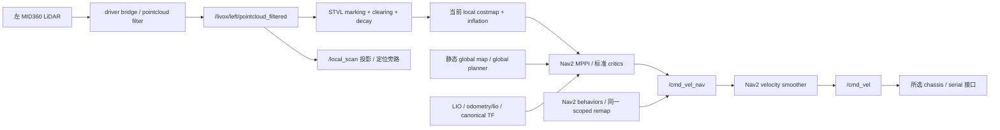

**图中没有 tracker/predictor。** STVL 不订阅 public prediction。旧车基础 STVL YAML 的 local plugins 是 `[stvl_layer,inflation_layer]`，global 是 `[static_layer,inflation_layer]`；不是所有 main 导航 profile 都选 STVL。

需注意真实入口与文件注释不一致：底层 competition launch 默认 opt-in 关闭，但 `old_car_full_navigation` 的 FEATURES 打开 driver/LIO/map/relocalization/Nav2/serial 等，并默认选择 `nav2_old_car_2026_left_stvl_three_point_spin_test.yaml`。该文件标题标记 HIGH-RISK，其 vx/vy=3m/s、wz=10rad/s，与普通 STVL 文件的低速参数不同。此事实只用于说明 **不能拿基础 YAML 或旧文档代替实际入口参数**；本次没有启动该入口、没有调整参数，也不把它当新研究公平基线。

### 4.2 旧 research：两条不同的后半段

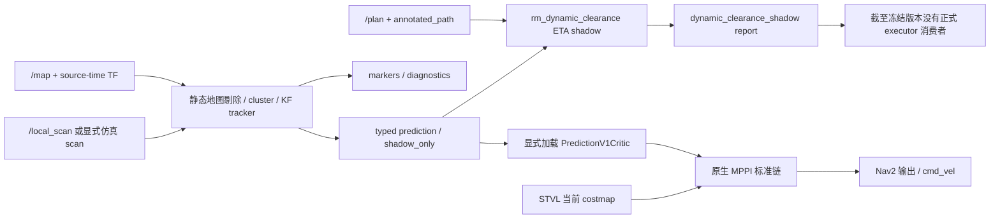

V1 包位于 `experiments/`，有独立 CMake/plugin export，运行器生成并显式使用候选配置；存在源码不能证明默认 colcon/launch 自动加载。真实 A/B 日志和配置一致性断言才证明其曾运行。其无效预测跳过动态评分，普通 CostCritic 保留；这与新路线不同。

### 4.3 当前 native 实验链：已消费，但未部署

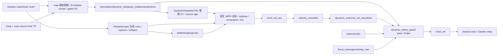

该链仅在 `cv_course.launch.py enabled:=true` 并选择配套 profile 时启动；`guard_enabled=false` 走显式旁路。冻结 v2 试次 ROS 图证实 `/cmd_vel` 的发布者是 guard、smoothed topic 的发布者是 smoother，成本/输入/SDK 返回控制逐周期关联。**该仿真 profile 的普通占据层是 ObstacleLayer，并非 STVL**；不能把这两次试次当 STVL + MPPI 公平净收益对照。

`NativeCycleSnapshotCritic`、CostAccumulator observers、`native_command_observer` 是研究证据模块，capture 默认关闭；前两者记录原生 rollout/成本，命令 observer 记录指定 topic。它们不是第二个规划器，也不把 marker/diagnostic 再送回 controller。

## 5. 构建、消费者与孤立模块

| producer/模块 | subscriber 或运行调用 | 最终影响/限制 |
|---|---|---|
| tracker markers / diagnostics | RViz/录包/审计工具；未找到导航权威消费者 | 可视化与观测；不影响正式 controller |
| typed predictions：2026-08 onward | 旧 research `dynamic_clearance_node.py`；显式 V1 实验插件；当前 native critic 和 guard；各自 ROS 测试/采集 | shadow report 无执行接线；两个 critic/guard 只在隔离实验影响导航 |
| `prediction[]` 点序列 | 旧 clearance 按 ETA 插值；显示/离线分析 | 新/旧在线 MPPI critic 从 position/velocity 重算，不消费这条显示路径；改变显示 decay 不会自动改变控制预测 |
| dynamic_clearance report | 全引用相关规范执行源码检索未找到已接线 mission/狗洞 report 订阅者 | **有 producer，无正式行为消费者** |
| observed-surface pure module | `test_observed_surface_geometry.py`、`audit_observed_surface_geometry.py` 等离线工具 | **有代码和离线调用，无已提交在线 critic/guard 消费者** |
| 未提交 surface member evidence | 默认关闭的文件证据开发 | 不是在线 surface prediction 消费链，不能计已完成 |
| ray cleanup CLI | setup entry point +离线工具调用 | 新 candidate PCD/report；不更新实时 local costmap、不直接发 cmd |
| HWS renderer / temporal maps | 本地没有对应 producer/接口/consumer | 整个阶段缺失，不是仅忘了 launch |

构建证据：tracker 的 `setup.py` 注册 node/config/launch；接口 CMake 生成两个 prediction messages；native CMake 构建共享 plugin、导出 `critics.xml`、安装 guard/配置/launch；旧 V1 的 CMake 在 experiment 包导出 plugin。历史 tracker/clearance 构建、DDS 回环与 V1 插件运行都存在。近期 v2 的真实执行和原生成本关联见[消费实验记录](../dynamic_obstacle_critic/observation_diameter_consumption_experiment.md)及其冻结目录。

## 6. branch / commit 证据

所有 refs 的完整名称与 full SHA 在清单；下表是行为节点，不是任选相似文件。

| 引用/提交 | 实际证据和含义 |
|---|---|
| main / origin/main `d735ee12` | 无 tracker/消息/critic 包和 launch 接线；STVL +标准 MPPI |
| `origin/feature/hwsentry-selective-migration-phase1@711d281f` | 默认关闭 shadow tracker、离线 ray prototype；无 controller 预测后半段 |
| `22117cef` / `52096078` | shadow tracker 首次实现 /关联前删除过期轨迹 |
| `d0ca9600` / `65fa7286` / `74ddb478` | DDA cleanup /不可覆盖输出合同 /bounded ray sidecar |
| `9ba73c08`、`origin/feature/gicp-degeneracy-gate@6a38b745` | GICP 后验质量门、选择性迁移状态；不等于动态控制迁移 |
| `f24f1124`、`origin/feature/dynamic-clearance-shadow@902261de` | typed predictions、annotated path 和 shadow ETA report；消费者止于 report |
| `cc254b4e`、`origin/fix/hwsentry-tracker-field-gates@c04278f3` | 静态误检/资源修复；历史实车整体仍 FAIL，不等于 D01–D07 已通过 |
| `462896db`、`origin/experiment/dynamic-prediction-v1@f85149e0` | 真实 MPPI V1 A/B 与冻结；并非 shadow-only 控制结果 |
| `codex/dynamic-differential-risk@e680b143` | 旧多方向实验、成本/输出对齐终结、暂停；tag `research/dynamic-differential-risk-frozen-20261001` **peeled commit** 同 SHA |
| `9e36853c` | 从 main 建新 native 路线，选择性复制 tracker/接口与纯几何；未整体 merge 旧 research |
| `feature/dynamic-obstacle-critic@91d7eda0` | 新插件与 guard 早期物理失败审计；后续能力在子 experiment refs |
| `14a015b5` / `e061a245` | v2 observation-anchor CV /完整 visible-nominal 失败归档 |
| `fb1f29bb` / `66719832` / `b5645eca` | 离线 observed-surface /全三秒配对原生回放 /在线成员证据登记；无 C 在线接线接受 |

当前 native 分支族包括 `experiment/{controller-odom-contract,mechanical-footprint-contract,ground-robot-extent-prior,observation-anchor-cv,observation-diameter-consumption,dynamic-surface-reveal}`、`native-{cycle,cost-accumulator,consumption等}` 证据系列和 rollout/weight/SG/safe-mass/map/stopping 等审计分支。精确 29 个审计前本地 heads 及全部缓存 refs 见清单；不把“分支很多”解释为多个可部署候选。

历史文档应按对应 ref 读取，当前 native checkout 没有把全部旧研究 docs 带过来。例如：

```bash
git show codex/dynamic-differential-risk:docs/hwsentry_migration/phase1_design.md
git show codex/dynamic-differential-risk:docs/hwsentry_migration/selective_migration_status.md
git show codex/dynamic-differential-risk:docs/hwsentry_migration/hwsentrynav26_phase1_linux_validation_report_20260824.md
git show codex/dynamic-differential-risk:docs/hwsentry_migration/dynamic_mppi_integration_plan.md
git show codex/dynamic-differential-risk:docs/dynamic_navigation/evidence/v1_mppi_ab_20260924/validation_20260924.md
git show codex/dynamic-differential-risk:docs/dynamic_navigation/research_stage_conclusion_20261001.md
```

## 7. 与 HWS 原设计的对应关系

HWS 实际链是 registered cloud →静态全局 3D PCD 差分（无 PCD 时 normals fallback）→SOR/投影密度/形态学/连通域 →Hungarian +CV KF +局部 raster →decayed-CV future frames →CostMaps →planner hard union /follower temporal soft maps →自有 FDDP/MPC →`ChassisCmd`。并非 Euclidean greedy →Nav2 STVL/MPPI。

关键上游永久链接：

- [map_server 实际 cloud 回调、预测开关与发布](https://github.com/Polyacetone/HWSentryNav26/blob/f5f941288197e14c867d711a4c4cd85bfd7a3194/map_server/src/map_server_node.cpp#L324-L424)
- [object_tracker：检测、关联、KF、形状与预测](https://github.com/Polyacetone/HWSentryNav26/blob/f5f941288197e14c867d711a4c4cd85bfd7a3194/map_server/src/object_tracker.cpp)
- [renderer：静态保底 +每时间帧平移轮廓](https://github.com/Polyacetone/HWSentryNav26/blob/f5f941288197e14c867d711a4c4cd85bfd7a3194/map_server/src/prediction_cost_map_renderer.cpp#L65-L110)
- [planner 未来并集 / follower 分帧](https://github.com/Polyacetone/HWSentryNav26/blob/f5f941288197e14c867d711a4c4cd85bfd7a3194/nav_executor/src/common/environment/obstacle_semantics.cpp#L33-L115)
- [MPC 按 k·dt 选帧](https://github.com/Polyacetone/HWSentryNav26/blob/f5f941288197e14c867d711a4c4cd85bfd7a3194/nav_executor/src/path_executor/mpc/follow_problem.cpp#L235-L253)

HWS 中 KF dt 使用回调 steady-clock 间隔，点云 TF lookup 使用 latest，nav_executor 接收 maps 后没有可见的 source-age 偏移加入 `cost_map_for_step`。所以它有相对时间选帧，却不能据此声称端到端绝对时间严格对齐或 stale 场景天然安全。源码闭环完整也不是与本项目相同工况的效果证明。

## 8. 重复实现：复用、合并和停止建议

| 对象 | 判断 | 不改正式系统的建议 |
|---|---|---|
| tracker、消息、纯几何 | 当前迁移身份记录说明最初选取旧 tracker 与消息，不是重新复制全部 HWS | 保留一个当前维护实现；旧 ref 作为版本化可复现基线，不同时激活两套 tracker |
| V1 `PredictionV1Critic` vs新 `DynamicObstacleCritic` | 都从 tracker 状态时间评分原生 MPPI；前者1s已知box/加速度包络+fail-open，后者3s圆模型+fail-closed | 有实质功能重叠，但语义不同。保留旧证据，不叠加加载两个动态 critic；未来只保留一个研究候选 |
| V1 geometry、native geometry、仿真 oracle | 坐标/多边形距离有复用；模型与独立 truth oracle 目的不同 | 共享被验证的生产纯函数；独立 safety oracle 保持独立，不能为去重失去独立检验 |
| 动态 clearance vs critic | ETA 通道准入与局部 rollout 不同时间/权威边界 | 不合并成大控制器；当前 report 暂停接线，后续有明确业务需求再单独评审 |
| DDA offline vs STVL clearing | 离线地图清理和运行时观测清除不同生命周期 | 不合并，不能用有 DDA 源码证明 runtime clearing/预测已迁移 |
| observed surface / visible box / nominal prior | 几何研究中间结果，尚无单一在线接受模型 | 停止继续扩展新几何分支；先使用冻结模型做限定比较。新公共 surface contract 不列为本月必做 |
| `frozen_cycle` proposals/CA/概率rank、旧 wrapper/trace | 大量失败和局部机制证据，不是正式控制依赖 | **停止作为活跃研究方向**；归档保留，勿物理删除复现输入/版本源码 |
| native observers | 证明实际消费/成本/SDK输出的价值高，但磁盘/调度有代价 | 只在预算内采集；runtime 与证据模块保持开关/权威分离，不能无限增加 observer |

目前最值得复用的是 **版本化消息、source-time/完整性检查、原生消费与输出证据、独立机械 oracle、已有 baseline/replay 工具**。最值得合并的是活跃动态 critic 的职责和运行入口；最值得删除的是将旧失败方案继续列为待部署候选的状态，而不是删除历史档案。本次未执行任何删除/合并。

## 9. 关键本地代码路径与结论边界

- 正式入口：[old_car_full_navigation](../../src/rm_navigation_launch/launch/old_car_full_navigation.launch.py)、[competition launch](../../src/rm_navigation_bringup/launch/old_car_2026_competition.launch.py)、[validation launch及命令remap](../../src/rm_navigation_bringup/launch/old_car_2026_validation.launch.py)、[另一个通用navigation入口](../../src/rm_navigation_bringup/launch/navigation.launch.py)、[基础 STVL YAML](../../src/rm_nav_config/config/nav2_old_car_2026_left_stvl.yaml)、[实际 full-entry 默认测试 YAML](../../src/rm_nav_config/config/nav2_old_car_2026_left_stvl_three_point_spin_test.yaml)。以上按 main pin 核实。
- 当前实验：[tracker core](../../src/rm_dynamic_obstacle_tracking/rm_dynamic_obstacle_tracking/core.py)、[tracker node](../../src/rm_dynamic_obstacle_tracking/rm_dynamic_obstacle_tracking/dynamic_obstacle_tracker_node.py)、[接口](../../src/rm_competition_interfaces/msg/DynamicObstaclePredictionArray.msg)、[critic](../../src/rm_dynamic_obstacle_critic/src/dynamic_obstacle_critic.cpp)、[model](../../src/rm_dynamic_obstacle_critic/include/rm_dynamic_obstacle_critic/model.hpp)、[guard](../../src/rm_dynamic_obstacle_critic/src/safety_guard.cpp)、[opt-in launch](../../src/rm_dynamic_obstacle_critic/launch/cv_course.launch.py)。core/node 链接可能显示已有未提交开发，审计依据是上述 HEAD，不把 dirty instrumentation 计为完成。
- 历史选择边界和首次 native 改写：[路线切换审查](../dynamic_obstacle_critic/repository_audit.md)、[迁移逐文件身份](../dynamic_obstacle_critic/migration_identity.json)。
- 实际失败与原始证据：[visible/nominal 消费](../dynamic_obstacle_critic/observation_diameter_consumption_experiment.md)、[全三秒与 reveal](../dynamic_obstacle_critic/dynamic_surface_reveal_experiment.md)、[阶段记录](../dynamic_obstacle_critic/stage2_progress.md)。

明确回答：**main 不消费预测；实验确实消费预测；shadow 准入 report 与新 surface 模块没有正式行为消费者；旧 V1 与新 critic 重复局部动态评分职责；当前路线已不同于 HWS 后半段。** 继续完整移植 HWS controller 并非本次诊断的必要步骤，也不在一个月最小研究范围内。

## 10. 本次文档验证与保留项

逐一检查三个文档的本地文件链接、章节锚点、代码围栏/图节点分隔符、JSON可读性；核对上游两个pin的核心目录diff为空、95个审计引用快照及跨85快照的report/renderer消费者检索。没有重新执行历史实车/仿真测试，也没有把历史测试通过当本次运行通过。

本次提交范围仅三份Markdown、机器清单和文档索引。核对main、旧research与peeled冻结tag SHA不变；对审计前十个dirty/untracked路径做内容摘要/大小保留检查（大core仅大小检查），均保持。已有未提交实验代码不暂存，不删除未知文件，不push/merge，不启动正式导航或新实验。图的语法结构已检查，未用外部Mermaid渲染器做视觉验收。
````

<a id="D0097"></a>

## D0097 — HWS 与当前动态预测路线逐模块对照

来源：`docs/dynamic_navigation/hws_vs_current_prediction_analysis.md`；版本：`652f14cea66edc0fcd77401de7db41cb6ffa7477`。
阅读副本：[独立原文](hws_vs_current_prediction_analysis.md).
以下仅为历史资料，不构成继续研究授权。

````text
# HWS 与当前动态预测路线逐模块对照

日期：2026-10-03。版本、检索范围和真实连接见[迁移审计](hws_migration_audit_20261003.md)。当前实现指 `b5645ec` 的 native 实验路线，历史 V1 单独标注；正式 main 没有显式预测。本文不修改代码，不执行新对照，不用函数名、marker 或设计意图替代消费者证据。

## 1. 核心判断与证据等级

问题不能先写成“HWS 效果好，而我们迁移效果差”。**已证实的是 HWS 的源码闭环完整、两者模块语义不同，以及本地若干夹具试次失败；尚无同场景、同机器人、同控制器、同 oracle 的 HWS 对照效果数据。** 采用预测不等于证明预测有净收益。

当前最有证据支撑的解释是三个问题叠加：**可见观测锚点不是完整车辆中心；长 CV/名义支持不能覆盖真实换向运动；安全 raw 候选不会被原生 MPPI 必然选为最终安全命令。** 保守扩大几何可缓解漏覆盖，却增加无解/拒绝通行；本地尚未以统一 STVL 基线量化这种交换是否值得。

本文统一使用：

- **[证据]** 已读源码/真实参数/冻结运行与独立审计支持。
- **[假设]** 与数据相容的机制解释，但尚未隔离变量或证明因果。
- **[无证据]** 尚无对应采集/对照；不得升级为事实。

HWS 来源固定 `f5f941288197e14c867d711a4c4cd85bfd7a3194`，与原迁移 pin 的 map_server/nav_executor 无差异；参数来自[上游 params](https://github.com/Polyacetone/HWSentryNav26/blob/f5f941288197e14c867d711a4c4cd85bfd7a3194/map_server/config/params.yaml)。本地值来自实际选择的 YAML，而不是所有分支共用的一套默认。

公开HWS快照没有默认地图/PCD资产，本次未运行HWS；非空PCD路径加载失败会终止初始化。以下比较其**配置条件成立时的源码链**，不声称公开仓库直接启动即产生预测，也不以“上游采用”代替效果验证。

## 2. 动态障碍观测

| 项目 | HWS 实际实现 | 当前 native tracker | 影响与证据边界 |
|---|---|---|---|
| 传感输入 | `/small_glim/registered_cloud`，3D 点云；6 帧累积，0.02m voxel | 场地 shadow `/local_scan`；当前 sim `/scan`，2D LaserScan，不累积 HWS 的6帧 cloud | [证据] 输入密度、延迟和遮挡差异很大，不能复制阈值即称等价 |
| 静态剔除 | 全局 PCD KD-tree 最近邻，距离 >0.20m 留作候选 | `/map` 2D occupied 距离 >0.25m；拒绝地图外/unknown；另 centroid static tolerance=0.35m | [证据] 当前在墙边/窄道有额外漏检条件；是否解释特定失败需实际成员证据 |
| 无静态 PCD | normals `|nz|<0.3`、12邻域、台阶方向过滤；默认 **关闭预测** | 无 map/无 source-time TF 时 drop/wait；没有同等 normals 路径 | [证据] 两者降级分支不同；HWS 此分支仍不是 STVL |
| ROI / sparse filter | XY 0.4–8m、z −0.55–0.2m；SOR k12/std2；投影密度800点/m²、component area0.0075m² | scan 合法范围 +地图过滤，Euclidean tolerance0.20m、min3、最大XY extent1.50m | [证据] HWS按投影密度/面积，当前按点数/欧氏连通，不是同一个聚类算法 |
| 检测器 | tracker morphology close radius0.10m +8连通 connected components，tracking area0.0075m² | 空间桶 Euclidean connected clusters；默认 greedy association | [证据] HWS没有这里所说的 Euclidean+greedy 默认链 |
| 可见几何 | 局部 raster（最小2m奇数边长）保存连通域形状，旧/新形状对齐后 max 融合、旧值×0.8 | 在线公共消息仅 centroid/size；size采用0.7旧+0.3新，无公开轮廓/beam集合 | [证据] 输入点存在并不代表轮廓被在线消费者保留 |
| 近场遮挡 | 未见面不会自动补成标准车辆；6帧累积、close、旧栅格留存可填局部断裂，也会拖尾/合并 | 点数不足、unknown/static gate、cluster断裂会丢失/拆分；centroid/size随可见面变 | [假设] 单面切换可能产生伪速度；冻结 viewpoint/geometry 审计支持风险，但不能归因每次接触 |

HWS `preprocess_cloud` 使用 latest TF，不是点云 header stamp 查询；本地 tracker 明确使用 scan source stamp。HWS 的累积局部形状也可能包含移动拖影。**HWS 保留观测形状，并不等于完整隐藏车辆几何已知。** [源码](https://github.com/Polyacetone/HWSentryNav26/blob/f5f941288197e14c867d711a4c4cd85bfd7a3194/map_server/src/map_server_node.cpp#L336-L359)

## 3. 跟踪：相似状态模型，不同参数含义

| 项目 | HWS | 当前 tracker CV/v2 | 结论 |
|---|---|---|---|
| 创建 | 未匹配 detection 立即建 track，v=0 | 未匹配有效 cluster 立即建 tentative，v=0 | [证据] 均不要求先有可信速度 |
| 确认 | 连续3 hits，confirmed sticky；不要求位移 | 连续3 hits **且相对初始观测位移≥0.15m** | [证据] 静止目标可长期 tentative；由普通 current costmap 处理 |
| 关联 | centroid 距离 Hungarian，gate0.30m，接受严格小于门 | distance gated greedy，gate0.60m，允许等于门；可选全局分配未启用 | [证据] 不是同等关联；放大gate并不解决合并/错误质心 |
| KF | 一个4D `[x,y,vx,vy]`，Joseph covariance update | 两个轴独立2D position/velocity filter，普通协方差更新后对称化 | [证据] 数学模型同属 CV，不等于数值参数/实现完全一致 |
| 过程噪声 | `process_noise_std=3` → Q乘 **9** | `process_noise=3` 直接乘 **3** | [证据] 同名数值不能当同一加速度噪声 |
| 测量噪声 | std0.08 → R=**0.0064m²** | `measurement_noise=0.08` 直接用于 R=**0.08m²** | [证据] 相差12.5倍；当前更低测量增益可能影响响应，具体因果属[假设] |
| 初始P | position0.0064，velocity4.0 | 每轴 position/velocity initial_variance1.0 | [证据] 收敛、速度估计初态不同 |
| dt | callback steady-clock间隔，clamp0.01–0.5s | scan source-time差，KF dt有clip；lifecycle 用真实 source-time | [证据] bag速度/调度可改变 HWS filter dt；本地也须记录 source和处理延迟 |
| 丢帧 | lost_frames>3删除；保留 confirmed KF预测，localgrid每帧×0.8 | tentative misses>1删除；confirmed→coasting，距最近观测>0.60s删除 | [证据] 一个按帧，一个按秒；不能直接等价换算 |
| 重获 | sticky confirmed匹配后立即继续 | coasting重新满足连续hits等条件后恢复confirmed；此前仍以coasting输出 | [证据] public state 与HWS bool不同 |
| 速度可信度 | confirmed即进入motion prediction，speed clip2.4m/s；没有公开 covariance confidence 门 | confirmed/coasting均可消费；输入 speed>3m/s整体拒绝；没有公开 covariance/innovation confidence | [证据] 两者都没有“速度可靠”统计认证；确认不等于速度可信 |

历史实车已经给出具体前端缺口：原 D01/D07 静态误 track 约37/min；修复后静止误检0/min，但 D07_deskew运动约6.46/min、在线callback P95=28.156ms仍失败；D05 双目标 crossing有ID碎片化。该报告也说明底盘颤抖和 scan/TF 到达相位，**不是“所有新平台必然同样失败”的证据**。历史入口：`codex/dynamic-differential-risk:docs/hwsentry_migration/hwsentrynav26_phase1_linux_validation_report_20260824.md`。

## 4. 预测

| 项目 | HWS | 历史 V1 | 当前 native CV/v2 |
|---|---|---|---|
| 模型 | CV KF，渲染位移 `v·tau·(1-exp(-t/tau))` | public KF velocity CV +夹具box加速度扩张 | public velocity纯CV；v2 anchor为真实最后观测质心，coasting先外推到数组epoch |
| horizon/dt | 20×0.1=2s | 默认1s；按 MPPI dt计算评分前缀 | 30×0.1=3s；完整网格必须一致 |
| velocity decay | tau1.6s、speed≤2.4；在 **consumer使用的渲染** 生效 | 不使用 tracker display decay | 当前显式tau0/不clip display；critic仍自行重算CV |
| uncertainty | KF P增长，但 renderer不把 covariance变为时间膨胀 | 可见半宽+每侧完整已知box尺寸+0.5·0.555165·t²；仅夹具条件 | 固定圆/固定nominal D，无e/B/covariance随t增长的在线支持界 |
| 远期降权 | 本次未发现按时间风险权重衰减；速度衰减不是 cost confidence decay | 无统一 confidence降权；评分长度截断 | cost沿dt积分；coasting和confirmed同几何评分，未按置信度或远期降权 |
| 有效时间上限 | 生成2s；MPC超出时选末帧；未见 source-age丢弃策略 | horizon1s，source age≤0.4s；超过跳过 | future3s+source age≤0.4s；输入/观测超0.4s fail-closed |
| future空间union | renderer分帧；**planner对当前+未来窗口逐格max**；follower保留时序 | 每rollout同t检查；没有预测costmap层 | 每rollout同t检查；无future写入costmap/union |

衰减只是外推位移的限制：tau1.6 时 t=2s 的有效平移时间约1.142s。它可能减小错误长外推，也可能低估持续高速运动；**不是安全保守界，也不是 CA/转弯预测**。当前将0.5s/1s候选作为有限研究变量，不继续增设多个复杂运动模型。

## 5. 障碍几何：当前最重要差异

HWS 使用 **观测局部栅格形状平移**，包含局部历史融合/形态学影响；它没有从机器人类别表取得标准完整 footprint，也不以目标朝向旋转全尺寸模型。[shape与预测源码](https://github.com/Polyacetone/HWSentryNav26/blob/f5f941288197e14c867d711a4c4cd85bfd7a3194/map_server/src/object_tracker.cpp#L307-L385)、[renderer](https://github.com/Polyacetone/HWSentryNav26/blob/f5f941288197e14c867d711a4c4cd85bfd7a3194/map_server/src/prediction_cost_map_renderer.cpp#L83-L108)

当前需要区分三个已经存在的代理，不能统称完整车辆 footprint：

1. **visible_extent**：圆心为 public observation/filter anchor，`r=max(0.36,0.5·hypot(size_x,size_y))`。质心来自可见返回，并非物体中心；半对角围住可见AABB也不保证绕质心包含所有返回，更不包括隐藏面。size还经过平滑。
2. **nominal_diameter**：v2真实观测锚点，手册条件下四类地面机器人最大投影直径 D约1.6970562748477143m；代码把 **完整D作为半径**，不是D/2。原因是锚点可能在目标表面，若已知完整直径且锚点确属该物体，当前物体所有点可在距锚点D内。未知e、附件/载物、倾斜、2027适用和未来运动仍不被覆盖。这不是位于车辆中心的标准footprint。
3. **observed surface prototype**：保留实际source beam端点和连续可见线段、缺失区UNKNOWN；只有离线模块/审计，没有已经接入当前控制的C方案。

| 几何模式 | false positive来源 | false negative来源 | 已知限制 |
|---|---|---|---|
| HWS observed raster | close合并、6帧拖影、localgrid历史残留、inflation、planner union | 隐藏车辆面/附件、局部grid裁剪、稀疏过滤、转动但只平移、误关联 | 没有完整物体安全证书；HWS未提供本项目同oracle数据 |
| 当前 visible circle | min radius使小簇变大；圆代替狭长形状；质心偏移 | 单面尺寸小、锚点偏、size滞后、遮挡漏检，固定CV换向失配 | 已发生机械接触；并非整个检测失败已被证明 |
| 当前 nominal D circle | 从表面锚点向所有方向伸完整D；窄道/goal可能被覆盖；固定未来假运动 | 直径条件不成立、anchor不属同物体、e未知、未来速度/转向不受界 | 当前支持改善，未来2/3s支持仍不足；任务失败 |
| centered full nominal footprint（尚无此在线模型） | 类别最大尺寸比真实目标大、朝向未知 | 若错误把可见质心当中心，隐藏侧仍漏覆盖；类别/朝向错 | [无证据] 当前没有可靠完整中心/朝向输入，不能把D改为D/2当低耦合修复 |

因此，visible→nominal不是单纯“更精确大小”的开关，而是改变 **几何未知性处理**。HWS把观测形状送入时间图，本地把不完整观测锚点变成整圆；这一差异足以提出保守/漏覆盖机制，但不足以证明 HWS 方法能通过当前机械oracle。

## 6. 预测进入控制：时间与成本对象

实际图在[迁移审计](hws_migration_audit_20261003.md#4-实际数据流)。HWS 的 maps[0]为当前，maps[1..20]为未来，frame header均为输入cloud stamp；nav_executor拆开这些图。MPC 40×0.05s=2s，stage k选 `floor(k·0.05/0.1)`，包含t=0当前帧，采用不晚于该stage的最近帧，不做线性时间插值。

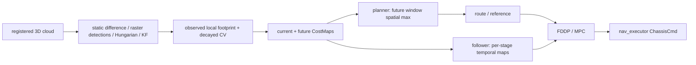

本地 Humble MPPI rollout 第0列已积分一个dt；新critic明确使用 `source_age+(k+1)·0.1`。初始化与score都检查步数/dt；原生消费重算已与实际300×30 tensor和成本累加关联。这证明相对时间和输入消费者，不证明所有时间口径一致。

| 时间/消费问题 | 已查结论 |
|---|---|
| HWS source time vs当前控制起点 | [证据] tracker用steady callback dt、TF用latest；`local_cost_maps_callback`存地图但未将header source age加入MPC选帧。相对网格对齐，绝对epoch补偿缺口存在 |
| 当前 source time | [证据] tracker scan按source stamp TF；critic age用node ROS now−array stamp；v2 coast位置先推进到array epoch，避免再把last-observation age重复加一遍 |
| 当前 robot rollout epoch | [证据] critic使用native tensor，不单独同步订阅pose；score-clock/source-pose epoch已分别审计。controller输入pose与node now差不能靠 `age` 自动消除 |
| 当前 TF | [证据] map→odom使用latest有年龄界的刚性世界变换，一次score固定；未证明期间relocalization correction无跳变 |
| 当前输出时间 | [证据] softmax/constraints/SG→smoother→guard不同阶段；guard将新鲜odom按measured twist推进到now。执行/传输/真实制动参数仍未认证 |
| horizon | [证据] HWS2s/MPC2s；当前3s/MPPI3s/消息30×0.1；guard只查0.5s响应+刹停尾段。只缩短未来有效段时应保留完整消息网格，不把dt/step mismatch门调松 |
| stale | [证据] 新critic0.4s source/observation限制超限fail-closed；旧V1丢弃预测并保留CostCritic；HWS未见同等感知source watchdog |
| future union | [证据] HWS planner会空间化未来，MPC保留分帧。本地新critic不union；不能把当前保守失败统一归因“预测写了静态墙” |

### footprint / inflation / safety margin 是否重复

HWS current/future maps对障碍形状膨胀（local full-cost0.2m、cutoff0.4m）；这是它自有MPC成本语义，不能直接搬到Nav2 footprint碰撞模型。

当前critic使用 `costmap_ros_->getRobotFootprint()` 的 **padded polygon**，动态圆加0.02m margin和0.4m influence；它没有再次对robot polygon做Nav2 inflation，也没有把dynamic circle写入costmap。但同一障碍的当前scan仍经过ObstacleLayer/inflation，再由CostCritic评分；guard另查raw203、map/uncertainty和刹停响应。**存在叠加代价与多道安全判定，[假设]可能加大等待/保守；不等于证明同一0.03m padding被重复几何膨胀两次。** 需实际成本分解和单变量比较；不删除安全门求通行。

## 7. 失败退化逐项比较

| 情况 | HWS实际路径 | 当前 native路线 | 判断 |
|---|---|---|---|
| tentative | 原始current mask保留；未被confirmed motion覆盖的区域复制到future fallback | critic/guard跳过tentative；普通current costmap保留 | 有current-only思想，但本地未提供显式“可信速度”级别 |
| velocity不可信 | hits确认、speed clip；无独立置信度门 | speed/finite/age/contract限制；高速度或坏消息令整个consumer失败 | 两者都没有完整创新/covariance可信度策略 |
| temporary occlusion | confirmed继续预测≤3lost帧，shape逐次×0.8 | coast≤0.6s，但观测age>0.4s已令consumer fail-closed；无coasting降权 | [证据] 发布寿命与消费有效期不同；有0.4–0.6s潜在拒绝区间 |
| stale prediction | 未见按source-age替换为空/丢弃未来；最新maps可以留存 | invalid快照替换旧缓存、critic fail flag、guard零输出 | 当前不会默默用旧预测，但也不会自动退回STVL通过 |
| starts inside predicted obstacle | planner窗口union可能包含起点；MPC lethal/stop路径存在 | penalty变高，guard从t=0检查，pass/brake没有escape规划 | 停车不保证躲开主动逼近障碍；须独立oracle检查 |
| 无安全候选 | FDDP rollout拒绝后stop/replan；stop/hold用current map | native CostCritic/all-collision或坏输入可能fail；动态评分本身为有限cost，guard可拒绝最终提案 | “高动态cost”不能当所有safe候选被硬过滤的证据 |
| stops | KF更新速度；future渲染速度逐时decay | KF速度可滞后；CV固定速度在长future仍运动 | [假设] 造成假future阻塞；尚无固定stop场景配对统计 |
| reverses | CV/decay不识别转向，只缓和外推 | CV不识别转向；旧CA也没有形成部署方案 | 固定正弦夹具长future失配已有证据 |
| sudden turn | 平移局部shape、不旋转完整车体 | 平移circle/anchor，不建朝向运动 | [无证据] 当前缺同条件突然转弯闭环数据 |
| perception完全断流 | 无全局PCD时走current-only模式；正常回调断流未见对应STVL/slow策略；chassis另有0.10s watchdog | tracker stop→source过期→fail/zero；无正式STVL fallback状态机 | 不把HWS模式开关或底盘watchdog误当感知故障保障 |

旧迁移设计曾提出 stale→skip dynamic score→普通costmap；最新实现主动选择fail-closed。这个设计漂移需要记录，而不是悄悄恢复fail-open。未来若评估分级退化，必须同时证明current occupancy、定位/控制数据仍有效；感知完全失效不能仅因动态topic清空就声称安全。该策略本次只是建议，不作为新增研究方向。

## 8. 实验现象与最可能原因

### 8.1 已有结果不是全负面，也不满足部署

历史 V1 四个候选均完成任务并改善夹具净空；重复phase0的QP/A*恢复数5/1违反原零恢复门，绕行比baseline增加约1.1–3.0m。随后相位未运行，不算完整矩阵。对应baseline有碰撞/净空不足，不能从此推导“STVL这四例安全可走，预测才堵死”。来源：`codex/dynamic-differential-risk:docs/dynamic_navigation/evidence/v1_mppi_ab_20260924/validation_20260924.md`。

最新v2 frozen scene：相同场景/机械oracle/35s窗口，但跨试次random实际noise不同，不是每条raw完全配对；baseline占据是ObstacleLayer。原始证据见[消费记录](../dynamic_obstacle_critic/observation_diameter_consumption_experiment.md)与[全三秒审计](../dynamic_obstacle_critic/dynamic_surface_reveal_experiment.md)。

| 指标 | visible | nominal D circle |
|---|---:|---:|
| 实际native消费周期 | 349 | 350 |
| risk double/after f32精确行 | 104700/104700 | 105000/105000 |
| 机械动态净空下界 | −0.006576701m，contact39.966s | 0.909401996m |
| raw203违反/可查物理样本 | 750/2264 | 0/2264（conditional） |
| 推进/goal | 4.943237802m /未成 | 3.379103096m /未成 |
| 完整actor支持0/1/2/3s | 0/285，各时域均无完整支持 | 284/284、284/284、192/284、98/284 |
| aggregate全3s同时条件安全 | 31/349 | 75/350 |
| 同时条件安全且正进展 | 31 | 59 |

这些结果排除了“只画了预测、没有被critic消费”的解释；仍不证明真实全地面机器人支持，也不以正下界替代任务接受。150ms窗口实际速度值匹配349/349、350/350（最大138/131ms），不能继续用早期已修复的错odom topic作为这两次结果的根因。

### 8.2 分现象归因

| 现象 | 已有证据 | 最可能机制（假设） | 尚无证据/不能下的结论 |
|---|---|---|---|
| `start blocked` | V1 QP重复30.19–30.59s全局端点拒收，本体间隙仍0.077m；本地V1预测未写costmap | 当前观测/inflation与绕行后重规划端点、T-DT可用性/局部行为协同 | 不能说新critic把future union进global map；未隔离预测导致姿态改变的间接作用 |
| predicted path过保守 | V1部分周期300/300预测碰撞；nominal D半径1.697m且goal失败 | 单面anchor+全D圆、旧t²扩张、长future对反向/等待不可行的假判定 | 哪一项造成多少false_block秒，缺同条件安全baseline和每次拒绝归因 |
| safe raw candidate存在却未采用 | 历史选定epoch38/300条件safe-progress；原生分成本/权重/SG/返回控制已经复算 | 总成本偏向task/path、softmax平均不保持非凸避障安全、限幅/SG改变raw路径、guard再拒绝 | 不能认定最高权重raw就是输出；38/300不是全部周期；不能将SG当唯一根因 |
| MPPI optimizer fail | native源码：invalid输入设fail；普通CostCritic有failure语义；历史原生fail trace存在 | 可能是source/grid/TF拒绝、current costmap all-collision，或后续重试/停滞，不同窗口不同因果 | 仅看日志“fail”不能指认dynamic未来碰撞；最新349/350消费不代表每次失败根因已标注 |
| 可见模式接触 | 实际机械contact与0/285完整支持；真实风险成本被消费 | 未知隐藏几何/anchor与长CV偏差叠加输出选择；停车后actor继续靠近也可能造成contact | reveal审计显示相关面早已可见、末次可靠观测在事件前33/35ms，不能说本次因首次揭示太晚；无完整实车B/e/制动认证 |
| nominal不碰撞但goal失败 | 单小box当前支持/较大净空；2/3s支持不足，推进3.379m、goal未成 | 大圆覆盖通路/目标，guard pass/brake缺逃逸和等待协同；假运动延长拒绝 | 当前物理净空不是全类别安全；未完成公平STVL/同noise对照，不能精确宣称净收益为负多少 |
| STVL能等待，预测却不可走 | 是待验证的核心命题；旧baseline部分本身不安全，最新无同条件STVL arm | future空间化（若引入）、长horizon/占据代理、无current-only退化可拒绝可等待解 | **目前不按此命题自动给最新trial贴实证false_block标签**；必须先取得baseline安全可执行或安全等待完成的证据 |

进一步结论：可信 raw 数量、最低dynamic cost、marker预测和最终执行净空是不同指标。不能用任一替代另一个；也不能靠调小尺寸、跳过guard或放松margin让结果“通过”。

## 9. 最小差异实验矩阵（计划，未执行）

只保留一个 active预测算法族：**原生时间评分critic + CV**。短horizon、decay、geometry为同一候选的有限消融，不是扩展到多个模型。所有arm保留同一 ordinary **STVL + MPPI**；不得将目前ObstacleLayer的trial换名为STVL baseline。

共用锁定fixture：同一个map/hash、init/goal、actor轨迹/起始相位、机械robot polygon/附件包络、MPPI全部参数/版本、vmax/amax、采样输入或可验证seed、传感路径/TF、safety oracle和时间预算。**当前没有用户级native MPPI seed已严格配对的证据**；`regenerate_noises=false`只固定单次实例，不保证跨进程noise相同。下一步需保存/校验实际noise身份或有界隔离fixture，否则只能报告场景配对统计，不能声称严格单变量因果。

| arm | 唯一差异 | 配对对象 | 必需边界 |
|---|---|---|---|
| A STVL baseline | 无显式future critic；普通STVL/标准MPPI | 全部候选的基线 | 同当前观测、safety oracle；不借真值控制 |
| B current-only critic | A上加同几何动态评分，但所有future位置固定在当前epoch；仍做source age补偿至当前 | A | 诊断纯几何/额外代价，不把“future时域设0导致检查消失”当current-only |
| C CV0.5s | B仅开启0<t≤0.5s的CV有效段 | B | tensor/message仍30×0.1；只变预测有效段，grid safety门不松 |
| D CV1.0s | C仅把有效段0.5→1.0s | C | 其余权重、cost归一化/普通current碰撞检查保持 |
| E velocity decay | D仅改future位移为tau1.6s衰减，并在实际consumer生效 | D | 不只改display prediction[]；source age补偿与futuredecay分开定义 |
| F observed geometry | D仅将visible-circle代理换为观测局部raster/surface | D | 当前无此在线契约，标NOT RUN；不把visible circle改名充当F，不为此新建公共接口 |
| G nominal full geometry proxy | D仅切既有v2 nominal D半径模型 | D（若F将来可用，另列F/G几何对照） | 同anchor/schema；不借中心/朝向truth。当前D circle非 centered full footprint，报告必须用真名 |

实现前固定score归一化：当前积分型cost裁掉future段会改变总cost，这是模型有效段消融的预登记语义，不能实验后补倍率“救效果”。如选择总时域归一化，所有预测arm统一预先锁定，并将其影响计为新协议，不能与旧3s试次伪配对。研究阶段只挑锁定的一套，不进行weight搜索。

B/C/D/E尚无现成的完整配套profile：本次只是预登记语义，不声称已经运行。允许的后续改动限于隔离实验的有界current-only/有效段/consumer decay开关，须保持完整消息网格和原输入/安全检查；未能在Week1预算内建立有效对照即退出C，不继续造控制框架。

最终guard不得成为隐含第二变量：A与预测arm使用同一执行约束/普通current-map停止策略和独立oracle；预测guard附加拒绝若保留，必须与预测功能作为一个明确候选整体比较，另以B诊断额外拒绝成本。**本次不关闭现有guard、不改main，也不建议直接在现有安全门下切无保护运行。** 若不能在预算内建立等价保护条件，停止矩阵并选C，而非声称公平A/B完成。

指标：physical collision、minimum **physical** clearance、action success、completion time（失败为右删失）、stop duration、recovery count、optimizer failures、no-valid-candidate rate、prediction false-block duration；另记录detour、stale usage、CPU、controller deadline。no-valid rate同时报告模型安全raw与原生fail两种口径，不能互换。false_block必须有安全baseline见证及future拒绝原因，不把正常安全停车计为假阻塞。精确定义、运行上限和淘汰规则见[退出计划](prediction_one_month_exit_plan.md)。

## 10. 对当前问题的重新选择

停止用“尚未迁移HWS后半段”作为继续增加模块的理由。既有前端和原生critic已经足够证明概念被实际消费；现在缺的是 **相对STVL的净收益证据**。不移植HWS FDDP、不增加temporal costmap/CA/IMM/学习模型、不新增surface接口作为必做项。

当前部署结论是 **C — RESEARCH FROZEN**：正式导航继续STVL + MPPI。允许的后续只是计划中有截止、有预算的一个候选比较；届时只能A/B/C三选一。已有局部净空改善值得保留为证据，不能用它替代稳定跨工况收益或继续无限扩展研究。
````

<a id="D0098"></a>

## D0098 — 同运行晚期固定时刻三层诊断

来源：`docs/dynamic_navigation/late_fixed_time_three_gate_20261001.md`；版本：`e680b1430db6efd8dc601d5585ee207e5f9b42a4`。
阅读副本：[独立原文](history_documents_20261004/legacy_e680b143/docs/dynamic_navigation/late_fixed_time_three_gate_20261001.md).
以下仅为历史资料，不构成继续研究授权。

````text
# 同运行晚期固定时刻三层诊断

## 背景与假设

goal+2s输入在01全体安全，不能检验排序；v4仅5条不安全。完整物理执行诊断已显示01取消后仍继续控制并破门，不能据此指控早期周期聚合。此阶段检查接近任务后半段时原采样、排序、输出分别是否失效，先定位层，再决定唯一算法改动。

假设：固定goal+6s的原300条rollout仍可能存在安全候选，但排序或原输出在完整3s预测上失败。如果0安全，结论限定Sampling/当前可达安全覆盖不足，Ranking不解释。不以完整物理结果或接近程度挑周期，不扩大batch、调temperature/权重/footprint。

## 固定方法和决策

仅使用原v4与01完整capture，按每运行第一个(sim_ns,cycle_id)≥goal_sent+6s选择一次。既有three-gate算法、7标准critic/rawV1、regularizer、原bounds/SG、两native时间口径、raw203、body≥.05/padded>0、正推进、首选安全+质量≥.5均保持。记录延迟与数据覆盖；无足够未来3s直接输入FAIL，不替换周期。

prepare最小变化只是将固定时间偏移作为显式参数（默认2s保持早期协议），不增加recorder/receipt/TF/身份门。准备/输入冻结后再读rollout安全标签；此前已读完整物理标签，且同运行强相关，**不称盲测或独立holdout，不补齐CA两试次协议**。

顺序：Gate1原候选数与安全正推进；有safe才Gate2原排序/Top-K/质量/各critic及总分；Gate3原online/single-safe/oracle-safe-only的weighted/bounded/filtered整段传播、静态及推进。层失败的优先诊断：0safe→A；有safe而原排序FAIL→B；排序PASS而online输出FAIL→C。多个失效同时保留，不通过优先规则删去后续事实。

只有B失败且已有因果四源条件满足，才将已冻结CA-full公式在同输入作一次诊断，不调公式/单位/支持/时间范围，不进入运行集成。若B不失败不追加CA评价。若A失败，下一实验必须先判当前状态/固定首列导致不可控失效，或同N分布缺少可行控制；不以0safe证明不存在安全控制。

## 数据、结果、限制、下一步

待源码及参数输入冻结。新算法源、输入/参数/镜像hash与结果保存到本文件/evidence。原mirror/native数值容差保持1e-5/1e-3/5e-5，float采用语义/数值/门一致，未新增跨设备byte门。未来truth只离线标签，main/部署配置/TF保持。

源码/prepare`1f67682`。仅按固定时间选择：v4 cycle40/28.106s，threshold28.102、延迟.004s；01 cycle219/28.227s，threshold28.224、延迟.003s。输入SHA256分别`e720611cf1eb9ec462e632d3bf0057c08e8fe6300cf1f560ecf0fd8dfcf7cc17`、`d6e32d1a32bec89f7927eb7c7111a9f653a85e74aa64b9c1051758b346751c43`；参数`22e0425b54e1499d6538bce52937ce9aae3824c1268154ab0fcd07fa95ac1bdf`、`7a15a6b93d8a26ed201bf10d2703c00ff5d800e6306c10d7fd37374bffcf2da5`。完整3s未来覆盖到31.106/31.227，原tail已覆盖；不选择尾段32.694s破门邻域。

如果两输入全部门通过，只说明这两个晚期周期未复现算法失效，停止在此数据调参；新的算法实验须另行假设。任何层失败都保留，选择最小针对该层的机制研究，不扩展工具。

## 原三层结果与条件输入

原native评价`7620f20`。v4 Gate1 FAIL：0/300动态及联合安全、static collision0、最好body gap0；不解释Ranking或输出。01 Gate1 PASS：58动态安全、57联合安全且57都推进、static collision5。Gate2 FAIL：最好安全第15、Top1/5/10/30安全0/0/0/1、质量.116506，top#79不安全。Gate3原online filtered两口径body/padded均0；原整段bounds越界.005405。原生pose/7标准score/weighted/before误差0，after/聚合误差≤5.96e-8，数值门通过。

01single-safe原最低成本候选经SG后两口径也失败；safe-only current-first body .085789通过动态几何，但offset计划body .034218失败，且bounds越界，不能把单条安全候选或oracle赋权当作输出保证。这是新固定晚期周期的三层诊断，旧“安全候选≠聚合安全”结论仍CLOSED，不重新计为机制创新。

按B失败条件已构造01最新四源27.919/.985/28.051/.117s，跨度.198s，全部因果几何构造条件通过。source input SHA256 `197b7bf9a1e28c0cd2e4343ff4dea0c11f65f3478026366f5f53f85799f4c932`，参数沿原`f2d97785237b59214b69ff0143e044dc8e603278547cbf640a887035a7eeef38`。后续H1真值误差仅作离线报告，CA是否构造由这些在线条件决定，不按H1标签选择另一个source/cycle。

source评价`5ab3bcd`，H1 PASS：最大位置误差.017131m、速度误差.114955m/s，estimate(-.582564,-.005559)、truth(-.467744,0)。同公式CA a=(1.173889,.406666)m/s²，risk范围.0129624–.0190362；host Python3.12.3/NumPy1.26.4准备。kinematic input SHA256 `19da12a30339c96044cbaf8638d44e3b5b4eb002e2bb07edc5aff6f261407a10`、parameter `a51fe7ee5b4a3746f7dffce3f822d65014b11ac0a5f53483c66c314f9f55a905`。CV文件随原prepare产生，仅保留不新增评价；本条件只评价冻结CA。CA scoring input `df076366548c8224a9d3806d43274379492720ae134ebfb1530e6d7520b845a5`、原参数`33ed984343b7afd69585e4995441c2dc910fe8c1e1d0f97abc89c4e226cfbf23`，评价前冻结。

## CA算法结果及阶段决策

CA原生评价`327ac6a`。Gate2 PASS：top#280安全且推进.546175m、最好安全第1、Top1/5/10/30安全1/3/5/6，安全质量.786672（基率57/300=.19），总分/风险AUC .588333/.588694。单项风险只DIAGNOSTIC_ONLY，没有把均匀质量当实际MPPI赋权。

Gate3仍FAIL：filtered current-first body/padded .050251/.012182，推进.610867；returned-offset-plan body/padded .032983/.002983，推进.639865。static/bounds均通过；body .05门不可放宽，两口径都通过的要求不变。原生附加评分核对最大6.10352e-5<原1e-3容差，不新设byte门。

**新晚期输入已证明固定CA可以提供有效总排序信号，同时输出安全仍不足；不进入runtime。** 不能以current-first刚过门掩盖返回控制计划FAIL，也不能重调CA/单位/temperature救援。v4零安全属于A；01剩余主要问题为C输出与评分功能的一致性/聚合，而不是无安全候选。

[全部输入、原生结果及CSV](evidence/late_fixed_time_three_gate_20261001/manifest.json)、[v4 Sampling](evidence/late_fixed_time_three_gate_20261001/v4_summary.json)、[01 CA](evidence/late_fixed_time_three_gate_20261001/01_ca_summary.json)。

下一阶段先另行预登记C最小对照：固定当前失败周期及已有正对照，检验把同一CA风险评价在原bounds+SG+offset后的候选输出计划能否改善最终返回控制计划。保留原采样/硬V1/标准critic/正则/聚合/安全门；不改预测模型或引入新planner。该映射可直接复用原Nav2控制函数，没有新记录器；仍不能保证非凸风险下的平均控制安全。v4的A需要另行当前状态/可行见证实验，不与C同时改变。
````

<a id="D0099"></a>

## D0099 — 晚期零安全批次的固定零控制见证

来源：`docs/dynamic_navigation/late_zero_control_witness_20261001.md`；版本：`e680b1430db6efd8dc601d5585ee207e5f9b42a4`。
阅读副本：[独立原文](history_documents_20261004/legacy_e680b143/docs/dynamic_navigation/late_zero_control_witness_20261001.md).
以下仅为历史资料，不构成继续研究授权。

````text
# 晚期零安全批次的固定零控制见证

## 背景与假设

late v4 cycle40/28.106s的原300×30全部动态不安全。此前std4/更大batch方向已CLOSED，不能再放大batch。单个批次0safe也不能证明当前状态下不存在安全控制。

H1：固定零控制在同测量speed/pose/map和未来完整3s上存在原生联合安全见证；若成立，原分布的覆盖不足得到明确反例。H2：原全部候选第一步若安全、后期才破门，0safe不能归因于共同首列已经不可控。若零见证失败，只否定这一个见证，不证明不可达或尝试更多原型凑PASS。

## 最小方法与门

仅已有late v4 cycle40。预先固定唯一控制Ui=[0,0,0]×30，不选方向/幅度/真值动作、不试27原型。保持原测量speed第一步、原Omni传播、30×.1s、八顶点body/pad.03、原rawmap203/静态probe/安全门。原CA模型与C输出风险失败组合不改，不runtime集成。

prepare保存原实际V1 snapshot/age、原control history[4]、map、零control和输入/参数/commit/镜像hash；不读未来标签。native不运行标准critic评分（本实验不是Ranking），只传播同状态的零见证；原V1消息保持，静态安全由原probe独立核对。报告原native零候选以及该one-hot零控制经原bounds+SG后两时间口径的动态/静态/bounds/推进；不重置history或用理想静止状态代替实测speed。

H1门仅原native零候选body≥.05/padded>0/raw203无碰撞；同时单独报告原Gate3完整标准（含bounds/正推进）。零控制只是Sampling可行空间见证，不能因仅安全而宣称可部署MPPI或替代导航。H2固定报告原300每步安全数、首次破门步分布及共同第一步gap；不改时间窗或以安全前缀验收。

可复用成熟部分是同Nav21.1.20 Omnidynamics/控制约束/SG和既有探针；新内容只是一个预定动作的算法可行性评价，无新架构/模型/工具。更小方案仅看第一步不足以排除后期覆盖缺陷，故保留完整3s，且只做一个见证。

## 数据、结果、限制、下一步

待冻结后评价。若H1+H2支持，下一项另行预登记同N/std的时间结构采样假设；不从一个零动作推断相关噪声一定有效。若FAIL，记录否定结果，不重试更多固定动作、降低安全门或声称无法避障。未来truth只离线标签；main/源码/config/TF保持。

源码/prepare`2f1412c`，镜像固定`81b325bebf2f631d2f70ca72914873e0fee6df5b87977750cac17228def171c3`。input SHA256 `5c752d51c593f3b2209d1a7568e31e5403afd0a5504f1ad96e6203d3ce423525`，parameter `8bb744dabae0ee906a0d2bdb608ddaee0ccafe0d50a372e1a5361c94c7bf98fc`；原实测speed(-.297777,0,0)，不是理想静止机器人。未读未来或增加动作。

## 算法结果与层定位

原native评价`7264e29`，H1 PASS。唯一零候选body/padded .158428/.124611m，原静态无碰撞、bounds0，推进.029467m。one-hot原SG输出current-first .125162/.091065、推进.061105；returned-plan .174631/.140710、推进.012681；两口径均通过原完整输出门。即使称为零控制，原实测首列和SG历史仍造成少量运动，不能误称理想静止。

H2 PASS：第一步300/300动态安全，body/padded最小.864056/.830612。首次破门步16/17/18/19/20/21/22分别18/59/121/76/18/7/1条；第22–24步所有候选破门。完整3s0safe保持，禁止用前15步安全替代验收。

因此此状态存在同原完整门通过的控制见证，原批次0safe属于实际分布覆盖失败，不能归因于共同第一步不可控，也不能证明场景不可避障。[全部冻结/native/每步结果](evidence/late_zero_control_witness_20261001/manifest.json)、[summary](evidence/late_zero_control_witness_20261001/summary.json)。这是单周期可行性结论，不代表零控制策略或原MPPI闭环部署通过。

下一项A先预登记原N=300/std/mean下的raw时间相关Gaussian提案，固定rho与多seed；禁止预clip/filter后套Gaussian密度，原bounds/SG仍只用于实际聚合之后。若要输出控制，必须对原white固定周期目标给出proposal density修正并报告ESS，不能直接沿用对角正则冒称相关MPPI正确。不扩batch、不改预测模型/critic/安全门。
````

<a id="D0100"></a>

## D0100 — 原bounds/filter映射的非可逆反例预注册

来源：`docs/dynamic_navigation/mapped_control_preimage_preregistration_20261001.md`；版本：`e680b1430db6efd8dc601d5585ee207e5f9b42a4`。
阅读副本：[独立原文](history_documents_20261004/legacy_e680b143/docs/dynamic_navigation/mapped_control_preimage_preregistration_20261001.md).
以下仅为历史资料，不构成继续研究授权。

````text
# 原bounds/filter映射的非可逆反例预注册

## 背景与假设

必要协方差代数已通过，但raw→bounded-filtered大部分元素改变；未证明mapped变量可以沿用latent Gaussian表达式。此次假设两个不同raw提案可以经原clip/filter/clip映射成同一完整控制序列，用冻结数据否定简单可逆线性换变量假设。不证明所有latent推导无效，也不研究安全/排名。

## 输入与固定选择

完整八组原提案manifest SHA `bc8d5245fe69fd654c9acede1b2cf5da4db88a92a09dcd0cf489b6553148a699`、参数SHA `7a9db00145f8d4c05a8c446510fafa5b189836aeb7bdfbad6c6f1e253dc1d9a2`；读取raw、已冻结mapped、initial及原四输出history，无truth/geometry/critic/label。每组按(candidate,time,axis vx/vy/wz)字典序选首个raw越界元素，不用安全或代价挑选。

准备阶段只将该元素向原bounds外再加/减f32 .125，其余元素完整保留；每组mutant raw全矩阵及唯一改动位置/前后值/source/参数/镜像hash先冻结提交，之后evaluate映射。没有新RNG、batch/std/temperature或控制参数。

## 固定检验

两个raw须恰好一个元素不同且仍在同一bounds外；第一次clip后完整字节须相同。独立重新执行已有 `filtered_all_critic_probe.filtered_controls` 及原bounds末端clip：全部八组原mapped必须与已冻结文件逐字节相同，mutant mapped也须完整逐字节与原相同；任何失败停止反例接受。原history/滤波系数/顺序/bounds均不改。

另仅报告Gaussian线性模型数学量 `gamma*u^T*Sigma^-1*epsilon` 两raw间差，和固定精度矩阵线性导数乘实际f32 delta的对照，误差≤1e-12。它不是critic/重要性权重或安全判据；若数学量相同也报告，不据此换位置。无softmax、聚合、轨迹传播或新运行命令。

## 判定与限制

反例只能否定这条具体映射的可逆线性解释；非单射本身不证明所有映射后分布都非Gaussian，也不否定可在latent空间另行推导重要性权重。mapped变量的密度、边界质量及latent均值→输出更新仍须独立证明。即使通过，不接受动态安全、MPPI一致性或已失败风险组合。

镜像 `sha256:81b325bebf2f631d2f70ca72914873e0fee6df5b87977750cac17228def171c3`不变；结果和否定失败全部留docs/evidence，不改线上optimizer/critic/TF、正式配置/main或安全门。待有完整目标测度与映射处理依据才考虑新的离线更新协议，不能把本反例作为部署修改。

## 评价前冻结登记

源码/prepare `d3e0818207368e3e88e6c95fd203028213b1f0a4`；input SHA `f6ef6c33ccf2071944cc95afd89c9d94f8dc013fd85e9e01bdf4d3ee51fca783`，参数SHA `0a070fc673c5f124f492b0d38fc5b4a97b51be09af5d33d20dd307593741a206`。八组mutant全矩阵先保存，seed0首个位置(0,0,vy)，其余(0,0,vx)；原/相关首步共享xi0，所以每seed位置相同，不是八个独立成功实验。[完整输入](evidence/mapped_control_preimage_inputs_20261001/manifest.json)先提交，尚未evaluate。
````

<a id="D0101"></a>

## D0101 — 原bounds/filter映射存在不同raw的相同完整像

来源：`docs/dynamic_navigation/mapped_control_preimage_result_20261001.md`；版本：`e680b1430db6efd8dc601d5585ee207e5f9b42a4`。
阅读副本：[独立原文](history_documents_20261004/legacy_e680b143/docs/dynamic_navigation/mapped_control_preimage_result_20261001.md).
以下仅为历史资料，不构成继续研究授权。

````text
# 原bounds/filter映射存在不同raw的相同完整像

## 背景与方法

按[预注册](mapped_control_preimage_preregistration_20261001.md)完整八组输入，按固定字典序选择首个raw越界元素并向同一bounds外再改动f32 .125。选择没有truth/安全/critic参与。两个raw恰好一个元素不同，第一次原bounds clip后完整字节相同，再按原四history、原in-place SG滤波、原末端bounds clip核对完整控制矩阵。没有轨迹传播、权重或运行输出更新。

## 数据身份

源码/prepare `d3e0818207368e3e88e6c95fd203028213b1f0a4`，评价 `2f34221734ef99212d21e353e958cd2d19ed3bc6`。input SHA `f6ef6c33ccf2071944cc95afd89c9d94f8dc013fd85e9e01bdf4d3ee51fca783`、参数SHA `0a070fc673c5f124f492b0d38fc5b4a97b51be09af5d33d20dd307593741a206`；原提案manifest SHA `bc8d5245fe69fd654c9acede1b2cf5da4db88a92a09dcd0cf489b6553148a699`。结果summary SHA `f43eb6ad91387ca3edae5a84ea66e6930d2fb206af40f51e3c02c13191052037`，镜像 `sha256:81b325bebf2f631d2f70ca72914873e0fee6df5b87977750cac17228def171c3`。

## 结果

八组原mapped全矩阵（每组2000×30×3）逐字节复现冻结文件；八组mutant经映射后也与各自原mapped完整字节相同。每组raw只改变一个元素；第一次clip已完整消除该差别，后续滤波/history/bounds无变化。所有反例通过固定门。

位置记(candidate,time,axis)，从0开始。原/相关共享首步xi0，所以每seed两输入组位置和raw改动相同，不能视为八个独立成功实验。

| seed | 原/相关位置 | raw前→后 | 原独立模型数学量差 | 相关模型数学量差 |
| --- | --- | --- | ---: | ---: |
| 0 | (0,0,vy) | -.688496→-.813496 | +.001002238 | +.000479250 |
| 1 | (0,0,vx) | 1.029190→1.154190 | -.001037382 | -.000659686 |
| 2 | (0,0,vx) | 1.009536→1.134536 | -.001037382 | -.000659686 |
| 3 | (0,0,vx) | 1.579627→1.704627 | -.001037382 | -.000659686 |

两raw的 `gamma*u^T*Sigma^-1*epsilon` 数学量不同，虽各自完整mapped控制相同；独立密集精度线性导数乘实际delta核对最大误差8.24e-18，低于预注册1e-12。该量只属于无舍入线性latent模型，未当作critic或重要性权重。

## 结论、限制与下一步

这条具体原bounds/filter/clip映射非单射，不能仅凭线性Gaussian逆协方差公式，就把mapped变量解释为同一个可逆线性换变量；实际更新仍未验收。非单射本身不证明所有映射后分布非Gaussian，也不否定可以另行在latent空间推导目标测度和重要性权重。反例没有安全、排名或控制性能结果，不能救援已停止风险组合。

矩阵保持原bounds、history及滤波；修改只在冻结raw提案的实验副本，没有发送运行命令。现有必要代数已给出边界，后续不能跳过mapped密度/边界质量、latent均值→实际输出一致性和原三秒安全验证。

下一项回到独立输入采集：先只读确认新设备已有Gazebo/launch/diagnostic capture能力与已冻结镜像相容性，记录版本、场景/配置hash及TF所有权，不运行旧镜像门已经失配的holdout、不改旧协议或正式配置。新的完整周期数据协议须另行预注册，不能拼接synthetic observer capture与历史周期来冒充同一次运行。

[八组固定mutant输入](evidence/mapped_control_preimage_inputs_20261001/manifest.json)、[两组完整mapped文件、数学量与日志](evidence/mapped_control_preimage_result_20261001/manifest.json)保留。main、运行optimizer/critic、TF、正式配置和原安全门不变。
````

<a id="D0102"></a>

## D0102 — 高算力 miniPC 算法验证交接（无雷达、串口）

来源：`docs/dynamic_navigation/minipc_algorithm_handoff_20260924.md`；版本：`e680b1430db6efd8dc601d5585ee207e5f9b42a4`。
阅读副本：[独立原文](history_documents_20261004/legacy_e680b143/docs/dynamic_navigation/minipc_algorithm_handoff_20260924.md).
以下仅为历史资料，不构成继续研究授权。

````text
# 高算力 miniPC 算法验证交接（无雷达、串口）

状态：2026-09-24。**建议迁移软件构建、回放和仿真验证；不迁移实车安全结论。** miniPC 目前只有计算平台，没有雷达、串口或可运动底盘。下述试验是待执行计划，不是已经取得的 miniPC 结果。此文档随 `experiment/dynamic-prediction-v1` 分支交接；不修改部署默认。

## 项目背景与仓库边界

仓库：`git@gitee.com:qiheiovo/rm2027_navigation.git`。本轮目标是把 T-DT A*/QP 全局规划迁移到 ROS 2 Humble/Nav2，同时研究独立的移动障碍短时预测。最终目标车是 2027 新车；现在使用仓库已有 **382/126 mm 八边形参考 footprint**，其最终 CAD、轮组及附件包络尚待确认。旧车不能因为参考新车几何通过就获得运动授权；狗洞继续走专项流程。

相关分支按依赖顺序：

1. `experiment/tdt-planner-phase2`：T-DT 静态迁移、参考八边形、最新 costmap 快照整路复查及早期动态诊断。交接前本地顶端 `e374894`；不要将其中旧动态失败、夹具专用扫掠路由或停车 guard 误当作当前部署方案。
2. `experiment/dynamic-prediction-v1`：从上面分支继续，隔离新增已有 HWSentry shadow tracker 的动态预测 MPPI critic 与验证证据。交接前代码/证据顶端 `e02d9d2`，本交接文档会形成后续提交；使用 Gitee 分支实际 SHA 锁定输入。

**已经验证的范围**：[T-DT 快照复查静态报告](../tdt_migration/evidence/snapshot_revalidation_20260922/validation_20260922.md)中 A*/QP 各5/5、十次零恢复，通过的是参考新车几何下的有限静态门。它没有证明动态避障或实车部署。移动障碍问题已从 T-DT 迁移拆出；[动态预测 V1 范围](v1_prediction_scope.md)复用 shadow tracker 的源时间戳、`[x,y,vx,vy]`，按观测年龄和 MPPI 时间步预测已知仿真箱体占用，保留 STVL 与原 CostCritic。

**当前动态结果**：[T-DT V1 A/B](evidence/v1_mppi_ab_20260924/validation_20260924.md)的 QP/A* 首例候选均零恢复且有限几何门通过，但预定 phase 0 重复分别恢复5/1次，原零恢复门未通过。[Navfn 交叉实验](evidence/v1_navfn_transfer_20260924/validation_20260924.md)中同一 V1 profile 的一例发生参考八边形与移动箱体采样平面重叠，一次预注册复现通过。[只读差分](evidence/v1_navfn_repeatability_20260924/validation_20260924.md)表明两例同在16.008仿真秒开始、初始路径一致，却在24.56秒已分叉超过0.1 m。不得用通过的一例抵消碰撞例，或把 action 成功、零恢复当动态安全通过。当前 `accepted_for_deployment=false`。

## miniPC 为什么有价值，以及不能回答什么

目前动态实验 MPPI 为 **300 条 rollout、30 步×0.1 s、1 次优化、10 Hz 控制**，`regenerate_noises=false` 不是关闭噪声。原 Navfn+V1 试次没有完整逐周期计算耗时/CPU数据；旧的插桩 MPPI 实验约1.7–2.0 ms中位周期只覆盖**未接 V1 critic**的不同试次，不是 V1 的算力证明。miniPC 可在不抢占旧车计算资源的情况下测量 V1 全链实际周期，验证更大采样预算是否增加安全可行候选及其耗时。固定相位不保证闭环逐帧相同；扩大采样也不能自动修复观测年龄、占用外形、代价全体饱和或输出后处理。

| 可在此设备完成 | 此设备单独不能完成 |
| --- | --- |
| 容器构建、CTest、统一依赖链 sanitizer、纯软件几何/规划回归 | 真实雷达的采样/外参/传输延迟和 STVL 实测 marking/clearing |
| Gazebo 原夹具固定相位 A/B、参考 footprint 独立几何 oracle | 串口/底盘转发与实车制动、实际控制符号、真实 Spin |
| 同周期 MPPI 评分/输出和 CPU、内存、调度占用审计 | 新车最终 CAD/附件碰撞包络、整车动力学、部署安全验收 |
| 已有 bag **另行转入后**的离线 LIO/双 STVL 回放及全负载 | 没有 bag/传感器输入时的真实定位、雷达链闭环结论 |

旧仿真中经 velocity_smoother 归零命令到 odom 接近零约0.42 s、移动约0.09–0.10 m，只是单次仿真观察，不能带到 miniPC 当实车制动保证。新设备性能提升也不能自动宣布 V1 有效。

## 交接前核对与数据获取

1. 在 miniPC 记录 `uname -m`、CPU/内存、内核、Docker 版本和可用磁盘，再确认 ROS Humble 镜像架构匹配。原实验镜像 `rm2027_navigation:humble` 的 ID 为 `sha256:7e864ca17d5329df021ca7be828391491a0c83229b390cdfafac98f41cad1172`；Gitee **不包含镜像**。可单独传镜像并核对 ID。仓库 `docker/Dockerfile.humble` 含随时间变化的外部 `master` 依赖；在 miniPC 重新构建只能作为**新环境输入**，不能冒充旧镜像逐字节相同。
2. 从 Gitee 检出 `experiment/dynamic-prediction-v1`，保存 `git rev-parse HEAD`、`git status --short`、镜像 ID、插件 `.so` 哈希与 profile 哈希；不要直接在旧车实车工作区运行或修改。底层 `experiment/tdt-planner-phase2` 另保留独立远端分支供审阅。
3. Gitee 本次同步的是**Git 跟踪的实验代码和文档**。`build/tdt_p2b/` 被 `.gitignore` 排除，本机约4.4 GB的原始 trial、编译目录和旧插桩二进制未随 Git 上传；相关报告中的 `build/...` 链接在仅克隆仓库时暂不可打开。原始证据须另行做只读归档、传输、哈希复核，再放到相同相对路径。尤其 Navfn 首例/复现原始目录约60/32 MB；旧 manifest 中的 SHA256 可用于核对，**不得生成新文件覆盖旧 series**。没有归档就不能在 miniPC 声称复算了旧原始试次。
4. Docker 仿真沿用已有 `rm2027_navigation:humble`、无网络、非 root、独立 ROS domain/IGN partition、源码只读挂载和新建运行目录；绝不挂载串口或真实底盘设备。若 miniPC 是不同 CPU 架构、缺旧镜像或环境变量不匹配，先单列环境适配记录，再做新 series，不填充旧矩阵。

## 建议的执行顺序与停止条件

**第一层：不改参数，建立新平台基线。** 先运行构建、相应 CTest、sanitizer 链审计与固定 profile 的静态 smoke；然后在同一个移动箱体夹具用已接通 `controller_server.odom_topic=/odometry/lio` 的 profile，按事先写定的相位0分别运行 baseline 和 V1。原 goal `(5.6,0,0)`、STVL、BT、footprint、padding0.03 m、本体间隙0.05 m、零恢复门都保持。记录完整 action、恢复、终点误差、行程/到达时间、停滞、Gazebo 实际箱体和车体位姿、插值间隙、预测源年龄，以及 MPPI 各周期计算耗时/丢周期/CPU与内存。首个有效碰撞或安全门失败保留并停止对应组的重复；不得靠多跑选成功轨迹。

**第二层：只检验算力假设。** 在第一层数据完整后，先用预先冻结的同周期输入检查 300 条 rollout 的预测碰撞分布、各 critic 累计代价、最终序列和命令；节流日志的“300/300”不能代替同周期数据。若看到确有采样覆盖不足，再另建 profile 和 series，**只改 `batch_size`** 做预注册预算比较（例如300、600、1200；这些数字是待审实验点，不是已验证参数），保留30步、0.1 s、1次优化和所有安全门。先报告周期 P50/P95/最大、10 Hz 截止期违反、内存和代价分布，再做固定相位闭环。不同机器、不同运行不可当作逐帧配对；更高采样通过一次仍不能覆盖旧失败。

**第三层：此前真正受计算资源约束的工作。** 若第一、二层明确显示算力富余，再按单独计划检查 T-DT QP 的实际采纳/A*安全回退和时间预算、LIO/双 STVL/MPPI 同机全负载，以及旧 sanitizer/性能症状。真实 bag 未归档时只能用明确标注的仿真流；不得把“高算力”当作修复旧几何、快照、odom接线或预测占用问题的证据。每项使用新 series、完整哈希与实际结果，失败如实保留。

仅当 V1 在预注册试次中满足原动态几何门、action/恢复门且没有不可接受的算力超期，才考虑结束此研究层并扩大场景；若仍有明确的预测已覆盖而命令继续侵入，先做针对性的 V1 评分修正。V2 停车 guard、terminal selector、航向调参和 T-DT 核心修改目前均不属于 miniPC 首轮迁移任务。

## 交接输出

miniPC 每个新 series 最少回传：环境/镜像/源码/插件/profile 哈希，预注册计划，原始 observer/Gazebo/tracker/MPPI 周期流，独立 polygon 审计，CPU/内存及周期统计，失败原文、构建/CTest/sanitizer 日志，以及清楚区分“已执行/未执行/历史证据”的验证报告。`accepted_for_deployment` 在没有最终 CAD、真实雷达和整车闭环前保持 `false`。无实车推进边界见[原计划](../tdt_migration/p2b_without_hardware_plan.md)。
````

<a id="D0103"></a>

## D0103 — 已归档移动机器人试次交叉检查预登记（2026-09-30）

来源：`docs/dynamic_navigation/moving_view_crosscheck_preregistration_20260930.md`；版本：`e680b1430db6efd8dc601d5585ee207e5f9b42a4`。
阅读副本：[独立原文](history_documents_20261004/legacy_e680b143/docs/dynamic_navigation/moving_view_crosscheck_preregistration_20260930.md).
以下仅为历史资料，不构成继续研究授权。

````text
# 已归档移动机器人试次交叉检查预登记（2026-09-30）

## 固定问题与数据地位

[静止偏置视角速度区间](face_velocity_uncertainty_result_20260930.md)在同一夹具有效历史上九步纵向全覆盖，但它的近面点选与噪声假设尚未接受**机器人运动、靠近物理箱体和视角变化**。本项只读使用已归档的 Navfn+V1 独立相位 2 试次 `build/dynamic_prediction_phase2_holdout_20260929_setupfix/candidate_navfn_1/`；该试次的关键周期真值已经分析过，因此是交叉诊断，**不是盲封留出**。不再运行同相位、不修改原归档、tracker/KF、V1/MPPI 或安全门。

## 冻结输入和规则

主分析窗口为确认 source stamp `36.0–39.99 s`。物理箱体与机器人在 `40.893 s` 首次低于 `0.05 m`，故窗口的第九步仍早于这个首次失守时刻；不把接触后的物理轨迹当作未受扰的预测标签。每个 source 须有同时间戳 `/scan`、单条 confirmed track，机器人位姿从试次原 observer 订阅的 `/simulation/ground_truth/odom` 轨迹按时间插值（这是仿真在线 ROS 话题；不能代表未来比赛 LIO 定位误差）。Gazebo pose 只作离线物理标签。历史四帧允许在窗口之前，但必须是逐帧同样规则下有效的 source。

完全沿用已提交规则：用现有 tracker core 的 `dynamic_candidates` 和相同静态地图去掉 `0.25 m` 内静态端点；在 tracker 可见中心周围取 `|x 差|≤0.35 m`、`|y 差|≤0.50 m` 的动态点；观测侧由在线 odom 与 tracker 中心判定，南侧 `min(y)+0.275 m`、北侧 `max(y)−0.275 m` 得源中心。用当前及前三个有效源的普通最小二乘斜率估计速度，历史跨度仍须 `0.15–0.30 s`。速度半宽仍取 `3×0.01/sqrt(Σ(t_i−平均t)²)+0.5551652475612764×(当前t−平均t)`；预测中心按恒速，纵向半宽为 `0.275+0.05+0.5×0.5551652475612764×h²+h×速度半宽`，`h=0.1,…,0.9 s`。不按新结果改窗口、倍数、已知箱体尺寸或余量。

## 判定

报告窗口内原始 source 数、扫描与在线位姿可对齐数、近面动态点可用数、四帧速度有效数、观测侧与物理侧一致数；对有近面点的源报告源时刻 `y` 误差中位/P90/最大及 `|误差|≤0.05 m` 数，另报告 tracker `x` 对物理中心误差。对有效四帧历史的源逐步报告完整物理箱体**纵向**九步覆盖、原 V1 宽框覆盖、宽度与首次漏包；无点/无历史一律计为失败，不能只报成功子集。只要源时刻 `y` 误差超过 `0.05 m` 或有效源的未来纵向漏包，就停止在输入门；即使全过，也还缺完整二维、MPPI 300 条候选排序、聚合、source age、raw local costmap 和独立新输入的验证。过去同一试次的关键周期 613 可以单独注明诊断，不能取代主窗口统计。
````

<a id="D0104"></a>

## D0104 — 移动机器人相位 2：冻结近面区间的侵入前交叉检查（2026-09-30）

来源：`docs/dynamic_navigation/moving_view_crosscheck_result_20260930.md`；版本：`e680b1430db6efd8dc601d5585ee207e5f9b42a4`。
阅读副本：[独立原文](history_documents_20261004/legacy_e680b143/docs/dynamic_navigation/moving_view_crosscheck_result_20260930.md).
以下仅为历史资料，不构成继续研究授权。

````text
# 移动机器人相位 2：冻结近面区间的侵入前交叉检查（2026-09-30）

按[预登记窗口和规则](moving_view_crosscheck_preregistration_20260930.md)，只读复核已有 Navfn+V1 相位 2 归档的 `36.0–39.99 s` 确认 source；每个 source 的第九步均早于 `40.893 s` 的首次本体动态间隙失守。机器人此时沿箱体北侧移动并靠近障碍。[冻结近面规则](visible_face_geometry_probe_preregistration_20260929.md)、过去四帧斜率与[噪声推导速度区间](face_velocity_uncertainty_preregistration_20260930.md)均未按该归档重调。

**纵向输入交叉门通过：**60 个不同确认 source 全有同时间戳扫描、可插值的在线 ROS odom 和动态近面点；source 时刻物理箱体纵向中心误差中位/P90/最大为 `0.0184/0.0252/0.0288 m`，60/60 小于 `0.05 m`。全部 source 都有四帧速度历史，未来九步的完整物理箱体纵向区间 **540/540** 覆盖，原 V1 宽框在此窗口也为 540/540。候选区间第 1 步中位宽度 `0.707 m`，原 V1 为 `1.363 m`；第 9 步为 `1.565/1.807 m`。

| 关键约束 | 结果 |
| --- | ---: |
| 固定窗口确认 source / 扫描精确匹配 / 在线位姿 / 近面点 / 四帧速度 | 60 / 60 / 60 / 60 / 60 |
| 在线观测侧与物理侧不一致 | 0 |
| 近面估计 `y` 绝对误差中位 / P90 / 最大 | `0.0184 / 0.0252 / 0.0288 m` |
| 近面估计 `|y误差|≤0.05 m` | 60 / 60 |
| 候选九步纵向覆盖 | 540 / 540 |
| tracker `x` 中心 `|误差|≤0.05 m` | **46 / 60**；最大 `0.1063 m` |

**二维几何门仍未定义/通过。** 上表的 `x` 误差是在 source 时刻把 tracker 可见中心与物理中心比较，14/60 超过 `0.05 m`；不能简单以本次 `y` 结果宣称完整物理箱体被框住。相位 2 的 observer 在线位姿订阅 `/simulation/ground_truth/odom`，是仿真可用的 ROS 话题，不代表比赛设备 LIO 的定位误差。当前窗口及该试次的真值早已用于诊断，因此这是移动视角交叉检查而非新的盲封试验。第九步限制在原碰撞间隙失守之前，也不证明临界周期 613 的未来安全。

[源时刻表](evidence/moving_view_crosscheck_20260930/sources.csv)、[九步表](evidence/moving_view_crosscheck_20260930/source_steps.csv)和[摘要/原始输入哈希](evidence/moving_view_crosscheck_20260930/summary.json)可复核。原相位 2 归档、profile、tracker、V1/MPPI、T-DT、footprint、padding 与原 `0.05 m` clearance 均未更改。下一门需用在线扫描建立 `x` 方向完整箱体占用及其未来不确定性，再在冻结 MPPI 周期检查候选排序和聚合；当前不能将这个输入规则放入运行链。
````

<a id="D0105"></a>

## D0105 — 新设备MPPI / V1动态链接身份前置门预注册

来源：`docs/dynamic_navigation/mppi_module_link_preregistration_20261001.md`；版本：`e680b1430db6efd8dc601d5585ee207e5f9b42a4`。
阅读副本：[独立原文](history_documents_20261004/legacy_e680b143/docs/dynamic_navigation/mppi_module_link_preregistration_20261001.md).
以下仅为历史资料，不构成继续研究授权。

````text
# 新设备MPPI / V1动态链接身份前置门预注册

## 背景与假设

实际shadow consumer字段/TF门通过，仍未有新设备完整MPPI cycle capture。guarded/controller/critics和V1库只被确认存在，不能假定runtime选中同一模块。假设source新workspace+guarded overlay后，固定Humble镜像能解析这些已编译模块及依赖，且实际loaded controller/critics来自guarded、V1来自workspace。

## 冻结、方法与范围

先提交本协议，再开发独立Python只读探针。prepare冻结commit、镜像81b325、明确controller/critics/V1文件SHA和路径、setup/manifest/插件XML/optimizer trace source/critic source、旧研究profile、portable near-X场景及runner引用；保存指定AMENT_PREFIX_PATH和LD_LIBRARY_PATH的实际值及参数hash，input提交后才evaluate。

Docker network none、2CPU/6GB/drop capabilities，仅sourceworkspace与guarded local setup，不使用缺失/work wrapper，不伪装旧image。读取package prefix与原capture接口源码。使用ctypes.CDLL按controller→critics→V1顺序RTLD_NOW|RTLD_LOCAL加载准确库路径；只检查链接、static registration初始化与/proc/self/maps实际加载身份，不创建controller/critic实例、不configure、不启动ROS节点/仿真、TF或publisher，不评价算法。

expected controller `5a17595b01311d3ba4133a02b403c97bca30e950c690bd830902eee471c3d2ad`，critics `f92f2a5de291b0455dcf1242680fbaecd58460bf68d32d41fff6c191fec307f1`，V1 `7da70180f7272ffc4a02e85b7f4b3dc613297ea6bb8027456ab0feaadb595010`。实际loaded target必须与这些身份相同，不允许悄悄混入/opt的同名controller/critics。记录所有可读loaded .so路径/SHA及每次load成功/错误，源码各trace字段/成本分项接口只读梳理；源码存在不等于capture已工作。

## 判据、限制与下一步

source/input/parameter/environment hash先检查；所有目标module解析成功，/proc maps中critical库身份严格相同且唯一，否则保留失败停止，不换库/改RPATH/降低判据。旧capture数值FAIL和V1冻结结论不变。loaded基础依赖属于固定镜像和overlay环境，不宣称任意ABI/类初始化/score行为已验证。

通过只允许进一步预注册独立完整cycle采集协议，必须保持原scene/profile/footprint/padding/TF/critic/安全门并验证plugin实例、实际consumer/costmap/rollout/critic/filtered output身份。禁止直接修改critic/正式配置、单纯扩大batch/调temperature/权重或将新数据冒称旧capture恢复。结果及全部阴性/哈希写docs/dynamic_navigation，main不改，不merge/push/deploy。

## 加载前冻结登记

源码 `92dc8a1268e2ade76ea5d23756042dc16fcde0b6`；29资产input SHA `b5110d4c6cad5a4384d77c4306b9da24710e060c19a073a1272aba50ca4b9134`，参数SHA `f0ca7a31ef3809aba9ebefc93bd4e7d5e25fdb7def9c2707b3d08edc559d02a3`。[全部输入](evidence/mppi_module_link_inputs_20261001/manifest.json)先提交再load；真实overlay环境字符串冻结，不绑定缺失旧prefix。
````

<a id="D0106"></a>

## D0106 — 新设备MPPI / V1链接身份与capture接口核查

来源：`docs/dynamic_navigation/mppi_module_link_result_20261001.md`；版本：`e680b1430db6efd8dc601d5585ee207e5f9b42a4`。
阅读副本：[独立原文](history_documents_20261004/legacy_e680b143/docs/dynamic_navigation/mppi_module_link_result_20261001.md).
以下仅为历史资料，不构成继续研究授权。

````text
# 新设备MPPI / V1链接身份与capture接口核查

## 背景、假设与方法

按 [预注册](mppi_module_link_preregistration_20261001.md)仅加载既有库，以RTLD_NOW/LOCAL验证动态链接和实际/proc maps；source workspace+guarded local overlay，未创建/配置controller或critic实例，没有ROS节点、publisher、仿真或score。读取冻结的trace/critic源码解释capture能力。

## 数据身份与结果

源码 `92dc8a1268e2ade76ea5d23756042dc16fcde0b6`，评价 `ca1f875daa8b8c738542eee184da55725830f455`；input SHA `b5110d4c6cad5a4384d77c4306b9da24710e060c19a073a1272aba50ca4b9134`、参数SHA `f0ca7a31ef3809aba9ebefc93bd4e7d5e25fdb7def9c2707b3d08edc559d02a3`，29资产及实际overlay环境冻结。镜像 `sha256:81b325bebf2f631d2f70ca72914873e0fee6df5b87977750cac17228def171c3`，summary `c5b855dcfb466ea177d2113f32198b44c1555ef0c7384b30b59ea5cea23eda23`。[全部loaded模块、proc maps和日志](evidence/mppi_module_link_result_20261001/manifest.json)无损导出核验。

三库顺序加载成功；100个loaded .so记录身份，三项critical身份唯一且与期望SHA和真实resolved path完全一致，无/opt同名controller/critics混入。

| 实际库 | SHA256 |
|---|---|
| guarded controller | `5a17595b01311d3ba4133a02b403c97bca30e950c690bd830902eee471c3d2ad` |
| guarded critics | `f92f2a5de291b0455dcf1242680fbaecd58460bf68d32d41fff6c191fec307f1` |
| workspace V1 | `7da70180f7272ffc4a02e85b7f4b3dc613297ea6bb8027456ab0feaadb595010` |

## 只读capture合同核查

| 输入/输出 | 当前源码记录 | 限制 |
|---|---|---|
| 周期pose/speed/path/clock | cycle metadata | 不是tracker/critic receipt |
| local raw map/padded footprint | controller锁内快照 | 周期锁保持覆盖optimizer评价 |
| sampled controls/velocities、rollout | tensor blobs | iteration/fallback重复事件需保留顺序 |
| 每critic成本累计、fail flag | CriticManager trace | 成本分项不证明预测快照身份 |
| 加正则后成本、原生概率、control update | optimizer trace | 未声明接受控制 |
| before/after filter和returned command | tensor/output事件 | `control_history[4]`未直接记录 |
| V1实际latest prediction及callback receipt | 未记录 | 旁路消息不能证明score时用了哪个对象 |

V1源码在mutex下复制latest指针后用该消息评分，但没有保存callback receipt或score snapshot；硬占用饱和时多个消息可产生同一分数，不能靠输出反推唯一输入。滤波history可能由先前周期及reset路径影响；只有完整连续capture且reset等状态可证明时才能重建，任意冻结单周期不能假设已有四行history。

旧runner含缺失/work安装与绝对路径，新链接门不恢复它。现有trace writer有64包队列和attempted/written/dropped/errors/closed计数，后续完整capture必须核对，不可以漏包文件选择通过样本。

## 限制与下一步

通过只证明链接/路径身份，不证明plugin实例、类初始化、实际score/消息消费或完整replay。原historical capture数值FAIL、V1冻结结论及安全门保持。未直接修改或运行critic、controller、TF/正式配置。

当前日志不足以作严格完整同输入replay；先停止完整cycle运行推进。下一项预注册build root中原源码的最小只读telemetry副本：保存score实际prediction快照/receipt/实际age和滤波前四行history，不改公式、输入选择、权重、TF或控制。必须先用冻结输入比较原版/副本的全部score/概率/控制字节及正负接口门，证据通过后才考虑研究容器运行；原线上/既有插件与源码不得覆盖，旧evidence不得删除。若语义门失败即记录/停止。
````

<a id="D0107"></a>

## D0107 — 多帧扫描可行集：历史留出与两个冻结周期

来源：`docs/dynamic_navigation/multi_scan_bound_probe_20260925.md`；版本：`e680b1430db6efd8dc601d5585ee207e5f9b42a4`。
阅读副本：[独立原文](history_documents_20261004/legacy_e680b143/docs/dynamic_navigation/multi_scan_bound_probe_20260925.md).
以下仅为历史资料，不构成继续研究授权。

````text
# 多帧扫描可行集：历史留出与两个冻结周期

状态（2026-09-25）：**多帧条件运动界减少了目标附近的过度覆盖，但在碰撞前安全关键周期仍从第一步起判 300/300 条 rollout 相交，不能据此修改运行 critic。** 本轮只做离线计算，不修改 tracker、T-DT、MPPI 配置、footprint、padding 或 0.05 m 门，也没有新闭环试次。

## 构造及适用前提

接续[两帧条件界实验](causal_scan_bound_probe_20260925.md)，[离线分析器](../../experiments/dynamic_prediction_v1/frozen_cycle/multi_scan_bound_probe.py)复用已有确认 track、源激光簇与近完整跨度条件，收集当前源时刻前 1.0 s 内的近完整扫描中点。每轴只假定所有源中点误差绝对值不超过旧六组试次拟合的 B（x/y 为 0.0787/0.0852 m，含 0.03 m 探索性余量），障碍物加速度绝对值不超过当前正弦夹具参数 A=0.555165 m/s²。当前中心 c 和当前速度 v 必须同时满足每个过去观测 i 的线性约束：

```text
|c - v Δ_i - scan_mid_i| ≤ B + A Δ_i² / 2
|c - scan_mid_now| ≤ B
```

实现用二维多边形逐个裁剪这些半平面，最初速度范围由最早一帧的同一约束推导，没有人为速度截断。未来 h 秒的中心范围是可行多边形上 c+v h 的极值，再向两侧各加 A h²/2 和箱体物理半尺寸。**不使用未来箱体真值拟合速度或做裁剪**。输入 B 来自历史真值，A 是单一仿真夹具的运动假设；两者都没有成为比赛设备的硬保证。仅在源时刻扫描视角近完整、且至少有一帧 0.2 s 以前的合格历史扫描时，本探针才输出可行集。

## 留出覆盖

六组旧试次分别留一、其余五组重新拟合 B，合计 **8,650 个**源时间未来样本、**0 漏包**。旧数据用 Gazebo 机器人位姿投影扫描；新设备两条独立归档使用实际记录的仿真里程计插值：phase 4 有 468 个合格源帧、5,142 个源时间样本及 4,209 个实际评分步，碰撞探针试次有 60 个合格源帧、660 个源时间样本及 540 个实际评分步，均 **0 漏包、0 空可行集**。这只验证已记录的同种箱体轨迹；样本之间高度相关，未覆盖不合格视角、真实定位误差或其他障碍物运动，不能换算成安全概率。

## 同一输入下的 MPPI 可行性

| 固定周期与判据 | 原 V1 预测框 | 两帧条件界 | 多帧可行集 |
| --- | ---: | ---: | ---: |
| phase 4 目标附近周期 263：九个评分步全程无预测相交 | 58/300 | 0/300 | **177/300** |
| 周期 263：3 s 末端到目标位置 0.15 m 内且九步无预测相交 | 0/30 | 未复核 | **8/30** |
| 碰撞前周期 162：九个评分步全程无预测相交 | 0/300 | 未复核 | **0/300** |

周期 263 的多帧候选到第 8/9 步才分别与 5/123 条 rollout 相交，另有 145 条在九步全程保持至少 0.02 m 的预测 padded 间隙。8 条到目标位置的无相交 rollout 在归档真实箱体下 3 s 均满足动态间隙与 CostCritic 判据，但**该周期的 300 条 rollout 在预测前九步本来全部真实安全**；不能用这些数量证明新评分更会识别危险控制。目标位姿从第六步起仍与多帧框相交，而且 30 条到目标位置的 rollout 没有满足完整朝向要求的候选。

碰撞前周期 162 则相反：记录的 300 条中仅 **16 条**在真实箱体下达到原 0.05 m 本体间隙，原 MPPI 聚合控制的最小真实间隙约 0.0094 m。多帧框在**第一步**即与 300 条 rollout 全部相交，尽管该步真实本体到箱体尚有 **0.1505 m**。该周期 profile 为 V1 legacy 模式，硬碰撞项全体并列，其它 critic 仍可能排序，不能说完整 MPPI 得分并列。此结果直接否决“多帧几何输入已经解决安全关键周期排序”的判断。单改 batch 不会改变固定首步状态的全体相交事实，但新 batch 的未来安全轨迹数、控制输出与耗时尚未实测。

### 固定 rollout 的评分与控制重放

进一步保持两周期原始 300 条采样控制、其它 critic、MPPI 温度与前四周期滤波历史，按各自 profile 仅把 V1 **硬预测框与 near 判定**替换为多帧框；原实验模式的连续重叠项如存在仍按原 tracker 输入计算。原控制序列的复算最大误差小于 `1.2e-7`。这是真实历史轨迹上的离线反事实，不是重新运行闭环。

| 固定周期指标 | 原记录重放 | 多帧占用反事实 |
| --- | ---: | ---: |
| 目标附近周期 263：3 s 真实安全 rollout 权重 | 89.97% | **92.14%** |
| 周期 263：到目标位置 0.15 m 内 rollout 权重 | 0 | **6.81%** |
| 周期 263：聚合控制 3 s 末端到目标位置 | 0.359 m | **0.280 m** |
| 周期 263：聚合控制 3 s 真实本体最小间隙 | 0.233 m | **0.219 m** |
| 碰撞前周期 162：真实安全 rollout 权重 | 3.14% | **3.14%** |
| 周期 162：聚合控制 3 s 真实本体最小间隙 | 0.00944 m | **0.00944 m** |

因此目标附近的候选权重与位置推进有所改善，安全 rollout 权重也略增；但该周期聚合控制的真实动态间隙反而减少，并仍未证明完整目标朝向或闭环到达。更关键的是碰撞前周期 162 的预测分数最大变化仅约 `0.00012`（浮点复算量级），返回命令和低于 0.05 m 的真实间隙实质不变。这个固定反事实**不支持**“多帧占用本身稳定产生更安全控制”。

[逐试次留一结果、源文件与冻结数组哈希、分步相交和真实间隙](evidence/multi_scan_bound_20260925/summary.json)可复算：

```bash
python3 experiments/dynamic_prediction_v1/frozen_cycle/multi_scan_bound_probe.py \
  --historical-root /home/wpie/tdt_p2b/runs \
  --phase-trial build/dynamic_prediction_runs/rank_phase4_20260924_02/candidate_navfn_1 \
  --collision-trial build/dynamic_prediction_runs/navfn_probe_20260924_01/candidate_navfn_1 \
  --output docs/dynamic_navigation/evidence/multi_scan_bound_20260925/summary.json
```

结论是**部分输入改良成立，核心安全问题未解除**。后续只有在安全关键周期也能兼顾真实覆盖与有区分度的评分，并在当前比赛设备完整 MPPI 负载及独立闭环试次中验证，才有依据考虑运行侧更改。本构造仍是离线探针。
````

<a id="D0108"></a>

## D0108 — 冻结 MPPI 原生计算核心的重复耗时与内存

来源：`docs/dynamic_navigation/native_core_benchmark_20260928.md`；版本：`e680b1430db6efd8dc601d5585ee207e5f9b42a4`。
阅读副本：[独立原文](history_documents_20261004/legacy_e680b143/docs/dynamic_navigation/native_core_benchmark_20260928.md).
以下仅为历史资料，不构成继续研究授权。

````text
# 冻结 MPPI 原生计算核心的重复耗时与内存

状态：**单输入原生计算核心已重复测量；完整控制周期性能门仍未通过。** 本轮沿用[已逐条校验的原生回放](native_full_cycle_replay_20260928.md)及其二进制 `d964a87392504ab84805b5f93d03111c916099d70b369ca53aa085f3d01a8ca4`，在原始 300 条捕获以外选用固定种子 0 的 300/600/1000/2000 条嵌套采样。每组先预热 2 个新进程，再顺序测量 20 个新进程；`OMP_NUM_THREADS=1`、`OPENBLAS_NUM_THREADS=1`。没有重采样、改评分、修改配置或运行新闭环相位。

每个进程加载同一冻结 raw local costmap、path、机器人状态、tracker 已消费输入、初始控制、历史命令与固定 sampled controls。逐次将最终滤波控制的 SHA256 与[前轮结果](evidence/native_full_cycle_20260928/summary.json)核对，80/80 次一致。[脚本](../../experiments/dynamic_prediction_v1/frozen_cycle/native_core_benchmark.py)在单个固定 Docker 镜像 `sha256:0aa16ce3fd9c78d5d3bdab4873a51d077ea9dc637578091c860ad2b326d1b0a6` 内顺序执行。镜像及依赖没有变化；本轮没有重新编译，所用构建物哈希已与前轮验收记录核对。

| Batch | 原生核心 p50 / p95 / 最大（ms） | 其中 V1 几何 p50 / p95（ms） | 子进程峰值 RSS p50 / 最大（MiB） |
| ---: | ---: | ---: | ---: |
| 300 | 1.54 / 1.59 / 1.65 | 0.45 / 0.47 | 33.4 / 33.7 |
| 600 | 2.68 / 2.79 / 2.81 | 0.86 / 0.92 | 33.8 / 34.2 |
| 1000 | 4.23 / 4.37 / 4.42 | 1.43 / 1.51 | 34.6 / 34.9 |
| 2000 | 7.58 / 8.05 / 8.27 | 2.53 / 2.90 | 36.8 / 37.1 |

核心计时仅包含 Omni 动力学积分、七项有界标准 critic、冻结 V1 几何镜像、MPPI 聚合与输出滤波。80 次核心计时均低于 100 ms，但它**不包含**噪声生成、ROS 控制器外层、传感器/代价地图更新、TF、系统满载或输入装载和序列化。每次 `ru_maxrss` 是该独立回放进程的进程峰值，未加载完整导航栈；不能代表比赛时的全系统内存。作为边界检查，包含 ROS 节点初始化与文件 I/O 的新进程墙钟 p50 从 batch 300 的约 136.5 ms 至 batch 2000 的约 151.4 ms；它同样**不是**持续运行控制器的周期耗时。20 次测量的 p95 只是同一夹具上的进程样本分位数。

[逐次耗时、峰值 RSS、输入及输出哈希](evidence/native_core_benchmark_20260928/summary.json)可审计。复算时在镜像中先 source ROS 和隔离 Nav2 overlay，然后运行脚本；固定参数与完整路径见脚本 CLI，单任务执行。本结果支持在当前设备上继续做完整控制器负载门，但不能把 2000 batch 发布为比赛配置。算法判断仍是本冻结周期已采到真实安全 rollout，而原 V1 全体同分、聚合输出未过 0.05 m 门；增加 batch 的计算余量不能代替新的在线排序信息。
````

<a id="D0109"></a>

## D0109 — 冻结周期原生 critic 与 batch 敏感性（2026-09-28）

来源：`docs/dynamic_navigation/native_critic_batch_sensitivity_20260928.md`；版本：`e680b1430db6efd8dc601d5585ee207e5f9b42a4`。
阅读副本：[独立原文](history_documents_20261004/legacy_e680b143/docs/dynamic_navigation/native_critic_batch_sensitivity_20260928.md).
以下仅为历史资料，不构成继续研究授权。

````text
# 冻结周期原生 critic 与 batch 敏感性（2026-09-28）

后续[有界 PathAlign 回放](guarded_path_align_replay_20260928.md)给路径末端查找定义确定行为，并对同一 16 组重新评分：最低分轨迹有 7 组改变，滤波后聚合仍 0/16 达动态间隙门。本页下方原生排序数字保留为当时的记录，不能作为有界算法的排序基准。

## 范围与输入

本轮只使用 Navfn+V1 碰撞首例的周期 162。原始周期、profile 与真值窗口已存于[冻结证据](evidence/frozen_cycle_probe_20260924/summary.json)；前四周期的输出及原文件哈希另存于[控制历史](evidence/native_critic_sensitivity_20260926/control_history_158_161.json)。地图、路径、机器人位姿/速度、初始控制序列、tracker 输入和 source stamp 均来自同一周期。四个固定随机种子分别生成 2000 条 Omni 控制样本，每个种子的 300/600/1000/2000 条是同一序列的前缀。没有运行新仿真相位，也没有更改正式 Nav2 配置、tracker 或安全门。

使用镜像 `rm2027_navigation:dynamic-prediction-20260924`（ID `sha256:0aa16ce3fd9c78d5d3bdab4873a51d077ea9dc637578091c860ad2b326d1b0a6`）中的 Nav2 1.1.20 构建离线[原生评分器](../../experiments/dynamic_prediction_v1/frozen_cycle/costmap_mask_probe_cpp/src/frozen_critic_score.cpp)，构建参数为 `--parallel-workers 1`、`MAKEFLAGS=-j1`、`CMAKE_BUILD_PARALLEL_LEVEL=1`。评分器读取冻结 raw local costmap、原 footprint/padding、路径、每条控制和轨迹，调用安装版 Constraint、Cost、Goal、GoalAngle、PathAlign、PathFollow、PathAngle critic。随后[审计器](../../experiments/dynamic_prediction_v1/frozen_cycle/native_critic_sensitivity.py)按原 gamma/temperature 计算 MPPI 正则项、softmax 与加权控制，并用前四周期输出复算 Savitzky–Golay 滤波后的返回速度。真实移动箱体只用于离线标签，安全条件保持八边形物理间隙至少 0.05 m、padded footprint 与箱体不重叠、CostCritic 无碰撞。

V1 在这个周期的第一预测步已将共用的机器人起始轨迹判为碰撞，原始 300/300 条均进入同一硬碰撞分支。新生成的所有控制也具有完全相同的第一步位姿，因此该周期的 V1 项对排序是常数，敏感性计算只省略这个常数。该特性只属于此冻结周期，不能推广到其它周期。

## 原始 300 条对齐门

用原始捕获分数复算正则项、softmax、控制滤波，返回速度最大绝对误差为 **7.6×10⁻⁶ m/s 或 rad/s**。直接使用捕获的 softmax 权重核对完整 30 步滤波序列，最大逐项误差 **1.2×10⁻⁷**；重新积分的本体最小间隙 **0.0094355 m**，与原冻结分析一致。原生评分器在 V1 之前的累计分数与原始记录有 **278/300 条误差不超过 0.001**；另 22 条误差超过 0.001，最大 **1.601**，95 分位绝对误差 **0.0495**。逐项隔离显示 Constraint 分数完全相同，Cost 最大误差约 `2.5×10⁻⁵`，Goal 最大误差约 `1.5×10⁻⁵`，显著差异集中在 PathAlign。将 path furthest index 从计算所得 35 改为 31–34 使对齐更差。后续[路径末端审计](path_align_bound_audit_20260928.md)发现当前镜像 PathAlign 路径点查找在 207 条轨迹上达到末迭代器越界前提，22 条分数偏差全部位于其中；旧实验镜像缺失，仍不能复现旧二进制越界时的数值。使用当前原生分数复算原始周期返回速度，与记录相差最多约 **0.0025 m/s**。

又用相同程序检查了独立 phase 4 周期 31 与目标附近周期 263：[逐周期哈希与结果](evidence/native_critic_sensitivity_20260926/holdout_parity.json)显示两者的 V1 前累计标准 critic 分数均 **300/300 条逐位相同**。周期 31 的 PathAlign 项有 300 条非零分数且无越界前提；周期 263 的 PathAlign 全为零，不能验证该项的数值计算。阶段 1 的逐条对齐门仍未通过。

## 固定输入敏感性

以下每个单元按种子 `0,1,2,3` 排列。联合安全数满足真实动态几何及原 CostCritic；“首名安全组数”是四个种子中最低加权分数轨迹联合安全的次数。完整逐种子数据、哈希、返回速度和耗时见[结果 JSON](evidence/native_critic_sensitivity_20260926/summary.json)。

| batch | 联合安全 rollout 数 | 最优联合安全名次 | 首名安全组数 | 联合安全概率质量 | 滤波后聚合本体最小间隙（m） | 原生输入读取与标准 critic 评分时间中位数 |
| ---: | :--- | :--- | ---: | :--- | :--- | ---: |
| 300 | 10, 13, 15, 7 | 1, 16, 26, 75 | 1/4 | 7.2%, 4.5%, 2.8%, 0.7% | 0.0145, 0.0139, 0.0111, 0.0084 | 1.01 ms |
| 600 | 24, 20, 24, 18 | 1, 6, 11, 2 | 1/4 | 4.2%, 5.0%, 2.9%, 4.5% | 0.0113, 0.0130, 0.0118, 0.0079 | 1.95 ms |
| 1000 | 40, 40, 34, 38 | 1, 15, 14, 3 | 1/4 | 3.5%, 4.7%, 2.3%, 5.4% | 0.0129, 0.0123, 0.0099, 0.0100 | 3.32 ms |
| 2000 | 93, 89, 82, 79 | 1, 17, 24, 8 | 1/4 | 3.3%, 5.3%, 3.5%, 4.3% | 0.0106, 0.0111, 0.0091, 0.0105 | 6.35 ms |

四个种子在 300 条时都已有联合安全轨迹；2000 条时每组已有 79–93 条。因此对这个输入，**可行轨迹未被采到**不能单独解释原始碰撞。扩大 batch 增加可行候选，但没有使当前打分稳定把安全候选排在首位：种子 1–3 在所有四种 batch 下的最低分轨迹仍不满足联合安全。更关键的是，**16/16 组的滤波后聚合控制开环动态间隙均低于 0.05 m**；种子 0 虽然总把联合安全轨迹排第一，安全轨迹的总概率质量仍仅 3.3%–7.2%，聚合控制也未过门。这显示单条最优排序与 MPPI 加权汇总是两个不同判别。对这 16 条完整滤波轨迹另行使用已校验的 Nav2 原生局部图碰撞检查器，**静态碰撞 0/16**；[输入轨迹](evidence/native_critic_sensitivity_20260926/filtered_aggregate.bin)、[行序和哈希](evidence/native_critic_sensitivity_20260926/filtered_aggregate.json)、[逐条碰撞标记](evidence/native_critic_sensitivity_20260926/filtered_aggregate_mask.txt)均已保存。因此这些开环序列在当前冻结图上的联合间隙失败来自动态几何。原始捕获的 300 条有 16 条联合安全，最佳安全轨迹排名 24，概率质量 3.14%，滤波后开放环序列的真实箱体最小间隙约 0.0094 m。

本轮新增评分的 PathAlign 对齐还不完整；[路径末端审计](path_align_bound_audit_20260928.md)还发现每组新采样约三分之二轨迹达到当前镜像 PathAlign 未定义行为的前提。因此“3/4 组首名不安全”和 16 组聚合间隙仅是**当前镜像的探索性开环记录，不能作为稳定算法排序基准**。三组中的最优安全与最优非安全加权分数差仅约 **0.015–0.816**，小于旧周期 162 所见的最大 PathAlign 偏差 1.601；不能把这项跨镜像偏差忽略后宣称旧环境也会选出同一控制。固定输入已反驳“300 条根本采不到安全轨迹”，但新增评分不足以发布运行时排序参数。单周期真值开环不能等同未来闭环。记录的 `score_eval_ms` 只覆盖离线文件读取与七个标准 critic，不包含 V1、噪声生成、轨迹积分、完整 ROS 控制周期或设备负载；`native_process_wall_ms` 还包含进程和节点启动。它们都不能作为比赛设备可部署的控制周期证明。

## 下一步判别

1. 先在隔离回放中给 PathAlign 的末路径点查找定义确定边界行为，再对同一批样本重新评分；旧镜像缺失时不能以越界行为的逐位对齐作为合理验收门。已验证的 CostCritic 与 Constraint 不需要重写。
2. 在这个冻结周期对“预测硬碰撞全部打平”设计**有差异的预测排序信号**，以原始 300 条的真实联合安全排名和目标推进项同时评估；继续只做离线比较，不直接增大 V1 weight。
3. 若候选排序改善，再用同一冻结输入补测完整 MPPI 输出及 V1 耗时，然后在当前比赛设备上验证闭环与单周期预算。高 batch 的离线可行数本身不能代替这些验证。
````

<a id="D0110"></a>

## D0110 — 冻结控制输入的原生 MPPI 核心回放

来源：`docs/dynamic_navigation/native_full_cycle_replay_20260928.md`；版本：`e680b1430db6efd8dc601d5585ee207e5f9b42a4`。
阅读副本：[独立原文](history_documents_20261004/legacy_e680b143/docs/dynamic_navigation/native_full_cycle_replay_20260928.md).
以下仅为历史资料，不构成继续研究授权。

````text
# 冻结控制输入的原生 MPPI 核心回放

状态：**17 组原生动力学、评分及控制聚合核对通过；完整 ROS 控制周期性能门未通过。** 本轮接续[有界 PathAlign C++ 校验](guarded_path_align_cpp_validation_20260928.md)，把原始 300 条与四种子 300/600/1000/2000 条冻结控制送入隔离 Nav2 `Optimizer`，调用原生 Omni 运动传播、七项标准 critic、控制正则、softmax、限速和 Savitzky–Golay 滤波。没有改变 T-DT、tracker、footprint、padding、0.05 m 间隙门、默认控制器或仿真相位。

## 输入及 V1 边界

[准备/验证脚本](../../experiments/dynamic_prediction_v1/frozen_cycle/native_full_cycle_probe.py)从周期 162 提取初始控制与前四周期命令，将原始采样控制或已固定的新采样直接注入回放器。这替代噪声生成以保持**逐条同输入**；不是随机生成器性能测试。原始 raw local costmap、路径、位姿、速度和预先捕获的控制均经输入哈希固定。[C++ 回放器](../../experiments/dynamic_prediction_v1/frozen_cycle/costmap_mask_probe_cpp/src/frozen_cycle_replay.cpp)调用隔离构建的 Nav2 核心，使用[已核对的路径末端分支](../external/nav2_mppi_path_align_guard.md)。编译沿用镜像 `sha256:0aa16ce3fd9c78d5d3bdab4873a51d077ea9dc637578091c860ad2b326d1b0a6`，`MAKEFLAGS=-j1`、`CMAKE_BUILD_PARALLEL_LEVEL=1`、`--parallel-workers 1`。

原 `PredictionV1Critic` 的 ROS 订阅与 `node->now()` 未在此回放器启动；其**已接受消息、source age 和原 profile**由冻结周期注入。回放器调用项目现有的 [`geometry.hpp`](../../experiments/dynamic_prediction_v1/rm_dynamic_prediction_critic/include/rm_dynamic_prediction_critic/geometry.hpp)，照原 [`prediction_critic.cpp`](../../experiments/dynamic_prediction_v1/rm_dynamic_prediction_critic/src/prediction_critic.cpp) 的 legacy 几何、九个有效预测步与分数缩放计算 V1 项。这验证固定消息下的算术与计算成本，**不等于直接执行运行插件**。原捕获的 V1 分项相减含大数 `float32` 舍入，回放逐条最大差 `0.0001221`；17 组 V1 分数跨度均为 **0**，每条约 `1666.6666`。共同第一步几何及源数据与既有冻结分析一致。

## 逐条核对与安全结果

17 组共 15,900 条：原生重新积分轨迹相对冻结 Python/原始轨迹最大误差 `4.77×10⁻⁷` m/rad；七项标准 critic 相对独立 C++ 评分器最大差 `3.05×10⁻⁵`。完整 V1 常数加入后，原生控制聚合/滤波与离线复算的最大差分别为 `3.84×10⁻⁵`、`1.43×10⁻⁵` m/s 或 rad/s。大罚分在 float32 中使少量低位被量化；不含 V1 常数的原生基准聚合误差低于 `3×10⁻⁷`。17 条完整原生输出的真实动态间隙仍 **0/17** 达 0.05 m，符合前轮有界回放。这里的未来真实箱体只在输出计算结束后用于评价。

| Batch | 组数 | 原生核心单次计算范围（ms） | 其中 V1 几何（ms） |
| ---: | ---: | ---: | ---: |
| 300 | 5 | 1.53–1.74 | 0.44–0.46 |
| 600 | 4 | 2.63–2.77 | 0.86–0.90 |
| 1000 | 4 | 4.14–4.28 | 1.43–1.45 |
| 2000 | 4 | 6.43–8.11 | 2.09–3.02 |

计时器只包围原生运动积分、七项标准 critic、V1 几何镜像、控制聚合和滤波。每组仅一次进程内测量；未包括噪声生成、输入装载、ROS 订阅/TF/costmap 更新、控制器外层及系统满载。此表说明在这台设备上值得继续测完整周期，**不是**已达到比赛设备 10 Hz 全负载门。单根 12 GB 内存要求只约束编译并发；运行峰值内存尚未记录。

[证据清单](evidence/native_full_cycle_20260928/summary.json)保存逐组输入、隔离源码及构建物哈希、逐条误差上界、控制、几何与耗时；[输入清单](evidence/native_full_cycle_20260928/inputs.json)和每组滤波后控制、V1 分数二进制允许独立检查。总计 17 组仍未形成动态过门控制，且 2000 条已有 79–93 条真实/静态图联合安全原采样；这进一步排除“本例仅因 300 条没有采到安全轨迹”，将后续工作指向**在线预测差异排序及最终控制聚合**。完整控制器性能、其它关键周期和独立留出闭环仍是下一门。
````

<a id="D0111"></a>

## D0111 — 固定连续风险：新输入排序与完整输出

来源：`docs/dynamic_navigation/near_field_fixed_continuous_risk_20261001.md`；版本：`e680b1430db6efd8dc601d5585ee207e5f9b42a4`。
阅读副本：[独立原文](history_documents_20261004/legacy_e680b143/docs/dynamic_navigation/near_field_fixed_continuous_risk_20261001.md).
以下仅为历史资料，不构成继续研究授权。

````text
# 固定连续风险：新输入排序与完整输出

## 背景、假设与复杂度

cycle23三层诊断已显示Sampling PASS、原Ranking FAIL、online Aggregation PASS。本阶段只改变离线评分信号，采样、控制bounds、SG及传播保持原样。

假设：既有uniform-center expected overlap连续风险，在该新输入中能将联合安全候选置于总分首位，并保持safe weight mass≥0.5及完整输出安全/正推进。只做一次固定公式检验，失败不扫描单位、窗口、temperature或标准critic权重。

对应失败是原总分首选#293不安全而295条安全候选存在。硬相交几乎同罚使标准项主导，既有软重叠提供连续信号。Nav2原CostCritic已有空间软成本累加与trajectory length归一化（固定Humble源码cost_critic.cpp）；本项复用现有研究expected_overlap而非引入新依赖/新优化器。更小的验证是对既有原生replay输入固定additive分数文件，无运行源码修改。此前旧四seed组合的否定结果保持；此次仅一次新输入迁移诊断，不能重新回调旧失败组合。

## 冻结输入、参数与判据

- 唯一输入沿用fixed-time cycle23，input SHA256 `4fe24a21df02f8ceeaf2d76016c06ec776300118686c577a7bc5de29c81459ee`；原三层评价提交 `1848f85`，结果见 `near_field_three_gate_holdout_20261001.md`。
- 原300×30全部候选，无truth筛选或替换。风险仅来自actual prediction typed CDR、actual used_age、原轨迹及padded footprint。
- 直接调用既有 `occupancy_rank_probe.expected_overlap(order=5)`，原物理尺寸、acceleration、原1.0s prediction horizon不变。均匀支持不是校准碰撞概率。
- 附加单位保持既有 `(3.81/254)*1e6/9`，总分=原总分+该单位×risk；原正则不变、temperature不变。unit是历史固定诊断尺度，并非此次调参或安全阈值。
- Ranking门仍为首选联合安全且safe mass≥0.5；报告Top1/5/10/30、最好安全名次、风险单项与标准项/正则/总分。
- Aggregation由既有原生replay执行，记录weighted/bounds/filtered与两种完整3秒传播口径、raw静态门203、body≥.05/padded>0/整段bounds/正目标推进。先保存在线风险/分数，再读取已有标签进行判定。
- Oracle对照沿用原三层已保存single-safe和safe-only，不因新排名重选oracle，避免同时改变诊断条件。
- 参数/风险源码/输入/镜像hash先冻结再执行；数值误差沿用score1e-3、pose1e-5、aggregate5e-5，不增加byte-exact门。

## 结果、限制、下一步

评价前冻结：算法源码提交 `85d2f1d`；input SHA256 `ccd527523eac5da224c4e2348164d7cf24ee28a4c8cdbab2d2d807387441e265`、parameter SHA256 `33ed984343b7afd69585e4995441c2dc910fe8c1e1d0f97abc89c4e226cfbf23`，固定镜像 `sha256:81b325bebf2f631d2f70ca72914873e0fee6df5b87977750cac17228def171c3`。

执行 `dc372ba755c9cc7a38d457d317d59975eba176d9`；[完整证据](evidence/near_field_fixed_risk_20261001/manifest.json)、[结果](evidence/near_field_fixed_risk_20261001/summary.json)。

**Ranking FAIL，停止此固定组合；Aggregation PASS不能替代排序门。** 300条原候选不变，首选仍#293不安全，最好安全名次2，Top1/5/10/30安全数0/1/5/25；safe mass由.717214变.717172。风险范围1.79356e-5–2.86274e-5，288条完全同最低风险，包含全部5条不安全者以及283条安全者。任意正附加权重都不能改变这288条内部排序，继续调单位没有合理依据。

风险单项safe-lower AUC .479661；单项首选#0虽安全，却是288条同分最低中的stable索引首位，不能当作动态信息成功。summary中的risk_only.verdict和safe_weight_mass使用均匀概率作展示，是诊断字段，不是实际MPPI风险权重或算法PASS；其“.983333”只反映295/300基率。完整总排序与输出判定不受该展示字段影响。

原生附加评分最大误差0。增强filtered输出body/padded gap在当前速度首列口径.143519/.113272m、offset口径.131062/.101039m，静态与bounds门通过，推进.153435/.159293m，和原在线输出几乎一致。两口径输出PASS只说明此次加项没有破坏原安全输出，没有安全改善证据。

当前实际tracker输入position(4.48803,.15548)、velocity(-.896889,-.133694)m/s、age .065s。这些字段本身不证明真实运动；下一阶段只研究在线运动信息如何给完整控制提供可分风险，而不是调权重救援该项。可以复用已有actual consumer/source字段评估一个最小运动估计假设，禁止新增采集层。

当前labels已经查看，因此此项是固定迁移诊断而不是新的盲holdout；均匀支持不是校准概率；只有一条周期，不能外推稳定性。旧四seed同组合的否定结论保持。本阶段没有运行算法修改。下一项必须先写新的运动/软风险假设，回答成熟实现与更小验证方式；若无法给出直接算法判据，则不实现。
````

<a id="D0112"></a>

## D0112 — 固定恒速/恒加速度消融：完整控制期的软风险

来源：`docs/dynamic_navigation/near_field_kinematic_risk_20261001.md`；版本：`e680b1430db6efd8dc601d5585ee207e5f9b42a4`。
阅读副本：[独立原文](history_documents_20261004/legacy_e680b143/docs/dynamic_navigation/near_field_kinematic_risk_20261001.md).
以下仅为历史资料，不构成继续研究授权。

````text
# 固定恒速/恒加速度消融：完整控制期的软风险

## 背景、假设与复杂度

四帧近面源运动H1通过，但短期恒速软风险全体同分、Ranking失败。停止继续修源中心和调风险权重。本项检验当前四帧是否含有可用减速信息，以及该信息能否改善完整控制期总排序。

H：共享同一源位置/速度/不确定支持/风险尺度/30步评价的CA（恒加速度）软风险，相对CV（恒速）固定消融，能将联合安全且推进候选排到高权重区，并保持原生完整输出安全/正推进。两模型均不通过则停止该运动/风险组合；若只有CV通过，不能把收益归于加速度，也不增加CA复杂度。

复现失败：准确源速度仍无法使原短期风险区分任何候选。现有CV名义运动没有减速项，原1s风险不评价完整控制期。公开成熟的加速度状态传播可见 [robot_localization EKF源码](https://github.com/cra-ros-pkg/robot_localization/blob/rolling-devel/src/ekf.cpp) 中的速度×dt和加速度×dt²/2；这里只引用模型，不复制源码或导入EKF依赖。更小方式是现有四点二次最小二乘，仅取加速度项，位置/速度仍用已验证近面估计。不新增tracker、IMM、intent或optimizer。

这不是时间窗口扫描：唯一评价期固定为现有MPPI完整30步；CV-full作为必要消融，判断CA是否有独立增益。原硬V1运行horizon及YAML保持不变。旧“单纯改窗口不足”结论仍CLOSED，不回调30步长度寻优。

## 输入、参数与判据（评价前）

- 同一已看标签cycle23，输入 `4fe24a21df02f8ceeaf2d76016c06ec776300118686c577a7bc5de29c81459ee`；四帧motion输入 `680b10f98623c2a012ecaf8bc26d6212cf7e56a521bef1ae351c24df7d2c85ad`；镜像81b325。不是新盲holdout。
- 两臂共享motion最后source位置和六对斜率中位数速度；CA逐轴拟合 `[1,t,.5*t²]`，时间相对最后source，仅使用加速度系数，CV加速度0。四点不变，不扫描历史长度/滤波。
- 未来nominal center=p+v*h+.5*a*h²，h=actual age+(j+1)×actualdt。风险仍为原uniform-center expected overlap、5×5 quadrature、padded footprint面积归一化。支持半宽=原visible size/2+原physical size/2+.5×原reference_acceleration×h²；原加速度支持参数不改，不拟合历史残差概率。
- 每臂风险平均完整30步，原附加单位 `(3.81/254)*1e6/9` 保持；七标准项、硬V1实际项、原正则/temp/bounds/history/SG保持。原300候选全部参与。
- Ranking PASS仍首选联合安全且safe mass≥.5；报告最好安全名次、Top1/5/10/30及进度。Aggregation完整两口径body≥.05/padded>0、raw203、bounds/正推进。source样本/加速度不以truth挑选，truth只离线标签和模型误差描述。
- 若某臂通过，停止在本输入调参，下一步使用未查看周期或新的独立运行固定规则验证；不能称一次模型通过为稳定或部署安全。

## 结果、限制与下一步

评价前源码 `4085f2d`。风险输入 SHA256 `30e43ef4bf7c0294a9299ee72559eb28a11d86111a2247ced265964f4ef8d22f`、运动参数 `876aeedb0bef5f85cf9fcbd33d13af41613fbcf8bd5062189d4c11a0e8e199af`；CV evaluation input `b1dc54c7f55e5235c04f751904d2e7eabd207f612ed5dd1582e245b59118cd88`、CA evaluation input `d4b05096ec10cd74dc48efdf8020650d41d50b25bd857cd25455aae29cfe62d8`，共享原生score/output参数 `33ed984343b7afd69585e4995441c2dc910fe8c1e1d0f97abc89c4e226cfbf23`。online风险在host Python3.12.3/NumPy1.26.4生成冻结，原生评价使用固定Humble镜像81b325；image字段指原生评价镜像，不冒称host风险在容器计算。

固定四点拟合加速度(1.489462,1.207854)m/s²；此数值未根据truth筛选或clip。CV风险全0，CA范围.008218–.014753。该阶段只冻结online风险，还未查看两臂排序/控制。四点加速度可能对range误差极敏感；恒加速度三秒外推不是换向意图预测，也不是预测保证。原body/padded/static门不改变；不以更精确预测替代排序和输出结果。

执行提交 `8366977`：[完整证据](evidence/near_field_kinematic_risk_20261001/manifest.json)、[CV](evidence/near_field_kinematic_risk_20261001/cv_full_summary.json)、[CA](evidence/near_field_kinematic_risk_20261001/ca_full_summary.json)。

| 臂 | Ranking | 首选 | 最好安全名次 | Top1/5/10/30安全 | safe mass | total safe-lower AUC |
|---|---|---|---:|---|---:|---:|
| CV-full | FAIL | #293不安全 | 2 | 0/1/5/25 | .717214 | .003390 |
| CA-full | PASS | #67安全，推进.088319m | 1 | 1/4/9/26 | .939646 | .090169 |

CA完整输出Aggregation PASS：filtered当前速度首列body/padded .146511/.111081m、offset计划.166195/.130806m，静态/bounds均通过，推进.086230/.050165m。原CV输出也PASS，推进.153420/.159275m；CA减少推进，不能只报告安全质量增加。原生附加评分误差0。

**决定：冻结CA作为离线候选，不继续在本周期调参；下一项新的独立试次固定时间三层验证。** 相同完整窗口CV风险仍0，CA产生区分并改变选择，说明此次变化来自模型项而非单纯加长窗口；该因果结论限本冻结输入。

CA风险单项AUC .214237、总分AUC .090169均低于.5；且.939646质量仍低于295/300=.983333的安全基率。通过预登记top1/mass门不代表全局风险有可靠安全辨别能力。四帧估计的y加速度1.207854不等于真实横向运动；nominal模型可能对range/近面误差过拟合。没有模型真实性或稳定闭环证据。只保留本周期三层门PASS，禁止据此运行集成或部署；独立失败则停止该组合，不修参数追PASS。
````

<a id="D0113"></a>

## D0113 — 因果近面运动估计与排序信号

来源：`docs/dynamic_navigation/near_field_surface_motion_20261001.md`；版本：`e680b1430db6efd8dc601d5585ee207e5f9b42a4`。
阅读副本：[独立原文](history_documents_20261004/legacy_e680b143/docs/dynamic_navigation/near_field_surface_motion_20261001.md).
以下仅为历史资料，不构成继续研究授权。

````text
# 因果近面运动估计与排序信号

## 背景、假设、复杂度

cycle23 Sampling PASS但原总分和固定软风险总分Ranking FAIL，全部5条不安全者共享最低软风险。本项只研究Prediction/Ranking输入：原可见点质心随遮挡/视角变化可能被误解释成速度，近面物理几何的时序变化是否更有用。

H1：最近四个因果source的近面中心能给出≤.05m的逐轴源时刻位置误差及≤.25m/s的速度向量误差（仅离线truth判定）。H2：以该位置/速度替换软风险输入，保持原硬项/单位/窗口/候选/正则，是否首选联合安全且safe mass≥.5。H3：原生完整输出两口径body≥.05/padded>0、raw static203、bounds及正推进是否仍PASS。

此项不是再做单独扫描中点优化；检验的是同侧近面在四帧中的运动估计及最终排序。既有单中心改进不足、旧四源支持排名失败均保留。当前tracker已有Kalman速度，但对质心量测建模；更小验证是离线将同四帧近面中心的成对斜率中位数作为速度，不引入IMM/intent/新tracker/新规划器。

公开成熟数值方法是Theil–Sen的成对斜率中位数（[SciPy官方文档](https://docs.scipy.org/doc/scipy/reference/generated/scipy.stats.theilslopes.html)）。只按该数学定义用现有NumPy六对斜率，不复制外部源码或引入依赖；不把四点中位数称校准置信区间。scan变换/static extraction继续复用本仓库现有core。Nav2/MPPI本身不能修复输入对象质心运动偏差，先验证量测运动，较改optimizer更小。

## 冻结方法与输入

- 唯一周期沿用cycle23；input `4fe24a21df02f8ceeaf2d76016c06ec776300118686c577a7bc5de29c81459ee`，capture_files `d14e3cb590872da30f6ce9853c960722c45d60ee938b8735509da73f672b1238`；镜像81b325。当前标签已看过，只是机制诊断。
- 仅从consumer原events选actual consumed track_id：prediction publish调用时间≤本周期V1 callback_steady、source≤实际consumed source；同id最新四个confirmed source，必须最后一个等于consumed source，跨度.15–.50s。不能用旁路receipt替代消费者；不选择更有利帧。
- 对每source使用该scan_entry及其lookup_return里的原生TF，不重做TF查询/预载。扫描投影完全沿用原core quaternion XY block与angle增量。
- static map沿用原fixture recipe/.25m known-free提取。选择动态点在该source tracker中心±.60m的原association范围；至少3点，轴跨度≤物理宽/高+.10m（原point allowance .05每侧），否则预测输入FAIL。
- 原物理宽/高.45/.55m、range allowance .05不变。sensor在轴的正侧则max(point)-半尺寸，负侧则min(point)+半尺寸；四帧每轴观察侧必须一致。不能依据truth选择侧、点或中心。
- 速度取六对source时间/近面中心差的逐轴中位数；source中心用最后一帧，不做未来拟合。保留原track size和actual age，仅替换连续风险xy/vxy；硬V1实际项、风险5×5/原1s窗口/原固定单位均不改。
- 源速度truth仅用于离线H1，在source±.05s transport中心差/.1s计算；future30步只用于既有标签/H2/H3。没有truth字段进入online_prediction.json。
- 原三层门和数值阈值保持；必要条件FAIL仍保留已选四帧和算法否定结果，不新增录制/身份/字节验证层。

## 结果、限制与下一步

评价前冻结：源码提交 `99cb8cc`；四source27.457/27.523/27.589/27.655s，跨度.198s，构造条件通过。input SHA256 `680b10f98623c2a012ecaf8bc26d6212cf7e56a521bef1ae351c24df7d2c85ad`、parameter SHA256 `f2d97785237b59214b69ff0143e044dc8e603278547cbf640a887035a7eeef38`。未读取source truth进行选择。

H1评价 `1f7361d`：**PASS**。四帧surface逐轴最大误差.018612m；原tracker中心逐轴偏差约.155–.205m。surface估速(-.965268,-.011817)m/s，source truth(-.902033,0)m/s，向量误差.064330m/s。当前信息可构造更合理源运动，但尚不证明未来风险/排序有效。

H2/H3评价前冻结：风险执行源码 `62dcd8c`，soft输入仅替换为上述无truth的online_prediction，原硬V1仍用实际snapshot。input SHA256 `99409e2adb29d0282041428e633fbd1b9a9cd89357f8b892505f1dd2ef3749d3`、parameter SHA256 `33ed984343b7afd69585e4995441c2dc910fe8c1e1d0f97abc89c4e226cfbf23`。

执行 `71af06e`：**H2 Ranking FAIL，H3 Aggregation PASS。** 新位置/速度下风险单项全体同分，AUC=.5；总首选仍#293不安全、最佳安全名次2、safe mass=.717214、Top1/5/10/30安全数0/1/5/25。原生附加评分误差0，filtered两口径body/padded gap .143531/.113284及.131078/.101055m，推进.153420/.159275m，静态/bounds通过，原输出没有实质变化。

决定：源中心/速度估计改进不能代替有效未来排序信号。停止“更准确源运动+现有短期CV软风险”组合，不能靠进一步修中心/估速或权重取得通过。完整[证据](evidence/near_field_surface_motion_20261001/manifest.json)、[源运动结果](evidence/near_field_surface_motion_20261001/source_summary.json)、[排序/输出结果](evidence/near_field_surface_motion_20261001/risk_summary.json)保留。

四source实际物体沿x运动，source truth的y=0；研究不使用旧摘要中沿y运动的描述作输入。全体短期风险同分与当前向外运动一致，但尚未评价完整控制期的转向/减速信息。下一项若进行，必须另行预登记一个小的运动模型/时间风险假设及固定消融，不能仅改时间窗口。仍只有已看标签的一条周期，不是独立成功；不得运行集成或部署。
````

<a id="D0114"></a>

## D0114 — 新设备近场holdout三层诊断

来源：`docs/dynamic_navigation/near_field_three_gate_holdout_20261001.md`；版本：`e680b1430db6efd8dc601d5585ee207e5f9b42a4`。
阅读副本：[独立原文](history_documents_20261004/legacy_e680b143/docs/dynamic_navigation/near_field_three_gate_holdout_20261001.md).
以下仅为历史资料，不构成继续研究授权。

````text
# 新设备近场holdout三层诊断

## 背景与假设（先于标签和评分评价）

现有基础设施冻结。本阶段只回答当前实际300条候选在哪一层失效，不调整batch、temperature、prediction窗口或critic权重。新设备v4是新的输入运行，但其关闭监督器FAIL保留；完整窗口/tail/150周期可用于离线诊断。一个周期不能证明稳定闭环效果。

H1 Sampling：固定选择的周期至少有一条完整3秒联合安全候选，并记录其中正目标推进者。若无联合安全候选，停止Ranking解释，结论限定为当前采样/可达控制空间未覆盖安全解。

H2 Ranking（仅H1存在安全候选时）：实际在线总排序首选联合安全，且联合安全weight mass≥0.5，视为本周期排序门PASS。0.5是预登记的高权重区诊断阈值，不是安全保证。报告最好安全名次、Top1/5/10/30、安全weight mass、原生动态项/七标准项/正则/总分，保持原始实际probability。

H3 Aggregation：原在线加权后的完整序列经原bounds/SG滤波和Omni传播，是否保持body≥0.05m、padded>0、原CostCritic raw-map门与正目标推进。比较single-safe、oracle-safe-only、online-weight。oracle只用于离线归因。

## 输入与固定方法

- 分支 `codex/dynamic-differential-risk`；raw冻结提交 `0f85833`；采集源码 `6486643839e78c5cb5f5944ef4d24a945c28a41a`、执行 `f420a39ce7946a9f6ef259b07ae69f6c8ceaec6a`。
- capture `build/dynamic_research_device_20260930/new_device_near_x_capture_v4_20261001`；原input SHA256 `3565a62ed44b7e8e8b90d426dae10eefbef68c19d60c0f2b8fb66e63663d6b38`，原参数 `6f84d9233c36c59d0059408e71a497bb017128bcf7fc9272e82037cd3367d595`；capture_files `d14e3cb590872da30f6ce9853c960722c45d60ee938b8735509da73f672b1238`。
- 固定镜像 `sha256:81b325bebf2f631d2f70ca72914873e0fee6df5b87977750cac17228def171c3`。
- 唯一选择：按(sim_ns,cycle_id)排序，选择sim_ns≥(goal_sent_sim_s+2.0)×1e9的第一个周期；不依据安全、评分、prediction状态选择。goal发送22.102s，阈值24.102s。必要字段缺失直接记录限制，不换周期。
- 保持原profile 300×30、dt≈0.1、std .2/.2/.4、temperature .3、gamma .015、iterations1、offset1；body8顶点/pad .03/raw阈值203不变。
- future truth仅由Gazebo transport插值构造30个离线polygon，时间锚点固定cycle.sim_ns+(j+1)×实际dt；覆盖不足直接停止，不移动锚点。
- 静态安全采用本周期原raw CostCritic collision mask；输出复用原生costmap_mask_probe，不调整门。
- 候选目标推进使用冻结局部path末点距离减少>0，另报告正式目标(5.25,-1.10)距离变化。
- 实际prediction来自本周期native typed CDR及used_age事件，旁路observer不能替代。分项为原累积分数相邻差；不再以硬V1饱和作为新发现。
- single-safe固定选联合安全者中实际weighted.costs最低者（index打破平分）；safe-only对联合安全者实际weighted.costs重新softmax，避免原概率下溢为零。两者分别保持原采样/原控制bounds/实际history和SG，不引入运行时真值。
- 输出分别报告raw weighted、bounds后、SG后。传播采用原生Omni的“当前速度首列、控制序列前29列”口径，并额外报告从实际返回offset1开始、末列保持补齐30步的开环执行计划。两口径不混同，不宣称后者等于闭环真实执行。
- 数值口径：姿态误差≤1e-5、分数≤1e-3、聚合/滤波≤5e-5，最终安全门一致；不新增默认byte-exact门。若数值验证失败则保留限制，原capture标签仍可独立评价。

## 复杂度与复用

本阶段没有新运行算法。直接复用当前Nav2/Humble原生rollout、已有聚合/SG公式、原生replay与静态checker。唯一局部适配是读取events数组（CDR按bytes），直接支持三层必要字段。若Sampling FAIL，下阶段仅研究时序结构；若Sampling PASS但Ranking FAIL，仅研究连续动态风险；若前两层PASS而输出FAIL，才研究最小aggregation机制。三层都PASS后停止本输入离线调参，预登记最小runtime A/B。

## 数据、结果、限制与下一步

评价前冻结：算法源码提交 `28d6dc0`；input SHA256 `4fe24a21df02f8ceeaf2d76016c06ec776300118686c577a7bc5de29c81459ee`，parameter SHA256 `6abc7e3e8d8426613f223efbfd63eadc1e30b70c795cd216389197ed141faeab`。规则选中cycle23、27.719s，比24.102s阈值延迟3.617s；阈值后此前无MPPI周期，保留该时间缺口，不换周期。输入目录 `near_field_three_gate_inputs_20261001`。

执行提交 `1848f85`。所有输入、逐条候选评分/标签、原生输出和日志保存在 [evidence](evidence/near_field_three_gate_20261001/manifest.json)，[summary](evidence/near_field_three_gate_20261001/summary.json)。关闭失败不改写为PASS。

### 三层结果与决定

**Sampling PASS，Ranking FAIL，在线Aggregation PASS。下一阶段只研究Ranking。**

Sampling：295/300联合安全，静态碰撞0；135条安全者正推进目标。最大body gap0.541584m。当前场景输入有大量安全解，无理由扩大batch或修改sampling。

Ranking：总分首选#293不安全，最好安全名次2（#236）；Top1/5/10/30安全数0/1/5/25，实际safe weight mass0.717214。质量虽超过0.5，但首选未过门。分项/正则/总分完整见candidates.csv。V1原硬项几乎恒定的既有结论不作为新成果。

Aggregation原在线完整输出通过两种传播口径，不能因为top1不安全就断言这次输出不安全。三种filtered输出如下；全部raw静态门通过、整段bounds合规，且正推进。

| filtered输出 | 当前速度首列body/padded gap m | offset执行计划body/padded gap m | 两口径推进 m |
|---|---:|---:|---:|
| online实际权重 | .143531 / .113284 | .131078 / .101055 | .153420 / .159275 |
| single-safe oracle #236 | .099844 / .064285 | .097173 / .062147 | .172466 / .146810 |
| safe-only oracle | .180014 / .147728 | .175090 / .142096 | .117409 / .122389 |

single-safe的未滤波offset计划仍FAIL（bounded body .028964m、padded0），SG后PASS。原raw该候选有.032929速度越界；原bounds消除。本阶段不能把原候选标签当作执行计划安全：时间索引口径和滤波都会改变完整路径。这里没有观察到safe-only均值破门，旧oracle否定结论仍保留，不能据此推翻。

### 数值与限制

捕获rollout与Omni镜像最大误差4.76837e-7；原生replay姿态/七标准项/weighted.costs/before_filter误差0，after_filter7.45e-9。实际probability重聚合before误差0、after1.49e-8、返回0；通过既有阈值，不要求跨设备byte-exact。

只有一个固定周期，且选择规则延迟3.617s；原采集10次recovery和关闭FAIL保留。30步polygon采样与Gazebo线性插值标签不是连续时间无碰撞证明；三秒开环执行计划不是闭环物理控制。风险尚未替换或扩展，原生输出安全只证明这个冻结输入。

下一步预登记一次固定连续风险在此新输入的排序与输出检验，不回调已有失败组合的单位/窗口/temperature；成功后必须在新的独立运行固定时间holdout验证，失败则停止该组合并归因信息/排序。main、默认profile、运行critic/TF/footprint/安全门均不改。
````

<a id="D0115"></a>

## D0115 — 周期 162 的近场候选排序归因与四步风险消融

来源：`docs/dynamic_navigation/near_term_rank_attribution_20260929.md`；版本：`e680b1430db6efd8dc601d5585ee207e5f9b42a4`。
阅读副本：[独立原文](history_documents_20261004/legacy_e680b143/docs/dynamic_navigation/near_term_rank_attribution_20260929.md).
以下仅为历史资料，不构成继续研究授权。

````text
# 周期 162 的近场候选排序归因与四步风险消融

**结论：四个已知的 3 s 近场失败组，主要是最高权重候选本身未过 0.05 m 门，不能归因于“安全候选被控制平均成危险轨迹”。把连续 V1 重叠均值只取前四步能救回 seed 2 / 300，却不能救回 seed 3 / 300，还明显压缩原捕获组的安全余量；此规则不进入运行链。** 本轮只读复用已冻结的 Navfn 碰撞试次周期 162、两个原先失败的 300 条随机种子，以及较早周期 147 和目标附近周期 263。未重跑有利相位、调整 V1 权重、修改 tracker/KF、T-DT、footprint、padding、0.05 m 门或比赛控制器。

## 原评分下的近场失效位置

[逐候选归因器](../../experiments/dynamic_prediction_v1/frozen_cycle/near_term_pair_audit.py)在读取未来真值前，使用已保存的七项原生标准 critic、九步 V1 硬项及连续项、MPPI 正则和原温度重算完整分数与权重。Gazebo 真值随后才用于挑出最低分的真实联合安全候选作为解释性对照。原发布控制复算最大差在脚本中限制为 `1e-5`。原生首步输出与单条滤波候选使用相同的当前速度边界；静态图标签来自此前原 raw local costmap 的 Nav2 检查器。

| 周期 162 输入 | 最高权重候选 | 该候选 3 s 本体间隙 | 最高权重 | 最低分真实安全候选名次 | 原最终输出间隙 |
| --- | ---: | ---: | ---: | ---: | ---: |
| 原捕获 300 | #176，安全 | 0.05715 m | 近 100% | 1 | 0.05715 m |
| seed 2 / 300 | #72，不安全 | 0.04820 m | 91.6% | 6 | 0.04707 m |
| seed 3 / 300 | #31，不安全 | 0.04681 m | 99.93% | 12 | 0.04681 m |

已有的[17 组逐条结果](filtered_batch_candidate_rank_20260928.md)与[原生首步输出结果](output_first_step_audit_20260928.md)进一步表明：seed 3 / 600、1000 的最高权重候选仍不安全，权重分别约为 99.998%、99.978%，最终控制间隙为 0.04283、0.04220 m；直到同一种子的 2000 条前缀，最低分才换成安全候选。这四个失败组的 softmax 有效样本数接近 1。扩大 batch 在此输入确实改变过首名，但 300 条已经有安全候选，问题同时包含**采样覆盖与排序**，不能简化成“完全未采到可行轨迹”。

seed 3 / 300 的逐条对照最能定位现有连续分数：最高权重 #31 在第 4 步的真实本体间隙为 **0.04681 m**，唯一 3 s 联合安全候选 #208 为 **0.05032 m**。七项标准 critic 反而给 #208 更低分（`2.561` 对 `4.181`），但连续 V1 加硬项给 #208 更高分（`1822.946` 对 `1812.728`），盖过标准 critic 的优势，使安全候选权重仅约 **`1.0×10⁻¹³`**。第 4 步的均匀中心软重叠，危险 #31 为 **0.09958**、安全 #208 为 **0.10213**，在这个真实近场对照上已呈反向排序；第 9 步仍是 `0.07314` 对 `0.07736`。两者在原保守框下的 padded 间隙九步全为 **0**，所以硬项无法纠正这组排序。

tracker 传递的可见聚类位置在第 4 步恒速外推约为 `(5.002, 0.565) m`，Gazebo 物理箱体中心约为 `(4.900, 0.387) m`。**两者并非同一观测量**：激光框只描述可见表面，不能把这个差值直接认定为 tracker 错误，更不能将真值中心回填线上预测。这里只说明当前未校准的均匀物理中心假设，在这组候选上没有把更大真实间隙排到前面。[历史留出分布检验](center_marginal_calibration_20260926.md)也已否定把该均匀假设解释成可靠概率。

## 只改变连续项的时间平均

[四步消融脚本](../../experiments/dynamic_prediction_v1/frozen_cycle/temporal_prefix_rank_probe.py)预先固定五个 300 条输入：147、162 原捕获、263，以及 162 的 seed 2/3。它保留原**九步**硬预测框、near 项和硬罚分，只将九步连续重叠均值替换成前四步均值；七项原生标准 critic、样本、MPPI 正则与温度、原始控制聚合、最终滤波和安全门均不变。每条最终控制按已校验的 Nav2 当前速度首步模型积分，真值仅评价结果；十条输出再由已安装的 Nav2 原生 CostCritic 检查器复核原静态地图，**0/10** 条静态碰撞。

| 冻结输入 | 原九步均值：本体间隙 | 前四步均值：本体间隙 | 新输出联合门 | 关键变化 |
| --- | ---: | ---: | --- | --- |
| 147 | 0.05221 m | 0.05221 m | 过 | 返回控制不变；最小间隙在第 17 步 |
| 162 原捕获 | **0.05715 m** | 0.05160 m | 过，余量约 1.6 mm | 最高权重候选改为不安全；安全组权重降至 10.2% |
| 263 目标附近 | 0.22281 m | 0.22281 m | 过 | 目标终点仍距 0.36172 m，未改善推进 |
| 162 seed 2 / 300 | **0.04707 m** | 0.05868 m | 过 | 安全候选升至首名 |
| 162 seed 3 / 300 | **0.04681 m** | **0.04456 m** | **未过** | 安全组仅得 0.35% 权重 |

这个固定改动只对 seed 2 有效；另一个失败组退化，原捕获安全余量也缩小。继续在同一五组输入上调前缀长度或时间权重寻找恰好通过的值，会把已知真值用于选规则，不足以证明泛化。本轮因此**否决前四步均值**作为运行候选，保持原九步 horizon 和所有安全门。

[逐步候选对照、评分分解、预测硬框及真实间隙](evidence/near_term_pair_20260929/summary.json)保存源周期、profile、真值和原生分数哈希；[五输入消融结果](evidence/temporal_prefix_rank_20260929/summary.json)保存原/新控制、位姿、九步逐条重叠、原生静态掩码与哈希。两份结果均为冻结开环反事实，不能推出闭环碰撞率、比赛可部署性或完整控制周期耗时。

下一阶段应首先验证**在线可观测的物理中心/运动不确定性表述**是否能给周期 162 的近场候选正确排序，同时不重现周期 147 的窗外风险和周期 263 的目标过覆盖。既有扫描中点点估计已在这些固定输入下失败；新的输入假设必须经过独立留出与完整评分、聚合验证，再谈运行插件修改。
````

<a id="D0116"></a>

## D0116 — 原控制图精确身份fixture输入冻结

来源：`docs/dynamic_navigation/near_x_command_graph_fixture_inputs_20261001.md`；版本：`e680b1430db6efd8dc601d5585ee207e5f9b42a4`。
阅读副本：[独立原文](history_documents_20261004/legacy_e680b143/docs/dynamic_navigation/near_x_command_graph_fixture_inputs_20261001.md).
以下仅为历史资料，不构成继续研究授权。

````text
# 原控制图精确身份fixture输入冻结

## 背景与假设

按独立预注册，纯离线检查能否识别固定Humble原控制图，并拒绝13种未知/缺失/错误/重复身份。goal工具仍未使用helper，原capture FAIL与runtime保持。

## 方法、数据与结果

source `d5a2d9cfc3eb301ddde6e932120da2f92f316d79`，graph/source来自已冻结v2图和归因summary511b735d...；正对照1、负对照13，prepare exit0。input SHA `6f1c0d2ae6d81c6f4d01d0462b5ceb9ea63a549fe4573cdf781d228bee5fa43e`，parameter SHA `437e77e603a27dc66bc1e5bf74e92d77df9c04b3b92924d2b416515fb091eaa6`，固定81b325来源身份；本纯Python评价运行于host，不声称镜像中新的runtime行为。

16个完整输入文件在 `evidence/near_x_command_graph_fixture_inputs_20261001/` tar/gzip归档，逐成员SHA解包核对。未评价，输入在评价前提交。

## 限制与下一步

下一项只评价全部14fixture，不按实际通过结果修改输入或门。helper的identity/GID集合不提供raw消息逐发布者归属、实际控制应用或安全证明；通过才另协议考虑接入。main/config/TF/安全门不变。
````

<a id="D0117"></a>

## D0117 — 原Humble控制图精确身份fixture预注册

来源：`docs/dynamic_navigation/near_x_command_graph_fixture_preregistration_20261001.md`；版本：`e680b1430db6efd8dc601d5585ee207e5f9b42a4`。
阅读副本：[独立原文](history_documents_20261004/legacy_e680b143/docs/dynamic_navigation/near_x_command_graph_fixture_preregistration_20261001.md).
以下仅为历史资料，不构成继续研究授权。

````text
# 原Humble控制图精确身份fixture预注册

## 背景与假设

只读归因已证明新tool的cmd_vel单publisher预期与固定Humble source冲突，原FAIL保留。假设独立tool检查可精确识别原controller→smoother→chassis及既有四behavior command publisher，同时拒绝未知/缺失/错误身份。不是修改运行控制链或放宽物理/风险/安全门。

## 方法与冻结数据

纯离线新helper只检查控制图，goal工具暂不使用。正对照唯一取已冻结v2图快照；source证据为固定Humble launch+TimedBehavior header+原profile四behavior plugins，归因summary511b735d...。输入先冻结source/input/parameter/image hash并提交后评价。

要求controller、behavior、velocity smoother、chassis各单一node且namespace为/。精确publisher Counter：cmd_vel_nav=controller×1，cmd_vel=behavior×4+smoother×1，simulation/chassis/cmd_vel=chassis×1；均geometry_msgs/msg/Twist、根namespace，各topic GID非零且唯一。要求smoother订阅cmd_vel_nav、chassis订阅cmd_vel，身份/类型/namespace正确，且各恰一endpoint。四behavior数量仅适用于被冻结profile，其他profile必须另协议，不按capture结果推导允许集。

固定负对照：未知cmd publisher、缺/多behavior endpoint、错误namespace、错误Twist类型、重复GID、缺controller、缺smoother、缺chassis转发、缺/错误smoother订阅、缺chassis订阅、多behavior node。全部应拒绝。记录各门，不通过即停止，不调整fixture求通过。原七graph门中的另六门保持；此fixture只证明tool的控制图身份检查。

## 限制与下一步

图发现GID只能核对endpoint集合，raw observer仍无每消息publisher GID，不能宣布cmd_vel来自哪个plugin或实际应用。通过之后另预注册v3 tool接入、新input/output capture；不得提前修改goal工具或launch/TF/配置。尚无结果，main/安全门/旧failure evidence不变。
````

<a id="D0118"></a>

## D0118 — 原控制图精确身份fixture结果

来源：`docs/dynamic_navigation/near_x_command_graph_fixture_result_20261001.md`；版本：`e680b1430db6efd8dc601d5585ee207e5f9b42a4`。
阅读副本：[独立原文](history_documents_20261004/legacy_e680b143/docs/dynamic_navigation/near_x_command_graph_fixture_result_20261001.md).
以下仅为历史资料，不构成继续研究授权。

````text
# 原控制图精确身份fixture结果

## 背景与假设

原tool错误排除了Humble已有behavior publisher；按独立协议只评价来源约束下的control图身份helper，未接入goal工具或runtime。

## 方法与数据

source d5a2d9c，evaluation commit `9792968dd08f94da1e9db0a55b052416a7ff6de6`。input SHA `6f1c0d2ae6d81c6f4d01d0462b5ceb9ea63a549fe4573cdf781d228bee5fa43e`，parameter SHA `437e77e603a27dc66bc1e5bf74e92d77df9c04b3b92924d2b416515fb091eaa6`。来源为81b325实际Humble capture/source，评价是host纯Python离线；result image_id表示来源镜像，不表示host有该runtime。

## 结果

14/14预注册case通过：唯一原native图被接受，13种未知publisher、behavior缺/多endpoint、错误namespace/type、重复GID、controller/smoother/chassis输出缺失、smoother订阅缺失/错误、chassis订阅缺失、多behavior node全部被拒绝。正对照九个详细门通过，负对照失败门全保存。

summary SHA `3700ce194c5be3109cdc3cb2753592494bbd884e92bb2f297b50a58c943311ec`，完整结果在 `evidence/near_x_command_graph_fixture_result_20261001/`。未修改输入或根据结果调整允许集。

## 限制与下一步

helper只证明被冻结四behavior profile的endpoint身份集合检查，不能证明raw命令归属、DDS异步时序或安全。原v2 graph FAIL保留。下一项另预注册v3工具接入、actual behavior参数读验证和新capture目录；原六TF/单consumer等门保持，所有物理/风险/控制安全判据不变，不改runtime控制链/TF/config/main。
````

<a id="D0119"></a>

## D0119 — 近场 `x` 穿越周期 73：冻结输入扩批预登记（2026-09-30）

来源：`docs/dynamic_navigation/near_x_crossing_batch_preregistration_20260930.md`；版本：`e680b1430db6efd8dc601d5585ee207e5f9b42a4`。
阅读副本：[独立原文](history_documents_20261004/legacy_e680b143/docs/dynamic_navigation/near_x_crossing_batch_preregistration_20260930.md).
以下仅为历史资料，不构成继续研究授权。

````text
# 近场 `x` 穿越周期 73：冻结输入扩批预登记（2026-09-30）

先前一次闭环试次按既定规则固定周期 73；物理未来从预测消费时刻起完整超过 3 s。捕获的 300 条原始候选、逐条限幅和滤波后的 300 条候选，均无一条达到真实箱体本体 `0.05 m`、padded 和原 raw costmap 联合安全门。原 V1 九步均对 300/300 判相交。本项只回答固定输入扩大搜索时能否找到安全候选，不改变线上控制器。

在读扩批结果前固定：从捕获的 initial control、pose、speed、raw local costmap、path、预测消息和 source stamp 出发，按现有 Nav2 Gaussian 采样方式及原三个 noise std，用种子 **0、1、2、3** 分别生成 2000 条；每组只读取嵌套前缀 **300/600/1000/2000**。独立对每条候选按原速度限制、过去四个输出的 Savitzky–Golay 滤波、当前速度作为轨迹首步重积分。未来物理箱体只用于标签；本体最小间隙 `>=0.05 m`、padded 不相交且原 raw costmap 的 Nav2 静态检查无碰撞，才计联合安全。记录每个前缀的动态安全数、静态碰撞数、联合安全数和最佳本体间隙。对捕获的 300 条复核基线，不能把新 seed 的 300 条说成原捕获轨迹。

先核验试次选择/输入哈希、source 与镜像及原生检查器哈希；以原 profile、原插件和原始地图检查静态碰撞。所有四组结果如实保留，不按有利 seed 挑选。若 2000 条仍无联合安全，则不调整 V1 权重或其它 critic，下一步检查动态可达性、horizon、noise std 和动力学约束；若出现联合安全，再冻结评分和聚合的排序诊断。高 batch 离线采样时间不代表完整 MPPI 单周期或比赛设备预算。此次不运行新仿真，不改 T-DT、tracker/KF、footprint、padding、安全门或运行参数。

## 固定边界控制诊断补充

上述四种子扩批已经完成，2000 条各组均无联合安全候选，且第一次动态门违反集中在第 3 步。为了区分“当前采样分布难以命中”与“原限幅/滤波控制域内不可达”，在查看边界控制结果前固定一个非优化网格：完整 30 步恒定采样指令 `vx∈{-0.5,-0.25,0,0.25,0.5,0.8}`、`vy∈{-0.5,-0.25,0,0.25,0.5}`、`wz∈{-1.2,-0.6,0,0.6,1.2}`，共 150 条。对各条单独使用同一过去四输出、原速度限制/滤波和当前速度首步，按同一真实 `0.05 m`/padded 及原 raw costmap 静态门评价，同时报告终点向目标的推进。若没有安全网格点，不推断全控制域不可行；若有，也不能把恒定边界动作当作在线策略或称为临场急停机制。这只是固定周期的离线可达性见证，不改运行配置。

## 固定噪声幅度敏感性补充

边界网格已得 72/150 条联合安全见证，现以同一周期、同一 30 步 horizon、2000 条 batch、四种子 `0/1/2/3` 固定增加一项单变量离线检查：三个 Gaussian noise std 同比乘以 **2** 或 **4**，其它初始序列、速度约束、滤波、当前速度首步、真值标签及 raw costmap 静态门不变。每个种子在倍率 1 的随机数组必须与既有采样逐元素一致，倍率 2/4 复用同一随机数组，仅缩放幅度。报告每组联合安全数、最大本体间隙及静态碰撞数。它是对采样空间的诊断，不改运行 MPPI 参数，也不代表完整周期性能；若安全候选出现，仍需单独检查 critic 排序与聚合，不据此认定闭环安全。若不出现，不能由有限随机样本推断不可能。

## 扩噪声候选的评分/聚合检查

倍率 4 在四组中各有 43–63 条联合安全候选，故在读取排序与输出前固定四组全部进入下一门。用现有原生七项 critic 在**原始 sampled trajectory** 和冻结 raw costmap 上分别评分，保持原 V1 输入/权重与九步算法；MPPI 正则按倍率 4 后的 std 计算，温度和 gamma 不变。用原 sampled controls 加权、原速度限制和过去四输出滤波，随后以当前速度作为首步重新积分最终序列。逐组报告：原 V1 冲突数和分数跨度、联合安全候选在总分/正则后名次与权重、有效样本数、最终完整 3 s 动态与原 raw costmap 静态门、目标推进及单个输出控制。真值只标注候选和最终轨迹，不进入评分。该反事实不是一次闭环，也不是新增安全保证；若安全候选存在但输出仍危险，区分 critic 排序与 softmax 聚合，而不马上改 weight。
````

<a id="D0120"></a>

## D0120 — `x` 轴移动箱体近场穿越：单次闭环预登记（2026-09-30）

来源：`docs/dynamic_navigation/near_x_crossing_holdout_preregistration_20260930.md`；版本：`e680b1430db6efd8dc601d5585ee207e5f9b42a4`。
阅读副本：[独立原文](history_documents_20261004/legacy_e680b143/docs/dynamic_navigation/near_x_crossing_holdout_preregistration_20260930.md).
以下仅为历史资料，不构成继续研究授权。

````text
# `x` 轴移动箱体近场穿越：单次闭环预登记（2026-09-30）

## 场景与预先固定的判别

[上一条 `x` 轴移动机器人试次](x_motion_control_holdout_result_20260930.md)按原起点/目标运行后，动态箱体全程最小间隙 `0.666 m`，没有近场排序判别力，且固定周期后物理真值不足 0.3 s。本项是**不同起点与目标**的独立场景，不重复上一条相位试次以寻求有利结果。预先设机器人起点 `(5.25,1.10,yaw=0)`、目标 `(5.25,-1.10,yaw=0)`；原静态墙体几何计算两点本体最小间隙各约 `0.9708 m`、带原 `0.03 m` padding 各约 `0.9356 m`。直线连接这两点穿过箱体 `y=0` 的运动带，而 `x` 轴滑块中心范围约 `4.0–5.8 m`，因此应迫使控制面对动态穿越选择；真实 Navfn 可能绕开且未必达到危险邻域，若如此照实报告。

箱体尺寸仍为 `0.45×0.55 m`、中心基准 `(4.9,0)`、振幅 `0.9 m`、周期 `8 s`；障碍启动相位预定 **6 s**，不按结果改变。使用原 Navfn+V1 profile SHA256 `d00f722e64db8b4228ad0e9a3a0fcca4f33dcb9e744da67129d75fce59cd4640`、batch 300、原 0.05 m 本体门与 padded 八边形、原扫描/跟踪/局部代价地图和 MPPI 参数。临时世界只改机器人起点，临时箱体 SDF 只改滑块轴 `y→x`；派生的四层 launch 只替换各自下一级入口/世界/模型路径，派生 runner 只替换 launch、目标并在 action 结束后继续录物理 pose **3.2 s 仿真时间**。不改 T-DT 核心、tracker/KF、V1/MPPI 运行插件、footprint、安全参数或比赛配置。容器无网络、`2 CPU / 6 GiB`、无实车接口，不重新编译；若需要编译，必须单线程且重新核对当前 HEAD。

在仿真前冻结当前 HEAD、已构建源码提交与二进制 SHA256、镜像 ID、原 profile、临时世界/SDF/launch/runner 哈希；无仿真解析 launch。场景**只运行一次**，不因碰撞、安全通过、恢复、目标成败或无近场数据重跑。启动错误和全部证据保留。Gazebo 物理 pose、预测消息、扫描、在线位姿、raw local costmap、global path、MPPI 全部逐周期 rollout/critic/控制、目标和恢复事件都应记录。物理尾录制必须在 action 结果后完成并在日志写明起止仿真时刻；若失败，报告数据门失败。

## 评价门

1. 先验证镜像及运行插件与当前 HEAD 对应的已构建源码一致、原 profile 未改、目标确实发送、物理 pose/扫描/在线位姿/预测非空、writer `attempted=written` 且无 dropped/errors。任何缺失停止后续效果判断。
2. 全试次物理八边形到物理箱体：取**首次**采样本体间隙 `<0.05 m`，否则取采样最小间隙。固定选择事件至少 `0.25 s` 前最后一个完整且接受 Prediction 的 MPPI 周期；不以安全候选数或评分另选周期。选中后单独检查从 Prediction 消费时刻起有完整 **3.0 s** 物理未来；不足即报告候选标签失败，不用近邻周期替代。
3. 若完整，导出 300 条原始和逐条限幅/滤波、当前速度首步重积分候选；用未来物理箱体只作标签，同时验证原 `0.05 m` 本体/padded 门与 raw costmap 原生静态门。报告安全候选数、最大间隙、原 V1 九步预测冲突及每项 critic、名次/权重、实际完整聚合控制及滤波后静态/动态门和目标推进。闭环观测与开环反事实分开报告。
4. 不调参迁移已固定的四帧扫描二维物理占用和连续面积 near 单位；报告源时刻与九步完整物理箱体覆盖、硬项相交数、逐条排序、安全质量、聚合静态/动态门和目标推进。输入覆盖或输出门任何一项失败，当前规则不进运行插件。即使单周期通过，也不把它解释为稳定安全或比赛性能验收。

本场景为一条新物理起点/目标、同一已知箱体和仿真设备，不能计作多场景统计。仍需不同侧别、换向、完整设备负载与跨试次闭环验证。所有输出进入文档和哈希证据，保留失败。
````

<a id="D0121"></a>

## D0121 — `x` 轴移动箱体近场穿越与 MPPI 冻结周期 73（2026-09-30）

来源：`docs/dynamic_navigation/near_x_crossing_result_20260930.md`；版本：`e680b1430db6efd8dc601d5585ee207e5f9b42a4`。
阅读副本：[独立原文](history_documents_20261004/legacy_e680b143/docs/dynamic_navigation/near_x_crossing_result_20260930.md).
以下仅为历史资料，不构成继续研究授权。

````text
# `x` 轴移动箱体近场穿越与 MPPI 冻结周期 73（2026-09-30）

## 结论

**本输入同时暴露采样覆盖和评分排序问题。** 原配置的 300 条捕获轨迹没有一条通过真实箱体本体 `0.05 m`、padded 与原 raw costmap 联合门；同一冻结输入扩到四组各 2000 条仍然全部为零。但原限幅和滤波控制域内存在真实安全轨迹：固定 150 条恒定边界控制中 72 条通过联合门，且其中 12 条在 3 s 内向目标推进。三个 Gaussian std 同比放大四倍后，四组各出现 43–63 条安全候选；原 V1 对这四组每组 2000 条的九个预测步全部判相交，安全候选综合排序最高只到第 38 名，最终四个聚合控制全部真实动态碰撞。因此，**增大 batch 至 2000 或让噪声覆盖可行轨迹，都不足以使现有 V1+MPPI 在本周期输出安全控制**。这不是跨场景或闭环稳定性证明，运行配置不变。

## 单次闭环与选周期

本试次按[预登记场景](near_x_crossing_holdout_preregistration_20260930.md)只运行一次：机器人从 `(5.25,1.10)` 至 `(5.25,-1.10)`，箱体沿 `x` 轴以已固定相位 6 s 运动；使用原 Navfn+V1 profile、batch 300、物理 `0.45×0.55 m` 箱体、原 footprint/padding 和安全门。运行提交 `d3bb045`，运行源码对应构建提交 `148a3a5`，镜像 ID `sha256:0aa16ce3fd9c78d5d3bdab4873a51d077ea9dc637578091c860ad2b326d1b0a6`。启动前核验 52 项旧归档、82 个运行源码及插件/镜像/profile；没有用旧编译产物代替当前源码。206/206 个 MPPI 周期写入，零丢失/写入错误。action 成功，最终平面目标误差 `0.135 m`，发生 6 次 recovery；试次内**采样物理动态最小本体间隙为 `0.06159 m`，没有触及 `0.05 m` 门**。观测器另报的 `0.9708 m` 是静态墙间隙，不能用作动态间隙。

按预登记的最小间隙事件 `25.05 s`，选择其 `0.25 s` 前最后一个完整、已接受预测的周期 73；预测消费时刻 `24.8 s`，source age `0.049 s`。action 后继续录制至 `34.175 s`，从周期起保有 `9.375 s` 物理未来，完整覆盖三秒候选评价。周期 73 的**开环**原聚合控制在未来箱体处第 5 步发生物理平面重叠；闭环没有重叠是后续重规划/恢复的观测结果，不能把这条开环预测当成实际闭环碰撞。

## 同周期逐条候选与扩批

| 固定输入诊断 | 真实联合安全候选 | 说明 |
| --- | ---: | --- |
| 捕获的原始 300 条 | 0 | 原 V1 九步各 `300/300` 相交；硬分数跨度约 `0.000244`。 |
| 捕获 300 条逐条限幅/滤波、当前速度首步 | 0 | 137 条碰原 raw costmap；原生七项总分重放捕获误差为 0，softmax 最大误差 `1.11e-5`。 |
| 原 std，种子 0/1/2/3 各 2000 条 | `0/0/0/0` | batch 300/600/1000 前缀也全为 0；最佳三组本体间隙 0，种子 2 为 `0.0147 m`。四组共 8000 条中 `7605` 条首次违规发生在第 3 步。 |
| 固定 150 条恒定边界控制 | 72 | 原限幅/滤波、当前速度首步和原静态门；其中 12 条目标推进为正。最大安全本体间隙 `0.1419 m`，该动作不能直接作为在线策略。 |
| std ×2，四种子各 2000 条 | `0/2/5/2` | 只改变三轴噪声幅度；固定种子与其它输入。 |
| std ×4，四种子各 2000 条 | `53/47/63/43` | 说明这组安全轨迹可由较宽采样获得，尚未说明控制器会选择。 |

四种子是同一冻结状态、同一物理未来的不同随机前缀，不能当四次独立闭环成功。边界网格只是存在性见证，150 条不构成控制域穷举，也没有测试完整硬件负载。

## std ×4 的原生评分与最终聚合

以原始 sampled trajectory 运行当前源码构建的七项 Nav2 原生 critic；V1 仍用原 profile 的 legacy 硬项，原生代码在首次预测相交时统一给 `1e6` 碰撞罚分。四组候选每组九步均 `2000/2000` 相交，因此 V1 项对安全/危险候选**没有排序差别**。正则使用 std ×4，原 gamma/温度、加权控制、限幅与输出滤波不变；最终控制按当前速度首步重新积分。真值只作标签。

| 种子 | 安全候选 | 最佳安全综合名次 | 前 10 安全数 | 安全权重总和 | 最终本体间隙 | 原 raw costmap 静态碰撞 |
| ---: | ---: | ---: | ---: | ---: | ---: | --- |
| 0 | 53 | 212 | 0 | `1.14e-10` | 0 | 否 |
| 1 | 47 | 38 | 0 | `7.28e-6` | 0 | 是 |
| 2 | 63 | 43 | 0 | `1.04e-5` | 0 | 否 |
| 3 | 43 | 129 | 0 | `1.64e-8` | 0 | 否 |

最终四条输出全部未过联合门；其 3 s 平面目标推进分别约 `1.000/0.958/0.743/0.961 m`。所以这里并非只有“batch 不够”：扩大噪声后已有几十条可用候选，原 V1 硬项仍打平，其它 critic/正则与聚合把概率集中在危险候选。不能靠简单增大 V1 权重修复完全相同的硬项。

作为预登记的输入迁移检查，既有四帧扫描二维占用在本周期只覆盖未来真实完整箱体 `2/9` 步，从第 3 步起失配，且硬项仍九步 `300/300` 饱和；固定连续重叠项也未使输出过动态门。原 V1 的宽预测框则覆盖真实完整箱体 `9/9` 步。这个结果否决了**当前扫描框规则直接迁移到运动机器人近场 `x` 轴场景**，并不证明原 V1 的输入中心正确或其控制安全。

## 判别与下一门

本周期的“300 条中本来就有联合安全轨迹”命题为否。`300→2000` 在原噪声下仍无安全轨迹；离线边界控制和 std ×4 说明限制不在已检查的速度限幅/滤波控制域，而与采样分布有关。**在产生足量安全候选后，原 V1 legacy 硬项仍全部打平，综合排序和最终聚合也失败。** 下一门应先在新独立冻结输入上重复这两个分层判别；输入层要解决移动近视角第 3 步后的完整箱体覆盖，再预登记能对安全候选排序且对齐最终聚合的评分，不同时改其它变量。完整设备周期耗时、内存与多场景闭环仍未验收。

全部原始周期、物理 pose、扫描、预测、派生夹具、原生评分与静态检查结果见[证据清单](evidence/near_x_crossing_20260930/manifest.json)；122 个文件各有源和归档 SHA256，归档内选中周期复算 300 条原始分析一致。扩批、边界、噪声和评分的预设见[冻结协议](near_x_crossing_batch_preregistration_20260930.md)。没有修改 T-DT 核心、tracker/KF、V1 运行插件、footprint、padding、`0.05 m` 门或比赛配置；所有编译沿用已核对单线程构建，此次没有新编译。
````

<a id="D0122"></a>

## D0122 — `x` 轴箱体较快运动的单次近场留出试次预登记（2026-09-30）

来源：`docs/dynamic_navigation/near_x_fast_motion_preregistration_20260930.md`；版本：`e680b1430db6efd8dc601d5585ee207e5f9b42a4`。
阅读副本：[独立原文](history_documents_20261004/legacy_e680b143/docs/dynamic_navigation/near_x_fast_motion_preregistration_20260930.md).
以下仅为历史资料，不构成继续研究授权。

````text
# `x` 轴箱体较快运动的单次近场留出试次预登记（2026-09-30）

## 目的与唯一场景差异

[原北侧周期 73](near_x_crossing_result_20260930.md)与[南侧周期 65](near_x_south_crossing_result_20260930.md)已用于采样、评分和聚合诊断，不能再当作独立验证输入；[理想安全支撑上界](near_x_safe_support_oracle_result_20260930.md)也使用了这两个已查看周期。本次新增**一次**独立仿真输入，固定沿用北侧机器人起点 `(5.25,1.10,yaw=0)`、目标 `(5.25,-1.10,yaw=0)`、原 `x` 轴滑块和目标发送相位 **6 s**，只把移动箱体正弦运动周期从 **8.0 s 改为 6.0 s**。箱体基准 `(4.9,0)`、振幅 `0.9 m`、SDF 碰撞尺寸 `0.45×0.55 m` 不变；最大指令速度约 `0.942 m/s`，仍低于原滑块 `1.5 m/s` 限速。该差异改变物理运动速度及临界时刻，不通过事后挑相位寻找有利结果。它仍是同一箱体/地图，不能当作跨物体泛化。

## 运行与数据门

先提交此协议及派生脚本，再由脚本在**干净 HEAD**上核对历史原始归档、运行源码/二进制、Navfn+V1 profile、Docker 镜像 ID 与全部派生世界/SDF/launch/runner SHA256。沿用此前已单线程构建且仍与当前运行源码匹配的诊断 overlay；本项不重新编译。派生 launch 仅将 `moving_obstacle_controller` 参数 `'period':8.0` 替换为 `'period':6.0` 一次；原 T-DT、tracker/KF、STVL、MPPI、V1、batch 300、footprint、padding、`0.05 m` 门和其它比赛配置均不改。仿真容器仍无网络、`2 CPU / 6 GiB`，不接实车；action 完成后继续录制 **3.2 s 仿真物理 pose**。

只启动这一条试次一次。若启动失败、未接近箱体、碰撞、安全通过、恢复、目标成败或物理未来不足，均保留并报告，不改相位/周期/起终点重跑。先验数据门：目标确实发送、物理 pose、在线扫描/位姿、tracker prediction 非空，writer `attempted=written` 且 `dropped/errors=0`，action 后物理尾录制完成。Docker/observer 非零退出须分别解释，不能直接推断动态避障失败。

## 选周期与冻结判别

按预先固定规则找全试次首次采样物理八边形与完整箱体本体间隙 `<0.05 m`；若无，取采样最小间隙。选该事件至少 `0.25 s` 前最后一个完整、接受 prediction 的 MPPI 控制周期；**不得按安全候选数、critic 分数或碰撞结局换周期**。所选 prediction 消费后须有至少 **3.0 s** 完整物理真值，缺失即停止候选/聚合结论。先报告 action、recovery、全试次动态最小间隙和采样平面重叠；观测器静态墙间隙不得混为动态间隙。

若数据门通过，先冻结机器人 pose/velocity、raw local costmap、tracker source stamp 与预测消息、path、当前 control sequence 及捕获全部 300 条 rollout。逐条按原限幅/滤波和当前速度首步重积分，用物理未来仅做离线标签，检查三秒本体 `>=0.05 m`、padded `>0`、原 raw map Nav2 CostCritic 无碰撞；逐项核对捕获 critic、V1 九步相交/完整物理箱体覆盖、原聚合控制动态/静态门与目标推进。若捕获评分或静态掩码不能精确回放，保留差异并停止对应的排序结论，不放宽门槛。

只有上述冻结输入完整时，才按既有固定种子 `0/1/2/3`、嵌套 batch `300/600/1000/2000` 做原 std 采样覆盖；若原 std 在 2000 条仍少有联合安全候选，再依先前已定义的三轴 std ×4 **仅离线**扩展，报告安全数、综合名次、权重和最终控制。这个二级诊断不写回运行配置。若本试次没有近场或完整未来，则仅形成闭环/数据门结论，不从其它周期补齐。全部原始和派生数据、失败日志、哈希与解释同步归档。

在读取新固定种子扩批结果前，将上段“少有”的触发条件明确为：**至少一组 2000 条原 std 候选的联合安全数为零**。若四组均有安全候选，则先复核原分布的排序，不自动扩大噪声。固定选择已得到周期 47，JSON SHA256 `b31352dcf763fbec0f05b8a092a32237c8b7c5a3d076e9b8e1b46139a501aec6`、二进制 SHA256 `9a21c928a1a89a7c73320de890bebfd2e259dd4d2f74452ee06c5523ee1eff51`、物理记录 SHA256 `b5de3aaa439d999b4eec1ab2b142a1bb26516dd00703c218d2044342547c902f`；后续不改选周期。

原 std 四组各 2000 条均为零联合安全，触发 std ×4 诊断。为避免已知 PathAlign 路径末端未定义行为污染扩大采样后的排名，在读取新倍率结果前固定：采样仍用同一四种子/2000 条、同一当前控制及三轴倍率4；raw sampled 轨迹用先前已验证的隔离有界 PathAlign C++ scorer 评分，且每组以“六项 C++ + 独立 Python 有界 PathAlign”逐行核对七项分数，误差阈值沿用 `1e-3`。同时比较有界 scorer 对原捕获 300 条的结果与原 trace，明确它与运行评分的关系；若不相等，只保留有界离线反事实口径，不称精确运行回放。记录 V1 九步相交数、联合安全数、综合排名、权重、完整限幅/滤波聚合的动态门、原静态门及目标推进。任何数值门失败都保留并停止排名判断；使用有界离线 scorer 不切换运行插件。
````

<a id="D0123"></a>

## D0123 — 较快 `x` 轴箱体近场留出试次：冻结周期结果（2026-09-30）

来源：`docs/dynamic_navigation/near_x_fast_motion_result_20260930.md`；版本：`e680b1430db6efd8dc601d5585ee207e5f9b42a4`。
阅读副本：[独立原文](history_documents_20261004/legacy_e680b143/docs/dynamic_navigation/near_x_fast_motion_result_20260930.md).
以下仅为历史资料，不构成继续研究授权。

````text
# 较快 `x` 轴箱体近场留出试次：冻结周期结果（2026-09-30）

## 结论与界限

按[单次预登记](near_x_fast_motion_preregistration_20260930.md)，只把原 `x` 轴移动箱体的正弦周期从 `8 s` 改为 `6 s`，保持 Navfn+V1、batch 300、起终点、目标相位和安全几何不变，运行了一次新闭环。目标最终成功，但出现 23 次 recovery；采样物理八边形到完整箱体的最小间隙为 **`0.01970 m`**，在 `24.038 s` 首次低于原 `0.05 m` 门，未观察到采样平面重叠。静态观测器的 `0.8935 m` 最小间隙是到静态障碍物，不能替代该动态间隙。

固定规则选中侵入前周期 **47**（`23.770 s`）。捕获的 300 条 rollout 经原控制限幅/滤波、当前速度首步重积分、未来物理箱体及原 raw costmap 检查后，联合安全数为 **0/300**；原噪声的四个预定种子，各扩到 2000 条仍全部是 **0/2000**。因此在此固定输入上，单纯把 batch 从 300 增至 2000 未得到可用轨迹。这与旧周期 162 增大 batch 有益的结论并不冲突：两者是不同状态。

本周期 V1 在第一个预测步就将全部 300 条判为与预测占用相交；同一步物理真值的本体间隙约 `0.20026 m`。V1 总分在 300 条之间只相差 `0.000244`，预测硬占用没有给本批候选提供有效区分。捕获的标准评分经原生 scorer 重放最大差 `0`，CostCritic 静态碰撞掩码 **0/300 条不一致**，故这项排序观察没有落在先前南侧周期的重放异常上。这里仍不能把闭环 `0.01970 m` 的破门归因于这个单一周期，或宣称批量扩大永远无效。

按预先明确的触发条件，原噪声四组 2000 条均无联合安全，下一项应在同一冻结输入、同一种子下完成 **三轴 std ×4 的纯离线诊断**。该倍率不得写回比赛配置；在得出安全候选综合排名和完整加权输出前，本试次只支持“原采样分布未覆盖可用解，同时 V1 对已采样候选高度饱和”的判断。当前未运行该倍率评分，不能虚构其结果。

## 数据门和运行身份

- 目标发送、在线扫描/位姿、tracker prediction、完整 MPPI 周期及额外物理未来均齐全。writer `attempted=written=538`，`dropped=errors=0`；action 后物理 pose 记录到 `52.166 s`，尾录制完成。Docker/observer 退出码均为 `1`，原因是观察器把 recovery 计为验收失败；action 状态 `4` 为目标成功。该静态验收失败不等于 action 失败。
- 运行使用已核对源码的诊断 overlay，`compiled_source_commit=148a3a59`，运行提交 `aeb373fb`，镜像 ID `sha256:0aa16ce3fd9c78d5d3bdab4873a51d077ea9dc637578091c860ad2b326d1b0a6`。82 个运行源码文件、profile、插件映射和派生场景哈希均在 `plan.json` 与选周期规则中核对；本项没有并行或新增编译。新设备应重新单线程构建并核对，不能把本机二进制当作新机验证。
- 周期 47 JSON SHA256 `b31352dcf763fbec0f05b8a092a32237c8b7c5a3d076e9b8e1b46139a501aec6`，二进制 SHA256 `9a21c928a1a89a7c73320de890bebfd2e259dd4d2f74452ee06c5523ee1eff51`，物理记录 SHA256 `b5de3aaa439d999b4eec1ab2b142a1bb26516dd00703c218d2044342547c902f`；物理未来至少 3 秒。

[可移植证据](evidence/near_x_fast_motion_20260930/manifest.json)保存周期 43–47、周期 47 全部 rollout、raw local costmap、tracker/扫描/物理流、原生评分和掩码、四组原噪声覆盖及每项哈希。导出时从这些文件重新计算周期 47 的 300 行原始分析，与原结果一致。完整的 538 周期仿真归档另存本机，不混入普通 Git 历史；迁移方法见[设备迁移记录](device_migration_20260930.md)。

运行 critic、MPPI profile、tracker/KF、T-DT、footprint、padding、`0.05 m` 门与比赛配置均未改变；本次只有只读诊断与归档。
````

<a id="D0124"></a>

## D0124 — 原生goal UUID日志fixture输入冻结

来源：`docs/dynamic_navigation/near_x_goal_uuid_fixture_inputs_20261001.md`；版本：`e680b1430db6efd8dc601d5585ee207e5f9b42a4`。
阅读副本：[独立原文](history_documents_20261004/legacy_e680b143/docs/dynamic_navigation/near_x_goal_uuid_fixture_inputs_20261001.md).
以下仅为历史资料，不构成继续研究授权。

````text
# 原生goal UUID日志fixture输入冻结

## 背景与假设

按6191c74预注册，仅离线验证复制合法UUID为JSON Python int列表同时保持原字段/CDR。v3失败和六周期保留，未接入goal工具。

## 方法、数据与结果

source `e38df28e3f47efc633213e32ff7266a2279464ee`；固定81b325/Humble原生ROS UUID/rclpy serializer、NumPy1.21.5，prepare exit0。三vector×四容器共12正例及七非法负例，typed CDR仅本地序列化，不冒充DDS原始bytes。

input SHA `5bb8e4e36c99c8263640d813be6507ebfdb04d8f04dfb860fc41d3b485443cf3`，parameter SHA `e19f005eaf37153c4fa503fcd4ec6fc9a97126f41cd326f38f387836680933e5`。完整五文件和逐文件SHA在 `evidence/near_x_goal_uuid_fixture_inputs_20261001/`，source/helper/原生message/serializer源码hash冻结。

## 限制与下一步

准备输入不证明转换门通过；下一项在同镜像评价全部19case的accept/reject、完整JSON值、原对象身份/内容/native type和CDR逐字节一致。此输入在评价前提交；没有node、TF、goal或runtime配置变化。通过才另协议考虑capture接入，所有旧失败与安全门保持。
````

<a id="D0125"></a>

## D0125 — near-X原生goal UUID记录fixture预注册

来源：`docs/dynamic_navigation/near_x_goal_uuid_fixture_preregistration_20261001.md`；版本：`e680b1430db6efd8dc601d5585ee207e5f9b42a4`。
阅读副本：[独立原文](history_documents_20261004/legacy_e680b143/docs/dynamic_navigation/near_x_goal_uuid_fixture_preregistration_20261001.md).
以下仅为历史资料，不构成继续研究授权。

````text
# near-X原生goal UUID记录fixture预注册

## 背景与假设

v3 FAIL已冻结提交cd0035d：原参数/图门均过，goal accepted后UUID NumPy uint8元素不能直接JSON写入，窗口/tail不完整。假设新纯记录helper将合法16-byte整数序列复制为Python int列表，可保持UUID完整值和原对象/CDR，同时拒绝非法长度/非整数/范围错误；不改变action handle或算法。

## 方法与固定fixture

goal工具暂不改。固定81b325内原生unique_identifier_msgs/UUID和rclpy serializer用于数据生成与评价，无node/TF/goal。三固定vector：全0、0..15、边界0/1/127/128/254/255重复到16；每vector四种容器：Python int list、array('B')、NumPy uint8、原生ROS UUID经过typed CDR serialize/deserialize后的字段，共12正例。负例7：长度0/15/17、float、bool、negative、256，全部拒绝。

每正例记录旧list→json成功/TypeError、容器/元素原生类型、完整CDR/输入值/期望JSON。输入先source commit/freeze input/parameter/image/module hash并提交后才评价。新helper必须返回全部Python int、长度16、值完全相等；原数组/ROS对象身份与内容不变、重新序列化CDR逐字节相等。JSON覆盖原accepted event字段结构。不得把typed CDR说成DDS原始bytes。

## 限制、结果与下一步

没有结果。19case全部满足原协议预期才另预注册goal记录接入和v4 capture；不修改v3失败、不使用其六周期当完整采集。此门只证明logging类型转换，不能证明action异步时序、窗口/tail、replay或安全。main/TF/config/运行control链/原参数与所有安全判据保持。
````

<a id="D0126"></a>

## D0126 — 原生goal UUID日志fixture结果

来源：`docs/dynamic_navigation/near_x_goal_uuid_fixture_result_20261001.md`；版本：`e680b1430db6efd8dc601d5585ee207e5f9b42a4`。
阅读副本：[独立原文](history_documents_20261004/legacy_e680b143/docs/dynamic_navigation/near_x_goal_uuid_fixture_result_20261001.md).
以下仅为历史资料，不构成继续研究授权。

````text
# 原生goal UUID日志fixture结果

## 背景与假设

按6191c74协议，纯离线验证UUID记录转换，不改goal/action handle。v3全部FAIL数据与六周期保持，未读安全或排名标签。

## 方法与数据

source e38df28，evaluation `76cc824af791a3b1af77bf132a79ba7b6a66d034`；固定81b325/Humble/NumPy1.21.5，无node、TF或action。input SHA `5bb8e4e36c99c8263640d813be6507ebfdb04d8f04dfb860fc41d3b485443cf3`，parameter SHA `e19f005eaf37153c4fa503fcd4ec6fc9a97126f41cd326f38f387836680933e5`，完整source/原生module身份与typed CDR先冻结。

## 结果

19/19case通过。12正例Python int结果、16-byte完整值及accepted event JSON字段一致；原容器/字段identity、原生类型、内容保持，重新serialize的UUID typed CDR逐字节相同。七非法长度/类型/范围输入全拒绝且未改原容器。旧直接list写法在三NumPy和三native decoded字段共六例TypeError；Python list和array('B')六例原本可写，区别保留。

summary SHA `df8baa7be07d8691156a19fa7a0dccf65feab827e2d0c1220297cbb070b26958`，完整结果在 `evidence/near_x_goal_uuid_fixture_result_20261001/`。

## 限制与下一步

门仅证明记录值转换，typed CDR非DDS原始bytes；没有action异步/window/tail/replay/安全结果。下一项另协议最小接入日志helper及全新v4 capture，保持原runtime、source/config/TF/control链、时限与安全门。不得以工具转换成功替代完整采集。
````

<a id="D0127"></a>

## D0127 — near-X图归因输入冻结

来源：`docs/dynamic_navigation/near_x_graph_attribution_inputs_20261001.md`；版本：`e680b1430db6efd8dc601d5585ee207e5f9b42a4`。
阅读副本：[独立原文](history_documents_20261004/legacy_e680b143/docs/dynamic_navigation/near_x_graph_attribution_inputs_20261001.md).
以下仅为历史资料，不构成继续研究授权。

````text
# near-X图归因输入冻结

## 背景与假设

按 `near_x_graph_attribution_preregistration_20261001.md` 只读定位v2图门差异，暂不认定是runtime或tool错误。协议source commit `3d530b790286f5bb00adc86fdd46e7e06ec2b5e3`。

## 方法、数据与结果

固定81b325容器中核对capture envelope SHA84ed404f...，七capture目标文件分别与已冻结SHA一致。复制14项capture/installed/source材料至独立输入，包括实际 `/opt/ros/humble/share/nav2_bringup/launch/navigation_launch.py`，不读主机Jazzy launch作为依据。

input SHA `09302a417d924c9553f971358b673e5a61c2aa829bedae5f0909c6c222c1e4d4`，parameter SHA `be3f50d1538aa9ad9014a1a68cd45dcf9ce58d03e4d0d4399c7b9bf7a9983f2a`。16个完整输入文件及逐文件SHA在 `evidence/near_x_graph_attribution_inputs_20261001/`，prepare exit0，无sim、node或goal。

## 限制与下一步

此阶段仅冻结来源；尚未评价图门差异。下一项重算原七gate并逐项核对actual endpoints及固定Humble source，未知身份不得按出现结果加入允许集合，不能推断DDS逐事件所有权或安全有效性。原failure数据、main/config/TF/安全门保持。
````

<a id="D0128"></a>

## D0128 — near-X v2图门失败只读归因预注册

来源：`docs/dynamic_navigation/near_x_graph_attribution_preregistration_20261001.md`；版本：`e680b1430db6efd8dc601d5585ee207e5f9b42a4`。
阅读副本：[独立原文](history_documents_20261004/legacy_e680b143/docs/dynamic_navigation/near_x_graph_attribution_preregistration_20261001.md).
以下仅为历史资料，不构成继续研究授权。

````text
# near-X v2图门失败只读归因预注册

## 背景与假设

v2完整原始capture已冻结于提交 `1197c90ce111c8a5b704b15cdd7ff8759a9dd43d`。七参数门通过，但goal前graph门失败，无控制周期。假设失败可能来自actual TF/control所有权问题，也可能来自新工具对原Humble graph/remap的错误预期；归因不预设是哪一种。

## 方法与数据

只读固定v2 `goal/graph.json`、七参数响应、execution/capture_files/process/log和原已冻结源码、固定镜像installed launch与节点源。先验证capture envelope与目标文件SHA，冻结归因输入（source/input/parameter/image）后才执行评价。逐项重算原七graph gate，原判据不改；列出所有实际node/publisher/subscriber及命名空间/endpoint，找出每个不匹配项。

对每个控制topic，核对固定Humble Nav2 navigation_launch的Node/remappings及velocity smoother/chassis原launch/source。对TF、tracker/map检查此前契约、原源码与实际身份。读取具体installed文件，不能引用主机Jazzy版本当Humble依据。保存全部来源文件、路径、SHA及查询日志；没有新sim、goal、配置改动。

## 结果判据、限制与下一步

若发现runtime实际所有权违规，停止完整capture推进并记录问题，未经另行协议不改runtime。若发现tool预期与原固定source冲突，记录原门FAIL与来源证据，再独立预注册最小判据纠错；保持所有原TF/物理/风险/安全门。未知publisher不能仅因出现而加入允许集，发现源约束不能解释的identity即停止。graph发现快照不证明每条DDS消息publisher或执行时序，不做安全/预测结论。

本文件在归因前提交；没有结果。所有旧failure evidence保持，main/原src/config/install/launch不修改。
````

<a id="D0129"></a>

## D0129 — near-X图门来源归因结果

来源：`docs/dynamic_navigation/near_x_graph_attribution_result_20261001.md`；版本：`e680b1430db6efd8dc601d5585ee207e5f9b42a4`。
阅读副本：[独立原文](history_documents_20261004/legacy_e680b143/docs/dynamic_navigation/near_x_graph_attribution_result_20261001.md).
以下仅为历史资料，不构成继续研究授权。

````text
# near-X图门来源归因结果

## 背景与假设

v2完整capture前置graph失败，先冻结数据后只读辨别runtime问题或tool预期错误。按独立预注册执行，归因工具source/evaluation `27033fb15c8af1038b052948cd312a716c1ab24d`。

## 方法与数据

input SHA `09302a417d924c9553f971358b673e5a61c2aa829bedae5f0909c6c222c1e4d4`，parameter SHA `be3f50d1538aa9ad9014a1a68cd45dcf9ce58d03e4d0d4399c7b9bf7a9983f2a`；补充native source输入SHA `021c837e16fa4952b726072127d9d8a2bb65e89ae0a31bd1da3e277d8db56cf2`。固定81b325内Humble Nav2 bringup/behaviors/velocity smoother均1.1.20；完整source、query和version已先提交。最初误猜nested include header路径FileNotFoundError保留，后用dpkg实际清单找到唯一 `/opt/ros/humble/include/nav2_behaviors/timed_behavior.hpp`，不改旧失败。

## 结果与来源

原七图gate重算与记录逐项一致，六pass、仅nav_command_chain FAIL；五个来源检查通过。实际 `/cmd_vel_nav` publisher只有controller_server，smoother订阅存在；`/cmd_vel` 有velocity_smoother一endpoint和behavior_server四endpoint，chassis订阅和唯一转发publisher存在。canonical TF、单一tracker/static map/controller和无hardware门全部通过。writer written0，仍无导航周期。

固定Humble `navigation_launch.py` 的非composition Node分支：controller将cmd_vel映射cmd_vel_nav；behavior只用原TF remappings，没有该command remap；smoother将输入映射cmd_vel_nav、输出映射cmd_vel。原 `TimedBehavior::configure` 第130行建立 `geometry_msgs::msg::Twist("cmd_vel",1)` publisher，header SHA `db7260945fc77b8e4323abf2d8dc1a399a2bbadcadb7be67534a90d6635390cf`。因此新工具“cmd_vel只有smoother”预期与原固定source冲突。四behavior endpoint与原四plugin配置一致，此数量关系是来源支持的解释，不声称逐DDS消息或逐plugin归属。

summary SHA `511b735d4cde5245bf2fd80660f611faa39d3bde6a2fea5f43228b1f775ac192`，完整结果在 `evidence/near_x_graph_attribution_result_20261001/`。

## 限制与下一步

没有安装新graph判据或修改runtime，原图门FAIL保持。新协议可最小修复工具：精确匹配原source约束下的identity/namespace/type/endpoint数量及原链，而非任意放行新publisher；必须先离线正负fixture验证，再考虑全新capture。behavior可直接发布cmd_vel，后续不能默认每条cmd_vel来自MPPI+smoother；旁路raw receipt没有publisher GID，这个归属限制保持。

不改TF/运行control链、配置、MPPI算法或安全门；main和所有旧否定实验保留。
````

<a id="D0130"></a>

## D0130 — 南北近场冻结周期安全支撑上界预登记（2026-09-30）

来源：`docs/dynamic_navigation/near_x_safe_support_oracle_preregistration_20260930.md`；版本：`e680b1430db6efd8dc601d5585ee207e5f9b42a4`。
阅读副本：[独立原文](history_documents_20261004/legacy_e680b143/docs/dynamic_navigation/near_x_safe_support_oracle_preregistration_20260930.md).
以下仅为历史资料，不构成继续研究授权。

````text
# 南北近场冻结周期安全支撑上界预登记（2026-09-30）

## 要回答的问题

[北侧周期 73](near_x_crossing_result_20260930.md)及[南侧周期 65](near_x_south_crossing_result_20260930.md)均在离线 std ×4、每组 2000 条时采到真实联合安全候选，但原 V1 硬项打平，原综合评分的最终聚合控制均与真实箱体重叠。本实验只判断：**若给同一批候选一个不可能在线获得的完美安全筛选，Nav2 现有 MPPI 加权、限幅和输出滤波能否保住三秒联合安全门？** 它不设计新的预测器或可部署 critic。

## 冻结输入和操作

- 固定北侧 `candidate_navfn_1` 周期 73、南侧 `candidate_navfn_1` 周期 65，以及各自既存的 std ×4、种子 `0/1/2/3`、每组 2000 条原始 sampled 控制。沿用已有逐条限幅/滤波后的物理本体与 padded 间隙、原 raw costmap 的 Nav2 静态掩码、七项原生评分、MPPI 当前 control sequence 和滤波历史。北侧七项评分已精确重放原捕获；南侧只用已加载并经独立 8000 条核对的**隔离有界 PathAlign** 七项 C++ 评分，不能称为原运行评分重放。
- 固定输入门：北侧周期 SHA256 `5b9608928eb729a91256404770ca20a4143f4661ec4ec1938293a772e4283491`、既有综合结果 SHA256 `fac24214f22ea0962a0736df153ae3c19a746edfe9a687ff56a8e15985a18a94`；南侧周期 SHA256 `cf62847bc075612b793594cbe6c18c9b33db11a69f051aa68e02a551d83f68c1`、既有有界综合结果 SHA256 `fb40812c9dee25edd6601cd6453e1f174bcbb1ed6dd0f39ac693dc1e30db5bac`。脚本还核对每组分数、逐条标签和静态掩码与既有结果摘要相符；任何一组不符则停止，不选别的周期或种子。
- 联合安全标签严格为未来三秒物理八边形到完整 `0.45×0.55 m` 箱体的本体最小间隙 `>=0.05 m`、padded 最小间隙 `>0`、原 raw costmap 静态检查无碰撞。物理未来只用作离线 oracle 标签与输出核验。不能降低这些门，也不能用静态墙间隙代替动态间隙。
- 先按当前评分、std ×4 正则、原温度/限幅/滤波重算 baseline，要求八组最终控制与已保存的标准或有界离线结果最大绝对差 `<=1e-5`；否则本实验不作判别。
- **安全支撑 softmax**：保持七项评分及 std ×4 正则，给不通过联合标签的候选加 `1e6` 分，使其归一化概率为零；通过标签的候选之间仍按原评分排序和原温度加权。原 V1 在同组内的共同硬项可整体平移，不影响概率。报告零概率掩码、有效样本数和安全候选总权重。
- **单候选对照**：从同组联合安全候选中选七项分数加原正则最低者，给其概率 1；经过完全相同的加权控制、速度限幅和输出滤波。这验证标签与最终控制重积分口径是否一致，不作为可部署选择策略。
- 对两种输出均以**当前速度作为第一个时间步**重积分 30 步，检查完整未来箱体本体/padded 间隙和目标推进；按原 raw local costmap 导出八组×两种输出的静态检查夹具，并由既有原生 Nav2 CostCritic 掩码程序复核。保留所有失败结果、输入/输出 SHA256 和运行插件/镜像 ID。

## 判别和边界

- 若单候选对照安全，而安全支撑 softmax 不安全，则即使完美排除危险候选，现有加权/滤波也能破坏可行性；后续评分必须针对**聚合后的控制**设计验收，不能只提高单候选安全名次。
- 若两者均安全，则这些固定候选上的主要限制在当前预测/排序把权重给了危险候选；仍不能推出在线输入、其它冻结周期或闭环稳定安全。
- 若单候选对照也不安全，先审计逐条标签、控制历史、限幅/滤波和当前速度首步口径，不据此归因于 MPPI 算法。

这八组是**两个已看过的冻结状态**上的固定随机样本，并非八次独立闭环；本实验是离线上界，未来物理真值不可上线。不修改 T-DT、tracker/KF、V1 运行 critic、footprint/padding、`0.05 m` 门、batch、噪声或比赛配置，不运行新相位；若要运行既有原生静态检查程序，先核对镜像及二进制哈希，不重新编译。
````

<a id="D0131"></a>

## D0131 — 南北近场安全支撑上界结果（2026-09-30）

来源：`docs/dynamic_navigation/near_x_safe_support_oracle_result_20260930.md`；版本：`e680b1430db6efd8dc601d5585ee207e5f9b42a4`。
阅读副本：[独立原文](history_documents_20261004/legacy_e680b143/docs/dynamic_navigation/near_x_safe_support_oracle_result_20260930.md).
以下仅为历史资料，不构成继续研究授权。

````text
# 南北近场安全支撑上界结果（2026-09-30）

## 结论

在两个已冻结的近场状态上，即使**事后用未来物理真值和原静态地图把全部不安全候选的 MPPI 权重精确置零**，现有加权、限幅和滤波仍会在南侧四组中的两组产生低于 `0.05 m` 的输出。北侧四组及南侧另两组通过；从每组已标注的安全候选只取综合分最低的一条作对照，则八组全通过。这表明**原 V1 预测/排序给危险候选权重是主要已知失败之一，同时安全候选的加权聚合也不能自动保住原几何门**。它只是离线 oracle 上界；不能用物理未来真值上线，也没有证明任何闭环算法稳定安全。

## 固定输入与核对

依[预登记协议](near_x_safe_support_oracle_preregistration_20260930.md)使用北侧周期 73、南侧周期 65 的既有 std ×4、四个固定种子、每组 2000 条原始采样控制。逐条标签均是在原限幅/滤波、当前速度首步、真实未来完整箱体、原本体/padded footprint 和 raw costmap 原生 CostCritic 下得到；两侧各有 `53/47/63/43` 与 `42/38/35/38` 条联合安全候选。北侧标准七项分数沿用精确捕获重放；南侧仅用此前独立核对过的**隔离有界 PathAlign** 七项分数，原运行捕获总分的 2/300 条差异仍然存在。

全部八组原评分 baseline 的返回控制与已保存结果**逐项完全一致**（最大绝对差 `0`）。安全支撑 softmax 的不安全候选权重为零，安全候选概率和与 1 的最大浮点误差约 `1.8×10⁻⁷`。单候选对照的输出间隙与该候选既有逐条标签在 `1e-4 m` 内一致。输出均以当前速度作首步重积分完整 30 步；既有原生 Nav2 静态检查器在原 raw costmap 上复核 **16/16 无静态碰撞**。镜像 ID 为 `sha256:0aa16ce3fd9c78d5d3bdab4873a51d077ea9dc637578091c860ad2b326d1b0a6`，运行源码 82 项、静态检查器 SHA256 `37671b08cd8248f336703d79da4b5dd73fd7677999d24706f4955b7b6f6c059a` 已核对；本项没有重新编译或运行新仿真。

## 三秒开环输出

| 冻结侧别 / 种子 | 安全候选数 | 安全支撑加权后最小本体间隙 | 加权输出联合门 | 单条安全候选输出最小本体间隙 |
| --- | ---: | ---: | --- | ---: |
| 北 / 0 | 53 | `0.08704 m` | 通过 | `0.10720 m` |
| 北 / 1 | 47 | `0.06337 m` | 通过 | `0.06337 m` |
| 北 / 2 | 63 | `0.05882 m` | 通过 | `0.05123 m` |
| 北 / 3 | 43 | `0.08437 m` | 通过 | `0.07847 m` |
| 南 / 0 | 42 | `0.06139 m` | 通过 | `0.06106 m` |
| **南 / 1** | **38** | **`0.04683 m`** | **失败** | `0.05333 m` |
| **南 / 2** | **35** | **`0.04443 m`** | **失败** | `0.05661 m` |
| 南 / 3 | 38 | `0.06073 m` | 通过 | `0.05807 m` |

两组失败的 padded 最小间隙仍为 `0.00441/0.00430 m`，原静态地图无碰撞，目标距离仍推进 `0.550/0.882 m`；失败仅来自真实动态本体 `0.05 m` 门。其安全支撑 softmax 有效样本数分别约 `1.23/4.04`，所以即便权重几乎集中于很少的安全候选，平均后的三秒轨迹也可能破门。单候选对照八组均通过联合门，说明本次失败不应归于候选标签、静态地图或首步口径不一致。

## 决策边界

这八组只来自**两个已查看的冻结周期**，四种子共享各自状态与未来箱体，物理真值既参与筛选又参与检验；这是验证 MPPI 加权可行性保持性质的反例，不能当作八次独立闭环成功率。输出是 0.1 s 采样几何，不能保证采样点之间的连续安全。理想安全支撑使原先八组都失败的输出变为六组过门，说明改进预测与排序有价值；南侧两次失败同时要求以后对**完整加权、限幅、滤波后的控制**做独立动态/静态验收。下一阶段仍应预登记新的独立近场输入和单变量的在线可得预测/评分规则；不能从此 oracle 直接引入真值、安全筛选器或放宽原门。

[原始输出及哈希证据](evidence/near_x_safe_support_oracle_20260930/manifest.json)包含两侧已归档输入的逐项校验关联、16 条输出的原生静态检查夹具和结果。此次未修改运行 V1、MPPI 参数、T-DT、tracker/KF、footprint、padding 或比赛配置。
````

<a id="D0132"></a>

## D0132 — 南侧出发的独立 `x` 轴近场穿越预登记（2026-09-30）

来源：`docs/dynamic_navigation/near_x_south_crossing_preregistration_20260930.md`；版本：`e680b1430db6efd8dc601d5585ee207e5f9b42a4`。
阅读副本：[独立原文](history_documents_20261004/legacy_e680b143/docs/dynamic_navigation/near_x_south_crossing_preregistration_20260930.md).
以下仅为历史资料，不构成继续研究授权。

````text
# 南侧出发的独立 `x` 轴近场穿越预登记（2026-09-30）

[北侧出发周期 73](near_x_crossing_result_20260930.md)在同一冻结输入中证明：原 std 的 300/2000 条均无联合安全候选，扩大噪声后能采到安全轨迹但原 V1 硬项打平，综合排序及聚合失败。该归档已用于诊断，不能再作盲封验证。下一条独立输入固定机器人从 **`(5.25,-1.10,yaw=0)`** 向 **`(5.25,1.10,yaw=0)`** 运动，沿用同一 `x` 轴箱体、`0.45×0.55 m` 物理尺寸、基准 `(4.9,0)`、幅度 `0.9 m`、周期 `8 s`、启动相位 **6 s**。这改变观察侧与行进方向；不根据先前结果挑新的相位。起点和目标到静态墙的参考本体间隙各约 `0.9708 m`，原 padding 间隙各约 `0.9356 m`。Navfn 可能绕过箱体；若不形成近场或完整未来不足，也按失败保留，不重跑。

只使用已核对的当前 HEAD 运行源码和 `rm2027_navigation:dynamic-prediction-20260924` 镜像、原 profile、原 tracker/STVL/MPPI/V1 插件及 batch 300；运行前验证 HEAD、源码/二进制/镜像/profile 和派生世界/模型/launch/runner 的哈希。临时仿真只改起点和目标，沿用已经核验的派生 `x` 轴箱体及 action 后 **3.2 s 仿真物理尾录制**。一次 Docker 无网络仿真，`2 CPU/6 GiB`，不接实车，不重新编译；若后续需要编译只能单线程。不得修改 T-DT、tracker/KF、V1 运行 critic、footprint/padding、`0.05 m` 门或其它比赛配置。

按[既定选周期规则](near_x_crossing_holdout_preregistration_20260930.md)读取首次采样物理本体间隙 `<0.05 m`，否则取采样最小间隙；固定其 `0.25 s` 前最后一个完整且接受预测的周期。先核对 writer `attempted=written`、物理/扫描/里程计/预测齐全、物理尾录制，再要求预测消费后至少 **3.0 s** 完整真值，失败时不换周期。若通过，报告捕获 300 条及逐条限幅/滤波候选的真实动态、raw costmap 静态和联合安全数，V1 九步覆盖/相交、每项 critic、最终滤波控制的动态/静态门和目标推进。作为固定协议的离线诊断，用种子 `0/1/2/3` 与嵌套 batch `300/600/1000/2000` 及原 std；仅在该输入完整时按既有倍率 2/4 和评分复核脚本扩展，所有结果分层报告。四种子仍是同一冻结输入，不计四次独立闭环。运行安全配置保持未改，闭环与开环反事实分开说明。

## 原生总分重放差异的后续定位

周期 65 捕获原始 300 条与原生总分重放仅 2 条相差超过 `1e-3`，最大约 `0.257`；静态碰撞掩码 300 条完全一致，且相反侧原生排序门因此暂未验收。在查看逐项结果前固定：在相同捕获控制、原 raw costmap、相同 Nav2 参数和同一已构建原生 scorer 上，按原顺序依次启用前 1 至 7 个 critic，和捕获的每项累积数组逐行比较；报告每个前缀的差异条数、最大差、首次出现的 critic 与全部受影响 rollout ID。只定位重放差异，不放宽安全阈值或据此声称控制安全；若定位到数值临界，还需单独给出可复核误差界后才能恢复排序门。

七项前缀发现 #74/#237 在第 5/6/7 前缀间交替偏离、抵消和重现，而且第 6 前缀分数对这两条**低于**第 5 前缀，无法直接解释为独立 critic 的非负增量。为排除 scorer 本身在固定输入上的随机不稳定，在改变任何源码或输入前，再对**同一**第 5、6、7 前缀各做一次独立进程重放，比对逐字节分数、差异 rollout 与 SHA256。这不是重跑仿真或寻找有利相位；无论重复一致与否都记录，不能通过挑选某次重放恢复排序门。

## 已隔离有界 PathAlign 的评分上界诊断

上述重复回放逐字节一致；现有[PathAlign 越界前提审计](path_align_bound_audit_20260928.md)用于新周期 65 时，唯二触发 `lower_bound(end)` 前提的 rollout 正好是唯二原生总分不一致的 #74/#237。为在这个新独立输入上恢复确定的**离线**排序口径，在读取结果前固定：只使用此前已经单线程构建且验证 15,900 条评分的隔离有界 Nav2 C++ 插件与匹配原生 scorer，保持 `lower_bound(end)→最后一个有效路径点` 的既定规则；不重编、不切换运行控制器、不改 V1 或参数。先在捕获 300 条上报告相对于原捕获及无界重放的逐条差异；再对四种子各 2000 条 std ×4 的**同一原始 sampled 控制和 raw costmap**评分，原 V1 legacy 硬项仍按第 1 步全体相交的共同罚分，正则仅按 std ×4 计算。报告安全候选综合名次、权重、原控制加权/限幅/滤波后的完整三秒物理动态门、原静态门及目标推进。若有界 C++ 插件/评分器的哈希、映射或输入不匹配，停止此评分上界，不使用无界分数替代。结果只是冻结反事实，不是比赛运行补丁或安全保证。

为再次核验隔离 scorer 在这个新输入上的数值路径，继续固定四组 std ×4 2000 条输入：用同一原生 scorer 去掉且仅去掉 `PathAlignCritic`，将六项原生总分与既有 Python 有界 PathAlign 计算相加，逐条和已加载隔离插件的七项 C++ 分数比较。绝对差容忍沿用既有验证的 `1e-3`；任一组非有限或超过该界，就撤回这批 C++ 排序结论。验证脚本须保留四组输入/评分 SHA、最大差与超界条数。原仿真与运行参数均不变。
````

<a id="D0133"></a>

## D0133 — 南侧出发的独立 `x` 轴近场穿越结果（2026-09-30）

来源：`docs/dynamic_navigation/near_x_south_crossing_result_20260930.md`；版本：`e680b1430db6efd8dc601d5585ee207e5f9b42a4`。
阅读副本：[独立原文](history_documents_20261004/legacy_e680b143/docs/dynamic_navigation/near_x_south_crossing_result_20260930.md).
以下仅为历史资料，不构成继续研究授权。

````text
# 南侧出发的独立 `x` 轴近场穿越结果（2026-09-30）

## 结论

预登记的相反观察侧试次再次出现**原噪声 batch 300/2000 没有联合安全候选、扩大噪声后才出现安全候选，而原 V1 硬项仍全体打平**。这支持北侧周期 73 的采样覆盖与硬评分饱和并非该侧别独有，但仍是同一已知箱体的两个输入，不等于跨场景稳定性。原运行七项分数的捕获重放仍有 2/300 条未精确匹配；另用先前已验证的隔离有界 `PathAlignCritic`，在四组扩大噪声的同一批冻结样本上得到可独立核对的**离线反事实排序**：每组都有 35–42 条联合安全候选，但安全者均未进前十，最终加权、限幅和滤波控制均与真实箱体重叠。此结果没有切换运行插件，也没有修改运行参数。

## 数据门和闭环事实

按[预登记协议](near_x_south_crossing_preregistration_20260930.md)只运行一次：机器人由 `(5.25,-1.10)` 向 `(5.25,1.10)`，同一 `x` 轴物理箱体、相位 6 s、原 Navfn+V1 profile、batch 300、原 footprint/padding 与 `0.05 m` 门。运行提交 `3ca2a47`，运行源码对应构建提交 `148a3a5`，镜像仍为 `sha256:0aa16ce3fd9c78d5d3bdab4873a51d077ea9dc637578091c860ad2b326d1b0a6`；派生场景和原源码/二进制/profile 已按运行脚本核哈希。697/697 个周期写入，零丢失/错误；预测、扫描、在线位姿、物理 pose 非空，action 后物理尾录制从 `55.198` 至 `58.433 s` 完成。action 成功，平面目标误差 `0.128 m`，有 22 次 recovery。全试次物理八边形与箱体的采样最小本体间隙 **`0.03809 m`**（`24.719 s`），首次低于门在 `24.663 s`、间隙 `0.04624 m`；没有采样平面重叠。观测器的 `0.679 m` 是静态墙间隙，不可作动态指标。

固定选择首次破门 `0.25 s` 前最后一个完整、接受预测的周期 **65**，时刻 `24.381 s`。其预测消费后物理真值还有 `34.069 s`，超过 V1 九步和 MPPI 三秒评价窗。原捕获聚合控制开环在未来真实箱体处第 4 步重叠；后续闭环成功不能抵消该冻结周期的开环风险。

## 冻结周期的采样和输入

| 候选来源 | 本体 `>=0.05 m`、padded 清空且原 raw costmap 静态无碰撞 |
| --- | ---: |
| 捕获的原始 300 条 | 0 |
| 捕获 300 条逐条限幅/滤波、当前速度首步 | 0；其中 49 条碰原静态地图 |
| 原 std，四个固定种子各 300/600/1000/2000 条 | 各前缀均 0；2000 条每组最好本体间隙为 `0.0109/0.0250/0.0135/0 m` |
| std ×2，四种子各 2000 条 | `3/5/3/6` |
| std ×4，四种子各 2000 条 | `42/38/35/38` |

四种子共享同一冻结输入和未来真值，不是四次独立闭环。std ×2/×4 只在离线改变三轴 Gaussian 幅度，其余限幅、滤波、当前速度首步、原地图及真实标签不变；不能直接写进比赛配置。

原 V1 在捕获 300 条中对九个预测步各判 `300/300` 相交，硬项分数跨度仅约 `0.000244`。对 std ×4 的四组候选，每组九步仍各判 **`2000/2000` 相交**，所以原 legacy 硬项无法区分真实安全与危险轨迹。与此同时原 V1 宽框未覆盖未来真实完整箱体第 7–9 步（相对消费时刻 `0.7–0.9 s`）；第 1 步真实本体间隙 `0.196 m` 却被预测为相交。该周期同时存在早期过保守与后期漏包，不能只增加硬项权重。

原生七项 scorer 对捕获原始 300 条有 **2/300** 项超过 `1e-3` 的精确重放阈值，最大差 `0.25689`；其余 298 条逐项一致。原生静态检查器对捕获 300 条的碰撞标记 **0/300 差异**。按原顺序重放七个 critic 前缀后，#74 与 #237 在前四项完全一致，第 5 项 `PathAlignCritic` 前缀首次出现差异，第 6 项前缀差异抵消，第 7 项前缀又重现。重复第 5/6/7 前缀的输出逐字节一致。沿用[已有源码边界审计](path_align_bound_audit_20260928.md)检查本周期，只有 #74/#237 会让 `PathAlignCritic` 的 `lower_bound` 返回 `end` 并进入解引用前提；两条恰好也是仅有的总分差异。这确定了源码中的未定义行为暴露及其与误差的对应，**不能证明原实验镜像中的具体数值路径**。原运行总分的精确重放门仍失败，没有为过门降低任何真实动态或静态安全阈值。

## 隔离有界评分的反事实输出

按[追加预登记](near_x_south_crossing_preregistration_20260930.md)沿用已单线程构建、在 15,900 条样本上校验过的有界 Nav2 C++ `PathAlignCritic` 和匹配 scorer。插件 SHA256 `fe8f7895bd7cc2ec2ab2e4e5f46e49034682ec56dbae5049acec05ac1fa06e83`，scorer SHA256 `6d243002735e96d9a99104934b5b7284483a2542037c8761c34718831eef5aeb`；容器中核对 overlay 前缀并从动态加载日志确认该插件确已加载。第一次挂载路径不符的尝试保留在证据中，不用于结论。捕获 300 条的有界分数与捕获运行 trace 仅 #74/#237 不同、最大差 `0.25689`；此设备上无界离线重放恰与有界重放数值相同，不据此声称原运行评分已精确复现。

另用**六项原生 C++ critic + 独立 Python 有界 PathAlign**核对四组共 8,000 条扩大噪声样本的七项有界 C++ 总分：全部误差不超过 `1e-3`，最大 `0.0000611`；其中 6,780 条经过路径末端查找暴露点。四组仍使用相同冻结周期和物理未来，不能当作四次独立闭环。原 V1 legacy 硬罚分在组内为共同常数，正则按扩大后的噪声计算。

| 固定种子，std ×4，2000 条 | 联合安全候选 | 最好安全综合名次 | 安全候选权重和 | 最终聚合物理本体间隙 | 最终静态地图 |
| --- | ---: | ---: | ---: | ---: | --- |
| 0 | 42 | 100 | 0.00962% | 0 m，重叠 | 清空 |
| 1 | 38 | 115 | 0.00551% | 0 m，重叠 | 清空 |
| 2 | 35 | 147 | 0.00848% | 0 m，重叠 | 清空 |
| 3 | 38 | 12 | 0.659% | 0 m，重叠 | 清空 |

四组安全候选均未进入前十；最终控制按原当前速度首步模型重积分，原 raw costmap 静态检查均不碰撞，目标距离仍前进约 `0.90–1.17 m`，但动态 `0.05 m` 门四组都失败。这是**有界离线评分器下的固定输入反事实失败**，不是原运行控制器实际输出、闭环碰撞证明或有界修正可部署的结论。

## 后续判别

当前 V1 的硬项已被证实在两侧输入都饱和，而且南侧周期还发生真实 `0.05 m` 门破例与九步占用漏包；有界评分反事实也没有从已有安全候选产生安全输出。下一轮应预先固定新的独立输入与单变量候选规则：先验收移动近视角正反两侧的完整箱体未来覆盖，再检查安全候选综合排序、最终聚合、原静态地图和目标推进。不要用这两个已查看冻结周期回调评分权重、噪声或预测框。完整设备负载和不同箱体/运动规律仍待验收。

一次仿真、周期 61–65、物理 pose/扫描/预测、原始与派生候选夹具、七项 scorer 前缀、静态标记、有界插件/评分及独立数值校验见[哈希证据](evidence/near_x_south_crossing_20260930/manifest.json)；归档周期 65 原始 300 条重算一致，压缩文件解压后的 SHA256 也逐项核对。此次没有新编译、没有修改 T-DT、tracker/KF、运行 V1、footprint、padding、安全门或比赛配置。
````

<a id="D0134"></a>

## D0134 — 新设备独立周期采集前置条件只读核查

来源：`docs/dynamic_navigation/new_device_capture_inventory_preregistration_20261001.md`；版本：`e680b1430db6efd8dc601d5585ee207e5f9b42a4`。
阅读副本：[独立原文](history_documents_20261004/legacy_e680b143/docs/dynamic_navigation/new_device_capture_inventory_preregistration_20261001.md).
以下仅为历史资料，不构成继续研究授权。

````text
# 新设备独立周期采集前置条件只读核查

## 背景与假设

已有raw observer与因果TF子流程通过，历史周期标准评分capture仍不完全复现，尚无本设备完整独立cycle数据。假设当前固定Humble镜像和已构建工作区可能提供Gazebo、现有sim launch、V1插件及trace overlay，但不能假定旧设备 `/work` 安装、旧镜像或derived场景仍存在。

## 方法与冻结

先固定本分支commit、镜像、明确资产清单和只读命令/参数hash。读取原world/model/bridge、研究profile、launch、TF/topic合同、V1插件与trace源码hash；现有文件只读，不生成新场景或调整参数。使用镜像 `sha256:81b325bebf2f631d2f70ca72914873e0fee6df5b87977750cac17228def171c3`、已构建workspace setup，查询Gazebo版本/帮助、dpkg版本、ROS package前缀和executables、launch `--show-args`。独立超时命令保留stdout/stderr/exit及缺项，缺项不能改成通过。

核对新prefix、旧绝对prefix、现有V1库/trace库及二进制hash；资产存在不等于可加载或已运行成功。只读源码梳理预期TF单一所有者：map_odom_stub、lio_adapter、robot_state_publisher及gimbal来源；Gazebo pose不桥接canonical TF。没有启动Gazebo server、Nav2、tracker、observer、controller或行动客户端，没有ROS topic/TF/command发布，show-args只是解析。

## 判定与限制

报告每个命令和资产，不将“package存在”判为完整replay/闭环门；特别分清sim依赖可用、旧prefix缺失、controller trace/插件安装是否准备好与历史scene能否忠实恢复。旧holdout image门、source/hash与正式配置不改，不调用原holdout去绕过缺失镜像。

如前置能力可用，下一独立周期协议仍须另行预注册并冻结scene/profile/源码/镜像/模块加载身份，保留actual消费者与observer receipt边界；如缺少组件，只考虑在隔离build root编译已冻结原源码，先做数值/接口核对，不直接运行或修改critic。禁止拼接本次合成observer capture与旧cycle冒充同一输入。

文档/evidence保留全部阴性输出；main、正式运行配置、算法代码、TF合同和安全门不变。此阶段纯环境/源码静态检查，不提供算法安全结论。

## 评价前冻结登记

初次host prepare `02b9d62`输出host绝对路径，不适用于container执行；未evaluate，原envelope和日志保留。源码 `d631ff50b8a3159db0e967cf93769020360cd9ad`增加命令/执行路径解释一致门，在实际容器路径重新prepare；input SHA `1d80218730b3b40cd52ff1b200abeeb9eec06a5ad15d4fe9675c8520bb70736e`、参数SHA `2c01263a8009f60d2cd1b627a695fa2b350ec1f4512fe81a6ddb03874a0391ff`。26项资产hash固定，未执行版本查询或launch。[两次准备与有效清单](evidence/new_device_capture_inventory_inputs_20261001/manifest.json)先提交。

## 只读路径补充核查（执行前）

原inventory已完成，候选 `libnav2_mppi_controller.so` 不存在不能推断trace没编译；CMake/插件XML实际目标是 `mppi_controller` 和 `mppi_critics`。trial目录缺derived路径也不等于portable evidence缺场景。追加只读核对actual library路径及 `near_x_fast_motion_20260930/scenario/` 的五个原artifact，并对migration manifest SHA `50c6f347d0558393224b19af7face0ba3caba5d9427d8d685f700f2cb7f6cae6`逐项确认源身份。不覆盖原阴性路径输出，不加载库或运行launch。[补充输入/参数](evidence/new_device_capture_artifact_supplement_20261001/inputs.json)在新路径字节查询前提交。
````

<a id="D0135"></a>

## D0135 — 新设备独立采集前置核查结果

来源：`docs/dynamic_navigation/new_device_capture_inventory_result_20261001.md`；版本：`e680b1430db6efd8dc601d5585ee207e5f9b42a4`。
阅读副本：[独立原文](history_documents_20261004/legacy_e680b143/docs/dynamic_navigation/new_device_capture_inventory_result_20261001.md).
以下仅为历史资料，不构成继续研究授权。

````text
# 新设备独立采集前置核查结果

## 背景、假设与方法

按 [预注册](new_device_capture_inventory_preregistration_20261001.md)检查固定镜像、原工作区和研究资产能否支持下一项独立采集。26项源码/配置先冻结，14项只读 CLI 查询全部 exit 0；未启动仿真、tracker、Nav2或行动客户端。随后单独冻结实际 CMake 库名和迁移场景路径，再作补充核对。保留第一次 host prepare 和所有阴性路径输出。

## 数据身份

| 项目 | SHA / commit |
|---|---|
| 原查询源码 | `d631ff50b8a3159db0e967cf93769020360cd9ad` |
| 原评价提交 | `c184a65d2b313fdbb08b2c44e3230fcf3a53661d` |
| 原 input / parameters | `1d80218730b3b40cd52ff1b200abeeb9eec06a5ad15d4fe9675c8520bb70736e` / `2c01263a8009f60d2cd1b627a695fa2b350ec1f4512fe81a6ddb03874a0391ff` |
| 原 summary | `6e7fffa4ad6e2dbaa44cd5dbf80e4c63d577312f87fe2aadc00658e43f425b99` |
| 补充评价提交 | `7a5bec11670c5ce739f36d02b591f736c26ab5e9` |
| 补充 input / parameters | `b7d557080f9a61aae92e20ec482c39cd7d6bb83702584b2c86e3747e513d8d81` / `88c2bfe91f188e7401ce15ddd7271f88054473afd504bc7d10491a2502f2d3e7` |
| 补充结果 | `a4a4c68134416b65fc020c625a8416c7d77048911f552a78aa67fb66f77e412f` |
| Docker image | `sha256:81b325bebf2f631d2f70ca72914873e0fee6df5b87977750cac17228def171c3` |

[32项原始结果、stdout/stderr和日志](evidence/new_device_capture_inventory_result_20261001/manifest.json)均无损 gzip 导出并验证。补充输入在 [独立目录](evidence/new_device_capture_artifact_supplement_20261001/inputs.json)。

## 结果

Gazebo `6.18.0`，Nav2 MPPI `1.1.20-1jammy.20260607.083249`，ROS-GZ bridge/sim `0.244.25`。9个包前缀均找到；launch 参数解析通过。仅 source 新 workspace 时，V1 critic 前缀为本设备 workspace，而 Nav2 MPPI 前缀仍是 `/opt/ros/humble`。trace overlay 并未被加载。

| 实际库 | SHA256 |
|---|---|
| 新 workspace V1 critic | `7da70180f7272ffc4a02e85b7f4b3dc613297ea6bb8027456ab0feaadb595010` |
| guarded `libmppi_controller.so` | `5a17595b01311d3ba4133a02b403c97bca30e950c690bd830902eee471c3d2ad` |
| guarded `libmppi_critics.so` | `f92f2a5de291b0455dcf1242680fbaecd58460bf68d32d41fff6c191fec307f1` |
| 镜像 `libmppi_controller.so` | `fc259b61103fe1cc8ce6e5fa517460074aecf4b8d5c1075c50fad0ab0eaff88b` |
| 镜像 `libmppi_critics.so` | `cb4f73ca0ac36be85c37a7bb1eafcca94120d8300d7c290c52a35f89fe4f31ef` |

旧 `/work/.../install/setup.bash` 两项确实缺失。原清单猜测的 `libnav2_mppi_controller.so` 缺失，但实际 target `mppi_controller`、`mppi_critics` 都已编译安装；trial 内猜测的 derived world/launch 缺失，但 [原迁移 evidence](evidence/near_x_fast_motion_20260930/manifest.json)内 crossing world、X障碍 model、base launch、near-X launch和runner五项全与原 source SHA 一致。不能把候选路径阴性扩大为场景或编译组件丢失。

源码预期 TF 所有者仍为 map_odom_stub（map→odom）、lio_adapter（odom→base_link）、robot_state_publisher（机械结构及 joint_states 驱动云台）。ROS-GZ bridge 不桥接 canonical TF。此表仅解释源码；未验收实际图、边的唯一发布者或源时刻可用性。

## 限制与下一步

包/库/场景存在不证明 headless rendering、插件加载、数据流、TF或完整冻结周期可用。旧镜像与 `/work` wrapper 协议不能据此判为恢复；旧 capture 数值门失败保持。V1 仍 Research Frozen / Not Accepted for Deployment。

下一项另行预注册：原 `phase1_5_gazebo.launch.py` 关闭 Nav2/RViz、保持 world/bridge/TF/adapters 的被动仿真，仅采集 raw observer receipt 和源时刻 TF。先冻结命令、launch依赖、镜像和模块身份，再执行限时采集；无导航目标、算法/配置改动或安全成功声明。main及正式配置不变。
````

<a id="D0136"></a>

## D0136 — 新设备near-X首次完整采集工具失败

来源：`docs/dynamic_navigation/new_device_near_x_capture_failure_20261001.md`；版本：`e680b1430db6efd8dc601d5585ee207e5f9b42a4`。
阅读副本：[独立原文](history_documents_20261004/legacy_e680b143/docs/dynamic_navigation/new_device_near_x_capture_failure_20261001.md).
以下仅为历史资料，不构成继续研究授权。

````text
# 新设备near-X首次完整采集工具失败

## 背景与假设

按完整capture协议，在原near-X scene/profile/phase上采集可重放的actual MPPI输入。输入/参数在启动前冻结，source `ffb637eb6d42e4c9d51eb50978efbaa724075368`，执行提交 `2bd166af08950c556ab78c36a220ad8890248624`。

## 方法与数据

固定镜像81b325、2CPU/6GB、network none、只读仓库，Domain174。input SHA `f5f0cb93af62c658e045d309bf47c9c99e40728d4deacc2c28e74667fe33eb50`，parameter SHA `b73762c50c8e493aa378d7ead789751c000d76c3c33f8a4b811723e3e6ce65df`。原observer readiness/phase运行到约22.174模拟秒；controller、planner、velocity smoother、两costmap、tracker、moving obstacle七组实际参数服务响应与冻结YAML/CLI一致，全部原始响应保留。

## 结果与归因

capture FAIL，supervisor exit1，planned_stop_completed=false；未发送ComputePath或NavigateToPose goal，未得到MPPI周期。新goal工具graph写入调用 `self.get_clock().now().nanoseconds()`，但Humble rclpy该接口是int属性，抛 `TypeError: 'int' object is not callable`。这是采集工具错误，不是算法、安全、TF所有权或参数门失败；graph结果在异常前尚未写入，不能宣布actual graph通过。

`capture_files.json` SHA `6d8b9497c03ac0309aae68655b229383051adfa41c2fc71411a18317dc320ea1`。observer没有planned marker，按原预注册记录interrupted；所有typed/raw、goal原始stream、参数、GZ transport、process/signal、ROS/stdout/stderr和退出warning完整冻结到 `evidence/new_device_near_x_capture_failure_20261001/`，逐文件SHA与解包核对。启动期scan TF extrapolation、网络地址提示和退出日志原样保留。

## 限制与下一步

该数据不是完整动态控制capture，不能用于首三个周期replay，不能以七组参数匹配替代graph/cycle/安全门。原协议停止且不覆盖此失败。另预注册仅修复rclpy属性读法的新协议和全新input/output绑定，保留原scene/profile/phase/门/时间限；修复目标是工具完整性，未发送goal的旧run不构成可选择的安全样本。

main、原src/config/launch、安装、TF契约及所有安全判据不变，不部署、不merge、不调MPPI参数。
````

<a id="D0137"></a>

## D0137 — near-X采集v2前置图门失败与原始数据冻结

来源：`docs/dynamic_navigation/new_device_near_x_capture_failure_v2_20261001.md`；版本：`e680b1430db6efd8dc601d5585ee207e5f9b42a4`。
阅读副本：[独立原文](history_documents_20261004/legacy_e680b143/docs/dynamic_navigation/new_device_near_x_capture_failure_v2_20261001.md).
以下仅为历史资料，不构成继续研究授权。

````text
# near-X采集v2前置图门失败与原始数据冻结

## 背景与假设

按v2协议修复首次rclpy属性误调用，完整采集仍要求实际参数、canonical TF、单一consumer/map/control链门全部通过。source `68a65b47323e499b05c424e0377af4e968a0beb7`，执行 `5fdfa54cfe4044d99ff8841b5105c88a3ca24fb7`；首次FAIL证据保持。

## 方法与数据

固定81b325镜像、Domain174、2CPU/6GB/network none，scene/profile/phase/原门与时间限全部保持。input SHA `173f8369ced1c406b194f54bd0ab6a1b37f47d74dd5b86bb8cac1240cb21b38e`，parameter SHA `880edc1782ad1022a6c7e96121e70968c284988e5301629c0f8840ad0e8a4426`。启动运行到约22.095模拟秒，七actual参数响应全部匹配。

## 结果

v2 capture FAIL，supervisor exit1，planned_stop_completed=false。属性错误消失，实际graph写入成功，但 `canonical TF/single consumer/control-chain graph gate failed`，工具在发送ComputePath/NavigateToPose前停止。无goal周期可用于replay；loaded_maps/writer_status文件即使存在也不等同有控制周期。

全量 `capture_files.json` SHA `84ed404fcf36f77b4e2c5e00281f232a5dcaf181718a7d83ea05f3b2dec58306`，原始graph、参数、consumer/raw数据、process/signal、GZ transport、ROS日志及退出信息归档于 `evidence/new_device_near_x_capture_failure_v2_20261001/`。全文件身份与tar解包核对，冻结后才能分析具体图门差异。此文档仅记录原始失败，不宣称具体TF违规原因。

## 限制与下一步

v2协议停止，不重跑以选择有利图或安全结果。下一项先独立预注册只读graph/source归因，核对实际publisher/subscriber身份、命名空间、原Humble navigation launch remap及图判据来源；如是工具错误必须保留否定证据后再写最小修复协议，不改变runtime TF/控制链。没有MPPI完整capture、评分、排序、几何安全或部署结论。

main/source/config/launch/安装、全部安全门与旧否定研究结果保持。
````

<a id="D0138"></a>

## D0138 — near-X capture v3原生UUID记录失败

来源：`docs/dynamic_navigation/new_device_near_x_capture_failure_v3_20261001.md`；版本：`e680b1430db6efd8dc601d5585ee207e5f9b42a4`。
阅读副本：[独立原文](history_documents_20261004/legacy_e680b143/docs/dynamic_navigation/new_device_near_x_capture_failure_v3_20261001.md).
以下仅为历史资料，不构成继续研究授权。

````text
# near-X capture v3原生UUID记录失败

## 背景与假设

按v3协议接入离线通过的原Humble控制图helper，原runtime/scene/phase/profile/时限保持。source `d092420ffce03894d6338fb08f9a12ede3e020ec`，执行 `19937017c09b3e8d2a0ad83ce3f5318ee9801011`。

## 方法与数据

固定81b325、Domain174、2CPU/6GB/network none，input SHA `a254e18eed7f8009ecf049394a5dfe7841c54458ac494e8bbd0336e1f5319381`，parameter SHA `5fee08326781c8903a39a08971b75728d956e719487dbcff4e3b227ad7c69906`。八actual参数组完全匹配、七graph门和九command endpoint详细门全部通过；原phase22s后ComputePath返回status4/path87，约22.208s发送NavigateToPose并收到accepted handle。

## 结果与归因

capture FAIL，planned_stop_completed=false。新工具将 `list(handle.goal_id.uuid)` 写JSON，原生UUID数组元素为NumPy uint8，标准json拒绝 `Object of type uint8 is not JSON serializable`。错误在accepted handle之后的记录语句，监督器随后按异常流程终止场景；固定8s窗口、action outcome和3.2s physical tail未完成。已有少量MPPI周期保留，但不能作为完整capture或首三个周期实验输入。

全量 `capture_files.json` SHA `1af8a6b43854295982cf9b794b8272bc2d13a3f60de6117624e6e71eb2cd78e8`，完整raw/typed/MPPI trace/graph/参数/goal/process/GZ/ROS日志在 `evidence/new_device_near_x_capture_failure_v3_20261001/`，逐文件与tar解包身份核对。没有评价周期评分、排名或未来几何标签，不能把初始周期存在当算法或安全成功。

## 限制与下一步

v3协议停止，旧三个FAIL全保留。下一项先预注册实际Humble ROS UUID/NumPy类型的离线JSON序列化正负对照与仅记录转换修复；通过再写新capture接入协议。不得修改handle、UUID内容、goal/control/参数或任何安全门，不把此前三个工具失败隐藏于算法成功分母。main/source/config/TF/control运行链不变。
````

<a id="D0139"></a>

## D0139 — 新设备near-X完整采集输入冻结

来源：`docs/dynamic_navigation/new_device_near_x_capture_inputs_20261001.md`；版本：`e680b1430db6efd8dc601d5585ee207e5f9b42a4`。
阅读副本：[独立原文](history_documents_20261004/legacy_e680b143/docs/dynamic_navigation/new_device_near_x_capture_inputs_20261001.md).
以下仅为历史资料，不构成继续研究授权。

````text
# 新设备near-X完整采集输入冻结

## 背景与假设

按 `new_device_near_x_capture_preregistration_20261001.md`，验证actual MPPI输入能否冻结为同设备replay数据。组合八critic、V1缓存快照与滤波history离线门已通过；本阶段只准备输入，没有启动场景或评价安全。

## 方法与数据

源码提交 `ffb637eb6d42e4c9d51eb50978efbaa724075368`。新增三个独立研究工具：有界goal、扩充raw observer、采集监督器。原observer helper只在独立build目录替换两处import路径，每处一次；全字节逆变换门通过，完整副本和diff随输入归档。

输入 `build/dynamic_research_device_20260930/new_device_near_x_capture_inputs_20261001/inputs.json` SHA `f5f0cb93af62c658e045d309bf47c9c99e40728d4deacc2c28e74667fe33eb50`，参数SHA `b73762c50c8e493aa378d7ead789751c000d76c3c33f8a4b811723e3e6ce65df`；冻结378项源码/installed资产、15 package prefix、三个实际研究库及既有portable门。固定镜像 `sha256:81b325bebf2f631d2f70ca72914873e0fee6df5b87977750cac17228def171c3`。

scene/profile复用已通过portable v2输入，物理/预测/MPPI配置不改。Domain174、unique IGN partition、原phase6、单goal固定8模拟秒、额外3.2秒物理tail；真实参数/TF所有者/control链在goal前只读检查。旁路命令receipt与actual消费者receipt区分保存；future truth仅独立输出。

## 结果

三个源码AST检查通过，prepare exit0，helper逆变换与既有场景/installed资产/组合库身份门通过。完整输入tar/gzip及逐文件SHA位于 `evidence/new_device_near_x_capture_inputs_20261001/`，解包全文件身份核对通过。此记录在capture执行前提交。

## 限制与下一步

准备输入不证明实际capture完整、异步时序等价、预测准确或控制安全。下一步只执行预注册的这一次capture，先冻结所有原始数据、warning、失败和退出记录，之后另写replay协议。main仍 `d735ee12bd950dca0e691cdf2f2c61f35cef8ffc`，接手基线后src/config/launch无差异，原安全门及历史FAIL保持。
````

<a id="D0140"></a>

## D0140 — near-X采集v2输入冻结

来源：`docs/dynamic_navigation/new_device_near_x_capture_inputs_v2_20261001.md`；版本：`e680b1430db6efd8dc601d5585ee207e5f9b42a4`。
阅读副本：[独立原文](history_documents_20261004/legacy_e680b143/docs/dynamic_navigation/new_device_near_x_capture_inputs_v2_20261001.md).
以下仅为历史资料，不构成继续研究授权。

````text
# near-X采集v2输入冻结

## 背景与假设

首次工具FAIL已保存，按v2预注册仅修正rclpy属性读取，验证有界完整输入capture能否执行。没有重设架构或修改算法、场景、TF、参数、安全门。

## 方法与数据

协议commit `c521afe6753084cce466c4391cb7f954c1635db1`，工具source `68a65b47323e499b05c424e0377af4e968a0beb7`。同镜像81b325中原生API检查四种Time值读取全为相同int；actual Clock.now().nanoseconds也为int，descriptor为property。rclpy time.py SHA `9e77229d85033ed96af0b11b803964a958e04d6fd1e1b689199d6002f7efac05`，检查记录SHA `3ac1385879a6af2c7f82bef9bc002bb25f19f856591348ced5c96ee6cff626d0`。三个工具AST检查通过；检查没有创建node、goal或TF。

全新 `new_device_near_x_capture_inputs_v2_20261001/inputs.json` SHA `173f8369ced1c406b194f54bd0ab6a1b37f47d74dd5b86bb8cac1240cb21b38e`，parameter SHA `880edc1782ad1022a6c7e96121e70968c284988e5301629c0f8840ad0e8a4426`，380源码/installed资产，15 package prefix，原组合库身份保持。两helper import绑定逆变换还原全字节；scene/profile仍原portable v2输入。

## 结果

prepare exit0，API/AST/既有portable/组合库身份和helper逆变换门通过，完整准备input tar/gzip和原native API检查保存于 `evidence/new_device_near_x_capture_inputs_v2_20261001/`，逐文件解包SHA核对通过。此文档和证据在v2 capture前提交。

## 限制与下一步

API读取正确不证明actual graph、action、writer或完整capture。下一项只执行一次注册v2采集，新output/partition/XDG绑定，所有原时间上限与判据保持；完整输出先冻结，失败则保存停止。首三个eligible周期与replay需后续独立协议。此前29564文件失败证据和全部旧否定结论保持，main/src/config/launch不改。
````

<a id="D0141"></a>

## D0141 — near-X capture v3输入冻结

来源：`docs/dynamic_navigation/new_device_near_x_capture_inputs_v3_20261001.md`；版本：`e680b1430db6efd8dc601d5585ee207e5f9b42a4`。
阅读副本：[独立原文](history_documents_20261004/legacy_e680b143/docs/dynamic_navigation/new_device_near_x_capture_inputs_v3_20261001.md).
以下仅为历史资料，不构成继续研究授权。

````text
# near-X capture v3输入冻结

## 背景与假设

原Humble控制图身份helper离线14/14通过，按v3协议最小接入新goal工具，验证同场景完整capture可否执行。原两次无goal的前置FAIL和所有研究否定结果保持。

## 方法与数据

协议5af805d，工具source `d092420ffce03894d6338fb08f9a12ede3e020ec`。goal工具仅替换错误command chain检查为已验证九门AND、保存详情并增加behavior完整block只读参数核对；另六图门原样保留。supervisor按v3绑定新output/partition/XDG，冻结原Humble来源和helper gate；没有runtime/source/config/install/TF修改。

固定81b325 prepare exit0，388源码/installed/来源/gate资产，15 package prefix与三个原研究库身份不变。input SHA `a254e18eed7f8009ecf049394a5dfe7841c54458ac494e8bbd0336e1f5319381`，parameter SHA `5fee08326781c8903a39a08971b75728d956e719487dbcff4e3b227ad7c69906`。实际helper源码SHA与14case通过记录所冻结SHA完全一致，两个helper import-only逆变换全字节通过，三个工具AST通过。

## 结果、限制与下一步

完整准备输入在 `evidence/new_device_near_x_capture_inputs_v3_20261001/`，tar/gzip逐成员身份核对；此记录在v3 capture前提交。准备不证明actual graph/action/writer/replay或安全通过。下一项只一次新有界capture，原phase/ready/goal/scene/profile/8s窗口/3.2s tail/全部时限与安全门保持。原始数据先全冻结再分析首三个eligible周期，不读取truth挑选结果。
````

<a id="D0142"></a>

## D0142 — near-X capture v4输入冻结

来源：`docs/dynamic_navigation/new_device_near_x_capture_inputs_v4_20261001.md`；版本：`e680b1430db6efd8dc601d5585ee207e5f9b42a4`。
阅读副本：[独立原文](history_documents_20261004/legacy_e680b143/docs/dynamic_navigation/new_device_near_x_capture_inputs_v4_20261001.md).
以下仅为历史资料，不构成继续研究授权。

````text
# near-X capture v4输入冻结

## 背景与假设

按9c0d386协议仅接入经过原生19case验证的UUID日志值复制，前三次工具FAIL全部保留；不修改UUID/handle/action/control或算法。

## 方法与数据

source `6486643839e78c5cb5f5944ef4d24a945c28a41a`，goal工具两行import/调用变化；supervisor增加两个actual helper源码SHA与已通过fixture记录精确匹配、UUID gate19case验真、新v4目录/partition/XDG。原八参数组、七graph/九command门、scene/profile/phase/ready/时限/termination和安全门保持。

固定81b325 prepare exit0，392源码/installed/来源/gate资产，15 package prefix及原三个研究库身份不变；AST通过，helper fixture/source身份门通过。input SHA `3565a62ed44b7e8e8b90d426dae10eefbef68c19d60c0f2b8fb66e63663d6b38`，parameter SHA `6f84d9233c36c59d0059408e71a497bb017128bcf7fc9272e82037cd3367d595`。完整输入在 `evidence/new_device_near_x_capture_inputs_v4_20261001/`，tar/gzip逐成员SHA核对，capture前提交。

## 结果、限制与下一步

准备输入不是完整capture/评分/安全成功。下一项只一次新v4有界capture，完整原始结果先冻结再评价；失败停止并保存，不调整MPPI或碰撞门。当前branch codex/dynamic-differential-risk，main仍d735ee12...，接手基线后src/config/launch无差异。
````

<a id="D0143"></a>

## D0143 — 新设备near-X完整输入capture预注册

来源：`docs/dynamic_navigation/new_device_near_x_capture_preregistration_20261001.md`；版本：`e680b1430db6efd8dc601d5585ee207e5f9b42a4`。
阅读副本：[独立原文](history_documents_20261004/legacy_e680b143/docs/dynamic_navigation/new_device_near_x_capture_preregistration_20261001.md).
以下仅为历史资料，不构成继续研究授权。

````text
# 新设备near-X完整输入capture预注册

## 背景与假设

V1快照、actual滤波history、组合八critic及可移植launch门已通过；原历史全量replay仍失败，旧/work runner不执行。假设在固定新设备研究环境中，同一actual latest prediction、锁内costmap、sampled rollout、八critic评分、softmax/聚合与actual history可完整冻结，为同设备逐周期replay提供充分输入。此阶段先采集/冻结，不评价预测、排序或安全有效性。

## 场景与所有权

只用已通过v2的七scene资产，input SHA `26afaa9431e99dd6c9026be50d00022345ab835d77734119fdf954cda1a4bc3d`，preflight summary SHA `23e0f33bc24dfb57f0c2d4d40981d91aa9dd08f27c99b4bcb36d759b7979387d`。world/model/profile全部原byte（profile d00f722e...），四launch仅已登记路径改变。robot start(5.25,1.10,0)，goal(5.25,-1.10,0)，X障碍spawn(4.9,0)、amplitude=.9、period=6。原phase参数6、release公式8*ceil((sim-6)/8)+6及原ready条件（sim>=16、scan/odom/map/wall/actor/action server）保持。

固定81b325镜像、network none、2CPU/6GB、cap-drop ALL，无硬件。使用localhost research Domain174，以保持既有goal observer的域门；旧诊断Domain73不用作新scene。overlay顺序workspace→guarded→history→snapshot，三个库SHA对应已通过组合门，不覆盖原安装/源码。

canonical TF仅map_odom_stub、lio_adapter、robot_state_publisher；Gazebo、tracker、记录器、goal工具、chassis均不增加TF。保持原bridge/scan adapter/launch层级和mock chassis，真实设备/比赛配置/main完全不动。

## 采集方法与有界控制

开发前提交协议。新独立supervisor复用原portable dynamic launch、原static_map.py（/prediction_v1/static_map，frame odom，原静态body）、已通过consumer_trace_probe。tracker使用原shadow YAML，仅沿用旧runner的CLI use_sim_time=true、map_topic=/prediction_v1/static_map、map_frame=odom、scan_topic=/scan、prediction.velocity_decay_tau=0；不调整算法、TF timeout=.08或其他参数。

goal接口工具复用原benchmark observer的readiness/phase、map pose构造和ComputePathToPose/NavigateToPose API，单独新有界run方法记录全部实际接受/结果/取消。一次goal后固定记录8模拟秒（wall上限90s），即使goal提前成功/失败仍保留该固定窗口；若届时未结束则取消。此8s是采集边界，不改变预测窗口或3s安全门。parent goal等待上限240s；额外原record_physical_tail保证3.2模拟秒（wall60s），仅作未来离线labels，不反馈预测或controller。整体wall上限约320s，失败/timeout全部保留，不为有利结果重复场景。

goal前只读核对controller FollowPath/相关速度门与controller_frequency、planner GridBased、local/global costmap geometry/参数、moving obstacle与tracker实际参数，和原YAML+明确CLI override一致；不加旧QP插件未声明参数。保存实际source/header时间、服务响应与差异。图检查canonical TF、单一tracker/static map与正确control链；控制节点在本研究sim中允许，硬件节点禁止。

raw observer复用已验证Recorder，只在新独立进程扩充OccupancyGrid静态map和三个Twist命令流：/cmd_vel_nav、/cmd_vel、/simulation/chassis/cmd_vel。同其余scan/odom/prediction/clock/tf/tf_static完整raw CDR、source/observer receipt及因果TF查询一起保存，声明observer receipt不属于消费者。consumer保存actual scan entry、源时刻lookup原参数/结果、prediction publish；V1副本保存同cache latest typed CDR/receipt/实际age；history副本保存actual滤波前后history。GZ pose transport单独完整记录，不能作为预测输入。

父进程在固定窗口和tail完成后写planned stop marker，raw observer自然关闭并记录原因；unexpected interruption或自身deadline不能标为完整成功。原consumer按已有SIGINT/finalize行为关闭；原有退出warning若出现照实保存。所有process group有界终止，trace目录不预创建，检查writer status。捕获过程及终止事件逐项保存，不用goal success替代输入/trace完整性。

## 输入与结果冻结

scene、profile、tracker/collector/goal/supervisor/helper source、原源码提交、已通过门/库、installed资产/overlay、源运行参数和env，input/parameter/image/binary hash必须先冻结提交。原observer helper仅在独立build复制并替换import路径，保留源/差异；新goal方法不同于旧长时间等待，不声称旧observer性能或旧run复现。未来truth记录器只输出独立文件。

采集后先将全部raw/typed/cycle/goal/parameter/graph/process/ROS/GZ stdout-stderr日志逐文件SHA冻结、commit与image写manifest并归档，之后才能开发/执行评价。磁盘不够只停止并保存，不删除旧实验/evidence。

## 后续固定选择与验收范围

后续独立replay协议固定选择goal之后按cycle id最先三个eligible cycle，不能依据安全标签或排名选取。eligible仅接口可重放条件：原300×30、iteration1、八critic及rollout/weights/update/filter/output唯一完整、无fallback/exception/fail、schema/frame/complete/age/finite confirmed V1 accepted、同cache receipt/CDR与history完整。所有其他cycle及拒绝原因保留，少于三个则报告输入门失败，不另挑有利run。

先核对实际库/原运行参数/TF所有者和全capture writer完整性，再确认consumer→V1 native消息身份与因果receipt、锁内map、候选姿态/评分、权重/聚合/滤波/returned control。同capture三个cycle共享输入环境，不是三次独立成功。旁路命令流无header，若重复/歧义不能冒充实际应用控制receipt；端到端tracker map缓存与velocity smoother内部状态不在本次MPPI replay声明中。

此协议不把完整采集或replay成功当安全/预测有效，不改变body gap>=.05、padded gap>0、raw CostCritic阈值203或full30-step3s判据。此前所有否定结果、V1 Research Frozen、历史FAIL、main/正式配置/TF契约保持。

## 下一步

严格冻结新capture后，另预注册首三个cycle同设备评分/聚合/滤波replay。通过后才能用实际receipt/frame数据研究在线风险排序及输出一致性；任何方向否定照实记录，不回调batch/std/temperature/window/权重求成功。
````

<a id="D0144"></a>

## D0144 — near-X采集工具属性修复v2预注册

来源：`docs/dynamic_navigation/new_device_near_x_capture_v2_preregistration_20261001.md`；版本：`e680b1430db6efd8dc601d5585ee207e5f9b42a4`。
阅读副本：[独立原文](history_documents_20261004/legacy_e680b143/docs/dynamic_navigation/new_device_near_x_capture_v2_preregistration_20261001.md).
以下仅为历史资料，不构成继续研究授权。

````text
# near-X采集工具属性修复v2预注册

## 背景与假设

首次capture已独立冻结提交 `7e805eccb9dd0065890483287bfb1fa02ce5327e`，在graph写入前因rclpy int属性误调用FAIL。七actual参数门通过，但没有发送goal、没有MPPI周期或安全结果。假设仅修复 `now().nanoseconds()` 为 `now().nanoseconds` 可消除明确的采集工具TypeError；不假设graph、完整capture、replay或安全会通过。

## 最小方法

只修改新研究goal工具的一处属性读取。supervisor只改v2输出目录、IGN partition、临时XDG目录并增加本协议及native API检查身份；原scene/profile/phase/ready/所有参数、graph判据、300×30/八critic、8s窗口/3.2s tail、TF timeout、process termination/所有时间上限保持。helper仍两处import-only绑定至全新input目录，旧source和failure evidence不覆盖。

先在固定Humble镜像中读取实际rclpy Time.nanoseconds类型与Clock.now()返回值，保存源码/API版本及多个Time值读取结果，确认是int属性；不创建导航goal或TF发布。AST/syntax检查后固定工具source commit，prepare冻结原378资产及新协议/API检查，完整input/parameter/image/binary证据提交之后执行一次v2 capture。

## 数据与评价边界

新inputs `new_device_near_x_capture_inputs_v2_20261001/`，新output `new_device_near_x_capture_v2_20261001/`，partition `rm2027_near_x_capture_v2_20261001`，XDG `/tmp/rm2027_near_x_runtime_v2_20261001`。相同81b325、Domain174、2CPU/6GB/network none。完整输出先freeze/commit再分析，失败停止并保存。此重试为未发送goal的工具修复，不按任何安全标签挑选成功run。

graph缺门、parameter差异、action不接受、超时、writer不完整均不能以属性修复成功替代。原首三个eligible周期选择及后续独立replay协议要求保持；本阶段不分析排名/几何安全，不引入future truth作为输入。

## 结果、限制与下一步

本文件在修复前提交，尚无v2结果。native API检查只证明该属性读法，不证明完整工具路径；完整capture仍需实际所有门。main/比赛配置、原安装/source/TF、安全判据与全部否定研究结论保持。
````

<a id="D0145"></a>

## D0145 — near-X capture v3原控制图工具接入预注册

来源：`docs/dynamic_navigation/new_device_near_x_capture_v3_preregistration_20261001.md`；版本：`e680b1430db6efd8dc601d5585ee207e5f9b42a4`。
阅读副本：[独立原文](history_documents_20261004/legacy_e680b143/docs/dynamic_navigation/new_device_near_x_capture_v3_preregistration_20261001.md).
以下仅为历史资料，不构成继续研究授权。

````text
# near-X capture v3原控制图工具接入预注册

## 背景与假设

v2 FAIL由tool错误预期排除原behavior publisher导致，全部原始证据已冻结。fixed-source精确control图helper离线14/14case通过，summary3700ce19...。假设接入该helper能消除已归因的错误前置拒绝，同时保持原runtime与所有其他门；不假设完整capture/replay/安全一定通过。

## 最小方法

goal工具只将nav_command_chain替换为已验证helper九门的AND，另六graph gate原样保持，并将九门详情加入原始graph记录。参数只读验证增加原behavior_server YAML完整block/use_sim_time=true，原四plugin列表必须不变；这不是修改参数。原source/profile/TF/control链、phase6/readiness、batch300×30/八critic、8s窗口/90s wall、3.2s tail/60s wall、其他全部上限和termination保留。

supervisor只改v3 output/partition/XDG绑定，冻结本协议、helper14case结果、原Humble launch/header/version来源及新helper source，追加身份门要求fixture summary SHA及pass/正负结果不变。仍先source commit→prepare input/parameter/image/library/hash→完整证据commit→一次capture。新的八actual参数组、七图门+九详细command gate、goal/action/window/tail/process/raw/typed/trace/log全保留；未通过则停止并冻结，不覆盖旧FAIL。

新input `new_device_near_x_capture_inputs_v3_20261001`，output `new_device_near_x_capture_v3_20261001`，IGN partition `rm2027_near_x_capture_v3_20261001`，XDG `/tmp/rm2027_near_x_runtime_v3_20261001`。同81b325、Domain174、2CPU/6GB/network none。完整capture冻结后再另写首三个eligible周期replay协议，选择不依赖truth/排名/安全标签。

## 限制与下一步

四behavior endpoint数量适用冻结profile，unknown/多/少身份必须拒绝。graph不是逐消息publisher证明；raw cmd_vel仍可能来自原behavior，不能默认MPPI或实际应用控制。不存在runtime重构、remap改动或降低碰撞/footprint安全门。main/source/config/install/TF及旧否定结论不变。本文件在tool接入前提交，尚无v3结果。
````

<a id="D0146"></a>

## D0146 — near-X capture v4 UUID记录接入预注册

来源：`docs/dynamic_navigation/new_device_near_x_capture_v4_preregistration_20261001.md`；版本：`e680b1430db6efd8dc601d5585ee207e5f9b42a4`。
阅读副本：[独立原文](history_documents_20261004/legacy_e680b143/docs/dynamic_navigation/new_device_near_x_capture_v4_preregistration_20261001.md).
以下仅为历史资料，不构成继续研究授权。

````text
# near-X capture v4 UUID记录接入预注册

## 背景与假设

v3完整参数/图门通过并接受goal，但UUID日志TypeError中止，固定窗口/tail未完成，全部失败及六周期已保留。UUID helper原生19/19正负值/CDR身份门通过summarydf8baa7b...。假设仅替换日志中的list(uuid)可移除该工具异常，不假设capture/replay/安全会通过。

## 最小方法

goal工具只import已验证UUID helper，并在accepted event使用其返回的Python int值；原handle/UUID/消息/goal/控制完全不修改。supervisor只作v4 output/partition/XDG绑定、冻结新协议/UUID gate，并检查command与UUID两个actual helper source SHA分别等于已通过fixture记录。另六图门、精确九command门、八actual参数组、原phase/readiness、单goal/8s窗口/90s wall/3.2s tail/60s wall及所有其他上限/termination保持。

新input `new_device_near_x_capture_inputs_v4_20261001`，output `new_device_near_x_capture_v4_20261001`，IGN partition `rm2027_near_x_capture_v4_20261001`，XDG `/tmp/rm2027_near_x_runtime_v4_20261001`。仍81b325、Domain174、2CPU/6GB/network none、只读仓库。source commit、AST检查、helper gate、388+新来源资产/15pkg/三库、input/parameter/image hash先冻结提交；只执行一次新capture。全部raw/typed/trace/graph/参数/action/log/process/异常先冻结后评价，不以goal成功作安全证明。

## 限制与下一步

此重试仅去除确定日志错误，前三个capture FAIL与其数据不得删除或变成成功样本。完整capture或不足三eligible周期仍可能失败；保留严格body/padded/rawCostCritic/full3s安全门，不回调batch/std/temp/窗口/weight。通过完整capture冻结后才独立预注册goal后first3eligible周期同设备replay，无truth/安全/排名选择。main/原src/config/install/TF/control链不变。本文件在接入前提交，尚无v4结果。
````

<a id="D0147"></a>

## D0147 — 动态预测输入：偏置视角完整记录预登记（2026-09-29）

来源：`docs/dynamic_navigation/offset_view_observation_preregistration_20260929.md`；版本：`e680b1430db6efd8dc601d5585ee207e5f9b42a4`。
阅读副本：[独立原文](history_documents_20261004/legacy_e680b143/docs/dynamic_navigation/offset_view_observation_preregistration_20260929.md).
以下仅为历史资料，不构成继续研究授权。

````text
# 动态预测输入：偏置视角完整记录预登记（2026-09-29）

## 目的

[首组南北采集](paired_view_observation_result_20260929.md)显示可见中心纵向偏差换号，但旁路记录器因 `/scan` QoS 和 `/odom` 话题错误丢失原始扫描与在线里程计。本次先修正记录链，再检查该偏差在**新预定的偏置视角**是否仍有同向规律。这是同一个箱体夹具的条件复核，不作为跨场景或闭环安全证明。

## 运行冻结

从同一 `phase1_omni.sdf` 派生两份世界，只把机器人 pose 改成南侧 `(5.25, −1.80, yaw 0)`、北侧 `(5.25, +1.80, yaw 0)`。这个位置相比首组同时向东 `0.35 m`、远离箱体运动带 `0.15 m`；按箱体 joint limit `±0.95 m` 和已知半高/机器人八边形纵向半宽估算最近间隙约 `1.8 − 0.95 − 0.275 − 0.2801 = 0.295 m`，仍需事后用物理 pose 审计。箱体、激光、tracker、墙、静态图、障碍运动参数及 Docker 镜像保持原样。不启动 Nav2 或底盘 stub，无导航目标、速度命令或实车硬件访问。

旁路订阅 `/scan` 改用 ROS sensor-data QoS，里程计改订阅本工程实际的 `/odometry/lio`；tracker 和预测消息不变。两侧各运行**一次**，南后北，从仿真起点至 `/clock >= 44 s`，墙钟最长 `240 s`；不据观察结果改相位或重复。新目录下冻结源提交、镜像 ID、已单线程构建的运行源码/插件 SHA256、脚本与世界 SHA256；容器无网络，资源限 `2 CPU / 6 GiB`。启动故障、数据缺失也保留原始记录并报告，不覆盖首组数据。

## 预登记判别

每侧要求：原始扫描 `>=100` 帧、在线里程计 `>=100` 帧、物理 pose 非空；`16–43.9 s` 内单条 confirmed track 的不同 source stamp `>=40`；物理 `vy > +0.3`、`vy < −0.3`、`|vy| <=0.2 m/s` 三类均非空；在线里程计与 Gazebo 同一时刻的机器人位置差在可比较窗口内不超过 `0.03 m`；机器人位于相应的南/北侧，物理本体间隙保守插值下界 `>=0.05 m`。若任一门失败，停止在输入采集门，不继续用该数据选择中心修正。

对不同 source stamp 计算 `tracker_y − physical_box_y`，预期南侧中位数 `<−0.10 m`、北侧 `>+0.10 m`；分可见纵向跨度 `<0.275 m` 与 `>=0.275 m`，报告中位、P10/P90、范围与运动阶段覆盖。以录制在线里程计相对 tracker 中心的方向计算**在线可得**观测侧，再与 Gazebo 物理方向对照。原始扫描只用于证实采集完整和后续表面建模可复核；本次不看着真值拟合模型、不修改 V1 critic 或 MPPI 参数。所有相邻帧和两侧试次共享同一箱体，不能当独立成功率。

若完整数据门通过，下一步先从在线扫描/位姿与 tracker 历史构造明确的物理占用区间假设，另找未参与规则选择的冻结输入检验九步覆盖、真实 0.05 m 间隙附近的候选排序和最终聚合。首组与本组真值一旦用于诊断，不再作为盲封集。T-DT、tracker/KF、footprint、padding、安全门、critic weight 及运行 profile 保持原样。
````

<a id="D0148"></a>

## D0148 — 动态预测输入：偏置视角完整记录结果（2026-09-29）

来源：`docs/dynamic_navigation/offset_view_observation_result_20260929.md`；版本：`e680b1430db6efd8dc601d5585ee207e5f9b42a4`。
阅读副本：[独立原文](history_documents_20261004/legacy_e680b143/docs/dynamic_navigation/offset_view_observation_result_20260929.md).
以下仅为历史资料，不构成继续研究授权。

````text
# 动态预测输入：偏置视角完整记录结果（2026-09-29）

按[第二组预登记](offset_view_observation_preregistration_20260929.md)，南、北各一次新视角采集均完整结束，**预登记输入数据门通过**。这次旁路扫描与在线里程计修复有效，tracker 的 423 个不同确认 source stamp 在每侧都能与原始扫描同时间戳匹配，录制的在线机器人位置与物理位置一致。南侧 `tracker_y − 物理箱体_y` 中位数 `−0.2558 m`，北侧 `+0.2830 m`；换视角后纵向偏差仍随观察侧换号。该结论只针对同一个仿真箱体及两次相关的静止观测，**没有验证九步预测或 MPPI 控制安全**。

执行提交 `0574183d1d664c9db5b821a9019a1f0043f54b7f`；运行源码、已单线程构建的插件和镜像 ID 在[冻结计划](evidence/offset_view_20260929/plan.json)中以 SHA256 固定，并在两次运行前检查。机器人分别位于 `(5.25, −1.80)`、`(5.25, +1.80)`，无导航目标、底盘命令或实车连接。原始目录 `build/dynamic_prediction_offset_view_20260929/`，可复核的压缩原始记录、逐 source 表和[摘要](evidence/offset_view_20260929/summary.json)在[证据包](evidence/offset_view_20260929/manifest.json)。26 个包内文件和 22 个原始文件的 SHA256 已逐一核对，压缩文件也解压对照了原始哈希。

| 预登记与描述指标 | 南侧 | 北侧 |
| --- | ---: | ---: |
| 原始扫描 / 在线里程计 | 667 / 2,199 | 667 / 2,199 |
| 不同确认 source，`16–43.9 s`；同时间戳扫描匹配 | 423 / 423 | 423 / 423 |
| 在线里程计与物理机器人最大位置差；观察侧误判 | `0 m`；0 | `0 m`；0 |
| `tracker_y − 物理箱体_y` 中位数 | `−0.2558 m` | `+0.2830 m` |
| 朝向观察者的偏差 P10–P90 | `0.1956–0.3232 m` | `0.1976–0.3252 m` |
| 可见纵向跨度 `<0.275 m`：样本数 / 有符号中位偏差 | 256 / `0.2105 m` | 217 / `0.2155 m` |
| 可见纵向跨度 `≥0.275 m`：样本数 / 有符号中位偏差 | 167 / `0.3137 m` | 206 / `0.3147 m` |
| 物理 `vy > +0.3 / < −0.3 / |vy| ≤0.2 m/s` 的 source 数 | 154 / 148 / 77 | 154 / 148 / 77 |
| 八边形本体对箱体的间隙插值下界 | `0.2939 m` | `0.2870 m` |
| 完整预登记输入门 | **通过** | **通过** |

可见跨度分组与中心偏差的关系**不能直接当作校准函数**：跨度随箱体相位、激光遮挡和视角一起变化，同一周期内相邻 source 高度相关。`0.275 m` 半箱高虽然是已知物理量，但在窄跨度组会产生约 `−0.06 m` 的典型过修正；结合[相位 2 临界窗口](phase2_source_surface_result_20260929.md)也已见到类似问题。第二组已用于上述观察侧和跨度诊断，因此不能再用其真值拟合修正后称它为盲封通过。

下一项应是**只读的在线几何输入探针**：以已知 `0.45 × 0.55 m` 箱体和同时间戳的扫描、里程计、tracker 状态，构造可检查的物理占用区间，而不是把可见聚类中心当完整物体中心。先离线描述该规则在当前两侧、运动与换向阶段的物理覆盖，并明确所用的未来真值只是标签；若需选择阈值或规则，再锁定新的留出输入做独立九步覆盖与 MPPI 排序、聚合复核。运行 critic、tracker/KF、T-DT、footprint、padding、0.05 m 门和控制参数仍不变。
````

<a id="D0149"></a>

## D0149 — 冻结周期安全样本的滤波与加权上界（2026-09-28）

来源：`docs/dynamic_navigation/oracle_aggregation_probe_20260928.md`；版本：`e680b1430db6efd8dc601d5585ee207e5f9b42a4`。
阅读副本：[独立原文](history_documents_20261004/legacy_e680b143/docs/dynamic_navigation/oracle_aggregation_probe_20260928.md).
以下仅为历史资料，不构成继续研究授权。

````text
# 冻结周期安全样本的滤波与加权上界（2026-09-28）

状态：**离线真值上界诊断完成；未形成可部署的预测 critic 或安全策略。** 本实验接续[原生 critic 和 batch 敏感性](native_critic_batch_sensitivity_20260928.md)，只复用 Navfn+V1 碰撞首例周期 162 的原始捕获、同一地图/路径/tracker 输入、四个固定种子及 300/600/1000/2000 的嵌套样本。没有重跑仿真相位，也没有修改 T-DT、tracker、MPPI 运行配置、footprint、padding 或 0.05 m 本体间隙门。

新增 batch 的原 softmax 与条件 softmax 数字受当时 PathAlign 末路径点越界影响；[后续有界回放](guarded_path_align_replay_20260928.md)已重新核对原 softmax 的全部 16 组，仍均低于动态间隙门。本页的真值均分是原权重分配之外的离线上界，不应与有界回放的原 softmax 混作同一评分实验。

## 实验定义与复核

[探针](../../experiments/dynamic_prediction_v1/frozen_cycle/oracle_aggregation_probe.py)先按真实箱体、原生 CostCritic 和原 0.05 m 门给**原始采样轨迹**离线贴标签。对原始联合安全样本执行 Nav2 的限速与 30 步 Savitzky–Golay 滤波，按输出控制序列重新积分；再在完全相同的采样控制、标准 critic 得分、gamma、temperature 和四周期滤波历史下比较三种分布：

1. 原 MPPI softmax；
2. 只保留原始联合安全样本，并按原 softmax 的相对权重重新归一化；
3. 只保留原始联合安全样本，但在它们之间均分权重。

后两种是**使用未来真值挑样本的离线 oracle**，仅用于界定机制，绝不可作为线上评分或控制方案。单条滤波控制重新积分后的首步也与原 MPPI 使用当前机器人速度的采样首步不同；单条结果只能说明控制序列经过滤波后的开环几何，不能当成原采样 rollout 的安全证书。原始捕获组采用记录的逐条得分和 softmax 权重，返回控制复算误差小于 `3×10⁻⁸`，本体最小间隙重现为 `0.0094355 m`。新 batch 仍采用当前镜像的原生标准 critic 分数。[后续审计](path_align_bound_audit_20260928.md)发现其约三分之二轨迹达到 PathAlign 末迭代器越界前提，因此相关权重与聚合仅是当前镜像的探索性记录，**不能作为稳定的算法排序基准**；原始捕获的采样安全数与使用记录权重的回放不受这个新增评分问题影响。

所有 **410 条**滤波后序列另用当前 Nav2 原生局部图碰撞检查器检查，包含 359 条独立样本的滤波序列和 17 组各三种聚合序列；其中 10 条单独滤波序列触发 CostCritic，51 条聚合序列均未触发。输入二进制、逐行标签及控制、原生碰撞标记、哈希和完整结果在[证据目录](evidence/oracle_aggregation_20260928/summary.json)；其中 `manifest.json` 对应 `filtered_sequences.bin` 的行序。碰撞检查器 SHA256 为 `b529048e2b06b635432e695df5f9fdb7780643f97ab066db04f5a8ede4aa2df3`，镜像为 `rm2027_navigation:dynamic-prediction-20260924`，ID `sha256:0aa16ce3fd9c78d5d3bdab4873a51d077ea9dc637578091c860ad2b326d1b0a6`。

## 结果

下表“单条滤波后联合安全”同时要求重积分本体间隙至少 0.05 m、padded 足迹不相交及当前冻结图 CostCritic 无碰撞。“聚合过门”按原 softmax / 安全组内保留原相对权重 / 安全组内均分权重排列。每个 batch 的四个种子是嵌套前缀，不是独立闭环试次。

| 样本组 | 原始联合安全数 | 单条滤波后联合安全数 | 三种聚合的过门组数 |
| --- | --- | --- | --- |
| 原始捕获 300 | 16 | 8 | 0 / 0 / 1 |
| 新采样 300，四种子 | 7–15 | 1–6 | 0/4 / 0/4 / 2/4 |
| 新采样 600，四种子 | 18–24 | 4–15 | 0/4 / 1/4 / 3/4 |
| 新采样 1000，四种子 | 34–40 | 11–22 | 0/4 / 1/4 / 3/4 |
| 新采样 2000，四种子 | 79–93 | 31–42 | 0/4 / 0/4 / 4/4 |

原始捕获组中，安全样本只取得 **3.14%** 的原 MPPI 总权重。原聚合的最小本体间隙是 **0.00944 m**；仅在安全组内保留相对权重后是 **0.0414 m**，仍低于门；安全组内均分权重后是 **0.0517 m**，仅比门高约 **1.7 mm**。该均分序列终点距路径末端约 **0.161 m**，原聚合约 **0.084 m**；两者都相对周期起点距路径末端约 **0.850 m** 有位置推进，但均分牺牲了部分进度。其余 16 个新采样组，原聚合 **0/16** 过门，安全组内保留相对权重 **2/16** 过门，均分 **12/16** 过门。均分仍有 4 组失败，所以简单平均安全样本也不能当成通用控制规则。

## 机制判断与下一门

在这个固定输入上，原始 300 条**确实含有**安全采样，扩大到 2000 条也没有让原 softmax 聚合自然过门，因此“batch 太小，未采到可行轨迹”不足以解释本例。另有两层可区分的失效：原 V1 第一预测步对所有样本给出同一硬碰撞分支，未向它们提供差异排序；原始安全标签本身也不保证单条控制滤波后安全，且把 softmax 总质量全部限制到原始安全组内后仍可能给滤波后危险序列过高权重。真值均分的上界表明某些安全混合可形成过门控制，但它使用不可在线获得的信息，且有目标推进和跨周期问题。

下一步应继续研究**可在线获得的预测差异信息与输出控制序列的对齐**，并在已冻结的周期 147、162、目标附近 263 及留出周期同时检查动态间隙、CostCritic、目标推进和完整滤波后输出。此前的[短时软风险](short_horizon_filter_probe_20260926.md)会使 147 退化，[接近风险](proximity_margin_probe_20260926.md)会压掉目标附近候选；本上界实验不能消除这些反例。达到跨周期离线门以前，不进入运行时插件、闭环重复相位或比赛设备部署结论。
````

<a id="D0150"></a>

## D0150 — 冻结输出过滤前后控制约束审计预注册

来源：`docs/dynamic_navigation/output_control_bounds_preregistration_20261001.md`；版本：`e680b1430db6efd8dc601d5585ee207e5f9b42a4`。
阅读副本：[独立原文](history_documents_20261004/legacy_e680b143/docs/dynamic_navigation/output_control_bounds_preregistration_20261001.md).
以下仅为历史资料，不构成继续研究授权。

````text
# 冻结输出过滤前后控制约束审计预注册

## 背景与假设

四 seed 风险迁移结果 seed0 raw 的实际返回 vy=-0.50779098，原上限为±0.5。已有 Nav2 1.1.20 实现先 applyControlSequenceConstraints、再 Savitsky-Golay filter；过滤可能产生越界。本项只读冻结数据，检验完整序列与实际返回点是否满足原 bounds，不改任何控制或安全门。

## 固定审计集合

完整读取：27 条确定性原型中 native replay 成功的17条；原型原基线/raw/actual-filtered 三口径；四组原 std4 baseline；四组风险迁移八口径。raw replay失败的10条只记录缺失，不以事后复制控制假装通过。全部数据已冻结，记录每个来源 SHA、执行 commit、原 cycle/profile/参数/镜像 hash。

## 方法与判据

原 bounds 来自 cycle47 settings：vx_min=-0.5，vx_max=float32(0.8)，vy=±0.5，wz=±float32(1.2)。分别统计 before-filter 和 after-filter 的逐轴最小/最大、超限元素数、最大超限值、首次超限索引；实际返回用原 offset=1 单独检查。严格数值越界和 >1e-6 的显著越界分别报告，1e-6只是展示浮点量级、不放宽原 bounds。

不重跑、不中途 clamp、不改变标签。几何安全仍报告为原 body/padded/raw map 三项联合几何门，不能额外暗称这些轨迹全程满足控制 bounds。若原型正对照的整段输出越界，则追加限制说明到其文档而不覆盖原结果。不存在越界也不能说明连续动力学或闭环安全。

## 下一步

保存只读审计结果及全输入 hash；若存在越界，记录当前输出链约束保持限制，再单独预注册是否检验有限的额外输出保护，禁止直接改正式运行代码或依靠新 clamp 使旧实验变成功。
````

<a id="D0151"></a>

## D0151 — 冻结原生输出约束审计结果

来源：`docs/dynamic_navigation/output_control_bounds_result_20261001.md`；版本：`e680b1430db6efd8dc601d5585ee207e5f9b42a4`。
阅读副本：[独立原文](history_documents_20261004/legacy_e680b143/docs/dynamic_navigation/output_control_bounds_result_20261001.md).
以下仅为历史资料，不构成继续研究授权。

````text
# 冻结原生输出约束审计结果

## 背景与方法

按预注册只读32组 before/after 和 offset=1 返回点，原 vx [-0.5,float32(0.8)]、vy±0.5、wz±float32(1.2)。不加 clamp，不改变旧几何标签。10条 raw replay失败原型保持缺失。

首次提交 `051a83a` 有报告语法错误，启动即停止、未读输入，日志保留。修复后119个离线Python文件静态语法检查通过。实际执行 `0f155b0307eb778570d6058bc9c3b9a227dabee1`；输入 SHA `7d4b48c554abe444f4f298a6a7bf4b07f27acb0a61c372ad7c977ec37f1fff90`，参数 SHA `567b9951862e2815935763c8e457cbef3d0a1b808fe507c98f505a64cddbd435`，镜像 `sha256:81b325bebf2f631d2f70ca72914873e0fee6df5b87977750cac17228def171c3`。

## 结果

| 组别 | 数量 | before越界 | after整段显著越界 | 实际返回越界 |
| --- | ---: | ---: | ---: | ---: |
| 单原型成功replay | 17 | 0 | 16 | 0 |
| 原型聚合 | 3 | 0 | 2 | 0 |
| std4基线 | 4 | 0 | 2 | 0 |
| std4风险 | 8 | 0 | 7 | 1 |

32组before全部合规，after有27组越界，严格与显著（>1e-6）失败序列数相同；1e-6只展示浮点量级，不放宽原bounds。整段最大超限约0.06714。唯一真实返回越界为 seed0 raw vy=-0.50779098，超限0.00779098。

几何正对照#18整段 vx最大0.82162035、vy最小-0.50286001、wz最小-1.21487236，虽真实返回合规，整段不保住原nominal bounds。因此不能将过滤前限幅声明成过滤后约束保证。

## 限制与下一步

共享一个冻结状态，不证明部署链已发生相同问题；仅审计逐轴velocity，不涉及加速度、轮速或连续安全。旧“联合安全”只指body/padded/raw map几何门，不能追加声称整段velocity合规。

下一步单独预注册原after-filter逐轴投影到原bounds的纯离线几何反事实，不覆盖原标签，不修改运行clamp。见[全部输入hash、逐轴结果和失败日志](evidence/output_control_bounds_20261001/manifest.json)。
````

<a id="D0152"></a>

## D0152 — 最终控制序列的原生首步动力学复核

来源：`docs/dynamic_navigation/output_first_step_audit_20260928.md`；版本：`e680b1430db6efd8dc601d5585ee207e5f9b42a4`。
阅读副本：[独立原文](history_documents_20261004/legacy_e680b143/docs/dynamic_navigation/output_first_step_audit_20260928.md).
以下仅为历史资料，不构成继续研究授权。

````text
# 最终控制序列的原生首步动力学复核

状态：**修正此前“17/17 通过”的解释：按 Nav2 当前实测速度首步模型，固定周期 162 的 17 条候选输出只有 13/17 通过原 0.05 m 动态与静态联合门。** 四个失败组均非静态图碰撞，而是本体到未来真实移动箱体的 3 s 最小间隙低于 0.05 m。此复核不修改运行控制器、tracker、T-DT、footprint、padding、批量参数或安全门，也未运行新仿真相位。

此前[17 组同轨迹全项评分](filtered_all_critic_replay_20260928.md)对**每条候选**按原生 MPPI 首步使用冻结当前速度积分，却对**最终聚合控制**直接从第一个控制值积分。两种动力学边界不同；在周期 162 这样的近障碍时刻，首步差异足以跨越 0.05 m 门。[复核脚本](../../experiments/dynamic_prediction_v1/frozen_cycle/output_first_step_audit.py)重建已发布的 17 条完整滤波控制序列，返回命令与原结果最大差 **0**。再将它们作为 17 条固定控制送入同一隔离 Nav2 `Optimizer` 原生积分器：原生与独立 Python 首步积分的 1,530 个位姿分量最大绝对差 **`4.77×10⁻⁷`**。未来 Gazebo 真值只在积分完成后评价；原 raw local costmap 的 CostCritic 检查器随后验证原生轨迹，17 条静态碰撞数为 **0**。

| Batch | 四个预设种子中，原先直接积分通过 | 原生首步积分通过 | 失败输入 |
| ---: | ---: | ---: | --- |
| 300 | 4/4 | **2/4** | 种子 2、3 |
| 600 | 4/4 | **3/4** | 种子 3 |
| 1000 | 4/4 | **3/4** | 种子 3 |
| 2000 | 4/4 | **4/4** | 无 |

原捕获 300 条另计，原生首步间隙约 **0.0571 m**，仍通过。四个失败组的原生首步本体最小间隙：种子 2 / 300 为 **0.04707 m**；种子 3 / 300、600、1000 为 **0.04681、0.04283、0.04220 m**。种子 0 / 300、600 虽通过，也只有约 **0.05026 m**，离门不足 0.3 mm。此前直接积分的对应四组间隙为约 **0.07050、0.07929、0.06797、0.07910 m**，不能继续用它们代表 Nav2 原生首步轨迹。2000 条四种子全过门只证明本次固定输入与固定随机样本的离线结果；[逐条排序审计](filtered_batch_candidate_rank_20260928.md)已显示 softmax 有效样本数通常接近 1。

[原生积分输入、17 条控制、Python/原生位姿、逐条动态间隙、原生静态掩码及 SHA256](evidence/output_first_step_audit_20260928/summary.json)均已固定。镜像仍为 `sha256:0aa16ce3fd9c78d5d3bdab4873a51d077ea9dc637578091c860ad2b326d1b0a6`；隔离 `frozen_cycle_replay` 与 CostCritic 检查器来自当前工作分支已验证的有界 Nav2 overlay，顺序运行且没有重新编译。这里是将未来完整控制序列开环执行 3 s 的反事实；真实控制器每 0.1 s 重规划，因此仍不是闭环碰撞率。研究门当前应按 **13/17**，而非 17/17，评价同一冻结周期的原生动力学输出。任何运行侧算法改动仍需先兼顾较早周期与目标附近，再完成独立闭环和完整设备负载门。
````

<a id="D0153"></a>

## D0153 — 动态预测输入：南北成对可见面观测预登记（2026-09-29）

来源：`docs/dynamic_navigation/paired_view_observation_preregistration_20260929.md`；版本：`e680b1430db6efd8dc601d5585ee207e5f9b42a4`。
阅读副本：[独立原文](history_documents_20261004/legacy_e680b143/docs/dynamic_navigation/paired_view_observation_preregistration_20260929.md).
以下仅为历史资料，不构成继续研究授权。

````text
# 动态预测输入：南北成对可见面观测预登记（2026-09-29）

## 判别问题

[相位 2 北侧试次](phase2_source_surface_result_20260929.md)显示 tracker 可见中心相对物理箱体中心有正向纵向偏差，但没有南侧样本。本次只检查**同一传感器、tracker 和物理箱体**从两侧观测时，偏差是否随观测侧换号，以及运动/换向时是否仍有足够输入覆盖。该实验不发送导航目标，不运行 Nav2/MPPI，不改变运行 critic 或比赛配置，不能证明闭环避障安全。

## 冻结采集

用 `phase1_omni.sdf` 原世界制作两个只改哨兵模型初始位姿的副本。机器人分别固定在 `(4.9, -1.65)`（南侧）和 `(4.9, +1.65)`（北侧），朝向 0；原世界、墙、激光、tracking shadow 配置、`0.45 × 0.55 m` 箱体和障碍运动控制器保持一致。箱体目标振幅 `0.9 m`、周期 `8 s`。不启动 Nav2 和 chassis stub，机器人没有速度命令。纵向最近几何间隙按已知尺寸保守估算约 `1.65 - 0.9 - 0.275 - 0.2801 = 0.195 m`，事后仍用 Gazebo pose 核实机器人与箱体未接触。

两侧各运行**一次**，启动与停止条件在运行前锁定：从模拟起点运行至 `/clock >= 44 s`，最多等待墙钟 `240 s`。先南后北，不因某侧观测不理想重复相同位置或换相位。若环境设置导致零有效物理 pose/scan/tracker 记录，保留失败目录，仅在记录具体启动故障和修正之后才可新预登记；已有可分析观测的失败也保留为结果。采集原始 Gazebo pose、`/scan`、`/odom`、tracker prediction/diagnostic 与控制器 target；Gazebo 仅作离线物理真值，不能进入在线预测输入。

执行前必须核对当前分支提交、运行源码、镜像 ID 与已构建 tracker/仿真插件哈希；这一轮不改需编译的源码，因此复用已验证的单线程构建。执行脚本在 `experiments/dynamic_prediction_v1/paired_view/`，执行计划及输入 SHA256 写在新 `build/` 目录。容器无网络、限 `2 CPU / 6 GiB`；不会连接实车硬件。分析脚本和报告在运行之后另行提交，不回写已经冻结的运行计划。

## 预定分析与判定

1. 对每侧取 `16 <= source stamp <= 44 s`、单个 confirmed track 的**不同 source stamp**；同一 source stamp 不当成独立样本。用物理 pose 在 source stamp 插值，计算 `tracker_y - physical_box_y` 和可见纵向跨度；并用机器人与 tracker 可见中心判断在线可得的观测侧。
2. 主对照量为有符号可见面偏差：北侧取 `tracker_y - physical_y`，南侧取 `physical_y - tracker_y`。两侧各自报告中位数、10/90 分位数和范围；按可见跨度 `<0.275 m` 与 `>=0.275 m` 分开报告。**预期**两侧中位数均 `>0.10 m`，即原始纵向偏差换号；不满足则不把简单侧向平移投入后续模型。
3. 采集覆盖门：每侧至少 40 个不同的确认 source stamp；物理箱体在分析窗内有 `vy > +0.3`、`vy < -0.3` 和 `|vy| <= 0.2 m/s` 的源时刻；机器人/箱体真值南北关系不变；扫描和 pose 非空；真实平面间隙始终 `>=0.05 m`。每侧源帧及时间相邻帧高度相关，40 个只代表可分析覆盖量，不算 40 次独立成功。
4. 仅检查位置/可见面输入的条件覆盖和符号。若两侧达到覆盖门且偏差换号，再在新离线脚本中提出使用**在线可得**观测侧与扫描表面构造物理占用区间的候选规则；必须把南侧数据保留为未调参检验，不使用本次 Gazebo 真值拟合后又在本次数据上宣称盲封通过。若覆盖门失败，报告原因并停在数据门。九步未来覆盖、MPPI 排序和聚合仍须另找冻结周期验收。

无论结果如何，保持 footprint、padding、0.05 m clearance、T-DT、tracker/KF、V1 critic weight 与控制器参数原样。
````

<a id="D0154"></a>

## D0154 — 动态预测输入：首组成对观测结果（2026-09-29）

来源：`docs/dynamic_navigation/paired_view_observation_result_20260929.md`；版本：`e680b1430db6efd8dc601d5585ee207e5f9b42a4`。
阅读副本：[独立原文](history_documents_20261004/legacy_e680b143/docs/dynamic_navigation/paired_view_observation_result_20260929.md).
以下仅为历史资料，不构成继续研究授权。

````text
# 动态预测输入：首组成对观测结果（2026-09-29）

## 结论与限制

按[运行前预登记](paired_view_observation_preregistration_20260929.md)，南、北侧各采集一次 44 s；两次均按原计划截止。固定物理箱体、激光和 shadow tracker 下，确认目标可见中心相对物理中心的纵向偏差**随观测侧换号**：南侧中位数 `−0.2601 m`，北侧 `+0.2905 m`。每侧有 423 个不同的确认 source stamp；同一静止视角下的连续帧相关，不能解释为 423 次独立实验。两侧均覆盖箱体正向、反向和换向附近运动，物理本体间隙的保守插值下界分别为 `0.1441 m`、`0.1410 m`，高于原 `0.05 m` 门。

**预登记的完整输入覆盖门未通过。** 新加的旁路 `/scan` 记录器采用默认 reliable 订阅，而仿真激光以 best effort 发布；日志明确报 `incompatible QoS / RELIABILITY`，两次原始扫描均为 0 行。`/odom` 订阅也选错了本工程的输出话题，实际是 `/odometry/lio`，两次里程计记录为 0 行。tracker 自身持续输出确认目标，且物理位姿和障碍目标记录完整，因此以上可见中心与物理中心的描述性比较成立；但本数据**不能**逐帧复核扫描几何，也不能以录制的在线机器人位姿验证观测侧判定，更不能作为新占用规则的盲封通过证据。采集没有因结果好坏重跑。运行 V1 critic、MPPI 与比赛配置保持原样。

## 冻结执行与数字

执行提交 `2d541bb4d0887b2d9dba337706037103486d707a`，原已单线程构建的运行源码提交 `148a3a59e0f7936a5c06bd65a8ec2309306c0aef`。准备阶段核对当前分支运行源码、镜像 ID `sha256:0aa16ce3...d1b0a6`、tracker 与仿真控制器二进制哈希，计划内记录了完整 SHA256。两容器都无网络、限 `2 CPU / 6 GiB`，没有 Nav2、chassis stub、控制命令或实车硬件访问。原始目录为 `build/dynamic_prediction_paired_view_20260929/`；[证据包清单](evidence/paired_view_20260929/manifest.json)保存冻结计划、压缩的全部原始记录与哈希，[逐 source 表及摘要](evidence/paired_view_20260929/summary.json)由[审计脚本](../../experiments/dynamic_prediction_v1/paired_view/audit_pair.py)生成。压缩包已逐文件解压并同原始 SHA256 对照，26 个包内文件与 22 个原始文件均匹配。

| 指标 | 南侧 `(4.9, −1.65)` | 北侧 `(4.9, +1.65)` |
| --- | ---: | ---: |
| 不同确认 source，`16–43.9 s` | 423 | 423 |
| `tracker_y − 物理箱体_y` 中位数 | `−0.2601 m` | `+0.2905 m` |
| 朝向观测者的有符号偏差，P10–P90 | `0.1970–0.3478 m` | `0.2022–0.3526 m` |
| 可见纵向跨度 `<0.275 m` | 423/423 | 423/423 |
| 物理 `vy > +0.3 / < −0.3 / |vy| ≤0.2 m/s` 的源帧 | 154 / 148 / 77 | 154 / 148 / 77 |
| 机器人与物理箱体本体间隙插值下界 | `0.1441 m` | `0.1410 m` |
| 旁路扫描 / 里程计行数 | 0 / 0 | 0 / 0 |
| tracker/物理几何子门 | 通过 | 通过 |
| 完整预登记输入门 | **失败** | **失败** |

箱体目标振幅设置为 `0.9 m`，物理 pose 在 joint limit 附近可到 `±0.95 m`；因此实际最小间隙低于预登记中按目标振幅估算的约 `0.195 m`，但仍过原间隙门。两侧所有确认源帧的可见跨度都小于物理箱体半高 `0.275 m`，所以本实验没有较宽可见面条件，不能据此拟合“跨度到中心偏移”的一般函数。南北中位数也不完全对称；直接把可见中心加减 `0.275 m` 并不足以作为经留出验证的模型。

## 下一判别门

先修旁路扫描 QoS 与里程计话题，再在**新的、事先锁定的静止视角**采完整在线输入。原两侧原始数据保留，不覆盖或把重复相位当成独立闭环安全成功。只有得到可复核的扫描、在线位姿和 tracker 历史，才构造使用观测侧与表面几何的占用区间，并在未参与规则选择的冻结输入上检查九步物理覆盖、MPPI 候选排序与最终聚合输出。当前数据已经用于描述性诊断，不再是该规则的盲封集。
````

<a id="D0155"></a>

## D0155 — 新设备被动仿真 raw receipt / TF 前置门预注册

来源：`docs/dynamic_navigation/passive_sim_receipt_preregistration_20261001.md`；版本：`e680b1430db6efd8dc601d5585ee207e5f9b42a4`。
阅读副本：[独立原文](history_documents_20261004/legacy_e680b143/docs/dynamic_navigation/passive_sim_receipt_preregistration_20261001.md).
以下仅为历史资料，不构成继续研究授权。

````text
# 新设备被动仿真 raw receipt / TF 前置门预注册

## 背景与假设

只读 inventory 已找到现有 Gazebo/Humble 组件，但未启动实际数据流。假设原仿真（关闭 Nav2/RViz）可以产生 canonical scan/odom，并使 observer 在扫描 callback 当时按源时间查询 TF。此门只检查新设备输入链，不把 observer receipt 当成 tracker/controller receipt，不作预测、MPPI或安全结论。

## 方法与冻结

在当前研究分支先提交本协议，再实现独立监督脚本。固定镜像 `sha256:81b325bebf2f631d2f70ca72914873e0fee6df5b87977750cac17228def171c3`，仅 source 新 workspace。prepare 固定脚本、原 launch/world/bridge/adapters/URDF/TF合同、实际安装 executable/module SHA、命令、环境和输入/参数 hash；input envelope 提交后才能启动。所有原资产只读，不改 world、采样率、gimbal placeholder、TF拓扑/所有者、footprint或正式配置。

原 `ros2 launch rm_simulation phase1_5_gazebo.launch.py headless:=true use_nav2:=false use_rviz:=false`。Docker network none、无设备/图形硬件挂载，2 CPU、6 GB memory、drop all capabilities；软件渲染 `LIBGL_ALWAYS_SOFTWARE=1`、`QT_QPA_PLATFORM=offscreen`，隔离 `IGN_PARTITION=rm2027_passive_tf_20261001`，ROS_DOMAIN_ID73 / ROS_LOCALHOST_ONLY1 / FastRTPS。没有 goal、速度 command、tracker、V1 critic 或 Nav2启动；原 chassis stub 的仿真输出按原代码保留。

先启动已有 raw recorder（30 s wall duration，use_sim_time，/scan，scan frame sim_lidar_link，target/prediction frame map），等待其 events 文件出现（最多5 s）再启动原 launch。启动后15 s抽样 ROS graph，在独立只读 node 中 spin 2 s，记录 node/topic/publisher endpoint身份和QoS；不能以此归因每个收到的TF边。记录进程 exit、完整 stdout/stderr、原始 raw CDR、callback clocks、TF字段/异常及 manifest。进程组 SIGINT，最多8 s后 SIGTERM，最多2 s后 SIGKILL；仅本次创建的进程组。监督超时和渲染失败全部作为失败保存，不重试或改参数凑通过。

## 判据、数据与限制

捕获完整 manifest 和原始文件 hash；clock须有至少两个不同正值，scan/odom须存在且 frame合同通过；graph无controller_server/planner_server/bt_navigator等导航节点。按预注册同时报告全部scan及启动后固定5 s的scan：源时刻正值、frame、source-after-observer、TF available/unavailable/invalid数量。严格源时刻TF门要求全部适用scan available；5 s子集单独报告，不替代全部门，不删除startup失败。扫描TF不能查询latest、等待未来包或补identity。

原始输入来自simulation ground-truth odometry，这是原sim定位来源；本阶段无动态预测器，因此没有将未来真值喂给预测。以后预测协议须重新划清线上可获得输入。若scan/render/TF不通过，停止并记录否定结果，再预注册诊断；不能为此调TF频率、改变frame/所有权或降低安全门。

本项只是一条被动设备前置记录，不是独立闭环成功，也不能修复旧image/capture gate。后续因果TF replay需另行冻结本次真实事件后独立验证，完整周期仍需要实际消费者与rollout/critic捕获。结果写入 docs/dynamic_navigation，旧阴性与证据完整保留，main不改、不merge/push/deploy。

## 启动前身份登记

监督脚本提交 `b5f1685f24c7ff13e7662b2b1101e5a19cdb3af4`；113项源/安装资产，input SHA `b670bdf7a89abf502cf1ce8d03cb1bc57f4a9199e2de46c4bcde9e2474be115b`，参数SHA `f98f132df965ed8cefb1af0cf2db6603676011cefbedecc4c261a641d4f75a19`。[完整输入](evidence/passive_sim_receipt_inputs_20261001/inputs.json)先提交，再运行。本次源代码包含原C++ adapter实现与安装二进制、installed launch/资源的身份；没有更改它们。
````

<a id="D0156"></a>

## D0156 — 被动仿真 receipt / TF 前置门：未通过

来源：`docs/dynamic_navigation/passive_sim_receipt_result_20261001.md`；版本：`e680b1430db6efd8dc601d5585ee207e5f9b42a4`。
阅读副本：[独立原文](history_documents_20261004/legacy_e680b143/docs/dynamic_navigation/passive_sim_receipt_result_20261001.md).
以下仅为历史资料，不构成继续研究授权。

````text
# 被动仿真 receipt / TF 前置门：未通过

## 背景、假设与方法

按 [预注册](passive_sim_receipt_preregistration_20261001.md)关闭 Nav2/RViz，运行原 world、bridge、adapters、URDF和TF链。软件渲染、隔离网络、无硬件；没有导航目标或速度 command。已有 raw observer 记录30 s wall时间，15 s后只读抽样graph。未改变 runtime源代码、配置、TF频率或安全门。

## 数据身份

源码 `b5f1685f24c7ff13e7662b2b1101e5a19cdb3af4`，执行提交 `3513f8c4b165baceb692f2262eaec9cc76755a97`。input SHA `b670bdf7a89abf502cf1ce8d03cb1bc57f4a9199e2de46c4bcde9e2474be115b`；参数SHA `f98f132df965ed8cefb1af0cf2db6603676011cefbedecc4c261a641d4f75a19`，113项源/安装资产。

镜像 `sha256:81b325bebf2f631d2f70ca72914873e0fee6df5b87977750cac17228def171c3`；capture manifest `8d0d8da9dd80308eca288a6b9981ac024ae7e0e78133ca4d60623620660bd8a0`；summary `af3c3bd12a6d1ea366d1652696d1c62d022c7620d6064a8094ac9f2827baa205`。[原始 CDR、事件、进程/graph及全部日志](evidence/passive_sim_receipt_result_20261001/manifest.json)打包保存，逐文件验证解压后源SHA；build原件保留。输入/evidence冻结在启动前提交。

## 结果

捕获22394事件：clock18375、canonical odometry918、scan279、动态TF2821、static TF1；无prediction（本协议未启动tracker）。clock有18375个不同正值，全部scan/odom frame合同通过，无scan source-after-observer。数据流/frame门通过，但源时刻TF严格门失败。

| 固定口径 | scan | TF available | TF unavailable | 严格全量门 |
|---|---:|---:|---:|---|
| 全部 | 279 | 71 | 208 | FAIL |
| launch后固定5 s | 273 | 68 | 205 | FAIL |

Graph无导航节点、`/cmd_vel`无发布者；`/tf`发布者为robot_state_publisher、map_odom_stub、lio_adapter；`/tf_static`只有robot_state_publisher。捕获边符合canonical父子关系，未见一个child的多个parent；graph及raw事件不能归因每条边的实际publisher，也不证明全时段无重复所有者。

监督程序在graph后等待recorder最多20 s，触发 `TimeoutExpired`，阶段进程exit1。后续本次进程组SIGINT清理：launch和recorder最终return0，capture manifest为complete，重新逐文件验证通过。recorder日志保留一次generator里的 `KeyboardInterrupt`（SIGINT发生在最终处理期间），不能把“最终文件完整”覆盖为监督门通过。事件receipt覆盖约28.912 s；30 s wall采集与最终manifest/验证时间须分开，尚未量化I/O结束耗时。

首个TF失败是ConnectivityException；末次失败为源18.349 s、最新完整TF18.340 s的未来外推异常。这里只报告原错误文本，不据此认定全部208条失败同源。

## 限制与下一步

严格源时刻门和监督门均失败。不能称新设备输入链验收、完整MPPI replay、闭环安全或V1部署接受。observer当场缺TF不证明运行tracker/controller必然失败，它们的实际receipt/TF查询过程仍未捕获；亦不能用未来预载TF改写原失败。

停止当前协议重试与调参。下一项预注册离线因果TF到达归因：冻结本次真实capture，独立按事件顺序重建每个源时刻查询并逐字段核对；拆分map→odom、odom→base_link、base_link→sim_lidar_link，统计callback时缺哪条边，再单独记录后续到达何时首次使原源时刻可用。后续可用仅是到达诊断，不能回填原标签或擅改runtime等待策略。监督超时另列限制，不增加预算重跑以掩盖本次失败。
````

<a id="D0157"></a>

## D0157 — 真实被动capture的因果TF到达归因预注册

来源：`docs/dynamic_navigation/passive_tf_arrival_preregistration_20261001.md`；版本：`e680b1430db6efd8dc601d5585ee207e5f9b42a4`。
阅读副本：[独立原文](history_documents_20261004/legacy_e680b143/docs/dynamic_navigation/passive_tf_arrival_preregistration_20261001.md).
以下仅为历史资料，不构成继续研究授权。

````text
# 真实被动capture的因果TF到达归因预注册

## 背景与假设

被动仿真279个scan的原source-time TF有208个不可用，严格门失败，监督也超时。假设其中一部分可由callback当时某条dynamic边尚未到达解释。必须先复现原观察，再量化原因；不能预载未来或删掉startup样本，不能将后来可用改写为原可用。

## 数据、冻结与方法

唯一新输入为 `passive_sim_receipt_result_20261001/capture/`，manifest SHA `8d0d8da9dd80308eca288a6b9981ac024ae7e0e78133ca4d60623620660bd8a0`，22394事件。固定原镜像81b325、源提交、脚本/旧replay工具hash、参数及完整manifest/file hashes。先prepare/export/commit，再evaluate。没有launch、DDS、ROS节点、publisher、truth/轨迹/critic/风险评分/MPPI权重或控制。

按原sequence逐事件建立private TF Buffer，epoch变化时重新建立。仅收到TF时插入。scan用原非零source stamp、原frame、timeout0查询，独立核对原status和available返回的全部frame/stamp/float64位模式。每条同时按同一stamp单独查询map→odom、odom→base_link、base_link→sim_lidar_link，记录各edge异常及已到达source stamp范围；该范围只是诊断，不替代native TF查询语义。

原unavailable请求放入独立诊断队列，在后续每次真实TF插入后重新查询相同source stamp；记录首次available的event sequence、触发消息、observer steady/ROS receipt延迟；未能达到则保留unresolved，epoch重置则不跨epoch补TF。此项读取后续事件只计算“后来到达”诊断，原状态冻结不改；不模拟consumer wait成功，不使用capture末尾全部TF预载做原评分。

## 判据、结果与限制

279条原查询必须逐字段完全相同，否则停止并保存失败，不作缺边结论。全部与固定launch后5s两口径同时报告；失败边组合、异常、源stamp超前量、后续首次可用延迟及unresolved均保留，不设挑选安全或成功子集。原门仍FAIL，无线上TF设计/频率/timeout改动。

延迟属于observer及本次2CPU/software-render/磁盘recording调度，不能推广为tracker/controller时序，也不能证明其等待策略；原监督timeout独立保留。结果/限制/下一步写docs/dynamic_navigation，并保留新旧所有evidence。若因果门失败即停止该诊断；通过只允许更精确报告输入链限制，仍不是完整MPPI replay或安全验收。

## 评价前冻结

源码 `22fd5691d4e711b40fa8da84cd9733346272353d`；input SHA `c5d6a0b76665d97585ac922bc76e33c0ca307da7367a9d73ca55f053efe05aaa`；参数SHA `5e2ff7625126831eceb7a5dec3aead28ed0f9594186138c75351bb78a9e7cb58`。完整capture文件身份及用于固定5s子集的parent summary hash均冻结。[输入证据](evidence/passive_tf_arrival_inputs_20261001/manifest.json)先提交再evaluate。
````

<a id="D0158"></a>

## D0158 — 真实被动capture的因果TF到达归因结果

来源：`docs/dynamic_navigation/passive_tf_arrival_result_20261001.md`；版本：`e680b1430db6efd8dc601d5585ee207e5f9b42a4`。
阅读副本：[独立原文](history_documents_20261004/legacy_e680b143/docs/dynamic_navigation/passive_tf_arrival_result_20261001.md).
以下仅为历史资料，不构成继续研究授权。

````text
# 真实被动capture的因果TF到达归因结果

## 背景、假设与方法

按 [预注册](passive_tf_arrival_preregistration_20261001.md)对原279次查询按实际sequence重建private Buffer，只插入当时已经到达的TF。独立核对原status及返回frame/stamp/全部float64位模式；拆分三段edge；后续TF到达时另查相同stamp，仅记录首次后来可用，原标签不改。无launch、ROS节点、truth、critic、权重或控制。

## 数据身份

源码 `22fd5691d4e711b40fa8da84cd9733346272353d`，评价 `bd8a014cc5da89932c3abcbe7e7c875ef298da54`；input SHA `c5d6a0b76665d97585ac922bc76e33c0ca307da7367a9d73ca55f053efe05aaa`，参数SHA `5e2ff7625126831eceb7a5dec3aead28ed0f9594186138c75351bb78a9e7cb58`。镜像 `sha256:81b325bebf2f631d2f70ca72914873e0fee6df5b87977750cac17228def171c3`。

原capture manifest `8d0d8da9dd80308eca288a6b9981ac024ae7e0e78133ca4d60623620660bd8a0`；结果summary `cb0dbfff01263fedc4d0ba2f6db09d8b99308f54c92c617af076c6d444223dfe`。[全部279行、summary和日志](evidence/passive_tf_arrival_result_20261001/manifest.json)逐文件无损导出核验，build原件保留。

## 结果

279/279原查询全部字段一致，因果replay门通过。原71 available / 208 unavailable不变。

| 原失败时缺边 | 全部 | launch后固定5s |
|---|---:|---:|
| odom→base_link | 58 | 57 |
| map→odom | 52 | 50 |
| 两者都缺 | 98 | 98 |

base_link→sim_lidar_link的static边在这些失败中均可查询。edge查询合计出现1个ConnectivityException、305个ExtrapolationException（一个scan可能贡献两个edge异常，因此不是306个失败scan）。固定5s后只有ExtrapolationException。

208个原失败中207个后来首次available：observer steady延迟最小0.449 ms、中位9.020 ms、p95 45.131 ms、最大58.491 ms；observer ROS延迟中位8 ms、p95 22 ms、最大44 ms。固定5s后205个失败都后来available，steady中位8.964 ms、p95 44.251 ms、最大58.491 ms。所有这些scan的原状态仍为unavailable。

唯一unresolved是sequence105、源stamp0.002 s：当时odom→base_link尚未收到（ConnectivityException），map→odom和static叶边可查；capture剩余事件也未使此源时刻完整可查询。不跨时间补TF，不以其他stamp替换。

## 限制与下一步

通过的是对真实observer前缀的精确重放。后续首次可用只是同一capture的到达诊断；不同consumer receipt、executor调度、I/O或等待策略不能由它证明。原严格零等待TF门及监督timeout都仍FAIL，不能称新设备完整输入链、MPPI或安全验收。

现有tracker配置的tf_timeout_sec为0.08，源码使用2-thread executor；没有修改这些值。它与observer timeout0的行为不同，因此不能把本次observer失败当成tracker丢包证据，也不能凭延迟小于0.08断言tracker成功。

下一项先预注册隔离consumer trace探针及离线正/负对照，记录现有tracker scan callback entry、实际TF lookup参数/返回/异常和prediction/diagnostics发布的源身份。trace必须转发原实现、保持TF算法/线程/timeout、明确测量开销，先验证记录不会篡改结果；通过后才考虑无Nav2的shadow-only设备采集。禁止回填旧receipt，禁止调TF/critic/安全门来救本次失败。
````

<a id="D0159"></a>

## D0159 — 冻结 MPPI 回放：PathAlign 路径末端越界前提审计

来源：`docs/dynamic_navigation/path_align_bound_audit_20260928.md`；版本：`e680b1430db6efd8dc601d5585ee207e5f9b42a4`。
阅读副本：[独立原文](history_documents_20261004/legacy_e680b143/docs/dynamic_navigation/path_align_bound_audit_20260928.md).
以下仅为历史资料，不构成继续研究授权。

````text
# 冻结 MPPI 回放：PathAlign 路径末端越界前提审计

状态：**找到了当前镜像标准 critic 回放不一致的具体源码风险；旧实验镜像缺失，尚不能证明旧二进制与当前二进制在越界时执行了同一数值路径。** 本轮只读冻结数据与当前镜像的 Nav2 头文件，未改运行插件、T-DT、tracker、控制参数或安全门。

## 源码前提与审计口径

当前镜像 `sha256:0aa16ce3fd9c78d5d3bdab4873a51d077ea9dc637578091c860ad2b326d1b0a6` 安装的 Nav2 1.1.20 头文件 `/opt/ros/humble/include/nav2_mppi_controller/tools/utils.hpp`，SHA256 为 `cd48e40c5e698eaf6568ef6f50671e1b90190c8210464d2b7dff54fdc5f2dbe7`。其中 `findClosestPathPt` 对路径累计距离数组调用 `std::lower_bound`，检查了 `iter == begin + init`，却没有检查 `iter == end`，之后直接读取 `*iter`。当轨迹累计路程大于数组最后一个路径累计距离时，`lower_bound` 返回 `end`，这一读取属于 C++ 未定义行为。PathAlign 的积分循环会调用这个函数；它使用的路径累计距离数组长度为 `furthest_reached_path_point`，末尾不包含完整 global path 的终点。

[审计脚本](../../experiments/dynamic_prediction_v1/frozen_cycle/path_align_bound_audit.py)用原始 float32 路径与全部捕获轨迹，复算 furthest path point、路径累计距离及 PathAlign 每 4 步的轨迹累计路程；只判断是否到达 `lower_bound == end` 的前提，不执行越界读取。它同时比较旧记录的 V1 前累计标准 critic 分数与当前原生评分。输入 SHA、每条暴露样本索引、分数差异索引与 16 组新采样的暴露数存于[审计结果](evidence/path_align_bound_audit_20260928/summary.json)。

| 冻结周期 | PathAlign 实际非零得分 | 路径累计数组末值 | 达到 `end` 前提的 rollout | 当前原生分数与旧记录差异 >0.001 |
| --- | ---: | ---: | ---: | ---: |
| Navfn 碰撞前 162 | 300/300 | 0.8500 m | **207/300** | **22/300，22 条全在暴露组** |
| phase 4 的 31 | 300/300 | 1.4716 m | 0/300 | 0/300 |
| phase 4 目标附近 263 | 0/300 | 0.4250 m | 254/300 的轨迹若进入该循环会暴露 | 0/300 |

周期 263 的 PathAlign 在评分循环前返回：机器人距目标约 0.499 m，低于 0.5 m 的 `threshold_to_consider`，且 furthest index 18 小于 `offset_from_furthest=20`。因此它的 300/300 分数对齐**没有验证 PathAlign 数值计算**；此前文档称两个留出周期的 PathAlign 都非零，这是错误的，本次同步修正。真正执行 PathAlign 且完整对齐的留出周期 31 没有一条达到越界前提。

同周期四种子的新 batch 中，达到该前提的数量为：300 条时 **198、208、200、199**；600 条时 **395、406、378、410**；1000 条时 **647、692、654、683**；2000 条时 **1310、1366、1323、1353**。原生评分器当时没有做边界修正，因此[大 batch 排序与聚合结果](native_critic_batch_sensitivity_20260928.md)还受当前镜像 PathAlign 未定义行为影响；联合安全样本数、真值几何和独立 CostCritic mask 不依赖这个分数，仍成立。不能再把现有大 batch 原生得分当成稳定的算法排序基准。

## 判断与后续门

源码越界前提、22 条差异与暴露集合的包含关系，以及两个留出周期的对照，强烈指向 PathAlign 的路径末端处理是周期 162 分数不一致的来源。但旧实验镜像没有保存，无法还原旧进程的越界内存内容；“22 条差异完全由此导致”仍是**推断**，不能宣称已逐位复现旧二进制。修复方向是在隔离研究回放中为 `lower_bound == end` 定义确定的末路径点行为，再重新评分同一冻结输入；该修复会改变这类轨迹的 PathAlign 分数，因此必须重新计算 300/600/1000/2000 的排名、softmax、滤波后控制与动态间隙。原始数据和安全门不变。要进入比赛运行链，还需单独审核 Nav2 修复范围、完整控制周期负载及闭环行为；当前审计本身没有产生可部署改动。
````

<a id="D0160"></a>

## D0160 — 预测重叠的九步峰值排序：固定输入否决

来源：`docs/dynamic_navigation/peak_temporal_rank_20260928.md`；版本：`e680b1430db6efd8dc601d5585ee207e5f9b42a4`。
阅读副本：[独立原文](history_documents_20261004/legacy_e680b143/docs/dynamic_navigation/peak_temporal_rank_20260928.md).
以下仅为历史资料，不构成继续研究授权。

````text
# 预测重叠的九步峰值排序：固定输入否决

**结论：以九步最大重叠替换平均重叠，不能作为统一的 V1 评分改动。** 它使关键周期的一个失败采样种子过门，却让原捕获的同一周期从过门变为未过门，另一个失败种子也未修复。147 较早周期和 263 目标周期的控制结果基本不变。没有修改运行插件、tracker、T-DT、采样参数、footprint、padding 或 0.05 m 门。

[探针](../../experiments/dynamic_prediction_v1/frozen_cycle/peak_temporal_rank_probe.py)预选 147、162、263 三个已冻结周期及周期 162 的 seed 2/3 各 300 条采样。所有输出沿用前轮 `mixed` 聚合表述：每条候选先限速、滤波并用原生当前速度首步传播以评分，聚合则对原采样控制加权后执行最终滤波。七项原生 Nav2 critic 分数、硬预测占用、near 项、MPPI 正则/温度、原控制采样和最终滤波保持不变。唯一差别是：对**同一九个时间步、同一可见簇/物理箱体中心模型、同一 5×5 积分**，把连续重叠项的九步平均改为九步最大值。该操作没有另选权重，却会改变评分量级；它也没有改善原预测输入的校准。原均值积分逐候选复算误差小于 `1×10⁻⁸`，原聚合完整序列与已发表证据最大差为 `1.02×10⁻⁵`。

| 固定输入 | 原九步平均：3 s 本体最小间隙 | 九步峰值：3 s 本体最小间隙 | 峰值的最小间隙步 | 联合门变化 |
| --- | ---: | ---: | ---: | --- |
| 147，较早周期 | 0.05221 m | 0.05221 m | 17 | 均过门 |
| 162，原捕获 300 | **0.05715 m** | **0.04521 m** | 4 | **通过 → 未通过** |
| 263，目标附近 | 0.22281 m | 0.22281 m | 23 | 均过门；终点距目标仍为 0.36172 m |
| 162，seed 2 / 300 | 0.04707 m | **0.05868 m** | 4 | 未通过 → 通过 |
| 162，seed 3 / 300 | 0.04681 m | 0.04456 m | 4 | 均未通过，且峰值更差 |

十条完整输出在原 raw local costmap 的原生 CostCritic 静态检查中均未碰撞；表中未过门均由真实移动箱体的 0.05 m 本体间隙决定，padded 间隙也单独保留。[输入哈希、每条输出控制、静态夹具/掩码和结果](evidence/peak_temporal_rank_20260928/summary.json)已固定。随后在固定镜像 `sha256:0aa16ce3fd9c78d5d3bdab4873a51d077ea9dc637578091c860ad2b326d1b0a6` 内顺序用隔离 Nav2 C++ 核心重积分全部十条控制；与独立 Python 首步位姿最大差 **`4.77×10⁻⁷`**。又对原生位姿重新运行原 raw costmap 的原生 CostCritic，十条静态掩码及 0.05 m 联合门分类均未改变，见[原生复核](evidence/peak_temporal_rank_20260928/native_validation.json)。这些仍是冻结开环反事实，不是闭环验证。

峰值排序并非全无作用：seed 2 的安全候选权重从约 `2.2×10⁻⁶` 升至接近 1。但原捕获 300 条的安全候选权重从接近 1 降至 **4.21%**，聚合间隙跌破门；seed 3 虽把安全候选的成对排序 AUC 从 **0.963** 提高到 **0.997**，最高权重仍落在不安全候选，聚合输出也失败。**AUC 改善不足以证明最终控制变安全。**

这项反例与输入偏差一致，但不单独证明因果：周期 162 的第 4 步，tracker 恒速名义中心约为 `(5.002, 0.565) m`，Gazebo 真值中心约为 `(4.900, 0.387) m`，相差 `(-0.102, -0.178) m`。原保守框可覆盖真值，但其内部均匀中心只是未经校准的排序假设。用同一分布改时间汇总，在已知五组输入上无法同时保持安全；不继续根据这几组样本挑选“最好”的时间权重。下一项输入研究应以不使用未来真值的扫描/运动证据校准中心与换向，再通过独立留出周期检验排序和最终控制。
````

<a id="D0161"></a>

## D0161 — 独立 Navfn+V1 相位 2 采集预登记（2026-09-29）

来源：`docs/dynamic_navigation/phase2_holdout_preregistration_20260929.md`；版本：`e680b1430db6efd8dc601d5585ee207e5f9b42a4`。
阅读副本：[独立原文](history_documents_20261004/legacy_e680b143/docs/dynamic_navigation/phase2_holdout_preregistration_20260929.md).
以下仅为历史资料，不构成继续研究授权。

````text
# 独立 Navfn+V1 相位 2 采集预登记（2026-09-29）

## 目的与固定输入

本试次只补充一个此前未按结果挑选的闭环输入，用于检验旧周期 162 的预测输入、候选排序与控制聚合结论能否延续。试次相位在启动前固定为 **2 s**，与此前分析过的 0 s、4 s 归档不同；只运行一次，结果无论碰撞、恢复、通过或启动失败都保留。它不是跨场景稳定性统计，更不是部署验收。

固定使用历史 `candidate_navfn_1/profile.yaml`（SHA256 `d00f722e64db8b4228ad0e9a3a0fcca4f33dcb9e744da67129d75fce59cd4640`）：Navfn、原 V1 Prediction critic、MPPI batch 300、30 步、0.1 s 步长及原噪声、温度、足迹、padding 和其余安全门。仿真为现有 Phase 1.5D 的 0.45×0.55 m 移动箱体与参考八边形机器人；不连接实车。旧归档的 52 个文件在准备阶段按原 manifest 重验。保留 tracker 与 T-DT 源码、原运行插件及比赛配置不变。

运行镜像固定 `rm2027_navigation:dynamic-prediction-20260924`，镜像 ID 为 `sha256:0aa16ce3fd9c78d5d3bdab4873a51d077ea9dc637578091c860ad2b326d1b0a6`。这不是旧试次已遗失的原镜像，而是当前设备已核对的镜像。运行时将当前工作树只读挂载，采集输出单独写入忽略的 `build/`，禁网、限制 2 CPU、6 GiB RAM、8 GiB RAM+swap、1024 进程、关闭额外权限；`ROS_DOMAIN_ID=174`，`IGN_PARTITION=dynamic_prediction_phase2_holdout_20260929`。单线程构建，未用多线程编译。

## 当前构建和验证基线

可执行源来自分支 `codex/dynamic-differential-risk` 的提交 `148a3a59e0f7936a5c06bd65a8ec2309306c0aef`。按当前 `prepare_trace.py` 和 Nav2 1.1.20 固定源码生成 82 个插桩源文件，`trace_sources.json` SHA256 为 `5b172004c82a3cdb07f6cb32b38eb9547977fd7c9df57110c38a18bcfe03de99`。在该镜像中使用 `colcon --executor sequential --parallel-workers 1`、`MAKEFLAGS=-j1`、`CMAKE_BUILD_PARALLEL_LEVEL=1` 重新构建 7 个运行包及 2 个插桩包，均成功；新库的 `ldd -r` 未见缺失库或未定义符号，包查找指向此次新构建目录。

MPPI 和 V1 critic 的 76 项 gtest 均通过。测试套件整体不能标成通过：生成的插桩 Nav2 源码有 xmllint 1、uncrustify 4、cpplint 104 项失败；它们与功能测试分开记录，没有据此改动上游源码。准备脚本还会检查当前提交与上述编译提交间运行源码无变化，核对生成源码、原 V1 critic 源码、镜像、profile、实际二进制和试验入口的 SHA256。准备时写出 `plan.json`；启动时再次逐项核对，已有 container ID 或退出记录时拒绝再次启动。

## 固定分析规则

1. 保存所有 MPPI 周期、原始局部代价地图、机器人位姿与速度、tracker 消息及 source timestamp、路径、初始控制序列、rollout 和逐 critic 分数，并保留 Gazebo 箱体与八边形真值。检查每一项在实际归档中的完整度，不能以记录器消息代替控制器消费帧。
2. 以采样真实八边形对物理箱体的**本体**间隙判主事件，原门为 0.05 m。若首次低于此门，选择至少早于该事件 0.25 s 的最后一个完整且被控制器接受的 MPPI 周期；否则选至少早于全程最小采样间隙 0.25 s 的完整接受周期。若无合格周期，明确写成无法按规则选取，不能换有利周期。
3. 对选中周期独立复核 300 条逐条滤波候选：真实/预测最小间隙、首次预测冲突时间、V1 及主要原生 critic 分数、候选权重、聚合与滤波输出、原 raw local costmap 静态 CostCritic，以及完整控制序列与目标推进。按“输入错误、无安全候选、有安全候选但排序或聚合失败、未复现这些失败”分类，不以一次通过认定稳定。
4. 如果状态覆盖足够，再把此试次作为独立**输入诊断**，检查源时刻机器人在箱体哪一侧、箱体纵向位置与速度、换向附近九步预测残差。此前的 Navfn/T-DT 记录已参与方案选择，这条新数据保持留出，不用来选核宽、相位窗口或 critic 权重；若本相位未覆盖关键状态，保留缺口，不为补覆盖重跑同一相位。
5. 此次不改 batch、noise、horizon 或 critic 参数。只有该独立输入完成验收审计后，才对其冻结周期按 300/600/1000/2000 做离线同周期敏感性；结果仍需区分逐条安全候选与最终聚合控制，不能当四次独立闭环。

入口为 [phase2_holdout.py](../../experiments/dynamic_prediction_v1/frozen_cycle/phase2_holdout.py) 与 [run_phase2_holdout.sh](../../experiments/dynamic_prediction_v1/frozen_cycle/run_phase2_holdout.sh)。运行前还需提交此预登记和入口，随后将精确运行提交与所有哈希写入忽略的 `build/dynamic_prediction_phase2_holdout_20260929/plan.json`。原始大数据只在该 `build/` 目录，不进入 Git；结果摘要与核验哈希提交到 `docs/dynamic_navigation/`。

## 首次启动失败及预登记修正

提交 `1f7309f3cd77beda97818b2a6302c5f81829f680` 的首次容器已经按计划启动并保留在 `build/dynamic_prediction_phase2_holdout_20260929/`，退出码 2。旧观测器在创建目标前拒绝 `ROS_DOMAIN_ID=176`，明确要求其已记录的 localhost 域 174；同时 `--pids-limit 256` 使 Gazebo 及 controller 创建线程时报 `Resource temporarily unavailable`。原始 Gazebo pose 和 tracker prediction 文件均为 **0 行**，没有 observation 目录、没有导航目标或可分析周期。此失败不能视作相位 2 的闭环结果，也不覆盖、不删除。

修正仅为运行隔离参数：域改回 174，仍保持 Docker 禁网、ROS localhost、独立 IGN partition；进程上限提高到 1024，CPU/内存限制及算法 profile 全部不变。新计划写入另一个全新 `build/dynamic_prediction_phase2_holdout_20260929_setupfix/`，保留第一次失败记录。若再次未产生完整闭环输入，应记为采集失败，不据此挑选相位或修改算法结论。
````

<a id="D0162"></a>

## D0162 — Navfn+V1 独立相位 2 留出试次：输入、300 条候选与排序（2026-09-29）

来源：`docs/dynamic_navigation/phase2_holdout_result_20260929.md`；版本：`e680b1430db6efd8dc601d5585ee207e5f9b42a4`。
阅读副本：[独立原文](history_documents_20261004/legacy_e680b143/docs/dynamic_navigation/phase2_holdout_result_20260929.md).
以下仅为历史资料，不构成继续研究授权。

````text
# Navfn+V1 独立相位 2 留出试次：输入、300 条候选与排序（2026-09-29）

## 结论

**这条新采集的输入再次排除“300 条里根本没有安全候选”这一单因解释；原 V1 在此周期也没有有效地给安全候选排序。** 相位 2 的固定闭环在物理箱体前首次低于原 0.05 m 间隙门后，按预登记规则选中周期 613。原始 300 条 rollout 中有 8 条同时满足未来 3 s 的物理动态门与记录的静态 CostCritic；逐条限幅、Savitzky–Golay 滤波并按 Nav2 当前速度首步模型重积分后，仍有 **3 条**通过真实动态门和原 raw local costmap 上的原生静态碰撞检查。原 V1 却在 9 个预测步均给 300/300 条判相交，硬碰撞分数跨度只有 `0.000214`；重算全部其它原生 critic 后，3 条可用候选的最高名次仅 **133/300**，加入 MPPI 正则项后为 **159/300**。本周期批量增加不能作为首要修复，因为 300 条已经有可用轨迹，问题首先发生在输入表达与排序。

这是一条**同一仿真箱体**的新相位试次，加上过去已分析的周期 162，不能推出跨场景稳定性或比赛部署。实际闭环在此试次没有完成目标，出现 23 次 recovery；2 CPU 的诊断容器也记录了 action/server 超时，故不能把全部闭环失败归咎于预测 critic。冻结周期里的候选、评分和聚合证据则不依赖这种闭环归因。运行插件、tracker/KF、T-DT、比赛 profile、足迹、padding 与 0.05 m 门均未修改。

## 运行与周期选择

| 项目 | 结果 |
| --- | --- |
| 预登记 | [固定计划](phase2_holdout_preregistration_20260929.md)，相位 2 s，Navfn+V1 原 profile，batch 300；运行提交 `d530df359b541bd77e9c37889a1d9f5ce1982d1b`，编译源码提交 `148a3a59e0f7936a5c06bd65a8ec2309306c0aef`。 |
| 首次容器启动 | 观测器要求域 174 且 256 进程上限阻碍线程创建；目标未发出，Gazebo pose 和 tracker prediction 均 0 行。保留失败归档，修正隔离参数后在全新目录采集，未覆盖或挑选有利结果。 |
| 正式采集 | Writer 完整记录 **712/712** 周期、0 dropped、0 errors；运行时加载的三项 MPPI/V1 库均指向当前 HEAD 重建的 `/work/dynamic_prediction_trace_head_20260929/install/`。 |
| 闭环观察 | 目标 action status 6、23 次 recovery；八边形对移动物理箱体首次 `<0.05 m` 在仿真 `40.893 s`，采样最小间隙 `0.02061 m` 在 `40.988 s`。采样未见平面重叠，但未过原间隙门。旧观察器的静态墙间隙 `0.27055 m` 与此动态箱体间隙是不同量。 |
| 固定周期 | 预登记截止 `40.643 s`；最后一个完整接受周期为 **613**，开始 `40.639 s`、Prediction 消费 `40.641 s`、source age `0.050 s`。该周期 JSON/SHA256 `2013854c14c156e273e6e5a3659cbbbbd7a92d137eea1fbe1d5aa4c841cadcfc`，二进制/SHA256 `a982a5391c4b1f39201d4effb7f2fb2e9a8999d23ca4b4f5472fb085f3caecbb`。 |

## 冻结输入与评分归因

周期 613 的 critic **实际消费**了一个 confirmed track，source `40.591 s`，tracker 中心 `(4.9058, 0.6582) m`、速度 `(0.0071, 0.7607) m/s`、可见跨度 `(0.4448, 0.2000) m`。Gazebo 仅用于离线标签：同一 source 时刻物理箱体中心 `(4.9000, 0.3880) m`，纵向差约 `+0.2702 m`。机器人位于箱体北侧，差值接近已知 0.55 m 高度的一半，说明激光可见表面偏置在此源很强；这不授权直接缩窄物体占用。现有 V1 以可见中心作恒速预测，再按物体全尺寸和加速度余量扩张：第一预测步占用框约 `x=[4.228,5.586]`、`y=[0.116,1.429] m`。预测框与所有首步 padded 机器人足迹相交，而物理箱体与该首步参考本体仍相距约 `0.184 m`。物理箱体在后半窗换向，真实完整物理框在第 5–9 步均不被 V1 预测框完整包含。因此这里同时存在**前段硬评分饱和**和**后段真实占用漏包**，不能用一个更大硬权重解决。

| 周期 613 检查 | 原始 300 条 | 逐条滤波后的 300 条 |
| --- | ---: | ---: |
| 真实动态门 + 原代价地图静态门 | 8 | **3** |
| V1 判预测相交 | 300/300 | 每个评分步均 300/300 |
| 安全候选在原录制权重中的总概率 | 2.00% | 0.643%（将原权重映射到滤波候选） |
| 安全候选在总排序的最佳名次 | 25（录制原始分数） | **159**（滤波轨迹重算其它原生 critic 并加原 MPPI 正则） |
| 安全候选最大真实本体最小间隙 | `0.06463 m` | `0.06386 m` |

原生离线评分器从此次分支源码**单线程重建**；对 300 条原始候选的其它 critic 累积分数与运行时 trace 逐项完全一致（最大绝对误差 0），softmax 概率重放最大差 `1.27e-5`。在逐条滤波轨迹上，原生 raw map 检查标出 16 条静态碰撞，3 条真实动态安全候选均不在其中。单看重算的标准 critic，安全候选最佳为第 133 名；加入原控制正则后为第 159 名，候选安全概率质量为 `0.244%`，最高权重候选不安全。被实际返回的控制为 `(-0.4785, +0.2425, -0.0040)`；该周期录制的**完整滤波控制序列**用未来真值开环积分，最小本体动态间隙为 0（第 4 步）。这是意图轨迹，不等于后续真实闭环必然平面碰撞；真实闭环最小采样间隙为正值。

在这条**同一次**碰撞接近的固定 2 s 窗口，沿用此前已经定义的 overlap 只读探针：53 个可分析周期中，21 个既有原始真实安全候选又被 V1 对 300 条全部判相交。连续 overlap 单项在其中 19 个周期的前 30 条安全数高于原总分排序，0 个更低；但固定的近场尺度在选中周期 613 的总分前 30 条仍没有安全候选。53 个周期高度相关，19/21 不能当独立成功率，也不能据此把此前失败的 overlap 规则投入运行。此处说明连续几何量有部分排序信息，但原硬饱和、其它 critic、正则与控制平均仍决定最终输出。

## 证据与下一门

[可复核证据包](evidence/phase2_holdout_20260929/manifest.json)含预登记计划、选中及前四个 MPPI 周期的完整 trace、300 条原始和滤波候选表、原生重评分/静态掩码、闭环摘要，以及压缩的完整 Gazebo pose、扫描、tracker prediction 和机器人轨迹；导出时从包内原始 trace 与解压物理真值重新算得同一 300 条原始记录。[筛选入口](../../experiments/dynamic_prediction_v1/frozen_cycle/select_cycle.py)、[滤波复核](../../experiments/dynamic_prediction_v1/frozen_cycle/phase2_filtered_audit.py)与[导出入口](../../experiments/dynamic_prediction_v1/frozen_cycle/export_phase2_holdout.py)已保存。完整 287 MiB 试次仍在 `build/dynamic_prediction_phase2_holdout_20260929_setupfix/candidate_navfn_1/`，首次启动失败在相邻非 setupfix 目录，均不进入 Git。

下一阶段应将“可在线推断的物理中心/可见表面偏移”和“运动换向时的条件预测误差”分开建模，用**此前未参与调参的输入**检查 source 与九步覆盖，再在冻结周期检验 0.05 m 门附近的滤波候选排序及聚合控制。当前相位 2 真值已经被用于诊断，不能再当盲封调参验证集。若后续测试 300/600/1000/2000，必须仍用同一冻结输入、同一其它参数及逐条滤波和原生静态门，并分别报告候选存在、排序与聚合输出；不能把更大 batch 自动解释为 V1 预测有效。当前不修改运行 critic 或比赛配置。
````

<a id="D0163"></a>

## D0163 — 相位 2 实际消费源帧的可见表面偏差复核（2026-09-29）

来源：`docs/dynamic_navigation/phase2_source_surface_result_20260929.md`；版本：`e680b1430db6efd8dc601d5585ee207e5f9b42a4`。
阅读副本：[独立原文](history_documents_20261004/legacy_e680b143/docs/dynamic_navigation/phase2_source_surface_result_20260929.md).
以下仅为历史资料，不构成继续研究授权。

````text
# 相位 2 实际消费源帧的可见表面偏差复核（2026-09-29）

[本次留出试次](phase2_holdout_result_20260929.md)的周期 613 有约 `+0.2702 m` 纵向 tracker 中心对物理中心偏差。为判断它是不是偶发帧，[审计脚本](../../experiments/dynamic_prediction_v1/frozen_cycle/phase2_source_surface_audit.py)只读遍历该次 712 个已记录控制周期，筛选 `prediction.input` 明确标记 accepted 且只有一条 confirmed track 的周期；535 个周期对应 **296 个不同的 source timestamp**。同 source stamp 的状态必须完全一致才去重。机器人与物理箱体中心均从 Gazebo pose 在 source timestamp 线性插值；物理真值只用于离线标签，没有进入 critic 或模型参数。详细源帧和各首个消费周期 SHA256 在[逐帧表](evidence/phase2_source_surface_20260929/consumed_sources.csv)，[摘要及输入哈希](evidence/phase2_source_surface_20260929/summary.json)可复核。

| 物理观测侧与 tracker 可见纵向跨度 | 不重复源帧 | tracker `y` 减物理中心 `y` 的中位数 | 范围 |
| --- | ---: | ---: | ---: |
| 北侧、跨度 `<0.275 m`（已知 0.55 m 箱高的一半） | 102 | `+0.2081 m` | `+0.1075` 至 `+0.3080 m` |
| 北侧、跨度 `≥0.275 m` | 194 | `+0.1620 m` | `−0.0062` 至 `+0.3358 m` |
| 首次 0.05 m 动态门失守前 2 s 的北侧窄跨度 | 30 | `+0.2156 m` | `+0.2074` 至 `+0.2826 m` |
| 南侧 | **0** | 无法评价 | 无法评价 |

选中周期 source `40.591 s` 的 `+0.2702 m` 在临界 2 s 窗口的偏差范围内，不是孤立的单帧跳变。该试次机器人始终位于物理箱体北侧；仅凭这条数据不能确认南侧是否符号翻转、不能据此拟合双侧中心修正规则。对所有 296 源帧，用线上可得的机器人位置与 tracker 可见中心判断南/北，恰好与真值侧一致，但它们仍来自同一运动箱体和一条闭环轨迹，**不是 296 次独立试验**。

已知半箱高 `0.275 m` 在选中源帧恰能把 `+0.2702 m` 误差抵消，但把同样偏移用于临界窗口的 30 个源帧会把其中位数推到约 `−0.0594 m`，已经超过原 `0.05 m` 门的尺度。因此当前不对 tracker 消息直接做半箱高平移，不收缩 V1 硬占用，更不调整足迹或安全门。后续需要从**在线可得**的扫描表面、观测侧及轨迹历史推断物理中心的区间和换向不确定性，在尚未用于调参的两侧数据上验证；相位 2 的真值已用于本次诊断，不再当盲封评估集。
````

<a id="D0164"></a>

## D0164 — Navfn+V1 相位 6 新闭环输入：预登记（2026-09-30）

来源：`docs/dynamic_navigation/phase6_control_holdout_preregistration_20260930.md`；版本：`e680b1430db6efd8dc601d5585ee207e5f9b42a4`。
阅读副本：[独立原文](history_documents_20261004/legacy_e680b143/docs/dynamic_navigation/phase6_control_holdout_preregistration_20260930.md).
以下仅为历史资料，不构成继续研究授权。

````text
# Navfn+V1 相位 6 新闭环输入：预登记（2026-09-30）

## 目的与冻结选择

周期 613 已多次用于可见面几何、评分形状、全控制域和原生 critic 归因，不能在同一真值上继续选参数。本项收集一个尚未按结果选择的新控制输入，供后续固定规则的预测、候选排序及聚合复核。采用已哈希的 Navfn+V1 原 profile、batch 300、原 `0.05 m` 本体间隙与 padded 八边形、相同 `0.45×0.55 m` 箱体与原 **`y` 轴**动态场景，障碍开始相位预先定为 **6 s**。此前相位 0、2、4 的资料仅作历史参照，不反复跑 6 s 找有利闭环轨迹。

一次运行，在一个全新的 `build/` 目录保存完整 MPPI 逐周期 trace、raw local costmap、tracker prediction、扫描、在线机器人轨迹、Gazebo 物理 pose、profile、启动/控制/恢复日志。先核对当前分支 HEAD 与单线程构建运行源码提交 `148a3a59...` 的相关文件一致，镜像 ID 与原运行包、V1/MPPI 插件、tracker、obstacle controller 二进制 SHA256 与已封存相位 2 计划一致。容器无网络，限 `2 CPU / 6 GiB`，仅仿真，无实车接口；不改 T-DT、tracker/KF、V1、MPPI、footprint、padding、critic weight 或安全门。若启动失败、action 超时或 recovery，也保留原始数据，只尝试一次，不因结果换相位重跑。

## 预先固定的评价顺序

1. 先做数据完整性：目标发送、物理 pose、tracker prediction、MPPI 周期数、trace writer `written/dropped/errors`、profile/插件/image 哈希。任一关键输入缺失时报告启动/录制失败，不用旧二进制或缺失数据推结论。
2. 在完整物理记录中找**首次**采样本体与移动箱体间隙 `<0.05 m` 的时刻；若没有，则取全试次的最小采样动态间隙。按先前相位 2 的相同规则，选事件至少 `0.25 s` 前最后一个完整且接受预测的 MPPI 周期；不按候选数或结果另选周期。
3. 对选中周期保存原始 300 条 sampled rollout 及每项捕获 critic、control sequence、raw map/path、consumer 实际收到的 tracker source 和年龄；按当前速度首步模型逐条限幅/滤波重积分，并以原生静态 CostCritic 与未来真实箱体复核 `0.05 m` 本体+padded 联合安全候选。分别报告安全候选数、原 V1 预测每步相交数、前三类分数排序、softmax 权重和最终聚合滤波控制的真实动态/静态门。若无安全候选，转向采样空间/时域；若有而未选中，转向输入/排序/聚合；若预测消息无效，先修输入。
4. 仅在上述固定归档完整后，才把已冻结的扫描可见面二维占用与连续面积规则**不调参**转移到该周期；新试次的未来真值只作标签，不改变端点门、噪声系数、预测时长或评分单位。不能因为原闭环或反事实输出碰巧通过而宣布稳定安全，后续还须至少不同近场输入、完整控制周期负载和真实设备约束。

本项不通过重复有利相位刷成功率、不增加 V2 braking guard 或 formal safety supervisor，不放松安全约束。相位 6 的任何结果无论有利或不利都进入文档和哈希证据。
````

<a id="D0165"></a>

## D0165 — Navfn+V1 相位 6 闭环与冻结周期 816（2026-09-30）

来源：`docs/dynamic_navigation/phase6_control_holdout_result_20260930.md`；版本：`e680b1430db6efd8dc601d5585ee207e5f9b42a4`。
阅读副本：[独立原文](history_documents_20261004/legacy_e680b143/docs/dynamic_navigation/phase6_control_holdout_result_20260930.md).
以下仅为历史资料，不构成继续研究授权。

````text
# Navfn+V1 相位 6 闭环与冻结周期 816（2026-09-30）

## 判别结果

**本轮仍不能确认动态预测在足够 MPPI 搜索空间下稳定产生更安全控制。** 这条预登记的新相位闭环没有采样触及 `0.05 m` 本体间隙门，所选周期的 300 条中逐条滤波后有 **259 条**真实动态及原静态地图联合安全候选；原 V1 对全部 300 条的九步均报预测相交，九步真实物理箱体也均未被原预测框完整包含。原标准 critic 恰将一条真实安全候选排首，捕获控制开环本体最小间隙 `0.0934 m`，所以这次安全输出**不能归功于 V1 的有效排序**。同时闭环 navigation action status 6、24 次 recovery、目标未完成；诊断容器中有 action/server 超时，不能将闭环失败单独归因于预测 critic。

沿用此前固定的扫描二维占用后，所选周期九步物理完整箱体全覆盖，源时刻扫描推断中心约 `(4.8985,0.9027) m`，离线物理中心 `(4.9000,0.8811) m`；原 tracker 可见中心为 `(4.9079,1.2204) m`。输入位置改善了，但新框仍对 300 条九个预测步全部判相交，硬评分跨度为零。固定连续面积项使联合安全候选权重从扫描硬项的 `97.42%` 增至 `98.87%`，聚合开环本体最小间隙从 `0.0943` 增至 `0.1020 m`；三种聚合控制都通过原 raw local costmap 静态门和动态门，连续项的 3 s 目标推进比原捕获输出少约 `0.014 m`。这只是在**原控制已安全、绝大多数候选也安全**的一个冻结输入上获得的小幅开环改善，不能抵消此前周期 613 连续项仍选危险控制的失败，也不能视为闭环或比赛部署验收。

## 运行完整性与选择

| 项目 | 记录 |
| --- | --- |
| 计划和环境 | [相位 6 预登记](phase6_control_holdout_preregistration_20260930.md)；Navfn+V1 原 profile SHA256 `d00f722e...`，batch 300，相位 6 s；运行提交 `bea89ba5982e9694cfb29000a904c219b083d111`；编译相关源码仍为 `148a3a59...`，镜像 `sha256:0aa16ce3...`；先核对 52 个旧归档条目、82 个 instrumented source、五个运行二进制与当前 HEAD。没有重新编译，也没有使用与 HEAD 不符的旧插件。 |
| 环境失败 | 首次容器因观察器要求 ROS 域 174 而误设 178，在发目标前退出；物理/预测数据均空、周期 0。原证据见[失败记录](phase6_control_holdout_setup_failure_20260930.md)，未作为导航试次或有利结果挑选。仅修正该环境变量后，新目录运行一次。 |
| 有效运行 | 物理 pose、tracker prediction、扫描、在线位姿、目标事件及原 raw local costmap 都存在；MPPI writer `1021/1021`，0 dropped/errors，loaded maps 指向已校验的 MPPI/V1 库。仿真无网络，`2 CPU / 6 GiB` 限制，无硬件接口。 |
| 闭环 | 目标 action status 6，24 次 recovery，未达目标。原 Gazebo pose 流计算的**动态箱体**全试次采样最小本体间隙 **`0.10202 m`**（`57.901 s`），没有 `<0.05 m`；在线观察器的 `0.15361 m` 是**静态墙体**间隙，不能与动态箱体间隙直接比较。周期选择只使用前者。此处仅说明采样平面几何，没有证明连续时间绝对安全。 |
| 固定周期 | 按计划选事件前至少 `0.25 s` 最后一个完整接受周期 **816**，周期起始及 prediction 消费 `57.611 s`、source `57.553 s`、age `0.058 s`；周期 JSON SHA256 `4a2123d3320be24abc570348414cfc8b590f39f064bed7d1e0761df6ae528d89`。 |

## 候选、评分和输出

| 周期 816 检查 | 原始捕获 | 逐条滤波及原生复核 |
| --- | ---: | ---: |
| 真实 `0.05 m` 本体 + padded 动态门及原 raw costmap 静态门同时通过 | 226/300 | **259/300** |
| 原 V1 预测相交 | 300/300，每个九步 | 300/300，每个九步 |
| 安全候选在总分中最佳名次 | 1/300 | **1/300**，前十均安全 |
| 安全候选 softmax 权重 | 原始轨迹标签约 94.02% | 滤波候选标签上捕获权重 97.13%；重算其它原生 critic 后 97.42% |
| 捕获最终滤波控制未来真实动态本体最小间隙 | — | `0.09337 m`，padded `0.06093 m`，静态未碰撞 |

原生标准 scorer 对原始 300 条分数**逐条精确复现**捕获的 Prediction 前分数（最大误差 0）；MPPI softmax 回放最大概率差 `4.73×10⁻⁶`。因此“安全候选多、排序首名安全”不是 Python 近似打分制造的。原 V1 分数跨度仅 `0.000214`，来自数值舍入；物理未来的九步完整箱体覆盖为 `0/9`。优化控制完整序列按当前速度首步开环积分，不能与后续每 `0.1 s` 重规划的真实闭环等同。

[迁移规则预登记](phase6_fixed_transfer_preregistration_20260930.md)已在执行迁移分析前锁定；该周期原真值分析在此之前已查看，因此这里不是盲封验证。四个同源历史帧均有精确扫描、在线位姿、确认 tracker 目标，且机器人均位于目标北侧。扫描规则九步物理完整箱体覆盖 `9/9`，但预测硬相交仍 `300/300` 每步；固定面积单项最佳真实安全候选名次 1/300，合并其它七个原生 critic 与 MPPI 正则后也为 1/300。相比原输出，既定面积项的开环本体间隙增加约 `0.00865 m`、padded 间隙增加约 `0.00974 m`，静态门不变，返回速度为 `(0.6158,0.0529,0.1090)`，原捕获为 `(0.6119,0.0223,0.0988)`；对同一 `(5.6,0.0)` 目标的 3 s 位置推进从 `0.3260` 降至 `0.3124 m`。没有运行插件修改，也没有由此推断安全概率。

## 证据与后续门

[44 个文件的压缩证据包及 SHA256 清单](evidence/phase6_holdout_20260930/manifest.json)含计划、profile、目标/恢复事件、writer 状态、选中及前四周期原始 trace、300 条原始/滤波/迁移候选、原生分数和静态掩码、扫描/在线位姿/预测/物理流及日志。导出时重新执行固定选周期规则，并从包内原始周期、profile 和解压后的物理流重算 300 条候选分析，结果完全相同；完整 `412 MiB` 试次保留在 `build/dynamic_prediction_phase6_holdout_20260930_setupfix/candidate_navfn_1/`。复核入口为[选择](../../experiments/dynamic_prediction_v1/frozen_cycle/select_cycle.py)、[逐条滤波](../../experiments/dynamic_prediction_v1/frozen_cycle/phase2_filtered_audit.py)、[固定规则迁移](../../experiments/dynamic_prediction_v1/frozen_cycle/phase6_fixed_transfer.py)和[证据导出](../../experiments/dynamic_prediction_v1/frozen_cycle/export_phase6_holdout.py)。

本周期通过原门但没有给预测 critic 有效性作证，周期 613 则已证实有真实安全候选而连续项聚合失败。下一步应获得**不同移动机器人近场输入**，预先锁定物理间隙、九步完整覆盖、单条安全排序、聚合静态/动态门与目标推进的共同判别规则。只有多个不挑选的输入都通过且完整控制周期/内存适合本设备，才可考虑新输入和评分进入运行链；旧 2 CPU 诊断耗时也不能直接当最终比赛性能。
````

<a id="D0166"></a>

## D0166 — 相位 6 首次启动失败与固定环境修正（2026-09-30）

来源：`docs/dynamic_navigation/phase6_control_holdout_setup_failure_20260930.md`；版本：`e680b1430db6efd8dc601d5585ee207e5f9b42a4`。
阅读副本：[独立原文](history_documents_20261004/legacy_e680b143/docs/dynamic_navigation/phase6_control_holdout_setup_failure_20260930.md).
以下仅为历史资料，不构成继续研究授权。

````text
# 相位 6 首次启动失败与固定环境修正（2026-09-30）

[原预登记](phase6_control_holdout_preregistration_20260930.md)提交 `d8e2765` 的第一次容器尝试已原样保留于 `build/dynamic_prediction_phase6_holdout_20260930/candidate_navfn_1/`。容器退出码 2，观察器在发送导航目标前直接拒绝：`observe_dynamic.py: error: use the documented isolated localhost simulation domain 174`。该脚本的运行环境误设 `ROS_DOMAIN_ID=178`；物理 pose 和 tracker prediction 文件均 **0 字节**、MPPI 周期 0 条，不能被解释成导航、预测或碰撞实验结果。原目录、计划、profile、日志和错误码不覆盖。

本次只将新运行脚本的 ROS 域改为观察器要求的 `174`；相位仍固定 **6 s**，Navfn+V1 原 profile、batch 300、镜像、单线程构建插件、障碍运动、目标、选周期规则和所有安全门均保持。先提交修正，再在**全新** `build/dynamic_prediction_phase6_holdout_20260930_setupfix/` 目录登记当前 HEAD 和所有哈希；如果此后获得物理/预测/目标数据，不再因任何轨迹或安全结果重跑。原“只尝试一次”的防挑选约束针对能产生评价数据的试次；这次尚未发目标的环境错误作为一次明确报告的设置失败，例外仅限这一行启动域修正。这与此前相位 2 的无目标设置失败处理口径一致，但不会把失败归档从记录中抹掉。

[失败尝试的文件哈希清单](evidence/phase6_startup_failure_20260930/manifest.json)保存了原计划、profile、容器和观察器日志、退出码及两个空数据文件的 SHA256；MPPI 周期文件数为 0。该清单在修正提交前生成，后续试次不会覆盖它。
````

<a id="D0167"></a>

## D0167 — 相位 6 冻结周期的旧规则迁移门（2026-09-30）

来源：`docs/dynamic_navigation/phase6_fixed_transfer_preregistration_20260930.md`；版本：`e680b1430db6efd8dc601d5585ee207e5f9b42a4`。
阅读副本：[独立原文](history_documents_20261004/legacy_e680b143/docs/dynamic_navigation/phase6_fixed_transfer_preregistration_20260930.md).
以下仅为历史资料，不构成继续研究授权。

````text
# 相位 6 冻结周期的旧规则迁移门（2026-09-30）

## 已固定的输入与问题

[相位 6 原预登记](phase6_control_holdout_preregistration_20260930.md)的一次有效试次存于 `build/dynamic_prediction_phase6_holdout_20260930_setupfix/candidate_navfn_1/`，运行提交 `bea89ba5982e9694cfb29000a904c219b083d111`。1021/1021 个 MPPI 周期完整写入，无 dropped/errors；全试次没有采样本体间隙 `<0.05 m`，按预登记的**最小间隙**分支，在 `57.901 s` 事件至少 `0.25 s` 前选中周期 **816**，周期 JSON SHA256 `4a2123d3320be24abc570348414cfc8b590f39f064bed7d1e0761df6ae528d89`。其选取没有用候选评分或扫描规则。

原始周期复核已知：300 条中 226 条在原始轨迹上通过真实动态与静态门；经逐条滤波、当前速度首步重积分、原生 raw costmap 检查后为 **259 条**。原 V1 对 300 条九步都判预测相交，真实物理箱体九步均未被原框完整包含；原聚合控制开环真实本体最小间隙约 `0.093 m`。此周期相较相位 2 的危险控制是不同控制情形，不能因为原控制通过就认为 V1 信息有效，也不能因为 V1 输入错误就否定已观察到的真实间隙。上述数据在定义下项规则前已经查看，迁移测试是**固定旧规则的交叉诊断，不是盲封效能证明**。

## 只迁移既定规则

使用此前[扫描二维硬框](cycle613_face_xy_rank_result_20260930.md)的四帧同源扫描、在线位姿、可见面端点、固定 `0.45×0.55 m` 物理箱体、过去四帧最小二乘速度与其噪声/加速度余量，保持所有常数及原 9 步时域不变。用已冻结的[连续面积规则](cycle613_face_xy_overlap_result_20260930.md)：九步 padded 机器人多边形被预测框覆盖的面积占比均值乘原 near 单位 `(3.81/254)×300`。此连续项与该新框的原 V1 硬相交/near 语义并列；其它七项标准 critic、MPPI 正则、温度、控制序列、单条滤波、raw costmap、footprint/padding/0.05 m 门均不变。**不针对周期 816 的真实箱体或安全标签改端点、速度区间、面积尺度或其它参数。**

按[固定分析脚本](../../experiments/dynamic_prediction_v1/frozen_cycle/phase6_fixed_transfer.py)一次计算：四帧输入是否齐全、source 侧别、九步预测框对物理完整箱体覆盖、逐步相交数、300 条候选的真实联合安全数与逐项分数、排序、安全权重、聚合后原生静态碰撞和真实动态/目标推进。若扫描输入缺失，记录失败；若九步覆盖失败，**不能用该输入改运行 critic**。即使覆盖和当前周期控制通过，也还需不同移动机器人近场输入、聚合与完整系统负载验证。所有输出保留，不重跑同相位或选择其他周期替换。

评分及几何只读；Gazebo 未来真值只用于评价标签，不进入预测或 MPPI 评分。原 runtime 插件、比赛 profile 和安全门保持不变。
````

<a id="D0168"></a>

## D0168 — 北侧相位匹配残差的冻结排序：仍未过门

来源：`docs/dynamic_navigation/phase_conditioned_rank_20260929.md`；版本：`e680b1430db6efd8dc601d5585ee207e5f9b42a4`。
阅读副本：[独立原文](history_documents_20261004/legacy_e680b143/docs/dynamic_navigation/phase_conditioned_rank_20260929.md).
以下仅为历史资料，不构成继续研究授权。

````text
# 北侧相位匹配残差的冻结排序：仍未过门

**结论：即使只从位置、速度和观测侧都接近关键周期的既有记录取残差，软评分仍未产生过门控制。** 本轮是已看过归档上的探索性信息检查，不能当成独立验证或新在线模型；没有修改运行插件、MPPI 参数、tracker/KF、T-DT、footprint、padding 或 0.05 m 门。

前轮[联合支持审计](scan_phase_view_support_20260929.md)发现四条旧 T-DT 训练试次没有“北侧观测、箱体正向北移动且 `y≈0.10 m`”的源帧。本轮改用另外两条**非目标** Navfn 记录作为条件残差来源：旧固定复现归档在 `|Δy|≤0.2 m` 且 `|Δvy|≤0.2 m/s` 的北侧窗口内有 **8** 帧，目标附近的独立 Navfn 归档有 **70** 帧。目标碰撞归档的未来箱体真值没有进入模型；这两条记录的未来真值只用于各自残差训练。每条训练试次占相同概率质量，因此 70 帧也不替代独立试次数。窗口是依据先前只看因果源特征的支持审计固定，未按目标未来真值或控制结果调参；两条记录此前已用于其它诊断，所以本轮**不具盲封泛化含义**。

[离线探针](../../experiments/dynamic_prediction_v1/frozen_cycle/reflected_residual_rank_probe.py)只评价留出的碰撞归档周期 162：原捕获 300 条和两个固定的 300 条种子。三个组共享同一机器人、路径、局部图与障碍源周期，不是三次独立闭环。沿用每条候选原七项原生标准 critic、V1 九步硬框与非硬分支、原 `300` near 量级、控制采样/限幅/滤波、MPPI 温度与安全门；仅对原硬分支的连续项使用相位匹配训练源的九步物理箱体 padded `<0.02 m` 期望接近次数。所有原 V1 基线控制与已发布控制最大差 `<3×10⁻⁵`。

| 周期 162 的固定 300 条输入 | 原 V1 输出本体间隙 | 条件残差输出本体间隙 | 新首名候选联合安全 | 新输出联合门 |
| --- | ---: | ---: | --- | --- |
| 原捕获 | **0.05715 m** | **0.04450 m** | 是 | **失败** |
| seed 2 | **0.04707 m** | **0.03447 m** | 否 | **失败** |
| seed 3 | **0.04681 m** | **0.03652 m** | 否 | **失败** |

seed 2 的危险 #72 / 安全 #134，在条件模型下九步期望近场次数为 **0.416 / 1.573**，仍是反向排序；seed 3 的危险 #31 / 安全 #208 为 **0.613 / 0.720**，仍未把真实安全候选的近场风险排得更低。原捕获组的新首名虽然安全，安全候选的 softmax 权重从原 V1 的近 100% 降至 **63.4%**，聚合控制不达标。六条输出在固定镜像 `sha256:0aa16ce3fd9c78d5d3bdab4873a51d077ea9dc637578091c860ad2b326d1b0a6` 内顺序运行现成原生 raw costmap CostCritic（SHA256 `37671b08cd8248f336703d79da4b5dd73fd7677999d24706f4955b7b6f6c059a`），**0/6 静态碰撞**。

平均两两排序指标也不能替代头部名次。seed 3 的真实安全候选在完整分数中的名次从原 V1 的 **12** 升到 **2**，完整分数安全 AUC 从约 **0.963** 升到 **0.997**，但首名仍是危险候选 #134，输出依然失败。原捕获组则相反：四个安全候选在完整分数中的名次由 **1/3/6/7** 变为 **1/28/59/98**；保留安全首名的同时，大部分安全权重被摊薄，最终间隙跌破门。下一轮验收必须同时看安全候选在最低分附近的名次、权重质量与最终输出，不能只报告 AUC。

因此，旧 T-DT 样本缺少目标联合状态是真实的数据缺口，但把观察条件匹配的现有 Navfn 样本直接代入同一个 `<0.02 m` 接近软项，仍未修复**候选风险倒排和聚合后失守**。不能由这一负结果断言所有动态预测特征都无效；接下来应采集独立的新条件数据，并将可在线估计的物理占用、候选排序与最终聚合轨迹分开设门。继续在本周期调窗口、near 权重或温度，会使用已看过的真值挑规则，不进入本轮。

## 评分后的真实残差复核

[独立标签审计](../../experiments/dynamic_prediction_v1/frozen_cycle/phase_conditioned_residual_audit.py)在上述评分完成后，才读取目标周期 162 的未来 Gazebo 物理中心。将“真实中心减源扫描中点和拟合速度外推”按北侧观测映射到训练模型的规范纵向符号，比较那两条条件训练记录在**同一精确预测时刻**的残差范围：

| 评分步 / 源后时间 | 目标真实规范纵向残差 | 两条训练记录的最大值 | 超出训练最大值 |
| --- | ---: | ---: | ---: |
| 第 4 步 / 0.43 s | 0.0307 m | 0.0791 m | 0 |
| 第 5 步 / 0.53 s | **0.1035 m** | 0.0918 m | **0.0118 m** |
| 第 7 步 / 0.73 s | **0.2144 m** | 0.1279 m | **0.0864 m** |
| 第 9 步 / 0.93 s | **0.2624 m** | 0.1921 m | **0.0704 m** |

第 5–9 步连续 **5/9** 个评分时刻的真实纵向残差高于全部条件训练样本；这说明该固定源在后半预测窗明显超出经验残差支持。第 4 步则仍在支持内，而先前的 seed 3 危险候选首次真实间隙不足发生在第 4 步，因此**长时尾部缺口不能单独解释短时危险/安全倒排**。候选排序与最终输出聚合是另两项需要分别验证的机制。这里的同一试次 9 个时刻高度相关，不能把 5/9 当作发生率；[逐步残差、每训练试次范围、等试次描述性分位与输入哈希](evidence/phase_conditioned_residual_20260929/summary.json)保留了完整证据。

[输入来源、每步条件样本数、逐候选分数、完整输出、原生掩码与哈希](evidence/phase_conditioned_rank_20260929/summary.json)已保存。没有新仿真相位或编译。
````

<a id="D0169"></a>

## D0169 — 原V1完整物理执行与单周期输出一致性

来源：`docs/dynamic_navigation/physical_execution_consistency_20261001.md`；版本：`e680b1430db6efd8dc601d5585ee207e5f9b42a4`。
阅读副本：[独立原文](history_documents_20261004/legacy_e680b143/docs/dynamic_navigation/physical_execution_consistency_20261001.md).
以下仅为历史资料，不构成继续研究授权。

````text
# 原V1完整物理执行与单周期输出一致性

## 背景、假设和决策

既有v4与独立01的固定goal+2s周期原native filtered输出通过完整3s几何/原bounds/raw203/推进门；这只能证明同状态开环计划，不代表完整目标窗口的实际安全。CA独立验证证据不足，继续留在离线。此阶段只研究C，不修改Sampling、Ranking、线上代码或采集器。

H1：两个已有完整运行中，单周期计划通过时，完整8s物理轨迹仍可能违反body≥.05m或原padded>0门。H2：若同一周期未来3s物理轨迹也破门，应先报告实际轨迹与两种原native计划的偏离及后续控制更新；不能由偏离直接证明MPPI加权/SG错误。否定结果同样保留。

## 固定方法

- 固定数据为`new_device_near_x_capture_v4_20261001`和`ca_independent_01_capture_20261001`，均实际运行原V1；不新采集、不追加试次，也不作为失败CA两试次协议的替补。
- 每运行评价闭区间[goal_sent,window_end]和[goal_sent,原tail.final_sim_s]；另评价此前固定goal+2s周期的[cycle_sim_s,cycle_sim_s+3s]。不按接近/碰撞/排序选择时刻。插值只用于两个窗口端点及30个原计划比较时刻，源pose覆盖不足直接保留失败。
- 复用已审计`rows_from_transport`、convex polygon_distance、placed、radius、travel：实际Gazebo model/link组合pose，原profile八顶点body、原axis-sign padding .03m、原actor box .45×.55m；不改TF/footprint/安全判据。
- 主判定为实际动态body最小间距≥.05m且padded最小间距>0。分别报告采样最小值和既有线性插值相对运动下界；下界不过只称无法保证，采样值不过才称观察到破门；零polygon distance只证明投影接触/重叠，不推断物理碰撞力。
- 报告完整窗口全局goal(5.25,-1.10)距离减少、时间跨度/最大采样间隔、首次采样破门、全部间距CSV。固定周期另报告同一local path末点推进，以及30时刻实际robot对两种原native filtered计划的平移/角度偏差；偏差是诊断，不新增任意PASS阈值。
- 本实验只评价物理动态几何。单周期原raw203结果已冻结；不会把一张局部costmap外推为全窗口静态安全证明。原运行goal取消/recoveries与capture关闭FAIL保持。
- 只有观察到实际破门且其控制链相关时，才读取已有command/odom日志进行有限归因；不添加receipt/GID/TF/身份框架。信息不够则报告限制，停止工具扩展。

## 数据与可复现性

prepare记录当前源码commit、输入/参数SHA、原镜像81b325、pose源和原native结果hash，再评价。新分析在host Python3.12.3/NumPy1.26.4运行；原capture/native结果来自冻结Humble镜像，不冒称host代码在容器执行。单一决策脚本`physical_execution_consistency.py`；无recorder、运行配置或正式模块修改。结果/evidence不覆盖。

## 结果、限制、下一步

源码/prepare提交`3a28eeb`；输入SHA256 `08f6e8921264ef48915b6e8df4f27352d323280eb345d8cb3e0626c2fb634b74`，参数SHA256 `6bb215cc7b3904e83390cc07a60e1f6395b9a8d382396b9636795143f976a709`。v4固定22.102–30.102s、tail到33.496s、原cycle23的27.719–30.719s；01固定22.224–30.224s、tail到33.643s、原cycle13的24.405–27.405s。未按标签选时段。

待评价。若两个范围均通过，不证明一般闭环安全，只否定这两个运行的H1；转回明确尚未判定的算法层。若破门，用固定周期与完整窗口的时间关系限定原因，最多做已有数据支持的C归因，不直接上线CA或新安全监督器。

## 算法结果与执行归因

评价提交`981ed1d`。原8s窗口两条动态几何均PASS，H1在这两个目标窗口未被支持；固定尾段01观察到FAIL，不能把目标窗口PASS外推至完整取消/停止过程。

| 运行/范围 | body采样最小 / 线性下界 m | padded采样最小 / 线性下界 m | 全局目标推进 m | 判定 |
|---|---|---|---|---|
| v4 原8s | .072321 / .061825 | .038509 / .028013 | .448967 | PASS |
| v4 +固定tail | .053237 / .041434 | .020259 / .008214 | .472266 | 采样PASS，下界FAIL |
| 01 原8s | .193852 / .186823 | .151425 / .144397 | .355430 | PASS |
| 01 +固定tail | .029603 / .021331 | 0 / -.010009 | .967773 | 观察到FAIL |

v4的下界FAIL只说明现有采样不能保证≥.05m，不声称观察到破门，也不通过加密插值追PASS。01首次采样body破门32.694s：body .042195、padded .007256；之后padded降到0，只能断言二维投影接触/重叠。两pose流最大间隔.018/.019s，原tail及body/padded保持。

原固定周期的实际3s：v4 body/padded采样 .053237/.020259、body下界 .041434；01 .296045/.259548、下界 .285987，两者没有观察到破门。实际对两种原native filtered计划的最大平移差v4 .127193/.111756m，01 .249810/.252561m。01尾段破门不在cycle13的24.405–27.405s内，不能构成该周期聚合失败。后续重规划意味着这些偏差亦不单独证明模型或SG错误。

按已预登记条件只读现有observer CDR/control日志，固定Humble镜像用rclpy解码Twist，没有新记录器。v4取消后8个周期、最后30.202s，末次非零chassis命令30.307s；01取消后125个周期、最后33.147s，非零chassis命令直到33.275s。原日志30.231s记录`Failed to cancel action server for backup`。32.682/32.701/32.703s的cmd_vel_nav/cmd_vel/chassis值相同(-.394194,.235148,-.061851)，邻近首次破门。

因此保留**C执行停止过程FAIL**，责任范围是取消后仍执行控制的观测，不是已证明的MPPI加权/SG失效。观察者receipt不是消费者时间，无GID不能确定具体发布者；不继续扩展工具或修改取消程序。原navigation status5和capture关闭FAIL保持，不把尾段结果作为CA闭环验证。

[结果与全部CSV](evidence/physical_execution_consistency_20261001/manifest.json)、[主结果](evidence/physical_execution_consistency_20261001/summary.json)、[既有控制诊断](evidence/physical_execution_consistency_20261001/command_summary.json)。


下一项回到三层算法：仅在已有两个完整capture按另行预登记的goal+6s固定时刻做未评价晚期周期诊断。它们是同运行相关输入、物理标签已读，不称独立验证，不补齐CA失败协议；先看Sampling，只有存在安全候选才解释Ranking/输出。禁止选择破门前的有利周期、重新采集或修改工具。
````

<a id="D0170"></a>

## D0170 — 新设备near-X可移植资产与只读launch门预注册

来源：`docs/dynamic_navigation/portable_near_x_assets_preregistration_20261001.md`；版本：`e680b1430db6efd8dc601d5585ee207e5f9b42a4`。
阅读副本：[独立原文](history_documents_20261004/legacy_e680b143/docs/dynamic_navigation/portable_near_x_assets_preregistration_20261001.md).
以下仅为历史资料，不构成继续研究授权。

````text
# 新设备near-X可移植资产与只读launch门预注册

## 背景与假设

新设备原安装路径不同，旧/work runner不能执行；历史replay失败结论保持。组合telemetry八critic门12/12通过后，先验证原near-X七资产能仅经路径重绑定形成可审计的新设备场景。reference/comparison launch实际存在且SHA符合旧manifest；此前五项inventory是子集。

## 方法

固定81b325镜像，仅当前研究分支；先提交协议，再生成独立build目录，源码/输入/参数/镜像/库身份冻结提交后执行只读preflight。七原资产为crossing.sdf、x_axis_obstacle.sdf、base/reference/comparison/dynamic四个launch、run_near_x.sh；逐文件核对旧manifest source/artifact SHA。profile.yaml继续使用已迁移原byte，SHA `d00f722e64db8b4228ad0e9a3a0fcca4f33dcb9e744da67129d75fce59cd4640`。

world/model/profile原字节不变。四launch只将旧 `/work/dynamic_prediction_near_x_fast_motion_20260930`前缀换为独立新build路径；dynamic launch唯一 `/ws/src/rm_simulation/config/course_dynamic_bridge.yaml`换为当前workspace绝对路径。每锚点数量与完整逆变换必须符合原源字节，记录精确diff；不改变任何参数、timer、spawn位置、物理尺寸、TF或launch层级。旧runner完整byte保存作参考，明确不执行、不伪造旧安装；完整采集需要后续独立新supervisor协议。

保留robot start(5.25,1.10)、goal(5.25,-1.10)、X-slider spawn(4.9,0)、amplitude=.9、period=6；此门不启动或评价运动。静态walls、scan/odom/canonical TF/chassis stub仍由原包与原launch拥有。

## 验收门与数据

prepare冻结所有原/新场景文件、profile、contracts、相关src与installed package资产、当前image和已通过组合门/三库SHA，记录预期overlay顺序。使用已验证workspace→guarded→history→snapshot环境，仅执行ros2 pkg prefix以及 `ros2 launch <new dynamic launch> --show-args params_file:=<frozen profile>`。该CLI只展开参数，不启动仿真、controller、TF或发送goal/control。

原source/derived identities、全字节逆变换、world/model/profile不变、所有运行launch引用的文件存在且不含旧/work或/ws前缀、实际required package prefixes和controller/V1 overlays正确、show-args exit0及完整source/参数不变门必须通过。原profile的batch300/dt.1/steps30/std/temp/footprint/padding/critics/安全相关字段不改。preflight所有stdout/stderr/identity结果先保存，不覆盖旧evidence。失败则保存并停止，不换小footprint或放宽判据。

## 限制与下一步

路径与参数展开成功只证明新设备scene绑定/依赖可解析，不证明组件可运行、预测有效或闭环安全，不恢复旧镜像身份。原runner仍不可用于新设备。门通过后独立预注册有界完整研究capture（同原scene/profile、actual consumer receipt、V1/history/cycle完整性、canonical TF/真实模块身份），新数据先冻结再replay，不以单次成功证明算法有效。

## preflight前冻结

prepare源码 `143b20fbcd392f5416bcf81a4cdfe0ff9ca9fcee`；input SHA `fbc2d8aa842a3b1e49769fce7b05050222ebdabf81303daeedf61a23f9515602`，parameter SHA `370d98bf82a6acf348d6dfa75b3b07f2acdfbd05ef04655fcb62463227330d71`。196相关src/installed资产、15包prefix查询及三库/已通过组合门身份，四launch精确diff/逆变换、world/model/profile原字节和旧runner参考已冻结于 [evidence](evidence/portable_near_x_inputs_20261001/manifest.json)。独立scene目录portable_near_x_inputs_20261001/scene，尚未执行launch。
````

<a id="D0171"></a>

## D0171 — 可移植near-X首次只读preflight失败

来源：`docs/dynamic_navigation/portable_near_x_preflight_failure_20261001.md`；版本：`e680b1430db6efd8dc601d5585ee207e5f9b42a4`。
阅读副本：[独立原文](history_documents_20261004/legacy_e680b143/docs/dynamic_navigation/portable_near_x_preflight_failure_20261001.md).
以下仅为历史资料，不构成继续研究授权。

````text
# 可移植near-X首次只读preflight失败

## 背景与假设

按 [原预注册](portable_near_x_assets_preregistration_20261001.md)，验证只经路径重绑定的原near-X资产可解析。此阶段未启动仿真、controller、TF或goal/control。

## 方法与数据

源码/prepare `143b20fbcd392f5416bcf81a4cdfe0ff9ca9fcee`，执行 `13876ae21dd38e3ec9c12eb9f4c47b613478cbd4`；input SHA `fbc2d8aa842a3b1e49769fce7b05050222ebdabf81303daeedf61a23f9515602`，parameter SHA `370d98bf82a6acf348d6dfa75b3b07f2acdfbd05ef04655fcb62463227330d71`，固定81b325镜像。196源/installed资产、15包prefix已冻结；四launch逆变换及world/model/profile字节门通过。

## 结果与归因

preflight总体FAIL、进程return1，summary SHA `2545bdc696ce054749dd94e35a428b8588d6bd001f5b68287e6775d4543d7bf0`。两个失败门：

- 文件引用检查错误地把所有以“/”开头的AST字符串当文件。六个真正文件引用全部存在；`/scan`、`/cmd_vel`等topic及LogInfo文字被误判不存在。不能据此声称场景资产缺失。
- `ros2 launch <file> --show-args params_file:=...`被当前Humble CLI拒绝（return2，unrecognized arguments）。直接读取安装的LaunchCommand.add_arguments，确认其位置参数含可选launch_file_name和nargs=*的launch_arguments；本次选项穿插位置导致解析失败，未进入场景运行。

第一次parser探查错误导入不存在的ros2launch.verb模块，return1；其帮助输出与异常同样保留。随后正确读取ros2launch.command.launch的安装源码，成功。全部失败和归因文件逐SHA核验保存在 [evidence](evidence/portable_near_x_preflight_failure_20261001/manifest.json)，不覆盖原input或结果。

## 限制与下一步

此失败属于验证harness，尚不能推断完整launch可运行。原绑定逆变换、profile/world/model、15包身份保持；历史FAIL、TF、正式配置、安全门不变。

先独立预注册v2：以AST实际文件上下文识别world assignment、PythonLaunchDescriptionSource、Node的-file参数及config_file；要求完整六引用集合存在，ROS topic/LogInfo仍保留但不作为文件。CLI选项放位置参数之前。新源码/参数/输入目录与hash重新冻结再查询，旧失败保持；不启动场景。
````

<a id="D0172"></a>

## D0172 — 可移植near-X只读preflight v2结果

来源：`docs/dynamic_navigation/portable_near_x_preflight_result_v2_20261001.md`；版本：`e680b1430db6efd8dc601d5585ee207e5f9b42a4`。
阅读副本：[独立原文](history_documents_20261004/legacy_e680b143/docs/dynamic_navigation/portable_near_x_preflight_result_v2_20261001.md).
以下仅为历史资料，不构成继续研究授权。

````text
# 可移植near-X只读preflight v2结果

## 背景与假设

首次门因文件分类与CLI参数排列错误失败，完整 [旧失败](portable_near_x_preflight_failure_20261001.md)已保留。按 [v2预注册](portable_near_x_preflight_v2_preregistration_20261001.md)，只修复harness，原scene/profile/TF/安全标准保持。

## 方法与数据

修复/prepare `d97fac7f791cb2b2c060e5dd7fb61d2a2d8850ec`，执行 `ac4b833edaede9f8c104509163f025e33311cc9b`；input SHA `26afaa9431e99dd6c9026be50d00022345ab835d77734119fdf954cda1a4bc3d`，parameter SHA `2cf65fd2d3d4f7c8ef4a3bb6f247dbfbe4a66e49ea2ed06f3c4b43c95e7f48d5`，固定81b325镜像。

新独立目录portable_near_x_inputs_v2_20261001；七原资产全部符合旧manifest。四launch只变旧绝对路径，完整逆变换还原原文；world/model/profile byte保持，profile SHA `d00f722e64db8b4228ad0e9a3a0fcca4f33dcb9e744da67129d75fce59cd4640`。旧runner只存参考，不执行。

冻结196 src/installed资产、15包prefix、组合门及关键库身份。AST按world assignment、launch source、Node -file、config_file识别六个完整文件引用，topic/LogInfo另行保留。只执行 `ros2 launch --show-args <dynamic launch> params_file:=<profile>`；未启动仿真、controller、TF或goal/control。

## 结果

13/13门全部通过：原source逆变换与world/model/profile不变、15包查询return0、history/snapshot overlay prefix正确、四launch无旧runtime前缀、六文件集合严格相等且全部存在、show-args return0、查询后输入/source不变。

summary SHA `23e0f33bc24dfb57f0c2d4d40981d91aa9dd08f27c99b4bcb36d759b7979387d`。完整 [输入evidence](evidence/portable_near_x_inputs_v2_20261001/manifest.json) 与 [查询结果/ROS日志](evidence/portable_near_x_preflight_result_v2_20261001/manifest.json)逐文件SHA核验保存。原失败门及两个归因日志不覆盖。

## 限制

参数展开与路径存在仅证明依赖可解析，不证明组件运行、实时性、预测效果或闭环安全。新设备镜像/安装路径已另冻结，没有恢复旧/work环境或历史replay。原全量历史FAIL、所有风险否定结果、V1 freeze、main和正式配置/TF/footprint/安全门保持。

## 下一步

独立预注册有界完整研究capture，同七scene/profile与原goal phase；明确actual consumer receipt、V1最新快照、history及cycle完整性，核对canonical TF、实际库和运行参数。新capture先冻结后评价，再按固定首三个eligible cycle规则replay；不选安全结果，不将共享单run的三个cycle作为独立成功。
````

<a id="D0173"></a>

## D0173 — 可移植near-X只读preflight v2预注册

来源：`docs/dynamic_navigation/portable_near_x_preflight_v2_preregistration_20261001.md`；版本：`e680b1430db6efd8dc601d5585ee207e5f9b42a4`。
阅读副本：[独立原文](history_documents_20261004/legacy_e680b143/docs/dynamic_navigation/portable_near_x_preflight_v2_preregistration_20261001.md).
以下仅为历史资料，不构成继续研究授权。

````text
# 可移植near-X只读preflight v2预注册

## 背景与假设

首次 [失败](portable_near_x_preflight_failure_20261001.md)明确为harness把topic/日志当文件和CLI参数位置错误。假设仅修复文件语义识别与CLI选项顺序即可执行原只读门；不改变场景、physical/profile或安全标准。

## 方法与数据冻结

先提交本协议后改harness。原四launch/world/model/profile/runner都重新从旧七资产严格SHA验证，在全新portable_near_x_inputs_v2_20261001目录执行同路径前缀重绑定及全字节逆变换。除了新目录路径，旧scene内容不改变；profile d00f722e...原字节保持。原input fbc2d8aa.../原summary2545bdc6...及所有失败证据不覆盖。

AST文件上下文明确为world变量的绝对路径赋值、PythonLaunchDescriptionSource绝对路径、Node arguments中-file后的绝对路径、parameters中config_file绝对路径。要求六个引用的完整预登记集合：world、base/comparison/reference三个include文件、X障碍模型、dynamic bridge配置；不得只按存在性筛选、不排除任何真实文件。topic和LogInfo为其他类型字符串，仍保留并记录，不作为filesystem目标。保持无旧/work或/ws runtime引用门、全部原资产逆变换/物理byte门、196资产/15包/overlay身份门及输入不变门。

CLI使用 `ros2 launch --show-args <dynamic launch> params_file:=<profile>`，选项先于位置参数；只展开参数，禁止启动场景、TF/controller或goal/control。固定81b325镜像与同四overlay，sourcecommit/input/params/image/library/package全部冻结提交后执行。完整stdout/stderr/ROS日志和通过/失败记录追加保存。

## 判据、限制与下一步

六文件集合严格相等、全部存在、15查询/overlay及source/physical identities保持、show-args return0才通过；任何失败保存并停止，不放宽footprint/guard等判据。此门不证明运行、预测或安全。若通过，仍需另预注册有界完整capture及冻结后replay，原历史FAIL和V1 freeze保持。

## 执行前冻结

修复/prepare提交 `d97fac7f791cb2b2c060e5dd7fb61d2a2d8850ec`；v2 input SHA `26afaa9431e99dd6c9026be50d00022345ab835d77734119fdf954cda1a4bc3d`，parameter SHA `2cf65fd2d3d4f7c8ef4a3bb6f247dbfbe4a66e49ea2ed06f3c4b43c95e7f48d5`。196资产/15包、原七资产及四launch逆变换、完整新scene/source manifest均冻结于 [v2 evidence](evidence/portable_near_x_inputs_v2_20261001/manifest.json)。旧失败及原输入保持，未执行场景。
````

<a id="D0174"></a>

## D0174 — 冻结过滤输出bounds投影反事实预注册

来源：`docs/dynamic_navigation/post_filter_projection_preregistration_20261001.md`；版本：`e680b1430db6efd8dc601d5585ee207e5f9b42a4`。
阅读副本：[独立原文](history_documents_20261004/legacy_e680b143/docs/dynamic_navigation/post_filter_projection_preregistration_20261001.md).
以下仅为历史资料，不构成继续研究授权。

````text
# 冻结过滤输出bounds投影反事实预注册

## 背景与假设

32组原生输出的27条整段越界，包括几何正对照#18。假设原after-filter逐轴投影到原bounds后，部分正对照仍几何安全；也可能失效。该项不是运行控制器修改或安全策略验收。

## 方法与固定输入

完整32组，来源audit输入 SHA `7d4b48c554abe444f4f298a6a7bf4b07f27acb0a61c372ad7c977ec37f1fff90`；所有源字节先核对，10条raw replay失败仍缺失。只执行一次 `clip(original_after, original_bounds)`，不再次滤波，不调bounds、footprint/padding、dt、horizon、当前速度首步或安全门。

prepare先保存原/投影矩阵、case映射、参数JSON与输入/参数/源码/执行commit hash，评价前提交。镜像固定 `sha256:81b325bebf2f631d2f70ca72914873e0fee6df5b87977750cac17228def171c3`。

评价原与投影64条三秒轨迹，当前速度首步，未来完整箱体仅标签，原生raw map检查器复核；报告body>=0.05 m、padded>0、静态门、目标推进、返回点变化和整段bounds。原几何对旧记录差须<=1e-4 m，失败则停止解释。投影bounds是运算性质，不作为算法收益证明。

## 限制与下一步

prepare执行 `21f14bb`，输入 SHA `381c9d7809ed24ca8faedb0d1ab56915d6bd120bdc6a017a2d8f333e1738a327`、参数 SHA `f3379ebc1316d21ba72738444d6d2b92a7ecac7d5992ae06ad63bb2ca93142e9`。原/投影矩阵已在评价前冻结并登记。

不将投影结果写回旧标签。正对照仍安全只能给出此状态下满足原nominal约束的采样动作见证；风险迁移仍失败则保留否定结论。记录投影是否损害几何/推进，不假定单调改善。无加速度/轮速/连续安全/闭环或部署声明，无运行clamp/critic/supervisor修改；之后再预注册时间结构覆盖或在线输入研究，不重复调参。
````

<a id="D0175"></a>

## D0175 — 冻结过滤输出原 bounds 投影结果

来源：`docs/dynamic_navigation/post_filter_projection_result_20261001.md`；版本：`e680b1430db6efd8dc601d5585ee207e5f9b42a4`。
阅读副本：[独立原文](history_documents_20261004/legacy_e680b143/docs/dynamic_navigation/post_filter_projection_result_20261001.md).
以下仅为历史资料，不构成继续研究授权。

````text
# 冻结过滤输出原 bounds 投影结果

## 背景与假设

32 组原生输出中 27 组整段越界，之前的几何正对照不满足完整 nominal velocity 约束。本项按[预注册](post_filter_projection_preregistration_20261001.md)检查一次原 bounds 投影是否仍保留几何安全见证，不修改运行控制器。

## 方法与数据

全部 32 组原 after-filter 序列逐轴投影至原 vx/vy/wz bounds，不再滤波；原/投影 64 条轨迹沿用当前速度首步、30 步、0.1 s、原 body/padded footprint、raw map 和 body ≥ 0.05 m / padded > 0 安全门。未来箱体只生成离线标签。10 条原型 raw replay 失败依然缺失，未补齐或改标签。

准备提交 `21f14bb`；评价提交 `0d240d7a9bb900ee1c70cbeda49fdfdfd961d0e8`。输入 SHA `381c9d7809ed24ca8faedb0d1ab56915d6bd120bdc6a017a2d8f333e1738a327`，参数 SHA `f3379ebc1316d21ba72738444d6d2b92a7ecac7d5992ae06ad63bb2ca93142e9`；镜像 `sha256:81b325bebf2f631d2f70ca72914873e0fee6df5b87977750cac17228def171c3`，raw map 检查器 SHA `ce1c81c3f86bb5d87b188529e313e2694c10addafd9aedcc1807b1f0095d7faa`。全部原输出几何复现门通过，未借此重验收历史 capture 失败。

## 结果

| 组别 | 数量 | 原几何联合安全 | 投影后几何联合安全 |
| --- | ---: | ---: | ---: |
| 单原型成功 replay | 17 | 6 | 6 |
| 原型聚合 | 3 | 2 | 2 |
| std4 原基线 | 4 | 0 | 0 |
| std4 固定风险 | 8 | 0 | 0 |

原矩阵有 564 个逐轴越界元素，最大超限 0.0671363；投影矩阵严格越界数为零，无 tolerance。32 组 body/padded 最小间隙均未变化，目标推进最大变化 0.00847 m。#18 投影后 body/padded 为 0.147608/0.117608 m，推进 1.36399 m；#21 为 0.137698/0.107698 m，推进 0.624942 m。两条原型及重复使用 #18 的两个聚合正对照均保留。

唯一原实际返回越界 seed0 raw 的 vy 从 −0.50779098 投影为 −0.5，但动态间隙仍为零。投影没有修复固定随机集合的 0/8 风险迁移失败。

## 限制与下一步

这是同一个已查看冻结状态下的 nominal velocity 与采样几何见证，不是运行 clamp、安全算法、加速度/轮速、连续时间或闭环验收；8 条包含相同 #18 的重复使用，不是 8 个独立成功。原序列和旧标签不覆盖，运行 critic、TF 与比赛配置不变。

恒定动作可行而四组随机候选仍无安全覆盖，下一步预注册固定样本的时间相关结构覆盖对照，不增加 batch、不改 std、不调评分权重。相关噪声改变协方差，不能直接套用原对角正则声称 MPPI 输出正确。

完整输入、64 条 raw map 检查、严格 bounds 审计与日志见[证据清单](evidence/post_filter_projection_20261001/manifest.json)，11 项压缩与解压内容 hash 均核对。
````

<a id="D0176"></a>

## D0176 — 显式动态预测：一个月退出计划

来源：`docs/dynamic_navigation/prediction_one_month_exit_plan.md`；版本：`652f14cea66edc0fcd77401de7db41cb6ffa7477`。
阅读副本：[独立原文](prediction_one_month_exit_plan.md).
此阅读版本包含既有工作区/暂停文档差异，不冒充source commit原文。
以下仅为历史资料，不构成继续研究授权。

````text
# 显式动态预测：一个月退出计划

登记日期：2026-10-03，Asia/Shanghai。

> **2026-10-04 用户暂停更新：本方案暂时停止，计划中的新实验未启动。** 下列窗口、预算和阶段安排保留为原计划记录，不构成自动继续工作的指令。恢复需用户明确要求，再核对任务范围和时间安排。三轮方案及全部文档入口见[停止记录与文档总目录](all_dynamic_avoidance_documents_20261004.md)。

## 1. 问题、当前结论与硬截止

只回答：**相比 STVL + MPPI 基线，显式动态障碍预测能否在 RoboMaster 代表性工况下提供稳定、值得复杂度代价的净收益？** 不以“必须实现预测避障”为目标。

**当前部署决策：C — RESEARCH FROZEN。** 正式导航继续 STVL + MPPI，无显式未来位置预测。历史 V1 存在夹具净空改善，但恢复/绕行未稳定满足原门；最新 visible/nominal 两试次综合失败，且没有同条件 STVL 对照。当前材料不足以选 A，也不足以定义已验证的 B 条件触发场景。

有限评估的日历窗口为 **2026-10-03 至 2026-11-03 18:00（Asia/Shanghai，UTC+08:00）**。最终文档必须在该时刻前落地并选择A/B/C；证据不足、配对条件未建立或被更高优先级问题挤占，默认 **C**。暂停不延长截止，不追加“下个月再研究”作为本任务结论。

本次任务仅交付[迁移审计](hws_migration_audit_20261003.md)、[逐模块对照](hws_vs_current_prediction_analysis.md)和本计划，**未启动计划中的新实验**。原持续开发目标停止扩展；已有未提交成员证据开发保留，不自动继续surface接口、critic C或新分支链。

## 2. 冻结范围与候选数量

Baseline **A：STVL + MPPI，不使用显式未来位置预测**。版本/配置不能用“main默认”四个字代替：实际full-entry默认是高风险spin测试profile；最新native试次又是ObstacleLayer。研究先在隔离环境选定并记录一个STVL基线，不能启动实车full-entry来凑基线。

只保留 **一个活跃研究候选 R1**：既有原生 `DynamicObstacleCritic`，CV、source-age补偿、时间评分，短有效预测段0.5s或1.0s，配套停止保护作为明确整体。普通STVL/current CostCritic一直保留。模型/geometry/保护语义在pilot后一次锁定，不继续边跑边调。

候选上限2，但本计划**不启动第二候选**：

- HWS temporal renderer/FDDP不在本地运行链，重建不属于最小复用。
- 本地没有已接线的predicted occupancy layer；本月不新写一套。
- 旧 `PredictionV1Critic` 只作为历史机制/净空收益参考，不重开CA、概率overlap、proposal或sampler搜索。若R1失败，优先选C，不自动转新候选。

允许的有限消融仅为[对照矩阵A–G](hws_vs_current_prediction_analysis.md#9-最小差异实验矩阵计划未执行)：current-only、0.5/1s、单一decay开关、既有visible/nominal代理。observed raster/new surface若需新公共契约则标NOT RUN并退出该arm，不追加研发。**不扩展CV/CA/IMM、复杂概率、学习预测、controller替换、多目标新关联算法或新全尺寸感知。**

## 3. 同条件合同与进入实验门

在第一条有效run前，提交一份不可变fixture清单，记录以下共同对象的路径、SHA与实际参数readback：

| 对象 | 必须固定的内容 |
|---|---|
| robot geometry | Gazebo机械/link/附件包络、Nav2 footprint/padding、guard footprint；oracle检查完整机械几何。各arm相同，不能用参考八边形替代机械oracle |
| map | 同源地图、分辨率、origin、static/current STVL/inflation参数、global planner/BT；相同地图hash |
| controller | 同一Nav2/MPPI ELF/SDK版本、dt/steps/batch/iteration/temperature/gamma、原标准critic、SG和smoother参数 |
| limits | 同vmax/amax/angular limits、response/stop约束、输出bounds；不通过降低其他arm能力制造优势 |
| actor | 同物理shape、轨迹函数、起始相位、速度/加速度、遮挡时序；truth只进oracle，不给tracker/critic纠偏 |
| task | 同initial pose、goal/action、场景墙体、开始时刻规则、固定超时与尾段；失败不移目标 |
| observation/TF | 同sensor、发布率/噪声、静态剔除输入、canonical TF owner；相同错误注入规则 |
| randomness | 预登记seed集合；验证实际采样noise身份。`regenerate_noises=false`不等于跨进程配对seed，缺证据不得声称strict seed对照 |
| protection | 各arm同普通current-map保护和执行约束；预测附加拒绝纳入R1功能成本，不偷偷移除guard救完成率 |
| oracle | 同独立physical collision/连续净空、raw203、padded正间隙、原bounds与执行证据；与critic实现保持独立 |

不得为结果通过而放松已有门：冻结fixture原要求的机械body净空≥0.05m、padded严格正、raw203/unknown边界、输出bounds及原接受要求继续适用。基线的性能失败照实计入，不挑掉碰撞/timeout baseline；只有配置不一致、损坏/缺失证据或oracle无法判定等协议失败才标INVALID。

进入门只有：共同基线构建/启动、实际配置与topic图、source/rollout epoch、native真实noise/版本、oracle可用。不是重新建设大型证据系统。若在第一周预算内不能形成有效共同基线/可比保护与seed输入，直接C，保留缺失项；不得扩大研究以修建无限fixture。

## 4. 九个代表场景

所有位置/goal/轨迹数值在fixture中一次锁定。以下是必需覆盖，不用一个往复箱体代表所有场景。速度是预登记的仿真试验值，不冒充赛场上界。

| ID | 场景 | 最小设置与验证问题 |
|---|---|---|
| S1 | 静止障碍 | 障碍v=0，存在几何可行绕行；确认阈值与current-only是否足够，预测有无伪运动 |
| S2 | 低速横穿 | v=0.3m/s，直线跨路径；能否合理等待而不绕远/冻结 |
| S3 | 高速横穿 | v=1.5m/s，直线跨路径；预测是否给出可重复的更早避让收益 |
| S4 | 迎面接近 | v=1.0m/s，双方接近后有明确侧向空间；安全停车/避让与任务恢复 |
| S5 | 突然停止 | v=0.8m/s，固定source时刻减速至0，有限加速度一致 |
| S6 | 突然反向 | +0.8→−0.8m/s，固定过渡时序/加速度；旧CV ghost future是否阻塞 |
| S7 | 短暂遮挡 | 相同真值轨迹，固定0.2s与0.5s两个遮挡段；coast/consumer age拒绝及恢复 |
| S8 | 窄通道附近动态目标 | 固定通道宽度/障碍位置，保留base可行空间；几何margin与预测保守代价 |
| S9 | 基线等待后通过 | actor先横跨/占用通道后离开；baseline安全等待并最终完成作为false_block见证 |

S5/S6的stop/reverse不是瞬间赋无限加速度的传送，实际Gazebo真值轨迹必须验证。S7不能仅删除oracle记录模拟遮挡；只按同一输入协议遮挡感知，oracle真值保留。S8/S9至少保留一个baseline安全成功的配对样本，否则不能验证该场景的false_block命题，也不能另挑有利相位直到出现正例。

## 5. 核心指标与 false_block 的可执行定义

| 指标 | 定义/分母 |
|---|---|
| physical_collision | 实际机械几何contact或独立oracle重叠；两种原始结果并报，无法判定标UNKNOWN，不记无碰撞 |
| minimum_physical_clearance | 完整机械对actor与static连续净空下界；另列padded/代理间隙，不能替代physical |
| task_success | action成功且终点/原安全接受门通过；成功action但碰撞为失败 |
| completion_time | 从同一goal开始规则到完成；timeout保留为失败/右删失，不从平均中剔除 |
| stop_wait_time | 距goal>0.3m且实际平移速度≤0.03m/s的累计时间；停止是否必要另作归因 |
| unnecessary_detour | 实际path length相对安全baseline与冻结无动态reference的增量；仅有安全baseline时作因果配对 |
| recovery_count | 原BT/行动的恢复事件，按同action UUID计数；遵守fixture原接受门 |
| optimizer_failures | 原生fail/retry事件次数，按input/TF/grid/CostCritic/all-collision等真实原因分组 |
| no_valid_trajectory_rate | 无满足同oracle条件的候选周期/可完整评估周期；另列原生fail率。采样mask数和输出拒绝率不混用 |
| stale_prediction_usage | 被实际consumer使用的source/observation age超过其声明有效期的次数/消费次数；missing/拒绝单列 |
| CPU / deadline | 同硬件、同采集开关下进程CPU、controller耗时P50/P95/P99/max、miss比例；证据IO另列 |

### false_block

**定义**：STVL baseline有独立证据证明存在可安全执行轨迹，或通过安全等待最终完成同一任务；预测方案因未来占据判定持续无解/拒绝通过。

记录两个层次，避免把猜测混入主指标：

1. `false_block_confirmed`：baseline安全见证成立，candidate仍有同条件的当前几何可行路径/等待策略，真实诊断/离线同周期评分证实future约束是拒绝原因。episode为这种拒绝连续≥1.0s；事件结束于接受安全提案或原因改变。只累计满足证据区间的秒数。
2. `false_block_suspected`：baseline安全完成，但candidate轨迹已偏离、拒绝原因缺失或不能证明当前可执行；单列，不充当confirmed秒数。

“raw中有一条safe”本身不是可执行见证：需要同epoch、controller约束/SG后控制、current occupancy、执行保护可接受等证据。baseline已完成不能自动证明candidate当下任意位置有可行命令。安全停车、真正碰撞威胁、stale/TF拒绝分别记 `necessary_wait` / `input_degradation_block`，后者属于可靠性代价，不偷换为future false_block。

每个事件输出：scenario/seed/action UUID、start/end/source/rollout epoch、baseline安全见证引用、candidate current/future判定、输入age、geometry模式、原生fail/guard原因、成功或timeout结果。缺失cause时保持UNKNOWN。

## 6. 固定预算和阶段安排

预算上限：**120条有效/替补闭环run总计、24小时人工/agent主动研究工时、32小时实验机器占用**，任一到限立即进入结论阶段。证据额外存储上限2GiB，最多2个失败窗口保存完整raw/SG/成本trace，其余保存受限指标、实际配置、轨迹/事件和身份。已有冻结归档只读、不删除；空间不足时停止新增采集并据已有证据选C，不以清历史数据换研究时长。

| 日历阶段 | 截止/预算 | 输出与停止门 |
|---|---|---|
| Week1：共同基线与pilot | 10-10 18:00；最多8小时主动工时、21 runs | 单一fixture、seed/noise/保护/TF/oracle有效；A–G只在一个预登记场景做≤3seed消融。未实现arm记NOT RUN；无共同基线→C |
| Week2：锁定一个R1 | 10-17 18:00；最多6小时、累计≤60 runs | 按预登记顺序选0.5s，只有无收益且无安全失败才看1s；禁止weight/尺寸/安全门搜索。锁定模型、geometry、保护；失败停止该候选 |
| Week3：代表工况对照 | 10-24 18:00；最多6小时、累计≤111 runs | 九场景×A/R1×5seed=90条主对照；其中预先锁2seed为holdout，pilot不用于最终成功率。两周合计进行，不重复算预算 |
| Week4：汇总决策 | 11-03 18:00；最多4小时、最多9条INVALID替补，总≤120 | 只补协议无效run，性能失败不重跑求好结果；结果表、false_block事件和A/B/C结论提交。不得新模型/场景/机制 |

pilot的21 runs是上限；F新surface不可执行就不补新开发或其他scene凑数量。主对照5seed预登记为 `[0,11,23,47,101]`，holdout `[47,101]`；具体native采样身份必须进入fixture，不支持seed API时不能只把这五个数写入报告冒充确定性。时间/存储预算包括前置接线和失败排查，不把这些称“基础设施”后排除预算。

所有run最多90s仿真任务时长+固定3.5s尾段；goal失败/取消/碰撞全部保留。没有新实车、串口接入或无人值守运动安排。未来实现/实验在单一 `experiment/*` 分支、固定小commit节点进行，不逐证据点新建无上限分支；TF/topic/安全变化须同步合同文档。

## 7. 预登记淘汰和三选一规则

原安全门优先，统计收益不能抵销碰撞。发生候选physical collision、原安全接受失败或实际使用stale预测，**停止该候选**，保留证据，不调松门重启。INVALID协议故障可在替补预算内修复并仅重跑对应协议无效run；涉及主线可靠性时按第8节立即暂停。

在同一未放松的fixture接受条件下：

| 结论 | 截止前必须满足的证据 |
|---|---|
| **A — DEPLOY CANDIDATE** | 九场景数据齐、所有候选有效run安全接受；至少5/9场景在净空或任务表现上有稳定改善（≥4/5seed方向一致，并含holdout）；baseline安全成功的场景candidate无新增task failure；false_block无新增≥1s确认episode；无stale usage；资源门通过；复杂度仅一候选且撤回清楚 |
| **B — CONDITIONAL FEATURE** | 达不到A，但预登记的S3/S4等一个或两个明确类别有≥4/5seed且holdout复现收益；该触发类别全部安全接受、无新增false_block/task failure；有可测输入触发条件与失效回退边界。其他场景继续baseline，不能把oracle/truth当触发器 |
| **C — RESEARCH FROZEN** | 任何核心安全失败；无上述稳定收益；保守阻塞/失败/绕行或CPU显著增加；公平对照/holdout/退化边界未建立；预算/截止先到；或更高优先级主线问题阻断 |

“收益”至少满足一个预登记的实用门，并报告代价：baseline净空不达原门而candidate达到；或同安全条件下完成时间减少≥10%且≥1s；或stop/wait减少≥20%且≥1s；或任务失败减少。baseline安全成功的其他场景不能以新增失败补偿收益；median时间/行程/等待不得有>10%的系统性退化。若样本少导致不能稳定判断，选择C，而非以“看起来更安全”通过。

资源门：10Hz基线周期100ms下新增prediction路径CPU median≤一个core的10个百分点、controller P95新增≤10ms且<100ms，deadline miss不高于baseline+1个百分点，无新增感知/控制阻塞。以上是本任务复杂度判据，不是更改正式controller时限。完整原本资源门更严格时沿用原门。

A仅表示隔离验证中的部署候选，**不自动合main/上实车**；B仅表示明确条件的增强候选，也需要单独部署评审；C保留版本代码、文档、复现数据，移出活跃开发。三个结论都必须有具体证据/失败/资源表，不使用“还需要继续研究”逃避判断。

## 8. 主线优先和立即暂停条件

若出现定位、重定位、canonical TF、串口、底盘控制稳定性、基础MPPI或其他正式导航可靠性高优先级问题，**立即暂停动态预测研究，优先处理主线问题**。包括：source-time定位/TF不可信、串口/控制超时、底盘颤抖、基础controller不稳定、同地图基线反复异常。不得为预测实验绕过这些问题。

暂停记录：issue/evidence、发生时间、剩余预算、研究branch/HEAD、未完成run、停止进程和保留档案；不开展依赖该故障输入的新预测调参。截止保持11-03 18:00；无法在余下预算完成有效对照时选C。用户明确结束/要求结论时立即依据已有证据选A/B/C，不继续等满一月。

## 9. 最终交付与本次收尾

最终应在同一研究目录提交 `prediction_exit_decision_20261103.md`（若提前结束则记录实际日期），包含：唯一A/B/C、共同fixture身份、全部run含失败/INVALID、九scene指标、confirmed/suspected false_block事件、holdout、资源/复杂度、复现入口、正式系统保持baseline的方式。目录命名不是自动调度任务；本次未创建自动续跑或提醒。

本次交付三份文档及引用/历史清单；正式main、冻结旧research/tag、已有失败归档和未提交实验开发均保持。**当前选择C；后续允许的是有期限的净收益检验，不是无限继续实现预测。**
````

<a id="D0177"></a>

## D0177 — V1实际prediction快照：隔离副本离线结果

来源：`docs/dynamic_navigation/prediction_snapshot_fixture_result_20261001.md`；版本：`e680b1430db6efd8dc601d5585ee207e5f9b42a4`。
阅读副本：[独立原文](history_documents_20261004/legacy_e680b143/docs/dynamic_navigation/prediction_snapshot_fixture_result_20261001.md).
以下仅为历史资料，不构成继续研究授权。

````text
# V1实际prediction快照：隔离副本离线结果

## 背景与假设

现有cycle trace无法确认V1实际选择的latest prediction。按 [预注册](prediction_snapshot_trace_preregistration_20261001.md)，只在独立build源码副本增加同cache消息的typed CDR、callback ROS/steady receipt及原score实际使用age，验证其是否保持原评分。原V1源码与安装均未覆盖。

## 方法与数据

固定镜像 `sha256:81b325bebf2f631d2f70ca72914873e0fee6df5b87977750cac17228def171c3`。源码提交 `da1d700169a4a82f499bb49d2f8a50df0801f4ff`；评价提交 `c2720b928b54d64ab4a1f1185808c69617ff56d9`。输入SHA `4bfd43e383d56ce336e36489891286cebcd6e9299d86d8c2fcbe1f1d6207f947`，参数SHA `3ad8cfaf0bdc7d402ae436f538784be31e5d3b153caaa7df0243e37329b2c2dd`。

worker SHA `01a095ae36a7f0f2c659c6bc5657ed3bb1b5ad23267feace705a40a25f4d090b`；原V1库SHA `7da70180f7272ffc4a02e85b7f4b3dc613297ea6bb8027456ab0feaadb595010`，副本库 `cca4de6c4bd9d1be0d41b11ce1e9c43551cc2f7e49e9debe7fc90c71d1cef7dc`。副本单包及worker单线程Release构建exit0，源码删去追加块可恢复原CPP全部字节。

原周期47的300×30 CPM1/CTR1完整字节、costmap及八顶点padded footprint保持；worker执行原footprint核对。ROS_TIME固定7s，普通source6.9s。仅隔离V1评分，12条合成接口路径各在original/copy两个独立进程运行；无导航、控制、TF或未来truth。两组capture先归档后评价，196文件全部SHA核验。

## 结果

12/12路径全部通过；24进程return0，原版与副本全部300评分及fail记录逐字节一致。writer均attempted=written=1、dropped=errors=0、closed=true。每进程实际加载controller/V1唯一库身份符合冻结记录。

| 路径 | 原版/副本成本范围 | 实际记录age |
|---|---:|---:|
| missing / disabled | 0 | 未计算 |
| collision | 全部1666.6666259765625 | 0.1s |
| clear | 0 | 0.1s |
| uniform_overlap | 1927.9376220703125–1947.7525634765625 | 0.1s |
| schema / authority / incomplete / frame拒绝 | 0 | 原guard前未计算 |
| stale / future | 0 | 1.0s / -0.1s |
| no_confirmed | 0 | 0.1s |

所有present快照typed CDR解码后与冻结sole输入的全部native字段一致；source/processing/frame/schema/authority/complete/tracks及同cache callback ROS/steady receipt匹配。missing正确无payload/receipt，disabled保持原early-return、无snapshot/age；无telemetry异常。summary SHA `27c7a6739dd74fa1bcfefddf410a73f5329091abecb9ad4de99f751847a67abb`。

完整证据：[源码](evidence/prediction_snapshot_trace_source_20261001/manifest.json)、[worker与构建](evidence/prediction_snapshot_worker_source_20261001/manifest.json)、[输入](evidence/prediction_snapshot_fixture_inputs_20261001/manifest.json)、[24次capture](evidence/prediction_snapshot_fixture_capture_20261001/manifest.json)、[评价](evidence/prediction_snapshot_fixture_result_20261001/manifest.json)。

## 限制

这是单一消息内容的接口与公式门。三次重复发送内容相同，不能证明异步多消息选择或未instrumented时序不变。typed CDR不是原DDS字节；序列化、锁和记录有开销，未验收性能。合成碰撞全饱和与uniform可排序属于既有行为，不证明预测有效、候选安全或MPPI输出安全。没有改运行配置、源时刻安全门、TF或physical尺寸。

原历史完整replay失败、所有风险组合否定结果和V1 Research Frozen结论保持。任意cycle filter history[4]仍未记录，因此还不能宣称完整输入replay。

## 下一步

先独立预注册control_history[4]的只读telemetry副本，验证原版/副本实际evalControl滤波及输出字节一致和记录身份。两项输入缺口补齐且独立协议明确后，才考虑新的研究容器完整周期capture；本次不启动完整控制场景。
````

<a id="D0178"></a>

## D0178 — V1实际prediction快照telemetry隔离副本预注册

来源：`docs/dynamic_navigation/prediction_snapshot_trace_preregistration_20261001.md`；版本：`e680b1430db6efd8dc601d5585ee207e5f9b42a4`。
阅读副本：[独立原文](history_documents_20261004/legacy_e680b143/docs/dynamic_navigation/prediction_snapshot_trace_preregistration_20261001.md).
以下仅为历史资料，不构成继续研究授权。

````text
# V1实际prediction快照telemetry隔离副本预注册

## 背景与假设

链接门通过，但当前V1没有保存实际score用的latest消息/receipt，旁路数据及饱和分数不能反推输入。假设只读telemetry可以在不改变公式、cache选择、参数或输出的条件下，把actual snapshot保存进当前cycle trace。原V1及既有库不改；完整周期运行暂不推进。

## 副本与方法

先提交本协议。在独立build root复制当前冻结V1源码/package/geometry与已验证guarded接口，记录原文件SHA、生成脚本、完整copy和精确diff。保持原package/plugin/class/参数命名，不改score公式、source age门、物理尺寸、footprint、rank mode、track过滤、权重或TF。副本只追加：callback入口ROS/steady receipt、同一typed消息的一次完整CDR序列化缓存；与latest指针在同一mutex下关联；score复制原latest指针时同时取关联telemetry，保存present/error/receipt及typed CDR blob；在原age计算处记录实际使用的age。声明typed CDR不是原DDS字节。记录失败不改变原输入选择或输出，缺记录必须使后续capture身份门失败。

使用现有tdt_trace接口，active cycle内记录；score之外不创建logger节点/TF/publisher或改topic/QoS/线程。新overlay仅写独立build/install，不覆盖原source、workspace/guarded/audited安装；单线程编译、固定镜像81b325。即使build通过，未获离线语义门前不得用于sim/controller运行。

## 离线门与冻结

离线worker复用原冻结300×30 map/poses、8顶点padded footprint和原参数输入，构造固定ROS clock和sole frozen prediction消息；不使用未来truth。先冻结元数据、CDR、参数及原版/副本worker和library/source/image hash，提交后评价。插件实例只在隔离fixture里initialize/score，不运行导航或发布控制/TF；prediction输入仅本进程/隔离domain fixture传送。

至少覆盖missing、confirmed collision、clear、uniform overlap、schema/authority/incomplete/frame拒绝、stale/future、no confirmed、disabled等独立接口路径；case参数先登记，不依据结果调整。clock必须显式ROS_TIME，age固定；accepted collision/overlap须产生非零成本，clear/reject按原行为核对。原版与副本所有300个score/fail输出必须逐字节相同；telemetry CDR解码后与sole输入全部字段一致，receipt/frame/stamp/实际age/错误和缺失路径对应正确，原costmap/footprint门保持。

标准七critic/聚合/概率/滤波已有独立门，本次不声称其新runtime已验收；后续history快照仍需独立预注册/验证，再核对完整输出。telemetry源码删除指定追加块后必须还原原文件全部字节，CMake仅最小链接/依赖补充，接口无额外控制权。

## 限制与下一步

序列化/锁/写入开销改变运行时序，不能证明零开销、并发包选择不变或未instrumented性能。单消息离线fixture仅证明公式/接口转发和snapshot身份，不证明真实异步场景/预测效果/MPPI安全。任何byte/identity/footprint门失败即保存/停止，不放宽安全判据或直接改线上critic。若通过，只允许另行预注册history及完整研究capture；原V1 Research Frozen结论、历史FAIL、main/正式配置/TF/安全门全部保留。

## 副本构建前登记

生成器提交 `2bafd817c7a31953af5cf981903cbadaf6dadaa7`；原CPP SHA `767ffc49d8740d1c30f53d84d783b9e51331cf94e9b863781ae3666d44b2ff1f`，副本 `c3471603ebc344132ee129ba5b5078f782ef700bca41209c323fa91140e667d2`。仅src/prediction_critic.cpp变化，geometry/package/CMake及测试字节不变；去除指定telemetry块还原原CPP全字节门通过。[完整副本/diff/manifest](evidence/prediction_snapshot_trace_source_20261001/manifest.json)先提交。构建在独立 `prediction_snapshot_trace_overlay_20261001`，固定镜像81b325、workspace+guarded setup、MAKEFLAGS=-j1、sequential/parallel-workers1、Release(-O3 -DNDEBUG)、BUILD_TESTING=OFF，原安装不覆盖；编译并不允许运行场景或宣称语义通过。

## 隔离构建与worker源码冻结

V1副本单包构建exit0（19.5s），库SHA `cca4de6c4bd9d1be0d41b11ce1e9c43551cc2f7e49e9debe7fc90c71d1cef7dc`，不代表语义门通过。固定clock/sole-message worker源码SHA `23fa02ba892a250faf589dee2af5a56b7c25bc0f5d1278353c3fb8f67b44907d`，来自既有冻结scorer，完整源码/CMake/生成manifest和构建日志先保存于 [evidence](evidence/prediction_snapshot_worker_source_20261001/manifest.json)。worker同样只在独立目录、固定镜像与Release单线程构建。

## Sole-message fixture实现与冻结前参数

worker已在固定镜像单线程Release构建exit0，SHA `01a095ae36a7f0f2c659c6bc5657ed3bb1b5ad23267feace705a40a25f4d090b`。`prediction_snapshot_fixture.py`先提交，再prepare并冻结输入：固定ROS_TIME=7s，普通source=6.9s、stale=6s、future=7.1s，processing=7s；collision在原robot pose、clear中心(100,100)，confirmed=2，size(.45,.55)，15个常值预测中心。12路径为missing/collision/clear/uniform_overlap/bad_schema/bad_authority/incomplete/bad_frame/stale/future/no_confirmed/disabled；仅uniform路径选已有uniform_center_overlap，禁用路径仍发送同一消息以验证early-return。全部物理与age/horizon参数沿用原V1默认，case成本须遵守预登记positive或zero预期，不依结果调参。

原版/副本各自新进程、隔离Domain73、同一worker；先冻结两组完整输出/trace/log/实际加载库路径，再独立evaluate。逐字节score/fail、writer完整性、ROS clock、全字段typed snapshot/receipt及原guard位置对应age全部必须通过。fixture只选择V1以隔离语义检查，不用于运行配置或安全结论；原costmap/footprint门原样执行。

输入已冻结：源码 `da1d700169a4a82f499bb49d2f8a50df0801f4ff`，input SHA `4bfd43e383d56ce336e36489891286cebcd6e9299d86d8c2fcbe1f1d6207f947`，parameter SHA `3ad8cfaf0bdc7d402ae436f538784be31e5d3b153caaa7df0243e37329b2c2dd`；12路径CDR/meta/native字段、原map/control及buildcache/log已完整保存于 [冻结evidence](evidence/prediction_snapshot_fixture_inputs_20261001/manifest.json)。评价前先执行并归档两role输出。

两role各12进程return0，仅表示fixture完成；全部trace/score/ROS日志已在 [capture evidence](evidence/prediction_snapshot_fixture_capture_20261001/manifest.json)逐文件SHA核验并先冻结。original/copy capture manifest SHA分别 `55533d584fdc9028852a1e9fe535682d56730884c330becdf6b66f786a7492ee` / `cbedff6fa0130294bee482c7f69986efe0989afb968876a8295c4884cb7b2dd3`，评价尚未执行。
````

<a id="D0179"></a>

## D0179 — 动态障碍：滤波轨迹的接近风险离线复核

来源：`docs/dynamic_navigation/proximity_margin_probe_20260926.md`；版本：`e680b1430db6efd8dc601d5585ee207e5f9b42a4`。
阅读副本：[独立原文](history_documents_20261004/legacy_e680b143/docs/dynamic_navigation/proximity_margin_probe_20260926.md).
以下仅为历史资料，不构成继续研究授权。

````text
# 动态障碍：滤波轨迹的接近风险离线复核

状态：**完整冻结窗口离线复核完成；候选不能同时满足动态间隙与目标推进，未改运行 critic。** 本实验接续[短时软风险和滤波对齐复核](short_horizon_filter_probe_20260926.md)，只使用原 Navfn+V1 捕获的控制采样和另一条已归档目标附近周期；没有重跑相位或修改 T-DT、tracker、footprint、0.05 m 门、0.03 m padding、MPPI batch/noise/horizon。

## 固定评分假设

前一个 0.4 s 软风险在周期 147 缺少差异信号；只在实际重叠后评分，无法提前表达“正在接近”。本轮预设接近尺度 **0.15 m**：原 0.05 m 本体间隙门，加上既有仿真约 0.10 m 的停车续行距离。后者不是实车制动保证，只用于这个离线排序假设。对每个预测物理箱体中心计算 padded 八边形与 0.45×0.55 m 箱体的几何间隙；未相交时按 `(0.15−间隙)/0.15` 的正部评分，相交时用重叠面积平方根作为负的有符号间隙，以便继续提供梯度。每轴仍用固定 5 点 Gauss–Legendre 积分，九个原有效预测步平均；不拟合新 weight，保持 V1 原碰撞单位 `(3.81/254)×1,000,000/9`。

[探针源码](../../experiments/dynamic_prediction_v1/frozen_cycle/proximity_margin_probe.py)先将捕获的每条 sampled control 用原四周期历史做 Savitzky–Golay 滤波，再重积分并评分。其它 critic 仍是原始采样轨迹上的捕获得分，最终控制仍按捕获的 MPPI 聚合与滤波步骤重放；因此这是**不同轨迹表述混用的诊断**，不能直接视为线上算法。未来 Gazebo 箱体轨迹只用于最终间隙评估。

中心可行范围比较两个预定输入：原 V1 tracker/可见簇范围；以及此前[多帧扫描条件界](multi_scan_bound_probe_20260925.md)的各步中心区间。在源扫描不满足既定近完整视角及历史要求时，后者按规则回退原范围。多帧条件界的源误差 B 来自历史仿真真值，且加速度上界来自当前正弦夹具；这些不是比赛环境的硬保证。全窗口 20 周期中 **17** 个有合格多帧输入，**3** 个回退。输入哈希、逐周期两种反事实及目标周期 263 均在[结果](evidence/proximity_margin_20260926/analysis.json)与[清单](evidence/proximity_margin_20260926/manifest.json)。

## 固定输入结果

| 开环反事实 | 侵入前 20 周期达 0.05 m | 目标周期 263：到目标位置 0.15 m 内候选权重 | 目标周期 263：3 s 末端距目标 |
| --- | ---: | ---: | ---: |
| 原 V1 | 8/20 | 0 | 0.359 m |
| 前轮 0.4 s 软重叠、按滤波候选评分 | 18/20 | 20.3% | 0.240 m |
| 本轮 0.15 m 接近风险，原 tracker 范围 | **19/20** | 约 `1.4×10⁻⁶%` | **0.434 m** |
| 本轮同一接近风险，多帧条件界或既定回退 | **19/20** | **0.87%** | **0.354 m** |

两种接近风险都改善了已知周期 147：原 V1 开环间隙 **0.0918 m**，tracker 范围约 **0.1114 m**，多帧范围约 **0.1166 m**。周期 162 的滤波后聚合间隙约 **0.0945 m**。但其原始 rollout 安全标签权重为 0，因为所选第 176 条原始采样轨迹在原 CostCritic/3 s 真值联合标签下不安全，而对应滤波后控制轨迹安全；这再次证明不能互换“原采样 rollout”和“滤波后控制”的安全断言。

唯一未达门的窗口周期是 **164**，两种范围的开环间隙均约 **0.0435 m**。原 MPPI 该周期所有 rollout 的首步相同且真实本体间隙 **0.0328 m**；本探针的滤波控制重积分改变了首步控制假设，不能据此推断实际机器人可在该时刻恢复间隙。

**目标附近是本轮否决点。** 原 tracker 范围几乎完全压掉 30 条到目标位置的候选；多帧范围虽然让少量权重回来，仍只有 **0.87%**，开环终点推进与原 V1 基本相当。即使真实箱体在该周期与目标位姿约有 0.41 m 间隙，当前有界未来中心范围会在后续预测步接近目标；固定碰撞量级放大了这项尚未校准的接近风险。简单继续增大接近尺度、改变 weight 或按已知周期切换模式都不能据此获得验收依据。

## 保留中心与速度相关性的最小复核

区间近似会把历史中心与速度的相关约束压成两个极值。为验证这是否是目标阻塞的根因，[多边形边缘分布探针](../../experiments/dynamic_prediction_v1/frozen_cycle/polygon_marginal_probe.py)保持相同 0.15 m 接近公式与原评分单位，只把“区间均匀中心”换为“中心—速度可行多边形内均匀”所诱导的未来中心边缘分布。每轴取 5 个等概率分位点，再与有界加速度位移的 2 点均匀积分组合。**可行多边形均匀、轴独立、加速度均匀均是未校准的软评分假设；硬覆盖范围没有因它们变窄。** 已知三处门限周期的[固定输入结果](evidence/proximity_margin_20260926/polygon_marginal_analysis.json)：

| 周期 | 多帧历史数 | 区间均匀：聚合间隙 / 目标权重 | 多边形边缘：聚合间隙 / 目标权重 |
| --- | ---: | ---: | ---: |
| 147，较早危险窗口 | 2 | 0.1166 m / — | **0.0326 m / —** |
| 162，关键周期 | 14 | 0.0945 m / — | 0.0945 m / — |
| 263，目标附近 | 15 | 0.2383 m / 0.87% | 0.2215 m / **20.3%** |

多边形边缘分布释放了目标附近的候选，但失去周期 147 的较早避障信号。周期 147 只有两帧合格历史，确实提示分布形状不够稳；**不能仅凭这三处结果拟合一个历史帧数阈值切换两种模型**。目前没有同样完整的独立碰撞控制周期供该规则验证，故不扩展为运行参数或候选 critic。

## 结论

接近风险证明**分叉后的滤波轨迹可以携带较早的差异信息**，包括此前 0.4 s 软重叠无法区分的周期 147；但与已知目标阻塞形成明确取舍。多帧条件界只部分减轻过度封路。本轮**不修改运行 critic、不新增安全监督层、不开展新闭环 A/B**。若继续，应先获得能在独立留出数据上同时校准碰撞侧与目标侧的输入不确定性模型，并确保评分所用轨迹与最终控制一致；否则保持现有冻结结论。当前设备的计算预算尚未用于本候选的 C++ 全负载测量，不能从 Python 离线用时推断部署可行性。
````

<a id="D0180"></a>

## D0180 — 同N原始时间相关提案与原white目标

来源：`docs/dynamic_navigation/raw_temporal_proposal_20261001.md`；版本：`e680b1430db6efd8dc601d5585ee207e5f9b42a4`。
阅读副本：[独立原文](history_documents_20261004/legacy_e680b143/docs/dynamic_navigation/raw_temporal_proposal_20261001.md).
以下仅为历史资料，不构成继续研究授权。

````text
# 同N原始时间相关提案与原white目标

## 已复现问题与最小假设

late v4 cycle40原300/300全3s不安全，首列全部安全，唯一预登记零控制及原SG输出都安全推进。说明该分布后期覆盖不足；扩大batch/std已CLOSED。旧rho实验在N2000/std4且预clip/filter/clip上只证明候选覆盖，不具备mapped Gaussian密度；不把那些结果直接称MPPI。

H1：同N300、原std/mean，只改变raw噪声时间相关性，固定rho=.9可在四固定seed中每组提供至少一条联合安全且推进的完整3s候选。H2：对原white周期目标作合法proposal修正后，仍能满足首选safe/安全质量≥.5及原native输出两口径完整门。若H1成功但H2失败，记录采样覆盖与可用权重的区别，停止当前组合，不调rho/std/temp/batch或风险模型。

公开[IT-MPC论文](https://arxiv.org/html/1707.02342v1)给出基于分布/importance sampling的框架；[pytorch_mppi](https://github.com/UM-ARM-Lab/pytorch_mppi)包含SMPPI/KMPPI时间平滑实现，可作为时序结构参考。但本实验不导入它们或重设计控制器；低维插值不能直接当原全维white提案。最小选择是满秩AR(1)，复用既有相关代数和native optimizer，比新kernel/derivative controller小。以下固定周期functional与密度比是本实验推导，不冒称完整理论MPPI或已部署安全算法。

## 冻结目标、提案与方法

固定唯一cycle40和所有原状态/map/path/snapshot/history，原300×30×3与std(.2,.2,.4)。四seed0/1/2/3，共同标准Gaussian创新分别生成white及rho提案；raw Ui=原U0+noise，不预clip/filter，原bounds/SG只在加权更新后作用。未来truth仅离线标签。

令Cw(U)为原native7critic+hardV1+原对角regularizer的float32总成本，lambda为原temperature。固定目标为对原qwhite的有限周期函数积分：

`target(U) ∝ qwhite(U-U0) exp(-Cw(U)/lambda)`。

rho协方差为每轴sigma²*rho^|i-j|，初值stationary；轴独立。z=noise/sigma，

`log(qwhite/qrho)=.5*[Qrho-Qwhite+3*(T-1)*log(1-rho²)]`

`Qrho=sum_axes[z0²+sum_t>=1((zt-rho*z(t-1))²/(1-rho²))]`；`Qwhite=sum z²`。

rho有效成本为`Cw-lambda*logratio`。不改变原regularizer来假装另一个covariance目标；native仅加密度修正。为复用现有finite nonnegative additive接口，统一减去修正最小值与0的较小者，得到非负项；同批常量理论上不影响归一权重，报告float32数值差/最终门。原采样输入有float32舍入，密度对应连续Gaussian近似，不声称离散量化密度精确。

密度通过满秩raw Gaussian定义，不能在bounds/SG映射后套此比率。原目标与proposal差异可能使ESS崩溃；ESS仅报告，无新调参门，也不以覆盖PASS替代完整H2。

## 原三层门和停止条件

先freeze各raw controls/density及source/input/parameter/image hash，再用原native传播与7+V1计算。Gate1 body≥.05/pad>0/raw203、报告安全数和正推进；0safe直接Sampling FAIL，不解释Ranking。若有safe，Gate2按修正后native实际cost/prob报告最好safe rank/Top1/5/10/30/质量/标准及预测项/密度项；主门top1safe+mass≥.5。保存未修正成本作诊断，不能将rho未修正输出称为合法原目标更新。

Gate3 compare online修正权重、single-safe、oracle-safe-only（后两只离线），weighted/bounded/SG，原native当前首列及returned-offset-plan完整30步、body/pad/static/bounds≤5e-5/严格正推进；两口径filtered均PASS才主门PASS。对原white提案同样评价，用共同创新对照，不外推到闭环。数值沿pose1e-5/score1e-3/aggregate5e-5，原概率参考3e-5；采用语义和最终PASS/FAIL，不新增byte门/recorder。

H1要求四rho组均有safe且正推进，H2要求四rho组Gate2/3全部PASS。任一失败停止本组合，不继续改变密度/目标或加更多seed凑结果。四seed共用一个状态，不是独立场景；没有多场景/闭环/实时证明。原风险模型/critics/TF/正式配置/main保持，native/evidence复用冻结基础设施。

## 数据、结果、限制、下一步

待固定源与输入后评价。若H1/H2分离，后续只按失败层另行明确假设，不换理论定义救当前结果。若H1失败，不通过更大N或rho扫描证明它。即使全部门通过，仍须独立输入再研究，不能单周期多seed替代runtime验证。

源码/prepare`d91deff`。host Python3.12.3/NumPy1.26.4冻结8组raw controls及密度修正，原native评价固定Humble镜像`81b325bebf2f631d2f70ca72914873e0fee6df5b87977750cac17228def171c3`。input SHA256 `386bd836ac1a1b2b2e5057c861e6b94f03f8e71c6dc2903bbf6414b7292572eb`，parameter `c9141b999a93593102bfc4f4b0563c3c849e8d2635841bc708fc7665d5ec370d`；仅cycle40/std/N/mean原值，未读新候选标签。

## 算法结果与停止决策

native执行`9cebad0`。8组数值门PASS：pose最大4.768e-7，密度项原生score核对≤.000122071<.001，white目标理论prob与原生≤7.59e-7<3e-5，聚合在既有5e-5门内。

white四组全0联合安全，Ranking/输出不解释。rho **H1覆盖PASS、H2原目标排序/输出FAIL**：

| seed | 联合safe / 安全正推进 | raw static碰撞 | 最好safe名次 | 安全质量 | 最终ESS | 原native两filtered输出 |
|---|---|---|---|---|---|---|
| 0 | 31 / 31 | 49 | 55 | 2.80e-11 | 4.143863 | FAIL，body/pad均0 |
| 1 | 19 / 17 | 37 | 78 | 1.16e-12 | 1.001953 | FAIL，body/pad均0 |
| 2 | 22 / 19 | 42 | 38 | 1.30e-8 | 1.239750 | FAIL，body/pad均0 |
| 3 | 22 / 20 | 39 | 96 | 1.95e-12 | 1.691681 | FAIL，body/pad均0 |

四组Top1/5/10/30安全均0，首选均unsafe；原hardV1项在本输入0，仅复用事实，不重新验证CLOSED问题。修正前原成本排序最好safe14/174/32/105，也均首选unsafe，不能把失效完全归因于密度比。rho-only importance ESS1.152/1.001/1.062/1.001，safe logratio中位数比unsafe更低；原目标对这些时序提案的权重高度集中。未修改reference target/density/rho/temperature来救本实验。

所有single-safe/safe-only filtered两口径亦body/pad0，bounds还越界.003–.016m/s左右；不是通过放宽bounds即可变安全。表中的safe是原raw传播的动态+raw-map标签，它不自动证明原bounds/SG后的可行轨迹。固定零见证已有原门PASS，但此raw候选库是否覆盖同样可执行的输出尚需限定诊断。

**停止raw rho=.9+原white目标组合，不runtime集成。** 这是覆盖与权重/输出分离的算法结果，不是工具失败。[完整native/控制/density/逐候选/三类输出](evidence/raw_temporal_proposal_20261001/manifest.json)。四seed共用状态，不能称独立闭环。静态碰撞数量增加也是代价，保留。

下一项只补充本阶段必要算法归因：先预登记在这八固定库逐候选经过原bounds+SG+offset后的联合安全/推进数，区别raw几何覆盖与实际可用控制覆盖；原H1/H2结果不替换，不扩工具/变密度或未来risk。若没有可用输出候选，仍优先A；若有候选而排名/聚合不用，按B/C研究。旧clip/SG非Gaussian结论不重复计为成果，此诊断不计算mapped密度。

## 预登记的可用输出覆盖归因 H3

固定全部8库，不按安全挑raw候选，不变控制/risk/weight。对所有Ui单独one-hot原bounds+SG(history)映射，分别传播current-first与returned计划，原body/pad/raw203/整段bounds/严格推进全部保留。H3为四rho组每组至少一个候选同时通过两个完整输出口径；它不替换原H1。分开报告raw→mapped几何损失、static/推进及bounds排除数，不能把任意一个排除条件统称“没有可行控制”。

只复用已验证aggregate/Omni/mask函数，未计算mapped密度；源映射此前8候选已数值通过，本次只固定seed0白/相关各#0，用原nativeone-hot与returned plan核对新库接入（同5e-5/1e-5），不扩展numeric测试体系。prepare冻结所有映射控制/pose后再读新mapped标签。数据仍同一状态、标签已看，H3只限定下一实验层，不是新独立成功或controller修改。若H3失败，按几何/合法控制分别记录；不得修改SG/bounds门、反复试不同mapping或用单次见证代替统计覆盖。

H3源码/prepare`dbea66e`，input SHA256 `120cf6e0be272cfac6d142f26c58f42df09577d0b0265d32c516a3e2e54e3cb5`，parameter `4253852fcbbf0fafca52f8b3ed181098d9b90dfb304e1ea6c0a014ed154b4452`；原全部raw文件SHA沿冻结记录核对，不更换库/候选。映射host准备，原native/标签在固定Humble镜像评价。

H3评价`27574ca`：必要2个新库接入numeric PASS，filter≤1.1921e-7、pose≤4.768e-7。rho四库both-joint-geometry safe0/0/2/2，both完整输出数0/0/0/1，**H3 FAIL**；white两个口径几何皆0。rho returned几何safe1/1/3/4，其中原bounds合规的几何safe1/1/2/2；前两库都没有兼推进，seed2三条亦没有推进，seed3仅1条完整可用。

因此raw安全31/19/22/22主要不能保留为可用输出；不是纯粹由于SG bounds排除，几何和推进也丢失。零控制见证完整可用仍成立，rho机制没有稳定覆盖该可行区。停止rho及其原white权重组合的决定不变，H1原raw覆盖PASS亦保留。[H3完整结果](evidence/raw_temporal_proposal_20261001/usable_output_coverage/manifest.json)。

下一项A另行预登记当前均值+零控制均值的双Gaussian提案：同总N300/std/white covariance、固定150/150、四seed，不把确定性零原型当连续Gaussian密度。使用完整mixture密度与原white目标，先看可用控制覆盖，再看Ranking/输出；不是调rho或改变目标救当前组合。只改变提案均值结构，预测、cost、regularizer、aggregation全部冻结。仍可能因原目标对零均值区赋权不足而FAIL，需记录，不借此放宽门。
````

<a id="D0181"></a>

## D0181 — 历史扫描坐标来源统一：未修复冻结候选倒排

来源：`docs/dynamic_navigation/reflected_residual_odom_frame_20260929.md`；版本：`e680b1430db6efd8dc601d5585ee207e5f9b42a4`。
阅读副本：[独立原文](history_documents_20261004/legacy_e680b143/docs/dynamic_navigation/reflected_residual_odom_frame_20260929.md).
以下仅为历史资料，不构成继续研究授权。

````text
# 历史扫描坐标来源统一：未修复冻结候选倒排

**结论：训练扫描统一使用记录的里程计后，观测侧镜像残差软评分仍使关键周期退化。** [上一轮](reflected_residual_rank_probe_20260929.md)用仿真真值位姿投影四条旧 T-DT 试次的激光扫描，而目标 Navfn 冻结周期用记录的里程计。本轮只把旧试次的投影来源改成 `recorded_odom`，其他模型、样本、评分和安全门不变。这是离线输入口径核对，不是运行时改动。

[同一探针](../../experiments/dynamic_prediction_v1/frozen_cycle/reflected_residual_rank_probe.py)以 `--training-message-source recorded_odom` 重算四条旧试次在目标周期精确 `source_age + MPPI step` 时刻的二维联合残差。训练仍只用旧 T-DT 试次；目标源扫描和过去速度、五组固定 300 条控制、九步硬框、七项原生标准 critic、MPPI 温度与滤波完全沿用上一轮。目标未来真值只用于候选和输出评价。两轮均取每条旧试次相同概率质量，未按 Navfn 真值调参。

| 冻结输入 | 原 V1 输出间隙 | 镜像模型：旧试次用真值位姿 | 镜像模型：旧试次用里程计 | 新输出联合门 |
| --- | ---: | ---: | ---: | --- |
| 周期 147，源扫描不足 | 0.05221 m | 0.05221 m | 0.05221 m | 通过，保持回退 |
| 周期 162 原捕获 | **0.05715 m** | **0.04033 m** | **0.04023 m** | **失败** |
| 周期 263，目标附近 | 0.22281 m | 0.22281 m | 0.22281 m | 通过，未改善推进 |
| 周期 162 seed 2 / 300 | **0.04707 m** | **0.03154 m** | **0.03156 m** | **失败** |
| 周期 162 seed 3 / 300 | **0.04681 m** | **0.03460 m** | **0.03451 m** | **失败** |

在周期 162 的三组 300 条候选上，九步期望近场次数逐候选最大变化约 **0.0197、0.0184、0.0168**；危险/安全对照仍倒排：seed 2 的 #72/#134 为 **1.310/2.977**，seed 3 的 #31/#208 为 **1.305/1.921**。两组危险候选的估计风险均低于真实联合安全候选。原捕获组虽然最高权重候选未变，安全候选概率质量仍从原 V1 的近 100% 降到约 **55.7%**，聚合输出不达标。周期 263 的接近风险仍对所有候选为零；这不代表目标附近的导航推进得到改善。

十条聚合输出在固定镜像 `sha256:0aa16ce3fd9c78d5d3bdab4873a51d077ea9dc637578091c860ad2b326d1b0a6` 内，用现成原生 raw costmap CostCritic（SHA256 `37671b08cd8248f336703d79da4b5dd73fd7677999d24706f4955b7b6f6c059a`）顺序检查，**0/10 静态碰撞**。原 V1 基线与已发布控制最大差仍小于 `3×10⁻⁵`。完整输入哈希、逐候选分数、风险数组、输出几何与原生掩码见[证据](evidence/reflected_residual_odom_rank_20260929/summary.json)。本轮没有编译或新闭环试次。

因此，旧试次扫描投影的位姿来源差异**不足以解释**当前软评分反向排序。更可能缺少能区分未来箱体位置和换向状态的条件信息，但本实验不能证明具体应增加哪项特征。这个经验残差模型继续保持离线否决状态；下一个模型应在新留出试次上同时检验候选排序和最终聚合控制，不能只看边缘分布或在这五组已知真值上调权重。
````

<a id="D0182"></a>

## D0182 — 观测侧镜像残差进入冻结 MPPI 软排序：否决

来源：`docs/dynamic_navigation/reflected_residual_rank_probe_20260929.md`；版本：`e680b1430db6efd8dc601d5585ee207e5f9b42a4`。
阅读副本：[独立原文](history_documents_20261004/legacy_e680b143/docs/dynamic_navigation/reflected_residual_rank_probe_20260929.md).
以下仅为历史资料，不构成继续研究授权。

````text
# 观测侧镜像残差进入冻结 MPPI 软排序：否决

**结论：短时残差分位值改善，没有转化成更安全的 MPPI 决策。** 将前轮固定的观测侧镜像经验残差，作为物理箱体九步接近风险的软评分输入后，周期 162 原捕获的 3 s 本体最小间隙从 **0.05715 m** 降到 **0.04033 m**；两个已知失败的 300 条种子也分别从 **0.04707/0.04681 m** 降到 **0.03154/0.03460 m**。此方案不进入运行链，不改 tracker/KF、T-DT、V1 硬保守占用、footprint、padding、0.05 m 门或 MPPI 参数。

## 固定模型与输入

[探针](../../experiments/dynamic_prediction_v1/frozen_cycle/reflected_residual_rank_probe.py)只用四条旧 T-DT 试次的扫描中点、过去 0.4 s 最多五帧拟合速度以及其未来 Gazebo 箱体轨迹，构建每条试次、每个实际 `source_age + MPPI step` 时间上的**二维联合残差样本**。每条旧试次占相同概率质量；纵向残差按源机器人在扫描框中点南/北侧作固定符号镜像，目标侧再还原。二维样本中的横纵相关性保留，没有拟合 Navfn 未来真值。目标冻结周期的源扫描中点、过去速度与观测侧来自记录的扫描及里程计；旧试次真值用于拟合残差。扫描重建工具还会生成独立的目标真值审计字段，但这些字段不参与评分；目标未来真值只用于评分后的候选和输出评价。

同前轮只选已经冻结的五个 300 条输入：147、162 原捕获、263、162 seed 2/3。147 的合格扫描仅两帧，不满足预先固定的至少三帧速度拟合条件，因此保持原 V1 评分；162 和 263 分别有四、五帧。其余四组仅对**原 V1 硬分支**把未校准的均匀中心连续重叠，换成历史残差样本下物理箱体与 padded 足迹 `<0.02 m` 的九步期望次数；每次仍使用已有 `300` 单位 near 量级。原九步硬框、非硬分支、七项原生标准 critic、控制样本、MPPI 正则和温度、最终滤波与安全门均不变。没有调分布宽度或 critic 权重。

| 冻结输入 | 原输出本体最小间隙 | 镜像残差软评分输出 | 镜像残差最高权重候选联合安全 | 新输出联合门 |
| --- | ---: | ---: | --- | --- |
| 147，速度历史不足 | 0.05221 m | 0.05221 m | 是 | 通过，原样回退 |
| 162 原捕获 | **0.05715 m** | **0.04033 m** | 是 | **失败** |
| 263，目标附近 | 0.22281 m | 0.22281 m | 是 | 通过，目标终点距仍约 0.36172 m |
| 162 seed 2 / 300 | **0.04707 m** | **0.03154 m** | 否 | **失败** |
| 162 seed 3 / 300 | **0.04681 m** | **0.03460 m** | 否 | **失败** |

排序本身也有反例。seed 3 的危险候选 #31 在模型中的九步期望接近次数约为 **1.303**，唯一 3 s 联合安全候选 #208 反而为 **1.915**；两者在真实未来箱体上的接近次数分别是 **1 与 0**。seed 2 的危险 #72 与安全 #134 的模型期望约为 **1.317 与 2.972**，同样倒排。原捕获组即使首名仍安全，安全候选权重从几乎 100% 降到约 56.1%，控制聚合输出失守。[先前分布诊断](view_reflection_calibration_20260929.md)的短时 PIT 改善只验证了边缘频率，**不保证危险与安全轨迹的条件排序**；0.9 s 的留出尾部偏差也尚未消除。

原基线控制与已发布冻结控制最大差 `1.02×10⁻⁵`。十条最终输出使用已校验的 Nav2 当前速度首步模型积分，并在固定镜像 `sha256:0aa16ce3fd9c78d5d3bdab4873a51d077ea9dc637578091c860ad2b326d1b0a6` 内顺序运行原生 raw costmap CostCritic：**0/10 静态碰撞**，失败均来自真实动态间隙。检查器 SHA256 `37671b08cd8248f336703d79da4b5dd73fd7677999d24706f4955b7b6f6c059a`。[逐候选期望近场风险、排序、完整输出、源扫描/评分/真值/检查器哈希](evidence/reflected_residual_rank_20260929/summary.json)和五份候选 CSV 已保存；四组风险数组是小端 `float64`、每组 300 项。

这是同一已知箱体和已看过的冻结周期上的离线反事实，不能外推闭环碰撞率。下阶段需要能由在线观测区分**换向阶段、中心偏差和控制方向**的条件模型，并在新的未参与模型选择的试次校验**轨迹排序及最终聚合控制**。仅凭边缘 PIT 或继续调经验残差权重不足以通过该门。
````

<a id="D0183"></a>

## D0183 — 冻结observer事件顺序的独立TF replay预注册

来源：`docs/dynamic_navigation/replay_event_tf_preregistration_20261001.md`；版本：`e680b1430db6efd8dc601d5585ee207e5f9b42a4`。
阅读副本：[独立原文](history_documents_20261004/legacy_e680b143/docs/dynamic_navigation/replay_event_tf_preregistration_20261001.md).
以下仅为历史资料，不构成继续研究授权。

````text
# 冻结observer事件顺序的独立TF replay预注册

## 背景与假设

raw入口及DDS字节记录门通过，仍需证明离线重建保持当时可见TF，而不是把全录包的未来TF预先载入。假设只按冻结事件顺序填独立Buffer、按epoch清缓存，可以复现所有scan的准确源时刻查询成功/失败和返回全部字段。observer可见性仍不是实际消费者可见性，完整历史controller replay仍未通过。

## 固定数据与方法

使用已提交的raw结果全部两个capture：controlled 25事件 manifest SHA `3effa16ca065f5102b6c90b12f6e56b585aedff676f023d24d6a92c2887e02af`、DDS六事件 manifest SHA `37af4a751cafe5a566e2eaccd4cb36b7496b384ee623b6c8ab3d1cd28e353862`。不得筛选scan或补字段。每个manifest和文件/CDR hash先复核，新源码/parameter/input envelope在evaluate前冻结。镜像 `sha256:81b325bebf2f631d2f70ca72914873e0fee6df5b87977750cac17228def171c3`不变。

实现独立离线reader，不调用Recorder.observe_raw，不创建ROS节点/订阅/publisher/client，不读取真值。读取原始CDR构建私有TF Buffer，按原事件全局序号处理；每个epoch开始新Buffer；只在原TF到达事件插入，所有scan用非零准确源stamp且timeout=0，无latest。无效source保留not_queried；TF不可用保留unavailable，异常文本不要求跨运行一致。

基线逐条核对全部query status、target/source/requested stamp、返回header/frame/child与translation/quaternion每个float64字段的位模式（忽略CDR alignment padding而不改它）；任何差异停止replay验收，保存failed gate和日志。原入口payload本身仍要求完整字节身份，不用字段门替代。原query实际steady耗时只是原观察记录，不伪造成此次replay耗时。

否定对照仅在独立新Buffer预装同epoch所有未来TF，再按原scan stamp查询；完整报告各scan与原记录的差异。该arm显式无效，不作预测候选或成功算法。预期controlled中原缺失的一些query被错误变为available，至少一条须暴露；DDS中若本来全部TF已先收到，差异可以为0，不要求制造失败。

## 判定、限制与下一步

只验收因果TF/消息身份子流程，不验收tracker内部receipt、pose/scan实时处理、不丢包、时延性能、local costmap/critic/聚合完整replay或动态安全。失败不以latest/未来TF补救。源数据、旧失败和evidence都保留，不改运行节点/TF合同/main/正式配置/安全门；结果、限制及后续最小实验写入docs。

## 评价前冻结登记

源码/prepare `c746f36b73ea1f77a75ec068beb6387cd87b5f76`；input SHA `9a478709c87ad91fab319ae58f196fda7f4e7b91c465c57a2a879c09a1f2414d`，参数SHA `a8683afa713a330883590f18711f7ee8333dca3ef09c7f42108bc853feaa25af`。两份manifest与所有入口/返回payload hash已复核；[输入envelope和日志](evidence/replay_event_tf_inputs_20261001/manifest.json)先提交，尚未evaluate。
````

<a id="D0184"></a>

## D0184 — 冻结事件顺序的因果TF replay通过，预载未来TF改变三条记录

来源：`docs/dynamic_navigation/replay_event_tf_result_20261001.md`；版本：`e680b1430db6efd8dc601d5585ee207e5f9b42a4`。
阅读副本：[独立原文](history_documents_20261004/legacy_e680b143/docs/dynamic_navigation/replay_event_tf_result_20261001.md).
以下仅为历史资料，不构成继续研究授权。

````text
# 冻结事件顺序的因果TF replay通过，预载未来TF改变三条记录

## 背景与方法

按[预注册](replay_event_tf_preregistration_20261001.md)使用完整25事件受控capture和六事件独立进程DDS capture。独立reader不调用Recorder.observe_raw、不创建ROS节点；只在原TF事件插入私有Buffer，epoch开始重建，以准确非零源stamp查询，保留失败。返回全部frame/stamp和七个float64值位模式严格核对；入口CDR身份仍是完整字节。

## 数据身份

源码/prepare `c746f36b73ea1f77a75ec068beb6387cd87b5f76`，评价 `8c8291f4f63d680c43d2bda8c7aa5247d102a654`。input SHA `9a478709c87ad91fab319ae58f196fda7f4e7b91c465c57a2a879c09a1f2414d`，参数SHA `a8683afa713a330883590f18711f7ee8333dca3ef09c7f42108bc853feaa25af`，结果summary SHA `1a330f5f2186f957c391b2aafdec47d700392f9d985b41eb6ddeb77d1c0c7bc5`。两个原capture manifest SHA已在预注册和输入登记，全体文件hash通过。镜像 `sha256:81b325bebf2f631d2f70ca72914873e0fee6df5b87977750cac17228def171c3`。

## 结果

| capture | 完整事件 | scan/query | 因果status及全字段门 | 无效未来预载改变query |
| --- | ---: | ---: | --- | ---: |
| controlled | 25 | 13 | 13/13通过 | 3 |
| DDS | 6 | 1 | 1/1通过 | 0 |

无效对照在每个epoch开始预装该epoch的全部未来TF，使受控sequence 9/19/22（序号从0开始）由unavailable变为available。sequence 9是13 s的TF尚未收到；19是时间回退后TF尚未重到；22只有static重到、dynamic仍缺。原记录与因果replay均保留失败，预载对照不能作为“补全成功”。DDS capture的唯一scan原本位于完整TF到达后，预载没有变化，这是固定正常对照。

14/14准确源时刻成功/失败及所有返回数值位模式一致；查询原steady时间仍是原observer证据，未伪造为replay耗时。没有要求新构造返回消息的CDR padding跨运行相同，原输入CDR严格字节门保持。

## 限制与下一步

通过的是此镜像、两份冻结capture的observer因果TF输入子流程。实际tracker/controller receipt仍未证明；原历史cycle标准评分/控制capture差异仍未解决，不能称完整MPPI replay已通过。没有真实场景录制、不漏包/时延性能、几何安全或闭环验收。

下一项回到MPPI相关采样的一致性边界：固定原时间相关提案与原initial控制，先审计无clip/filter的Gaussian协方差双线性项，检查密集逆协方差与独立白化计算是否一致、rho=0是否回到对角形式。只作数学/数值必要条件，不读取真值、不选安全候选、不生成权重/聚合/新控制；clip/filter后的密度与实际更新一致性仍须另证，不以此救回已停止的风险组合。

[固定输入](evidence/replay_event_tf_inputs_20261001/manifest.json)、[完整14查询、无效对照与日志](evidence/replay_event_tf_result_20261001/manifest.json)保留。main、正式配置、运行节点、TF和安全门不变。
````

<a id="D0185"></a>

## D0185 — 原始CDR observer协议预注册

来源：`docs/dynamic_navigation/replay_receipt_raw_cdr_preregistration_20261001.md`；版本：`e680b1430db6efd8dc601d5585ee207e5f9b42a4`。
阅读副本：[独立原文](history_documents_20261004/legacy_e680b143/docs/dynamic_navigation/replay_receipt_raw_cdr_preregistration_20261001.md).
以下仅为历史资料，不构成继续研究授权。

````text
# 原始CDR observer协议预注册

## 背景与停止条件

前一[typed callback记录器](replay_receipt_recorder_preregistration_20261001.md)在原始CDR反序列化/重新序列化字节门失败，仅记录2事件，未执行DDS烟测，验收停止。固定输入 `acdddaa3ad749e29b9d9fd2140b8b744ed00d1c97d6c0bf4b83affcb2ca88d86`。初次完整归因25消息解码字段全一致，重新序列化字节18/25一致，其余7个消息有少量偏移变化；归因不是通过原字节门。

假设新协议可以从Humble `create_subscription(raw=True)`保存回调收到的精确CDR，再独立解码header/frame做诊断；字节身份从回调bytes读取，不从typed对象重新构造。修改仅在独立实验工具，不接运行tracker/critic/TF。先使用严格CDR游标按冻结ROS字段类型读取所有值并登记对齐padding，确认上述差异是否全部落在padding，任何解析/字段差停止归因。禁止把padding诊断当原字节验收。

## 固定输入与方法

25个旧合成输入CDR及独立预期保持原字节和原身份，不重新生成有利payload；新input envelope只登记旧manifest和新源码/参数/镜像。支持raw回调的实现首先记录实际入口时间，再解码，不对收到的bytes清零/规范化。CDR payload必须与传入bytes逐字节相同；TF返回值由Buffer新构造，记录它自己的CDR SHA但不声称该字节在跨运行确定。

固定夹具改为将同一旧bytes直接传入raw入口，所有25个预期仍固定。六消息独立进程DDS烟测采用原生 `Publisher.publish(bytes)`；raw subscriber收到的完整CDR必须逐字节与冻结输入相同，不仅比较解码值。typed重新序列化门继续记为失败，不作为新协议的前置假定；改动理由是更换记录接口以保存真实字节，而非放宽相同bytes门。

正常/坏frame、未来、重复/异payload、迟到、零stamp禁止latest、TF插值/失败保留、时间回退清Buffer、损坏证据拒绝和无应用publisher/client保持。独立observer的receipt仍不能证明tracker/controller收到，旧数据不回填。正式配置、公共消息/主题/TF合同、main及安全门不变，原失败目录/evidence保留。

## 身份与限制

镜像仍 `sha256:81b325bebf2f631d2f70ca72914873e0fee6df5b87977750cac17228def171c3`，源/参数/新envelope/原CDR/提交在evaluate前冻结。只验证记录协议，不接受闭环动态安全或消息不漏包/延迟性能；原生ROS序列化的padding是否确定须另行报告。本协议不使用真值，不调风险或控制。

## 评价前冻结

raw源码/prepare提交 `ff8cc65c72f6f275277de848614c0604323180f2`；input SHA `b898d9b58249097238da83bd21fed9378bc44d72d523a40d652c4d27f1ee1796`，参数SHA `50b0a06a2cefe454b1b8b4ff2c82ec6a3ebe6ac415c741ee61291361dfa59f2b`。25个原CDR及所有receipt/expected rows已与原envelope逐字节/逐字段核对，不变。[输入及prepare日志](evidence/replay_receipt_raw_inputs_20261001/manifest.json)先提交，尚未evaluate。
````

<a id="D0186"></a>

## D0186 — 原始CDR只读observer记录协议通过隔离夹具

来源：`docs/dynamic_navigation/replay_receipt_raw_result_20261001.md`；版本：`e680b1430db6efd8dc601d5585ee207e5f9b42a4`。
阅读副本：[独立原文](history_documents_20261004/legacy_e680b143/docs/dynamic_navigation/replay_receipt_raw_result_20261001.md).
以下仅为历史资料，不构成继续研究授权。

````text
# 原始CDR只读observer记录协议通过隔离夹具

## 背景与方法

按[raw协议预注册](replay_receipt_raw_cdr_preregistration_20261001.md)复用typed失败实验的全部25个CDR及独立预期，只改为raw subscriber保存入口bytes，再独立解码header/frame。没有清零padding、重生成payload或放宽完整字节门。旧[typed字节门失败](replay_receipt_typed_failure_result_20261001.md)保持。

## 数据身份

源码/prepare `ff8cc65c72f6f275277de848614c0604323180f2`，评价 `ba3de94`。输入SHA `b898d9b58249097238da83bd21fed9378bc44d72d523a40d652c4d27f1ee1796`，参数SHA `50b0a06a2cefe454b1b8b4ff2c82ec6a3ebe6ac415c741ee61291361dfa59f2b`。原25个payload及所有receipt/expected rows与旧输入 `acdddaa3ad749e29b9d9fd2140b8b744ed00d1c97d6c0bf4b83affcb2ca88d86`完全相同。镜像 `sha256:81b325bebf2f631d2f70ca72914873e0fee6df5b87977750cac17228def171c3`；结果summary SHA `530b7c0e43422533e76ca6f22d63fd153b7ac298a316aaff4f2a3170b5d22730`。

## 结果

- 25/25受控原始CDR完整字节通过；入口bytes从未由typed消息重新构造。受控receipt明确标为synthetic，不能当实际耗时。
- 固定TF插值返回12.5 m及11.5 m（两动态样本加static .5 m），准确源stamp一致；13 s缺失事件在晚到TF后仍保留unavailable，下一重复scan才变available（16.5 m）。
- 时间0与空frame不查询latest；错误frame、未来source/processing时间、旧source后到、重复/同stamp异CDR按预期识别。
- ROS回退后epoch增加，私有Buffer重建；static再到仍不补造dynamic，完整TF重到后才成功，跨epoch不合并CDR重复。
- 有意生成的三种损坏test-copy（payload变化、payload缺失、event截断）全部被manifest/hash检查拒绝。原capture未修改，坏副本及拒绝原因保留。
- 独立进程DDS实际六消息（static TF、dynamic TF、scan、odom、prediction、clock）通过完整原始CDR字节门，receipt来自真实回调入口，先于callback的发布steady时间另存；scan源时刻TF成功。一个epoch，正常关闭、6事件完整manifest。
- Recorder源码无应用publisher/client调用，无TF、命令、goal/action权限；fixture publisher仅存在隔离ROS domain 73、无网络/硬件/controller的容器。Humble executor未提供DDS MessageInfo，GID明示null/unavailable。

## 限制与下一步

**通过的是独立observer记录协议，实际tracker/controller receipt仍未证明。** 六消息DDS只验证接口与字节传递，不能声称消息不漏包、延迟性能或真实场景在线可用。TF Buffer返回消息是新构造的结果，保存它本次CDR身份但不声称padding跨运行确定。CDR解码异常会停止并封存已有事件；当前协议不声称保存畸形CDR的失败入口。没有真值、几何安全或闭环验收。

工具位于 `experiments/dynamic_prediction_v1/frozen_cycle/replay_receipt_recorder.py`，显式选择scan topic/frame、TF target、prediction expected frame及镜像。公共prediction合同为map；旧sim采用odom必须单独登记，不能静默改frame。use_sim_time由显式flag控制；仅手工独立运行，尚未加入旧holdout或正式launch。

下一步冻结本次25事件和六事件capture，独立按事件顺序重建TF并核对查询成功/失败及全部返回字段；用预装未来TF的否定对照检查因果顺序是否影响结论，不补回原缺失事件。该阶段仍不宣称完整controller cycle/critic历史replay已通过。

[已冻结输入](evidence/replay_receipt_raw_inputs_20261001/manifest.json)、[全部capture、损坏副本、日志与结果](evidence/replay_receipt_raw_result_20261001/manifest.json)保留。main、运行tracker/critic、TF发布者、正式配置和安全门不变。
````

<a id="D0187"></a>

## D0187 — 冻结replay只读消息身份与接收证据记录器预注册

来源：`docs/dynamic_navigation/replay_receipt_recorder_preregistration_20261001.md`；版本：`e680b1430db6efd8dc601d5585ee207e5f9b42a4`。
阅读副本：[独立原文](history_documents_20261004/legacy_e680b143/docs/dynamic_navigation/replay_receipt_recorder_preregistration_20261001.md).
以下仅为历史资料，不构成继续研究授权。

````text
# 冻结replay只读消息身份与接收证据记录器预注册

## 背景与假设

旧周期43–47有scan/pose源时间，却没有这些observer回调的receipt和完整pose frame，故只能条件化分析。此次假设是：在独立实验observer中保存源时间、回调入口时间、frame、原始CDR及源时刻TF查询，可以复现其自身的消息可见顺序，并准确识别迟到、重复、同stamp异payload、错误frame及ROS时间重置。

**observer receipt不能证明tracker/controller自身的receipt。** 两者是独立DDS消费者；记录器不补造旧字段，也不把observer时间当运行节点时间。未来需要实际消费者内部证据才能证明其在线可用性。此次不研究几何安全、风险权重或控制性能。

## 最小实现与合同边界

实现仅在 `experiments/dynamic_prediction_v1/frozen_cycle/`，standalone Python工具，不新增src包、不改正式launch/参数/消息定义。prediction的expected frame与TF target必须显式登记：公共合同是map，旧sim实验采用odom不能偷换。读取显式给定的LaserScan、规范 `/odometry/lio`、现有版本化prediction、`/clock`、`/tf`和`/tf_static`；与冻结controller cycle JSON/bin在离线阶段按源stamp和payload关联，暂不宣称完整历史capture replay。

每个回调入口先取steady/wall/ROS整数纳秒；事件包括本次run全局递增序号、ROS时间epoch、topic/type、header/processing stamp、frame/child frame、message CDR SHA与长度、可用DDS publisher GID。CDR原始字节按内容hash保存，事件重复仍逐条记录；目录必须新建，已有证据不覆盖。meta保存commit、源码/参数/镜像身份及观察者用途，结束manifest核对每个事件和payload。

TF订阅只填私有Buffer。scan查询显式实验target frame（登记为map或odom）`target <- header.frame_id` 的**准确非零源stamp**，timeout=0；当时失败保留异常，不查询latest、不合成identity、不等待未来TF回填。保存query时刻、返回transform原始CDR及frame/stamp；静态返回stamp为0与query源stamp分开记录。ROS时间回退后增epoch、清Buffer（含静态项；须再次接收），跨epoch相同源时间不会被合并。不创建任何应用publisher（ROS节点固有parameter事件不授予运行权限），没有TF、velocity、goal、action或diagnostic发布，无硬件与运动权限。相应TF/topic边界只在本实验文档说明，公共运行合同不变。

## 输入冻结和检验

先提交实现与固定夹具计划，再生成合成ROS消息的CDR/预期事件身份，登记input/parameter/source/commit/image SHA后evaluate。镜像固定 `sha256:81b325bebf2f631d2f70ca72914873e0fee6df5b87977750cac17228def171c3`；网络隔离容器、独立ROS domain、无机器人/Gazebo/controller。

固定夹具包括正常scan/odom/prediction、无源时刻TF（保留失败）、时间0禁止latest、相同CDR重复、同源stamp异CDR、较旧源stamp后到、错误odom frame/child frame、未来source/processing stamp、ROS时间回退后同stamp，以及回退后静态/动态TF缺失与重新接收。TF source轨迹用两个不同translation样本，查询中间stamp必须返回插值结果，防止错误使用latest。将原生序列化/反序列化再序列化的CDR字节门、事件顺序与时间域、hash/缺损检测及TF行为分别报告。纯调用回调夹具与真实DDS接收烟测分开，不用合成时钟数据假装真实耗时。

失败停止该工具验收，保存失败日志和修复来源；测试必须验证证据含义而非仅镜像实现。输出不能证明运行节点收到消息、在线prediction有效或闭环动态安全。所有结果、限制与下一步写入 `docs/dynamic_navigation/`，main/正式运行配置/critic/tracker/TF发布者/安全门均不变。

## 评价前冻结登记

首次源码 `5c01c68` prepare因geometry消息x字段要求float而传入int失败，未冻结CDR；原参数目录和失败日志保留。修复源码 `05aaf96f84e79fb440719e0985134f5fa890267c` 明确转换为float；25个固定案例不变，新目录 `replay_receipt_fixture_inputs_v2_20261001/`，input SHA `acdddaa3ad749e29b9d9fd2140b8b744ed00d1c97d6c0bf4b83affcb2ca88d86`，参数SHA `ad7b44bbfe48cf5dea45800c2b1fd7e2206cd5df6b068b70e87095f3b0f0dd22`。尚未evaluate，[完整输入及失败prepare](evidence/replay_receipt_fixture_inputs_20261001/manifest.json)先提交。
````

<a id="D0188"></a>

## D0188 — Typed消息重新序列化不能作为原始CDR身份

来源：`docs/dynamic_navigation/replay_receipt_typed_failure_result_20261001.md`；版本：`e680b1430db6efd8dc601d5585ee207e5f9b42a4`。
阅读副本：[独立原文](history_documents_20261004/legacy_e680b143/docs/dynamic_navigation/replay_receipt_typed_failure_result_20261001.md).
以下仅为历史资料，不构成继续研究授权。

````text
# Typed消息重新序列化不能作为原始CDR身份

## 背景、假设与数据

[原预注册](replay_receipt_recorder_preregistration_20261001.md)要求先过CDR反序列化/重新序列化完整字节门，再检验记录顺序与DDS。首次prepare `5c01c68`严格float字段失败，修复源码/prepare `05aaf96f84e79fb440719e0985134f5fa890267c`；输入SHA `acdddaa3ad749e29b9d9fd2140b8b744ed00d1c97d6c0bf4b83affcb2ca88d86`、参数SHA `ad7b44bbfe48cf5dea45800c2b1fd7e2206cd5df6b068b70e87095f3b0f0dd22`。镜像固定 `sha256:81b325bebf2f631d2f70ca72914873e0fee6df5b87977750cac17228def171c3`。

## 结果与归因

评价提交 `08dbaf7`在第3个消息dynamic TF bracket的完整字节门停止；只记录2个受控事件，manifest标aborted，DDS烟测尚未执行。工具不能验收为原始消息字节记录器。

另进程只读完整25消息归因中，解码字段25/25一致，重新序列化18/25字节一致。先[追加预注册](replay_receipt_raw_cdr_preregistration_20261001.md)，再提交独立严格CDR字段游标 `b91e38b`，以原生反序列化字段逐项核对每个primitive、string、sequence、array及嵌套消息，并记录CDR1对齐padding。25/25完整字段解析与native核对通过；所有变化都位于明确padding偏移，无尾部未知编码。该进程重新序列化只有12/25字节一致，说明跨分配/进程的padding字节也不能假定确定。游标结果SHA `6b16beca3e2d5c64623feaf7b9f79c4536316cf3ab827dc91176b60ce3928dd4`。

**字段相同不等于原始CDR字节相同；原门仍失败。** typed callback后重新序列化只能记录新构造payload，不能代表DDS收到的原字节。停止该接口验收，没有风险、控制、安全或消息到达性能结论。

## 限制与下一步

字段游标只支持此冻结夹具用到的little-endian CDR1类型，未知类型/编码即停，不是通用CDR库。未修改ROS serializer或把padding清零；完整失败、两个归因进程的不同字节结果均保留。

下一协议用Humble `raw=True`订阅直接保存入口bytes，再独立解码；原25个CDR与预期保留，不重生成有利数据，新的source/parameter envelope先冻结。六消息独立进程DDS要求 `publish(bytes)`到raw callback完整字节相同，不能替换成字段门。observer receipt仍不能证明实际tracker/controller receipt，也不追补旧字段。

[原输入及失败prepare](evidence/replay_receipt_fixture_inputs_20261001/manifest.json)、[aborted capture、完整归因及日志](evidence/replay_receipt_typed_failure_20261001/manifest.json)保留。main、运行配置、消息/TF合同和安全门不变。
````

<a id="D0189"></a>

## D0189 — 动态避障研究持续工作检查点

来源：`docs/dynamic_navigation/research_continuation_checkpoint_20260930.md`；版本：`e680b1430db6efd8dc601d5585ee207e5f9b42a4`。
阅读副本：[独立原文](history_documents_20261004/legacy_e680b143/docs/dynamic_navigation/research_continuation_checkpoint_20260930.md).
以下仅为历史资料，不构成继续研究授权。

````text
# 动态避障研究持续工作检查点

本文件是追加阶段后更新的恢复索引；历史实验 result 和 evidence 不覆盖。**最新状态：用户要求先收尾并换思路，现有研究路线已暂停，自动续跑`rm2027`已PAUSED。** 此要求优先于此前持续至额度用完/恢复后继续的授权；不再自动启动研究，只有用户明确要求回到这条路线才恢复。历史记录中的“下一步”是当时计划，不是待执行队列。

## 必须保持的约束

最新用户方向纠正（2026-10-01）优先：见 `research_direction_reset_20261001.md`，基础设施默认冻结，禁止新增法证/recorder/identity/byte-exact等体系；仅明确阻塞三层算法判定或当前capture的最小工具修复允许。当前运行v4完成后直接按固定无安全标签选择的新近场holdout报告Sampling→Ranking→Aggregation，每阶段至少算法机制PASS/FAIL；数值采用既有冻结阈值/语义和最终门一致。后续工具问题统一notes，不扩展微小工具主章节。旧CLOSED结论不反复验证，三层机制不同时改，oracle只离线，main/部署/安全约束继续。

- 仓库 `/home/qihei/rm2027_navigation`，仅 `codex/dynamic-differential-risk`。
- 接手基线 `e067c3757e2272128a6af6f015526f893321e5f6`；main 保持 `d735ee12bd950dca0e691cdf2f2c61f35cef8ffc`。禁止 merge、push、部署或 formal 配置改动。
- 遵守 `docs/development_workflow.md`、architecture、TF/topic 合同；保持单一 TF 发布者和低耦合。
- 不修改线上 critic，不改变 footprint/padding/body gap 0.05 m/padded gap > 0/raw CostCritic 安全门。未来真值仅离线标签。
- 每实验先预注册、固定输入，保存源码提交及输入/参数/镜像/二进制 hash；旧 evidence、失败结果、未知用途文件全部保留。
- 不重复以单纯 batch、temperature、窗口、中心、历史残差概率或权重调参代替研究。

## 已完成与当前断点

**最终暂停检查点（2026-10-01，用户要求收尾）**：最后实验`standard_output_cost_alignment_20261001.md`全部执行完成，执行commit `b3f706508f6422c44ef772c6886f01abc054d036`。H0/数值门两输入PASS，early Gate2 PASS、late Gate2 FAIL（top1原raw unsafe，safe mass0.493066）；两输入Gate3最终filtered两口径均PASS，整套协议FAIL。没有新算法运行/部署通过方案。完整输入/source/binary/log/result归档到`evidence/standard_output_cost_alignment_20261001/`，archive SHA256 `d5fa265be3d6f9187938aeff8052502cf73aa9963f930d44cd6d6ee60b943917`；全部输入文件hash和摘要归档核对通过，不覆盖旧证据。

收尾只更新文档和封存已有结果，**无待prepare、evaluate或补跑任务**。Docker无运行容器，相关实验进程无；持续研究goal保持PAUSED，heartbeat `rm2027`更新为PAUSED。磁盘约11GB可用，不清理未知文件或历史数据，`core`继续保留。分支`codex/dynamic-differential-risk`，main `d735ee12bd950dca0e691cdf2f2c61f35cef8ffc`不变；tracked研究改动仅docs/dynamic_navigation和experiments/dynamic_prediction_v1，正式源码/配置/TF/footprint/padding/安全门不变，无push/merge/部署。最终文档与证据本地提交是本次恢复点，可用`git log -1 -- docs/dynamic_navigation/research_continuation_checkpoint_20260930.md`定位。

若用户以后明确要求恢复，先读`research_stage_conclusion_20261001.md`和最后实验结果，再核验branch/HEAD/status/进程/磁盘；不要把下列历史“未执行”记录当当前状态，不重复生成冻结输入或覆盖结果。不自动重启原heartbeat，不沿已否定组合继续调参；新实验需新假设和预登记。

### 以下为历史阶段记录（最新暂停状态优先）

09:56UTC成本对象实验待评价：`standard_output_cost_alignment_20261001.md`。prereg7241d36，发现单候选改变整批path缓存，未执行单候选方案；缺失的每候选首列速度明确阻塞B，按用户最小字段例外只在offline probe加state velocity输入013a514，独立build保留e667旧binary。脚本/prepare c3d26f7，整批Freturned六非静态critic替代raw六项，原Cost/hardV1/R/CA risk/update保持。H0两个legacy默认入口全误差0、mappedpose≤4.768e-7 PASS。新binary85b0ecb1…951ba1；early inputa18612d0…5c154a、late ec1a94bd…e8d93f、param e560b7d7…51bdce；完整hash在stage doc。两个input目录已freeze，不重复prepare；待run standard_output_cost_alignment.py两case各新result目录，H1/H2尚无结果，无在跑进程。

09:30UTC B结果：`clearance_shape_risk_20261001.md`，execute8ed5c1f。构造H0 PASS、8arm/seed数值PASS；两种CA风险H1ranking/H2output均FAIL，全部TopKsafe0、online两口径body/pad0。clearance风险单项AUC.203–.256低于overlap.308–.398，safe风险更高；质量float32下溢0。固定CA未来中心最大误差x4.9447/y3.2671m、center-support16/30，仅离线标签；停止CA/support+两形状，不调unit/核/支持/温度或写方向投影救援。evidence新目录clearance_shape_risk archive bfa78e37…3638fb。下一项可回到有排序信号的旧late01/earlyv4：soft risk映射已FAIL且early返回退离，标准7critic仍raw评分；若推进须另行预登记只对齐标准critic评分对象与候选返回计划，A/risk/C更新不变，不调权重。不属于cycle40预测补救，目前未prereg/实现新项。所有进程已结束。

09:26UTC下一B实验已freeze：`clearance_shape_risk_20261001.md`，prereg e2c13be、源码/prepare dc50027；构造cycle40四源27.853–28.051 errors0/H0 PASS，source input79bd423b…fc93e2，risk input e01a2227…bc7148/parameter7e4b154a…dca5cf。四个旧mixture库不变，仅同CA支持下overlap对照与body.05 clearance-deficit，两风险单位/密度/其余cost/output不变。已有原expected-overlap公开reference、原source模型，未引入新架构。风险在标签前冻结；待原native评价，H1/H2未判定。source prepare与risk prepare均完成，无在跑进程；不得重复prepare同目录。

09UTC新算法结果：`zero_mean_proposal_20261001.md`，原生执行40a5a40。同N/std白协方差150current+150zero四seed，两口径完整可用候选46/29/36/49，white0，**主H1 PASS**；raw122/106/116/123safe（60/45/58/63推进）。保留原white目标mixture density修正后rank/online output全部FAIL，质量6.51e-38/1.99e-37/2.04e-38/6.75e-37，最好safe163/168/167/157、ESS20–40；8raw及2mapped数值PASS。safe-only/single-safe部分输出PASS但不是一般保证。修正前原成本首选也unsafe；停止mixture+原成本目标组合，不改比例/方差/temp/target。evidence新目录`zero_mean_proposal_20261001` archive e54de2d5…c0cf56，旧ρ/CA不覆盖。两个run均已完成，无在跑进程。下一项优先B，仅固定四库另立在线风险形状假设，不再扩采样；未预登记/实现下一项。main/正式配置/TF/footprint/门不变。

09UTC恢复：ordinary quota可用（5h used5%、weekly47%），未重置/购买。分支HEAD9182e48、main d735ee12，只有未知core未跟踪，磁盘11GB；Docker无运行实验。零均值mixture源码沿6263ae6，prepare9182e48，raw input9f5666e4…fc6fb0/parameter171b420d…6417c9，mapped inputf07b4a8c…dbdba9/parameterf2a7b0c1…01250a；完整hash在`zero_mean_proposal_20261001.md`。两个新输入目录已经freeze，**待原native评价，尚无算法结果**。不能重复prepare同目录；run用generic raw_temporal_proposal.py与raw_output_coverage.py，结果各新目录。H1主门为两口径完整usable coverage，不是generic raw H1。当前未启动进程。

2026-10-01 08UTC后收尾：用户要求先交付结论性内容，已汇总至`research_stage_conclusion_20261001.md`。本轮没有runtime/部署验收通过方案；CA晚期Ranking PASS但returned body.032983 FAIL，输出映射机制FAIL，rawρ覆盖PASS但完整可用输出0/0/0/1 FAIL，原white目标密度修正排名/输出FAIL。旧成功/否定及evidence完整保留。下一项零均值混合仅预登记+源码准备，提交`6263ae6047cd0e83015be8576ca54627d6362d0b`；**未生成/冻结输入、未执行、H1/H2未评价**，不得恢复成已有结果。generic raw消费者记录evaluation_script_sha256，旧输入仍用各自旧Git源码；输出覆盖按冻结arms/treated_arm读取。恢复先检查进程与目录，再prepare/hashfreeze后才evaluate，不重复运行已完成ρ/CA。普通额度已自然恢复，未用重置券或购买；无Docker实验运行，磁盘11GB，core保留。main保持d735ee12，tracked范围仅docs/dynamic_navigation与experiments/dynamic_prediction_v1。本次conclusion所在提交为最新恢复提交。

最新H3（05:20UTC附近）：rawρ八库逐候选原bounds+SG+offset已评价，2新库接入numeric PASS；rho both几何safe0/0/2/2、完整可用输出0/0/0/1，H3FAIL；white全0。几何及推进也丢失，不是只bounds。原rawH1PASS/H2FAIL保持，rho组合停止。下一项A须新预登记当前mean+零mean双Gaussian（N300/std/white covariance不变，150/150、四seed），完整mixture density修正对原white目标，先可用输出覆盖再Ranking/aggregation。不直接插入零atom后套density，不调ρ/target/权重，不runtime。原零见证PASS提供范围动机，未证明新mixture有效。H3evidence在raw_temporal_proposal目录新增usable_output_coverage子目录，旧archive/manifest保留。

最新A提案结果（05:03UTC附近）：`raw_temporal_proposal_20261001.md`。同N300/std/mean rawρ.9四seed联合safe31/19/22/22（正推进31/17/19/20），white全0；H1PASS。合法qwhite/qrho原固定周期目标修正数值PASS，但rank全部FAIL：安全质量2.8e-11/1.16e-12/1.30e-8/1.95e-12，ESS4.14/1.00/1.24/1.69；所有online/single-safe/safe-only filtered两口径body0，H2FAIL。停止组合，不调rho/target/std/temp，不runtime。下一项仅预登记八库逐候选原bounds+SG+offset的可用输出覆盖诊断（不算mapped密度，不替换H1/H2），区分A真实可行覆盖与B/C用不了；复用原函数/探针，不扩recorders。全部证据归档，磁盘11GB，无清理必要。

最新A见证（04:50UTC附近）：`late_zero_control_witness_20261001.md` H1/H2 PASS。latev4 cycle40原300/300第一步安全，首次破门16–22步；固定唯一零控制native body.158428/pad.124611、SG两口径body.125162/.174631、正推进且static/boundsPASS。支持原分布后期覆盖失败，不能说共同首列不可控/场景无解。下一项A另行预登记同N300/std/mean raw AR(1)ρ固定多seed，不预clip/filter，不扩batch；若走权重/输出需明确原white周期functional的qwhite/qproposal修正与ESS，不能套旧对角正则或mappedGaussian。B/C公式已停止，暂不改预测/critic/聚合，所有FAIL保留。main/source/config/TF不变。

最新C算法否定（04:42UTC附近）：`candidate_output_risk_20261001.md`。同CA风险只映射到候选bounds+SG+offset输出，8原生filter/pose核对PASS；late01原rankFAIL .455730，mapped rankPASS .813223但最终returned body.043611 FAIL；earlyv4原rankPASS但最终推进-.011013 FAIL。组合停止，不调参数、不runtime、不扩工具。原CA-top#280 one-hot mapped body.072145安全推进，说明可行候选存在仍不能保证平均。下一项A仅固定late v4 cycle40零控制原生可行见证+固定原首列失效诊断，先预登记/hashfreeze；若支持可行控制才研究同N时序采样，不重复batch/27原型。primary41%、weekly43%，磁盘约11GB，main/source/config保持。

最新晚期算法结果（04:30UTC附近）：`late_fixed_time_three_gate_20261001.md`。固定goal+6s选v4 cycle40/28.106、01 cycle219/28.227，非安全选择。v4 Gate1 0/300safe，不解释Ranking；01 Gate1 57safe全推进，原rank最好安全15/质量.116506，原outputFAIL。01因果source H1PASS后固定CA rankPASS #280安全推进/质量.786672/AUC.5883，但filtered current-first body.050251、返回offset计划.032983，Gate3FAIL。CA不runtime、不调参。下一项只针对C预登记同CA风险在原bounds+SG+offset候选输出计划的评价对照（原采样/critic/正则/aggregation不变），固定失败219+已有早期正对照；非凸均值仍可能FAIL。v4 A单独后续当前状态/零控制可行见证，不同时改三层。所有原证据已归档，main/source/config未改。

最新C结果（04:25UTC附近）：`physical_execution_consistency_20261001.md`。原v4/01完整8s动态门均PASS；01固定取消后tail观察到body.029603/padded0，32.694s首次body破门。已有日志取消后125个MPPI周期、命令持续33.275s、backup取消失败；observer无GID，不能确定节点责任。原cycle13的3s实际安全，破门不在该预测范围，不能指控聚合。v4tail采样PASS但线性body下界.041434无法保证。全部证据已归档，工具冻结/不修取消器，CA仍不runtime。下一项另行预登记已有v4/01 goal+6s晚期三层诊断（同run相关/已读物理标签，不充当CA独立试次），先Sampling，禁止安全挑周期。primary33%、weekly42%、磁盘11GB。

最新断点（方向纠正后）：v4窗口/tail完成、150周期完整，observer关闭超时仍FAIL；raw冻结，基础设施不再修补。fixed goal+2s选cycle23/27.719s（延迟3.617s）：Sampling PASS295/300联合安全、135正推进；Ranking FAIL最好安全第2/top1 unsafe/safe mass.717214；online/single-safe/safe-only filtered两口径均通过。固定旧连续风险迁移FAIL，288最低同分含全部5unsafe；停止组合。新四帧因果近面motion H1 PASS：位置最大.018612m、速度误差.064330m/s；接入相同短期CV软风险H2 FAIL全体同分，H3 PASS输出无实质变化。见 `near_field_surface_motion_20261001.md`。停止源中心/速度+短期CV组合，不调权重/窗口救援。下一项须另行预登记小运动模型/时间风险假设和固定消融，不是单纯扩window；不改sampling/aggregation。实际物体沿x运动，不沿用旧摘要y运动描述。额度最新5h14%、weekly39%，继续。

最新追加：固定CV-full/CA-full消融完成（`near_field_kinematic_risk_20261001.md`）。CV Ranking FAIL、CA Ranking PASS #67安全正推进/safe mass.939646；两输出PASS，但CA推进降低，risk/total AUC .214/.090低于.5，安全基率.983高于CA mass；仅已看周期诊断，不能部署。冻结四帧CA模型/单位/完整30风险，停止当前输入调参，下一项预登记新独立试次fixed goal+2s三层验证。复用现有capture，仅新输出目录/namespace绑定避免覆盖，不新增记录器或graph/TF/identity门；已知close-timeout保持FAIL、不为此修工具。

最新断点03:58UTC：两独立CA试次已结束，见 `ca_independent_holdout_20261001.md`。01全8s+tail、451周期，关闭timeout FAIL但输入可用；fixed+2s选cycle13/24.405s，原300/300safe/143positive，原及CA三层PASS，无unsafe故AUC不可定义；四帧source H1PASS速度误差.011047；CA输出body≥.43748、推进≥.02688。02原ready/phase timeout，goal未送、MPPI0，完整失败raw归档，不重试。协议独立验证未通过/证据不足，CA不进runtime、不补第三试次。下一项只用已完整v4/01冻结窗口研究actual物理执行与单周期nominal输出一致性（C），先预登记完整窗口/末尾固定区间，禁止按安全结果挑周期或修工具。额度03:51 primary26%、weekly41%，磁盘约11GB，无清理必要。

已确认环境和既有 freeze 文档；迁移 61 个数据项 hash 通过；Humble 容器单线程构建 27 包成功。新设备历史 capture replay 未通过：53 行标准评分变化，最大 0.47530985，控制相对旧 capture 亦变化。不能称完全历史 replay。

guarded PathAlign 的独立数值门通过：六个 C++ critic 加独立 Python PathAlign 与七 critic 差异 4.768e-7，静态 mask 与姿态一致，滤波前后控制与 Python 聚合差异低于 5e-5。该门仅支持反事实离线评分，guard 未修复 capture 差异。见 `device_replay_result_20260930.md` 与 `device_guarded_gate_result_20260930.md`。

周期 47 std4 的首次诊断停在 seed 0 标准噪声 map SHA 不复现；未进入 std4 排序。保留 `build/dynamic_research_device_20260930/fast_x_scale4/` 和日志。两种登记 CPU 设置均不能恢复四组历史 SHA，见 `device_sample_reproduction_result_20260930.md`。原协议停止。下一步执行独立的 `fast_x_device_frozen_control_preregistration_20260930.md`，先将默认设备四组控制字节冻结，再研究当前设备反事实覆盖/排序/输出。旧门仍失败，不放宽。

新设备输入已冻结为 `controls_frozen_device_20261001/inputs.json`，SHA `e35c5c4ece49f581f6548156685cb7e74226e6f1d5658f67594ed856f144f47e`。第一次新设备执行 seed 0 的聚合对旧 Python 参考门失败；已定位为正则 float32 累加顺序差，见 `device_aggregation_attribution_result_20261001.md`。原参考不改。`fast_x_scale4_native_reference_20261001/` 四组全部完成并通过数值门，但均无动态或联合安全候选，四组原生输出均失败。见 `fast_x_frozen_device_result_20261001.md`。停止扩大该分布。

27 条固定控制原型已完成：7 条严格几何安全，其中 6 条有独立原生传播核对；#18/#21 同时推进目标。见 `fast_x_control_prototype_result_20261001.md`。10 条单候选 raw scorer fail（含几何安全 #25）全部保存，不能混同 filtered 标签。

固定原型在线风险区分完成：硬 V1 raw/actual-filtered 九步全饱和，原总分首选不安全 #14，加原固定单位连续风险两口径均首选安全 #18。单项风险最低 #19 仍不安全。见 `fast_x_prototype_risk_result_20261001.md`，不作闭环或实际采样分布声明。

原型原生输出一致性已完成：18/18 新旧/零项字节门、4/4 非法输入拒绝通过；原基线动态失败，两个固定连续风险口径均产生 #18 的安全输出，body/padded gap 0.14761/0.11761 m，推进1.365 m。详见 `fast_x_native_risk_consistency_result_20261001.md`。两口径共享一条原型，不是独立闭环成功。新工具 `audited/install/.../frozen_cycle_replay` SHA `e667e19f75d7b5a937f7df78191359ff0d3e8c35fbdd017ae54d123ff1fa7d5c`。

固定四 seed 风险迁移已完成，24/24 基线字节门及八口径数值门通过，但动态输出0/8严格安全。详见 `fast_x_frozen_batch_risk_result_20261001.md`。确定性原型正对照不能外推到这些随机集合，停止在此数据上调单位/temperature/窗口等参数。

32组bounds审计完成：before全合规，after整段27组显著越界；实际返回只有seed0 raw vy越界。几何正对照#18整段也越界（真实返回合规），已追加限制，不覆盖标签。首次语法启动失败已保存并修正，见 `output_control_bounds_result_20261001.md`。

32组原bounds投影反事实已完成：8条原几何安全序列仍安全，投影严格越界0；std4基线0/4、风险0/8仍动态失败。见 `post_filter_projection_result_20261001.md`。该结果只保留同状态的nominal velocity可行见证，不是运行clamp或部署验收。

固定时间结构覆盖已完成，见 `temporal_coverage_result_20261001.md`。源码 `86e21b6`；输入SHA `bc8d5245fe69fd654c9acede1b2cf5da4db88a92a09dcd0cf489b6553148a699`、参数SHA `7a9db00145f8d4c05a8c446510fafa5b189836aeb7bdfbad6c6f1e253dc1d9a2`。完整16000条clip/filter/clip后：原组四seed全0安全，rho=.9组联合安全154/149/189/166，兼正推进23/22/20/23；静态碰撞也增多。没有评分/权重/聚合或运行验收。输入在 `temporal_coverage_inputs_20261001/`，结果在 `temporal_coverage_result_20261001/`。

完整两组bounded-filtered七critic/固定连续风险排序已完成，见 `temporal_risk_rank_result_20261001.md`。输入SHA `4c112bf073b8f196ec50582b6e8a3e65fd73f641c87582bee864f98afc51891b`、参数SHA `8ca3596f716458a3b892373654130ca50b8d966c53d284bf20a66e1f7986cdc4`。八组数值门通过；相关组增强小计最好安全名次5/2/8/3、静态clear AUC约.884–.896，但四组首选全不安全；单项首选安全者退离目标。停止该组合在这些输入上的回调/推进，不套原对角正则做控制。输入/结果在 `temporal_risk_rank_inputs_20261001/` 与 `temporal_risk_rank_result_20261001/`。

周期43–47输入审计完成，见 `fast_x_online_input_audit_result_20261001.md`：五周期字段/源时间构造门全通过，共享6个不同source；scan/pose callback receipt及pose frame未记录，实际在线可用证明0/5验收，不是证明运行迟到或frame错误。输入SHA `f9e3a28a96ec1f74101de9f2114e003d9b768681c5a1a41fbf4cda7363a57501`、参数SHA `4c5de5bc710c052d91a2464f4814ff07fd179e2a6cad01df4d1efbf9795a36c9`，目录 `fast_x_online_input_audit_20261001/`。未读未来或计算几何。

条件化二维规则覆盖完成，见 `fast_x_face_coverage_result_20261001.md`。输入SHA `503807f99c94c3d7b0d64a0958844cce4e4b14211a98ed1b3d46563d85b05028`、参数SHA `207fadc745d9f8656308792fea91f817b5dc5bc2f1f5924ed97481dadfed1e3c`。五周期候选/原V1均45/45完整二维覆盖，共享6源；候选源x中点误差最大.11924 m，区间包含不等于中心精确。实际receipt/frame仍未验收。目录 `fast_x_face_coverage_inputs_20261001/` 与 `fast_x_face_coverage_result_20261001/`。

支持替换排序完成，见 `face_support_rank_result_20261001.md`：输入SHA `889cfa5629b2190eaab2e7fe1d935c838a126d5bfa243a995f523baf9b0ebaab`、参数SHA `7277b798813e23827e15ce771474efe31c489ec318b5f86b714188687c5fb43c`。旧16000风险逐字节一致；新增强静态clear AUC约.932–.941，但相关四组首选仍全不安全，最好安全名次7/2/7/4。停止回调/推进该组合，不做原对角正则或MPPI输出；receipt/frame限制保留。目录 `face_support_rank_inputs_20261001/` 与 `face_support_rank_result_20261001/`。

完整16000×30步失效归因已完成，见 `temporal_failure_timing_result_20261001.md`。源码 `fdc1ab4`、评价提交 `6d067c5`；输入SHA `a1a16a9247e7f06f733f3738c6cd2c494a39552ded046842aea1525f691ac512`、参数SHA `ec5e0234267f32eba92aeb925e100c8396685c5021fbfbb02f9f74a526020dce`。八组min-gap误差0、原标签逐条一致；相关组八个旧/新固定首选记录均九步安全、13–20步首次破门，三秒仍全失败；原组新首选也有3/9步早期失败。目录 `temporal_failure_timing_inputs_20261001/` 与 `temporal_failure_timing_result_20261001/`。停止该组合调参，不改horizon或安全门；下一项独立只读receipt/frame/源时刻TF记录器需先预注册，不能回填旧数据。

只读typed receipt记录器评价失败，见 `replay_receipt_typed_failure_result_20261001.md`。源码 `05aaf96`、评价 `08dbaf7`；inputs SHA `acdddaa3ad749e29b9d9fd2140b8b744ed00d1c97d6c0bf4b83affcb2ca88d86`，参数SHA `ad7b44bbfe48cf5dea45800c2b1fd7e2206cd5df6b068b70e87095f3b0f0dd22`。第3消息CDR字节门失败，只记录2事件、DDS未执行；完整归因native字段25/25一致，独立CDR游标变化全部padding，两个进程重序列化完整字节18/25及12/25一致。保留失败。下一项按 `replay_receipt_raw_cdr_preregistration_20261001.md`开发raw入口并复用旧25个bytes，新envelope冻结后才evaluate；observer receipt不能证明消费者receipt。

raw receipt新协议已评价通过隔离记录器门，见 `replay_receipt_raw_result_20261001.md`：源码 `ff8cc65`、评价 `ba3de94`，input SHA `b898d9b58249097238da83bd21fed9378bc44d72d523a40d652c4d27f1ee1796`、参数SHA `50b0a06a2cefe454b1b8b4ff2c82ec6a3ebe6ac415c741ee61291361dfa59f2b`。25/25旧CDR和固定事件行为门、3/3损坏拒绝、独立进程DDS6/6完整字节通过，TF/重置/零stamp等通过。目录 `replay_receipt_raw_inputs_20261001/`、`replay_receipt_raw_result_20261001/`；typed失败不变。observer receipt仍不证明运行消费者receipt，不称闭环安全；下一项需先预注册按事件顺序独立TF replay并核对原始capture。

独立因果TF replay已通过，见 `replay_event_tf_result_20261001.md`。源码 `c746f36`、评价 `8c8291f`；input SHA `9a478709c87ad91fab319ae58f196fda7f4e7b91c465c57a2a879c09a1f2414d`、参数SHA `a8683afa713a330883590f18711f7ee8333dca3ef09c7f42108bc853feaa25af`。31事件14个scan的status及全部返回字段位模式一致；预载未来TF无效对照将controlled序号9/19/22误变available，DDS正常对照无变化。原缺失不补；仍不是实际消费者receipt或完整MPPI历史replay。下一项需先预注册无clip/filter的相关Gaussian协方差双线性项代数审计，不做权重/聚合/新控制或风险组合救援。

相关提案协方差必要代数通过，见 `temporal_covariance_algebra_result_20261001.md`。源码 `c3bbf78`、评价 `1ab0f2c`；input SHA `a813be60135daddc45c1ee9907a75ae99f7aa05ac409f14943a172eb8e7c3865`、参数SHA `6d549edf98f8d64a204064dd4f97ba172725ec353828acd93617df4cda19dfdc`。矩阵/完整八组密集-白化总误差≤8.42e-17、rho0对角误差0、四组f32递推raw字节一致；相关-对角差RMS约.162–.168，mapped改变约98%元素。无truth/critic/权重/聚合，重要性目标与实际更新仍未验收，不救援停止组合。目录 `temporal_covariance_algebra_inputs_20261001/` 与 `temporal_covariance_algebra_result_20261001/`。下一项可先预注册无truth的raw→mapped非可逆反例，否定简单可逆线性换变量假设，不否定所有latent推导。

原bounds/filter非可逆反例已通过，见 `mapped_control_preimage_result_20261001.md`。源码 `d3e0818`、评价 `2f34221`；input SHA `f6ef6c33ccf2071944cc95afd89c9d94f8dc013fd85e9e01bdf4d3ee51fca783`、参数SHA `0a070fc673c5f124f492b0d38fc5b4a97b51be09af5d33d20dd307593741a206`。八组原mapped完整复现、mutant一元素改变在第一次clip消除，完整mapped各自逐字节相同；latent数学量不同，密集导数误差≤8.24e-18。不是八次独立成功，不推断所有mapped分布非Gaussian或所有latent理论无效，无安全/评分/权重输出结果。目录 `mapped_control_preimage_inputs_20261001/` 与 `mapped_control_preimage_result_20261001/`。下一项先只读新设备sim/launch/capture能力与TF所有权，新的独立周期协议需预注册；禁止拼接synthetic observer capture与历史周期冒充一次运行。

新设备采集前置只读inventory及actual路径补充已完成，见 `new_device_capture_inventory_result_20261001.md`。14项查询exit0，Gazebo6.18/Nav2 1.1.20/ROS-GZ0.244.25；workspace V1及guarded实际mppi库存在，原near-X五artifact迁移SHA完全一致。旧/work prefix缺失仍保持；候选库名/derived trial路径缺失不等于库或场景丢失。原评价c184a65、补充7a5bec1，summary SHA `6e7fffa4ad6e2dbaa44cd5dbf80e4c63d577312f87fe2aadc00658e43f425b99` / `a4a4c68134416b65fc020c625a8416c7d77048911f552a78aa67fb66f77e412f`。全部32结果文件在 `new_device_capture_inventory_result_20261001/` evidence。未启动或加载插件，TF只为源码预期所有者。下一项先预注册原sim关闭Nav2/RViz的限时被动raw/TF采集；保持world/bridge/adapters、无导航目标或算法配置修改。

被动sim前置capture已完成且门FAIL，见 `passive_sim_receipt_result_20261001.md`。执行3513f8c，113项资产input SHA `b670bdf7a89abf502cf1ce8d03cb1bc57f4a9199e2de46c4bcde9e2474be115b`；22394事件、279scan、918odom，数据流/frame门通过，源时刻TF71可用/208不可用（固定5s后68/205），严格门失败；graph canonical publisher、无导航节点或cmd_vel发布。监督等待TimeoutExpiredexit1，SIGINT后两进程return0、capturecomplete且逐文件verify；KeyboardInterrupt警告保留。capture manifest SHA `8d0d8da9dd80308eca288a6b9981ac024ae7e0e78133ca4d60623620660bd8a0`。完整tar/gzip evidence与build原件保留。停止该协议重试，下一项先预注册真实事件独立因果TF逐字段replay和缺边/后续首次可用到达归因；不回填失败、不改TF/等待策略，不称MPPI或安全验收。

真实TF到达归因完成，见 `passive_tf_arrival_result_20261001.md`；源码22fd569/评价bd8a014，input SHA `c5d6a0b76665d97585ac922bc76e33c0ca307da7367a9d73ca55f053efe05aaa`。279/279因果TF全字段一致，原失败208不变；缺odom58/map52/两者98，static叶边无缺。207后来可用steady中位9.020ms/p95 45.131/max58.491，1个sequence105源.002s始终不可用，5s后205失败都后来可用。summary SHA `cb0dbfff01263fedc4d0ba2f6db09d8b99308f54c92c617af076c6d444223dfe`，全行证据保留。不能推断actual消费者wait成功/失败；现有tracker .08s timeout和2线程未改。下一项先预注册隔离consumer trace及offline正/负对照，门通过后才考虑shadow-only采集，无Nav2或目标、禁止改TF/critic/配置/安全门。

consumer trace原clock门FAIL保留，修复版本七例全部转发门通过，见 `consumer_trace_fixture_result_20261001.md` 与原 `consumer_trace_fixture_clock_failure_20261001.md`。修复源码2d7cbc5、评价7026c05；input SHA `7b3c339b8b808888f809dd2347ee7a4c3b15236ca565e703c3547469b180b633`；旧21CDR逐字节复用，14项float32 wire native身份另冻结/严格验证。正常非空tracks、所有语义输出（仅latency_ms独立保留）、callback/lookup原参数/.08s/clocktype/返回对象和异常身份全pass；sentinel同对象、两损坏拒绝pass。summary SHA `14ec0bb318f1c00a0c4852606768c37db2735ab0348a93be1aea48e33c1625ea`，完整证据保留。不是异步wait/零开销/在线安全门；下一项独立预注册无Nav2实际shadow consumer+observer新capture，原YAML/TF/算法不改，新数据先冻结后分析。

原shadow实际consumer新capture已完成冻结，见 `shadow_consumer_capture_result_20261001.md`。执行ab2dd2f，input SHA `363be19416798e4e3c52aeedb396f082e1789d60513350b37ca2dd166d4e94fe`。observer8881事件/8731文件、manifest SHA `27dce5d9c7901e288c68355d926a1fde94b6b3acdf6c462defe0527616094112`；consumer754事件/538文件、manifest SHA `e8d3e3a1226b16a0328157cff9850022aaf53b6c784f5f047d732d565b482a01`。所有文件SHA验证、四进程return0、graph无control且canonical publisher门通过；early past TF警告和退出never-retrieved Destroyable警告完整保存，不称无异常退出。完整raw/typed/log tar evidence已冻结，未进行跨receiver成功率评价。下一项先预注册source/frame全native scan对齐、consumer lookup参数/时间/status、prediction身份，未匹配/歧义保留，不能以observer receipt代consumer。原YAML/TF/.08s/算法/正式配置不改，fixture map仅接口诊断。

实际receiver对齐10门通过，见 `shadow_receiver_alignment_result_20261001.md`；源码b40223a/评价32995fe，input SHA `a8009c4b64dd3635e2028746f52a3509a31759a549d3490bceb71f87dd82cfa4`。consumer108 scan、observer107，共同107全native一致，1consumer未匹配保留；实际query107available/1exception，cross零等待observer失败→consumer成功69（其余共同37成功/1异常）。固定5s后104都available。原.08s/ROS_TIME/frame/source/entry-exit/query/publish身份门全pass，lookup spanmax94.923ms不保证80ms wall上界；107 prediction源身份pass，106 raw observer全字段匹配、1未匹配，8mapbodyfixture一致。退出warning/原observer门FAIL仍保留，不称预测/闭环/MPPI安全。下一项先预注册新MPPI/V1实际动态链接身份和trace捕获接口核查，再考虑新near-X完整cycle采集；保持原scene/profile/TF/算法/安全门。

MPPI/V1动态链接门三库全pass，見 `mppi_module_link_result_20261001.md`；源码92dc8a1/评价ca1f875，input SHA `b5110d4c6cad5a4384d77c4306b9da24710e060c19a073a1272aba50ca4b9134`。100 loaded .so、controller/critics/V1唯一SHA及resolved路径正确，无/opt同名库混入；summary SHA `c5b855dcfb466ea177d2113f32198b44c1555ef0c7384b30b59ea5cea23eda23`。未instantiate/configure/score。capture合同核查明确缺V1 actual latest prediction snapshot/receipt及任意周期filter history[4]，不能凭旁路或成本反推同输入；旧runner不恢复。停止完整cycle运行推进，下一项先预注册隔离build原源码只读telemetry副本和严格offline原版/副本全字节/正负门；原critic/controller源码与库、TF/config/安全门不覆盖，未通过前不研究容器运行。

V1 actual snapshot telemetry隔离副本已生成并单线程构建exit0、未评价，见 `prediction_snapshot_trace_preregistration_20261001.md`。生成器2bafd81；原CPP SHA767ffc49...，副本c3471603...；仅CPP增加callback typedCDR/receipt与score snapshot/实际age，去除追加块还原原CPP全字节门通过，其他文件不变，完整source/diff evidence已冻结。worker构建exit0，12路径input SHA4bfd43e3.../parameter3ad8cfaf...已冻结完整evidence，下一项执行original/copy role并先冻结输出，再评价300×30score字节/身份门；不允许live/controller使用，原插件/controller安装源码/配置/TF/安全门未改。history[4]缺口仍待独立协议，不声称完整replay。

V1 actual snapshot隔离副本12路径离线门全部通过，见 `prediction_snapshot_fixture_result_20261001.md`。源码da1d700/评价c2720b9；input SHA4bfd43e3.../parameter3ad8cfaf.../summary27c7a673...。24进程return0，全部300score/fail逐字节一致、正负成本、writer完整性、实际加载V1/controller身份、full-native typedCDR/同cache receipt/source/frame/实际age均pass；legacy碰撞300全1666.6666、uniform1927.94–1947.75，明确不是安全或预测有效结论。原安装源码/config/TF不变、历史FAIL不变。下一项独立预注册control_history[4]只读telemetry副本及实际evalControl filter-only fixture/既有native replay语义门；完整cycle运行仍停止，未经另行协议不live使用。

filter history 16/16路径共298门全部通过，见 `filter_history_fixture_result_20261001.md`；input SHA c623e53f.../parameter8ea2d05c.../summarye073b72c...，执行7b11ab2/评价e4c299f。原版/副本32进程正常0/非法1；7种actual evalControl iteration0 filter-only路径before/after/history/returned/internal shift与logger_off全字节一致，连续第二次history继承正确；5 native cases×6输出×2 role共60 golden全字节相同、4非法×2拒绝通过，实际controller/critics身份正确。原算法/install/配置/TF及全部否定安全结论不变。两副本单独门已过，下一项先独立预注册组合加载下7critic+V1评分/快照/逐critic identity门（同冻结12消息/原300×30），通过后才考虑新的完整研究capture；不把两个单项门自动等同完整周期。

组合telemetry八critic门12/12共558门全pass，见 `combined_trace_fixture_result_20261001.md`。源码e57119a/执行7a96639/评价46ce2da；input SHA7884873f.../parameter65338333.../summaryee456fa3...。24进程return0，三库actual maps唯一身份、八累计300score/八fail/最后加法/whole raw map/full-native snapshot/receipt/age全门pass；没有新C++构建或控制运行。下一项先预注册可移植near-X七资产精确path-binding和只读launch依赖门，再独立完整capture协议。旧near-X evidence的reference.launch.py/comparison.launch.py也已实际找到且SHA与manifest一致（此前inventory仅列五项，不是证明其丢失）；绝不伪造旧/work安装或旧镜像身份。原main/source/config/TF/安全门与历史FAIL不变。

portable near-X首次preflight FAIL保存：input fbc2d8aa.../parameter370d98bf.../summary2545bdc6...，执行13876ae。四launch逆变换/原world-model-profile/196资产/15pkg/overlay通过；file检查误把ROS topic和日志字符串当filesystem路径，show-args在positionals中间插option使Humbleargparse拒绝params_file（return2）。未启动场景；首个parser探查误用ros2launch.verb import失败也保留，正确LaunchCommand源码已读取。完整失败evidence及否定doc先提交；下一项按新预注册改harness AST语义识别file contexts与CLI option顺序、全新v2输入/输出，不覆盖旧失败、不改scene/profile/TF/安全门。

portable near-X v2只读preflight全部13门pass（原FAIL保存），见 `portable_near_x_preflight_result_v2_20261001.md`；source d97fac7/executeac4b833，input SHA26afaa94.../parameter2cf65fd2.../summary23e0f33b...。196资产/15pkg/正确history+snapshotprefix、六真实filecontext完整集合及存在性、四launch逆变换、原world/model/profilebyte、show-args return0和source不变门全pass；其余topic/LogInfo单独分类保留。尚未启动场景；下一项先独立预注册有界new-device near-X full capture（same7scene/profile、原goalphase、实际consumer/V1/history/trace、canonicalTF和真实lib/参数身份），新capture先冻结后评价/first3eligiblecycles replay，禁止单次安全成功外推。保持旧/work runner不执行、main/source/config/安全门及全部旧FAIL不变。

## 环境和恢复路径

near-X v4工具纯UUID日志接入/source身份门和输入已冻结，尚未运行。协议9c0d386/source6486643；input SHA3565a62e.../parameter6f84d923...，392资产/15pkg/三库、actual两个helper与已通过14/19case源码SHA均一致，AST/prepare exit0。见 `new_device_near_x_capture_inputs_v4_20261001.md`。下一项一次v4完整capture（新output/partition/XDG），原8参数/7graph/9command门、scene/profile/phase/ready/窗口/tail/时限/安全门保持；全量数据先freeze/commit，再独立first3周期replay，不使用旧v3六不完整周期。main/src/config/TF不变。

UUID logging native fixture19/19通过，见 `near_x_goal_uuid_fixture_result_20261001.md`；source e38df28/eval76cc824，input5bb8e4e3.../parametere19f005e.../summarydf8baa7b...。12正例完整16byte/Pythonint/JSON值、原字段identity/type/content和CDR全字节一致，7非法拒绝且不改输入；旧list直接JSON在6个np/native容器TypeError、其余6本来成功。尚未接入goal/capture。下一项先独立预注册v4纯UUID记录接入、新output/partition/XDG及两helper与通过fixture实际sourceSHA验证，所有旧FAIL/六不完整周期、runtime/配置/TF/安全门不变。

near-X v3 capture FAIL，执行1993701；八actual参数、7graph/9command门全pass，ComputePath status4/path87，22.208s发送导航且handle accepted；新tool list(UUID numpy uint8)写JSON TypeError，窗口/tail未完成，少量周期全部保留且未评价。见 `new_device_near_x_capture_failure_v3_20261001.md`；capture envelope SHA1af8a6b4...，全raw/typed/MPPI/graph/参数/process/GZ/log在v3 failure evidence。v3停止，下一项先预注册实际ROS UUID/NumPy序列化fixture与仅记录转换修复，不修改UUID/handle/control/runtime，也不使用此不完整capture作first3实验。所有旧FAIL/main/config/TF/安全门保持。

near-X v3已预注册并完成最小tool接入/输入冻结，尚未执行。source d092420，input SHAa254e18e.../parameter5fee0832...，388资产/15pkg/三原研究库保持，实际helper源码SHA与14case通过记录一致。goal仅command gate换成精确九门AND、增加原behavior参数只读核对，另六图门及全部scene/phase/ready/时限/TF/config/安全门不变。见 `new_device_near_x_capture_inputs_v3_20261001.md`。下一项一次v3完整capture（新output/partition/XDG），全量数据先冻结提交；原两次前置FAIL保留，不按truth/安全/排名选周期。

精确原控制图helper offline14/14case通过（原图1接受、13负例拒绝），见 `near_x_command_graph_fixture_result_20261001.md`；source d5a2d9c/eval9792968，input6f1c0d2a.../parameter437e77e6.../summary3700ce19...。身份包括四single root control node、三command topic精确publisher Counter/type/namespace/unique非零GID、两exact chain subscription；host纯Python离线，81b325仅来源镜像。尚未接入goal/runtime。下一项先预注册v3 helper接入+actual behavior参数额外读验证+全新capture，原另六图门/TF/scene/profile/时间限/安全判据保持。

v2 graph只读归因完成：原7gate重算一致，6pass，仅nav_command_chain失败；5source门pass，summary511b735d...。见 `near_x_graph_attribution_result_20261001.md`，eval27033fb；input09302a41.../parameterbe3f50d1.../native source021c837e...。固定Humble1.1.20原launch中behavior没有cmd_vel→cmd_vel_nav remap，TimedBehavior::configure原header在cmd_vel建立publisher；actual四behavior+一smoother endpoint符合原四plugin来源。tool只允许smoother的预期错误，runtime/TF/config不改，原FAIL保留。下一项先预注册精确identity/namespace/type/count/source约束的graph工具纠错和offline正负fixture，通过才新capture；不能默认每条cmd_vel是MPPI输出，无rawpublisherGID限制保持。最初错误nested header路径探查也保留。

near-X v2实际capture再次FAIL，执行5fdfa54；属性修复成功，七actual参数匹配，graph原始文件已写但前置canonical/single/control-chain图门失败，未发送goal、没有可选MPPI周期。见 `new_device_near_x_capture_failure_v2_20261001.md`；capture envelope SHA84ed404f...，全raw/typed/graph/参数/process/GZ/log冻结于v2 failure evidence。v2停止，下一项先独立预注册只读graph/source归因，判断实际身份/remap和工具判据，不能放宽TF或安全门，也不能凭loaded_maps/writer_status声称有控制周期。

near-X v2工具最小属性修复及输入已冻结，尚未执行。协议c521afe/source68a65b4；native rclpy property四值与actualClock读取/三个AST检查通过。input SHA173f8369.../parameter880edc17...，380资产/15pkg/组合库/helper逆变换保持；见 `new_device_near_x_capture_inputs_v2_20261001.md`。下一项只执行一次v2完整capture（新output/partition/XDG），原scene/profile/phase/ready/窗口/tail/超时/所有门不变；完整输出先冻结提交再评价。原FAIL29564文件全保留，首三个eligible周期不能提前选。

完整near-X首次capture FAIL，执行2bd166a；七组actual参数均匹配，原ready/phase到22.174s，但新goal工具误调用rclpy nanoseconds属性，graph写入前TypeError、未发送任何goal、无MPPI周期。见 `new_device_near_x_capture_failure_20261001.md`；capture envelope SHA6d8b9497...，完整raw/typed/日志/参数/process/GZ transport在failure evidence，observer因无planned marker标interrupted。原协议停止，下一项独立预注册仅修复属性读法的新input/output绑定；不能把此FAIL当算法或TF图失败，不能用其做三个周期replay。原约束与全部旧FAIL不变。

完整near-X采集协议与工具已提交，准备输入完成exit0且未启动场景。见 `new_device_near_x_capture_preregistration_20261001.md` / `new_device_near_x_capture_inputs_20261001.md`；source ffb637e，input SHA f5f0cb93.../parameter b73762c5...，378源码/installed资产与helper两处import-only全字节逆变换门通过。下一项只运行单次有界capture（Domain174、same scene/profile/phase/goal、actual consumer+V1+history+MPPI trace），全量原始输出先冻结提交，之后独立预注册首三个eligible周期replay。raw observer marker仅固定窗口+tail完成才complete；失败不为有利结果重跑。原main/src/config/TF/安全门及历史FAIL保持。

主机 Ubuntu 24.04 / ROS Jazzy；主机无 Humble，不能使用旧 install 假定环境一致。固定镜像 `sha256:81b325bebf2f631d2f70ca72914873e0fee6df5b87977750cac17228def171c3`，Humble/Nav2 1.1.20、NumPy 1.21.5。

所有新设备构建和原始输出位于 `build/dynamic_research_device_20260930/`：`restored/candidate_navfn_1`、`workspace/install`、`guarded/install`、`guarded_source/source_manifest.json`、`baseline_original`、`score_prefix_original`、`baseline_guarded/counterfactual_gate.json`。工作区整仓只读挂入容器 `/workspace/rm2027_navigation`，仅该 build root 另行可写挂载。Docker 运行 `--rm --network none --cpus 2 --memory 6g --cap-drop ALL`，无硬件与线上系统接触。

此前保存的每小时续跑 heartbeat，ID `rm2027`，已按最新收尾要求设为PAUSED，不会自动恢复旧研究。不使用付费重置或购买额度；恢复需用户明确授权。原配置保留供以后选择，未新增自动任务。

## 磁盘检查

已完成五个 2026-06 失败 SDK git clone 构建容器及五个无标签中间镜像清理，约恢复 15.6 GB，见 `device_disk_cleanup_result_20260930.md`。保留所有 tagged 镜像、旧 navigation 容器、core、地图、录包、实验与 evidence。未知文件不能作为清理目标。
````

<a id="D0190"></a>

## D0190 — 研发方向纠正：三层算法判定

来源：`docs/dynamic_navigation/research_direction_reset_20261001.md`；版本：`e680b1430db6efd8dc601d5585ee207e5f9b42a4`。
阅读副本：[独立原文](history_documents_20261004/legacy_e680b143/docs/dynamic_navigation/research_direction_reset_20261001.md).
以下仅为历史资料，不构成继续研究授权。

````text
# 研发方向纠正：三层算法判定

## 决策与背景

用户在2026-10-01明确要求已有研究基础设施视为足够使用并默认冻结。此前工具验证消耗过多时间；后续成果必须回答Sampling、Prediction/Ranking、Aggregation中的至少一个机制问题，不继续完善实验法证体系。

当前已启动的v4近场capture完成并保存，只有直接阻塞这次capture或已明确算法PASS/FAIL的最小工具缺口可以修复。不新增recorder、receipt/CDR层、graph/library/launch gate、byte-exact/TF replay或验证工具的验证工具。旧实验、工具失败及证据保留，不删除已写章节。后续工具错误统一记 `experiment_infrastructure_notes_20261001.md`，主研究结果以算法决策为中心。

## 下一实验决策

新capture完成后先预登记独立近场holdout，按goal相对固定时间选择周期，不读取未来安全标签或排名作选择。固定原batch/profile/footprint/原0.05m/padded/rawCostCritic/full3s判据。记录source commit、输入/参数/image SHA，浮点验证采用语义一致、既有冻结数值阈值和最终判据一致，不要求跨设备逐字节一致。

Gate1报告联合安全候选数及目标推进；没有安全候选则只判Sampling/reachable control space未覆盖安全解，不解释ranking。Gate2在安全候选存在时报告best safe rank、Top-K安全数、safe weight mass及risk/标准critic/总分。Gate3报告weighted/filtered控制、native dynamics、dynamic/static/progress，并比较single-safe、oracle-safe-only、online-weight aggregation；oracle仅离线诊断，不是可部署算法。

优先分清raw candidate→aggregation→filter→integration在哪一步失去安全，再仅研究该层。不同时改三层，不回到已CLOSED的batch/temperature/时间前缀/硬V1饱和/中点/residual/PathAlign/CostCritic反复验证。新机制必须说明对应复现失败、现有方案不足、成熟公开实现及能否更小改动；没有答案不实现。

## 限制与下一步

尚无本次holdout算法结果。连续60–90分钟没有算法机制判断时，主动停止非阻塞工具工作。三层全PASS才考虑最小runtime candidate与预登记闭环A/B；单个holdout不宣称稳定安全。main/比赛profile/真实footprint、TF契约与低耦合规范保持，仅当前研究分支继续，不merge或部署。
````

<a id="D0191"></a>

## D0191 — 动态预测与 MPPI 阶段结论（2026-10-01）

来源：`docs/dynamic_navigation/research_stage_conclusion_20261001.md`；版本：`e680b1430db6efd8dc601d5585ee207e5f9b42a4`。
阅读副本：[独立原文](history_documents_20261004/legacy_e680b143/docs/dynamic_navigation/research_stage_conclusion_20261001.md).
以下仅为历史资料，不构成继续研究授权。

````text
# 动态预测与 MPPI 阶段结论（2026-10-01）

## 结论与本轮决策

**当前没有可进入运行链或比赛部署的改进方案。V1 保持 Research Frozen / Not Accepted for Deployment。** 已得到的成果是定位并分开了三类算法失效：部分状态未覆盖可用控制；已有安全候选未获得合理排序权重；排序通过后实际聚合/滤波输出仍可能破门。它们不能靠一个 batch、权重或预测精度指标统一解释。

在线可构造的扫描近面信息改善了源时刻位置与速度；固定 CA 风险在一个晚期周期提供了有效总排序信号。这两个阳性结果均不足以保证未来占用、完整输出或闭环安全。候选输出映射风险和 raw 时间相关提案的具体组合已被离线否定，停止在原输入上调参，不推进 runtime。

**最新收尾：用户要求暂停这条路线并换思路，已停止持续研究及自动续跑。全部已启动实验完成并归档，无待执行阶段。** 最后一项六个标准任务critic评分对象对齐，让两个既有冻结输入的最终filtered输出均通过原门，但晚期raw排序仍FAIL；协议整体FAIL，不进入运行链。详见[最后实验结果](standard_output_cost_alignment_20261001.md)及[恢复检查点](research_continuation_checkpoint_20260930.md)。以下08UTC阶段记录及后续追加保留历史，不构成继续工作的授权。

## 背景与研究假设

既有研究已否定“只要扩大 batch 就解决问题”和“安全首名或安全支撑加权能自动保持输出安全”。本轮遵从[方向纠正](research_direction_reset_20261001.md)，把记录/重放等基础设施默认冻结，仅研究 Sampling A、Prediction/Ranking B、Aggregation/输出 C 的最小机制。旧硬 V1 饱和、时间前缀、中心修正、残差拟合和单项权重调参不重复计作新成果。

检验的假设分别是：因果近面运动信息能否改善排序；小运动模型能否提供在线可算的总排序信号；同一风险对齐候选输出是否改善最终控制；同 N/std 的时间相关提案能否覆盖安全且可用的输出。这些假设均先预登记再冻结输入。各自成功、失败和停止条件保留在阶段文档，不把一个阶段阳性外推成整套算法成功。

## 方法与安全门

新运行先按目标发送后的固定时间选周期，不能按未来安全标签选有利输入。早期使用 goal+2 s；后续同运行诊断使用另行预登记的 goal+6 s。晚期诊断此前已看完整物理轨迹，明确不是盲测或独立验证。

同一输入分开报告原 rollout、总分/实际权重、weighted/bounded/SG 后输出；同时检查当前速度首列及 returned-offset-plan 两种时间口径。完整预测期为 30×0.1 s，本体间隙≥0.05 m、padded 间隙>0、原 raw CostCritic 阈值203、原完整控制 bounds 容差5e-5、最终严格正目标推进均保持。没有安全候选时只判 Sampling，不解释 Ranking。single-safe 与 safe-only 只用于离线归因，未来物理真值只作标签或明确 oracle。

沿用冻结数值容差，未要求跨设备字节相同。历史 capture 的精确重放仍有未通过项；隔离反事实评分与当前原生控制有已通过的限定数值核对，不能合称全部历史 replay 成功。新设备构建及工具验收也不等于算法验收。

## 数据与执行身份

本轮核心数据为新设备 v4 与独立试次01的完整窗口：v4 有150个完整周期，01有451个；目标窗口均为8 s并保留固定尾段。两次捕获退出超时仍记执行 FAIL，数据足够的算法评价与该状态分开。独立试次02就绪/相位超时，目标未发送、MPPI周期为0，不补第三试次凑通过。

| 固定输入 | 用途 | 原候选状态 |
| --- | --- | --- |
| v4 cycle23 / 27.719 s | 早期原三层、近面 motion、CV/CA | 295/300 联合安全，135条安全且推进 |
| 01 cycle13 / 24.405 s | CA 独立协议唯一有效早期输入 | 300/300 联合安全，缺少安全/不安全排序对照 |
| v4 cycle40 / 28.106 s | 晚期 A、零控制见证、四 seed raw 提案 | 原300条及四 seed white 库均无完整3 s安全候选 |
| 01 cycle219 / 28.227 s | 晚期 B/C、CA 和输出映射诊断 | 原57/300 联合安全，57条均推进 |

late v4 cycle40 input SHA256：`e720611cf1eb9ec462e632d3bf0057c08e8fe6300cf1f560ecf0fd8dfcf7cc17`；late01 cycle219：`d6e32d1a32bec89f7927eb7c7111a9f653a85e74aa64b9c1051758b346751c43`。全部参数、source、输入和执行 commit 的完整记录见下列阶段文档及其 evidence manifest。

原生评价镜像：`sha256:81b325bebf2f631d2f70ca72914873e0fee6df5b87977750cac17228def171c3`；native replay binary SHA256：`e667e19f75d7b5a937f7df78191359ff0d3e8c35fbdd017ae54d123ff1fa7d5c`。部分在线模型/控制准备在 host Python3.12.3/NumPy1.26.4执行，原生评分在固定 Humble 容器，角色不混写。

## 结果与停止决定

| 层/机制 | 关键结果 | 结论 |
| --- | --- | --- |
| B：四源因果扫描近面 motion | 源位置最大误差0.018612 m、速度误差0.064330 m/s；同短期 CV 风险仍全体同分，首选 unsafe | 源估计改善 PASS；排序 FAIL，停止此组合 |
| B：固定 CV-full / CA-full | CV 排序 FAIL；CA 在 v4早期首选安全、质量0.939646，输出两口径 PASS；总分 AUC仅0.090169，推进减少 | 保留局部阳性，不能宣称可靠全局辨别或部署 |
| B/C：CA 晚期01 | 首选#280安全且推进、质量0.786672；current-first 本体0.050251 m，returned-plan仅0.032983 m | Ranking PASS；输出 FAIL，CA仍离线 |
| C：同 CA 风险评价候选输出计划 | 晚期 returned 本体0.043611 m；早期正对照 returned 推进−0.011013 m | 完整机制 FAIL，停止输出映射组合 |
| A：唯一固定零控制见证 | cycle40 raw 本体0.158428 m；SG两口径0.125162/0.174631 m，静态/bounds/推进全 PASS | 此状态存在可行见证，原0safe不能证明场景无解 |
| A：raw AR(1), ρ=0.9，同N300/std/mean | 四seed raw联合安全31/19/22/22；white均0 | raw覆盖 PASS，但尚不是可用输出覆盖 |
| B/C：AR提案保留原white目标的完整密度修正 | 安全权重质量约1e-12–1e-8，ESS1.00–4.14，四组首选与输出均 FAIL；修正前成本首选也均 unsafe | 停止该提案+原目标/成本组合，不删修正或换目标救结果 |
| A/C：八个冻结库逐候选原bounds+SG后覆盖 | ρ四组两口径几何安全0/0/2/2；同时满足静态/bounds/推进的完整可用输出0/0/0/1；white全0 | 可用输出覆盖 FAIL；保留原raw覆盖PASS，不互相替换 |
| C：原V1物理执行窗口/停止过程 | 两条8 s动态窗口 PASS；01取消后尾段本体0.029603 m、padded=0，并观察到取消后继续控制 | 停止过程观察 FAIL；不能归咎于较早周期的聚合或确定节点责任 |

原 cycle40 的300条第一步全部安全，首次破门在第16–22步；因此此输入也不能解释成“共同首列导致当前状态不可控”。零控制仅一个有限可行见证，尚不是停止策略或实际 sampler 的稳定支持。

CA 的独立验证协议**未通过，证据不足**：01原/CA均全体安全，排序 AUC不可定义；02输入失败。不能把02判成 CA 安全失败或通过，也不能用同运行晚期诊断补齐协议。取消后观察来自原V1运行，不能当作CA闭环结果。

阶段依据：[源motion](near_field_surface_motion_20261001.md)、[CV/CA消融](near_field_kinematic_risk_20261001.md)、[独立协议](ca_independent_holdout_20261001.md)、[晚期三层](late_fixed_time_three_gate_20261001.md)、[候选输出风险](candidate_output_risk_20261001.md)、[零控制见证](late_zero_control_witness_20261001.md)、[raw相关提案及可用覆盖](raw_temporal_proposal_20261001.md)、[物理执行](physical_execution_consistency_20261001.md)。各文件保存原假设、方法、参数及失败，完整 native/逐候选/控制/密度证据沿其原 manifest 保留。

## 已回答与未解决的问题

已回答的是：同一个问题在不同周期可能由不同层先失效；源时刻估计改善不必产生有效排序；在线可算的小模型可在限定输入产生总排序信号；增加 raw 安全候选不必覆盖可用输出；排序甚至离线安全支撑通过也不保证最终控制。这些结论有明确反例和停止实验，后续不重复以调 batch/温度/critic 权重争取单次成功。

未解决的是：换向及较长预测期的因果不确定性占用；风险与0.05 m本体裕量、任务推进的合理竞争；同预算下对完整可用控制的稳定覆盖；原成本/目标如何给该区域有效质量；非凸安全约束下聚合、bounds、SG及返回口径的一致性；独立多条件验证和完整闭环/实时验收。当前结果没有证明其中任一项已普遍解决。

四seed共享状态与未来箱体，不是四次独立闭环。CA三秒恒加速度外推可能放大近面误差，不等于换向意图；实际actor沿x运动，拟合y加速度不是真实横向运动证明。原white目标修正实验是已明示的固定周期functional，不冒称完整理论 MPPI、安全概率或精确量化密度。

完整30步输出门是离散时间检查，不是连续时间安全保证。物理执行中01尾段破门不在早期cycle13的3 s范围内；observer没有发布者GID，不能据此确定责任节点。v4尾段采样通过但线性本体下界不足0.05 m，只能说不能保证，不能声称观察到破门。

## 08UTC收尾记录与后续追加

唯一下一项为[当前均值+零均值双Gaussian提案](zero_mean_proposal_20261001.md)：同总N300、原std和white协方差，固定150/150、四seed、完整mixture密度修正，预测/成本/正则/聚合全部冻结。先判两个输出口径的完整可用候选覆盖，再判原总排序及实际输出。不直接插入确定性零atom后套Gaussian密度，不扫描比例或改变目标。

**该方案仅预登记和源码准备，未生成/冻结新输入，未执行，H1/H2均未评价。** 准备提交`6263ae6047cd0e83015be8576ca54627d6362d0b`，三脚本语法及diff检查通过；这不是数值或算法PASS。恢复时先冻结输入/source/参数/binary/image身份，再按已有三层和可用覆盖函数执行。旧ρ实验必须用旧记录的Git源码版本，当前consumer小改动不改变其结果。如果覆盖改善而原目标权重仍拒绝，停止本组合，再依据失败层另行预登记，不能当场删密度修正或改成本救结果。

收尾核验：分支`codex/dynamic-differential-risk`；接手基线`e067c3757e2272128a6af6f015526f893321e5f6`；main仍`d735ee12bd950dca0e691cdf2f2c61f35cef8ffc`。相对基线所有已跟踪变更只在`docs/dynamic_navigation/`及`experiments/dynamic_prediction_v1/`，正式源码/配置、TF/topic合同和安全门未变。未push、merge或部署。

2026-10-01收尾时无运行中的Docker实验，无zero_mean输入/结果目录；磁盘可用约11 GB，无需清理；未知`core`保留为未跟踪文件。核对所引十个阶段evidence的24个归档/摘要hash通过，未覆盖或删除任何旧证据。恢复入口为[持续研究检查点](research_continuation_checkpoint_20260930.md)。

09UTC后续追加：原未执行zero_mean实验已完成，[完整结果](zero_mean_proposal_20261001.md)主H1可用覆盖PASS（46/29/36/49），H2原目标排序/输出FAIL；不改变本报告08UTC结论及其证据。采样支持改善，下一失败层定位到B，仍没有运行/部署通过方案。

09:30UTC后续追加：[同CA支持的风险形状对照](clearance_shape_risk_20261001.md)数值PASS，但overlap与body.05 clearance两臂排序/输出均FAIL。source模型在三秒末端已大幅失配，对齐风险裕量不足以补偿预测误差；组合停止，不扩大惩罚救援。此前报告和原证据保持。

## 最终封存与暂停（用户最新要求）

[标准任务成本对象对齐](standard_output_cost_alignment_20261001.md)已在冻结执行提交`b3f706508f6422c44ef772c6886f01abc054d036`完成。H0及数值门两输入PASS；early排序PASS、late排序FAIL（raw首名unsafe、安全权重质量0.493066）；最终filtered current/returned两口径均PASS。early returned推进由旧−0.011013m转为0.086124m，late returned本体由0.043611m转为0.056962m，保留这项输出局部改善。整体协议仍FAIL，不降低0.5排序门、不改raw标签、不认定独立泛化或部署成功。

本轮最终结论是：可用候选覆盖可以改善，在线源信息和评分对象对限定输入也有作用，但有效总排序、长时预测、输出一致性及跨条件闭环安全尚未联合解决；目前没有可运行验收的改进方案。旧路线暂停，换思路的任务另按用户要求确定，不继续在已否定组合上调参。

本次仅归档最后已有结果并更新文档：完整输入、源码、实际binary、日志及两份摘要保存到[最后实验evidence](evidence/standard_output_cost_alignment_20261001/manifest.json)，归档hash`d5fa265be3d6f9187938aeff8052502cf73aa9963f930d44cd6d6ee60b943917`。此前zero-mean、clearance、rho、CA及全部失败证据保留。

收尾操作：`rm2027`自动续跑已PAUSED，既有持续研究goal保持PAUSED；Docker运行列表为空，相关native/ROS/Gazebo实验进程检查为空，无未完成的研究任务。分支保持`codex/dynamic-differential-risk`，main仍`d735ee12bd950dca0e691cdf2f2c61f35cef8ffc`；正式源码/配置、TF/topic合同、footprint/padding与安全门未改，未push/merge/部署。约11GB空间可用，没有磁盘告急，不作清理。未知未跟踪`core`保留，不把未审计文件当作可删残留；历史数据和可恢复构建产物保留。收尾文档及证据提交到当前研究分支，恢复入口以上方检查点为准，只有用户明确要求才恢复这条路线。
````

<a id="D0192"></a>

## D0192 — 扫描中点点估计用于软排序：固定输入否决

来源：`docs/dynamic_navigation/scan_midpoint_soft_probe_20260928.md`；版本：`e680b1430db6efd8dc601d5585ee207e5f9b42a4`。
阅读副本：[独立原文](history_documents_20261004/legacy_e680b143/docs/dynamic_navigation/scan_midpoint_soft_probe_20260928.md).
以下仅为历史资料，不构成继续研究授权。

````text
# 扫描中点点估计用于软排序：固定输入否决

**结论：较准的源时刻箱体中心没有自动变成较安全的 MPPI 输出。** 使用当前近完整激光簇的外接框中点、过去扫描的因果速度拟合，仅替换连续重叠项的中心点估计后，周期 162 原捕获 300 条的 3 s 本体间隙从 **0.05715 m** 降至 **0.03791 m**；两个已知失败种子仍未过 0.05 m 门。147 和 263 的最终输出不变。因此该点估计不能进入运行插件。

[离线探针](../../experiments/dynamic_prediction_v1/frozen_cycle/scan_midpoint_soft_probe.py)复用现有扫描聚类/关联分析，不改 tracker/KF。三个预选周期的源激光簇均满足“每轴跨度至少为已知 0.45×0.55 m 物理尺寸减 0.05 m”的既定探索条件。选择源时刻前 0.4 s 内最后最多五个合格扫描中点；至少三帧时做已有最小二乘速度拟合，否则沿用 tracker 速度。周期 147/162/263 分别有 **2/4/5** 帧，147 因而回退 tracker 速度。扫描投影使用归档仿真里程计；这还不是实车定位/外参输入验证。

本轮只把 V1 的连续重叠平均值改为该点估计物理箱体与 padded 机器人足迹的九步平均重叠。所有输出沿用前轮 `mixed` 聚合表述。**原硬保守框、near 项、硬罚分量级、七项原生 critic、控制样本、MPPI 温度/正则、最终滤波、footprint、padding 和 0.05 m 门均不变。** 点估计没有不确定性覆盖或概率校准意义；源时刻 Gazebo 真值只在评分后核对中点误差，未来真值只标记候选与输出。原方案完整输出与已发表冻结证据最大差 `1.02×10⁻⁵`。

| 固定输入 | 原中心分布：本体最小间隙 | 扫描点估计：本体最小间隙 | 点估计安全候选权重 | 点估计联合门 |
| --- | ---: | ---: | ---: | --- |
| 147，较早周期 | 0.05221 m | 0.05221 m | 78.7% | 通过 |
| 162，原捕获 300 | **0.05715 m** | **0.03791 m** | 31.5% | **未通过** |
| 263，目标附近 | 0.22281 m | 0.22281 m | 93.4% | 通过，终点距目标仍 0.36172 m |
| 162，seed 2 / 300 | 0.04707 m | 0.03477 m | 2.22% | 未通过 |
| 162，seed 3 / 300 | 0.04681 m | 0.03386 m | 9.32% | 未通过 |

十条输出在原 raw local costmap 的原生 CostCritic 检查器中均无静态碰撞，失败由第 **4** 步的真实动态间隙决定。周期 162 源时刻扫描中点与真值的 x/y 误差约为 **0.0048/0.0057 m**，而 tracker 中心相对真值约偏 **0.085/0.171 m**；即使在这个有利观测帧，点估计仍让原捕获的安全候选权重从接近 100% 降到 31.5%，聚合输出失守。147/263 的扫描点估计九步物理重叠对所有 300 条均为 0，因而无法改善目标附近的硬占用阻塞。源中点更准与软分数更可靠之间没有简单等价关系。

[扫描输入哈希、逐候选点估计风险、输出控制、静态掩码及摘要](evidence/scan_midpoint_soft_20260928/summary.json)已保存。随后在固定镜像 `sha256:0aa16ce3fd9c78d5d3bdab4873a51d077ea9dc637578091c860ad2b326d1b0a6` 中顺序运行隔离 Nav2 C++ 核心，十条原生首步位姿与独立 Python 最大差 **`4.77×10⁻⁷`**；以原生位姿重新执行原 raw costmap 的 CostCritic 后，十条静态掩码与联合门分类均未变，见[原生复核](evidence/scan_midpoint_soft_20260928/native_validation.json)。没有新闭环试次。点估计不是可部署的物理中心范围；继续研发应处理扫描测量误差、中心/速度相关性和换向，并要求新模型在独立留出周期同时改善候选排序与**最终输出**，不能只优化源中点误差或 AUC。
````

<a id="D0193"></a>

## D0193 — 关键周期的扫描相位与观测侧联合支持

来源：`docs/dynamic_navigation/scan_phase_view_support_20260929.md`；版本：`e680b1430db6efd8dc601d5585ee207e5f9b42a4`。
阅读副本：[独立原文](history_documents_20261004/legacy_e680b143/docs/dynamic_navigation/scan_phase_view_support_20260929.md).
以下仅为历史资料，不构成继续研究授权。

````text
# 关键周期的扫描相位与观测侧联合支持

**结论：四条旧 T-DT 训练试次没有覆盖周期 162 的“北侧观测、箱体正向北移动”联合状态。** 这解释了为什么简单按观测侧镜像历史残差缺乏可验证依据，但不能单独证明它就是输出失守的全部原因。该检查只用源扫描、过去速度和记录的机器人里程计选择样本，不按未来真值筛选。

[支持审计脚本](../../experiments/dynamic_prediction_v1/frozen_cycle/scan_phase_view_support_audit.py)沿用上一轮相同的四条旧 T-DT 归档、原扫描重建器和里程计投影。只保留满足原 `near_full_span` 与至少三帧、过去最多 0.4 s 速度拟合条件的扫描。目标源状态来自冻结证据：周期 162 扫描中点 `y=0.10353 m`、扫描速度 `vy=+0.73060 m/s`，机器人在扫描框北侧。按 `|Δy|` 与 `|Δvy|` 同时不超过表中的数值比较；数值分别以米和米每秒解释，是支持诊断容差，并非新预测模型或安全门。

| 联合容差：位置 / 速度 | 周期 162：同为北侧的旧扫描 | 周期 162：南侧的旧扫描 | 周期 263：同为北侧的旧扫描 |
| --- | ---: | ---: | ---: |
| 0.1 m / 0.1 m/s | **0** | 7 | 9 |
| 0.2 m / 0.2 m/s | **0** | 14（四条分别 4/3/6/1） | 30 |
| 0.3 m / 0.3 m/s | **0** | 29 | 43 |

周期 162 每条旧试次的**最近北侧扫描**仍至少在位置或速度的一个分量上差 `0.587–0.724`（相应单位）；实际上这四帧最近邻的扫描中点 `y` 均低于目标 `0.587–0.724 m`，而速度差为 `0.125–0.271 m/s`。因此缺口主要是**位置与观测侧的联合覆盖**，不是把容差从 0.1 调到 0.2 m 就能补足。对照周期 263 的目标状态为北侧、`y=-0.92569 m`、`vy≈0.00794 m/s`，训练集在 0.2 双容差内有 30 帧北侧扫描。此前经验近场项在周期 263 对全部候选都是零，不能据此证明它在此状态具备有效排序能力。

这项结果限定了[镜像残差排序失败](reflected_residual_rank_probe_20260929.md)和[里程计口径复核](reflected_residual_odom_frame_20260929.md)的解释：旧试次在位置和速度相近时只提供**南侧**实例，镜像规则必须跨观测侧外推到目标北侧。短时边缘 PIT 改善无法验证这种联合条件外推。对可部署模型的下一道数据门，应收集或留出真正覆盖北侧、正向移动、相近位置的源扫描，并在这些源上检查物理中心残差、候选危险/安全排序和聚合后控制。不能用已知周期 162 真值调一个碰巧让它通过的镜像系数或权重。

[逐训练试次计数、最近源扫描及全部归档哈希](evidence/scan_phase_view_support_20260929/summary.json)已保存。扫描重建工具另行计算的真值审计字段未用于相位/观测侧筛选；本轮没有重跑仿真、修改运行插件、编译或改动安全门。
````

<a id="D0194"></a>

## D0194 — 原shadow tracker实际consumer采集预注册

来源：`docs/dynamic_navigation/shadow_consumer_capture_preregistration_20261001.md`；版本：`e680b1430db6efd8dc601d5585ee207e5f9b42a4`。
阅读副本：[独立原文](history_documents_20261004/legacy_e680b143/docs/dynamic_navigation/shadow_consumer_capture_preregistration_20261001.md).
以下仅为历史资料，不构成继续研究授权。

````text
# 原shadow tracker实际consumer采集预注册

## 背景与假设

consumer trace修复版离线转发门通过；原observer timeout0门仍FAIL。假设原tracker在其现有0.08s等待、TF listener及2-thread executor下的实际query结果与observer不同，需要实际consumer记录回答，不能由observer后来到达推断。

## 隔离场景与冻结

固定镜像81b325和新workspace，原phase1_5_gazebo.launch关闭Nav2/RViz，无导航目标、critic、速度command或硬件。原world/bridge/TF/频率不改，软件渲染、network none、2CPU/6GB/drop capabilities；隔离ROS_DOMAIN73及新IGN_PARTITION。唯一新增应用是原shadow tracker的已通过转发门实验包装和研究fixture map发布者。加载原shadow YAML，仅命令行绑定use_sim_time true、scan_topic /scan、map_topic /research/passive_static_map；算法/KF/预测/阈值/TF参数不改，map_frame保持map。

研究map复用旧consumer fixture的ok_map.cdr（已冻结21CDR内一项），40,000个free cells、0.05m、origin(-5,-5)、frame map。独立publisher以1Hz/transient local/reliable发布同一静态内容，只将header stamp写为实际sim clock。它是接口诊断fixture，不是真实静态环境地图；tracker输出不能据此验证物体/预测正确性。使用独立research topic，未改正式/map/config。原消息与publisher代码/命令/QoS在启动前冻结。

raw observer保留原六种消息并扩展该研究map类型，所有实际callback bytes先保存；map observer QoS为reliable/volatile/depth100（周期发布使其可观察，不冒称latched consumer receipt）。consumer trace记录typed callback entry及实际lookup/publish，仍不是原DDS bytes。两种receipt及typed/wire字段语义明确分开；不回填旧capture。

prepare固定源码/安装module、原YAML/scene/bridge/TF、fixture map字节、已通过fixture summary、镜像、全部命令/环境/QoS/时间预算。输入提交后启动；capture完成后新raw/typed manifest、全部stdout/stderr/graph/进程状态再次冻结提交，之后另阶段评价跨consumer/observer对齐。

## 时序、门与失败处理

raw observer和consumer各采样20 s wall，先启动map publisher与两个记录进程，events文件ready最多5 s，然后启动原sim。launch后10s取2s只读graph。监督每个采集进程允许最多45s完成（含manifest/验证），该预算为本新协议预先限定，旧30s协议监督FAIL不改。只清理本次进程组：SIGINT8s、SIGTERM2s、SIGKILL2s。全部异常/超时保留，无自动参数重试。

启动前identity拒绝变化；完成门要求两个manifest完整、采集进程return0、graph无导航控制节点、/cmd_vel无publisher，/tf及/tf_static graph与既有canonical所有者一致。只报告producer/frame/data存在，不要求所有TF成功以选择输入；所有consumer query/status/scan丢弃/processing source身份完整保留，不能以单次成功接受算法。任何启动/记录门失败停止新协议并记录；不调TF频率/timeout/frame或原安全门。

## 限制与下一步

measurement增加日志/serialize/I/O开销，资源限额也影响时序。实验仅验证实际instrumented consumer接口，不能证明未instrumented性能、独立闭环成功、prediction准确或MPPI安全。无动态模型truth输入/轨迹/rollout/critic评价。完成后先冻结真实数据，再预注册完整native scan字段对齐、实际lookup duration/status及prediction源身份分析；不把observer缺TF与consumer等待互相替代。保留全部旧FAIL、main不改，不merge/push/deploy。

## 启动前冻结

采集源码 `d331b6a50cb8a1be6c59d47f64cced5015faede4`；124项资产/模块，input SHA `363be19416798e4e3c52aeedb396f082e1789d60513350b37ca2dd166d4e94fe`，参数SHA `0c8a1eb033f5a663d63af6757ade4e6bdfaa9ca815a90ca844da23ddf9b41faf`。[完整输入](evidence/shadow_consumer_inputs_20261001/manifest.json)先提交，再capture；原转发门summary及全21CDR身份在prepare/capture都严格核对，没有重新生成map或修改probe/source。原observer类型catalog仅在新独立process扩展map，原工具源码不改。
````

<a id="D0195"></a>

## D0195 — 原shadow tracker实际consumer capture：数据冻结

来源：`docs/dynamic_navigation/shadow_consumer_capture_result_20261001.md`；版本：`e680b1430db6efd8dc601d5585ee207e5f9b42a4`。
阅读副本：[独立原文](history_documents_20261004/legacy_e680b143/docs/dynamic_navigation/shadow_consumer_capture_result_20261001.md).
以下仅为历史资料，不构成继续研究授权。

````text
# 原shadow tracker实际consumer capture：数据冻结

## 背景、假设与方法

按 [预注册](shadow_consumer_capture_preregistration_20261001.md)运行原headless sim、关闭Nav2/RViz，增加已通过离线转发门的tracker实验记录包装。加载原YAML，只绑定simtime、/scan及独立research fixture map输入；TF/.08s/两线程/算法参数未改。raw observer与typed consumer各20s wall采样，无目标、速度command、critic或硬件。

研究map复用已冻结ok_map.cdr，经独立topic以1Hz发布，header为实际sim clock，几何不变；这是接口fixture，不能验证动态检测或预测准确性。raw observer只在独立进程扩展map消息catalog，原工具源码未改。

## 数据身份与结果

采集源码 `d331b6a50cb8a1be6c59d47f64cced5015faede4`，执行 `ab2dd2fbd94295665eeecb83ca0bad1dcd2f841c`。input SHA `363be19416798e4e3c52aeedb396f082e1789d60513350b37ca2dd166d4e94fe`，参数SHA `0c8a1eb033f5a663d63af6757ade4e6bdfaa9ca815a90ca844da23ddf9b41faf`，124资产/模块；镜像 `sha256:81b325bebf2f631d2f70ca72914873e0fee6df5b87977750cac17228def171c3`。

| 冻结对象 | SHA / 数量 |
|---|---|
| capture identity | `b2fe9cdc3bbee0ad1ab9f4c034d6ec924001e8ce9f6521aa7a4c1ba654b8e745` |
| observer manifest | `27dce5d9c7901e288c68355d926a1fde94b6b3acdf6c462defe0527616094112`；8881事件、8731注册文件 |
| consumer manifest | `e8d3e3a1226b16a0328157cff9850022aaf53b6c784f5f047d732d565b482a01`；754事件、538注册文件 |

四个本次进程最终return0；两个采集进程在监督等待内自然退出，raw manifest为complete。graph满足无导航控制节点、/cmd_vel无publisher、canonical TF现有publisher集合一致的门。两个manifest逐文件集合/大小/SHA核验通过。[全部raw/typed payload、事件、graph及日志](evidence/shadow_consumer_capture_20261001/manifest.json)在任何跨接收方分析前无损打包/验证/提交，build原件保留。

## 限制

consumer日志有一次源0.002s、earliest TF0.020s的过去外推警告，以及退出阶段 `The following exception was never retrieved: cannot use Destroyable because destruction was requested`。全部保留；return0和manifest完整不证明异步退出完全无异常。此处只核验存储/身份门，不分析callback或lookup成功率，也不以这次录制宣称算法成功。

consumer typed CDR由本地serializer生成，不能当原DDS字节；observer receipt不能代替consumer entry。测量开销、2CPU/software-render、不同启动/结束窗口都影响时序。fixture map不是实际静态环境解释；没有未来truth或MPPI rollout/critic数据。旧observer严格TF门及监督FAIL、历史capture数值FAIL、V1冻结结论全部保持。

## 下一步

另行预注册跨接收方native字段对齐：按source stamp/frame寻找scan，再比较全部native字段，不用重序列化CDR padding作相等门；所有未匹配/歧义保留。核对实际consumer query的frame/stamp/Time clocktype/0.08s参数、入口/返回/异常时间、退出配对及prediction source/processing身份，并与同源observer原timeout0结果并列。先冻结本次原文件hash/参数，后评价；不能补未来TF或把窗口外/缺失记录抹掉。
````

<a id="D0196"></a>

## D0196 — Shadow真实consumer/observer字段与TF结果对齐预注册

来源：`docs/dynamic_navigation/shadow_receiver_alignment_preregistration_20261001.md`；版本：`e680b1430db6efd8dc601d5585ee207e5f9b42a4`。
阅读副本：[独立原文](history_documents_20261004/legacy_e680b143/docs/dynamic_navigation/shadow_receiver_alignment_preregistration_20261001.md).
以下仅为历史资料，不构成继续研究授权。

````text
# Shadow真实consumer/observer字段与TF结果对齐预注册

## 背景与假设

新shadow capture已经冻结，原tracker参数未改。假设共享source的scan完整native字段可对齐，并且实际consumer的0.08s查询可与observer timeout0结果并列。不能从后来TF到达推断本次consumer结果，必须读其实际trace；也不能以单次结果接受预测或MPPI算法。

## 数据与方法

唯一输入为 `shadow_consumer_capture_20261001/`，observer manifest SHA `27dce5d9c7901e288c68355d926a1fde94b6b3acdf6c462defe0527616094112`，consumer manifest SHA `e8d3e3a1226b16a0328157cff9850022aaf53b6c784f5f047d732d565b482a01`，capture identity SHA `b2fe9cdc3bbee0ad1ab9f4c034d6ec924001e8ce9f6521aa7a4c1ba654b8e745`。先冻结source/全部输入文件集合/字节hash、镜像/参数，export/commit后才evaluate。

扫描按header source stamp/frame建立两侧多值索引，再逐字段比较全部native值（含ranges/NaN/inf/intensities/时序角度）；不同source不得互相填补。consumer native输入来自callback typed对象，observer来自原raw CDR解码；不比较二次CDR padding。相同source唯一pair的字段不同即门FAIL；歧义/窗口不重叠/单侧缺失均列出，不删除，不解释成已证明DDS丢包。

逐consumer scan入口sequence核对唯一exit、lookup entry/return或exception和publication关联；lookup必须使用该scan源stamp、sim_lidar_link→map、ROS_TIME、timeout80,000,000 ns，记录原参数、真实entry/结束ROS/steady时刻及duration，不能把返回/异常身份当source时间。每个原prediction发布要求header源stamp对应关联scan、frame map/schema/authority shadow_only、processing stamp保留；与observer prediction按完整native字段hash对齐，未匹配/歧义列出。诊断status来自consumer发布的原native内容，不调整标签。

observer同源scan的原TF状态与consumer实际TF状态交叉计数；同时报告全量及固定launch后5s口径，单侧记录仍单列，不用warmup覆盖原结果。map原始body与已冻结fixture解码字段比较（只排除实际publisher刻意更新的header stamp），frame/分辨率/origin/全cells必须一致；未捕获consumer map callback，不冒称实际map receipt。

## 门、限制与下一步

所有输入manifest/file hashes、事件序号、scan entry/exit和lookup完整配对、参数、共同唯一source字段、同源prediction语义身份必须通过；否则保存具体失败并停止该门，不改算法/TF/等待/QoS/判据。未匹配自身是数据覆盖限制，不能用它强行推断字段相等或运行成功。报告原warning和日志hash，无重跑。

若接口门通过，只能说明这一份instrumented consumer在此fixture/map/资源条件的实际输入/TF行为；不证明零扰动、未instrumented性能、独立闭环、检测/预测准确性或MPPI安全。无truth、rollout/critic/risk排序。保持原所有FAIL、main/正式配置/TF/安全门不变，结果包含背景/假设/数据/方法/结果/限制/下一步。

## 评价前冻结登记

源码 `b40223a65f0cb294843615567941a0e3c727bc10`；9279个capture内文件/日志全hash冻结，input SHA `a8009c4b64dd3635e2028746f52a3509a31759a549d3490bceb71f87dd82cfa4`，参数SHA `d4c7bfec0c15f425ae2dce16aa3591e92775e0fb6c010e2cc9c06f98c280c3b9`。[完整输入](evidence/shadow_receiver_alignment_inputs_20261001/manifest.json)先提交再evaluate。consumer typed scan另解码核对callback native身份；共同唯一source prediction比全字段，不把native hash未命中而同source存在的差异当普通缺失。
````

<a id="D0197"></a>

## D0197 — 实际shadow consumer与raw observer对齐结果

来源：`docs/dynamic_navigation/shadow_receiver_alignment_result_20261001.md`；版本：`e680b1430db6efd8dc601d5585ee207e5f9b42a4`。
阅读副本：[独立原文](history_documents_20261004/legacy_e680b143/docs/dynamic_navigation/shadow_receiver_alignment_result_20261001.md).
以下仅为历史资料，不构成继续研究授权。

````text
# 实际shadow consumer与raw observer对齐结果

## 背景、假设与方法

按 [预注册](shadow_receiver_alignment_preregistration_20261001.md)对冻结真实capture按source stamp/frame建立多值索引，唯一共同scan比较全部native字段。核对consumer callback/lookup/publish实际序号、源身份、ROS_TIME及原0.08s参数；与同源observer原timeout0结果并列。没有启动新场景、改TF/算法或补未来消息。

## 数据身份

源码 `b40223a65f0cb294843615567941a0e3c727bc10`，评价 `32995fe67c101a31f2370335c62a60db75674a23`。input SHA `a8009c4b64dd3635e2028746f52a3509a31759a549d3490bceb71f87dd82cfa4`，参数SHA `d4c7bfec0c15f425ae2dce16aa3591e92775e0fb6c010e2cc9c06f98c280c3b9`。9279项原文件/日志冻结，镜像 `sha256:81b325bebf2f631d2f70ca72914873e0fee6df5b87977750cac17228def171c3`；capture及两份manifest身份见 [采集结果](shadow_consumer_capture_result_20261001.md)。[全部对齐行、未匹配、map/prediction检查及日志](evidence/shadow_receiver_alignment_result_20261001/manifest.json)无损导出，原件保留。

## 结果

10项接口/身份门全部通过。consumer处理108条scan，observer收到107条；107个共同唯一source的全部字段（含ranges/intensities等）一致，consumer typed输入重新解码亦一致，无歧义/字段差异。consumer末条sequence747没有observer对应，完整保留，不能证明其缺失原因。

| 共同source的原observer TF → 实际consumer TF | 数量 |
|---|---:|
| unavailable → exception | 1 |
| available → available | 37 |
| unavailable → available | 69 |

consumer全108条实际query有107 available/1 exception，diagnostic分别107 ok/1 tf_unavailable；固定launch后5s有104条，全部available/ok（103共同source、1未匹配）。callback唯一正常exit、lookup唯一结果/异常、来源参考和返回frame/stamp门全部通过，始终map←sim_lidar_link、原scan stamp、ROS_TIME、timeout80,000,000ns；无latest替换，source-after-consumer count0。

lookup记录span全量中位0.320ms、p95 75.588ms、最大94.923ms；固定5s后中位0.309ms、p95 69.702ms、最大94.923ms。span含入口日志/调度开销，timeout参数不等于严格wall deadline，不能称80ms耗时上界。共同source的consumer-entry减observer-entry steady差中位0.191ms、p95 1.347ms、范围[-1.914,61.045]ms，两个receipt域有差异。

consumer发布107份prediction：header源stamp/frame、schema/authority和关联scan全部正确，106份与observer全字段相同、1份未在observer匹配，无歧义；observer没有额外prediction。8份raw map的body/frame与冻结fixture完全相同（只排除publisher明确更新的header stamp）。没有consumer map callback entry记录，不能据此给出其map receipt时间。

## 限制

这是一次stationary原sim + known-free研究map + instrumented tracker记录，不能验证物体检测/未来速度/换向不确定性、未instrumented性能或独立闭环安全。测量/I/O与2CPU限制影响调度；退出Destroyable warning及原早期失败保留。共同记录支持身份结论，未匹配记录不补、不归因为已证明DDS丢包。

原observer timeout0严格门仍FAIL；它与已捕获consumer实际等待行为不同，不能用它证明tracker输入必然不可用。此发现没有推翻旧周期缺实际receipt/frame的限制，也未恢复历史MPPI capture数值门，V1依然Research Frozen / Not Accepted for Deployment。

## 下一步

回到完整冻结周期pipeline：先预注册新设备已编译MPPI/V1模块的动态链接身份门及原trace/capture接口只读核查，确认实际overlay载入库与源码/镜像一致，再考虑独立near-X研究采集。保持原场景/profile/footprint/TF/critic/安全门，完整记录tracker输入、local costmap、rollout、critic及滤波输出；新capture先冻结后离线验证，旧门不冒称恢复，不重复batch/temperature/权重调参。
````

<a id="D0198"></a>

## D0198 — 动态障碍：软风险时域与 MPPI 控制滤波离线复核

来源：`docs/dynamic_navigation/short_horizon_filter_probe_20260926.md`；版本：`e680b1430db6efd8dc601d5585ee207e5f9b42a4`。
阅读副本：[独立原文](history_documents_20261004/legacy_e680b143/docs/dynamic_navigation/short_horizon_filter_probe_20260926.md).
以下仅为历史资料，不构成继续研究授权。

````text
# 动态障碍：软风险时域与 MPPI 控制滤波离线复核

状态：**同一冻结输入上的机制检查完成；没有产生可部署的 critic 修改。** 本记录在独立分支 `codex/dynamic-differential-risk` 中继续研究，原 `experiment/dynamic-prediction-v1` 及其冻结标签保持不变。未运行新仿真相位，未修改 T-DT、tracker、运行参数、0.05 m 本体间隙门、footprint、0.03 m padding 或默认部署链。

## 输入与复算边界

复用 Navfn+V1 侵入前已登记的 **2 s、20 个完整控制周期**，其中 12 个周期同时有真实安全采样轨迹、且 V1 原硬占用将 300/300 条轨迹判相交。另复用不同 phase 的目标附近周期 263。原始周期包含持锁代价地图、输入预测消息及 source stamp、初始控制序列、全部控制采样及 critic 得分；[分析 JSON](evidence/short_horizon_filter_20260926/analysis.json)记录 profile、真值文件及各周期二进制的 SHA256，[清单](evidence/short_horizon_filter_20260926/manifest.json)记录脚本与结果的哈希及 Python 依赖版本。所有未来 Gazebo 箱体位姿只用于离线几何评估，没有输入反事实评分。

[复算脚本](../../experiments/dynamic_prediction_v1/frozen_cycle/short_horizon_filter_probe.py)用实际捕获的 300 条轨迹和其它 critic 得分，**仅将原 V1 评分替换为物理箱体中心均匀可行范围的平均重叠风险**。分别看 0.4、0.6、0.9 s；碰撞代价原单位 `(3.81/254)×1,000,000/9` 固定，不增权重，也不重新采样。与此前 graded 实验相比，这里的反事实去掉 V1 硬碰撞常数项；这会改变未全体饱和周期的相对排序，绝非“全体减同一常数”。0.9 s 是当前浮点实现的原九个有效预测步。

脚本先复算原 MPPI softmax 与 Savitzky–Golay 滤波后控制序列，所有周期最大误差均低于 `1e-5`，再替换评分。重新积分的 3 s 控制序列属于**固定输入开环反事实**，不能当作真实闭环行动或制动保证。

## 全窗口结果

| 同一 Navfn 试次、侵入前 20 周期 | 原 V1 | 0.4 s 软风险 | 0.6 s 软风险 | 0.9 s 软风险 |
| --- | ---: | ---: | ---: | ---: |
| 滤波后开环本体间隙 ≥0.05 m 的周期 | 8/20 | 11/20 | 17/20 | 18/20 |
| 其中 12 个全体硬占用饱和周期达标 | 2/12 | 5/12 | 11/12 | 12/12 |
| 全窗口最小本体间隙 | 0 | 0.0262 m | 0.0373 m | 0.0359 m |

**反例周期 147：**原 V1 在 293/300 条预测相交时，安全 rollout 权重约 90.6%，滤波后开环真实间隙 **0.0918 m**。替换为 0.9 s 软风险后，安全权重降至约 23.0%，间隙降为 **0.0359 m**。去掉硬项会让若干真实危险轨迹重新竞争；本轮结果不能支持把 V1 硬项全局删除。0.4 s 还在多个临近侵入周期缺少足够前瞻，其 12 个饱和周期仅 5 个达门。

**关键周期 162：**原评分中 16/300 条满足真实动态几何和原 CostCritic，合计权重仅 **3.14%**，聚合间隙 **0.00944 m**。0.9 s 软风险使安全权重接近 100%，滤波后间隙 **0.0721 m**。这与此前均匀中心连续评分的同周期结果一致，因此不算一个新的独立成功。0.4 s 也把权重几乎全部给真实安全的第 190 条，然而该轨迹的加权控制序列在滤波前重积分间隙约 **0.0571 m**，滤波后只有 **0.0295 m**。有效样本数约 1；此处主要是控制滤波改变了已选序列的几何，而非危险轨迹权重混入。原 MPPI 采样 rollout、聚合控制重积分和真实闭环使用不同时间边界，不能把这三个数互换为实际碰撞结论。

**更晚的周期 164：**原 300 条轨迹没有任何一条满足 3 s 真值间隙。该周期第一步机器人状态对 300 条采样相同，按冻结真值与真实本体的首步间隙只有 **0.0328 m**，低于 0.05 m。依照当前 Omni 首步使用当前速度的模型，仅在这一周期增加 batch 也无法改变首步状态；需要更早的控制决策，不能把此周期解释为单纯 300 条采样不足。该真值是离线 oracle，不能作为在线输入。

## 目标附近的相反作用

在另一条已归档 phase 4 试次的周期 263，原 V1 使 30 条进入目标位置 0.15 m 内的轨迹总权重为 **0**；原滤波后开环终点距目标约 **0.359 m**。0.9 s 软风险去掉硬项后，这些轨迹权重约 **19.5%**，开环终点距目标约 **0.244 m**，真实箱体最小间隙约 **0.222 m**。这说明原硬占用对目标推进有实质抑制，但单周期位置推进不能证明闭环到达，也不能忽略周期 147 的退化；这些位置候选亦未证明满足完整朝向目标。

## 将预测评分对齐到滤波后候选

上面的周期 162 暴露出评分轨迹与输出控制序列不一致，因此又用[独立探针](../../experiments/dynamic_prediction_v1/frozen_cycle/filtered_rollout_risk_probe.py)对每条已捕获的采样控制应用同一历史 Savitzky–Golay 滤波，按其重积分轨迹计算 V1 软风险；其余 critic 和最终 MPPI 加权聚合仍复用捕获数据。[逐周期结果](evidence/short_horizon_filter_20260926/filter_aware_analysis.json)包含同一 20 周期及目标周期 263。它**不是** Nav2 原始采样 rollout，也未对滤波后轨迹重新运行 CostCritic。用原 CostCritic 标记与滤波后真实动态间隙组合的“安全”标签只是离线诊断，不是线上安全证书。

| 固定 20 周期窗口，滤波后聚合间隙 ≥0.05 m | 按原采样轨迹评分 | 按逐条滤波后轨迹评分 |
| --- | ---: | ---: |
| 0.4 s 软风险 | 11/20 | **18/20** |
| 0.9 s 软风险 | 18/20 | **17/20** |

周期 162 有 **15/300** 条逐条滤波控制在离线真值下达动态间隙且未被原 CostCritic 标记，其中 **8** 条也是原始 rollout 安全。0.4 s 风险对这组滤波后安全标签的两两排序 AUC 从原评分轨迹的 **0.892** 升至 **0.998**；反事实权重几乎集中于第 176 条，最终滤波控制开环间隙约 **0.0945 m**。这说明“没有可供选择的滤波后候选”不是此周期的主要解释；评分与最终控制的轨迹对齐能提供新的差异风险。

但周期 147 的 0.4 s 预测风险对滤波后安全标签仍全部并列，AUC **0.5**；最终间隙约 **0.0373 m**，低于原 V1 的 **0.0918 m**。0.9 s 的 AUC 也仅约 **0.523**，间隙约 **0.0358 m**。周期 164 仍低于 0.05 m；其“逐条滤波后控制”与原 MPPI 固定首步的采样轨迹不是同一模型，不能用其中单条离线安全候选推翻原首步固定状态的结论。目标周期 263 的 0.4 s 提示在逐条滤波评分下仍基本为零，结果与上节接近。**滤波对齐解决了一个已观察到的排序失配，但没有解决较早周期的预测信息缺失或目标附近硬占用问题。**

## 判断与下一门

本轮同时复现了三个不同约束：关键周期有安全采样但原二值预测失去排序；全局去硬项会让较早周期退化；滤波有时会把高权重安全采样对应的开环控制推过 0.05 m 门。因此 **短时软提示或全局去硬项都不进入运行 critic**。原冻结的 V1 仍是研究状态，STVL+MPPI 正式链不变。

下一门应要求**同一种明确的预测评分及后滤波聚合规则**同时守住周期 147、162 与目标附近 263；不能按这些已知周期临时切换规则，也不能重复跑 phase 寻找有利结果。必须先在留出冻结周期验证，然后才考虑单次预登记闭环 A/B，再单独验收当前比赛设备完整负载。这里没有编译或使用旧插件，也没有 Docker 闭环试次；本轮结论只依赖当前分支 Python 源码和带 SHA256 的冻结输入。

后续固定 0.15 m 接近尺度的同输入验证见[接近风险复核](proximity_margin_probe_20260926.md)。
````

<a id="D0199"></a>

## D0199 — 原始扫描构造箱体 `x` 中心区间：预登记（2026-09-30）

来源：`docs/dynamic_navigation/source_x_interval_preregistration_20260930.md`；版本：`e680b1430db6efd8dc601d5585ee207e5f9b42a4`。
阅读副本：[独立原文](history_documents_20261004/legacy_e680b143/docs/dynamic_navigation/source_x_interval_preregistration_20260930.md).
以下仅为历史资料，不构成继续研究授权。

````text
# 原始扫描构造箱体 `x` 中心区间：预登记（2026-09-30）

[移动机器人交叉检查](moving_view_crosscheck_result_20260930.md)的 source `y` 和九步纵向覆盖通过，但 tracker 可见中心 `x` 对物理中心有 14/60 帧超过 `0.05 m`。本项只读检验一个由**已知 0.45 m 箱宽和同源扫描端点**直接推出的 `x` 中心可行区间，不改 tracker/KF、不使用真值选点、不写入 MPPI。

沿用已经冻结的 `/scan`→在线 odom 坐标变换、原 tracker core `dynamic_candidates` 静态过滤 `0.25 m`、tracker 中心周围 `|x差|≤0.35 m`、`|y差|≤0.50 m` 的端点选择，不随 `x` 结果更改。设所选端点的 `x` 极值为 `xmin,xmax`，已知箱宽一半 `0.225 m`；将每个端点视为落在物理箱体内并给测量/端点选择预定 `0.05 m` 容量，则物理中心应在 `[xmax−0.225−0.05, xmin+0.225+0.05]`。若无端点或下界超过上界，直接记为无效；不截断、不回退到真值。对应完整箱体在 `x` 上的联合占用为中心区间两端各扩 `0.225 m`。`0.05 m` 是这个探索性输入区间的点测量容量，不替代机器人对障碍的原 `0.05 m` clearance，且不是激光噪声的硬保证。

主数据仍是相位 2 移动机器人 `36.0–39.99 s` 的**同一 60 个源**；逐源报告有效区间、物理中心是否在区间、联合占用宽度，与原 V1 预测框在 source age=0 时的 `x` 宽度对比。附加检查第二组两侧静止偏置视角的 423+423 个已记录 source，以判断该区间是否仅偶然适合一条移动轨迹。输入/规则均先锁定；Gazebo 真值只作离线标签。任何主窗口有效源的物理 `x` 中心漏出，或无效源，都否决该区间的当前夹具覆盖；即使所有源通过，仍缺 `x` 速度/九步、与 `y` 组合的完整二维框、source age、MPPI 候选排序与聚合、独立新场景。前述数据已看过真值，不能称为盲封通过。
````

<a id="D0200"></a>

## D0200 — 扫描端点约束 `x` 中心：已观察夹具源时刻覆盖（2026-09-30）

来源：`docs/dynamic_navigation/source_x_interval_result_20260930.md`；版本：`e680b1430db6efd8dc601d5585ee207e5f9b42a4`。
阅读副本：[独立原文](history_documents_20261004/legacy_e680b143/docs/dynamic_navigation/source_x_interval_result_20260930.md).
以下仅为历史资料，不构成继续研究授权。

````text
# 扫描端点约束 `x` 中心：已观察夹具源时刻覆盖（2026-09-30）

按[预登记](source_x_interval_preregistration_20260930.md)，将已筛出的动态扫描端点看作落在已知 `0.45 m` 宽箱体中，为端点偏差预留固定 `0.05 m`，由最大和最小 `x` 推出物理中心可行区间。在已归档 Navfn+V1 相位 2 的**移动机器人侵入前**窗口，60/60 个 source 均给出有效区间且包含离线物理中心；两侧静止偏置视角也分别为 423/423。所有数据早已查看过真值，此结果是几何可行性的交叉诊断，**不是盲封或安全保证**。

| source 时刻 `x` 指标 | 移动机器人 36–39.99 s | 静止南侧 | 静止北侧 |
| --- | ---: | ---: | ---: |
| 有效区间 / 物理中心包含 / source 总数 | 60 / 60 / 60 | 423 / 423 / 423 | 423 / 423 / 423 |
| tracker 可见中心误差 `>0.05 m` | 14 | 56 | 75 |
| 由中心区间扩完整箱宽后的占用宽度中位 | `0.5544 m` | `0.5557 m` | `0.5551 m` |
| 原 V1 source age=0 的 `x` 宽度中位 | `1.3438 m` | `1.3420 m` | `1.3436 m` |

可行区间用在线扫描、在线机器人位姿、tracker 可见中心和已知箱宽构造，物理 `x` 只用于离线判断；原 tracker `x` 中心超过 `0.05 m` 的源帧并没有被删掉。所选端点若混入其它动态物体、物理物体不是该尺寸/朝向，或者极值噪声超过 `0.05 m` 容量，区间可能失效。箱体在当前夹具的物理 `x` 恰好固定，不能把源时刻的 906/906 包含直接外推到未来 `x` 运动。

[逐源区间表](evidence/source_x_interval_probe_20260930/sources.csv)和[摘要/输入哈希](evidence/source_x_interval_probe_20260930/summary.json)记录有效性、区间端点和宽度。规则在评价前由提交 `06628db` 固定。下一步须把 `x` 源区间与已验证的 `y` 近面区间、因果速度及时间余量组合，先对**同一冻结周期**全部 300 条候选检查预测交集是否仍打平、可用候选的评分名次及最终聚合；保留原 raw costmap、0.05 m 本体 clearance 和 padded 足迹，不能用源时刻几何结果直接修改运行插件。
````

<a id="D0201"></a>

## D0201 — 标准任务成本的候选输出对象一致性

来源：`docs/dynamic_navigation/standard_output_cost_alignment_20261001.md`；版本：`e680b1430db6efd8dc601d5585ee207e5f9b42a4`。
阅读副本：[独立原文](history_documents_20261004/legacy_e680b143/docs/dynamic_navigation/standard_output_cost_alignment_20261001.md).
以下仅为历史资料，不构成继续研究授权。

````text
# 标准任务成本的候选输出对象一致性

## 背景、假设及最小选择

本实验回到已有排序信息的early v4 cycle23及late01 cycle219，不救援cycle40已否定的CA/support。仅风险评价候选returned plan的旧组合已FAIL：late returned body.043611m，early returned推进−.011013m；标准任务成本仍评价raw rollout。原CA early首选#67 one-hot returned本身退离目标，故单纯用MAP样本替代加权均值不是充分的最小修复，此处不为MAP重复写试验。

H0：既有native能在同参数下对原实际候选返回计划计算标准任务分数，单候选与批评分的必要核对通过。H1：仅替换标准任务成本的评分轨迹对象，保持既有mapped CA risk、采样与更新，两个固定输入的raw Gate2均PASS。H2：两个输入的online filtered两口径完整输出均PASS。任何门失败保留并停止，不调Goal/Path/Constraint权重、risk单位或聚合函数。

公开[Nav2 DWB轨迹生成](https://github.com/ros-navigation/navigation2/blob/1.1.20/nav2_dwb_controller/dwb_plugins/src/standard_traj_generator.cpp)先模拟受运动学限制的速度与位置，[DWB评分](https://github.com/ros-navigation/navigation2/blob/1.1.20/nav2_dwb_controller/dwb_core/src/dwb_local_planner.cpp)再评价生成的轨迹，可作成本对象与可执行轨迹一致的成熟实践参考。本实验不引入DWB、不改变规划器或模块接口，只用原native scorer改变离线函数的输入。

比新控制器/安全监督器更小的改动是评分对象替换；只移动soft risk已经失败，单独改Goal权重也已CLOSED。此处保持相关标准函数及权重，统一六个非静态critic的对象，避免继续逐项调参数。**原CostCritic仍按原raw rollout计分、原静态安全门不变。** 不声称七项全对齐：CostCritic含all-trajectories-collide批门，不能把单候选批fail改成自造成本。保留它也避免放松或重写原静态判定。

## 方法与冻结边界

复用旧candidate_output_{earlyv4,late01}_inputs，原300 raw Ui、实际4 history、bounds+SG、offset1重复末步补齐30得到的F-returned(Ui)、mapped CA risk全保持。原baseline和旧风险映射结果直接引用，不重跑其整个实验。只新测Constraint、Goal、GoalAngle、PathAlign、PathFollow、PathAngle六项在F-returned(Ui)上的分数。

原native六项raw批评分记S6raw；六项returned评分记S6out。新周期成本为`Cnew=Cwraw+(S6out-S6raw)+original_unit*mapped_CA_risk`，Cwraw保留原CostCritic、hardV1、regularizer。采样仍原raw控制和原目标定义，不在非线性mapped控制上套Gaussian密度。模型/风险/标准权重/temperature/更新函数/footprint/padding/TF均不变。

原native的当前速度首列每批共享，而F-returned首列随候选不同；最初预登记计划300个单候选测量。源码检查发现PathFollow/PathAlign使用整批furthest-path缓存，该方法无法保持原批上下文，**在生成新评分输入前弃用单候选方法**，不将它执行成等价结果。

缺失的具体能力是同批各候选首列速度不同，直接阻塞此B成本对象实验。按用户允许“具体字段缺失直接阻塞三层PASS/FAIL”的最小例外，仅在experiments的离线probe加入可选`offline_state_velocities_file`，读取原已冻结F-returned速度张量，替换用于传播/critic的state.vx/vy/wz；sampled控制、原正则/更新、runtime代码不变。其余入口/二进制身份/记录体系不扩展。保留原e667 binary，新binary独立build目录，禁止覆盖旧产物。

必要H0为新binary默认入口对两个旧原七critic frozen baseline数值核对（score≤1e-3、pose≤1e-5、概率≤3e-5、before/after≤5e-5），再整批override六项评分，原生pose对已有冻结mapped poses≤1e-5。源控制映射已有原native核对，不新增工具测试框架/recorder或byte门。任一测量缺失/核对FAIL则算法未评价，不删候选、手工填分或放宽判据。六项分数和新成本delta冻结后才读取未来安全标签。负delta以同批常量平移复用原nonnegative additive接口，概率/成本/聚合沿原门。

Gate1/2保留原raw labels，另报告已有mapped标签作诊断，不能替换主门。Gate3照旧single-safe/safe-only/online、weighted/bounded/SG、native current-first及returned/full3s/body≥.05/pad>0/raw203/整段bounds≤5e-5/严格推进。只early改善或只late改善不计完整机制PASS。

## 数据、结果、限制及下一步

预登记时状态：未prepare/evaluate。现已完成，最终结果见下节。两个已看同scene输入，不是独立验证，不补齐CA协议，不部署。每输入分别固定source、参数、native binary与image hash，新目录保存全部单测及最终结果，不覆盖旧风险映射证据。

若H0技术前提不满足，不修线上critic/工具门追PASS；若H1或H2失败，停止该对象对齐组合，不接着改权重、采样或聚合。即使两输入PASS，CostCritic/hardV1/regularizer对象仍未统一、非凸均值仍无保证，只有资格另立独立验证协议。cycle40预测失配尚未解决，不能把这个实验成功外推到它。

源码/prepare commit `c3d26f7bb9169452ce4b81fa793f7a7a93ab9c94`；新probe source commit `013a514863f36936a9b9bc3878590b5454ba3591`，独立单线程Release build完成。probe CPP SHA256 `ae94353cbf8b6beecc70142aa770e99ad8bf9fac6a5fd31a7355865275ed7865`，实验脚本`f9bc79e6cb9797a1d67f060331dbc0971cfe32d1c68f727831f33b2557518a35`。

earlyv4 input SHA256 `a18612d0329ea0f2591e5799b81f1bfed18a68096bec733244dc456fa95c154a`；late01 `ec1a94bd32b1370d542d987d72f6be9c709e2ce2c8da2edb36d93f271fe8d93f`；共同parameter `e560b7d7305dab191198353fee33bd43c502de5d3e41abf1e0e95f222751bdce`。原始raw、旧mapped风险及六项分数全部在新输入目录冻结，评分未使用安全标签。

**H0 PASS**：两个默认入口score/prediction/weighted/pose/before/after/prob对旧counterfactual baseline误差全0，原阈值未改变；两个mapped批传播pose误差4.768e-7，raw六项批pose误差0。这里只是当前原设备相同数据实际观测，不提出新的跨设备byte门，不扩工具测试体系。

新binary SHA256 `85b0ecb1ead6462ab9f180b64a882787d1afe29c44994d0430f1252d14951ba1`，镜像保持`sha256:81b325bebf2f631d2f70ca72914873e0fee6df5b87977750cac17228def171c3`；原e667 binary未覆盖，raw static checker保持`ce1c81c3f86bb5d87b188529e313e2694c10addafd9aedcc1807b1f0095d7faa`。原正式source/config与TF合同无diff。以上为输入冻结时记录；H1/H2最终判定如下。

## 最终结果与停止决定

预登记提交`7241d36f88094d7fed5dfbed09518bb3c81b8df6`，冻结输入及算法执行提交`b3f706508f6422c44ef772c6886f01abc054d036`。两个新结果目录均正常完成；未重复prepare或执行旧组合。数值PASS与算法PASS分别报告。

| 冻结输入 | 数值门 | H1 / Gate2原raw排序 | H2 / Gate3最终filtered输出两口径 | 单输入算法判定 |
| --- | --- | --- | --- | --- |
| earlyv4 cycle23 | PASS；score误差0、概率2.4662e-5 | PASS；首选#67安全且推进0.088319m，安全质量0.639365 | PASS；current/returned本体0.132890/0.131466m，推进0.115443/0.086124m | PASS |
| late01 cycle219 | PASS；score误差6.1035e-5、概率2.0182e-6 | FAIL；首选#231原raw不安全，最好安全第2，安全质量0.493066 | PASS；current/returned本体0.068207/0.056962m，推进0.627075/0.650804m | FAIL |

最终filtered四条online输出的padded间隙依次为0.094915/0.093663/0.038207/0.026962m，原静态门均无碰撞、整段bounds违规均0、推进均严格为正。原生聚合before/after误差early为2.9802e-7/1.0431e-7、late为0/5.9605e-8，均保持原容差。Gate1原raw联合安全仍为295/57，安全且推进135/57，没有改标签或候选。

**协议整体FAIL：H0 PASS，H1要求两个输入均通过而未满足，H2两个输入通过。** late安全质量低于原0.5门且首名不安全，不能因接近阈值、最终输出通过或改用mapped标签而重判。保留完整输出的局部改善：旧仅映射风险early returned推进−0.011013m、late returned本体0.043611m均失败，本次分别转为0.086124m、0.056962m通过；这支持成本评分对象对C有影响，不能证明排序已稳定正确或风险预测可靠。

early/late Top1/5/10/30安全数分别为1/3/7/26及0/2/2/13；总成本安全低分AUC为0.070508/0.766298，ESS为3.109852/2.882778。early全局辨别仍很弱，不能把首名与质量门通过解释为全局排序良好。只报告两个既有相关输入，不能当独立验证。

single-safe oracle早期#67 returned本体0.180865m但推进−0.033865m，仍FAIL；其current口径及late两口径PASS。safe-only oracle两输入两口径最终均PASS，均仅用于离线归因。late未滤波weighted bounds违规0.049554、returned本体0.040972m，bounded returned本体0.041697m仍FAIL；最终SG通过不意味着各中间轨迹都安全，更不构成连续时间安全证明。

## 证据、限制与恢复条件

[evidence manifest](evidence/standard_output_cost_alignment_20261001/manifest.json)与[result.tar.gz](evidence/standard_output_cost_alignment_20261001/result.tar.gz)保存两份完整冻结输入、prepare中的三个native批评分及H0、最终native/静态/控制证据、全部构建与执行日志、实际新binary和冻结Python/CPP源码。归档2,711,728 bytes，SHA256 `d5fa265be3d6f9187938aeff8052502cf73aa9963f930d44cd6d6ee60b943917`。early/late摘要SHA256为`855e166a2a899c65f19c2fe9977a1b88677afbe4b7bcc3937a9e0e60a8902468`、`c378b89a2c256620923431ce0b61d7f28268e2d1106a20009161f672f77cb8f8`。原输入文件hash、新binary/source及归档内外摘要核对通过，旧evidence未覆盖。

停止此冻结对象对齐组合，不调整critic权重、风险单位、temperature、采样或聚合追求通过。仍只对齐六项非静态critic，CostCritic/hardV1/regularizer保留raw对象；cycle40 CA/support失配与一般非凸聚合安全均未解决。没有修改运行链，也没有闭环/部署验收。

用户最新要求先收尾并换思路：本实验已完成归档，无待执行项；整条现有研究路线暂停，自动续跑`rm2027`已PAUSED。下一步由用户的新思路决定，只有用户明确要求回到此路线才恢复；届时从[检查点](research_continuation_checkpoint_20260930.md)读取，不重跑已完成结果或删除否定证据。
````

<a id="D0202"></a>

## D0202 — 时间相关提案协方差双线性项：仅代数必要条件审计

来源：`docs/dynamic_navigation/temporal_covariance_algebra_preregistration_20261001.md`；版本：`e680b1430db6efd8dc601d5585ee207e5f9b42a4`。
阅读副本：[独立原文](history_documents_20261004/legacy_e680b143/docs/dynamic_navigation/temporal_covariance_algebra_preregistration_20261001.md).
以下仅为历史资料，不构成继续研究授权。

````text
# 时间相关提案协方差双线性项：仅代数必要条件审计

## 背景、假设与边界

时间结构实验已有安全候选，但固定风险组合首选仍失败且已停止推进。不能将相关噪声套用原对角std正则后宣称MPPI一致。此次不救援该组合，只审计Gaussian线性提案模型的必要代数：密集逆协方差与独立白化能否给出相同双线性项，rho=0是否回到原对角形式，以及clip/filter映射改变了哪些控制参数。

这里定义数学量 `gamma * u^T Sigma^-1 epsilon`，不宣称已证明Nav2 MPPI的全部proposal/目标测度或重要性权重推导。即使代数通过，有限精度噪声、clip/filter映射、latent均值更新与实际输出一致性仍未验收。无真值、七critic/risk、候选排序、softmax、权重、聚合、新控制或线上修改。

## 固定输入与数学方法

只读取已冻结完整8×2000×30×3 raw/noise/bounded-filtered及initial控制，source manifest SHA `bc8d5245fe69fd654c9acede1b2cf5da4db88a92a09dcd0cf489b6553148a699`，参数SHA `7a9db00145f8d4c05a8c446510fafa5b189836aeb7bdfbad6c6f1e253dc1d9a2`。不读取coverage labels、物理truth或排序。rho与q用原f32已冻结值转换成f64，std=.8/.8/1.6原值不调。

无舍入线性模型 `eta0=xi0; eta_t=r*eta_(t-1)+q*xi_t`：`A[i,0]=r^i`，`A[i,j]=q*r^(i-j)` (1≤j≤i)，`R=A*A^T`，每轴 `Sigma=std_axis^2*R`。B为下双对角，B00=1、后续Btt=1/q、B[t,t-1]=-r/q。密集计算用solve(R, epsilon)，独立白化用 `(B*u)^T*(B*epsilon)`；固定f32 q不是精确sqrt(1-r²)，不偷换为理想Toeplitz R。

先核对AB/BA与I最大误差≤1e-12、密集逆R与B^T B≤1e-10；完整8组逐条每轴与总双线性项误差≤1e-10。rho0/q1白化与对角f64量≤1e-12。复现原f32相关noise递推和raw控制须四seed字节一致；B白化stored eta与原stored xi的舍入误差固定≤3e-6，失败停止代数解释。

报告四seed相关提案原对角与相关双线性项差异完整分布、原native f32累加式与rho0 f64差异（仅数值诊断，不伪称原生二进制控制门），R对角偏离1及条件数。报告原raw超bounds数、raw→bounded-filtered改变数与最终饱和数；用同一形式代入不同mapped控制只能标为参数对照，不能把映射后变量当相同Gaussian扰动。所有8组和逐条项保存，不选有利seed。

## 冻结、结果与限制

源码/参数/输入envelope在evaluate前提交；镜像 `sha256:81b325bebf2f631d2f70ca72914873e0fee6df5b87977750cac17228def171c3`不变。必要条件失败保存并停止；通过也不修改任何运行critic/optimizer/正式配置/TF/main或安全门。否定结果及全部数值写入docs。下一步只能依据审计识别剩余证明义务，不能直接把该双线性量作为可部署更新。

## 评价前冻结登记

源码/prepare `c3bbf782b66501790c82b80c5c23065a646ef15b`；input SHA `a813be60135daddc45c1ee9907a75ae99f7aa05ac409f14943a172eb8e7c3865`，参数SHA `6d549edf98f8d64a204064dd4f97ba172725ec353828acd93617df4cda19dfdc`。原八组输入文件hash已核对，没有打开truth/coverage label或critic score。[输入及日志](evidence/temporal_covariance_algebra_inputs_20261001/manifest.json)先提交，尚未evaluate。Python按native源码形式的f32诊断使用NumPy sum，不称与xtensor原生二进制完全一致。
````

<a id="D0203"></a>

## D0203 — 相关提案协方差代数通过，mapped控制与latent提案需另证

来源：`docs/dynamic_navigation/temporal_covariance_algebra_result_20261001.md`；版本：`e680b1430db6efd8dc601d5585ee207e5f9b42a4`。
阅读副本：[独立原文](history_documents_20261004/legacy_e680b143/docs/dynamic_navigation/temporal_covariance_algebra_result_20261001.md).
以下仅为历史资料，不构成继续研究授权。

````text
# 相关提案协方差代数通过，mapped控制与latent提案需另证

## 背景与方法

按[预注册](temporal_covariance_algebra_preregistration_20261001.md)完整使用八组冻结提案，不读truth、coverage labels或critic。只定义无舍入线性Gaussian模型的数学量 `gamma*u^T*Sigma^-1*epsilon`，以密集solve和独立局部白化两种计算核对。原f32 rho/q/std不调，不偷换为理想Toeplitz协方差。没有候选排名、权重、聚合、新控制或运行更新。

## 数据身份

源码/prepare `c3bbf782b66501790c82b80c5c23065a646ef15b`，评价 `1ab0f2c5d9382c96aeb6bcb6d66b4e6338f59a6f`。input SHA `a813be60135daddc45c1ee9907a75ae99f7aa05ac409f14943a172eb8e7c3865`、参数SHA `6d549edf98f8d64a204064dd4f97ba172725ec353828acd93617df4cda19dfdc`；原提案manifest SHA `bc8d5245fe69fd654c9acede1b2cf5da4db88a92a09dcd0cf489b6553148a699`。结果summary SHA `a1195078a1be262fe092531890d856fa501e2b8765a082ecacb15393a5b46821`，镜像 `sha256:81b325bebf2f631d2f70ca72914873e0fee6df5b87977750cac17228def171c3`。

## 数值结果

AB/BA恒等误差分别1.1102e-16/2.2204e-16；密集逆R与B^T B误差5.3174e-14，均通过。R条件数256.5696，对角相对1偏差最大7.2124e-8，来自实际f32 q与rho的组合，不能静默用理想stationary R替代。

完整八组密集/白化每轴最大误差5.6379e-17、总项最大8.4134e-17；rho0/q1对白f64对角式误差均0。四组相关f32 noise递推及raw控制再构造字节全部一致；白化stored eta恢复xi最大误差7.8894e-7，低于预先固定3e-6。

| seed | 相关项减原对角项范围 | 差值RMS | f64恢复xi最大误差 |
| --- | --- | ---: | ---: |
| 0 | -.535892 至 .537896 | .163729 | 7.2223e-7 |
| 1 | -.551423 至 .633240 | .162223 | 5.9024e-7 |
| 2 | -.501781 至 .606044 | .168228 | 7.8894e-7 |
| 3 | -.578989 至 .565078 | .167742 | 7.1203e-7 |

independent组使用rho0/q1，相关/对角差值为0。Python按native源码形式的f32对角量与f64对角量最大差9.7854e-8；它使用NumPy sum，**不是xtensor原生二进制或实际控制门**，本实验没有重新执行native更新。

## bounds/filter映射诊断

每组每轴60000个元素，完整八组raw→bounded-filtered改变58837–59228个（98.06%–98.71%）。raw提案尚未经过bounds，越界计数不能外推实际返回命令。四seed范围如下，完整逐组计数仍保留：

| 输入组 | raw越bounds vx / vy / wz | 最终mapped恰在bounds vx / vy / wz |
| --- | --- | --- |
| independent | 27999–28179 / 34849–35033 / 27630–27884 | 1857–1883 / 2767–2943 / 1296–1343 |
| correlated | 28000–28602 / 34596–34937 / 27559–27909 | 10986–11274 / 14004–14233 / 10673–10901 |

将同一形式代入mapped-initial与raw-initial的总项差RMS：independent .10477–.10679、correlated .01653–.01703。这只说明参数不同，不能解释为“mappedGaussian的正确代价”。bounds/filter是原实验映射，没有新投影或运行参数。

## 决定、限制与下一步

**接受无舍入线性模型的必要代数核对，实际MPPI proposal/权重/更新仍未验收。** 原对角式与相关式不同，不能仅改变噪声后把对角std表达式宣称为协方差一致；clip/filter后控制也不能未经证明当同一latentGaussian扰动。此次没有证明完整重要性采样目标测度，不能直接把公式作为上线改动，已失败风险组合继续停止。

下一项可用纯控制、无truth的固定反例审计原bounds/filter是否可逆：先按预注册从raw越界元素确定扰动位置，再将其向bounds外进一步改变，核对两个不同raw提案是否映射成同一完整控制序列。用于否定简单可逆线性换变量假设；即使存在反例，也不能推断所有latent空间推导无效，更不能作为安全候选或控制输出成功。

[输入与参数](evidence/temporal_covariance_algebra_inputs_20261001/manifest.json)、[完整矩阵、16000条每轴数学量、映射诊断及日志](evidence/temporal_covariance_algebra_result_20261001/manifest.json)保留。main、TF、运行optimizer/critic、正式配置和原安全门均不变。
````

<a id="D0204"></a>

## D0204 — 周期 47 固定扰动时间结构覆盖预注册

来源：`docs/dynamic_navigation/temporal_coverage_preregistration_20261001.md`；版本：`e680b1430db6efd8dc601d5585ee207e5f9b42a4`。
阅读副本：[独立原文](history_documents_20261004/legacy_e680b143/docs/dynamic_navigation/temporal_coverage_preregistration_20261001.md).
以下仅为历史资料，不构成继续研究授权。

````text
# 周期 47 固定扰动时间结构覆盖预注册

## 背景与假设

已冻结四 seed 各 2000 条 std4 随机候选均无严格安全覆盖；原 bounds 投影后的恒定原型 #18/#21 却仍安全且推进目标。假设缺失的时间持续性可能使固定随机集合难以覆盖这些可行动作。该项只比较离线候选覆盖，不接受 MPPI 算法或运行配置更改。

## 冻结输入与单一变换

保留周期 47 与其四帧历史，源控制 manifest SHA `e35c5c4ece49f581f6548156685cb7e74226e6f1d5658f67594ed856f144f47e`。四 seed 各 2000、30 步、原 std4、initial、pose/speed、dt、原 footprint/padding、raw map 与安全门固定。镜像 `sha256:81b325bebf2f631d2f70ca72914873e0fee6df5b87977750cac17228def171c3`。不产生新随机数、不改 seed/batch/std、不按未来真值生成候选或选择参数。

对每轴保存的扰动恢复 `xi = (controls - initial) / std4`。预先固定 rho=0.9，float32 递推 `eta[0]=xi[0]`，`eta[t]=rho*eta[t-1]+sqrt(1-rho^2)*xi[t]`，新控制为 `initial + std4*eta`。原组直接使用保存字节，不经恢复重建。理想独立标准高斯下该递推保留单时刻方差、改变时间协方差；不声称有限冻结样本的经验方差相等，须报告逐轴经验幅度和 lag1。

两组统一执行原 bounds clip → 原历史 Savitzky–Golay 滤波 → 原 bounds clip；最后一次 clip 是已明确登记的离线投影。先保存原扰动/相关扰动、未限幅控制、bounded-filtered 控制、参数和全部 hash 并提交，再读取未来标签。所有输入/源码/执行 commit 与镜像登记，不覆盖旧未投影标签。

## 方法与报告

评价完整 8 组共 16000 条 bounded-filtered 三秒轨迹，当前速度首步，body ≥ 0.05 m、padded > 0、原生 raw map 静态门。记录每 seed 的动态/联合安全数、联合安全且正目标推进数、静态碰撞数、body/padded 最佳与中位间隙、逐条标签和全部矩阵 hash。不只报告最优案例，不增补恒定原型。

使用现有已核对的滤波 helper 与 raw map 检查器。冻结初始/历史与原 footprint，不缩小 footprint、不放宽静态或动态门。原组此次新增投影可能与旧未投影标签不同，必须完整重算，不能沿用旧 0/2000。

若任一组联合安全为零，明确报告该固定变换在相应 seed 失败；不追加 rho/std/batch 搜索。若多个 seed 有安全覆盖，只证明这个已查看周期中时间结构能产生几何支持，不证明真实预测可排序、聚合安全或闭环有效。

## 限制与下一步

四 seed 共享同一状态，非四个独立场景；只验 0.1 s 采样点，未验加速度/轮速/连续时间。相关高斯改变协方差及采样测度，原对角 MPPI 正则不能直接移植；本项禁止套用原 gamma 聚合声称运行正确。覆盖阳性之后仍须另行预注册协方差一致性、在线风险排名和最终输出核对，覆盖阴性则停止本变换并记录。

只新增实验脚本/记录；main、正式配置、线上 critic、TF/topic 和既有架构不动。

## 准备阶段身份登记（评价前）

准备提交 `86e21b6`，输入 manifest SHA `bc8d5245fe69fd654c9acede1b2cf5da4db88a92a09dcd0cf489b6553148a699`，参数 SHA `7a9db00145f8d4c05a8c446510fafa5b189836aeb7bdfbad6c6f1e253dc1d9a2`。四组原控制字节 SHA 全部与源相同，两组全部 bounded-filtered 矩阵严格符合原 bounds；准备只核对未来文件 hash，未计算未来标签。完整噪声、raw/bounded 控制、历史、参数和源码身份见[输入清单](evidence/temporal_coverage_inputs_20261001/manifest.json)。
````

<a id="D0205"></a>

## D0205 — 周期 47 固定时间结构覆盖结果

来源：`docs/dynamic_navigation/temporal_coverage_result_20261001.md`；版本：`e680b1430db6efd8dc601d5585ee207e5f9b42a4`。
阅读副本：[独立原文](history_documents_20261004/legacy_e680b143/docs/dynamic_navigation/temporal_coverage_result_20261001.md).
以下仅为历史资料，不构成继续研究授权。

````text
# 周期 47 固定时间结构覆盖结果

## 背景、假设与方法

按[预注册](temporal_coverage_preregistration_20261001.md)只改变固定扰动的时间结构，rho=0.9 不回调。四 seed 各 2000、std4、初始控制、历史、原 pose/speed 和地图保持；两组共同 clip → 原历史滤波 → clip。未来箱体仅给离线标签，全部 16000 条按当前速度首步、30×0.1 s 和原安全门检查，未评分或聚合。

## 数据身份

准备提交 `86e21b6`，评价提交 `e157bbaa7f1691c80893941220d0686441e3509b`。输入 SHA `bc8d5245fe69fd654c9acede1b2cf5da4db88a92a09dcd0cf489b6553148a699`，参数 SHA `7a9db00145f8d4c05a8c446510fafa5b189836aeb7bdfbad6c6f1e253dc1d9a2`；镜像 `sha256:81b325bebf2f631d2f70ca72914873e0fee6df5b87977750cac17228def171c3`，检查器 SHA `ce1c81c3f86bb5d87b188529e313e2694c10addafd9aedcc1807b1f0095d7faa`。原组四份 raw 控制逐字节保持，两个组全部完整序列严格符合原 nominal velocity bounds。

## 结果

| seed | 原组动态/联合安全 | 相关组动态安全 | 相关组联合安全 | 联合安全且推进目标 | 原/相关组静态碰撞 |
| --- | ---: | ---: | ---: | ---: | ---: |
| 0 | 0 / 0 | 157 | 154 | 23 | 228 / 773 |
| 1 | 0 / 0 | 150 | 149 | 22 | 265 / 821 |
| 2 | 0 / 0 | 189 | 189 | 20 | 239 / 756 |
| 3 | 0 / 0 | 167 | 166 | 23 | 223 / 773 |

每组数量为 2000，未挑子集或增补原型。相关组最佳本体间隙为 0.14772–0.15251 m，原组 seed2 最佳 0.04074 m 且 padded 间隙为零，其余本体最佳为零。相关组联合安全候选中也有退让目标的动作；最大目标推进分别 0.95505/1.03703/0.90740/1.09056 m。

原标准化扰动 RMS 范围 0.99430–1.00728、lag1 为 −0.00429–0.00529；相关组 RMS 为 0.98883–1.01012、lag1 为 0.89736–0.90199。完整逐步经验标准差保留，不把有限样本幅度宣称成完全相同。四组共同支持“时间结构在这个状态下影响可行候选覆盖”，同时相关组静态碰撞由约 11–13% 增至约 38–41%，并非无代价改善。

## 限制与下一步

只证明同一已查看冻结周期里的 bounded-filtered 几何支持，非独立场景、闭环或采样算法验收。完整 raw 候选与 bounded-filtered 候选属于不同轨迹；这里不宣称运行 scorer 或最终聚合对应这些标签。相关协方差与原对角正则不同，尚未计算 MPPI 权重。旧未投影标签仍保留，main/运行 critic/正式配置/TF 均未改。

下一项在四组相关候选的完整 bounded-filtered 轨迹上另行预注册七 critic 与既定连续风险的排序诊断：风险只用冻结 tracker 消息，评分在读取逐条标签前固定；不调 rho、std、risk unit 或其它 critic，不直接输出控制。原组没有安全候选，仍报告完整分数但安全排序指标标记不可定义。

[输入证据](evidence/temporal_coverage_inputs_20261001/manifest.json)与[完整标签、地图和日志](evidence/temporal_coverage_result_20261001/manifest.json)均可复核。离线标签时间不代表控制周期性能。
````

<a id="D0206"></a>

## D0206 — 固定候选30步失效时刻归因预注册

来源：`docs/dynamic_navigation/temporal_failure_timing_preregistration_20261001.md`；版本：`e680b1430db6efd8dc601d5585ee207e5f9b42a4`。
阅读副本：[独立原文](history_documents_20261004/legacy_e680b143/docs/dynamic_navigation/temporal_failure_timing_preregistration_20261001.md).
以下仅为历史资料，不构成继续研究授权。

````text
# 固定候选30步失效时刻归因预注册

## 背景与假设

旧/新支持增强小计四组相关首选均不安全，但目前标签只报告三秒最小间隙。假设可能在原九步预测域内失效，也可能到后21步才首次失效；需要分清输入时域信息边界与时域内风险/目标竞争。不是调窗口或重新定义安全。

## 固定输入与方法

完整两组8×2000 bounded-filtered姿态和原几何标签继续固定，控制manifest SHA `bc8d5245fe69fd654c9acede1b2cf5da4db88a92a09dcd0cf489b6553148a699`，coverage summary SHA `2ee39c5c79e3da9a0500058097274d3fe502de15ab231464f4ed2f5722a044a1`。旧/新增强小计来自支持替换manifest SHA `889cfa5629b2190eaab2e7fe1d935c838a126d5bfa243a995f523baf9b0ebaab`。先冻结参数及各组两个固定分数首选ID，选择只按已固定分数，不以真值挑候选。

evaluate重新计算全部16000×30步本体/padded物理间隙；逐条30步min对已冻结标签最大差须≤1e-12，失败停止解释。首次破门仍定义body<0.05 m或padded≤0，与原三秒门完全一致；0表示30步均动态安全，静态mask单独报告。

完整报告每组首次破门步直方图、1–9步已破门数、9步动态安全但30步失败数、完整30步动态/联合安全数。对两种固定首选报告30步所有gap、首次body/padded/联合动态破门、前9步和整段min、原static mask、目标推进；共16个组/口径记录，不只报告相关组或有利候选。

## 判别与限制

九步内已失效说明当前风险/目标竞争或支持分布不能排除本域内危险；仅九步之后首次失效说明局部风险与三秒评价时域有信息边界。两种情况均仍是原三秒失败，不缩短安全门，也不延长horizon去调结果。0.1 s采样点首次失效不是连续碰撞时刻。

同一已查看周期、复用旧真值，仅作归因，无新控制或在线预测。时间相关协方差与聚合仍未验收，实际receipt/frame限制保留。输入/参数/源码/commit/镜像均登记；镜像固定 `sha256:81b325bebf2f631d2f70ca72914873e0fee6df5b87977750cac17228def171c3`。运行critic/TF/main/比赛配置/footprint/padding及旧evidence不变。

## 评价前冻结登记

源码/准备提交 `fdc1ab4`，输入manifest SHA `a1a16a9247e7f06f733f3738c6cd2c494a39552ded046842aea1525f691ac512`，参数SHA `ec5e0234267f32eba92aeb925e100c8396685c5021fbfbb02f9f74a526020dce`。16个原/新固定分数首选及分数SHA已保存，[输入清单](evidence/temporal_failure_timing_inputs_20261001/manifest.json)在逐步物理重算前提交；准备未用真值筛选。
````

<a id="D0207"></a>

## D0207 — 完整三秒失效归因：相关组固定首选均在九步域外破门

来源：`docs/dynamic_navigation/temporal_failure_timing_result_20261001.md`；版本：`e680b1430db6efd8dc601d5585ee207e5f9b42a4`。
阅读副本：[独立原文](history_documents_20261004/legacy_e680b143/docs/dynamic_navigation/temporal_failure_timing_result_20261001.md).
以下仅为历史资料，不构成继续研究授权。

````text
# 完整三秒失效归因：相关组固定首选均在九步域外破门

## 背景与方法

按[预注册](temporal_failure_timing_preregistration_20261001.md)冻结旧/新支持增强小计的16个首选记录，再重算完整两组16000×30步本体与padded物理间隙。首次破门仍是body<0.05 m或padded≤0；九步统计仅用于归因，三秒接受门不变。没有修改预测、评分、窗口、控制或运行配置。

## 数据身份

源码/prepare提交 `fdc1ab4`，评价提交 `6d067c549080a763c81217e7f42f811b059cbb0a`。输入SHA `a1a16a9247e7f06f733f3738c6cd2c494a39552ded046842aea1525f691ac512`，参数SHA `ec5e0234267f32eba92aeb925e100c8396685c5021fbfbb02f9f74a526020dce`，结果summary SHA `203b49909c6d1a0f597d01e692e8170add785bc88e609567d40592f5a6481b10`。镜像 `sha256:81b325bebf2f631d2f70ca72914873e0fee6df5b87977750cac17228def171c3`。八组30步min-gap复现误差均0，完整动态/联合标签逐条一致。

## 完整候选结果

每行2000条，未按结果筛选；完整首次失效直方图和逐步gap保存在evidence。

| seed | 输入组 | 九步内失败 | 九步安全但三秒失败 | 三秒动态安全 | 三秒联合安全 |
| --- | --- | ---: | ---: | ---: | ---: |
| 0 | independent | 1999 | 1 | 0 | 0 |
| 1 | independent | 1992 | 8 | 0 | 0 |
| 2 | independent | 1990 | 10 | 0 | 0 |
| 3 | independent | 1992 | 8 | 0 | 0 |
| 0 | correlated | 1711 | 132 | 157 | 154 |
| 1 | correlated | 1737 | 113 | 150 | 149 |
| 2 | correlated | 1696 | 115 | 189 | 189 |
| 3 | correlated | 1705 | 128 | 167 | 166 |

## 固定首选结果

所有首选原静态无碰撞、三秒动态/联合失败。旧/新重复ID共享一条候选，不能计作独立成功。步号从1开始，dt是原f32约0.1 s；首次采样失效不是连续碰撞时刻。

| seed | 输入组 | 旧/新ID | 旧/新首次动态破门步 | 旧/新九步body最小间隙(m) | 旧/新九步padded最小间隙(m) |
| --- | --- | --- | --- | --- | --- |
| 0 | independent | 512 / 924 | 10 / 3 | .062274 / .038077 | .032274 / .008077 |
| 1 | independent | 547 / 852 | 13 / 9 | .098618 / .019853 | .068618 / 0 |
| 2 | independent | 699 / 699 | 12 / 12 | .069451 / .069451 | .039451 / .039451 |
| 3 | independent | 1430 / 1202 | 12 / 11 | .060526 / .061373 | .030526 / .031373 |
| 0 | correlated | 650 / 650 | 16 / 16 | .133072 / .133072 | .103072 / .103072 |
| 1 | correlated | 1893 / 1893 | 13 / 13 | .147352 / .147352 | .117352 / .117352 |
| 2 | correlated | 101 / 1106 | 13 / 20 | .132276 / .138214 | .102276 / .108214 |
| 3 | correlated | 90 / 1881 | 16 / 17 | .148198 / .120992 | .118198 / .090992 |

相关组八个首选记录均满足前九步原动态门，首次破门在13–20步。其三秒body/padded最小gap均0；#1106首次body在20步、padded在21步，其余相关首选两门同一步破门。independent seed0新首选body在3步、padded在11步，表明本域内风险竞争也仍存在。independent seed2首选三秒body .040739 m、padded 0，仍失败。

## 结论、限制与下一步

这一固定周期的相关组首选危险发生在九步动态评分信息域之外。支持替换改善整体排序，仍不能保证三秒目标/路径评价下的首选安全；这一归因不证明延长窗口有效，也不推翻其它周期已经发现的本域内饱和与竞争问题。**停止该组合的回调和运行推进，保留原三秒失败。**

本实验复用了已查看周期、真值和相关候选，不是独立留出；没有gamma、权重或聚合，不作最终MPPI输出声明。scan/pose真实receipt及pose frame未记录的限制仍然存在。

下一步补齐冻结replay输入证据：独立实验记录器保存源stamp、回调入口的ROS/steady/wall时间、frame/child frame及准确源时刻TF查询结果，并验证迟到、重复与时间重置能够被区分。记录器只读，不发布TF、命令或目标，不修改tracker/critic/正式接口；新记录不能追补旧设备缺失字段，也不构成动态安全验收。

[输入身份](evidence/temporal_failure_timing_inputs_20261001/manifest.json)、[全量逐步gap、固定首选及日志](evidence/temporal_failure_timing_result_20261001/manifest.json)均保留。
````

<a id="D0208"></a>

## D0208 — 冻结时间结构候选的在线风险排序预注册

来源：`docs/dynamic_navigation/temporal_risk_rank_preregistration_20261001.md`；版本：`e680b1430db6efd8dc601d5585ee207e5f9b42a4`。
阅读副本：[独立原文](history_documents_20261004/legacy_e680b143/docs/dynamic_navigation/temporal_risk_rank_preregistration_20261001.md).
以下仅为历史资料，不构成继续研究授权。

````text
# 冻结时间结构候选的在线风险排序预注册

## 背景与假设

[覆盖对照](temporal_coverage_result_20261001.md)在相关组得到联合安全154/149/189/166，原组全0。假设既定在线连续风险在这些完整候选中能提供排序信息；也可能只偏好退让或被目标/路径项抵消。本项检查风险与七 critic 小计，不计算正则、softmax、聚合或实际控制，不视作 MPPI 总排序验收。

## 固定输入与规则

保留两组完整8×2000条 bounded-filtered 控制和姿态，输入manifest SHA `bc8d5245fe69fd654c9acede1b2cf5da4db88a92a09dcd0cf489b6553148a699`，不增补原型、不重采样、不调rho/std/速度bounds。共享周期47、原body/padded footprint、raw costmap与原几何门。

七 critic 使用已核对的隔离有界原生 scorer `7f0b75722ee8d6069a5f4d29f07c814ebcde5924863a6256c87b18f3648f1709`。姿态与控制均来自同一 bounded-filtered 序列，不混用 raw rollout。六 critic + 既有独立 Python PathAlign 的逐条误差须 ≤1e-3，失败停止该项。标准评分权重及路径、目标保持原样。

风险复用 `occupancy_rank_probe.expected_overlap(order=5)`，只用冻结critic实际收到的tracker消息、原可见尺寸/速度与原不确定性支持；保留共同V1硬罚，固定单位float32((3.81/254)*1000000/9)，不调单位、horizon、中心或quadrature。第1步共同硬相交须继续登记；报告各步相交数量，不假定后八步饱和。

完整四口径：硬V1单项、连续风险单项、七critic+硬V1、七critic+硬V1+固定单位连续风险。prepare先固定全部分数、风险、参数、source/binary/image/commit hash并提交，再evaluate读取逐条标签。此前覆盖数量已经查看，不能称新盲封。

## 报告与判据

每seed/组报告完整2000数量、联合安全数、联合安全且正推进数、两两安全低分比例（含相同分0.5）、最佳安全名次、top1/top10/top50安全与静态碰撞、首选目标推进。对原静态无碰撞子集另外报告安全排序比例，避免大量静态碰撞的高成本掩盖动态区分失败。

原组无联合安全，AUC和最佳安全名次标为不可定义，而非隐藏该组或将其当成评分通过。相关组若固定增强口径首选不安全，明确记录失败，不回调参数。首选安全或AUC改善也仅为critic小计证据，不能替代正则、最终聚合与完整输出门。

## 限制与下一步

相关样本改变协方差，原对角gamma正则不能直接套用；本项没有MPPI权重/输出或运行代码改动。既定均匀支持重叠是几何风险信号，不是已标定概率或硬安全界。四seed同一状态，不证明跨输入稳定。若有信息，再单独预注册协方差一致性与聚合输出；若无信息，停止该固定风险在这批输入上的推进并记录。

镜像固定 `sha256:81b325bebf2f631d2f70ca72914873e0fee6df5b87977750cac17228def171c3`；main、正式配置、线上critic、TF/topic与架构保持。

## 评价前评分冻结

工具源码提交 `a5b4d50`，prepare记录提交 `ac29ef0`（执行期间只更新恢复文档，源码hash未变）；评分输入 SHA `4c112bf073b8f196ec50582b6e8a3e65fd73f641c87582bee864f98afc51891b`、参数 SHA `8ca3596f716458a3b892373654130ca50b8d966c53d284bf20a66e1f7986cdc4`。八组独立数值门全部通过，最大误差6.1035e-5；两组每seed九步硬相交全部2000/2000。完整原生分数、风险、固定增强项与源码身份见[输入证据](evidence/temporal_risk_rank_inputs_20261001/manifest.json)，冻结后再读取逐条标签。
````

<a id="D0209"></a>

## D0209 — 固定时间结构候选在线风险排序否定结果

来源：`docs/dynamic_navigation/temporal_risk_rank_result_20261001.md`；版本：`e680b1430db6efd8dc601d5585ee207e5f9b42a4`。
阅读副本：[独立原文](history_documents_20261004/legacy_e680b143/docs/dynamic_navigation/temporal_risk_rank_result_20261001.md).
以下仅为历史资料，不构成继续研究授权。

````text
# 固定时间结构候选在线风险排序否定结果

## 背景与方法

按[预注册](temporal_risk_rank_preregistration_20261001.md)对完整两组16000条 bounded-filtered 候选复用七critic及固定连续风险，姿态与控制对齐；不调rho/std、风险单位、预测支持或其它critic。评分先冻结提交，再读取逐条标签。没有正则、softmax或MPPI输出。

## 数据身份

源码提交 `a5b4d50`，prepare记录提交 `ac29ef0`，评价提交 `5300bf12aec198e54859ca683503c25ecb98690c`。输入SHA `4c112bf073b8f196ec50582b6e8a3e65fd73f641c87582bee864f98afc51891b`，参数SHA `8ca3596f716458a3b892373654130ca50b8d966c53d284bf20a66e1f7986cdc4`；镜像 `sha256:81b325bebf2f631d2f70ca72914873e0fee6df5b87977750cac17228def171c3`，scorer SHA `7f0b75722ee8d6069a5f4d29f07c814ebcde5924863a6256c87b18f3648f1709`。八组六C++ + Python PathAlign门全部通过，最大6.1035e-5。

## 结果

原组四seed无联合安全候选，AUC及最佳安全名次全部标为不可定义。两组各seed的九步硬V1均2000/2000相交，硬项全同，AUC=0.5；stable排序首个碰巧安全也不构成排序信息。

相关组结果如下，AUC只取原静态地图无碰撞子集，避免静态高成本掩盖动态失败：

| seed | 安全数 | 原小计AUC | 增强小计AUC | 原/增强最好安全名次 | 增强top10安全 | 增强首选安全 |
| --- | ---: | ---: | ---: | ---: | ---: | --- |
| 0 | 154 | 0.11674 | 0.88410 | 398 / 5 | 3 | 否 |
| 1 | 149 | 0.11326 | 0.89167 | 372 / 2 | 5 | 否 |
| 2 | 189 | 0.09477 | 0.88748 | 400 / 8 | 1 | 否 |
| 3 | 166 | 0.10301 | 0.89584 | 269 / 3 | 3 | 否 |

增强小计首选分别#650/#1893/#101/#90，全部通过静态门、推进目标，但动态门失败。top10中的安全者都兼有正推进；首选失败不能用AUC或安全者进入前十来代替。

连续风险单项静态clear AUC为0.92965–0.93780，首选在seed0/1/3安全、却分别退离目标1.162/1.212/0.946 m；seed2首选#1106不安全。风险不是安全筛选器，目标/路径小计仍会与其排序竞争。固定信号确实释放部分信息，但未通过四组首选安全门。

## 限制与决定

这是已查看同一周期的critic小计诊断，不是完整MPPI排序或聚合失败证明；没有相关协方差正则/输出。均匀支持重叠不是标定概率，静态clear AUC也不代表动态安全保证。四seed并非四个独立场景。

**停止在这些输入上继续推进或回调该固定风险组合。** 不调单位/temperature、critic权重或rho去追求首选安全；保留覆盖阳性及排序阴性两种证据。下一项检查已有因果扫描/速度区间规则能否迁移到周期47快运动输入，先验证源数据、时间因果性与完整物理占用覆盖，再决定是否有新评分实验；不自动修复或改运行critic。

[完整固定分数](evidence/temporal_risk_rank_inputs_20261001/manifest.json)与[全部排序、不可定义指标及日志](evidence/temporal_risk_rank_result_20261001/manifest.json)保留。main、比赛配置、TF、footprint/padding和安全门未改。
````

<a id="D0210"></a>

## D0210 — 冻结 MPPI 周期的真实箱体评分上界

来源：`docs/dynamic_navigation/truth_geometry_score_probe_20260929.md`；版本：`e680b1430db6efd8dc601d5585ee207e5f9b42a4`。
阅读副本：[独立原文](history_documents_20261004/legacy_e680b143/docs/dynamic_navigation/truth_geometry_score_probe_20260929.md).
以下仅为历史资料，不构成继续研究授权。

````text
# 冻结 MPPI 周期的真实箱体评分上界

**结论：更准确的预测输入本身仍不足以让当前评分和 MPPI 聚合稳定过动态门。** 在周期 162 两个失败的 300 条种子中，离线使用未来真实箱体的 2 cm 接近信息后，最高权重候选都变成了 3 s 联合安全候选，但最终混合控制仍低于 0.05 m 本体间隙门。使用真实箱体重叠面积替换原连续项则更差。这里的未来真值是**不可在线获得的 oracle**，只用于区分输入信息、评分形状和聚合三个机制；没有进入运行代码。

## 方法边界

[脚本](../../experiments/dynamic_prediction_v1/frozen_cycle/truth_geometry_score_probe.py)固定读取先前选定的五个 300 条输入：较早周期 147、侵入周期 162 原捕获、目标附近周期 263，以及周期 162 的 seed 2/3。每条候选先使用既有的控制限幅与滤波、重新积分，再使用七项原生标准 critic 分数。原 V1 的九步保守硬框、硬罚分、未进入硬分支时的 near 项、原始控制样本、MPPI 正则/温度与最终控制滤波均保持。只对**原本已落入 V1 硬分支**的候选，比较两种理想连续信息：

1. **真实重叠**：用 Gazebo 未来物理箱体与 padded 机器人足迹的九步平均重叠，代替原先的均匀中心平均重叠，保持原 `1,000,000` 硬分支连续项量级。
2. **真实接近**：用同一真实箱体九步中 padded 间隙 `<0.02 m` 的步数，代替原连续重叠；每步沿用 V1 已有的 `300` near 罚分量级。重叠也记为接近。

两种都不是建议在线使用的真值 critic，也没有以本轮真值调权重。每条候选的 3 s 联合安全标签仍要求真实本体间隙 `>=0.05 m`、padded 足迹不相交及原 raw local costmap CostCritic 无碰撞。最终输出按已校验的 Nav2 当前速度首步模型积分；所有 15 条输出另在固定镜像 `sha256:0aa16ce3fd9c78d5d3bdab4873a51d077ea9dc637578091c860ad2b326d1b0a6` 中顺序运行原生 CostCritic，**0/15** 条静态碰撞。已构建检查器 SHA256 为 `37671b08cd8248f336703d79da4b5dd73fd7677999d24706f4955b7b6f6c059a`。原基线控制序列与先前发布证据最大差 `1.02×10⁻⁵`。

| 固定输入 | 真实联合安全候选/300 | 原方案输出间隙 | 真实重叠输出间隙 | 真实接近：首名候选间隙 / 最终输出间隙 | 真实接近安全权重 |
| --- | ---: | ---: | ---: | ---: | ---: |
| 周期 147 | 106 | 0.05221 m | 0.05221 m | 0.08760 / 0.05221 m | 78.7% |
| 周期 162 原捕获 | 4 | 0.05715 m | **0.02744 m** | 0.05869 / 0.05445 m | 88.0% |
| 周期 263 | 292 | 0.22281 m | 0.22281 m | 0.24458 / 0.22281 m | 93.4% |
| 周期 162 seed 2 | 3 | **0.04707 m** | **0.02797 m** | **0.05516 / 0.04247 m** | 37.0% |
| 周期 162 seed 3 | 1 | **0.04681 m** | **0.02773 m** | **0.05032 / 0.04320 m** | 59.8% |

周期 162 seed 3 是评分形状的直接反例：原危险首名 #31 与唯一安全候选 #208 的**真实箱体 padded 重叠均为零**，故即使未来箱体完全准确，纯重叠连续项也无法区分这对临界候选；其九步最小 padded 间隙约为 **0.00512 / 0.02032 m**。真实接近计数分别为 **1 / 0**，让 #208 升为首名，但其 59.8% 的权重仍与其余危险候选混合，最终输出降到 0.04320 m。seed 2 同样是安全首名、危险输出。原捕获组则从 0.05715 降到 0.05445 m，安全余量缩小；147 的最低间隙发生在第 17 步，九步真实信号没有改变其输出；263 的目标终点距离仍为约 0.36172 m。

**归因：** 原 V1 的连续重叠对 0.05 m 门附近的分离不充分；即使增加理想的接近信息，逐候选安全也不会经 softmax 控制平均自动保留到最终输出。下一阶段应研究**线上可观测的接近信息**与**聚合后控制的风险**如何对齐，且必须在 147/162/263 和独立新试次一起验证。不能据真值 oracle 把 2 cm 接近计数或更低温度直接改成比赛参数；未来箱体真值无法在线提供，本轮也没有闭环稳定性或部署时延证据。

[逐候选原/理想分数、联合安全标签、输出几何、输入与原生检查器摘要](evidence/truth_geometry_score_20260929/summary.json)及同目录五份候选 CSV 已保存。二进制重放中间件位于 `build/truth_geometry_score_20260929/`，可由脚本对原归档重建。本轮未重新编译，不涉及多线程编译。

后续[同一滤波候选夹具的 PathAlign 有界评分复核](truth_near_batch_sensitivity_20260929.md)确认本页所用周期 162 标准 critic 分数与有界原生重算逐字节一致；其四种子的 [300/600/1000/2000 batch 上界](truth_near_batch_sensitivity_20260929.md)也说明，安全首名并不能保证最终混合控制过门。
````

<a id="D0211"></a>

## D0211 — 冻结周期 162：理想接近信号与 MPPI batch 敏感性

来源：`docs/dynamic_navigation/truth_near_batch_sensitivity_20260929.md`；版本：`e680b1430db6efd8dc601d5585ee207e5f9b42a4`。
阅读副本：[独立原文](history_documents_20261004/legacy_e680b143/docs/dynamic_navigation/truth_near_batch_sensitivity_20260929.md).
以下仅为历史资料，不构成继续研究授权。

````text
# 冻结周期 162：理想接近信号与 MPPI batch 敏感性

**结论：扩大搜索空间能改善这一个冻结输入的原评分输出，但不会自动修复评分与控制聚合之间的失真。** 四个预先固定种子的嵌套 `300/600/1000/2000` 条 MPPI 控制中，当前滤波候选 V1 回放的 3 s 联合安全输出由 **2/4、3/4、3/4、4/4** 增加；把它的连续项换成未来真实箱体的九步 2 cm 接近计数后，则为 **0/4、1/4、1/4、1/4**。后者在 300 和 2000 条时都把四组的真实联合安全候选排为首名，却大多仍混合出不安全控制。这是单周期、相关种子的离线开环结果，不能解释为闭环稳定性或比赛部署结论。

## 评分基准先核对

此前单独审计过 PathAlign 路径末端未定义行为。本轮用[同夹具顺序复核器](../../experiments/dynamic_prediction_v1/frozen_cycle/guarded_filtered_score_replay.py)，在固定镜像 `sha256:0aa16ce3fd9c78d5d3bdab4873a51d077ea9dc637578091c860ad2b326d1b0a6` 内，以已构建的有界 PathAlign 原生七项 scorer（SHA256 `6d243002735e96d9a99104934b5b7284483a2542037c8761c34718831eef5aeb`）重新评分**相同的逐条滤波候选夹具**。原有 17 组评分文件与这次输出 **17/17 逐字节相同**。先前把原始 rollout 的有界分数与滤波候选分数直接比较会得到大差异；那是不同评分对象，不能据此否定滤波候选基准。[输入哈希、逐组评分哈希与差异](evidence/guarded_filtered_score_replay_20260929/summary.json)已保存。

## 固定输入与结果

[batch 探针](../../experiments/dynamic_prediction_v1/frozen_cycle/truth_near_batch_probe.py)只使用 Navfn 碰撞归档周期 162 的冻结 pose/velocity、原 raw local costmap、path、tracker 消费消息及 source age、初始控制和四周期滤波历史；四种子各生成 2000 条嵌套控制，取固定前缀。`noise std`、30 步、`model_dt=0.1 s`、一次迭代、运动限制、`gamma`、温度 `0.3`、足迹、padding 和 0.05 m 门均未改变。每个 batch 使用对应夹具的七项有界原生标准 critic 分数；基线控制与此前发布结果最大误差 `<2×10⁻⁵`。

本周期所有 2000 条的共同首步都落入 V1 原九步硬保守框，硬罚分对候选是同一常数。理想分支只把其均匀物理中心连续重叠改为**未来真实箱体与 padded 足迹在九步内间隙 `<0.02 m` 的次数**，每次沿用原 `300` 单位 near 量级。未来箱体是离线 oracle，不能在线提供；没有调整权重或运行插件。16 组基线及 16 组理想输出均按已校验的 Nav2 当前速度首步模型重积分，再使用原生 CostCritic 检查原始局部图：**32/32 无静态碰撞**。

| batch | 四组联合安全候选数 | 原评分输出过门 | 理想接近输出过门 | 理想接近首名候选联合安全 |
| ---: | :--- | ---: | ---: | ---: |
| 300 | 3、3、3、1 | 2/4 | **0/4** | 4/4 |
| 600 | 6、3、4、3 | 3/4 | **1/4** | 2/4 |
| 1000 | 8、5、4、6 | 3/4 | **1/4** | 2/4 |
| 2000 | 14、11、10、15 | **4/4** | **1/4** | 4/4 |

理想接近的 300 条安全候选概率质量在四种子中为 **37.0%–62.9%**，四个首名都是安全候选，但四条最终本体间隙仅约 **0.0400–0.0456 m**。2000 条时安全质量约 **38.1%–74.6%**，四个首名再次都是安全候选，最终间隙约 **0.0410–0.0516 m**，只有一个过门。安全首名与危险混合输出在两个 batch 端都出现，不能把失败单归因于“没采到安全轨迹”。中间 batch 的首名也会随新样本改变，不能把嵌套前缀当独立闭环复现。

这项 oracle 使用真实几何却比基线差，并不表示“真实预测信息无用”；它否定的是**把连续重叠直接换成固定 2 cm 步数近项、仍照原温度混合控制**这一具体形式。此前[五个固定 300 条输入](truth_geometry_score_probe_20260929.md)中，纯真实重叠已无法区分部分 0.05 m 门附近候选；本轮进一步显示，接近项即使选出安全首名，也不保证最终控制安全。后续算法应把预测风险和**聚合后输出轨迹**一起作为设计与验收对象，同时验证 147、162、263 及未参与模型选择的新试次。不能据这一条单周期曲线直接调整比赛 batch、温度或 critic 权重；完整控制周期耗时与部署约束仍待独立测量。

[逐 batch 权重、首名、控制、30 步真值间隙、原生静态标记及哈希](evidence/truth_near_batch_20260929/summary.json)和四份 `int16` 小端、每份 2000 项的真实接近次数数组已保存。评分器和碰撞检查器调用均串行；本轮没有编译或新闭环相位。
````

<a id="D0212"></a>

## D0212 — 动态预测 V1：收缩后的独立实验边界

来源：`docs/dynamic_navigation/v1_prediction_scope.md`；版本：`e680b1430db6efd8dc601d5585ee207e5f9b42a4`。
阅读副本：[独立原文](history_documents_20261004/legacy_e680b143/docs/dynamic_navigation/v1_prediction_scope.md).
以下仅为历史资料，不构成继续研究授权。

````text
# 动态预测 V1：收缩后的独立实验边界

**2026-09-25 后续决定：**[V1 研究已冻结](v1_research_freeze_20260925.md)，未获部署接受。本页记录当时的实验范围和历史次序，不再是继续研发的当前指令。

状态（2026-09-24）：第一轮 T-DT 静态迁移维持已有结论；移动障碍问题单列为动态导航研究。停止扩展夹具专用扫掠路由、下一周期停车证书与形式化 supervisor。旧试次和失败证据保留，不把它们改写成部署通过。

当前执行结果：[V1 critic 固定相位 A/B](evidence/v1_mppi_ab_20260924/validation_20260924.md)已完成每组首例和预定 phase 0 重复。首例 QP/A* 候选都零恢复且几何门通过；重复候选虽保持正间隙，却分别恢复 5/1 次，原静态/动态零恢复门未通过。按预定规则停止 phase 2/4/6，V1 保留为独立研究候选，暂不进入 V2 或部署。

## 当前决定

已有 HWSentry shadow tracker 能输出带源时间戳的 `[x,y,vx,vy]`、可见簇尺寸和短时预测；不用重写聚类、关联或 KF。先验证这一数据链是否足以形成**物体占用**，再接 Nav2 MPPI 独立 critic。当前[离线与 live 首例](evidence/v1_tracker_probe_20260924/validation_20260924.md)显示：目标能稳定跟住，但激光只看到箱体局部表面，直接把 tracker 的中心和可见簇框当作完整箱体，会漏掉真实占用。这个具体失败必须在 V1 内解决，不能仅凭 tracker 已确认就接入控制器。

V1 保持 STVL 与原 MPPI 的静态代价和碰撞判断；候选额外用同一 source stamp 的跟踪状态，在控制周期按 `age + k·model_dt` 做恒速位移，并将**有物理来源的目标外形界**表示成第 `k` 步的预测占用。对当前已知夹具，外形界从 `moving_obstacle.sdf` 的 0.45 × 0.55 m 箱体取得，作为实验对象几何，不使用 Gazebo 当前或未来位置作为在线输入。可见簇只是目标表面的观测，不是完整外形；候选占用必须先经独立几何回放证明覆盖本夹具箱体。未知目标没有可信尺寸上界时，不宣称这套夹具界通用。

现有消息没有 KF covariance，不能声称已使用协方差不确定性。V1 若需时域扩张，只采用单一、明确记录来源的增长模型，先用独立数据检验覆盖与通行代价；不为通过某一相位反复调权重。年龄、错误 frame、未确认/截断轨迹、数据缺失分别计数。保持原 STVL 保护，预测层失效不等于安全通过。

## 最小实验次序

1. **输入链**：隔离静态夹具地图接 `/map` 语义，tracker 接原 `/scan`，核对 TF、源/处理/消费时刻、确认连续性和完整物体占用。已完成首例 shadow 采集；尚未验证 MPPI 消费年龄。
2. **唯一候选变量**：独立 `CriticFunction` 消费版本化 prediction 消息，在轨迹时间步上评估预测占用。先用冻结周期离线比对 score，再装入隔离容器。T-DT、MPPI 其余参数、BT、goal、footprint、clearance、安全门及部署默认不动。tracker 仅在该候选中启用；baseline 使用同一已修正 `/odometry/lio` 接线，不回退到旧的零速度输入。
3. **预定 A/B**：同一移动箱体夹具、goal `(5.6,0,0)`、相位 0 先做每组首例；若输入有效、两组证据齐全且候选没有动态门失败，再预先固定相位 0/2/4/6 s 做重复。不同运行不能当成逐帧同轨迹对照；原历史失败也不填入新矩阵。若首例碰撞、间隙不足、严重停滞或恢复过多，保留首个有效失败并分析，停止刷成功相位。
4. **判据**：独立 Gazebo 实际位姿与参考新车 polygon 计算本体重叠、0.05 m 本体间隙和 padded 接触；同时记录 action、恢复、到达时间、行进长度、停车/停滞、预测输入年龄与 MPPI 周期资源。首例通过只支持该相位的仿真结论；多相位稳定后才决定是否停止增加动态安全复杂度。

只有 V1 出现明确、可复现且不能由输入/物体尺寸修正解决的动态失败，才考虑薄层提前让行/限速 V2。制动轨迹认证、连续扫掠和三态 supervisor 不纳入当前实现。参考八边形仍待最终 CAD；0.42 s 仿真停车响应不是实车保证。未开展真实车、狗洞、terminal selector 或航向调参。
````

<a id="D0213"></a>

## D0213 — 动态预测导航 V1 研究冻结说明

来源：`docs/dynamic_navigation/v1_research_freeze_20260925.md`；版本：`e680b1430db6efd8dc601d5585ee207e5f9b42a4`。
阅读副本：[独立原文](history_documents_20261004/legacy_e680b143/docs/dynamic_navigation/v1_research_freeze_20260925.md).
以下仅为历史资料，不构成继续研究授权。

````text
# 动态预测导航 V1 研究冻结说明

后续独立分支的冻结输入机制复核见[软风险时域与 MPPI 控制滤波离线复核](short_horizon_filter_probe_20260926.md)；本文件记录的 V1 部署冻结状态不变。

## 1. 冻结状态

当前研究分支：

`experiment/dynamic-prediction-v1`

当前已知最新阶段提交：

`24d53f6`

本分支暂时停止继续研发，状态定义为：

> **Research Frozen / Not Accepted for Deployment**

本次冻结不是因为动态预测方向被证明无效，而是因为当前阶段已经取得足够多的机制性结论，继续深入的边际收益开始下降。项目现阶段优先回到稳定比赛系统、实车部署及其它任务。

本分支全部源码、离线脚本、冻结周期、原始试次、失败证据和分析报告应保留，未来有时间时可直接恢复研究。

本记录冻结的是**动态预测研究**，不宣布 T-DT、整车定位或比赛部署已经验收。运行配置现状和资料保存位置见文末执行核查。

---

# 2. 与 T-DT 迁移的关系

第一轮 T-DT 全局规划迁移已经基本完成。

已确认的主要结果包括：

- T-DT A* 接入；
- QP / MinimumSnap 轨迹优化；
- QP 失败时安全回退到验证过的 A*；
- 修正错误的新车 footprint；
- 修复 rolling costmap snapshot 因 origin 变化产生的假拒绝；
- 静态 A* / QP 闭环验证通过；
- T-DT 与 Nav2、MPPI、BT、底盘 stub 链路已在隔离仿真中集成；新车实物底盘尚未完成验收。

因此：

> **后续动态障碍问题不应未经证据就归因于 T-DT 迁移失败。** Navfn 交叉试次已出现动态几何失败，说明不能只用 T-DT 解释这一问题。

T-DT 全局规划链保留为经过有限静态仿真验证的**独立候选**。它尚未并入当前部署配置，也未通过完整新车实物与比赛部署验收；后续是否采用应按 T-DT 自身的验收门单独决定。

---

# 3. 正式运行系统与研究系统的边界

候选比赛链的目标结构建议为：

```text
MID360
  ↓
STVL / local costmap
  ↓
T-DT global planner
  ↓
MPPI Omni
  ↓
velocity_smoother
  ↓
chassis
```

这不是仓库当前已启用的部署链。当前通用 Nav2 YAML 的 `GridBased` 仍是 Navfn；T-DT 位于隔离实验包，动态预测 critic 也没有加入部署配置。冻结研究不自动切换 planner 或启用真实底盘。

以下动态预测研究内容暂不进入部署默认：

- `PredictionV1Critic`
- time-indexed dynamic prediction occupancy
- directional / multi-scan support occupancy
- dynamic sweep guard
- viability / stopping certificate
- braking safety supervisor
- 动态预测专用 instrumentation
- 专项实验 profile

已有 STVL + MPPI 的反应式动态避障能力应保留，不要因为冻结预测研究而删除。

此前研究中发现的通用系统修复也应保留，例如：

- 正确 footprint；
- `/odometry/lio` controller odom 接线；
- rolling snapshot latest-map revalidation；
- T-DT safe fallback；
- 已被证明属于正式系统的其它通用修复。

---

# 4. 为什么开始动态预测研究

原系统已经具备：

```text
STVL / obstacle layer
→ local costmap
→ MPPI reactive avoidance
```

实际使用中可以避开很多移动障碍，也曾处理过动态障碍残影、STVL clearing / decay 等问题。

但严格的动态仿真 fixture 表明：

> Navigation Action 成功并不等于动态几何安全。

在固定移动箱体实验中曾出现：

- 本体间隙低于原 0.05 m 安全门；
- padded footprint 重叠；
- 实际 polygon overlap；
- action 最终仍能成功。

因此开始研究预测式动态避障。

---

# 5. 已排除或确认的问题

## 5.1 感知并非完全看不到动态障碍

已确认：

- LiDAR 在侵入前能够看到移动障碍；
- local costmap 中存在对应 lethal / inscribed cells；
- MPPI CostCritic 已经能够标记大量危险 rollout。

因此原始问题不能简单归因于“雷达没看到”。

---

## 5.2 MPPI 使用的是最近完成的 master costmap

诊断中确认 MPPI raw map 与最近完成的 local master map一致。

但进一步发现：

> fresh map ≠ fresh world state

移动障碍的 source observation 相对控制消费时刻存在非零年龄，历史测试中曾观察到约几十至约 200 ms 的量级。

---

## 5.3 Controller odom 曾存在真实配置错误

原配置中 `controller_server` 未正确使用 `/odometry/lio`，导致大量 MPPI 周期的 robot speed 输入为零。

该问题属于正式系统真实 bug，不属于预测实验本身，应保留修复。

修复后动态障碍问题仍然存在，因此它不是唯一根因。

---

## 5.4 停车不是瞬时的

完整：

```text
/cmd_vel_nav
→ velocity_smoother
→ /cmd_vel
→ chassis
→ odom
```

仿真停车探针曾测得约：

- 0.4 m/s 横移：约 0.415 s 接近停止，继续运动约 0.090 m；
- -0.4 m/s 纵移：约 0.422 s，继续运动约 0.099 m。

这些数据只属于仿真，不是新车真实制动保证。

由此确认：

> 0.05 m 静态几何 clearance 不能直接视为动态停车距离。

曾基于此研究过 sweep / viability / braking safety guard，但由于复杂度较高，目前冻结，不进入运行系统。

---

# 6. HWSentry tracker 的复用结论

项目此前已经选择性迁移过 HWSentryNav26 风格的 shadow dynamic tracker，包括：

```text
静态地图过滤
→ 聚类
→ 数据关联
→ KF [x,y,vx,vy]
→ 短时预测
```

该 tracker 无需重新实现。

动态预测 V1 复用了：

- confirmed track；
- `[x,y,vx,vy]`；
- source timestamp；
- 短时运动状态。

实验表明 tracker 可以持续关联同一移动目标。

但：

> tracker 能跟住目标 ≠ tracker state 可以直接作为完整未来占用。

---

# 7. V1 输入阶段的重要发现

LiDAR cluster 表示的是物体可见表面，不是完整几何。

曾观察到：

- 碰撞前连续确认同一目标；
- 但可见 cluster AABB 多次不能完整覆盖真实箱体。

因此：

```text
tracker position + tracker visible size
```

不能直接作为完整 obstacle footprint。

进一步发现：

- 原始簇外接框中点在可见外廓完整时，比 tracker center 更接近真实箱体中心；
- 但只修正中心、继续使用 tracker velocity，未来预测仍会大量漏包；
- 换向附近 CV/KF 速度存在明显困难。

---

# 8. PredictionV1Critic

V1 实现了独立动态预测 critic：

```text
tracker
  ↓
source timestamp
  ↓
age compensation
  ↓
CV future prediction
  ↓
time-aligned predicted occupancy
  ↓
MPPI PredictionV1Critic
```

最初使用近似二值逻辑：

```text
rollout 与预测障碍相交
→ 固定 penalty
```

固定相位部分实验曾表现出明显收益：

- QP / A* 某些首例中 recovery 从较多降为 0；
- 动态最小间隙明显增大；
- baseline 未通过动态几何门，而 candidate 通过部分单例。

但重复试次和 Navfn 交叉验证证明：

> V1 尚不能稳定消除动态碰撞。

---

# 9. 冻结周期得到的关键机制结论

在碰撞前一个预先冻结的 MPPI 周期中：

- 共 300 条 rollout；
- 其中 16 条满足真实移动箱体 0.05 m 动态间隙门；
- 且未被原 CostCritic 判为碰撞。

因此：

> 当前失败不能首先归因于 batch=300 导致“根本没有安全轨迹”。

但 PredictionV1Critic 在第一预测步将：

```text
300 / 300 rollout
```

全部判为与保守预测占用相交。

原因是第一预测步所有 rollout 的机器人状态基本一致。

在该周期使用的 V1 legacy 二值评分下，于是：

```text
所有轨迹得到近似共同 penalty
```

Prediction critic 的该硬碰撞项在该步骤失去排序能力；其它 critic 仍可能排序，后续独立实验的连续重叠项也不能与这个 legacy 周期混为一谈。

16 条真实安全 rollout 最终仅获得约 3.14% 总 MPPI 权重。

因此曾得到一个重要结论：

> **动态预测信息存在，不代表 MPPI 一定能够利用它选择安全轨迹；预测 critic 必须提供轨迹间的风险梯度。**

---

# 10. 连续评分的结果

后续离线尝试了 graded / continuous risk 思路，例如：

- overlap area；
- 风险随时间变化；
- 连续几何侵入程度。

离线结果表明：

> 连续风险评分确实能够改善 MPPI 的轨迹排序和朝目标推进能力。

但唯一预登记的闭环候选曾出现：

- 动态间隙满足；
- recovery=0；
- 但 90 s 内仍无法到达目标。

复核发现：

> 预测 occupancy 对目标附近空间过于保守，导致大量本来安全的 rollout 权重被压制。

因此：

> 单纯从 binary collision cost 换成 continuous cost 还不足以解决问题，prediction geometry 本身必须合理。

---

# 11. Prediction geometry 研究结果

研究中尝试过：

- 已知完整箱体尺寸补全；
- directional support；
- scan support；
- calibrated scan support；
- multi-scan bound。

得到两个相反问题：

## 漏包

在换向等场景，部分未来预测不能完整覆盖真实箱体。

历史分析曾观察到明显漏出。

## 过度保守

目标附近预测占用可能长时间覆盖真实可通行区域。

曾观察到大量目标附近周期中 prediction envelope 与目标位姿相交，导致 MPPI 无法正常完成任务。

因此：

> 简单的单一“硬预测框”很难同时解决“不漏障碍”和“不过度封路”。

---

# 12. 最新离线结果

最新阶段尝试使用多帧历史 scan 构造更可靠的预测占用。

结果：

- 已检查的留出样本中实现零漏包；
- 目标附近冻结周期中出现大量全时域不相交 rollout，说明过度封路有所改善；
- 但碰撞前关键冻结周期仍然从第一预测步开始出现 `300/300` prediction intersection；
- 尽管其中仍存在 16 条真实安全 rollout；
- 聚合控制的真实最小动态间隙没有得到实质改善。

因此当前证据仍不能证明：

> 动态预测能够稳定产生更安全的闭环控制。

---

# 13. 当前技术判断

目前已经有充分证据认为：

1. 动态预测本身具有潜在收益；
2. 当前 tracker 可以作为运动跟踪基础；
3. prediction 信息能够影响 MPPI 排序；
4. 连续风险比二值 collision penalty 更合理；
5. 但完整未来 occupancy 的在线建模仍存在“不漏包”和“不过度保守”的矛盾；
6. 在关键控制周期中，所有 rollout 的共同风险仍可能掩盖真正有价值的轨迹差异；
7. 当前没有证据支持继续增加复杂 braking supervisor、formal safety、IMM、意图预测等更重机制。

因此研究在此冻结。

---

# 14. 未来恢复研究时的第一问题

未来重新打开本分支时，先复核已有[连续评分实验](graded_overlap_candidate_20260924.md)和[两个冻结周期的多帧占用重放](multi_scan_bound_probe_20260925.md)，再决定是否有新的差异风险信号值得测试。

**不要重新检查 T-DT、STVL、odom、snapshot、tracker 是否存在。**

这些已有大量冻结证据。

第一优先问题应该是：

> **对于碰撞前冻结周期，分叉之后可从现有预测输入得到的差异风险，是否能够可靠地将那 16 条真实安全 rollout 排到前面？**

仅从所有 rollout 的分数中减去同一个 common-mode 常数，**不会改变** MPPI softmax 权重或排序。这一问题必须检验新的、随 rollout 分叉而变化的时间分辨风险；此前的 `uniform_center_overlap` 已是一次相关尝试，不能把相同实验改名后再跑。

这是当前最值得进行的最后机制验证。

建议：

```text
冻结相同 300 rollout
        ↓
计算各时间步 prediction risk
        ↓
标记所有 rollout 共享的 common-mode component（用于诊断，不把减常数当成算法修复）
        ↓
检验分叉后产生的、不同于已有连续重叠项的 differential risk
        ↓
检查真实安全 16 条的 rank / weight 与聚合控制的真实间隙
```

不要先运行新的闭环仿真。

---

# 15. 未来研究的决策树

若 common-mode cancellation / differential-risk 离线结果显示：

### A. 安全 rollout 可以明显获得更高排序

则允许实现一次针对性的 Prediction Critic 修改。

然后：

```text
离线一致性
→ 一个预注册闭环 A/B
```

单次安全到达仍只证明该试次；必须再按独立试次、任务完成、动态几何门和目标设备完整负载验收，才可讨论部署接受。

---

### B. 仍然无法把安全 rollout 排出来

停止继续优化 prediction occupancy / critic。

不要进入：

- V1.3 / V1.4 无限迭代；
- IMM；
- 敌方意图识别；
- 概率 reachable tube；
- formal safety。

可另行研究是否仅保留非强制性的短时提示，例如：

```text
source-age compensation
+
0.2~0.4 s 极短时 risk hint
```

并继续依赖：

```text
STVL + MPPI reactive avoidance
```

此短时提示尚未实现或验证，不能因本冻结决定自动接入默认运行系统。

---

### C. Critic 已经能够正确选择安全 rollout，但闭环仍碰撞

这时才有证据重新启用此前冻结的薄层安全方案，例如：

```text
提前限速
yield
velocity limiting
薄层 viability / braking guard
```

不要直接恢复完整形式化 supervisor。

---

# 16. 明确禁止重新走的路线

未来继续研究时，除非新的失败证据明确要求，否则不要：

- 重写 tracker；
- 重写 KF；
- 再次检查 T-DT 静态迁移；
- 继续调 footprint；
- 放松 0.05 m 原动态门；
- 通过扩大 batch 掩盖已知排序问题；
- 通过无限增大 prediction weight 强压其它 critic；
- 用 Gazebo future truth 作为在线输入；
- 从单个成功试次拟合经验 envelope 后直接上线；
- 重复刷有利相位；
- 为实现“理论零风险”不断增加新的安全层。

所有新增复杂度必须能够回答：

> “当前哪个已经观察到的失败模式要求增加这一机制？”

若无法回答，则默认不做。

---

# 17. 正式项目当前建议

短期研发主线：

```text
稳定 T-DT
+
STVL
+
原 MPPI
+
真实新车集成
```

其中“稳定 T-DT”是待继续完成的独立规划候选工作，**不是已生效的比赛部署基线**。在通过其自身后续验收前，保留当前各 profile 的 Navfn + 原 local costmap + MPPI；显式的旧车 dual STVL profile 继续使用 STVL，不把冻结动态预测等同于批准切换 planner。

优先推进：

- 最终 CAD footprint；
- 新车真实 TF；
- 云台/底盘航向链；
- 目标设备算力；
- 实车制动与控制响应；
- 狗洞/窄通道；
- 长时间运行；
- 定位完整性；
- 比赛任务 BT；
- 实车部署和回归。

动态 prediction 分支暂时作为研究资产保留。

---

# 18. 冻结结论

本阶段不能宣称：

> “动态预测已经稳定解决 RoboMaster 动态避障。”

目前能够宣称的是：

> 已建立从动态目标跟踪、时间戳补偿、未来 occupancy 到 MPPI prediction critic 的完整研究链，并通过大量冻结周期和闭环试次识别了动态预测输入建模、评分饱和、可见表面偏差、换向速度不确定性及过度保守占用等关键问题。

动态预测显示出明确潜力，但尚未达到进入比赛部署默认的证据标准。

因此当前最合理的工程决策是：

> **冻结动态预测研究，不删除；当前配置保持无预测 critic 的 Navfn + 原 local costmap + MPPI 结构，已选用 STVL 的 profile 继续保留 STVL。T-DT 继续作为独立候选按原验收门推进，达到部署要求后再决定是否替换 Navfn。**

未来有明确时间和研发需求时，从本文件第 14 节继续，而不是重新开始。

---

# 19. 冻结执行核查（2026-09-25）

- 冻结前研究 HEAD 为 `24d53f6`，实验分支为 `experiment/dynamic-prediction-v1`；冻结记录本身单独提交。已有研究源码和逐周期离线脚本保留在 `experiments/dynamic_prediction_v1/`，失败与留出报告保留在 `docs/dynamic_navigation/`。
- 当前 `src/rm_nav_config/config/nav2_old_car_2026_dual_stvl.yaml` 与 `nav2_phase2f_deployment.yaml` 的 `GridBased` 仍选 `nav2_navfn_planner/NavfnPlanner`，MPPI critic 列表不含 `PredictionV1Critic`。前者显式使用 STVL，后者当前使用 ObstacleLayer，不能把 STVL 写成所有部署 profile 的既成事实。T-DT 位于常规构建排除的隔离实验目录；因此本次无需回滚部署 YAML，也不因冻结切换 planner。
- 旧 V1 试次原始归档位于 `/home/wpie/tdt_p2b/runs/`。新设备的关键原始试次原位于本工作树 `build/dynamic_prediction_runs/navfn_probe_20260924_01/` 与 `build/dynamic_prediction_runs/rank_phase4_20260924_02/`；其输入哈希和选定冻结周期见[碰撞前周期清单](evidence/frozen_cycle_probe_20260924/manifest.json)、[连续评分试次清单](evidence/graded_overlap_runtime_20260924/manifest.json)及[多帧重放汇总](evidence/multi_scan_bound_20260925/summary.json)。两组新试次现另存为 `/home/wpie/tdt_p2b/dynamic_prediction_v1_frozen_new_device_20260925.tar.zst`（217 MiB，2,356 个 tar 条目，SHA256 `531afcd9015b90cd14557f337e56d3552a2baf562c370e436f300a08decb1eee`，已完整列举验证）；[机器可读归档清单](evidence/v1_research_freeze_20260925/archive_manifest.json)记录来源与校验。旧语料仍以用户提供的 `/home/wpie/tdt_p2b/runs/` 为原始来源，未在 Git 内复制。Git 提交保存分析脚本、记录与较小证据摘要；压缩包和旧原始试次均在 Git 之外，后续迁移设备时应连同分支一并保存。
- 冻结是研发优先级与部署接受状态的决定；没有运行新的闭环实验、修改运行参数、启用真实底盘或替换当前配置。
````

<a id="D0214"></a>

## D0214 — 扫描中心残差的观测侧镜像：留出分布诊断

来源：`docs/dynamic_navigation/view_reflection_calibration_20260929.md`；版本：`e680b1430db6efd8dc601d5585ee207e5f9b42a4`。
阅读副本：[独立原文](history_documents_20261004/legacy_e680b143/docs/dynamic_navigation/view_reflection_calibration_20260929.md).
以下仅为历史资料，不构成继续研究授权。

````text
# 扫描中心残差的观测侧镜像：留出分布诊断

**结论：按机器人位于箱体南/北侧镜像纵向残差，显著改善了已知 Navfn 试次的短时分布匹配，但还不能当作已校准的在线概率模型。** 这是对[旧试次经验分布失配](historical_scan_residual_calibration_20260929.md)的一个固定几何假设检查；没有修改 tracker/KF、T-DT、V1 运行插件、MPPI 参数、安全门或仿真相位。

[脚本](../../experiments/dynamic_prediction_v1/frozen_cycle/view_reflection_calibration.py)仍以四条旧 T-DT 试次拟合等试次权重的经验残差 CDF，T-DT 内部逐试次留一；两条旧 Navfn 归档及目标附近周期 263 所在 Navfn 试次只作留出评价。源扫描必须满足原近完整跨度条件，并且过去 0.4 s 至少三帧可拟合速度。纵向残差定义为“未来物理中心减去源扫描框中点加因果扫描速度外推”。机器人在扫描中点北侧时把残差乘 `−1`，南侧乘 `+1`；目标侧将这个符号再还原。源时刻机器人位置和扫描中心决定符号，未来 Gazebo 箱体中心仅作标签。该规则无从 Navfn 真值拟合的阈值或权重。

若 CDF 大致匹配，未来真值落在最外两个十分位应接近 20%。下表报告同一留出试次镜像前后比例；同试次帧和正弦相位高度相关，只能描述失配形状，不能据帧数声称统计置信度。

| 留出试次 | 合格源帧 | 0.1 s：原分布 → 镜像 | 0.3 s：原分布 → 镜像 | 0.9 s：原分布 → 镜像 |
| --- | ---: | ---: | ---: | ---: |
| 旧 Navfn 固定复现 | 132 | **85.6% → 15.2%** | 40.2% → 18.9% | 35.5% → **33.1%** |
| 旧 Navfn 首次碰撞归档 | 107 | **82.2% → 11.2%** | 30.8% → 19.6% | 28.6% → **28.6%** |
| 周期 263 所在目标试次 | 460 | **70.4% → 13.3%** | 15.4% → 16.1% | 25.1% → 20.1% |

源时刻纵向残差的外侧比例也从两条旧 Navfn 的 **93.2%/87.9%** 变为 **21.2%/18.7%**。这支持“扫描可见表面相对物理中心的偏差随观测侧换号”这一机制判断。四条 T-DT 内部留一检查的镜像后 0.1 s 比例为 **16.0%–26.7%**，并未出现必须以 Navfn 数据调参才能得到的短时改善。

但更远预测仍有尾部失配，尤其旧 Navfn 0.9 s 的 28.6%–33.1%。经验样本主要来自同一 0.45×0.55 m 正弦箱体；旧 Navfn 归档没有完整 MPPI 周期，记录器消息不是精确消费帧；这些留出试次此前也已被其它诊断观察，非事先盲封的比赛场景。镜像只改变**软预测误差的坐标表述**，不收缩原硬保守占用或提供安全保证。

[逐试次源时刻与 0.1/0.3/0.6/0.9 s PIT、源文件哈希](evidence/view_reflection_calibration_20260929/summary.json)已保存。下一步先冻结这条规则，在 147、162、263 的原 MPPI 输入上检查它是否把安全候选和最终输出都排对；若出现跨周期退化就否决，不按已知真值调分布宽度或权重。
````

<a id="D0215"></a>

## D0215 — 扫描近面几何探针预登记（2026-09-29）

来源：`docs/dynamic_navigation/visible_face_geometry_probe_preregistration_20260929.md`；版本：`e680b1430db6efd8dc601d5585ee207e5f9b42a4`。
阅读副本：[独立原文](history_documents_20261004/legacy_e680b143/docs/dynamic_navigation/visible_face_geometry_probe_preregistration_20260929.md).
以下仅为历史资料，不构成继续研究授权。

````text
# 扫描近面几何探针预登记（2026-09-29）

## 问题与输入

[偏置视角完整数据](offset_view_observation_result_20260929.md)已通过扫描、在线里程计和 tracker source 完整门。本次只读评估一个**由已知物理尺寸推出、运行时输入可构造**的近面规则：能否在源时刻把激光可见面换算为箱体中心的纵向位置。输入固定为第二组两侧记录的 `/scan`、`/odometry/lio`、confirmed tracker 消息、原静态图和已知箱体 `0.45 × 0.55 m`；Gazebo 物理 pose 只用作离线标签。当前两侧真值已被查看，本探针是探索性诊断，不是盲封验证，也不产生运行插件。

## 冻结规则

逐个 `16–43.9 s` 的不同 confirmed source stamp 取**完全同时间戳**的原始扫描；按在线里程计将激光端点变到 `odom`（仿真模型中平面激光在 `base_link` 正上方，平面偏移和偏航均为 0）。复用现有 tracker core 的 `dynamic_candidates` 和既有静态图过滤 `0.25 m` 内的静态点，不重写 tracker 或 KF。仅保留 `|point_x − tracker_x| ≤0.35 m` 且 `|point_y − tracker_y| ≤0.50 m` 的动态候选点；窗口由箱体半宽 `0.225 m` 加 `0.125 m` 容量、半高 `0.275 m` 加 `0.225 m` 容量预定，不使用未来真值选择点。无点则记录失败，不能跳过后当通过。

观测侧由**在线里程计位置相对 tracker 可见中心**判定：南侧取所选扫描点最小 `y` 作为近面，并加已知半箱高 `0.275 m` 得中心；北侧取最大 `y` 再减 `0.275 m`。不加经验偏移或平滑，不改 V1 的恒速预测、权重、footprint、padding 或 0.05 m 门。这个规则只估计源时刻 `y`；箱体 `x`、换向和九步未来风险必须另外验收。

## 判定与限制

对南北各报告有效点比例、近面中心估计的 `y` 绝对误差 P50/P90/最大、`|误差|≤0.05 m` 的源数，并与原 tracker 可见中心同条件比较；按物理正向 `vy>0.3`、反向 `vy<−0.3`、换向 `|vy|≤0.2 m/s` 分组。**只要有任何有效源超过 0.05 m 或无支持点，就拒绝将此朴素规则视为完整物理占用的保守保证**；即使全过，也仍需独立留出输入和完整二维、九步预测、候选排序与聚合检查。所有源帧共享一个仿真箱体，时间相邻，不作独立成功率推断。固定数据不重复采集或改阈值刷通过率。
````

<a id="D0216"></a>

## D0216 — 扫描近面规则：源时刻纵向几何结果（2026-09-29）

来源：`docs/dynamic_navigation/visible_face_geometry_probe_result_20260929.md`；版本：`e680b1430db6efd8dc601d5585ee207e5f9b42a4`。
阅读副本：[独立原文](history_documents_20261004/legacy_e680b143/docs/dynamic_navigation/visible_face_geometry_probe_result_20260929.md).
以下仅为历史资料，不构成继续研究授权。

````text
# 扫描近面规则：源时刻纵向几何结果（2026-09-29）

按[探针预登记](visible_face_geometry_probe_preregistration_20260929.md)，只用第二组偏置视角的在线扫描、里程计、tracker 和已知箱体半高构造源时刻纵向中心。现有 tracker core 的静态图动态点过滤被直接复用，未改 tracker/KF。南侧取附近动态点最小 `y + 0.275 m`，北侧取最大 `y − 0.275 m`；Gazebo 只用于计算误差。规则提交 `22110ee` 在量测前锁定，未按结果改窗口或平移量。[逐 source 结果](evidence/visible_face_probe_20260929/sources.csv)和[摘要及输入哈希](evidence/visible_face_probe_20260929/summary.json)可复核。

| 源时刻纵向误差 | 南侧 423 source | 北侧 423 source |
| --- | ---: | ---: |
| 近面规则有效点数 | 423/423，每帧 22–77 点 | 423/423，每帧 22–77 点 |
| 近面估计绝对误差中位 / P90 / 最大 | `0.0197 / 0.0261 / 0.0367 m` | `0.0197 / 0.0262 / 0.0353 m` |
| 近面估计 `|误差|≤0.05 m` | 423/423 | 423/423 |
| 原 tracker 可见中心绝对误差中位 | `0.2558 m` | `0.2830 m` |
| 原 tracker 可见中心 `|误差|≤0.05 m` | 0/423 | 0/423 |

正向、反向和换向附近三组的近面估计最大绝对误差分别不超过 `0.0367 / 0.0329 / 0.0345 m`（南）和 `0.0334 / 0.0318 / 0.0345 m`（北）。所有 846 个源时间戳均有同时间戳扫描，规则用到的位姿均取自录制在线里程计。这个结果强烈支持**当前可见中心不应直接当物理中心**，而已知物理近面在此夹具中可以从原始扫描恢复。

这是**同一箱体、同一两条静止视角已看过真值后的探索性结果**，不是保守保证或独立留出通过。所选点的极值含 `0.01 m` 级激光噪声，会把估计中心系统性地向观测者一侧拉约 `0.02 m`；当前仅量了 `y`。事后检查原 tracker `x` 对物理中心的误差，南侧 56/423、北侧 75/423 帧已超过 `0.05 m`，所以即使本规则在 `y` 上全过，也不能宣称**二维完整占用**通过。未来换向、九步预测、静态代价地图、MPPI 候选排序和聚合控制也完全未被这项源时刻探针验证。

下一步固定同一规则不调参，离线检查向前九步恒速预测时，物理箱体是否始终处于一个明确写出的预测占用区间内；如失败，先处理运动不确定性而不推到运行 critic。即使这一步通过，也必须用新的留出输入检验完整二维几何与控制输出，且继续保留原 0.05 m 本体间隙和 padding 门。
````

<a id="D0217"></a>

## D0217 — 近面输入九步预测覆盖预登记（2026-09-30）

来源：`docs/dynamic_navigation/visible_face_nine_step_preregistration_20260930.md`；版本：`e680b1430db6efd8dc601d5585ee207e5f9b42a4`。
阅读副本：[独立原文](history_documents_20261004/legacy_e680b143/docs/dynamic_navigation/visible_face_nine_step_preregistration_20260930.md).
以下仅为历史资料，不构成继续研究授权。

````text
# 近面输入九步预测覆盖预登记（2026-09-30）

## 冻结问题

[近面扫描探针](visible_face_geometry_probe_result_20260929.md)在已观察的偏置视角数据上改善了**源时刻纵向中心**，但未检查 tracker 速度预测和换向。此轮不改上一轮的扫描点过滤、近面选择或中心规则，不运行控制器；只读评估从 tracker source stamp 开始的 `0.1,…,0.9 s` 九步真实物理箱体纵向覆盖。记录原 V1 框作对照，但原 V1 框因按完整物体尺寸在可见中心两侧放大，覆盖率高也不代表评分能区分安全轨迹。

## 输入、规则和门

固定数据为第二组偏置视角的 846 个不同 confirmed source 及同源近面中心估计；仅选择 source `16–43.0 s`，保证每个 source 的第九步仍处于已有物理真值。每步预测中心 `ŷ(h)=近面估计_y + tracker_vy × h`。候选纵向物理占用半高为已知 `0.275 m` 加源中心不确定量 `0.05 m`，再加 `0.5 × 0.5551652475612764 × h²` 的现有 V1 reference acceleration 余量；这些量在运行前锁定，不根据九步误差调节。`0.05 m` 在此只是候选**预测输入误差预算**，不代替机器人本体与障碍间原有 `0.05 m` clearance，也不改变 padding。原 V1 对照使用同一 source 速度、可见中心/跨度、物理尺寸、`reference_acceleration` 与 source age `0`，按现有 `predicted_box` 计算。这里没有 MPPI 实际消费时刻，故不声称已覆盖 source age 影响。

Gazebo pose 仅在离线评价时插值得到物理箱体中心，逐步判断**完整物理箱体纵向区间**是否在预测区间内。预先报告每步、每侧的候选与原 V1 覆盖数、误差 P90/最大、首次漏包步、漏包量；另外按物理真值是否在九步内换向分组，分组定义为 0.1 s 间隔的真值速度在同一 0.9 s 窗内同时出现 `>+0.05` 与 `<−0.05 m/s`，但该真值分类不得成为在线输入。只要任何源步漏包，就拒绝把候选称作当前夹具的九步保守纵向占用；若全覆盖，也仅代表此已观察夹具，仍需独立留出数据、完整二维占用、raw local costmap、滤波候选与最终 MPPI 聚合验收。规则不会写入运行插件或比赛配置，不重复仿真相位。
````

<a id="D0218"></a>

## D0218 — 近面输入九步覆盖结果：源位置准确仍不足以预测运动（2026-09-30）

来源：`docs/dynamic_navigation/visible_face_nine_step_result_20260930.md`；版本：`e680b1430db6efd8dc601d5585ee207e5f9b42a4`。
阅读副本：[独立原文](history_documents_20261004/legacy_e680b143/docs/dynamic_navigation/visible_face_nine_step_result_20260930.md).
以下仅为历史资料，不构成继续研究授权。

````text
# 近面输入九步覆盖结果：源位置准确仍不足以预测运动（2026-09-30）

按[预登记](visible_face_nine_step_preregistration_20260930.md)，固定近面中心规则、tracker 纵向速度、`0.05 m` 源中心误差预算及原 V1 的 `0.555165 m/s²` reference acceleration 余量，逐个检查 `0.1–0.9 s` 的真实物理箱体纵向区间。**候选九步覆盖失败**：南、北各 409 个不同 source、3,681 个“source×步”中分别仅覆盖 **1,543** 和 **1,475** 个。第九步分别只覆盖 127/409 与 125/409。源时刻 `y` 几何修正虽将当前夹具的最大误差降至约 `0.037 m`，却不能单独修复未来运动预测；该规则不进入运行 critic。

| 指标 | 南侧 | 北侧 |
| --- | ---: | ---: |
| 可评价 source / source×步 | 409 / 3,681 | 409 / 3,681 |
| 候选物理纵向区间覆盖总数 | 1,543 / 3,681 | 1,475 / 3,681 |
| 候选第 1 步 / 第 9 步覆盖 | 368 / 127（每步 409） | 372 / 125（每步 409） |
| 原 V1 宽框覆盖总数 | 3,581 / 3,681 | 3,559 / 3,681 |
| 原 V1 宽框第 9 步覆盖 | 365 / 409 | 350 / 409 |
| 候选中心误差绝对值 P90 / 最大 | `0.367 / 0.522 m` | `0.373 / 0.520 m` |
| 候选超出预算的最大单边量 | `0.247 m` | `0.245 m` |
| 九步内发生真实换向的 source×步：候选覆盖 | 117 / 639 | 102 / 648 |
| 九步内**未**发生真实换向的 source×步：候选覆盖 | 1,426 / 3,042 | 1,373 / 3,033 |

原 V1 框以**可见中心**为中心、两边各放完整箱体尺寸及可见跨度/2，再加时间扩张，因而覆盖多数物理 `y`，但仍有南侧 100、北侧 122 个源步漏包；其大宽度也已在[相位 2 冻结周期](phase2_holdout_result_20260929.md)产生 300/300 硬评分饱和。宽框高覆盖不是有用控制排序的证据。新近面规则在**无真值换向**组也大量漏包，说明不能只把错误归结为换向阶段；下一项需分开量化 tracker 速度估计与物理运动余量。

[逐源逐步表](evidence/visible_face_nine_step_20260930/source_steps.csv)及[摘要](evidence/visible_face_nine_step_20260930/summary.json)记录了输入哈希、规则、每步两种框的覆盖和首次漏包。评价脚本提交 `8eb5364` 在读取未来真值前固定，运行源码、镜像及已构建插件仍是第二组采集计划中核对的版本。本实验从 source stamp 预测，**source age 设为 0**；没有模拟 MPPI 实际消费延迟、机器人物理间隙、二维箱体、raw costmap、候选排序或控制聚合。Gazebo 的未来物理轨迹只用于离线标签，没有进入候选预测。

结果否决了“只把可见中心换成近面估计，保留 tracker 恒速与当前余量”这一具体输入修复。运行 V1、tracker/KF、T-DT、足迹、padding、0.05 m 本体间隙门和 MPPI 参数均未改。
````

<a id="D0219"></a>

## D0219 — 九步误差归因：物理源速度 oracle 预登记（2026-09-30）

来源：`docs/dynamic_navigation/visible_face_oracle_velocity_preregistration_20260930.md`；版本：`e680b1430db6efd8dc601d5585ee207e5f9b42a4`。
阅读副本：[独立原文](history_documents_20261004/legacy_e680b143/docs/dynamic_navigation/visible_face_oracle_velocity_preregistration_20260930.md).
以下仅为历史资料，不构成继续研究授权。

````text
# 九步误差归因：物理源速度 oracle 预登记（2026-09-30）

[已冻结的九步诊断](visible_face_nine_step_result_20260930.md)显示近面源位置改善后，沿现有 tracker 速度恒速预测仍严重漏包。本项用**只在离线可得**的物理源速度做一个单变量反事实，判断漏包中有多少来自速度估计、有多少仍来自未来物理运动偏离恒速；不改 tracker/KF、V1 critic、MPPI 或安全门，不产生上线参数。

输入固定为第二组偏置视角相同 409/侧源帧、[九步表](evidence/visible_face_nine_step_20260930/source_steps.csv)以及已归档源表中用 source 前后 `±0.1 s` 物理 pose 差分得到的纵向速度。近面中心、source 时间、九个 `0.1–0.9 s` 步、`0.05 m` 源中心预算、原 `0.5551652475612764 m/s²` 余量、物理真值和换向标签全部固定。只替换 `tracker_vy` 为物理 `vy`，计算同样的完整物理箱体**纵向**覆盖。

对每侧报告 tracker 减物理源速度的绝对误差中位/P90/最大、原 tracker 速度与 oracle 速度覆盖数（总数、每步、真值换向/未换向组）。把原预测中心误差逐项分解为源中心误差、`(tracker_vy − 物理源vy) × horizon` 速度项以及“以物理源速度恒速外推仍偏离未来物理位置”的运动项；逐项重构必须与原误差数值一致。若 oracle 仍有漏包，当前源速度估计并非唯一原因，现有恒速与 reference acceleration 余量也不足；若 oracle 全过，也只能说明这个已观察夹具的速度项值得优先处理，绝不把物理真值作为运行输入。相邻源帧相关，结果不解释为独立成功率或闭环安全。
````

<a id="D0220"></a>

## D0220 — 九步归因：物理源速度 oracle 结果（2026-09-30）

来源：`docs/dynamic_navigation/visible_face_oracle_velocity_result_20260930.md`；版本：`e680b1430db6efd8dc601d5585ee207e5f9b42a4`。
阅读副本：[独立原文](history_documents_20261004/legacy_e680b143/docs/dynamic_navigation/visible_face_oracle_velocity_result_20260930.md).
以下仅为历史资料，不构成继续研究授权。

````text
# 九步归因：物理源速度 oracle 结果（2026-09-30）

按[预登记](visible_face_oracle_velocity_preregistration_20260930.md)，仅把[同一九步检查](visible_face_nine_step_result_20260930.md)里的 tracker `vy` 换成**离线物理源速度**，保持近面中心、九个预测步、`0.05 m` 源误差预算和原 reference acceleration 余量不变。结果表明当前可见面速度与物理中心速度的差异是主要漏包来源：南、北各 409 个不同 source 的速度差绝对值中位数为 `0.2461/0.2453 m/s`，替换后九步纵向覆盖从 `1543/1475` 提升为 `3652/3646`（各 3,681 源步）。**仍有** 29/35 个漏包；全部发生在未来 0.9 s 内真值换向的窗口，最大超出当前预算 `0.0089/0.0079 m`。因此“只修速度”也未通过已观察夹具的完整九步门。

| 指标 | 南侧 | 北侧 |
| --- | ---: | ---: |
| tracker 与物理源 `vy` 差：中位 / P90 / 最大绝对值 | `0.246 / 0.319 / 0.386 m/s` | `0.245 / 0.315 / 0.383 m/s` |
| 原 tracker 速度的九步覆盖 | 1,543 / 3,681 | 1,475 / 3,681 |
| 物理源速度 oracle 的九步覆盖 | **3,652 / 3,681** | **3,646 / 3,681** |
| 无真值换向窗口：oracle 覆盖 | 3,042 / 3,042 | 3,033 / 3,033 |
| 真值换向窗口：oracle 覆盖 | 610 / 639 | 613 / 648 |
| oracle 第 9 步覆盖 | 402 / 409 | 400 / 409 |
| oracle 最大超出预算 | `0.0089 m` | `0.0079 m` |

物理源速度来自 source 前后 `±0.1 s` 的 Gazebo pose 差分，**使用了 source 后的未来真值**。它只能做离线反事实归因，不能作为运行输入，也不能把接近 99% 的覆盖解释为线上可达性能。逐项恒等分解已复核每个源步的原误差：`源中心误差 + (tracker_vy − 物理源vy)×h + (物理源中心 + 物理源vy×h − 未来物理中心)`；[逐步表](evidence/oracle_velocity_probe_20260930/source_steps.csv)与[摘要及输入哈希](evidence/oracle_velocity_probe_20260930/summary.json)保存全部项和覆盖结果。评价脚本在测量前由提交 `2ad543a` 固定。

**下一判别点**是从在线可得的连续近面位置估计物理表面运动，不调用物理真值、不改 tracker/KF；如果因噪声或换向仍漏包，应在离线数据门继续处理运动不确定性。已有两侧共享同一箱体、同一动力学和相邻时间帧，不能推断跨场景稳定性；二维 `x` 占用、source age、MPPI 排序与聚合仍未通过。运行 critic、footprint、padding 与原 `0.05 m` clearance 保持原样。
````

<a id="D0221"></a>

## D0221 — 箱体沿 `x` 轴运动的南北视角输入验证：预登记（2026-09-30）

来源：`docs/dynamic_navigation/x_axis_motion_observation_preregistration_20260930.md`；版本：`e680b1430db6efd8dc601d5585ee207e5f9b42a4`。
阅读副本：[独立原文](history_documents_20261004/legacy_e680b143/docs/dynamic_navigation/x_axis_motion_observation_preregistration_20260930.md).
以下仅为历史资料，不构成继续研究授权。

````text
# 箱体沿 `x` 轴运动的南北视角输入验证：预登记（2026-09-30）

## 目的与冻结场景

既有资料里的箱体物理 `x` 不动，因此扫描端点 `x` 区间只通过了源时刻包含，过去四帧 `x` 速度和九步 `x` 占用仍未验证。另用**相同已知 0.45×0.55 m 箱体、同一 tracker 和激光、同一控制器**生成一个只改变仿真滑块轴的独立观察场景：从原 `moving_obstacle.sdf` 派生临时模型，仅把 slider joint 的 `<xyz>0 1 0</xyz>` 改为 `<xyz>1 0 0</xyz>`；振幅 `0.9 m`、周期 `8 s`、joint limit `±0.95 m` 和原 plugin 均保持。派生模型及其 SHA256 保存在新 `build/` 归档，不修改安装包或比赛世界。

机器人固定在原世界的南 `(4.90,−1.80)`、北 `(4.90,+1.80)`，朝向均为 0；每侧仿真至 `44 s`，南后北，各尝试**一次**，不按结果换相位或重复。同一容器镜像及上次已核验的单线程构建二进制；运行前核对当前分支 HEAD 与运行源码、镜像 ID、tracker 和 obstacle controller 二进制 SHA256，记录所有输入哈希。容器无网络，限制 `2 CPU / 6 GiB`，无 Nav2、导航目标、`cmd_vel`、实车硬件或真实底盘访问。安全间隙按已知几何下界 `1.8−0.275−0.2801≈1.245 m`，事后仍用 Gazebo 物理 pose 审计，原 `0.05 m` 门不变。记录完整扫描、在线里程计、tracker 预测、目标值和物理 pose；启动/数据失败也保留，不覆盖。

## 输入门与后续固定判别

每侧要求原始扫描和在线里程计各至少 100 帧、物理 pose 非空、`16.0–43.9 s` 内至少 40 个去重确认 source；`vx>+0.3`、`vx<−0.3`、`|vx|≤0.2 m/s` 三类皆非空；同时间在线机器人 pose 与 Gazebo 差不超过 `0.03 m`，与物理箱体的保守本体间隙至少 `0.05 m`。任一门失败即停止输入有效性声明，不用真值修复扫描/速度。

输入门通过后，沿用已经冻结的扫描动态端点规则：`dynamic_candidates` 静态过滤 `0.25 m`，tracker 中心周围 `|x差|≤0.35,|y差|≤0.50 m`，源时刻 `x` 中心区间 `[xmax−0.225−0.05, xmin+0.225+0.05]`；南/北近面 `y` 分别用 `min(y)+0.275` / `max(y)−0.275`。仅用当前与过去三帧有效 source，要求 `0.15–0.30 s` 跨度，对 `x` 区间中点和 `y` 近面中心作普通最小二乘斜率，沿用已有噪声/加速度半宽 `3×0.01/sqrt(Sxx)+0.5551652475612764×(source_t−mean_t)`。源时刻 `x` 区间两端各扩箱半宽 `0.225 m`，未来再按斜率平移和 `velocity_halfwidth×h+0.5×A×h²` 扩展；`y` 中心按斜率平移，半宽 `0.275+0.05+velocity_halfwidth×h+0.5×A×h²`。在 source age=0 的第 1–9 个 `0.1 s` 步长报告完整物理箱体在 `x/y/二维` 的逐步覆盖、漏包量、宽度、换向与未换向组；历史不足的前三帧按不可用计，不用未来真值补速度。

这是新运动轴上的独立**观察输入**，不是新机器人闭环、独立障碍种类或部署安全保证。所有已参与规则研究的旧南北记录仍只作背景；本次数据一旦用于报告，也不能再调同一组数据后自称盲封。若任一有效 source 的未来完整箱体漏包，则当前二维输入规则未通过，不进入 MPPI 运行链；即使全覆盖，也仍须在新冻结控制周期检验逐条候选排序、聚合及原静态/动态门。不得增大 critic weight、缩小 footprint、放松 padding 或 `0.05 m` 安全门。
````

<a id="D0222"></a>

## D0222 — `x` 轴观察九步标签边界说明（2026-09-30）

来源：`docs/dynamic_navigation/x_axis_motion_observation_protocol_note_20260930.md`；版本：`e680b1430db6efd8dc601d5585ee207e5f9b42a4`。
阅读副本：[独立原文](history_documents_20261004/legacy_e680b143/docs/dynamic_navigation/x_axis_motion_observation_protocol_note_20260930.md).
以下仅为历史资料，不构成继续研究授权。

````text
# `x` 轴观察九步标签边界说明（2026-09-30）

两侧归档已按预登记在 `44.0 s` 停止、均未重跑。在打开物理真值和模型覆盖结果之前检查时间窗时，发现预登记的 `16.0–43.9 s` source 窗口与最长 `0.9 s` 预测窗不相容：`43.1–43.9 s` 的 source 不可能获得完整九步未来物理标签。这属于**采集计划缺陷**，不能事后把它说成完整九步通过。

审计保持原 `16.0–43.9 s` 输入门和所有确认 source。逐源按实际最后物理 pose 判断九步标签是否齐全；末尾不足者记录为 `future_label_available=false`，计入“全预登记窗口九步验收失败”，不使用外推真值。另报告预先由停机时间与九步长度算出的可评价子集 `16.0–43.0 s`，仅作诊断，不替代完整门。任何在可评价子集内的 `x/y/二维` 漏包仍否决当前规则；无漏包也不消除完整门失败。不得据此重复同一视角或挑选相位。
````

<a id="D0223"></a>

## D0223 — 箱体沿 `x` 轴运动：新观察输入的固定规则覆盖（2026-09-30）

来源：`docs/dynamic_navigation/x_axis_motion_observation_result_20260930.md`；版本：`e680b1430db6efd8dc601d5585ee207e5f9b42a4`。
阅读副本：[独立原文](history_documents_20261004/legacy_e680b143/docs/dynamic_navigation/x_axis_motion_observation_result_20260930.md).
以下仅为历史资料，不构成继续研究授权。

````text
# 箱体沿 `x` 轴运动：新观察输入的固定规则覆盖（2026-09-30）

按[预登记场景](x_axis_motion_observation_preregistration_20260930.md)，同尺寸 `0.45×0.55 m` 箱体的仿真滑块只改为沿 `x` 轴，南北固定视角各尝试一次，均正常到达仿真 `44.0 s` 并退出。机器人不发导航命令，Docker 无网络；准备时核对了当前分支运行源码与既有单线程构建提交、镜像 ID、tracker 和 obstacle controller 二进制哈希。派生模型、世界及原始记录的 SHA256 与运行提交 `d301810` 在[证据包](evidence/x_axis_pair_20260930/manifest.json)中。离线审核规则由提交 `1df7b3f` 固定。

**观察输入门通过，但完整预登记九步门失败。** 失败来自[已记录的采集时间窗缺陷](x_axis_motion_observation_protocol_note_20260930.md)：`43.9 s` 的 source 到 `44.0 s` 停机不足 `0.9 s`，每侧 11 个 source 没有完整未来标签。不得将这个试次写成完整预登记通过，也没有为补末尾数据重跑。预先由停机与九步长度限定的诊断子集 `16.0–43.0 s`，两侧各有 409 个 source，原规则对各 `409×9=3681` 个源步的**完整二维物理箱体**都覆盖；该子集结果仍有价值，但不能替代失败的完整门。

| 已冻结指标 | 南侧 | 北侧 |
| --- | ---: | ---: |
| 扫描 / 在线里程计帧 | 667 / 2199 | 667 / 2199 |
| `16.0–43.9 s` 不同确认 source | 423 | 423 |
| 同 source 扫描、在线 pose 匹配 | 423 / 423 | 423 / 423 |
| 物理 `vx>0.3` / `<−0.3` / `|vx|≤0.2 m/s` source | 155 / 148 / 77 | 153 / 149 / 77 |
| 源时刻有效 `x` 中心区间并含真实中心 | 423 / 423 | 423 / 423 |
| 源 `y` 近面中心最大绝对误差 | `0.0393 m` | `0.0421 m` |
| 物理机器人与箱体保守间隙下界 | `1.2331 m` | `1.2325 m` |
| 完整未来标签不足的 source | 11 | 11 |
| 固定早期子集的九步 `x / y / 二维` 完整箱体覆盖 | `3681 / 3681 / 3681` | `3681 / 3681 / 3681` |
| 早期子集中未来 `x` 换向 / 未换向 source | 70 / 339 | 70 / 339 |
| 早期子集第 1→9 步预测 `x` 宽度中位 | `0.618→1.476 m` | `0.618→1.475 m` |
| 同一 `y` 宽度中位 | `0.707→1.565 m` | `0.707→1.565 m` |

该组不沿旧夹具的 `y` 运动轴，因而为过去四帧扫描 `x` 斜率与同一不确定区间提供了真正有变化的输入：正向、反向和换向附近均被观察。[宽度及换向分组](evidence/x_axis_pair_20260930/width_turn_summary.json)采用过去 `y` 运动探针已使用的离线物理速度正负阈值，各侧未来换向源的 `630/630` 个二维步也全部覆盖；换向标签仅用于事后分组，不参与预测。第 9 步区间已扩至约 `1.48×1.56 m`，因此完整覆盖并不意味着 MPPI 评分不会再次饱和。报告中的所有覆盖均使用源时刻及此前扫描和在线位姿生成预测，Gazebo pose 只作离线标签，完整箱体按实际 yaw 的四角范围比较。未来标签不足、历史不足或输入缺失不由真值填补。静止机器人与单一同尺寸箱体仍不能证明移动机器人近场、其它物体或比赛定位条件下的二维预测；全体相邻源帧也不是独立成功率样本。

[逐源表](evidence/x_axis_pair_20260930/south_sources.csv)与[逐步表](evidence/x_axis_pair_20260930/south_source_steps.csv)保存南侧详情，北侧对应文件在同一证据目录；[审核摘要](evidence/x_axis_pair_20260930/summary.json)明确 `pair_input_gate_passed=true`、`pair_full_nine_step_gate_passed=false`。运行 V1、MPPI、tracker/KF、footprint、padding、原 `0.05 m` 门及 T-DT 均未更改。下一步应找能覆盖完整未来窗且包含移动机器人近场的独立输入，再回到冻结候选排序与聚合门。
````

<a id="D0224"></a>

## D0224 — `x` 轴运动北侧近视角：完整九步窗口预登记（2026-09-30）

来源：`docs/dynamic_navigation/x_axis_near_view_preregistration_20260930.md`；版本：`e680b1430db6efd8dc601d5585ee207e5f9b42a4`。
阅读副本：[独立原文](history_documents_20261004/legacy_e680b143/docs/dynamic_navigation/x_axis_near_view_preregistration_20260930.md).
以下仅为历史资料，不构成继续研究授权。

````text
# `x` 轴运动北侧近视角：完整九步窗口预登记（2026-09-30）

上一组南北远视角获得新的 `x` 运动输入，但在停机 `44 s` 前把 source 窗口定到 `43.9 s`，导致末尾无九步真值。本次从相同原始世界派生**一个新的北侧近视角**，机器人固定 `(5.25,1.10,yaw=0)`，箱体仍仅通过临时 SDF 的 slider 轴 `y→x` 运动；其它箱体、tracker、激光、速度控制器、振幅 `0.9 m`、周期 `8 s` 均不变。机器人到 `y=0` 箱体的几何本体间隙至少约 `1.10−0.275−0.2801=0.545 m`，运行后仍按物理 pose 检查原 `0.05 m` 门。不会启动 Nav2、发导航目标或命令，容器无网络/硬件访问。仅运行**一次**，不按结果调相位或重跑。

仿真从原起点到 `/clock≥45.0 s`，使预定 `16.0–43.9 s` 的确认 source 均有 `0.9 s` 九步未来标签。墙钟超时 `240 s`、`2 CPU / 6 GiB`；若启动或采集失败保留失败归档，不回填。运行前冻结当前 HEAD、已单线程构建的运行源码和二进制、Docker 镜像 ID、派生世界与模型、脚本 SHA256。仅修改实验启动脚本的可选停止时间参数，不改运行节点、tracker/KF、V1、MPPI、T-DT、footprint、padding 或安全门。

输入门：扫描和在线里程计各至少 100 帧；物理 pose 非空；窗口内至少 40 个去重确认 source；物理 `vx>0.3`、`vx<−0.3`、`|vx|≤0.2 m/s` 各有样本；每个 source 的精确扫描、可插值在线 pose、动态端点和四帧历史均可用；在线机器人位置对物理 pose 最大误差不超过 `0.03 m`；物理机器人与箱体保守间隙至少 `0.05 m`。最后一个 source 后必须有 0.9 s 物理标签，否则完整窗门失败。

沿用**先前冻结且不重调**的 `dynamic_candidates` 静态过滤 `0.25 m`、track 附近 `|Δx|≤0.35,|Δy|≤0.50 m` 点选；`x` 源中心区间 `[xmax−0.225−0.05,xmin+0.225+0.05]`，北侧近面 `y=max(y)−0.275` 及 `±0.05 m` 源余量；过去四帧 OLS 斜率和 `3×0.01/sqrt(Sxx)+0.5551652475612764×(t−mean_t)` 两轴速度半宽；未来九步以 `0.5×A×h²` 扩张完整箱体。物理 pose 仅作为事后标签，报告每个源时刻 `x/y` 覆盖、九步 `x/y/二维` 完整箱体覆盖、首次漏包、换向与未换向覆盖、步 1/9 预测宽度。任何输入缺失、源时刻漏包或有效源九步漏包都令相应门失败，不因结果更改阈值。即使全部通过，也只是同一单箱体仿真下的静止机器人观测，不能证明 MPPI 候选排序、聚合、闭环或比赛部署安全。
````

<a id="D0225"></a>

## D0225 — `x` 轴运动北侧近视角：完整九步输入门通过（2026-09-30）

来源：`docs/dynamic_navigation/x_axis_near_view_result_20260930.md`；版本：`e680b1430db6efd8dc601d5585ee207e5f9b42a4`。
阅读副本：[独立原文](history_documents_20261004/legacy_e680b143/docs/dynamic_navigation/x_axis_near_view_result_20260930.md).
以下仅为历史资料，不构成继续研究授权。

````text
# `x` 轴运动北侧近视角：完整九步输入门通过（2026-09-30）

按照[预登记的单次场景](x_axis_near_view_preregistration_20260930.md)，把静止机器人放在 `(5.25,1.10)`，箱体保持原 `0.45×0.55 m` 尺寸但沿 `x` 轴往返；仿真到 `45.0 s`，只采扫描、在线里程计、tracker 与物理 pose，未启动 Nav2 或发运动命令。当前镜像、运行源码提交 `148a3a59...`、已单线程构建的 tracker/运动控制器二进制与 HEAD 的运行源码一致；临时世界/模型、镜像 ID、运行提交 `df55769`、原始数据和评价提交的哈希都存于[证据包](evidence/x_axis_near_20260930/manifest.json)。

**这次预登记的观察输入与完整九步物理占用门均通过。** `16.0–43.9 s` 的 423 个不同确认 source 均有同时间戳扫描、可插值在线 pose、有效端点和四帧过去历史；仿真保留到 `45 s`，每个 source 都有九步未来物理标签。冻结的源 `x` 区间 `423/423` 含物理中心，近面 `y` 中心最大误差 `0.0382 m`。以 source age=0、四帧斜率和原不确定半宽预测的二维完整箱体 `3807/3807` 源步被覆盖；未来真实 `x` 换向组 70 个 source、630 步也全部覆盖，没有用未来真值构造预测。

| 预登记检查 | 结果 |
| --- | ---: |
| 仿真停机 / 扫描 / 在线里程计 / 物理 pose | `45.0 s` / 682 / 2249 / 3129 |
| 确认 source / 精确扫描 / 在线 pose / 四帧历史 | 423 / 423 / 423 / 423 |
| 物理 `vx>0.3` / `<−0.3` / `|vx|≤0.2 m/s` | 155 / 149 / 76 source |
| 原扫描 `x` 中心区间包含物理中心 | 423 / 423 |
| 近面 `y` 中心最大绝对误差 | `0.0382 m` |
| 机器人与物理箱体保守插值间隙下界 | `0.5320 m` |
| 完整九步 `x / y / 二维` 箱体覆盖 | 3807 / 3807 / 3807 |
| 未来 `x` 换向组二维覆盖 | 630 / 630 |
| 第 1→9 步预测框 `x` 宽度中位 | `0.614→1.471 m` |
| 第 1→9 步 `y` 宽度中位 | `0.707→1.565 m` |

与前一组远视角不同，末尾 source 的未来标签完整，因而这里可以如实判定**该一条新观察试次**过门。相邻 423 个 source 共享同一物理箱体、同一次控制周期和一个机器人视角，不能当 423 次独立成功率。`x` 运动轴和较近北侧视角增加了条件覆盖，但 robot 仍静止、箱体仍是单一已知尺寸；0.9 s 末端的框已经约 `1.47×1.56 m`，对 MPPI 仍可能造成大范围硬碰撞饱和。现有周期 613 的全控制域证明表明这种评分失效不会因仅增大 batch 消失。因此**不把本次输入门通过等同于动态避障算法或部署通过**。

[逐源表](evidence/x_axis_near_20260930/sources.csv)、[九步表](evidence/x_axis_near_20260930/source_steps.csv)和[审核摘要](evidence/x_axis_near_20260930/summary.json)保留每项覆盖、宽度、换向分组、真值标签及失败标志。运行 V1/MPPI、T-DT、tracker/KF、footprint、padding 和原 `0.05 m` 门均保持原样。下一项应在新的**移动机器人近场冻结控制周期**同时验证预测输入、真实联合安全候选的排序、原 raw costmap、最终 MPPI 聚合和控制耗时；不能只把这次静止观察结果移入运行 critic。
````

<a id="D0226"></a>

## D0226 — `x` 轴移动箱体 + 移动机器人：独立闭环预登记（2026-09-30）

来源：`docs/dynamic_navigation/x_motion_control_holdout_preregistration_20260930.md`；版本：`e680b1430db6efd8dc601d5585ee207e5f9b42a4`。
阅读副本：[独立原文](history_documents_20261004/legacy_e680b143/docs/dynamic_navigation/x_motion_control_holdout_preregistration_20260930.md).
以下仅为历史资料，不构成继续研究授权。

````text
# `x` 轴移动箱体 + 移动机器人：独立闭环预登记（2026-09-30）

## 独立判别目的

现有 `x` 轴[静止机器人近视角](x_axis_near_view_result_20260930.md)九步二维输入覆盖通过，但没有控制选择；相位 2 和 6 的 Navfn+V1 移动机器人记录都来自原 `y` 轴箱体，且扫描修正后近场硬评分仍饱和。本项在**一条新的仿真闭环**上交叉检查运动轴改变时的在线可见面输入、当前 V1 候选与固定旧扫描规则。只运行一次，不按碰撞、候选数或目标完成情况换相位、目标或视角重试。

固定为 Navfn+V1 原 profile SHA256 `d00f722e64db8b4228ad0e9a3a0fcca4f33dcb9e744da67129d75fce59cd4640`、batch 300、原机器人起点/目标、移动障碍起点 `(4.9,0.0)`、振幅 `0.9 m`、周期 `8 s`，启动相位 **6 s**。只在临时 SDF 中把原 slider joint 轴从 `y` 改为 `x`，箱体 `0.45×0.55 m` 物理尺寸、运动控制节点、tracker/KF、STVL/local costmap、MPPI、V1、足迹、padding、`0.05 m` 门、目标和其它安全配置保持。临时 launch/run 脚本分别只替换模型路径与 launch 路径；原源码和运行插件均不改。容器无网络、`2 CPU / 6 GiB`、无硬件接口；无需编译，如不得已重建必须单线程并重新核对 HEAD。

运行前记录当前 HEAD、原编译提交 `148a3a59...` 的运行源码一致性、镜像 ID、五个已构建节点/插件 SHA256、临时 SDF/launch/run 及 profile 哈希。先在不启动仿真的条件下检查衍生 launch 能解析，再进行一次容器尝试；若设置失败，保留失败，不把空记录当结果。正式采集完整保留物理 pose、tracker prediction、扫描、在线 odom、raw local costmap、global path、原始及分项 MPPI trace、目标/恢复事件、writer 完整性与退出日志。

## 预先确定的评价顺序

1. 检查目标已发送、物理/预测/扫描/在线位姿非空、运行插件路径与哈希、writer `attempted=written` 且无 dropped/errors。缺失就报告设置或数据失败。
2. 在 Gazebo pose 采样流中取首次本体与箱体间隙 `<0.05 m`；若无，则取全试次采样最小间隙。选择该事件至少 `0.25 s` 前最后一个完整且 Prediction 输入被接受的 MPPI 周期。没有这种周期则报告不满足固定周期门，不另选有利周期。
3. 对所选周期独立列出 300 条原始及逐条滤波、当前速度首步积分后的未来物理本体 `0.05 m`/padded 间隙与原 raw costmap 原生静态碰撞；记录 source stamp/age、原 V1 九步预测相交和分数、其它原生 critic、真实联合安全候选数量与名次、权重、实际聚合/滤波完整控制的开环静态/动态门及目标推进。若 300 条没有安全候选，优先归入采样/时域门；若已有却控制危险，归入输入/评分/聚合门。闭环真实轨迹只作单次观测，不能作为冻结反事实的替代。
4. 仅在原数据固定后，**不调参**迁移此前四帧扫描二维占用及连续面积单位；报告 source 和九步完整物理箱体覆盖、逐步硬相交数、滤波候选排序和聚合、原静态/动态门与目标推进。如果 source 或未来覆盖失败，规则不进入运行链。若覆盖成功但硬项仍饱和，也不以单项连续排序代替最终输出验收。

该试次与相位 6 原 `y` 轴运行共享同一物理箱体及仿真栈，不计作独立场景安全率；相同相位也不能视为严格配对控制实验，因为闭环轨迹会分叉。任何结果均写入记录，不通过重复运行寻找有利轨迹。运行 V1 插件和比赛配置保持不变。
````

<a id="D0227"></a>

## D0227 — `x` 轴移动箱体闭环：近场输入门失败（2026-09-30）

来源：`docs/dynamic_navigation/x_motion_control_holdout_result_20260930.md`；版本：`e680b1430db6efd8dc601d5585ee207e5f9b42a4`。
阅读副本：[独立原文](history_documents_20261004/legacy_e680b143/docs/dynamic_navigation/x_motion_control_holdout_result_20260930.md).
以下仅为历史资料，不构成继续研究授权。

````text
# `x` 轴移动箱体闭环：近场输入门失败（2026-09-30）

按[单次预登记](x_motion_control_holdout_preregistration_20260930.md)，在原 Navfn+V1 profile、batch 300、原机器人起点和 `(5.6,0)` 目标下，仅把临时 SDF 箱体 slider 轴改为 `x`，固定相位 6 s，运行**一次**独立仿真。当前 HEAD、编译源码、五个运行二进制、镜像、profile 和临时模型/launch/run 的 SHA256 已在运行前登记；衍生 launch 的无仿真解析通过。原 `T-DT` 核心、tracker/KF、V1/MPPI 插件、足迹、padding、`0.05 m` 门和比赛参数均未改，无多线程编译或硬件操作。

**这条试次没有形成近场判别输入。** MPPI writer 完整记录 `561/561` 周期，0 dropped/errors；物理 pose、tracker、扫描、在线位姿及导航目标都有数据，但 action status 6、21 次 recovery、目标未完成。原 Gazebo pose 流上机器人本体与运动箱体的全试次采样最小间隙为 **`0.66598 m`**，在 `55.312 s`；此时机器人约 `(5.450,0.706)`、箱体约 `(4.351,0.000)`，根本没有进入要研究的危险邻域。观察器报告的 `0.20251 m` 是**静态墙体**间隙，不是运动箱体间隙。不能把这次远距离轨迹用来声称 V1 或扫描规则实现近场安全避障，也不以它作为有利“通过”案例。

按照固定选取规则，在最小间隙前至少 `0.25 s` 的最后完整、接受预测周期为 **552**（`55.033 s`），周期 JSON SHA256 `b797ddb0fcdd91665b66d7a03d9f6eac1db7bcd3cc1af9c26e96abc1f701bb28`。物理记录在 `55.312 s` 结束，选中周期开始后只有 **`0.279 s`**、从 Prediction 消费时刻起只有 `0.277 s` 未来真值，小于 V1 的 `0.9 s`、也小于 MPPI 的 `3.0 s`。[固定选择未来门检查器](../../experiments/dynamic_prediction_v1/frozen_cycle/verify_selected_future.py)在相位 6 周期 816 返回完整（剩余 `7.649 s`），在本周期返回不完整；原分析器也按其完整未来门拒绝计算 300 条候选。这是预登记“最小间隙分支”与观察器在 action 结束即停录之间的**协议缺口**。不能把后面的缺失真值外推，不能转选早期有完整未来的周期，也不能从这次给出候选安全数、排序或聚合安全结论。该次正式闭环有目标和物理数据，故不以设置失败为由重跑同相位。

[28 个文件的原始证据与哈希清单](evidence/x_motion_control_20260930/manifest.json)保留计划、临时 SDF/launch/run、profile、周期 548–552 完整 trace、writer/目标/恢复状态、压缩的全物理/预测/扫描/在线位姿/launch 日志。导出时重新执行固定周期选择并记录物理真值窗口；完整试次保留在 `build/dynamic_prediction_x_motion_control_20260930/candidate_navfn_1/`。[证据导出入口](../../experiments/dynamic_prediction_v1/frozen_cycle/export_x_motion_control.py)不计算缺失的候选标签。

下一项若需要 `x` 轴移动机器人**近场**资料，应先从静态几何和运动范围预先定义不同起点/目标，再只运行一次，并让目标结束后物理与传感器记录继续至少 `3 s`；选择周期时将**完整未来标签**列为固定门。对这条远场试次不进行相位重试或回填，也不因它修改运行 V1 或安全配置。
````

<a id="D0228"></a>

## D0228 — 当前与零均值双Gaussian提案

来源：`docs/dynamic_navigation/zero_mean_proposal_20261001.md`；版本：`e680b1430db6efd8dc601d5585ee207e5f9b42a4`。
阅读副本：[独立原文](history_documents_20261004/legacy_e680b143/docs/dynamic_navigation/zero_mean_proposal_20261001.md).
以下仅为历史资料，不构成继续研究授权。

````text
# 当前与零均值双Gaussian提案

## 已复现问题、假设、成熟参考与最小选择

late v4 cycle40：原white四seed均0safe；raw rho增加31/19/22/22几何safe，但原bounds+SG后两个口径都完整通过的候选仅0/0/0/1。原单一零控制却完整通过。当前均值附近的时序相关噪声仍未稳定覆盖可用控制区，rho机制停止。

H1：固定当前均值与零均值双Gaussian，可在同N300/std下四seed每组提供至少一个原bounds+SG后两口径完整安全且推进的候选。H2：使用完整mixture密度修正保持原white周期目标时，原Ranking及online输出门亦能通过；若只H1通过H2失败，停止当前提案+成本组合，不删修正或换目标凑PASS。

[pytorch_mppi源代码](https://github.com/UM-ARM-Lab/pytorch_mppi/blob/master/src/pytorch_mppi/mppi.py)有sample_null_action及specific_action_sampler，可作为保留零动作候选的公开实践参考；不复制其实现/依赖或宣称它的安全保证。单个确定性零动作已只构成见证，不能直接当continuous Gaussian密度。更小且密度可算的实验是围绕零控制增加一个满秩Gaussian分量，保持已有sampler/cost/control函数；不引入新planner、行为监督或轨迹原型库。

## 固定方法、目标与门

唯一cycle40，原state/path/map/snapshot/history/7critic/V1/regularizer/temp/aggregation/TF及所有安全门不变。原N300/std/white时间协方差，四seed0/1/2/3；white对照直接复用原四个冻结white库。新mixture固定前150原均值U0、后150零均值，每分量同std、共同原seed创新；不预clip/filter，不加入确定性atom，不选择truth动作。比例.5不扫描。

`qmix=.5*N(U;U0,Sigma_white)+.5*N(U;0,Sigma_white)`。

固定原white目标`qwhite(U-U0)*exp(-Cw(U)/lambda)`，Cw仍原native总成本。用`logratio=log qwhite-log qmix`修正；两个相同cov常量抵消，用二次型与logaddexp计算，使用实际float32 Ui作连续密度近似。固定150/150分层抽样配同qmix分母，未归一积分的期望仍是原目标（两分量加权和=qmix）；不冒称有限样本无偏归一概率。same nonnegative additive common-shift接口复用旧数值门，无新density框架。

先prepare冻结raw controls/density，再原native三层评价；使用已有原参数输入读出两个arm名称的最小离线复用改动，不新增recorder/receipt/TF/identity。必要的可用输出coverage同H3映射函数，全候选原bounds+SG/current-first+offset/body≥.05/pad>0/raw203/整段bounds≤5e-5/严格正推进，不能降低门。H1要求四mixture组各≥1两口径完整可用；H2要求四组原raw安全候选存在、修正ranking top1safe+质量≥.5、online filtered两口径全门PASS。比较single-safe/safe-only/online，oracle只离线。

先保存raw覆盖/参考成本/risk/密度/ESS结果，随后另冻结全部mapped控制/pose再标签。原两个口径/数值容差保持，不以mapped label替换原Gate1/2。均值改变不一定克服原white目标对零区赋权不足；如果H1改善而H2失败，依据失败层另立成本假设，不继续改变mixture比例/方差/target或增加batch。

## 数据、结果、限制、下一步

**08UTC收尾时状态：预登记及离线源码准备完成，输入尚未生成或冻结，实验未执行，H1/H2均未评价。** 2026-10-01用户要求先给当前内容收尾；本方案当时不计入已完成成果。源码仅作Python语法和diff检查，不代表数值或算法验收。后续必须先记录prepare commit、输入/参数/source/binary/image hash，再评价。

四seed同状态、零模式动机来自已看可行见证，非独立blind holdout；无闭环/实时或一般性保证。host准备控制与密度，原native在固定Humble镜像81b325评价。任何结果保留，包括有效覆盖却权重拒绝。三层未全通过不能runtime集成，main/正式配置保持。

复用`raw_temporal_proposal.py run`时，`inputs.json`分别记录prepare脚本与evaluation脚本SHA；旧AR输入仍沿原`script_sha256`入口。`raw_output_coverage.py`仅从冻结参数读取white/mixture两臂及treated_arm，原阈值/映射不变。旧实验须使用各自记录的Git源码版本，当前源码变动不回填或重新解释旧结果。

## 09UTC恢复后的输入冻结

prepare commit `9182e48723fb444316e4a37b5fcc14b3b2ee9d41`；host Python3.12.3/NumPy1.26.4。原cycle40及原white库不变，无新标签参与生成。raw input SHA256 `9f5666e4b5584366c05f53ba2700ea1095be6d2a74f261e7be918607f5fc6fb0`、parameter `171b420d68dc25b32de88b7157db0127e9d9d35e05073693a3707043e46417c9`。

同时在标签评价前冻结全部one-hot原bounds+SG控制及两口径poses；mapped input `f07b4a8ce565fdbac762795a5078b14c0e23a9675764381e752382c6b3dbdba9`、parameter `f2a7b0c10c47bef30ce3a052c30eaaf75cbc6adf083de80970b1dd1a1501250a`。仍先报告raw三层，再判完整可用覆盖H1；generic脚本的`H1_coverage_verdict`只表示raw覆盖，主H1须用`H3_usable_coverage_verdict`，不能混同。

准备脚本SHA256 `b572fe94c57b34da8bc3d3c1ccb4b54209c07d354e0d7c7aec530312215b8c0f`；原三层consumer `72aaf0c66296b8d80c2d766e644d645a0ce656e24beeed43bae31dfa544343a1`；可用覆盖consumer `7b35c99b91196ca9f122011cc0c8cecbd59bf054efc96b4846228c12dcdcdafd`。replay binary `e667e19f75d7b5a937f7df78191359ff0d3e8c35fbdd017ae54d123ff1fa7d5c`；raw static binary `ce1c81c3f86bb5d87b188529e313e2694c10addafd9aedcc1807b1f0095d7faa`；原生镜像`sha256:81b325bebf2f631d2f70ca72914873e0fee6df5b87977750cac17228def171c3`。各输入目录保存逐文件SHA；结果/evidence使用新目录，不覆盖ρ或white旧结果。

## 算法结果与停止决定

原生执行commit `40a5a4027d6aa19532aaf47328fb83737b39b6ff`。8库raw数值PASS：pose≤4.768e-7、附加score≤7.63e-6、原white目标概率≤5.12e-8；online before/after聚合满足原5e-5门。可用覆盖接入的2个数值核对PASS，filter5.96e-8、pose4.768e-7。

| seed | raw联合safe / safe且推进 | 两口径完整可用候选 | 修正后最好safe名次 | 实际安全权重质量 | ESS |
| --- | --- | --- | --- | --- | --- |
| 0 | 122 / 60 | 46 | 163 | 6.51e-38 | 26.4525 |
| 1 | 106 / 45 | 29 | 168 | 1.99e-37 | 33.8080 |
| 2 | 116 / 58 | 36 | 167 | 2.04e-38 | 20.4528 |
| 3 | 123 / 63 | 49 | 157 | 6.75e-37 | 40.5353 |

white四库raw及完整可用输出皆0，Ranking不解释。mixture主**H1完整可用覆盖PASS；H2排序和实际输出FAIL**。四组Top1/5/10/30安全皆0，online filtered两口径body/padded均0；三组另有bounds越界.000904–.006315，seed2没有bounds越界但仍动态FAIL，不能只靠clamp解释。静态碰撞0保留。

单安全候选离线oracle：seed0/2/3两filtered全门PASS，seed1 current-first body.024078 FAIL而returned .057220 PASS。safe-only离线oracle：seed0/2两口径PASS，seed1/3 current-first分别.025503/.043443 FAIL，returned均PASS。这些对照不能部署，但区分了有完整可用候选和原赋权不使用；也没有把单条raw safe或safe-only变成一般输出保证。

不含密度修正的原成本仅作诊断：四组最好safe第154/164/161/155，首选仍unsafe，安全质量约1.56e-7–4.07e-7。safe原weighted cost中位数7.05–7.29、unsafe2.45–2.61。mixture零均值部分log(qwhite/qmix)中位数约−83，当前均值部分约ln2，进一步压低原目标对零均值安全区的权重；不是ρ阶段那种ESS接近1的同类退化，也不能把全部失败归咎于密度实现错误。

**停止当前mixture+原成本/white目标组合，不改比例/方差/temperature/target来救结果，不runtime。** 采样机制已在同状态四seed稳定改善可用覆盖，当前失败优先属于B权重/成本；非凸C限制仍保留。下一项若推进，须固定这四个完整bank，仅另行预登记在线风险形状假设，保留原密度修正/成本/聚合/门；不得重新扩大batch或重试调参数。

[原输入、完整native、密度、所有控制/标签及两种覆盖结果](evidence/zero_mean_proposal_20261001/manifest.json)，archive SHA256 `e54de2d57bcb2f332fbad195ec04d62cef0b0321b892a40c81c1885fa6c0cf56`。四seed同一已看cycle，零模式动机来自旧见证；不是独立holdout、闭环或运行改进验收。09UTC恢复结果不覆盖08UTC收尾时的“未执行”历史状态。
````

<a id="D0229"></a>

## D0229 — CV DynamicObstacleCritic 第一版

来源：`docs/dynamic_obstacle_critic/architecture.md`；版本：`652f14cea66edc0fcd77401de7db41cb6ffa7477`。
阅读副本：[独立原文](../dynamic_obstacle_critic/architecture.md).
以下仅为历史资料，不构成继续研究授权。

````text
# CV DynamicObstacleCritic 第一版

本页保留第一版模型定义；后续诊断与实验遵循
[第二阶段计划](stage2_plan.md)，结果保存在[进度记录](stage2_progress.md)。
guard 诊断新增源时间戳、测量/提案速度、拒绝响应分支、未来 pose、reserve
和第一个拒绝的 raw cell；这些字段描述该次消费检查，不代表 MPPI 最终候选。

`experiment/observation-anchor-cv` 增加显式 v2 锚点模式：真实关联检测
质心从最后观测 epoch 按本次滤波速度推进至 scan epoch；ROS coasting
先计算整数源时间差，未裁剪/衰减显示与公开 CV 一致。关联/滤波/可见
尺寸保持，默认 v1 不变，critic/guard 静态 schema 必须配对选择。
只使用同一公共消息，无感知私有状态消费、truth 输入或新 TF。完整
物体直径/观测误差/未来运动界仍独立且未知，在线可见尺寸圆未认证；
锚点checkpoint的v2文件证据初始化拒绝，后续直径实验已单独迁移v2
文件格式/RMDYNRP2重算helper。新显式三端profile通过完整配置比较和
实际typed参数回读，goal前另查新鲜完整v2 receipt；默认launch参数不改，
TF/话题所有者保持。闭环接受仍需独立原物理/任务门。见
[接口预运行与独立重执行](observation_anchor_cv_experiment.md)。

显式 `nominal_diameter` 与默认 visible radius 分开，critic/guard 共享
完整D名义圆及严格配置校验。D不是未知中心的半直径，也不是未来运动
界；默认模式、CV时间网格、原地图/MPPI/guard pass-brake保持。新
实际消费文件记录模式、D和来源，旧v1格式和重算输出保持，混合版本
拒绝。原物理/完整三秒/任务门继续适用。见
[直径/消费登记](observation_diameter_consumption_experiment.md)。

`experiment/static-stopping-critic` 在 `91d7eda` 之后另行增加静态刹停目标，
没有并回 feature 或 main。它从原生 CriticData 读取候选控制代理和测量
pose/twist，通过共享guard静态检查向原生MPPI costs增加0/10000成本：

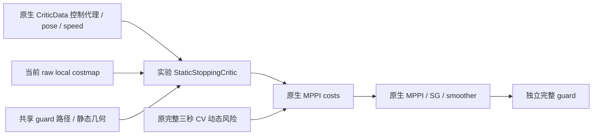

该静态critic不发布TF、目标或底盘命令，也不依赖tracker内部。
SG/smoother发生在评分之后，所以候选代理不是最终命令安全证书。
完整假设、失败试次、性能优化和回滚见
[静态停止实验](static_stopping_experiment.md)。

后续独立 `experiment/map-uncertainty-stopping` 只在停止critic当前地图
检查中增加可选规划预留（默认0），新配置选择0.11m。独立guard原判据和
TF所有权不变。观察器记录源时间扫描供离线核对，运行模型不读真值。
其依据、边界和验收见[地图不确定性实验](map_uncertainty_experiment.md)。

地图硬预留对照任务失败后，`experiment/soft-map-clearance` 单独验证沿
提案停止路径累计的连续预留成本，原reserve/raw203硬目标及运行guard
保留。可选nearest查询仅用于该规划目标，默认guard witness仍是原顺序
的第一个拒绝单元。详见[连续间隙实验](soft_map_clearance_experiment.md)。

`experiment/visible-box-geometry` 在tracker包内增加未接入node的纯几何
观测原型与离线审计。点成员/射线索引保留不改变原质心聚类；中心与全
几何仅为条件拟合，无返回/遮挡/单面/混合点簇仍有拒绝或失败，公开v1
继续表示可见质心/extent。运行critic不依赖此原型或tracker内部类；TF
唯一所有者与source-time契约不变。见[几何实验](visible_box_geometry_experiment.md)。

`experiment/soft-clearance-performance` 仅减少polygon-box距离内部不能
改进最小值的hypot调用；原distance/first/nearest witness、成本、参数、
TF和guard接受域保留。BUILD_TESTING微基准以同一ELF加载冻结/新原生
plugin比较完整成本，独立于运行控制。见[性能实验](soft_clearance_performance_experiment.md)。

`experiment/mechanical-footprint-contract` 单独修复已知仿真plant足迹契约：
base及4轮投影的包络半长宽0.325/0.300m，原padding0.03m不变，guard
对应0.355/0.330m。显式profile与`guard_params_file`配对选择；默认旧配置
保留。离线审计从冻结SDF读取真实base box，并另加完整机械投影≥0.05m
门，避免把规划矩形误称真实base。只改变已知自身几何，不将actor真值
作为感知先验；公共v1/TF所有权/原生MPPI及guard权限不变。详见
[足迹契约实验](mechanical_footprint_experiment.md)。

后续 `experiment/native-cycle-evidence` 通过默认不加载的末尾原生plugin
只读记录实际候选完整tensor、测量pose/speed、所有critic累计成本及
当前native grid/footprint。无TF/目标/命令发布，不改costs/fail_flag。
独立rclcpp command observer按DDS GID识别原`/cmd_vel_nav`发布者；无
命令路由变更。SG历史/控制均值未直接采集；固定trace的离线原生SDK
重建经349次完整输入与实际输出逐位验证，负对照清空历史/遗漏reset
失败。精确动态消费输入仍缺，成本位于gamma/softmax/聚合之前；重建
状态不能说成完整三秒安全控制/coverage证书。原生物理试次仍FAILED。见
[原生证据实验](native_cycle_evidence_experiment.md)。

后续三秒见证的数值模型/SG349周期均精确，但有效速度输入契约FAILED：
所有native speed为0，295个源时刻canonical样本有实际运动。原生
controller配置后实际订阅默认`/odom`，BT/smoother的canonical配置不
作用于controller。该层参数在configure时才声明；须在独立profile
明确设置并验证真正的速度输入。原zero-input上下文反事实不作为有效
物理安全控制或coverage证明。见[见证实验](native_safe_control_witness_experiment.md)。

该功能只存在于从 main 创建的 feature 分支，默认关闭。正式比赛启动和参数文件不加载它。当前兼容和验证目标为现有固定 Humble 镜像的 Nav2 MPPI 1.1.20。

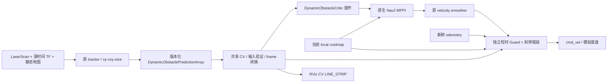

## 输入、坐标和时间

只使用原 `rm_competition_interfaces/DynamicObstaclePredictionArray`，不引入第二套 tracker 公共数据结构。源 header.stamp 是扫描/状态时间，position/velocity/size 均为 `map` 平面的米和米/秒；last_observation_stamp 是最近真实观测。`processing_stamp` 只用于诊断，不能替代源时间。

| 边界 | topic/type | frame / 意义 |
|---|---|---|
| tracker输入 | `/scan` sensor_msgs/LaserScan；`/map` nav_msgs/OccupancyGrid | 仿真 scan sensor frame 经源时间 TF 转 map；实车可用原 `/local_scan` |
| 动态状态 | `/perception/dynamic_obstacles_shadow/predictions` DynamicObstaclePredictionArray | schema v1 / authority shadow_only，固定 map 世界 frame。试验消费者显式接受 shadow 消息，不代表 tracker 获比赛授权 |
| 当前环境 | `/local_costmap/costmap_raw` nav2_msgs/Costmap | odom，原 0..255 raw cost，不使用未来轨迹烘焙地图 |
| MPPI内部评分 | 原 `CriticData.trajectories` 与 `costs` | local_costmap global_frame=odom；无 wrapper、无 upstream patch |
| MPPI里程计输入修复profile | controller_server参数`odom_topic=/odometry/lio` | 仅`nav2_cv_controller_odom.yaml`显式选择；STARTUP后实际读回/订阅检查，不增加publisher或TF owner |
| 平滑后提案 | `/dynamic_test/cmd_vel_smoothed` geometry_msgs/Twist | base_link body-frame twist，仅 experimental Nav2 范围 remap |
| guard pose/speed | `/odometry/lio` nav_msgs/Odometry | odom / child=base_link；新鲜源时间和真实测量速度 |
| guard输出 | 默认 `/dynamic_test/cmd_vel_guarded` Twist；显式仿真 launch输出 `/cmd_vel` | 最后安全层；Nav2和recovery输出先经过原 smoother，底盘只订阅 guard输出 |
| 可视化/日志 | `/dynamic_critic/predictions` MarkerArray；`/dynamic_critic/diagnostics`, `/dynamic_guard/diagnostics` DiagnosticArray | CV未来轨迹以 odom 显示；原 tracker markers 仍以 map 显示 |

map 和 odom 是世界平面坐标；允许它们之间使用**最新且有年龄上限的平面定位修正**，默认 `max_tf_age=0.1s`；静态 TF stamp=0 不受动态年龄限制。所有预测先在 map 外推，再用同一个修正变换到当次 rollout 的 odom frame；速度方向由同一旋转正确处理。没有每个未来步不同 TF，没有对缺失 TF 的无限等待。错误/过期/未来/非平面修正失败并制动。该模型要求两世界坐标间修正在一次评分/短安全窗内可视为固定；定位跳变仍需既有比赛完整性安全门，不能把此插件当作定位防护。输入 `input_frame` 可配置为另一个明确的世界平面 frame，不接受含时变本体运动的 sensor/body frame。

默认源消息、最近观测 timeout 各0.4s，确认/短暂coasting轨迹均消费；tentative仅由当前 costmap处理。完整性、总数、ID重复、finite xy/vxy/size、大小/速度界、观测时间、非单调源时间、同 ID 位置跳变均验证。新坏消息覆盖旧缓存，不能继续沿用旧速度；critic 设置 MPPI fail_flag，guard输出零。新鲜完整空数组表示 tracker当前无可靠动态目标，仍执行普通 costmap检查；停更空数组也会过期。原接口没有 covariance/confidence，第一版没有人为制造概率字段。

## 预测时域和 cost

v1位置/尺寸是滤波可见簇锚点和可见范围，不是完整机械中心/轮廓。
`complete`只表示输出预算没有截断，validator速度/尺寸阈值也不认证
物理支持。当前/未来包络及unknown条件见
[公共几何契约](../contracts/dynamic_obstacle_geometry_contract_2027.md)。

物体 i 在源时间 s 的估计为 p_i、v_i。评价时刻 n，年龄 a=n-s。第 k 个积分后 rollout 状态对应 `t_k=(k+1)*model_dt`，所以

`p_i(k) = T_map_to_odom [p_i + v_i (a + (k+1) dt)]`。

Humble原生 rollout第一列已经积分 dt，不是 t=0，故索引+1；当前 pose单独由guard在 t=0检查。第一版30×0.1s，完整3s。初始化核对 YAML prediction_horizon=MPPI time_steps×model_dt，score再次核对实际 tensor列数/dt和消息网格，任何不一致失败，绝不截成旧1s。tracker显示配置也设30×0.1、衰减tau=0；critic不会使用可能来自旧衰减模型的prediction[]，总是重算 CV。源年龄另计，最长外推为3s+≤0.4s，不允许无限外推。

使用 costmap真实 padded凸多边形 P_j(k)。障碍半径 `r_i=max(minimum_obstacle_radius, hypot(size_x,size_y)/2)`，默认minimum=0.36m。点在机器人多边形外时 clearance为最近边距离减radius；点在内则负最近边距离减radius。时间步clearance d_jk为全部confirmed/coasting障碍的最小值。

设影响距离 R=0.4m、额外安全裕量 m=0.02m、碰撞比例 λ=10000、weight w=1：

`phi(d)=w * [max(0,(R-d)/R)^2 + λ * max(0,(m-d)/m)^2]`

`C_dynamic(j) = dt * sum_k phi(d_jk)`。

这是两个连续平方 hinge。d≥R为零；接近时渐增；越过安全裕量后快速增长；实际 padded接触d=0时每秒密度至少约10000。无一票硬相交打平、无概率包络、无CA、无candidate rerank。其它七 critic和原采样/正则/温度/加权/SG保持原值，动态cost直接加到原数据 costs。

第一版实验继承main padded footprint=body矩形每轴±0.03m，机械足迹对照采用上述完整自身包络；均再要求动态clearance>0.02m。正式验收始终独立计算实际本体≥0.05m、padded>0，新增试次还要求完整机械投影≥0.05m，不拿动态半径模型替代真实几何。可见簇不是完整物体中心/尺寸，0.36m默认下限仅为本仿真箱体量级先验，不能证明所有遮挡情形或真实障碍均被包住。

## 独立安全层

guard每50Hz对最新平滑命令作有限时域模拟：先将新鲜odometry在测量twist模型下推进到当前评价时间；检查两个响应分支：已测运动在response_delay后减速到零，提案命令保持horizon=0.5s后减速到零。每分支使用精确平面body twist积分，线减速1m/s²、角减速2rad/s²，模拟dt=0.02s；**检查完整刹停尾段**，不会把刹停截在0.5s。满步相对运动距离作采样间隔reserve，当前t=0也检查。max_simulation_steps=512限制计算预算，所需完整尾段超出预算时直接brake，不截短后判safe。

同一公共 CV、障碍消息验证、frame转换和 polygon-circle 几何供 critic/guard使用。guard另外检查 raw costmap所有相交/邻近cell（包括多边形内部），raw≥203、255 unknown或地图外均阻止通过。命令越原bounds（vx[-.5,.8], |vy|≤.5, |wz|≤1.2）、非平面/非finite、数据过期或wall watchdog均输出零。使用wall timer和消息到达wall年龄，ROS时钟停住仍会制动。

guard仅pass/brake，不找路径、缩放命令或选择candidate。两个响应分支不等于所有底盘瞬态的包络；减速能力/延迟、定位误差、未来CV准确度和执行者接受零命令都须硬件确认。零命令不是物理瞬停，因此保留测量动量的刹停检查和独立实际物理真值验收。当前costmap消息必须是fresh full raw map；该实验profile提高发布率5→10Hz用于独立guard数据新鲜性，正式main原文件未动。

## 诊断解释与原研究关系

显式消费证据profile仅在自有DynamicObstacleCritic中记录实际输入字段、
score时刻/source_age、使用的世界修正与足迹、全rollout及before/double-risk/
after位型。默认关闭；记录失败只停证据，不改评分。私有文件格式不增加
public tracker结构、ROS订阅/发布或TF所有者；安装Nav2保持原生。另一个
末尾snapshot提供全batch匹配与总成本证据，两者不能按最近receipt代替精确
身份核对。IO开销需真实试次验证。见[消费证据实验](dynamic_consumption_evidence_experiment.md)。

critic日志中的minimum clearance/TTC属于**动态cost最低的rollout**，不是MPPI综合分首选，也不是加权/滤波后实际输出。dynamic_cost_min/max为该batch的新增贡献范围。guard诊断检查的是实际最终提案。两者不混称控制证明。预测markers只是可视化，绝不写未来路径到costmap。

旧研究 late cycle40 有三秒、实测首速度和SG历史下的零控制安全见证而原300条全不安全，仍为历史 sampler覆盖失败证据。新原生证据分支已记录完整raw控制，并数值验证固定trace的SG/均值重建；三秒反事实审计发现349个native速度全0、295个canonical样本有运动。条件见证仅对原生零输入上下文有效，物理实测首速度契约失败，不能归因sampler或optimizer。独立controller里程计profile先修复参数路由，再采集有效速度输入与完整三秒证据。新guard零命令测试是短时模型测试，不冒称取代旧三秒native见证。原研究证据通过封存tag完整可恢复，不需移入新产品包。
````

<a id="D0230"></a>

## D0230 — Controller里程计输入契约实验

来源：`docs/dynamic_obstacle_critic/controller_odom_contract_experiment.md`；版本：`652f14cea66edc0fcd77401de7db41cb6ffa7477`。
阅读副本：[独立原文](../dynamic_obstacle_critic/controller_odom_contract_experiment.md).
以下仅为历史资料，不构成继续研究授权。

````text
# Controller里程计输入契约实验

2026-10-02从`b89eb1d`建立`experiment/controller-odom-contract`。
前序SDK数值复现通过但349次native速度输入全0，295个canonical源
样本有运动。实际controller inactive配置读回默认`odom`和`/odom`
订阅；canonical发布在`/odometry/lio`。有效首速度契约失败，前序
完整三秒反事实只对原生零输入上下文有效，物理见证尚未建立。

## 执行前边界

新增显式`nav2_cv_controller_odom.yaml`只比native snapshot profile
多一个`controller_server.ros__parameters.odom_topic: /odometry/lio`。
不改原七critic、采样器、SG、优化器、Dynamic/Static、tracker、guard、
footprint、场景和速度界；不发布或复制里程计，不增TF owner，不用
额外remap绕过正确参数层级。旧profile与历史manifest保持。

driver新增可选明确要求的controller odom topic：lifecycle配置完成后
读回实际参数及controller实际nav_msgs/Odometry订阅，核对canonical
发布者；不把constructor阶段未声明的参数当成已验证默认值。预检
失败不发送目标，保存基础设施失败；原cmd路由与goal/窗口/相位不变。

先在固定Humble1.1.20 inactive节点实际配置读回，确认新profile的
订阅是`/odometry/lio`且原profile仍是`/odom`。通过后执行预定同条件
完整物理试次并保留全部失败：实际body/全机械≥0.05m、padded>0、
raw203、bounds容差5e−5、严格推进与action goal success全部独立。
native捕获需在真实canonical运动时确有非零速度输入，保留threshold
处理/来源时刻差异，不能要求所有静止时刻非零或用单次非零掩盖丢失。

新SDK重建仍先完整输入/输出逐位核对，然后再验证有效原生速度下的
完整三秒、实际历史与独立几何见证。该参数修复不证明CV隐藏几何或
未来支持；旧CA/sampler/ranking保持冻结，main/feature不提升。所有
配置、readback/graph、源码/ELF身份、原始数据与失败门都单独归档。

## 参数路由预运行

仓库工具`test_controller_odom_preflight.py`在隔离DDS域顺序configure
两个实际Humble controller，均停在inactive。旧profile读回`odom`并
实际订阅`/odom`，按预定要求拒绝；新profile读回并实际订阅
`/odometry/lio`，canonical唯一Odometry发布者检查通过。夹具仅声明
publisher，未发布消息、TF、命令或目标；不据此推断有效速度输入。

最初临时脚本只结束ros2 wrapper，两个用相同名字的controller存在
进程/发现隔离问题，第二项断言失败。保留该失败后改为独立进程组
清理，并等待DDS发现收敛；临时脚本重试及仓库工具新执行均通过。
完整证据见`stage2_evidence/controller_odom_preflight/manifest.json`。

安装新YAML后项目critic、guard、命令观察器及原生MPPI/critics、
controller/nav2_util的七个ELF身份均与前序一致。配置语义比较只多
controller层odom_topic。driver在明确STARTUP完成后检查实际参数/
订阅/发布者，失败保存readback且不发送目标。下一步仍是固定物理
试次；所有机械、三秒见证、有效速度和任务门尚未在新配置下验收。

## 固定试次后的回放关联登记

c775723试次的350个捕获与350条非零controller命令数量/顺序一致。
旧回放工具默认观察器到达差≤10ms在ordinal89失败，实际差21ms，
保留失败日志和部分输入；不能据此宣称SG已验证，也不再执行物理
重试。下一步明确选择半个native周期50ms的观察器关联假设（小于
100ms控制周期），仅用于这条新trace，完整输入张量与输出double
仍逐位验证；默认10ms及历史报告保持。窗口不作用于任何物理门、
速度界或比较容差。新假设若不通过逐位验证，SG见证保持未建立。

## 完整试次与速度输入核查

固定c775723实际试次从17.940s运行到52.941s取消，再保留至56.441s。
基础设施PASS，route readback确认`lio_adapter`是canonical唯一发布者；
任务与物理门仍FAILED。完整2265个真值样本、1925条窗口/尾段最终
命令，推进4.793063459m、goal_status=null。base动态样本最小
0.004789872m、线性插值下界0.001313541m；完整机械投影和padded
样本均0，下界分别−0.007467893m/−0.007712848m。static下界分别
base0.533005775m、机械0.510764420m、padded0.468094767m。输出界
违规0，raw203违规736/2265且无缺失/过期地图样本，不能放宽门。

40.048s首次完整机械margin失败（前右轮gap0.043754335m，base
0.049759160m）之前0.2s的12个pose完全静止、10条最终命令全0；
guard已拒绝。40.116s轮投影接触。停止位置被动态障碍进入的问题
仍存在。431个可用public CV在0/1/2/3s完整物体支持全部0/431，
不将参数修复解释为几何/未来覆盖验收。采样评分中位52.128475ms、
最大86.963207ms，整试次deadline警告45；非独立性能因果结论。

350个300×30原生捕获首速度/移位逐位通过。253个源时刻canonical
运动周期全部有非零native输入，350个输入都能在冻结guard的0.15s
年龄窗内找到完全相同的阈值后canonical值（double bits）；最新
匹配值最大年龄0.134s。固定SDK header及实际ELF回调/控制函数证明
使用`nav_2d_utils::OdomSubscriber`最近planar twist，并按分量严格
`abs(v)>threshold`处理，未使用此前猜测的OdomSmoother均值。此处
PASS是有效速度值一致性；重复值不能唯一确定实际消费消息，native
仍未直接捕获订阅源时间，pose/速度/score时刻差异必须保留。旧349
trace用同一审计仍FAILED：295个运动周期native全0，仅67个值可匹配。

50ms关联假设经实际SDK独立检验：350/350完整采样输入、350/350
实际输出double逐位相同，reset anchors0/232，排除零命令232/351
仅为该trace已验证的假设。清空历史负对照输入4/350、输出2/350
匹配；遗漏232 reset输入232/350、输出324/350匹配，均FAILED。
独立重执行正/负三个输出逐字节相同；七项畸形/单ULP比较测试通过。
350个完整三秒原生模型速度/位姿、聚合SG及实际命令也逐位通过。

913文件的`stage2_evidence/gazebo_controller_odom_contract/manifest.json`
冻结实际policy/readback、源83文件与c775723、场景/安装输入、全部
失败数据、观察器和原生SDK回放证据。五个运行ELF及场景/安装输入
与前序完全相同；profile除输出目录外仅controller odom_topic变化。
23份报告/图示/回放比较逐字节复现，原历史完整回放也继续核对。
三秒独立几何见证另存，不能用这些完整性结果覆盖FAILED物理结论。

## 修复输入后的完整三秒条件见证

复用0d13162已登记的11条提案，不改变集合或选择规则。350周期全部
3.000000045s使用实际非零/静止测量首速度、经实际命令核对的四项
SG历史，207–208个时间点合并全部actor真值采样（最大间隔0.018s）。
native source pose与物理真值最大xy差0.000103821m。350个完整原生
速度/位姿、actual aggregate SG及实际返回命令全部逐位通过。

| 固定提案 | 条件安全上下文 | 条件安全且严格推进 |
|---|---:|---:|
| 实际聚合输出 | 60 | 58 |
| 零原始控制 | 224 | 185 |
| 保持测量速度 | 119 | 85 |
| 初始world (.2,0) | 93 | 93 |
| 初始world (.2,.3) | 188 | 188 |
| 初始world (.2,−.3) | 35 | 35 |
| 初始world (.4,0) | 63 | 63 |
| 初始world (.4,.3) | 137 | 137 |
| 初始world (.4,−.3) | 27 | 27 |
| 初始world (0,.3) | 238 | 214 |
| 初始world (0,−.3) | 95 | 58 |

32周期满足预登记选择条件，最早为source196、37.560s。实测native
twist `[0.565160722,−0.036850862,0.295166887]`，该周期实际聚合
输出 `[0.443959713,−0.082171418,0.006679837]`在完整三秒内实际
base/机械/padded轨迹样本均零距；推进1.375551m、native frozen raw
间隔余量0.001447551m，故失败属于动态几何门。零原始提案经真实
SG历史后返回非零`[0.120778784,−0.008060448,0.052408345]`，推进
0.083345845m；base/机械动态插值下界0.556463042/0.532071505m，
padded下界0.459501357m、raw间隔余量0.587606425m，全部门通过。
该周期另有6条登记提案通过，保持真实首速度及整段SG输出界。

同周期原300条控制分别经过原生约束和相同SG历史后，239/300条
反事实提案通过全部安全/推进门。各门失败数可重叠：body45、机械53、
padded59、raw1、SG bounds1、推进0。此周期不支持“全300缺安全控制”
的归因；这些逐条SG反事实不是实际加权输出，也不是所有周期的
sampler coverage证明。后续应先观察critic实际消费的public预测、
时刻及每候选cost贡献，区分输入/目标与聚合问题，不能直接调sampler。
public CV完整支持失败仍独立存在，CA/ranking/采样器继续冻结。

`stage2_evidence/effective_native_witness/`冻结81文件、约3.21MB，
链接上述913文件source manifest，保存完整/所选输出、全部几何结果、
条件契约评估、工具、正反回放和source196映射证明。原生正/负SG及
完整/所选BIN/JSONL七个产物独立重执行逐字节一致；所选前11提案与
完整350记录中的196周期逐字节/字段一致。新选择工具在旧archive
仍选source223/16个eligible，与历史结果完全一致；旧20份报告/图示
完整回放通过。归档三秒分析的私有副本复算通过：完整/所选输入身份、
两份几何分析、选择周期、契约评估和原生四个重执行产物共10项逐字节
一致。验证日志独立保存在`stage2_evidence/effective_native_witness_replay/`，
原81/913文件manifest不修改。阶段源与证据提交1800ed8。

条件见证对记录的真实测量值、原生模型、SG历史、线性插值和冻结地图
成立，不能升级为实际执行安全证书；真实订阅源stamp、精确dynamic
consumer、native map源stamp仍缺。原物理和任务结论始终FAILED。
````

<a id="D0231"></a>

## D0231 — 显式条件下的CV支持界：离线开发登记

来源：`docs/dynamic_obstacle_critic/cv_support_bound_experiment.md`；版本：`652f14cea66edc0fcd77401de7db41cb6ffa7477`。
阅读副本：[独立原文](../dynamic_obstacle_critic/cv_support_bound_experiment.md).
以下仅为历史资料，不构成继续研究授权。

````text
# 显式条件下的CV支持界：离线开发登记

2026-10-02，从b17b73a建立`experiment/cv-support-bound-contract`。
四组同路径审计已证明修正当前中心/尺寸和有限局部速度仍缺未来支持。
本阶段开发一个独立纯函数，表达CV锚点周围的**条件支持界**与unknown，
不新增在线预测模型、消息类型、critic策略或半径配置。

## 数学与输入边界

源时刻s的完整机械投影S(s)直径≤D，原滤波锚点q(s)到conv(S(s))
距离≤e。若整个有效区间内，任意未来完整投影点到源集合的有向
Hausdorff距离≤B*h，则CV锚点q(s)+v_hat*h的支持半径可取

`R(h) = D + e + (B + |v_hat|) * h`，`h = source_age + future_offset`。

证明分别应用初始集合直径/凸包界、未来集合位移界和CV锚点位移的
三角不等式。B是**完整投影集合**的运动界，必须覆盖平移、转动、
机构展开与附件变化；仅底盘平移最大速度不自然满足。v_hat是公开
估计值，此公式不假设其为真实速度，也不进行CA状态预测。

每个非空假设需明确来源标识；所有返回都注明conditional，不因给出
数字成为现实认证。D/e/B/有效区间缺失时相关查询返回unknown/无半径；
严格源时刻h=0可仅用D/e。有限、符号、单位、维度及有效区间核验
不得使用validator/display阈值、夹具观测最大值或拟合未来曲线补齐。
浮点计算采用明确的向外舍入，溢出不返回有限“可安全”值。

## 预定验证和工程约束

1. 构造可达到三角界的反向CV/真实运动反例，验证源年龄必须计入，
   不把当前支持误作接收时刻支持。
2. 固定随机种子，以全部四类尺寸、旋转不规则集合、凸包偏置锚点及
   有界未来形变生成独立几何样本，核对所有真实点被条件圆包含。
   测试只证明给定条件的数学行为，不从样本认证真实B/e。
3. 缺失假设/来源、过期有效区间、非finite/非法输入和溢出有明确结果。
   保存测试源码、种子、输入默认unknown、结果及独立复算。
4. 新工具仅tools纯Python离线边界，不启动ROS/TF、不读tracker内部
   状态、不改变v1字段或runtime ELF。2026尺寸参考仍仅data-only，
   真实四类目标的运动界/锚点误差/2027适用性仍unknown。
5. 同分支同步公共几何契约、包README、阶段进度、runtime profiles
   和文档索引；保留此前固定三秒、原七critics/采样/SG/guard、原失败
   门及NOT ESTABLISHED。main/research封存和core不动。

本阶段不以保守圆大小宣布任务可行或改在线critic；若以后接入，必须
另登记观测供应、公共契约/版本、unknown策略、期限预算和独立物理门。

## 实现与结果

2a97d92先登记。`tools/conditional_cv_support.py`只接收四个显式bound/
来源槽、公开估计速度和源年龄/未来偏移，返回`CONDITIONAL_SUPPORT`
或`UNKNOWN`；后者半径为null并列出缺失/过期/数值原因。非法单位、
非finite、负界、空来源及模糊底盘运动语义拒绝。纯函数没有tracker/
ROS类型，不读取私有状态，也不认证调用者所写的来源。

时域和半径以输入浮点的精确有理数核算；速度norm的舍入平方需不小于
两分量精确平方和，最终半径向上舍入。溢出返回unknown；即使真实条件
可能允许极短时域有限界，无法表示的norm也保守拒绝。输入schema/
预算及已有输出保护均在文件CLI边界检查，没有部分有效结果。

8项数学/几何测试通过，包括可达到界的反向运动构造、源年龄、缺失
条件/来源、严格源时刻、精确有效区间、独立有理平方/舍入核对以及
非法输入/溢出。固定seed20261002的8000个旋转不规则/凸包误差/
有界未来形变样本中四类各2000个，全部完整点被条件圆包含；最大
`真实点距离-条件半径`=-0.358967111m。随机样本没有认证实际e/B；
2e-12只用于独立浮点距离比较，未更改任何物理门。

14项实际CLI检查通过。默认data-only
`config/cv_support_assumptions_offline.yaml`的四界及来源全为null；
source298公开消费速度/源年龄0.087s对应0/1/2/3s四查询**全部unknown**。
2026尺寸文件只作reference，不自动补入2027条件。

| 分离的合成构造 | 值 |
|---|---|
| 初始线段D、q到凸包误差e | 0.125m、0.25m |
| 完整投影真实平移B、估计CV速度 | +0.5m/s、-1.5m/s |
| 源年龄、条件有效源区间 | 0.5s、3.5s |
| future0/1/2/3s条件支持半径 | 1.375/3.375/5.375/7.375m |

该构造的最远端点达到半径，说明源年龄和反向CV项不能删除。其来源
明确标为synthetic test-only，不能填入真实机器人或公共预测消息。
source age导致超出有效区间、已知界缺来源均返回unknown/无半径；
错误单位/底盘语义/schema/budget/NaN等拒绝且不写输出，已有文件字节
保持。原5个runtime和3个离线ELF哈希不变，无C++重编译或安装。

## 归档和独立复算

68文件、104170字节的`stage2_evidence/conditional_cv_support/`
保存纯函数/CLI及依赖闭包、两份data-only配置、实际与合成分离输入、
8/14检查、负例、环境/ELF身份和日志；manifest SHA为
`0a6cf2d35206f3395c04f4c020880708403b1182434809df142866aeff14c4cc`。
首次准备脚本误用`native_source_ordinal`而非原`ordinal`，修正前源码/
失败日志保留；发生在创建输出前，没有用失败结果作数学证据。

```bash
python3 -B src/rm_dynamic_obstacle_critic/tools/evaluate_conditional_cv_support.py \
  src/rm_dynamic_obstacle_critic/config/cv_support_assumptions_offline.yaml \
  docs/dynamic_obstacle_critic/stage2_evidence/conditional_cv_support/prepared/actual_query.json \
  /tmp/conditional_cv_support_new.json

python3 -B src/rm_dynamic_obstacle_critic/tools/replay_conditional_cv_support.py \
  docs/dynamic_obstacle_critic/stage2_evidence/conditional_cv_support \
  /tmp/conditional_cv_support_replay_new
```

10项输入/数学结构化结果/真实unknown和合成输出逐字节复算通过，
8个geometry tests与14个CLI checks实际重执行通过。该工具表达条件
缺口，没有供应真实运动界或在线安全策略；原task/raw203/年龄FAILED、
综合NOT ESTABLISHED和运动上界unknown保持。

8文件独立verification保存于`stage2_evidence/conditional_cv_support_replay/`，
原物理/因子/本期三个archive共1865文件身份核验通过；原68文件
manifest保持。未将条件支持半径放入在线critic或guard。
````

<a id="D0232"></a>

## D0232 — 当前几何与未来CV支持：离线因子审计登记

来源：`docs/dynamic_obstacle_critic/cv_support_factor_experiment.md`；版本：`652f14cea66edc0fcd77401de7db41cb6ffa7477`。
阅读副本：[独立原文](../dynamic_obstacle_critic/cv_support_factor_experiment.md).
以下仅为历史资料，不构成继续研究授权。

````text
# 当前几何与未来CV支持：离线因子审计登记

2026-10-02，从8523d1f建立`experiment/cv-support-factor-audit`。
前序同raw与actual aggregate路径均有CV模型未预报的真实动态接触。
固定source298、原300 raw路径和原311处理后路径，下一阶段仅离线
隔离当前锚点/尺寸与未来运动假设的贡献。全部地面机器人范围保持；
本箱体oracle结果不认证真实赛场四类机器人或2027规则。

## 预定对照

1. **Actual baseline**：保留完整实际消费状态/参数/足迹/scoreclock，
   原300 risk/after必须逐位一致，311处理后baseline应逐字节等于
   已冻结C++输出，不重构实际SG历史。
2. **Source geometry oracle**：只在原消息源epoch将已按固定1m规则
   离线关联的actor track锚点改为真值物理几何中心，并用完整物理箱体
   的包围圆半径；原公开估计速度保留，其他tracks全部不变。这是诊断
   干预，不能写成原v1真实输入或在线感知输出。
3. **Source bracket-CV oracle**：在2的基础上，仅换为源epoch两侧
   原真值样本的局部平移斜率，继续严格CV至完整3s。该斜率来自有限
   采样/线性插值，不能冒称认证瞬时速度、最大物理速度或未来真值。
4. **Future circle oracle**：每个实际评分未来步直接用该时刻真值物理
   几何中心和完整包围圆，使用原polygon-circle/penalty算式与参数。
   真值未来只用于离线分离运动支持误差，不作为可上线预测器；不是
   CA模型、不恢复sampler/ranking、不向costmap写未来轨迹。

相同半径政策保留原minimum floor；尺寸oracle只修正可见簇的完整
物体解释。关联使用既有固定规则并保存ID、其他有效tracks数量；若
多目标影响risk，不删除未关联目标来挑好结果。true geometry / source
bracket / future数组均独立私有hypothesis格式，实际RMDYNRP1仍先核对
原raw位型，不用伪造风险或SG evidence flags让oracle变成actual。

## 证据和工程约束

完整300/311逐行risk/minimum_clearance/TTC、same-clock完整物理
动态支持标签及原native权重分别保存。只将原权重用于raw成本标签的
描述；新oracle cost不生成或执行新权重，不重选source周期，不把新
几何标签替代static/raw203/SG边界/完整原见证门。

先证明baseline数值与原记录一致，再比较actual aggregate/zero与全部
原始路径的变化。几何/时间/局部斜率采用独立标量对照，错误hypothesis
schema/ID/网格/finite/截断/尾字节必须拒绝。保留源码/输入/编译身份、
失败、图示和独立复算；只新增BUILD_TESTING离线目标，已有C++工具
与5个runtime ELF身份保持原值。

正式运动上界尚未建立；用户已被询问是否有四类目标的平移/转动/
机构展开速度依据，未提供前保持unknown，不取validator/display速度
阈值或本夹具最大观测值作为物理保证。条件不足时不得提出已认证的
3s支持或部署结论。即使oracle风险改善，也只定位缺口；真正输入修复
仍需公共契约、可获得的观测及unknown策略。main、research封存、TF、
在线参数及task/raw203/年龄FAILED、综合NOT ESTABLISHED均不变。

## 实现与独立核验

7b11884先登记。新增BUILD_TESTING-only `evaluate_cv_support_factors`
先核对原source298的300 actual risk/after位型，再读取私有有界
`RMDYNHX1`四组状态、30步未来中心和311条原SDK处理后路径。
实际上下文仍为RMDYNRP1；oracle数据不写公共消息或actual记录。
原5个runtime ELF及2个已有离线评分ELF前后SHA逐字节相同。
新目标仅O3/无fast-math，ELF SHA为
`934bd10451cd029910a03599207c0df308785051dd25c073c4a3c4609623ec89`。

19项实际C++检查通过：四组完整2444行；baseline的300 raw与311
processed risk/minimum/TTC位型全相同；将未来中心显式换成合成原CV
中心时，future-circle循环对全部611行逐位退化为原CV。此合成probe
另行标记，不是真值未来。格式、源、dt、ID、非finite、截断、尾字节、
已有输出、被篡改actual risk等负例均拒绝。

独立向量插值与准备端标量插值的当前/未来中心和局部斜率误差均0；
binary ledger与来源状态完全对应。额外6类同时篡改metadata/binary
的中心、局部/保留/基线速度、未来坐标和NaN反例均拒绝。2e-12仅是
数值核对容差，不修改物理门或认证误差界。

## 同一周期结果

source stamp47.917s，实际scoreclock48.004s，source age0.087s；
关联ID1，其他有效tracks为0，原30步约3.0000000447s不变。source
geometry将锚点改为物理中心(4.9,-0.1275021915)，尺寸为完整箱体
0.45×0.55m；原minimum radius floor0.36m仍支配包围圆。局部真值
斜率来自47.909→47.926s有限括号，为(0,0.775716288)m/s，不能写作
认证瞬时速度或未来速度上界。

| 离线输入条件 | 实际aggregate risk | 模型minimum clearance | 模型TTC | raw模型clear但padded网格接触 /300 | processed对应数 /311 |
|---|---:|---:|---|---:|---:|
| actual baseline | 0.549356769 | 0.114527361m | 无 | 76 | 91 |
| source geometry oracle | 0.193294599 | 0.198318481m | 无 | 117 | 119 |
| source bracket-CV oracle | 0 | 0.454222377m | 无 | 131 | 125 |
| future circle oracle | 205880.157195 | -0.163734526m | +2.600000039s | 0 | 0 |

所有路径和同scoreclock物理标签固定；原actual aggregate路径仍有机械/
padded接触，zero在四组下risk0且原动态几何门通过。模型clear定义仍
是原minimum clearance>0.02m，网格接触为同一30点真实padded距离0。
原native权重仅描述这些raw标签，baseline漏接触的权重约72.54%；
未按新risk生成softmax、优化序列、SG输出或command。

补足源时刻几何及有限局部速度没有修复本夹具三秒后的换向支持，
反而增加模型clear却真实接触的路径数。离线future circle能识别该周期
同网格接触，说明未来支持是这里的必要缺口；它使用不可在线获得的
未来真值，不能变成预测器、CA恢复依据或全时域/全场景安全证明。
source几何、速度、关联、遮挡及真实物理上界仍需可获得的公共条件。


## 冻结与复算

112文件、3,808,487字节归档`stage2_evidence/cv_support_factors/`，引用
原物理1685/SDK见证88/raw34/processed91文件manifest。保存完整输入、
2444行C++输出、标签、来源/独立核验、19项正反例、六类协调篡改
probe、源码依赖闭包、flags、ELF身份与日志；初版挤在一起的图标签
已缩短并视觉核验，初图保留。manifest SHA为
`b61cc5ad32bf692715b96b57888987c05f78ea14ca45a83ad39f2961bb435ccb`。

```bash
python3 -B src/rm_dynamic_obstacle_critic/tools/replay_cv_support_factors.py \
  docs/dynamic_obstacle_critic/stage2_evidence/cv_support_factors \
  /tmp/cv_support_factor_replay_new
```

首轮重建原processed输入、四组hypothesis及来源核验、负例、完整分析
和PNG/SVG，12项逐字节一致。`--cpp-output NEW_JSONL`可将独立重执行
的C++完整输出纳入复算；新增verification另行归档，不改变112文件
原始manifest。原task/raw203/年龄FAILED、综合NOT ESTABLISHED以及
motion bound unknown保持，未改main/research、在线参数、TF或接口。

使用复算新输入实际重执行C++全部2444行字节相同，再以新输出执行
13项复算全部通过。9文件独立verification位于
`stage2_evidence/cv_support_factors_replay/`；五个引用/本期archive共
2010文件身份核验通过，原112文件manifest没有变更。
````

<a id="D0233"></a>

## D0233 — DynamicObstacleCritic精确消费证据实验

来源：`docs/dynamic_obstacle_critic/dynamic_consumption_evidence_experiment.md`；版本：`652f14cea66edc0fcd77401de7db41cb6ffa7477`。
阅读副本：[独立原文](../dynamic_obstacle_critic/dynamic_consumption_evidence_experiment.md).
以下仅为历史资料，不构成继续研究授权。

````text
# DynamicObstacleCritic精确消费证据实验

2026-10-02从fea7bf9建立`experiment/dynamic-consumption-evidence`。
已修复controller canonical输入，并完成真实测量值/原生完整三秒/SG/
权重重建。source196有239个单条约束/SG条件安全推进标签，却仅得到
0.04066%权重。总成本偏好失败标签已证实，责任尚不能指定给Dynamic、
Static或原七critic；public CV完整物理支持仍0/431。

## 执行前登记

仅对项目自有DynamicObstacleCritic增加默认关闭的文件证据路径。
记录该次score真正持有的public消息中被消费的字段、实际评分clock/
source_age、实际world平面修正、使用的padded footprint/模型与cost
参数、原生输入pose/speed和完整300×30 rollout，以及每候选评分前
float成本、实际新增double风险和评分后float成本。元数据明确未消费
字段和未捕获的TF/native map/速度订阅源stamp；不新增第二套public
tracker结构或ROS话题，不订阅感知内部接口，不广播TF、不发控制。

证据只观察现有计算，默认空目录无文件/复制/评分旁路；显式profile
启用，独立空绝对目录/原子writer ownership、最多400（上限1000）
记录、batch≤512/steps≤64/tracks≤64/有限payload预算。记录成功评分；
非法/已有输出目录在初始化阶段拒绝，并在目标前作为基础设施失败。
评分中的数据/写入失败停止记录并报错，不能改变cost/state/fail_flag、
消息cache、控制输出或安全行为。风险与before/after成本保留实际
浮点位型，metadata最后提交，保留所有失败和预算限制。

先在真实插件测试中核对启用/关闭成本逻辑，以及空/移动/静止/invalid
输入、有限预算/拒绝覆盖。从保存的使用字段/时刻/rollout重新计算
动态cost，要求全部候选的实际新增风险及浮点成本关系逐位核对；
精确匹配native末尾snapshot的rollout/pose/speed，不以receipt最近
消息、最低动态cost或单个日志样本冒称真正消费。

控制算法、七critic/Static、采样器/SG、guard、footprint、scene/目标/
35s窗口/3.5s尾段/起始相位、controller canonical路线与物理门全部
不改。预运行保存代码/配置/ELF及验证后，再做一次同条件完整试次；
额外证据IO可能影响deadline/watchdog，必须记录实际结果，不能凭
只读代码宣称物理等价。安装库不fork，旧默认profile保持。

再验证原生实际SG/权重/完整三秒；按原登记规则选最早周期，比较
实际消费CV风险、当前几何/未来真值标签、自己的cost贡献、其它critics
累计成本和post-gamma权重。位置/未来真值只离线使用；当前观察到的
簇尺寸与validation max_extent不能冒充完整物理几何先验。若仍失败
如实归属已确认层与未知层，不恢复CA/sampler/ranking、不提升main。

## 预运行验证（2026-10-02）

17模型+19真实插件用例通过。新增移动、静止、空输入保存实测文件；
开启记录/预算耗尽/写入拒绝的评分成本逐位相同，disabled不创建证据。
20独立文件读取用例通过，拒绝截断/尾随/错误shape/重叠/dtype/重复JSON/
非finite/stale/假age/count/grid；one-ULP after成本关系失败。
BUILD_TESTING-only C++重算与runtime同算术策略（-O3，无SG fast-math），
三个真实插件fixture共4score/8候选的risk double和after float全部逐位
相同；将一个risk double增加1ULP的负probe退出2，risk仅1/2候选相同。

实际Humble controller只configure、始终inactive：新profile/证据directory/
budget/enabled读回通过；已有输出目录及budget=0均拒绝configure，已有
内容保留。零目标/命令/odom消息/TF。第一次编译误将公开schema/authority
字符串转整数失败，修正后通过；第一次新工具目标构建遇到CMake旧顶层
目标表失败，已生成的新表第二次构建通过。两份原失败日志均保留。

`nav2_cv_dynamic_consumption.yaml`语义只增加空directory/400预算；runner
显式选项设置独立目录，在目标前核对实际configured参数。原controller
canonical修复、七critic/Static/原生采样/SG/guard/机械足迹均保持。
离线审计按全部rollout bytes+pose/speed/frame/source pose stamp/dt/footprint
精确连接末尾snapshot。after与native总float差只称Static阶段舍入增量，
不称精确Static double成本，也不分别归因原七critics。

用户提供制作规范并明确后续几何实验覆盖全部地面机器人，另留
[尺寸审查](robot_extent_manual_review.md)。此固定试次不改radius或目标尺寸。

## 9f73d72固定试次：任务/原始地图/末尾速度门FAILED

首次调用误拼guard文件名，在任何节点/目标前失败，目录与日志独立
保存。按旧机械试次的实际`guard_mechanical_footprint.yaml`重试；两项
目标前readback通过。17.94→52.941固定取消，尾段至56.442；目标状态
为空，推进3.774170m。源代码全部来自9f73d72；原五ELF仅自有critic
库改变，原生MPPI/critics、guard和命令observer四ELF不变；已安装
tracker/guard/map/observer与scene输入逐字节等于旧canonical试次。
profile语义仅加两项证据knob，另两个目录属于证据输出目的地。

| 固定门/证据 | 新试次结果 |
|---|---|
| 基础设施/起始相位/唯一最终命令发布者 | PASS，guard是/cmd_vel唯一发布者 |
| 全物理base动态/静态线性插值下界 | 0.507021/0.505649m，均≥0.05 |
| 全机械投影union动态/静态下界 | 0.484332/0.486487m，均≥0.05 |
| padded动态/静态下界 | 0.410958/0.424740m，均>0 |
| 实际output bounds | 1925命令、0越界，原5e-5容差 |
| raw203 | FAILED，8/2264，首次56.309在取消尾段；map均新鲜 |
| goal | FAILED，固定窗口未成功 |
| observer CV完整物理支持 | 0/424，在0/1/2/3s均失败 |
| **实际消费**CV完整物理支持 | 0/278，在scoreclock+0/1/2/3s均失败；70score无可用actor |
| snapshot窗口内canonical速度逐位匹配 | FAILED，347/348；source164距pose源时间153ms>150ms |
| canonical有运动/native非零 | 318/318恢复；348/348 native速度等于pose源canonical值 |
| 评分clock内原150ms匹配 | 348/348；不替换snapshot失败门、不伪造callback stamp |
| 完整Dynamic risk double/after float | 348×300=104400候选逐位相同 |
| 完整rollout/pose/speed/stamp/frame/dt/footprint身份连接 | 348/348唯一精确配对，无最近receipt替代 |
| 原生均值/实际SG链 | 348/348完整输入与返回double位型一致，max error=0 |
| native权重重建/均匀负probe | 348/348 vs 0/348有界均值逐位相同 |
| SG零历史负probe | FAILED，输入2/348、输出1/348相同 |

评分clock距pose源epoch为3–43ms，中位24ms；评分至末尾snapshot最长
145ms。source164是计算后段的年龄失败，不等于评分时使用了零速度；
真正速度订阅callback源stamp仍未捕获。StaticStopping 34诊断点的
计算中位60.995ms、最大94.444ms，整段controller deadline警告61次；
guard窗口及尾段120次command_watchdog。Dynamic记录33采样点的I/O
中位0.327ms、最大8.042ms，Native记录34点中位0.374ms、最大0.956ms。
这些是采样统计，不是每cycle预算证明。随机采样与调度跨试次不同，
不能仅凭两个试次差异归因文件I/O或宣称解决动态重叠。

`gazebo_dynamic_consumption_evidence`保存1685文件/147581140bytes，
包含两次启动、完整实际消费/Native二进制、raw receipt/truth、runtime
源身份、原生重建/负probe与离线审计/图。首次非接触图绘制假设接触
事件而失败，旧速度图标题硬写PASS已修正；原失败图/日志保留，接触
旧图与PASS旧速度图的PNG/SVG共4文件保持字节一致。实际消费support
脚本最初未将Gazebo字符串秒转换数字，两次失败日志也保留。
原生离线调用错误参数在真实计算前被usage拒绝，核对实际CLI后重跑；
不将调用失败混作模型或安全负对照。

本阶段仍不归因单个原七critic、不声明全部300缺覆盖。精确贡献是
Dynamic actual double；原七是已有float subtotal，Static阶段是末尾
float减after float的**舍入增量**。最高权重raw row也不是SG最终控制。
完整三秒条件分析及其后续独立重执行另留证据，不改上述FAILED门。

独立复算：保存输出路径28项report/figure/input全部字节一致；从archive
重新生成的输入实际重执行risk/SG/零历史/weights/uniform五C++输出全部
字节一致，接入replayer后31项检查全部一致。独立验证目录单独manifest，
原1685文件manifest未改。四项旧机械/速度PNG/SVG回归字节相同。

## 完整三秒与最早周期298

348周期的原生全九矩阵、实际聚合SG与返回命令均数值验证后，固定11
提案各使用独立的真实SG历史，原生实测首速度及完整30×0.1f时域不变。
actual aggregate有85个安全上下文、74个正推进；zero有348个安全
上下文、257个正推进。全部线性actor/robot插值、物理base/轮投影、
padded>0、静态/冻结raw203带interval reserve、完整SG bounds和超出
source F32舍入的推进门仍保留。不能将这些条件替换闭环验收。

按原登记的最早“实际aggregate动态几何失败且另有固定提案全门推进”
规则有7个eligible，source298/pose47.98s最早。输入native速度为
[0.3433359903,0.0538297738,-0.3546795924]（vx,vy,wz），返回实际
aggregate[0.2580098808,0.1230360568,-0.1023539826]，推进1.172906m；
base动态下界0.026187m，机械/两padded接触，raw/bounds/progress通过。
zero raw提案经真实SG返回[0.0669778213,0.0186092183,-0.0345749594]，
推进0.049846m；base/机械/padded动态下界1.105286/1.085662/1.014456m，
raw interval余量0.731053m，其余固定门通过。不是字面瞬停控制。

选中batch的300条**独立约束/SG反事实**39条全门安全推进，获得
17.32993446%原生权重；261失败标签获得82.67006554%，effective N约54。
它们不是原始rollout几何或实际加权输出，不能判全部sampler缺覆盖。
这与此前source196/239安全标签不是同一trace，不作算法因果对照。

source298所有300条的Static阶段舍入增量均0。最高权重raw row73
weight0.057000637，原七subtotal1.125627875、实际Dynamic risk0.891502269、
after float2.017130136、gamma阶段舍入增量0.308465004、post-gamma
2.325595140；对应独立SG标签失败。**标签路径与被评分raw路径不同**，
这些分项还不能宣称该raw轨迹被Dynamic错误判安全，或归因某个原七
critic。已有实际消费CV支持0/278则独立证明完整外形/未来运动不足。

full trace snapshot速度门FAILED使既有综合assessment为`NOT ESTABLISHED`，
不因source298自身窗口匹配而改全局门。原通用witness binary/分析模板
不含实际Dynamic消息；本次消息/变换/时刻另存于已精确连接的消费档案，
两者的字段边界明确，不把模板中的缺失项视为本次从未采集。

`dynamic_consumption_witness`另留88文件/3643502bytes，与物理1685文件
manifest通过SHA引用，不覆盖原档案。固定full/selected原生四输出再次
实际重执行逐字节一致。原生安全与感知尺寸先验工作仍各自独立，不恢复
CA/sampler/ranking，不提升main/硬件。

完整/选中输入、全部三秒分析、规则选择、综合assessment、权重/分项成本
共8项独立复算字节相同；合并实际重执行的4个原生输出，共12项通过。
独立验证5文件另留manifest，物理1685与见证88文件均未修改。
````

<a id="D0234"></a>

## D0234 — 可见动态表面与 reveal / stopping 证据实验

来源：`docs/dynamic_obstacle_critic/dynamic_surface_reveal_experiment.md`；版本：`652f14cea66edc0fcd77401de7db41cb6ffa7477`。
阅读副本：[独立原文](../dynamic_obstacle_critic/dynamic_surface_reveal_experiment.md).
以下仅为历史资料，不构成继续研究授权。

````text
# 可见动态表面与 reveal / stopping 证据实验

2026-10-03，从配对失败证据节点 `e061a245` 建立
`experiment/dynamic-surface-reveal`。用户提供路线评估并明确意见仅供参考、
由开发者根据证据自主选择。本阶段选择先审计可观测性与停止/逃逸条件，
之后决定是否实现 C；保留 visible-radius A、nominal-diameter B。正式
参数、main、冻结 research/tag、TF、Nav2 optimizer/sampler 均保持。

## 判断依据与边界

完整物体重建不是架构必需条件，但安全需要对未观测区域有明确语义。
有效有限激光返回支持该射线前方在测量时刻/误差/高度条件下的自由，
不支持射线之间、被遮挡区域、无效/缺失返回或未来区域自动成为 free。
未知不是已确认 occupied，也不是 free。当前圆模式是带条件的模型代理，
不能把 B 在小 box 的一次无接触写成“非常安全”。3 秒 MPPI horizon 与
观测预测可信期限可不同，但缩短可信期限不能删除原全三秒接受门。

高频重规划不能独立保证揭露后的停止可行性。`v*tau+v²/(2a)+margin`
只在对应速度/延迟/实际减速度及目标运动条件下成立；转向/轮廓旋转、
动态目标在制动期间继续靠近和自车已停后的目标侵入需另计。已停后被
撞不能靠增加自车制动解决，需要可行逃逸/通行或场景约束。配置中的
1m/s²仅为停止代理参数，不是测得的实际制动能力。

现有资料中“38/300”和 raw185/SG 数值只属于既有选定周期/时钟/条件，
不是当前任意周期覆盖率；raw、约束、aggregation、SG、实际输出分开。
保留 confirmed projected contact、margin violation、interval uncertainty
区别，SDK边界查询不替代 raw203 完整单元/区间门。

## 第一阶段：冻结轨迹 reveal 审计（先登记、后运行）

输入为 A/B 已冻结 manifest，源 scan、canonical odom、Gazebo独立标签、
实际消息/guard/command和消费文件，不重跑或改参数。固定模拟单层
LaserScan、SDF box、source-time外参/<=0.04s插值及 odom/world核验；
不能代表双 MID360、真实不规则目标/任意旋转或全部地面机器人。

1. 原始有限有效射线按最近固定SDF交点离线标注实际box面，实际range
   残差必须<=3*已记录sigma；保留全部失败、遮挡、无返回与姿态缺失。
   该残差门是标签选择，不是高斯安全保证。角点距<=3sigma标记为
   ambiguous，不强制归面。面上固定5cm material bin，仅表示采样分区。
2. 同一面>=3个有效返回、相邻两个source scan间隔<=0.15s，且同一bin
   两次至少1返回，定义**离线可靠揭露代理**。首帧记录为left-censored；
   未揭露bin/整面均列出，不以从未揭露当作“无危险”。不声称该代理
   就是实际tracker/critic使用了该表面：现有公共消息未保留members。
3. 每次首次/间歇重新出现，记录source/确认/observer receipt时间、物理
   机器人pose/measured速度/actor运动、到该material segment的base、
   完整机械与padded距离，旁列最新guard和command的epoch/age。
   区分传感器可见与下游实际消费；无trace关联不填因果latency。
4. 计算停止模型**敏感性**：tau=0,0.05,0.10,0.20,0.40s；a=0.5,1,2m/s²，
   margin保持0.05m。旁列所需a/最大tau与目标继续靠近的影响，不把这些
   假定当实际制动能力，也不根据敏感性为实车给PASS。日志observer
   receive-source、tracker wall计算和消费source-age分别统计，不混加
   不同钟域，不用latest匹配制造总反应延迟。
5. 审计现有第一次margin/contact前后：何时已经收到足够表面、guard
   何时制动、物理速度是否已零、未揭露区域是否仍存在。结论只能为
   “现有轨迹标签支持/不支持某解释”，不能等价于 C 的闭环运行。

## 第二阶段：证据驱动的 C 设计与隔离仿真

首阶段和独立复现后再登记实现选择。有限线段不能跨点簇断口把无返回
空间补成表面；双面/L形不能强制拟合单墙；端点未知、噪声、稀疏/混簇、
旋转和时戳都需明确。只描述实际观测，不恢复假想车中心或全车轮廓。
公共契约显式版本化，producer与critic/guard低耦合，不传私有tracker类。
若缺少真实停止/观测保证，C只能是隔离实验，未知风险不能静默清零。
0/0.5/1/2/3s覆盖与预测有效期限分别记录，不用certainty降权作安全界。

如进入A/B/C，新C与原场景独立相同35s+3.5s、goal、足迹、地图、
sampling/SG/原critic/guard门。记录goal/time、物理body/full机械/padded、
raw203、guard介入/紧停、实际速度/进展、风险贡献、reveal证据。原严格
三秒实际控制与候选见证、150ms值门、5e-5 bounds和 Cases A–E保留。
单次随机闭环不作因果归因；需全部类别/端点遮挡/旋转等独立场景。

当前 Q1/Q2需此审计；真实tau/a未知，不能下可靠停止结论。Q3/Q4尚无
C闭环结果。Q5/Q7需反例与最小可认证假设，不先选最大圆或零隐藏风险。
Q6需按实现判断：仅刷新当前占用没有逐future-time几何就是reactive；
逐rollout时刻传播观测面并查询相对间隙才有time-aware动态风险。STVL
具体包版本功能另以固定源码/官方来源核验，不靠名称推定。

所有原始失败、源码/配置/ELF、审计参数、独立复现与git节点保留；
本阶段无硬件/串口/正式参数推广/合并/推送。A/B原档案不改。

## STVL 边界核验

查阅日期2026-10-03，官方[Nav2插件目录](https://docs.nav2.org/jazzy/configuration_and_development/navigation_plugins/)
将STVL描述为带传感器模型衰减的稀疏三维体素占用；[ROS2项目说明](https://github.com/SteveMacenski/spatio_temporal_voxel_layer/blob/ros2/README.md)
解释时间衰减和视锥清理。这里的time主要是观测占用随时间更新，并不
因此自动提供目标速度/转向与rollout未来时刻的表面位置关联。由此推断：
C若只刷新当前表面占用，会保留reactive占用特征；若另做逐未来时刻
预测/相对几何查询，则增加time-aware风险。尚未引入STVL依赖，也未
把当前在线文档当本仓库固定SDK的已安装功能证明。

### 刹停响应补充登记

原配置减速度及SDF限值不当实际能力。仅从已冻结A/B提取最终命令
连续零段（最大observer接收间隔0.10s、上一条非零），起点前<=0.04s
canonical odom值、初始平移速度>=0.05m/s；零段内最多观察2s，要求
平移<=0.005m/s且|wz|<=0.01rad/s持续>=0.20s才能标记已测停止。
不足/重新非零/缺样本均保留未测得；位移取物理truth累积路径，角度
旁列，不能用命令值当物理速度。按所选真实窗口列时间/距离等效
减速度，只是该模拟试次的观察值，不是实车/所有状态制动下界。
记录没有command源stamp、bridge/底盘执行epoch，端到端响应仍unknown。

## 第一阶段结果（源码/审计冻结前检查点）

18项针对角点、遮挡、稀疏、连续确认、时钟/缺样、旋转停止、静止自车
被动态目标逼近及manifest篡改的检查通过。两组reveal/empirical-brake
报告和PNG/SVG在全新目录重执行，8项逐字节比较全部同。一次相对路径
manifest判断错误的初始失败已保留，统一resolve路径后补相对路径回归。

| 离线证据 | visible A | nominal B |
|---|---:|---:|
| 有效源时间scan | 581 | 577 |
| 曾可靠揭露/固定material bins | 20/40 | 20/40 |
| 始终未可靠揭露 | 20 | 20 |
| 首揭露机械gap范围 | 3.803–4.226m | 3.607–4.366m |
| 间歇重新出现事件 | 132 | 289 |
| 实测模拟停止段/零命令段 | 3/15 | 4/18 |
| 等效时间减速度最小观察值 | 1.0931m/s² | 0.53655m/s² |
| 最长已观察source停止时间 | 0.400s | 0.320s |

两组只可靠看到x_minus与y_plus；另外两面40分区中20个始终unknown。
A首次机械净空违反39.898s涉及x_minus:10与y_plus:0，首可靠观测分别
24.157/29.635s，最近源观测距事件33ms；39.966s首次投影接触的相关
分区距最近可靠源观测35ms。此事件不支持“首次揭露太晚”解释，但
实际tracker/critic没有members证据，不把sensor可见直接写成控制链
有效利用。已有零命令/固定物理位置后仍接触的证据继续成立。

Q1/Q2尚不能得可靠停止保证：真实/保证tau、a、旋转和目标继续逼近
的界未知，首次距离较远和少量模拟减速度观察都不足。Q3/Q4没有C
运行。现阶段不选最终Conclusion A–D，也不证明完整prior必需/不必需。
先开发纯观测表面提取的离线质量/端点/缺失回波/双面测试，再决定
新消息/critic/guard配对和隔离C闭环；不因名字改变放宽原门。

## 原生三秒输出补充

固定SDK从两份manifest重新生成原risk/optimizer输入逐字节同，实际
risk、四组SDK输出（正例、zero-history、weights、uniform负例）全部同；
14项SDK比较/完整性门通过。349/350周期完整原生raw状态与pose重现
mask63、aggregate SG和实际MPPI返回control全部位型精确。源姿态时间
完整3s输出及10个独立固定proposal已作条件几何审计，非guard实际执行。

| 实际aggregate路径的完整3s条件门通过数 | visible | nominal |
|---|---:|---:|
| body | 221/349 | 342/350 |
| full mechanical | 214/349 | 339/350 |
| padded | 212/349 | 340/350 |
| 冻结native raw203+区间reserve | 81/349 | 131/350 |
| 完整SG序列与返回bounds | 199/349 | 246/350 |
| 所有上述条件同时通过 | 31/349 | 75/350 |
| 同时通过且有正向推进 | 31/349 | 59/350 |

这不是实际闭环接触率/执行三秒动作，也不能单独怪SG：模型序列、
物理插值、当前冻结map和未执行反事实均有条件。十个proposal的zero
也经过实际history的SG，不能当“瞬间静止”。全300 raw候选虽SDK重现
精确，其全量未来物理几何仍待完成；未来map来源和e/B仍unknown。
本checkpoint A/B整体FAILED、C尚未运行、main与TF保持。

揭露/停止审计已保存在 `stage2_evidence/surface_reveal_preflight`：
225个文件、34,845,477 bytes（不含manifest），manifest SHA256
`d1ad403692a075c2092492f10f9a61053b83c0ded83f2c98dbcf3ba390d26501`。
冻结0d7dd31c审计源、初次与独立执行报告/图、18项单元检查及失败日志。
2026-10-03继续开发时临时目录已清空；此仓库归档和原A/B试次保留。
从归档源再执行的4份报告与4张图已逐字节同。此前仅在临时目录的
SDK/三秒几何文件正在从原始manifest恢复，在完整新归档完成前，文档
中的三秒计数仅作为既有checkpoint摘要，不单独构成可复查的接受证据。

恢复已完成并另存为 `stage2_evidence/observation_native_full_horizon_replay`：
57个文件、367,320,808 bytes（不含manifest），manifest SHA256
`3d4e28af58d7c2e175d1ef239fc09f052ed5aa981c4d39574310432cd49dbcdc`。
新构建三helper ELF与旧冻结记录一致，14项实际SDK比较/完整性PASS，
349/350周期全部3s几何文件完整且两组gate计数与durable checkpoint
摘要一致。旧临时完整几何文件已丢失，因此不声称与旧文件逐字节同；
原risk与四类SDK输出则与原始A/B归档逐字节同。实际返回控制和完整
原生路径保持位型精确，原闭环总体FAILED。初次恢复driver对归档文件名
的错误假设已保留，修复后复核已有新SDK输出，未替换失败记录。

## 下一步离线表面原型登记

先用原source beam身份保留局部观测链，不做box/中心/完整轮廓补全。
输入是已选cluster的真实endpoint、原scan index/range和整数source epoch；
纯模块无ROS/TF、tracker状态或hidden truth。只在原index相邻且range
差及端点欧氏距离均<=0.20m时形成名义短弦，不跨缺失成员、scan接缝、
显著range跃变；孤立返回保留为退化point。预算4096 points/1024 elements，
超预算/非法输入整体拒绝，不能以丢弃表面当complete。点间弦仍是一项
局部连续性近似，只有端点是实际观测，不认证弦内部/隐藏端点后方。

保留全部真实观测端点，不拟合延长线、不连接首尾、不找隐藏中心；
单面/双面/L形/稀疏/缺失/混簇/噪声/平移旋转坐标变换分别测试。名义
CV仅做可配置0.5s age+future期限标记，超期保留UNKNOWN/TR趋势而不
静默成为free；此0.5s只是实验选择，不是可信物理保证。max nominal
translation speed=3m/s用于输入预算，非真实目标运动界。保留旋转
未建模标记，无risk函数/正式配置改变。完成固定源scan质量离线审计后
才登记实际members关联证据与配对消息/critic/guard C隔离实现。

## 表面链原型质量检查（2026-10-03）

18项端点/拓扑/时间/budget反例与3项距离标签检查通过。两组原始试次
均按全部point cluster提取后才作独立truth标签，未用actor位置筛选输入。
旧检测值与顺序逐scan精确一致；原端点没有丢弃。

| 原source-time离线输入 | visible | nominal |
|---|---:|---:|
| 有canonical source姿态并通过旧检测一致性检查 | 583 | 583 |
| 点簇 | 494 | 490 |
| 完整保留端点 | 30,548 | 13,262 |
| 名义短弦 / 孤立point | 30,002 / 4 | 12,766 / 0 |
| 原beam成员断裂 | 52 | 4 |
| 与最近actor交点range残差<=3sigma的端点 | 30,209 | 12,931 |
| range不吻合 / 射线无预期box标签 | 225 / 96 | 204 / 72 |

range标签只对truth bracket与world/odom吻合的scan计算，visible两帧
alignment缺失，nominal一帧truth缺失与五帧alignment缺失。nominal另有
一帧canonical source bracket缺失未提取；因此此表583不是reveal的
581/577，后者先要求truth对齐。不同分母没有改写旧报告。

truth residual门为已记录sensor sigma=0.01m的3倍，是离线一致性分类，
不是误差保证。230/211个actor标签cluster还含其他/未知标签，431/352
个短弦的端点标签不一致；不得把这些全部称为物理多目标混簇。实际
运行tracker TF、关联和内部成员仍未捕获，不能用本回放冒充实际消费。
短弦未提供FREE射线区间、完整occupancy或认证endpoint extension。
本阶段没有surface critic/guard C闭环试次，部署结论仍未建立。

原型源、两轮完整source-index cluster记录、4项冻结源逐字节比较、
21项检查、原tuple索引失败及初次粗标签均保留于
`stage2_evidence/observed_surface_geometry_preflight`：72个文件、
21,075,084 bytes（不含manifest），manifest SHA256
`db65236783dc189979bc848e13eda10cdf28c396c791499e76b34485b4a1c41e`。
依赖的审计源由surface_reveal_preflight manifest绑定；另一次冻结
reveal源执行的4份报告和4张图全部逐字节同，输出一并归档。
````

<a id="D0235"></a>

## D0235 — 全部地面机器人尺寸先验：离线契约实验登记

来源：`docs/dynamic_obstacle_critic/ground_robot_extent_prior_experiment.md`；版本：`652f14cea66edc0fcd77401de7db41cb6ffa7477`。
阅读副本：[独立原文](../dynamic_obstacle_critic/ground_robot_extent_prior_experiment.md).
以下仅为历史资料，不构成继续研究授权。

````text
# 全部地面机器人尺寸先验：离线契约实验登记

2026-10-02，用户明确覆盖全部地面机器人，并提供2026 V2.0.0制作
规范作参考。继精确Dynamic消费/原生SG/三秒条件证据后，下一阶段使用
独立`experiment/ground-robot-extent-prior`分支。先离线审计，无在线参数
或公共ROS接口变更；与当前消费证据试次不混合调参。

## 固定问题与数学边界

手册§2.4/S94/S96/S98/S113明确收纳和任意机械状态的伸展尺寸不同，
并包含裁判系统及支架。步骤见[源文件审查](robot_extent_manual_review.md)。
步兵/哨兵平面L/W≤0.8m，英雄≤1.2m；工程可选1.2×1.2m矩形条款或
直径1.5m球体条款。若只知道目标属于这四类2026规则下的机器人，
完整机械投影的直径上界可取`hypot(1.2,1.2)`≈1.697056m，能涵盖
工程球体分支。该上界不依赖规则矩形以外的真实形状或未知朝向。

已知矩形几何中心才可使用半对角线。对任意确属于该物体凸包的锚点q，
任意投影点p与q距离≤直径D（凸组合和三角不等式）；不规则形状也满足。
对任意测量锚点q若另有到该凸包距离的可信上界e，则半径D+e才提供
当前包络。滤波可见质心不是已知矩形中心，也未自然满足e=0。

这项界限是**2026规范条件**，不自动证明2027规则、所有实际目标合规、
分类正确、抓取物/外载物也包含在机械尺寸内、完整物体已被扫描或已知
运动界限。空中机器人、飞镖、场地设备、非机器人不在先验范围；不能
将validation `max_extent`或`max_speed`当成真实物理尺寸/速度认证。

## 运行前登记

1. 用独立纯几何工具表示来源/目标类别/球体或矩形条款/锚点含义/
   明确测量偏移界。未知类别仅能在已限定全部四类目标条件下用最大
   直径，分类信息不能来自仿真SDF真值注入在线。
2. 对旋转的任意不规则点集、凸包锚点、非中心表面锚点、超出凸包的
   测量点和非finite/负误差界，使用独立标量计算检验直径包络；保留
   半对角线放在表面点导致漏覆盖的反例。
3. 针对已冻结的9f73d72实际消费trace，只做离线假设对照：现有radius、
   0.8m规则的半对角线（明确为错误中心假设负对照）、全部地面机器人
   直径包络。锚点误差按明确假设给出，不用真值挑选online参数。
4. 保持同一消费字段、CV速度、source_age、score时刻和map/odom修正，
   审计scoreclock+0/1/2/3s完整物理支持。真值仅离线给支持/锚点误差
   标签。分别报告当前几何和未来CV失败，不能以半径变大抵消未验证的
   最大速度、旋转、变形、换向或隐藏尺寸契约。
5. 若得出有帮助的当前尺寸条件，先文档化公共接口中position/size/
   uncertainty的物理含义与unknown退化，再讨论显式在线profile；本阶段
   不改tracker、critic、sampler/optimizer/SG、guard、TF或main，不恢复
   CA/ranking，也不降低固定验收门。

保留全部源/参数/规则文件身份、完整结果、反例、失败和可复算脚本。
此登记不将先验提升为物理执行安全证书。

## 实现、固定数据与结果

920ce39先登记；离线配置`ground_robot_extent_prior_offline.yaml`包含四类
目标、2026来源身份、工程两种尺寸条款和排除范围。纯几何工具
`robot_extent_prior.py`要求调用者明确给出锚点到物体凸包的误差界e，
没有默认e=0、未知目标自动套用或在线订阅。未知类别只在列明四类
范围内取最大D。8项测试通过，包含seed=20261002的5000组旋转不规则
点集/凸组合锚点/显式偏移，以及半对角线漏覆盖、非法误差/范围、尺寸
溢出的反例；1e-13仅为几何单元测试浮点舍入余量，不改物理验收门。

分析引用9f73d72实际消费试次的冻结manifest
`5d3385ec5edf33ad8cdd7aebce3359304bc6a9c7b01224b674a757499fb654cd`，
保留全部348次score与实际时钟/age；278次可按原1m规则离线关联
actor，70次无可用目标。以下是同一真值箱体完整投影的覆盖数：

| 离线假设 | score当前 | +1s | +2s | +3s |
|---|---:|---:|---:|---:|
| 原实际消费radius=0.36m | 0/278 | 0/278 | 0/278 | 0/278 |
| 错误的800mm矩形中心半对角线≈0.565685m | 173/278 | 32/278 | 13/278 | 6/278 |
| 全部地面机器人D≈1.697056m，明确假设e=0 | 278/278 | 278/278 | 175/278 | 89/278 |

最大所需半径在当前/1/2/3s分别为0.606277/1.103596/2.105239/
3.321785m；D假设在3s的最大支持缺口仍为1.624729m。当前覆盖改善
不能证明CV换向/转动误差被规范上界约束，也不能借这一箱体的真值
挑选在线半径或运动界限。

46/278个**已按实际source_age外推至scoreclock的CV锚点**位于当时
actor投影之外，最大距离0.012314m。这是本夹具的离线经验标签，
不是扫描源时刻的质心误差认证或可以上线的e。即使大圆在这些样本
覆盖了完整物体，e=0的数学前提仍未成立；滤波、年龄外推、遮挡、
关联错误各自的界限仍未知。


## 归档与独立复算

独立25文件归档`stage2_evidence/ground_robot_extent_prior/`含冻结源码、
配置、结果、图示、环境/反例测试日志，引用原物理和手册审查manifest。
首次绘图的Matplotlib 3.6.3不支持`tick_labels`错误保留，改用本机支持
的`labels`后最终图已完整视觉核验。active历史CV审计只增加显式可选
几何输出；默认报告SHA仍为
`16831aa4a3739ef5bbab9ff120827653db4f477b96e51c48370fcbfcbcb64f25`。

```bash
python3 -B src/rm_dynamic_obstacle_critic/tools/replay_ground_extent_prior.py \
  docs/dynamic_obstacle_critic/stage2_evidence/ground_robot_extent_prior \
  /tmp/ground_extent_prior_replay_new
```

重执行8项几何测试通过；报告、PNG、SVG和历史默认CV报告共4项
逐字节复算一致。独立verification保存在
`stage2_evidence/ground_robot_extent_prior_replay/`；原25文件manifest不变。
该阶段无运行节点/算法/参数/TF/公共消息变更，main及research封存保持。
原物理试次的任务、raw203和末尾snapshot年龄FAILED，以及综合三秒
见证NOT ESTABLISHED均保留。下一阶段需要先明确公共输入中可见簇、
完整机械包络、锚点误差和未来运动界的不同含义及unknown退化条件。
````

<a id="D0236"></a>

## D0236 — 静态地图不确定性规划预留实验（预登记）

来源：`docs/dynamic_obstacle_critic/map_uncertainty_experiment.md`；版本：`652f14cea66edc0fcd77401de7db41cb6ffa7477`。
阅读副本：[独立原文](../dynamic_obstacle_critic/map_uncertainty_experiment.md).
以下仅为历史资料，不构成继续研究授权。

````text
# 静态地图不确定性规划预留实验（预登记）

## 起点与证据

`experiment/map-uncertainty-stopping` 从 `experiment/static-stopping-critic`
的 `faabc5a` 创建。feature、main、旧研究分支和冻结 tag 保留。
优化后试次虽推进4.213019m，但任务失败，独立raw203审计有457次违规。

新的同姿态反事实审计发现3次地图引入的违规，其中2次机器人在相邻地图
接收间的全部真值样本完全静止。首次26.068→26.268s，地图原点、分辨率
及尺寸相同，单元(56,46)从195升至213，相同padded footprint从通过变成
拒绝；guard随后在测量分支TTC=0拒绝。不能把该次违规归因于未刹住。
审计源码及结果存于 `stage2_evidence/raw_transition_supplement/`。

稳定main仿真SDF的扫描噪声标准差为0.01m，local raw地图分辨率为0.05m。
当前local/global costmap均为扫描obstacle layer加inflation，无static layer。
噪声和栅格化是待核对原因；旧试次未保存原始扫描，不能据地图单独证明
某一次标记的噪声来源。地图变化还可能来自障碍运动、观察角度及layer时序。

## 唯一控制变化

原生 `StaticStoppingCritic` 新增静态参数 `map_uncertainty_margin`，默认0。
只在其当前地图检查中把原运动reserve加上该距离；运行时guard保持原值。
新独立配置 `nav2_cv_map_uncertainty.yaml` 仅比原停止配置多此参数0.11m。
选择依据是向上取整到厘米的 `3×0.01 + sqrt(2)×0.05 = 0.100711m`。
这是一项规划预留假设，不是无界高斯噪声的确定上界或累计置信保证。

CV仍检查完整30×0.1s，原7项critic、sampler、optimizer、SG及所有原MPPI
参数不变。停止代理仍为未经过SG/smoother的offset1候选，成本0/10000；
不能据代理通过数量证明最终输出或完整安全控制覆盖。guard的raw>=203、
unknown/outside、footprint、制动模型、时间门及命令边界全部不变。

观察器只增加源时间LaserScan记录，保留frame、时间/角度/范围元数据及
非finite标记，不发布TF或命令。离线扫描核对必须使用源时间姿态和已知
固定sensor外参，不能用最新机器人/云台姿态。线上模型不得读取物理真值。

## 验证与验收

原生pluginlib测试检查：默认0预留保持原判定；0.11预留拒绝临近提案但
保留有间隙的零提案；负数/非finite参数拒绝初始化。原共享模型和实际
guard DDS测试重新执行。契约脚本校验新配置只增加一个参数。

预运行提交后执行一项完整同policy试次：周期8s、振幅0.9m、相位2附近
最早16s、目标(5.6,0)、35s窗口、3.5s尾段。独立检查实际body>=0.05m、
padded>0、raw203、输出边界容差5e-5、正推进、成功到达及三秒CV。
记录CPU、活动/尾段watchdog、guard分支、地图突变及扫描输入。
安全门任一失败或未到目标，整体仍FAILED；不选择性删除失败。

扫描/地图观察器receipt不能自动代表Nav2或guard精确消费时刻；真值间
插值及已保存地图的raw审计仅提供条件性离线证据。一次通过也不代表实车
或全场景验收。现有可见质心/尺寸和长期CV误差继续单独处理。

回滚：使用 `nav2_cv_static_stopping.yaml`（新参数默认0），或原feature
配置 `nav2_cv_experiment.yaml`（不加载停止critic）。正式main不受影响。

## 预运行结果

13项共享模型/几何、7项原生plugin测试及7个实际guard DDS场景全部通过。
colcon总计40含18项历史tracker结果及2个CTest汇总条目；未将历史tracker
结果算作本轮重跑。编译无警告，三份配置契约检查及diff检查通过。
结果保存于 `stage2_evidence/map_uncertainty_preflight/`，物理试次仍待运行。

## 物理对照结果（e256702）

17.94s发目标，52.943s超时请求取消，保留到56.443s；命令唯一发布者为
guard，基础设施执行成功。整体仍 **FAILED**，推进0.480420m，未到目标，
没有进入动态近场。body/static插值下界0.443684m，padded/static0.413665m，
body/dynamic3.790149m；1925条最终命令无越界。

独立raw203检查2264个真值采样，全部有新鲜同frame地图，违规0；没有地图
引入的新违规。只可报告 **conditional sampled pass**，不能取代连续时间、
精确消费时刻或硬件验收。原优化试次的457次违规仍完整保留。

912次静态拒绝均为提案分支，其中290次cell213、622次cell204；当前guard
footprint全部通过raw203，cell/gap回核不符0。活动窗口有207次command
watchdog、55次stale observation；尾段另有113次watchdog。原生日志也出现
stale observation导致的优化器中止和标准recovery，不能把全部停滞单独
归因于规划预留。

14个1Hz停止critic样本中有9个批次的300条代理全部因**共同测量路径**
不满足0.11m预留而拒绝。此时每条新增成本都是相同10000，不提供候选间
排序信息；当前raw203通过不意味着新增预留通过。该证据说明硬预留存在
共同状态使成本打平的问题，不能据此证明原sampler缺少完整安全控制。
评分中位数0.058751ms、最大19.006861ms，日志超时警告0；极小中位数来自
共同测量分支提前拒绝，不能拿它宣称完整评分进一步加速。

### 源时间扫描核对

855条原始扫描已保存。离线审计在任务及尾段接受581条源时间匹配扫描，
2条因严格world/odom插值一致性门跳过；投影只用源时间canonical odometry
和固定SDF外参，绝不使用最新姿态。5项独立射线/遮挡/时间插值测试通过。

静态物体角度内部射线残差51525条，标准差0.010384m，范围
-0.055871至0.080506m，206条超过3σ=0.03m。内部集合由相邻两个射线角
均命中相同最近物体定义，没有按残差挑选；全部射线中的125条预期命中
但无finite返回、115条无预期box却有finite返回也照常报告。边界、渲染、
插值和动目标的残差并非纯高斯噪声，不能把3σ当确定界。

本试次未在启动前冻结world文件；补录的是未重建的已安装world/model，
字节与未改main源码一致，launch日志记录实际安装world路径。此限制在
scene identity和manifest中明确保留。后续runner改为启动前冻结场景。
扫描端点栅格不能自动等同于Nav2实际消费的标记单元，也不能追溯证明
旧试次某一cell变化的噪声来源。

源码、二进制、配置、原始数据、独立审计及auditor快照见
`stage2_evidence/gazebo_map_uncertainty/`。本实验不能提升为正式配置。

## 下一项问题

硬预留造成共同状态下相同惩罚；下一项单独对照应验证连续的未来间隙
目标能否在原raw硬门之外表达预留，同时保留离开预留带的候选排序。
先做反向/横向离开和接近的可复现几何见证，保留最终独立guard和原
完整三秒CV，不以调小安全门、缩短时域或改变sampler来掩盖失败。
可见质心/尺寸、长期CV和stale观测仍须继续独立修复。
````

<a id="D0237"></a>

## D0237 — 仿真机械足迹契约实验

来源：`docs/dynamic_obstacle_critic/mechanical_footprint_experiment.md`；版本：`652f14cea66edc0fcd77401de7db41cb6ffa7477`。
阅读副本：[独立原文](../dynamic_obstacle_critic/mechanical_footprint_experiment.md).
以下仅为历史资料，不构成继续研究授权。

````text
# 仿真机械足迹契约实验

2026-10-02 从 `b92cbe0` 建立 `experiment/mechanical-footprint-contract`。
原因是已冻结SDF的4个轮sphere投影达到x±0.325、y±0.300m，当前
padded足迹x±0.330、y±0.280m没有包住全部轮投影。性能试次中轮子投影
先于base门失败；不是调整阈值或将guard改作避让控制器。

## 执行前的单项变更

新Nav2 profile只把local/global未padding足迹改为完整仿真碰撞投影的
轴向包络矩形x±0.325、y±0.300m。保留原0.03m padding。配套新guard
配置使用x±0.355、y±0.330m；与Nav2实际padded足迹一致。独立验证包络
包含base box及四个完整circle，不能以只检查circle中心代替边界。
旧profile和默认guard参数文件保持；新配置必须在显式实验中选择。

原7个critic参数、完整30×0.1s CV、静态连续目标、sampler、optimizer、
SG、smoother、raw203、unknown/outside、制动/响应参数和时间门不变。
新profile可能改变inflation的inscribed radius及通行能力，是与真实plant
模型一致的几何对照，不宣称控制行为等价。plant尺寸来自已知仿真车体
设计，不从actor真值或未来轨迹注入perception/controller。

只在隔离launch新增guard参数文件选择；默认仍指向旧guard.yaml，只有
enabled=true才运行。试次工具冻结**实际所选**guard文件并记录来源/hash，
不再把未加载的默认文件误当作运行输入。TF唯一所有者、所有topic以及
guard独立pass/brake权限不变；main/feature/旧研究冻结节点保持。

## 独立验收几何

base真实box来自冻结SDF，不能把放大的Nav2配置矩形称作实际base body。
padded门继续检查实际配置的规划/guard包络；另外明确要求完整机械
投影并集的真实gap>=0.05m。二者分别报告。检查脚本仍只离线读取物理
真值，接受SDF的已知plant几何；不是三维engine contact或硬件证书。

保持原目标(5.6,0)、8s周期、相位、35s窗口及3.5s尾段。目标成功、正推进、
完整机械body>=0.05m、padded>0、raw203、输出边界容差5e-5均须满足；
CPU超时和source-age退化照常报告。先核对全部投影支持和配置仅几何
差异、旧审计输出兼容，再运行实际DDS与完整物理试次，保留失败。

观测几何原型仍是离线实验；动态物体未知隐藏尺寸不因自身足迹修复而
获得证书。完整原生候选/SG/最终输出见证仍需收集，不恢复旧混合路线。

## 预运行结果

12项物理几何/解析审计测试通过；完整circle支持检查通过。深层YAML
差异仅local/global两条footprint与guard一条footprint，其他控制及时间
参数保持。实际guard通过GetParameters回读完整所选YAML（加隔离测试
端点/world覆盖），逐值相等；7个实际DDS场景通过。已有镜像离线构建
完成，critic/guard二进制hash仍为b075f94c…/a0d9d0ef…，未改C++或upstream。

旧soft和performance各3份报告语义精确一致，4个PNG/SVG逐字节一致；
原manifest无变化。私有副本新增机械门的probe仍判FAILED，实际base
报告与原精确一致，机械dynamic下界-0.011675m，static下界0.424653m。
该probe只验证审计契约，不是新运行试次或替换旧policy。

初次测试用double集合精确比较0.30+0.03与字面0.33，因1ulp失败；改为
1e-12几何比较，未改线上几何。历史接触报告也揭示顶点遍历顺序使gap
有约2e-17m差异；SDF base解析保持旧clockwise顺序后精确复现。初版
失败XML和测试源码仍留在预运行archive。不会以小浮点差异解释接触。

完整源码、配置、回读参数、DDS及复现脚本保存于
`stage2_evidence/mechanical_footprint_preflight/`。物理试次将在预运行节点
冻结后按上述原policy执行，最终所有门仍需独立审计。

## e3f9b4a 完整物理对照

17.940s启动，52.942s请求取消，保留至56.442s。执行/接线PASS，guard
仍为唯一`/cmd_vel`发布者；目标未到，推进4.928579m，算法整体**FAILED**。
46个运行源文件与e3f9b4a逐文件hash一致；实际选用新guard YAML已冻结。
原native controller/critics与本包critic/guard二进制均与性能试次完全相同。

| 门 / 观测 | 结果 |
|---|---:|
| 实际base动态sample / 插值下界 | 0.022236 / 0.015990m，FAIL |
| 完整机械投影动态sample / 插值下界 | 0 / -0.007206m，FAIL |
| 完整机械投影静态插值下界 | 0.513486m |
| padded动态sample / 插值下界 | 0 / -0.007429m，FAIL |
| raw203违规 | 716/2265，全部fresh同frame，FAIL |
| 最终命令 / bounds违规 | 1925 / 0 |
| 静态critic 1Hz评分中位 / 最大 | 45.030318 / 95.274940ms |
| 整链controller deadline警告 | 43 |

这不是固定随机库的配对因果性能试验；更大自身几何会改变通行域、
inflation半径及地图检查工作量。不能将原13→43警告单独归因某行代码。
34个评分采样批次中11个因共同测量路径全拒绝，20个有不同soft成本，
代理通过数中位147.5；仍不是实际SG/最终输出的coverage证明。

首次机械margin失败在40.117s：后左轮gap0.044073m、base0.072898m。
此前0.2s的12条物理pose完全相同，10条最终命令均0；最新40.103s的
guard已dynamic_collision/TTC0、测量速度0、输出0。40.185s该轮投影
零距，base仍0.031183m；此前命令全0、pose最大变化4.90mm。
首次base<5cm为40.151s，同样此前pose/命令0。包络已包含车轮，但进入
停止位置后的外物侵入问题仍在；guard作为pass/brake没有独立避让权。


当前公共状态431个可用样本在0/1/2/3s完整box覆盖均0/431，源center误差
中位0.223062m、最大0.388727m，3s误差中位1.209583m、最大2.926081m。
首次机械失败时源匹配disk也未覆盖box，但guard已判断风险，不能将此
缺陷说成唯一接触原因。未把truth或模型原型放入在线接口。

活动窗口guard：6 watchdog、1047 clear、137 static、561 dynamic；尾段
117 watchdog、42 clear、8 static、7 dynamic。没有收到goal取消确认的
独立证书。145个static拒绝全部源map匹配、回核无不符；112提案分支、
33测量分支，其中112次当前足迹本来clear。地图在2次完全静止pose上
引入raw违规；不能据此推断某条scan的精确消费或高斯噪声单因。

579条扫描按source-time对齐，5条world/odom严格一致性跳过，158个预期
box缺失finite返回、237个无预期box的finite返回均保留。数据不支持把
所有+inf永久解释为空。旧几何原型继续冻结为离线失败模型。

新gzip archive、14个冻结auditor/复现工具、完整模型/机械/静态/raw/任务
报告与图见 `stage2_evidence/gazebo_mechanical_footprint/`。11份报告和
2个PNG/SVG在私有副本由压缩原始数据逐字节重建：

```bash
python3 -B src/rm_dynamic_obstacle_critic/tools/replay_mechanical_trial.py \
  docs/dynamic_obstacle_critic/stage2_evidence/gazebo_mechanical_footprint \
  /tmp/mechanical-footprint-replay
```

该配置只修复已知self-plant包含契约，尚不能并入main/feature或用于
硬件。后续应采集进入危险停止位置之前的原生候选与输出证据，先明确
动态隐藏几何输入边界；不以此次失败恢复CA/sampler/ranking混合路线。
````

<a id="D0238"></a>

## D0238 — 原CostCritic累计成本变化：证据实验登记

来源：`docs/dynamic_obstacle_critic/native_cost_accumulator_evidence_experiment.md`；版本：`652f14cea66edc0fcd77401de7db41cb6ffa7477`。
阅读副本：[独立原文](../dynamic_obstacle_critic/native_cost_accumulator_evidence_experiment.md).
以下仅为历史资料，不构成继续研究授权。

````text
# 原CostCritic累计成本变化：证据实验登记

2026-10-03，从d688f79建立`experiment/native-cost-accumulator-evidence`。
既有地图helper与原七critic总成本无法给出实际CostCritic的单独影响。
原raw、约束与SG路径已有独立关联；本轮直接观察原SDK调用前后。

## 固定边界与操作

1. 另建观察器库，既有critic/guard/observer库及SDK不改。仅显式
   新实验profile在原CostCritic紧邻前/后各插入一个只读观察器；
   移除这两个名字后必须精确等于原七critic与现有三个实验critic
   的原顺序。原参数、sampling、iteration_count、warm/history、
   optimizer、SG和guard保持。现有profile不加载新库。
2. 观察器仅从公开CriticData及同一costmap包装复制实际累计成本、
   原网格位姿和必要关联上下文。无新订阅/发布/TF/控制、无感知
   私有类、无upstream optimizer fork，绝不修改costs/fail_flag。
   capture默认关闭，参数/directory/行预算/独占写入明确校验。
3. 新私有格式显式标记before/after CostCritic、源pose/capture时刻、
   真实网格、原始字节与fail_flag。两个记录用全部位姿/上下文关联，
   不能只按计数或相近时间拼接。再与动态消费/native末端记录绑定。
   两观察器仅在新库内部共享按父节点/控制器名/同costmap对象隔离
   的提交标识，并确认同一个公开CriticData对象；它不是optimizer
   cycle id，也不改SDK对象。before仅在记录提交后提供标识，after
   每次消费/清空，预算耗尽或停止也清空，防止旧标识重复使用。
   仍须核验全部记录字节；无before标识的after保留为unpaired。
   缺少after、batch失败导致SDK短路、地图差异或不完整关联返回
   unknown，保留全部原始记录；不能强制补配或复制前序标签。
4. `after_f32-before_f32`是实际累加器的变化，包含f32累加舍入。
   不声称它等于未舍入内部增量，更不推算私有inflation缓存、
   trajectory_point_step择点、collision支路或单元物理来源。
5. 先编译和只读/默认关闭/错误配置/预算/非finite/覆盖保护测试，
   核验原库身份，再启用隔离无硬件Gazebo证据试次。使用原source
   输入配置和严格physical/raw203/age/task/进展/完整三秒门；新I/O
   成本、周期deadline和配对完整性另审计，不复用旧闭环验收标签。
6. 试次runner须显式开关并要求native与动态消费证据、独占目录及
   实际配置preflight；安装源、ELF、真实配置、原始产物/所有失败、
   依赖闭包、复现与图示同步冻结。主分支及研究冻结节点保持。

## 结论边界

本轮只建立实际成本观察链。若新试次受I/O或环境影响，记录失败
和unknown，不减少原门或将模型通过写成部署接受。真实e/B与
完整CostCritic内部状态仍unknown；原task/raw203/age FAILED、综合
NOT ESTABLISHED保持。原Cases A–E不删，不恢复CA/sampler/排序器，
不画未来静态墙。TF唯一所有者、公共感知契约和现有运行profile不改。

## 实现与预运行验证（2026-10-03）

独立`rm_native_cost_accumulator_observer`库导出Before/After两个插件，
默认capture=false直接返回，不创建目录。开启后核验固定12项顺序、
两侧enabled/capture/相同1–1000预算、独占空绝对目录；同节点/控制器/
costmap包装隔离提交状态。每次回调（包括停止或预算耗尽）清除旧token，
before提交后才设置，after仅在同一公开CriticData对象时消费。地图复制
持同Costmap2D mutex，IO前释放；9矩阵、3path、成本、地图及context
均保留原字节，两个角色各有独立的一秒采样IO日志。未记录完整私有
CostCritic cache，累计float差不能冒充未舍入increment。

显式新profile仅增两观察器，移除其名字和参数后整个profile（含数字
类型）等于原消费profile。runner显式flag限定guard/native/dynamic证据，
在goal前readback全部显式FollowPath参数及controller频率/odom；原goal/
scene/35s窗口/3.5s尾段/起始相位及所有验收门保持。

SDK-only首轮编译成功后shell误加载不存在的聚合setup，在任何测试前
中止；修正为临时单包setup后4序列化/6真实插件及CTest两目标通过。
实际八包Release重建完成，原critic/guard/命令observer ELF分别仍为
a0ba…/a0d9…/c1b7…。首轮colcon test缺少源发现路径，0包执行，后续
test-result拒绝；此失败不计通过，原日志保留。补齐base-paths后46
GTest全部通过。两个实际controller配置（默认关闭、开启独占空目录）
及完整参数读回通过，始终inactive；已有目录/顺序错误/零预算/不等
预算/同目录/peer关闭六项configure均拒绝，原文件保留，目标、命令、
odom、TF发布均0。此配置夹具只关闭末端snapshot以免其空输出初始化，
不将它冒充完整Gazebo试次；Gazebo仍保留原末端snapshot。

纯Python52项读取/完整关联/typed profile/协议mock检查通过，保留负例。
读取拒绝重复JSON、非finite/截断/尾随/shape/offset/dtype/预算/未知字段；
不同控制/path/map/source stamp或signed-zero pose、无token、失败batch/
无锁/倒退clock保持unknown。合成成本变化只验证identity排除被观察
成本，不当实际SDK增量。实际风险重算、原生权重/SG关联及新物理试次
尚待运行；旧FAILED及unknown边界不变。

## 9a0d3b5固定试次：物理/原地图/任务FAILED

隔离无网络、独立ROS/Gazebo域、无硬件的既有Humble镜像运行。
三个实际goal前核验均通过；17.94s发原目标，52.941s固定取消，
尾段至56.441s。源码逐文件身份来自9a0d3b5；原critic/guard/命令
observer及SDK controller/critics五ELF均相同，仅新增cf649…独立
观察器库。场景、机械足迹、原七critic和所有门未改。两侧1000预算
未耗尽，没有observer停止日志；原native/dynamic预算仍400。

| 原固定门或证据 | 新试次 |
|---|---|
| 基础设施/三项preflight/唯一最终发布者 | PASS，guard唯一发布`/cmd_vel` |
| 全窗口/尾段动态base插值下界≥0.05m | FAILED，0.008433m；静态0.535837m |
| 全机械投影动态/静态下界≥0.05m | FAILED，−0.006466/0.527759m；首次48.108s投影接触 |
| padded严格正余量 | FAILED，动态−0.006742m、采样接触；静态0.480782m |
| 原raw203 | FAILED，347/2265；首次47.768s，map年龄9ms，全部map新鲜 |
| 5e−5原output bounds | PASS，1926命令、0越界 |
| 正推进/goal | 推进4.639079m；goal FAILED，固定窗口未成功 |
| 原150ms snapshot速度值匹配 | 347/347 PASS，最大147ms；真实订阅callback源stamp仍unknown |
| 两侧成本记录全9矩阵/path/map/context | 349/349唯一完整配对，104700个实际f32差 |
| 与末端native/实际动态消费关联 | 347/347；成本pair94/95没有末端输出，保留不分配控制 |
| 实际消费动态risk double/after float重算 | 347×300=104100逐位相同 |
| 实际原生输入/控制及SG重建 | 347/347逐位相同，max error=0；reset在0/94 |
| SDK权重/实际SG链及有理质量分组 | 347/347；347组exact partition误差0 |
| 均匀权重/每cycle零SG历史负probe | 均匀0/347重聚合相同；零历史输入4/347、输出2/347相同 |
| 实际消费CV完整物理支持 | 可核验235周期在0/1/2/3s均0/235；112无可用actor |

成本变化是after_f32−before_f32，24511行正、80189行零、无负行，
范围0至500.00000407686457。它们包含f32累加舍入，既不等于私有
内部double增量，也不将零值/最大权重行标为安全。349组CostCritic
两侧成本本身已观察；其中94/95缺少后续末端关联，所以整体输出join
仍标INCOMPLETE，不能猜它们的SG/control，或归因失败给CostCritic。
347末端周期的Dynamic和native连接仍完整。新的动态审计只通过显式
`--cost-accumulator-evidence`接受此顺序，并先重查全部Cost输入/map
关联；旧default审计对原消费archive的报告保持逐字节一致。

七个真实链篡改probe（有理差、成本1ULP、fail flag、risk double1ULP、
weights/uniform标志、实控比较计数）全部拒绝；2892个已纳入输入身份
的源文件未变，完整改变文件和失败原因保存。epoch审计最初在动态
join报告生成前调用而缺文件失败；补齐依赖并顺序重跑通过，失败日志
保留，不计模型或安全负对照。

两侧IO各34个采样点，中位/最大before0.487/1.495ms、after0.362/
1.029ms；Dynamic33点0.276/0.586ms、Native33点0.369/0.711ms。
StaticStopping33点55.608/85.930ms，controller deadline警告23次。
guard active/tail watchdog分别7/116。采样不能证明每cycle预算；随机
采样、调度和轨迹跨试次不同，不能把比旧试次更差的物理结果归因IO。

首次机械margin失败48.04s之前0.2s最终命令为零、物理pose不变，
guard最近诊断已`dynamic_collision`且brake=0；48.108s投影接触前
窗口命令仍零，pose最多偏移2.376mm。此段说明已停车仍不能避免
这个接近中的actor接触，不能将brake执行当物理安全证书；既有Cases
A–E、三秒规划门和完整几何/运动支持需求保持。当前图示保留Cost
分项/质量/epoch以及原机械/消费/速度图，不扩大为全局SG/sampler/
guard因果结论。真实e/B与私有CostCritic状态未知，不提升main/硬件。

## 归档及独立复现

[原始试次](stage2_evidence/gazebo_native_cost_accumulator_evidence/manifest.json)
保存3493文件、377290801bytes（不含manifest），manifest SHA256
`a2adeed5ddd006a00c95a6926824b0b5a56adb1b04ff4f3ecb34fd3ec97ec0a5`。
包含完整两侧/native/消费二进制、raw receipt/truth、源身份、配置、
所有命令失败、负例改变文件、编译参数和四组PNG/SVG。

`replay_cost_accumulator_trial.py ARCHIVE NEW_OUTPUT`校验manifest后在
独立副本重算31项输入/报告/图示，全部逐字节一致。原两侧成本报告
用记录时9a0d3b5 formatter重算，后续审计工具独立核验新增连接；
不静默改写原报告。默认调用使用已保存SDK输出，不冒称新SDK执行。

从归档重新生成的输入在不可变Humble镜像中实际重执行risk、原生SG、
零history、weights和uniform五输出，全部逐字节相同；通过
`--native-outputs NEW_SDK_OUTPUT_DIRECTORY`接入replayer后36项检查
均通过。[独立核验](stage2_evidence/gazebo_native_cost_accumulator_replay/manifest.json)
另存14文件、4965572bytes（不含manifest），manifest SHA256
`6bd2fb9dfef8ae538abdb92e21dc6e909a7abb7cea88dc1b6b7029f2ac7c8306`。
原3493文件manifest保持。恢复后/tmp及运行handle已消失，现存两份
archive逐文件身份重新通过，不重启已完成试次或声称旧临时安装仍在。
````

<a id="D0239"></a>

## D0239 — 原 CostCritic 与 raw203 地图足迹语义：离线实验登记

来源：`docs/dynamic_obstacle_critic/native_cost_map_contract_experiment.md`；版本：`652f14cea66edc0fcd77401de7db41cb6ffa7477`。
阅读副本：[独立原文](../dynamic_obstacle_critic/native_cost_map_contract_experiment.md).
以下仅为历史资料，不构成继续研究授权。

````text
# 原 CostCritic 与 raw203 地图足迹语义：离线实验登记

2026-10-02，从60e485b建立`experiment/native-cost-map-contract`，先
登记再执行数值查询。原profile CostCritic已启用consider_footprint，
weight3.81、power1、critical_cost300、collision_cost1e6；future
circle最高权重raw185的个体SG动态门通过但raw203失败，aggregate
SG前后都接触raw216。不能先猜成未考虑足迹或上游实现错误。

## 固定对象和操作

1. 保持原七critic、参数、SDK、采样、warm/history及地图原字节。
   原CostCritic/CriticFunction头文件只读查看；缺失的实际内部缓存/
   inflation-layer状态、各critic增量不得用猜测补齐。必要时只读
   检查已安装ELF的公开方法，记录实际库身份与方法边界。
2. 新BUILD_TESTING-only工具直接调用安装SDK的
   `FootprintCollisionChecker<Costmap2D*>`，在原100×100/.05m地图
   上查询原native padded足迹。无需Costmap2DROS、ROS init/node/
   TF/命令；不复制或fork上游算法。原CostCritic全score若需实时
   ROS包装状态且证据不足，保留unknown，不把独立checker输出
   伪装为实际CostCritic增量或collision分类。
3. 原八stage路径及前序43原raw个体bounds/SG路径，两个epoch
   完整3.0000000447s、208/207点，查询中心raw/SDK footprint返回
   和原raw203几何/保守reserve的差异。路径来源、shape、时间、
   足迹与map bytes校验，私有查询类型不复用ROS/原capture格式。
4. 原生checker对203/216/253/254/255、边/内部单元和地图边界的
   人工条件夹具单独标记；独立单元/栅格标量核验与原接触见证
   对照。不能从某个SDK返回值推断raw单元的动态/静态/unknown
   来源或已经执行的物理碰撞，不能以采样无接触认证连续间隔。
5. 新格式/非finite/地图预算/行映射/已有输出负例、依赖闭包、
   SDK/ELF/编译身份、全输入输出和所有失败保留；先保持原14
   ELF及main/research/稳定包不变，再独立复算归档。

## 结论边界

本轮对照原SDK地图足迹查询与203几何验收门的定义，说明可测差异
和仍缺状态。它不修改native critic成本、critical_cost、guard、地图
单元或完整三秒门，不提出新的排序/筛选，不恢复CA/sampler。
future oracle不可上线，真实e/B/有效区间unknown。原task/raw203/
age FAILED、综合NOT ESTABLISHED保持，TF唯一所有者不变。

## 实施与查询结果

40d9a32后新增BUILD_TESTING-only `native_cost_map_queries`，仅实例化
`Costmap2D`并调用已安装core库的方法；未初始化ROS或创建节点。
原CostCritic头文件与ELF只读检查显示`inCollision`依赖实际ROS
costmap包装、layered未知区域状态和inflation缓存。实际缓存、择支
与各critic增量未捕获，不能用空包装、猜测字段或helper返回值替代
完整score。`critical_cost=300`仅记录参数，本轮不解释其评分语义。

私有`RMCOSTQ1`固定689868字节，含原10000 map bytes、原四顶点
native padded足迹、102 trace和21165个双精度时间/位姿查询。8条
原stage与43条个体SDK bounds/SG路径各查询两epoch；完整时域
3.0000000447034836s，208/207点包含模型网格和真值采样时间。
这些是插值后的模型查询，不能冒充原300 raw CriticData网格或
实际执行事件。全部输入重新从四份原manifest生成并逐字节绑定，
拒绝协调改写位姿、地图或哈希后把原标签接到不同路径上。

全部21165次中心/边界查询与独立world-grid和整数中点栅格标量
重算完全相同，误差计数0。51路径两epoch中心raw全部0；边界
最高253且没有254。SDK扫描闭合轮廓边的栅格，不扫描填充多边形；
人工未inflation夹具中，203/216/253/254/255放在边上返回该值，
放在内部返回0，放在中心仅中心查询返回该值，越地图返回254。
这说明helper定义，不能解释成实际CostCritic的碰撞分类或缺陷。

| 原模型路径 | 主epoch原整足迹首次raw接触 | SDK边界首次≥203 | SDK边界最高 |
| --- | --- | --- | --- |
| 局部CV before/after | +2.999s / +2.999s | 均无 | 均202 |
| future circle before/after | +2.982s / +2.982s | +2.982s / +2.982s | 均216 |
| 个体SG raw185 | +2.914s | +2.914s（210） | 229 |

局部CV两stage虽然SDK边界最高202，完整多边形仍接触raw216单元
(78,38)，原203连续reserve门失败。源pose敏感性中future-before
两定义均+2.989s；future-after整足迹+2.972s、SDK边界+2.989s，
差异保留，不当成数值误差。主epochfuture两stage原单元见证位姿
与原生216查询完全一致，中心raw仍0。raw185权重属于原raw成本，
此处查询的是不同的个体SG路径，不能回填原CostCritic成本。

两epoch的8 stage分组相同：4条原raw门通过且SDK边界低于203，
2条原raw门失败且SDK低于203，2条原raw门失败且SDK达到203。
43个体中39条原raw门通过、4条失败；此子集无两定义相反的分类。
原完整条件安全正标签在SDK边界达到203的数量为0。未扩展到所有
300 raw、257未精确标量复核失败行或其他周期。

## 复现与身份

79项实际编译工具/格式/独立标量完整性检查及9项来源probe通过。
保留首次相对路径调用失败的源码/log（原archive完好），首次Docker
缺stdin转发的空log不算执行证据；后续实际执行确认原14 ELF逐一
不变。新helper SHA256为
`bb45f51c0c9e7c956d3e967608743032cf12237a22fb5bbecc489357ca28ec39`，
只读core库为
`d90906d3f7c461b540562707c17d01a35df02f19b11c8bbbda3ca351a7e4dab1`。
新工具Release/O3不含fast-math；既有SDK库未改，未vendoring源码。

原证据冻结于[独立归档](stage2_evidence/native_cost_map_contract/manifest.json)：
207文件、28987948字节、21个Python依赖模块，manifest为
`97f7e65be1645663776755b6df47ae0a6203b86a8d4b1d2d9e2b97ad5d966cda`。
含完整查询、负例、失败、SDK声明/ELF只读记录、编译/库身份和图示。

```bash
python3 -B src/rm_dynamic_obstacle_critic/tools/replay_native_cost_map_contract.py \
  docs/dynamic_obstacle_critic/stage2_evidence/native_cost_map_contract \
  /tmp/NEW_REPLAY_DIRECTORY
```

默认7项复算重建输入与独立标量/报告/probe/图示，原生输出注明
“frozen proof only”。对重建输入在同一已有SDK镜像中实际重执行，
再用`--cpp-output FILE --synthetic-output FILE --native-test-verification
FILE`提供三个新产物，10项逐字节一致。完整CostCritic状态仍unknown，
不能用任何一项helper/sample通过替代原整足迹连续门。

独立[11文件verification](stage2_evidence/native_cost_map_contract_replay/manifest.json)
另存，manifest
`e4c89008f1a418c9a963f8789bfd3bda2339a7cc9b49ce1be1f8cda1b135f12d`；
五份archive共2239个manifest文件身份通过，原207文件保持不变。
````

<a id="D0240"></a>

## D0240 — 原生候选周期证据实验

来源：`docs/dynamic_obstacle_critic/native_cycle_evidence_experiment.md`；版本：`652f14cea66edc0fcd77401de7db41cb6ffa7477`。
阅读副本：[独立原文](../dynamic_obstacle_critic/native_cycle_evidence_experiment.md).
以下仅为历史资料，不构成继续研究授权。

````text
# 原生候选周期证据实验

2026-10-02 从机械阶段 `a407602` 建立 `experiment/native-cycle-evidence`。
前序自身包络已包含车轮，但进入停止位置后外物侵入仍FAILED；在讨论
任何sampler/CA/ranking之前，先记录原生实际候选及对应测量状态。

## 执行前边界

新增独立 `NativeCycleSnapshotCritic` 只通过原生CriticData扩展点读取，
在全部7个原critic、DynamicObstacleCritic和StaticStoppingCritic之后加载。
它不评分，不写costs、fail_flag、state或trajectory，不订阅感知内部API，
不发布TF/目标/命令，也不读取物理actor真值。默认profile不加载；显式
snapshot profile继承机械profile，仅追加该末尾plugin及采集参数。

记录全部300×30的实际cvx/cvy/cwz、预测vx/vy/wz、x/y/yaw与累计critic
成本，实际pose/speed、原生path、当前raw costmap与padded足迹；保留
源pose时间及读取时刻。长度、字节格式、map/tensor上限必须明确，最多
固定数量snapshot。输出目录显式设置，已有内容拒绝覆盖；写失败只停止
采集并记录，不改变控制判定。记录带来CPU/I/O成本，须单独实测。

固定Humble1.1.20的CriticData没有control_sequence_或四项SG历史。
末尾costs也在原生gamma控制正则、softmax、聚合、约束和SG之前；不能
把它称作最终weights或安全控制证明。capture pose时间与后置读取时间
可能不同，不能无条件把后者当未来物理轨迹起点。公开消息receipt仍不
等于DynamicObstacleCritic精确消费snapshot；本插件不制造第二套tracker
数据结构，不以时间邻近关联声称精确消费。

原生optimizer/source/SG未改，原七critic参数、CV3s、smoother及guard
保持。此证据不能恢复旧sampler/CA/ranking，也不能用短停止代理替代
完整三秒、实测首速度和实际SG历史的安全控制见证。后续证明仍须补齐
真实SG/控制均值与最终命令映射，不能从停顿或candidate数量反推coverage。

另用独立 `native_command_observer` 读取原已有`/cmd_vel_nav`，按DDS
publisher GID和当前graph endpoint关联node，保存controller与behavior
各自的原始命令，不改变路由。Humble当前rclpy executor丢弃MessageInfo，
底层也只提供wall source/receipt timestamps，无法识别GID；因此观察器
使用已有rclcpp公开MessageInfo API。它只订阅，不发TF/目标/控制；文件
独占创建、记录数有预算，unknown publisher及非finite明示。DDS wall
timestamp不是ROS源时间；GID识别也不等于精确optimizer cycle/SG关联。
固定参数在独立YAML，输出文件和use_sim_time只由试次工具显式选择。

## 验证顺序

pluginlib实际加载，完整tensor/data/control/cost bitwise保留；disabled、
超budget、写失败及非正常形状不改变控制；二进制schema独立解析并回核
测量首速度、完整30列及costmap。保留镜像原生controller/critics的hash。
通过后再在预定原场景/相位/目标/窗口采集，同机械body/padded/raw203/
bounds/goal门验收，所有失败单独归档。来源是已记录的Humble1.1.20
官方扩展API，不引入或复制新外部源码、无新增依赖。

## 预运行节点

最终31项C++通过（17模型、14plugin）；包括全部既有动态/停止评分
场景和5个snapshot场景。正常捕获、上限、disabled、形状异常、已有
证据保护及原fail_flag=true都保持costs/state/trajectory逐位不变。
固定2×30是人工CriticData测试夹具，不冒称真实sampler；真实C++产物
由独立Python读取14块，实测首速度/成本/map字节精确保留。8个解析器
场景通过，覆盖截断/重复/offset/shape/dtype/NaN/map异常。

实际DDS命令观察器16条消息分属两个真实publisher GID，node/速度对应
精确，非finite显式null+finite=false，达到16条后停止记录，重复启动
拒绝覆盖原文件。这是观察器节点契约，不是SG/周期精确关联证明。

深层配置仅追加末尾noop plugin与其参数；原Dynamic/Static/guard源码
及机械guard YAML与a407602逐字节一致。guard二进制仍a0d9d0ef…；本包
critic库增加新plugin后hash6e7cb638…，新observer为c1b704d3…。固定
upstream的controller/critics未替换。配置/源码、XML、实际DDS数据和
C++夹具保存在 `stage2_evidence/native_cycle_preflight/`。

Docker首次自动审批超时未执行；一次允许重试完成。未将此基础设施
超时当作算法失败或安全拒绝。之后记录格式/边界更新都分别重新构建
对应测试；未重复物理调参选结果。下一项固定试次只采集证据。

## 固定完整物理试次：1339803

同一场景、目标、相位和35s运行窗口，17.940→52.941s取消，观察至
56.441s；取消没有action完成确认，goal_status为null。基础设施执行
PASS，安全与任务验收FAILED。推进4.331231m，2264条物理真值、1925条
最终命令，bounds违规0。真实base最小样本距0.048945m，线性插值条件
下界0.041630m；最小值发生于56.161s尾段，仍纳入验收。完整机械投影
与padded样本距均0，下界分别−0.007456/−0.007828m；raw203违规392/2264，
地图均新鲜。静态base/完整机械/padded下界0.541987/0.519536/0.472626m。

47.692s后左轮先违反0.05m门，此时base仍0.095364m；此前0.2s的12个
物理位姿和10条最终命令均为零。47.760s轮投影零距，base距0.049475m。
最近guard已拒绝，不从零命令或静止状态反推未来安全。运行窗口guard
6 watchdog、1283 clear、177 static、284 dynamic；尾段114 watchdog、
54 clear、7 static。完整控制周期deadline警告38；停止critic 34个1Hz
样本中位54.935998ms、最大92.294457ms，不能当成每周期耗时证书。

421个可用公开CV样本在0/1/2/3s完整actor支持均0/421，109个时刻无可用
actor track；源中心误差中位0.211374m，3s中心误差中位1.565572m。
576个scan通过源时刻对齐，7个world/odom失配、1个缺bracket跳过；
应有有限返回却缺失209条、无预期箱体却有限150条，全部保留。
没有把actor SDF完整尺寸作为在线先验，也没有放宽任何验收门。

349个实际native batch完整保留300×30；全部实测首速度与原生速度/控制
移位逐位一致，capture ordinal连续，预算400未耗尽。1Hz记录的34个
capture耗时中位0.378733ms、最大0.709983ms；不能覆盖整个控制链。
352条原始命令均由同一实际controller_server GID发布，三条零命令的
observer ordinal为298/322/351。GID、时间邻近和数量本身不能证明SG。

## 不改运行核心的离线 SG 重建

测试专用 `replay_native_optimizer` 在自己的Optimizer/NoiseGenerator
对象上调用现有安装库的setNoisedControls、updateControlSequence及
shiftControlSequence，SG调用固定SDK公开内联函数。它没有ROS节点或
publisher，不读取/写入正在运行的controller私有对象，也不链接本包
critic库。原生源码、采样器、评分、优化器和运行二进制未改。

本试次Omni、一次iteration、固定noise、offset=1；利用完整候选控制
矩阵、critic累计成本和已记录reset wall时间建立可检验关联假设。
零命令只作为本trace假设排除，不能作为一般stop分类器。reset anchors
为capture 0/298/321，逐步重建gamma、softmax、均值、四项SG历史及shift。
349/349个完整控制张量和349/349条实际三轴命令最终逐位相同，最大误差0。
因此这些历史是经实际输入与输出验证的重建状态，仍不是直接实时快照。

首版默认标量内联SG仅24/349输出匹配，最大误差5.07e−7，失败记录保留；
不接受容差替代。按已冻结本地Nav2 1.1.20 CMake的SIMD/FMA及fast-math
选项构建离线target后才精确匹配，这些选项不作用于runtime target。
负对照每周期清空历史仅3/349输出、6/349完整输入匹配；遗漏两次reset
仅299/349输出、298/349输入匹配。15项解析/比较场景通过，包括一ulp
差异必须失败、错误输入即使输出相同仍失败、NaN/shape/ordinal拒绝。

这一步没有产生完整三秒安全控制见证，也没有证明任何候选的未来物理
安全或采样coverage。实际动态消费输入、native地图源时间仍未直接
采集；pose时间与读取时间不相同。后续须保留实测首速度和本次验证过
的SG历史，使用完整3s、所有独立几何/raw/bounds/progress门进行见证。
CV支持仍失败，旧CA/sampler/ranking继续冻结，main与feature不提升。

## 冻结与复算

`stage2_evidence/gazebo_native_cycle_evidence/`保留847个初始文件：全部
349个实际tensor payload、命令、物理真值、观察流、运行配置与场景、
1339803运行源文件、运行ELF身份、独立auditors、SDK重建和全部失败。
二进制只无损gzip存储，logical payload hash与压缩存储hash分别保留。
图示检查没有裁掉actor/CV边界；此前归档保持原hash不动。

`replay_native_trial.py ARCHIVE NEW_OUTPUT`先验manifest，在私有副本
复算13份报告和PNG/SVG、重建input与schedule、核对四份重建比较报告，
共20个产物逐字节相同。默认对保存的C++输出做独立数值核对；实际
C++重执行须使用固定Humble库，然后以`--native-outputs DIRECTORY`
再次复算，不能把仅检查保存输出称成原生重执行。原始输入sha256为
`cf7f67a59f1d44771bac3e5554a29c50041a1e540a3eeec3e0e02d28589fdedb`。

压缩归档输入随后在固定Humble库中真正重执行，正向及两组负对照的
C++输出也逐字节相同；`--native-outputs`20项复算全部PASS。补齐与SDK
一致的编译器支持检查后，离线工具ELF仍7550ffdd…；不支持的SIMD选项
不会阻止其他架构构建，其他平台须重新证明数值匹配。最终manifest还
纳入两次复算及最后编译验证，原847个文件的hash保持。未推送或合并。

后续[完整三秒见证审核](native_safe_control_witness_experiment.md)发现
原生speed全0而实际canonical里程计有运动；此处“首速度逐位一致”
仅验证保存的native输入未变，不代表有效真实速度契约已满足。原生
controller配置后订阅默认`/odom`，该profile未在controller层选择
`/odometry/lio`。原归档与CAPTURE/SG数值判定保持，新增速度有效性门
FAILED；当前物理安全控制见证未建立，须独立修复输入再验证。
````

<a id="D0241"></a>

## D0241 — 输入因子的原生聚合后果：离线实验登记

来源：`docs/dynamic_obstacle_critic/native_factor_aggregation_experiment.md`；版本：`652f14cea66edc0fcd77401de7db41cb6ffa7477`。
阅读副本：[独立原文](../dynamic_obstacle_critic/native_factor_aggregation_experiment.md).
以下仅为历史资料，不构成继续研究授权。

````text
# 输入因子的原生聚合后果：离线实验登记

2026-10-02，从ca3a50d建立`experiment/native-factor-aggregation`。
前序b17b73a已固定source298的300 raw路径和四组离线风险；只有
future-circle真值诊断预报实际aggregate的未来冲突。下一步隔离风险
输入修复之后的原生优化/约束/SG环节，仍不供应可上线预测器。

## 预定操作和证明

1. 固定原source298、300×30 sampled controls、实测速度首列、实际
   warm control_sequence与四步SG历史。读冻结完整native/consume/SDK/
   weight身份链；baseline先核对原实际数值，不能用零历史或新的noise。
2. 原七critic成本、StaticStopping原增量（此周期需全300确认为0）、
   temperature/gamma/std/constraints/dt/Omni/offset1全部保留。只替换
   dynamic风险四组：actual、源几何、源有限局部CV、未来真值circle。
   七critic float先提升double，与risk double相加后整体转float的原顺序
   必须保持，baseline
   raw最终cost逐位对上实际native capture；每个hypothesis独立从原
   warm/history开始，不连成虚假的新闭环。
3. 新BUILD_TESTING-only对象调用现有Humble1.1.20原生
   `Optimizer::updateControlSequence`、约束和原SDK SG/状态传播/积分。
   不复制上游optimizer；源码/ELF/SDK FP flags记录。baseline需全
   post-gamma cost/weights、90 bounded mean/SG、returned command及
   raw模型/aggregate路径逐位等于原冻结结果，之后才分析反事实。
4. 保存4组native weights、完整控制/模型速度/姿态及300成本；source
   age和scoreclock相同。用已有纯CV/circle代码评估4个新aggregate
   路径，并独立检查全机械动态/静态、padded、原raw203、原5e-5 bounds
   和正进展。source pose与actual score epoch分开报告，不替代旧门。
5. 私有hypothesis输入/输出格式明确与实际capture分离。数值输入在
   SDK fast-math构建下也须按IEEE位型拒绝NaN/Inf；格式、网格、越预算、
   非finite、截断/尾字节/已有输出及actual baseline篡改负例保留。
6. 原纯factor评分代码可新增编译期4路径实例，默认311实例的行为/
   19项回归须保持。新数据不得伪装原311 SDK见证或actual score事件。
   保存依赖闭包、全部失败/输入/输出/编译身份及独立重执行；已有
   runtime、原SDK及离线ELF身份变化若发生必须解释和核验。

未来真值oracle仍inadmissible online；source oracle不是v1原输入。
重加权结果是固定周期条件反事实，没有执行、不认证deadline/goal/
新物理轨迹或未来地图。不能据此恢复CA、sampler、ranking或部署；
原task/raw203/年龄FAILED、综合NOT ESTABLISHED保持。main/research
封存、TF唯一所有者、公共字段/在线参数和guard路线不改。

该阶段回答“假设风险输入具备未来支持，原生聚合/SG在这个固定上下文
产生何种路径”，不回答真实感知如何获得这种支持。后者仍需可信e/B/
有效区间与公共供应契约，默认条件工具保持unknown。

准备阶段baseline成本核对拦截首次脚本的提前risk→float转换，运行源码
实际为`float(double(before)+risk)`；据此修正上述登记精度描述。
失败发生于创建输出之前，保留失败日志/首次源码；此前被冻结的实际
评分/after位型证据均使用原正确算式，不受此准备错误影响。

## 实现与结果

`prepare_native_factor_aggregation.py`检查原348周期完整native/consume/
weights身份链，输出独立私有RMCVAGH1。该周期StaticStopping全300
增量为0；只在七critic原float成本上按原精度顺序加四组风险。新的
BUILD_TESTING-only `evaluate_native_factor_aggregation`调用已安装
Humble1.1.20原优化器/约束/SG/Omni积分；没有复制上游优化器。

baseline的raw六矩阵、post-gamma300成本、300权重、90 bounded mean、
90 SG控制、return三轴与9×30路径逐位符合原capture；四组权重各自
逐位重聚合到bounded mean，首列实测速度全部一致。4路径私有
RMCVAGO1与原实际capture格式不同，baseline replica及三反事实显式
标记。NaN/Inf使用IEEE位型检查，SDK fast-math下的实际负例也拒绝。

共享纯CV代码新增编译期4路径实例`evaluate_cv_aggregate_factors`；
默认311实例ELF及19项全部输出/probe字节仍等于冻结前序。新实例
的1200 raw评分与原四因子逐位一致，baseline路径四评分也逐位一致。
本次matching score属于各因子**新生成的aggregate路径**，与前序在
固定实际路径上评分的数值不能混用。

| 离线风险因子 | 新aggregate matching risk / min(m) / TTC | scoreclock完整动态结果 | 原raw203 interval lower(m) |
| --- | --- | --- | --- |
| actual baseline | 0.549357 / 0.114527 / 无 | mechanical与padded接触 | +0.000030576 |
| source geometry oracle | 0.292334 / 0.164060 / 无 | mechanical与padded接触 | +0.000268636 |
| source bracket CV oracle | 0.001161 / 0.371287 / 无 | mechanical与padded接触 | −0.007597144 |
| future circle oracle | 0.406543 / 0.038635 / 无 | body/mechanical/padded下界0.218495/0.176158/0.130140m，通过 | −0.006935911 |

主epoch48.004s覆盖208采样点，source pose47.98s敏感性覆盖207点；
完整3.0000000447s、最大间隔17ms，均**0/4通过全部条件门**。
future circle的原bounds、静态物理门及正进展1.024586m通过，raw203
仍失败。独立120姿态×两epoch动态标量接触/距离核验误差0；原baseline
sourcepose完整几何与此前见证误差0。

原捕获100×100、0.05m地图的1483个raw≥203单元又经独立标量多边形
核验，四路径两epoch分类一致；正距离下vector保守下界可比精确单元
距离更小，不声明二者逐值相同。future路径实际scoreclock首次采样
接触在+2.982s：机器人姿态[4.144940,0.790873,−1.397423]，raw216
单元(78,38)，其范围x=[4.50,4.55]、y=[0.45,0.50]m，gap=0。
这是冻结地图原阈值下的单元接触，不是已执行物理碰撞；该单元的
动态膨胀/静态/unknown来源尚未建立。篡改为raw通过的负报告被拒绝。

28项原生可执行检查、17项4路径纯评分检查、19项默认回归、10项
私有输出格式检查及伪造raw通过负例全部通过。原五runtime、原SDK/
weights见证及三个纯评分共十个已有ELF身份保持。新原生ELF为
`0b8cb8ff2fe57bc91641f2bbd34d11cc0c274722f6b709a4696a4d877e706529`，
新4路径纯评分为
`c254dd8e0a7d68488bbce751b8b97d1647057afd4bd1719dfda4f3841829c79f`。
记录FP flags与实际加载`/opt/ros/humble/lib/libmppi_controller.so`；
仅补库路径metadata前后的数值JSON行和路径binary完全相同，初版本
输出/ELF身份与精度准备失败均保留。

## 冻结与独立复算

[原证据](stage2_evidence/native_factor_aggregation/manifest.json)179文件约
8.08MB，manifest SHA256
`01690b6230b5fb5c256b3fa41d3353b6576098cedda4aba1ad928ad60a180ece`。
保留27个Python模块依赖闭包、C++/头文件/CMake、原输入、新成本、
全输出、格式负probe、标量核验、失败源码/日志及修订前后图示。
`replay_native_factor_aggregation.py ARCHIVE NEW_OUTPUT`重建12项字节
精确结果；使用独立重执行native和纯评分三个产物参数后15项全同。

[独立verification](stage2_evidence/native_factor_aggregation_replay/manifest.json)
14文件，manifest SHA256
`1d6869009245a7a10e8040a493dc8298d6d07794a8fa9737ca114e0efbfaf326`。
四个引用archive共2064文件身份通过，原179文件manifest不改。
结论仍是固定上下文的条件反事实；future truth不能上线，完整物理
支持条件仍unknown，所有历史FAILED/NOT ESTABLISHED保持。

下一项独立登记同一四因子的SG前后路径比较，先测量raw216接触是否
在SG前已经存在。当前结果不能将失败归因SG、sampler或某一critic，
也不授权删除地图单元、改变203阈值、缩短三秒或恢复CA。
````

<a id="D0242"></a>

## D0242 — 四因子原生权重与个体安全见证：离线实验登记

来源：`docs/dynamic_obstacle_critic/native_factor_safe_mass_experiment.md`；版本：`652f14cea66edc0fcd77401de7db41cb6ffa7477`。
阅读副本：[独立原文](../dynamic_obstacle_critic/native_factor_safe_mass_experiment.md).
以下仅为历史资料，不构成继续研究授权。

````text
# 四因子原生权重与个体安全见证：离线实验登记

2026-10-02，从ced13e8建立`experiment/native-factor-safe-mass`，先
登记再运行。前序四因子的聚合在SG前后全部条件门均0/4；完整实测
速度与actual SG下的个体候选曾有39/300源pose条件safe-progress。
本轮核对权重的分布及个体/聚合路径区别，不开发新的控制选择器。

## 固定输入与关联

1. 原物理消费archive、source298完整native/cost/SDK链、原311
   SDK witness、processed CV、四因子评分、四native aggregate及
   SG阶段archive全部先验manifest与原位型核对。原300 raw风险
   评分对应300 sampler行；个体路径对应311 witness的11+raw行，
   是独立bounds/actual-history SG路径，不能当raw风险路径标签。
2. 复用冻结processed CV的两epoch动态标签（已全9330姿态独立
   标量核验），共用纯full-context函数补齐300个体的静态、原raw203、
   完整3.0000000447s原17ms网格、bounds原5e-5及进展。源pose全部
   几何/门需等于原311见证；主scoreclock与24ms敏感性分开。
3. 原四factor post-gamma300成本、native300权重及mean/SG全部
   使用冻结SDK输出。仅统计每类完整个体门的数量、质量和top权重，
   以及同300raw路径的risk/contact和其11+row个体SG几何之间的
   差异。质量用原native float32权重的float64 fsum描述，不重归一化
   为新策略，不把不同路径的标签叫成optimizer实际评分。
4. 独立raw单元标量核验的确定集合包含：全部原39个源pose安全个体、
   全部新主epoch被标为安全的个体、四factor各最高权重行以及row0。
   两epoch完整网格及原203门核验，报告被验证的原sampler索引。
   所有正安全标签都必须落在核验集合；其余失败标签仍为保守vector
   判定，不能宣称全部300的精确raw距离都已独立计算。
5. 负probe需拒绝raw/processed行混淆、权重篡改和不完整质量表；
   独立标量重算分组质量/计数与全集分割，原baseline39及其质量需
   复现前序。保留完整行级表、依赖闭包、失败/输出/图示与独立重跑，
   原14 runtime/SDK/offline ELF身份不变，不改历史manifest。

## 结论边界

个体控制具有条件安全正进展不推出其加权控制/积分路径安全；原
风险评分raw、bounds顺序、SG以及积分路径的区别必须明确。本轮
只描述当前固定周期的已有候选/权重和aggregate失败，不能从候选
质量直接提出custom ranking、恢复CA/sampler或执行候选。future
oracle仍不可上线，真实e/B/有效区间unknown；原task/raw203/age
FAILED、综合NOT ESTABLISHED及TF/公共契约/在线参数保持。

## 实现与结果

`audit_native_factor_safe_mass.py`是纯离线报告工具。先检查七archive
manifest、完整原348 native权重链和source298 SDK311见证，明确
sampler raw row i对应个体SG row 11+i。冻结processed CV两epoch
动态标签的完整9330姿态核验保留；共享full-context补齐全部311
路径的静态/raw203/bounds/进展，源pose每项几何/门/下界与原见证
完全相同。本轮统计仅使用其中300个体，不将前11注册提案混入。

主scoreclock48.004s、完整3.0000000447s、208点/最大17ms的个体
完整条件safe-progress为**38/300**；源pose47.98s、207点仍**39/300**。
差异仅raw row63（processed row74）的padded动态区间下界由
+0.003444444m变为−0.000390288m。两epoch密集采样的padded最小
距离都0.011234776m，没有由此证明接触；它是原保守连续区间门
不通过，不能放宽门或把源pose39直接宣称scoreclock39。

| 原风险因子 | 主scoreclock 38个体权重占比 | 源pose39个体权重占比 | 最高权重raw行 | 全部聚合门 |
| --- | --- | --- | --- | --- |
| actual baseline | 16.4561% | 17.3299% | 73 | before/after均失败 |
| source geometry | 11.4598% | 12.1703% | 73 | before/after均失败 |
| source bracket CV | 4.9892% | 5.3591% | 127 | before/after均失败 |
| future circle | 40.8640% | 40.8640% | 185 | before/after均失败 |

权重本身是原SDK float32 softmax输出，表中占比为其float64 fsum
质量除以原total的描述值。future-circle下59.135987%的未归一化
权重质量落在个体raw203失败行；其最高row185也未通过个体完整
门。不能由40.86%正见证质量推导aggregate安全，也不能据此进行
新排序、筛选或恢复sampler。风险路径是原raw，个体SG路径单独
评估，原成本与个体成本都逐行记录并分别标记path_kind/row。

独立原raw单元核验确定集合为43行：原39正见证、新主epoch38
正标签、各因子最高权重行及row0的并集；两epoch完整17ms网格
均与vector raw203门分类一致。所有正安全标签都被覆盖；余下
257行的失败标签为保守vector结果，不宣称全300精确raw距离
经过单元标量重算。固定地图来源仍unknown，标签不是执行碰撞。

`verify_native_factor_safe_mass.py`以精确有理数独立求和，检查300
raw/个体行映射、8 factor×epoch组、32互斥分组、所有门失败质量、
最高权重、源pose39质量及正标签raw子集；质量误差0。13项完整性/
CLI检查通过：raw/processed混淆、double一ULP权重/占比、缺factor、
路径成本替换、漏分组/正标签/行、伪造full门/标量映射和native权重
篡改均拒绝；已有报告在创建另一个产物前被保护。原14 ELF身份
逐一保持，无CMake/runtime/ROS/public/TF变更。

## 冻结与独立复算

[主archive](stage2_evidence/native_factor_safe_mass/manifest.json)67文件
约3.17MB，manifest SHA256
`21c8d9f0e647eaeac3c2514294f01b2dfb10402f5b466d98ee8d77717f756c69`。
保存23个Python依赖模块、300完整行表、43行密集raw标量见证、
有理核验、全部负probe、原14 ELF、日志与已视觉检查的PNG/SVG。
初轮11项probe与最终加入native输入/已有输出保护的13项结果均
保留；没有把重复验证解释为新的物理试次。

`replay_native_factor_safe_mass.py ARCHIVE NEW_OUTPUT`从冻结源码
重新计算全部300个体门和43行密集raw标量、重跑精确质量/13项
probe和图示；6报告/核验/PNG/SVG全部逐字节相同。
[独立verification](stage2_evidence/native_factor_safe_mass_replay/manifest.json)
8文件，manifest SHA256
`c63af9bda639a754cfcd741c6f12f991132049c68ad392d437b94c27ef8f7a71`。
八archive共2448文件身份通过，原67文件manifest保持。

下一轮将先登记原CostCritic与原raw203足迹门的地图语义对照；目前
只知道原profile明确`consider_footprint=true`，不能将raw216接触
直接解释为该critic没有考虑足迹或实现错误。e/B/有效区间仍unknown，
本轮新增证据没有满足上线支持条件，原FAILED/NOT ESTABLISHED保持。
````

<a id="D0243"></a>

## D0243 — 原个体控制约束与SG阶段：离线实验登记

来源：`docs/dynamic_obstacle_critic/native_individual_stage_experiment.md`；版本：`652f14cea66edc0fcd77401de7db41cb6ffa7477`。
阅读副本：[独立原文](../dynamic_obstacle_critic/native_individual_stage_experiment.md).
以下仅为历史资料，不构成继续研究授权。

````text
# 原个体控制约束与SG阶段：离线实验登记

2026-10-03，从2a67835建立`experiment/native-individual-stage-contract`。
原raw185完整地图门通过，但前序不同的个体bounds/SG路径失败；
不能由此推断SG单一因果，更不能把个体标签回填原raw成本。

## 固定对象与实施边界

1. 保持source298原300×30控制、实际测量速度前缀、原生Omni模型、
   约束和独立使用同一实际SG历史。先复现原六块raw速度/位姿字节，
   再证明原311个体见证、aggregate及实际命令逐位保持。
2. 仅增加BUILD_TESTING文件工具实例，输出原300控制的三个有明确
   顺序的阶段：未处理原raw、同SDK约束后但SG前、同实际历史SG后。
   阶段私有格式不伪装为原采样器输出或在线CriticData；新格式预算、
   完整网格、行映射、非finite、已有输出和关联负例保留。
3. 调用未改安装SDK，复用已有离线见证源文件时默认实例ELF和原
   311输出必须保持。新实例单独记录宏/flags/ELF。输入、旧六块raw、
   311见证与真实消费来源绑定，不从cost总和猜各critic增量。
4. 固定原map bytes、padded足迹、raw203和完整三秒reserve，比较
   三阶段同路径地图门。原raw185及发现的边界变化用显式单元标量
   子集核验；全300只有保守vector标签，不自动扩大精确单元范围。
   若检查动态/完整输出门，保持原physical阈值/时域，单独标识未
   接受的控制假设，不能将raw或pre-SG直接作为发布命令。
5. 原参考归档不改，负例/失败/图示、依赖闭包和独立复现结果保留。
   不修改原七critic、StaticStopping、sampler/optimizer/SG参数、
   guard或地图，不建立排序器、选择器或未来静态墙。

## 结论边界

本轮分离固定个体控制的约束与SG效果；不能推广为全局原生优化器
缺陷、闭环成功或新采样策略依据。原生实际CostCritic内部状态、
各增量、地图单元来源和真实e/B仍unknown。原task/raw203/age
FAILED、综合NOT ESTABLISHED保持。所有运行profile、公共接口、
TF层级和唯一所有者不改，main与冻结research不改。

## 三阶段实现和结果

9626742后新增`native_individual_stages`宏实例，共享既有见证源码；
默认实例不启用新宏。其ELF重新编译仍为
`d798fbd5050a943a6e9a5d4fb5d2e4cc0d2883891723a5e94b72f3c808abec01`，
默认及新实例原311 binary/JSON全部逐字节等于冻结见证。新阶段实例
ELF为`ae89bcf377117db0beb71ba840dd23f61f72e3a33029c9fae661331e89d0bdb7`。
保留早期尚未增加登记参数严格匹配检查的实例源码/身份；最终实例
实际正例产物与早期输出完全相同。所有构建/执行只使用原已有镜像。

固定输入324940字节，原f32参数为`.1,-.5,.8,.5,1.2`，新实例只
接收该登记网格/约束。私有`RMCISTO1`输出995816字节：原raw300行、
约束后SG前311行、SG后311行，原raw对应offset分别0/11/11。
两个处理阶段保留原辅助11行布局以保持SDK算术；辅助行不是新增
sampler候选。原raw九块控制/速度/位姿字节直接证明相同，SG后
九块311张量也逐位保持。源pose原311完整几何/门及两epoch原300
个体SG全部标签精确复现。63项实际编译/格式/非finite/覆盖保护/
张量关联检查通过；fast-math实例的非finite输入用IEEE指数位拒绝。

| 主scoreclock，原raw185 | 原始raw | 约束后SG前 | 同实际历史SG后 |
| --- | --- | --- | --- |
| 精确raw203区间下界 | +20.782mm | +23.441mm | −5.873mm |
| 完整地图门 | 通过 | 通过 | 失败 |
| raw单元采样接触 | 无 | 无 | +2.914s，raw210，(76,37) |
| 控制数值约束门 | 失败 | 通过 | 通过 |
| 其余完整fixture几何/进展门 | 通过 | 通过 | 通过 |

约束只改raw185的4个cvy及1个cwz值；位姿仍变化，地图门继续通过。
此固定路径的地图失败出现在SG后；源pose敏感性同样如此，首次
接触+2.921s。精确单元距离只覆盖raw185三阶段两epoch，未将其他
路径的保守vector变化写成接触或精确单元标签。

整批主epoch地图vector通过数90→90→92，源敏感性92→90→92。
原raw到约束，主epoch1条通过变失败（52）且1条失败变通过（42）；
约束到SG，主epoch8条通过变失败、10条失败变通过，全部行号保留
在报告。因此不能把一个个体结果推广为SG整体恶化或禁用SG依据。
全部计算fixture门的主计数2→34→38、源2→33→39只是模型假设；
原raw/pre-SG没有被过滤并发布，原SDK实际aggregate结果不替换。
沿用的`SG_full_sequence_and_return_bounds`键检查各阶段数值约束，
不能从这个键名声称raw/pre-SG已经执行了SG。

## 冻结与复现

[归档](stage2_evidence/native_individual_stages/manifest.json)保留185个
manifest文件、24541881字节（不含manifest）、24个Python依赖模块，
manifest SHA256为
`c53cc4a6be2da3cdf1979e21dc97b784d66b09d4312f21e5db29458c80bf596c`。
包括所有完整负例输入/输出、首轮缺link.txt构建失败、首轮绘图bytes
reshape失败的源码/日志、初次成功图和图例修正后的已检查图示。
原参考archive不改，当前没有运行或控制修改。

```bash
python3 -B src/rm_dynamic_obstacle_critic/tools/replay_native_individual_stages.py \
  docs/dynamic_obstacle_critic/stage2_evidence/native_individual_stages \
  /tmp/NEW_REPLAY_DIRECTORY
```

默认6项逐字节复算使用冻结SDK产物。若提供全部
`--native-stages FILE --native-witness-binary FILE --native-witness-json FILE
--native-verification FILE`，另核验四个新实际SDK/63项检查产物，
共10项；部分提供会拒绝。新输出目录必须不存在。此复现不认证
新控制发布、真实运动支持或完整实际CostCritic内部状态。

冻结源码闭包重新生成输入后，独立实际SDK执行/63项检查及报告、
raw185标量、PNG/SVG共10项逐字节一致。另存
[独立verification](stage2_evidence/native_individual_stages_replay/manifest.json)：
10文件、13967字节（不含manifest），manifest
`ca82df8f6ef4f96803b05677248ef1726523458be30d97082b9844d84dbd1a03`。
五份archive共2236个manifest文件身份通过，原185文件不改。
````

<a id="D0244"></a>

## D0244 — 原300 raw轨迹地图查询：离线实验登记

来源：`docs/dynamic_obstacle_critic/native_raw_map_contract_experiment.md`；版本：`652f14cea66edc0fcd77401de7db41cb6ffa7477`。
阅读副本：[独立原文](../dynamic_obstacle_critic/native_raw_map_contract_experiment.md).
以下仅为历史资料，不构成继续研究授权。

````text
# 原300 raw轨迹地图查询：离线实验登记

2026-10-02，从3ce3958建立`experiment/native-raw-map-contract`。
前序51路径属于aggregate/个体bounds-SG，不能据此解释原native
critic对300 raw的成本。原CostCritic内部inflation缓存、layered
状态、择支和各增量仍unknown；本轮只扩展同SDK地图helper查询。

## 固定输入和检查

1. source298原300×30 x/y/yaw和原测量速度/控制上下文必须先关联
   SDK见证与原消费证据。保留原map bytes、native padded足迹和
   dt，以及原七critic、StaticStopping、sampler/optimizer/SG参数。
   不把raw成本或raw路径替换成个体SG标签。
2. 新私有格式分别表示每个epoch的300条原30点网格查询和300条
   完整三秒208/207点插值查询。原网格位姿直接保留实际f32提升
   到double的位型；插值yaw unwrap和时域单独标识。两个epoch
   是实际scoreclock及source-pose敏感性，均非实际执行时刻认证。
3. 原生中心/边界查询只调用未改安装SDK。完整CostCritic score、
   native trajectory_point_step择点和collision分类不能猜测。
   若共享离线解析代码，保持旧格式隔离，重跑旧21165查询/79检查
   并逐字节对照。保留旧编译身份，新实例单独记录宏/flags/ELF。
4. 查询原300 raw中心/SDK边界返回值，和原风险/动态真值标签对照。
   对完整三秒raw203增加保守vector下界时，明确它不等于全部精确
   单元标量复核；SG/最终输出边界门不适用于未处理的raw控制。
   SDK采样低成本不认证连续整足迹clear，不能补成完整安全标签。
5. 独立标量核验所有原网格与插值查询、严格格式/完整性负例、
   依赖闭包、所有失败及原始产物保留。新的可疑路径如需要单元
   见证，则另选显式子集密集标量核验，不扩大其证明范围。

## 结论边界

本轮是原raw同路径地图契约归因，没有新成本/排序/选择/控制，
不删除raw203或单元、不画未来静态墙、不恢复CA/sampler，不
以安装SDK helper返回值宣称实际CostCritic错误。真实e/B/有效
区间unknown、原task/raw203/age FAILED、综合NOT ESTABLISHED
保持；main/research、正式配置和TF唯一所有者不变。

首轮原142500查询与标量一致，原30点的18000个位姿f32→double
逐位保持、无yaw unwrap位姿改写；SDK≥203行分类在两个网格/epoch
均为203/300。全300 raw203保守vector门主90/源92通过；SDK低于
203而vector失败的主7行为`[2,41,42,82,160,161,244]`，源5行为其
子集。按登记第5项，将原73/127/185三条命名路径和这七条并集
`[2,41,42,73,82,127,160,161,185,244]`作为显式密集单元标量子集，
初始三行结果、源码和图示保留。它不是控制选择或扩大到全部300
精确单元标签，验收门/阈值不变。

## 原始路径结果

私有`RMCOSTR1`固定4598940字节，1200 trace明确分开原30点和
密集插值路径、主scoreclock48.004及源pose47.98。原map SHA256
`311f595e81a1e9f42d4b825ee4b9767b1b6d58c01479c75e3cd5c293acfcb9d8`
保持；输入SHA256为
`b4188eacce3abc975bbb8169505ff59ccaf119bca0d82527dee07de5e70d7d10`。
全部142500次中心/边界查询与独立栅格标量完全一致。18000次原网格
位姿直接保留f32提升到double，原测量速度前缀和消费成本字节关联
通过；该批次密集yaw unwrap改写数量0。

两epoch、两个网格均203/300边界最高值达到203；中心3/300达到
203、边界6/300返回254。这里254只描述helper返回值，不能代替
实际CostCritic collision。原30点与密集路径的≥203行分类相同，
不表示首次查询时刻、最大值或全部成本逐位相同。

| 主scoreclock原300路径 | 数量 | 原实际native权重质量 |
| --- | --- | --- |
| 保守整足迹门失败，SDK边界≥203 | 203 | 0.4676883049222977 |
| 保守整足迹门失败，SDK边界<203 | 7 | 0.04465469461865723 |
| 保守整足迹门通过，SDK边界≥203 | 0 | 0 |
| 保守整足迹门通过，SDK边界<203 | 90 | 0.48765702547973433 |

源pose敏感性对应203/5/0/92行。8个分组的质量用独立有理运算
复算，最大误差0。实际300行均按`float(double(before)+risk)`
复现消费后的成本位型；before是原七critic及StaticStopping的总和，
没有据此推算各critic增量或轨迹择点。

十条显式路径的完整多边形/1483个阻塞单元/连续reserve标量核验
通过。主epoch七条SDK低于203而保守门失败的路径中，41/160/244
有采样接触；2/42/82/161只有负区间下界，未证接触。源敏感性中
82/161的精确下界变为正值。不能把七条都写成实际物理碰撞。

| 原raw路径（主epoch） | 整足迹首次采样接触 | SDK密集首次≥203 | SDK原30点首次≥203 | 精确区间下界 |
| --- | --- | --- | --- | --- |
| 73 | +2.982s，raw216，(78,38) | +2.999s，234 | +3.0000000447s，234 | −13.840mm |
| 127 | +2.540s，raw210，(76,37) | +2.642s，210 | +2.7000000402s，210 | −10.526mm |
| 185 | 未采样接触 | 无，最高202 | 无，最高202 | +20.782mm |

原raw185的地图门通过，而前序不同的个体bounds/SG路径SDK最高229、
raw203失败。原raw成本对应原raw路径；不得把个体SG标签回填，也
不得把bounds与SG的合并变化归因给单一滤波步骤。上述raw路径没有
接受最终输出约束/SG/执行认证。

## 冻结和中断后的恢复

[原归档](stage2_evidence/native_raw_map_contract/manifest.json)包含211个
manifest文件、12858163字节（不含manifest本身）、28个Python依赖
模块。manifest SHA256为
`a4bf8390a687345049adc954b29fdf08e7898b67cb8cb9f10fba1dd90e2da003`。
保留初始三行结果/源码/图示、十行最终结果、原生72项及证据13项
检查、旧79项回归、编译/库身份和38份无损篡改配方。

2026-10-03恢复时原`/tmp/rm_dynamic_critic_v1`已消失；不将旧进程
句柄或冻结时的临时文件说明当作当前执行证据。原归档完整性逐一
核验，保留不改。已有镜像身份仍为
`sha256:81b325bebf2f631d2f70ca72914873e0fee6df5b87977750cac17228def171c3`。
按归档flags/link命令重建两个helper，ELF分别保持
`bb45f51c0c9e7c956d3e967608743032cf12237a22fb5bbecc489357ca28ec39`
和`43575158ddb202f4824e4fe0108c5bc720107a0ae93435b3297044b5a98bae17`；
map core及两MPPI SDK库身份也重新读出匹配。其余已消失的旧临时
ELF只保留原记录，不声称此次重新读取。构建/执行无网络、不初始化
ROS、不创建TF所有者或命令发布者。

冻结的配方验证器漏扫`coordinated_pose/mutation.json`，首轮仅找到
37份并失败；失败日志保留。当前入口显式接收修正验证器，通过
`--mutation-verifier`另存源文件及旧/新哈希，原冻结依赖闭包不改。
38份配方全部重建SHA256匹配。逐字节结果与配方哈希检查分开计数，
后者不算逐字节报告复现。恢复后的旧回归首次命令缺少必填输入也
保留，修正调用另存结果。

```bash
python3 -B src/rm_dynamic_obstacle_critic/tools/replay_native_raw_map_contract.py \
  docs/dynamic_obstacle_critic/stage2_evidence/native_raw_map_contract \
  /tmp/NEW_REPLAY_DIRECTORY \
  --mutation-verifier src/rm_dynamic_obstacle_critic/tools/verify_raw_map_mutation_recipes.py
```

默认9项逐字节复算使用冻结SDK输出，不算新原生执行。提供
`--cpp-output FILE --native-test-verification FILE`核验新SDK执行及
72项编译检查，增加2项逐字节对照；38配方哈希另行核验。输出目录
必须不存在。实际CostCritic完整状态和单元来源仍unknown，完整
严格任务验收尚未通过。

恢复后的独立实际SDK重执行、报告/标量/子集/成本位型/有理质量、
13项证据probe及PNG/SVG共11项逐字节一致；38份配方哈希全部
匹配。旧21165查询、synthetic输出及79项结果逐字节保持。
[独立恢复verification](stage2_evidence/native_raw_map_contract_replay/manifest.json)
另存28文件、68886字节（不含manifest），manifest为
`f5d3207fe7a05edfe71a4605b2f1e5eb19c8022c0f0f55d9d7fb9bfcc2c7a0d0`。
七份被引用archive共2596个manifest文件核验通过，原211文件不改；
修正验证器、driver diff、编译恢复脚本和两次失败日志均保留。
````

<a id="D0245"></a>

## D0245 — 原生完整三秒安全控制见证实验

来源：`docs/dynamic_obstacle_critic/native_safe_control_witness_experiment.md`；版本：`652f14cea66edc0fcd77401de7db41cb6ffa7477`。
阅读副本：[独立原文](../dynamic_obstacle_critic/native_safe_control_witness_experiment.md).
以下仅为历史资料，不构成继续研究授权。

````text
# 原生完整三秒安全控制见证实验

2026-10-02从`a12688b`建立`experiment/native-safe-control-witness`。
前序物理试次仍FAILED，349周期的SG/均值仅完成数值重建验证；本阶段
只在冻结输入上建立离线见证，不改运行感知、critic、guard或MPPI核心。
main、feature与原research保留原节点。

## 执行前登记

使用全部349个真实300×30 snapshot、实际13项pose/speed、实际四项
SG历史重建和聚合序列。新测试工具在自己的原生Optimizer对象中调用
未改安装库的速度传播和积分；先要求全部原始9个控制/速度/pose张量
逐位复现，再允许分析新提案。实际聚合序列经同一SDK SG后的完整序列
及返回命令必须与前序数值验证逐位相同。

固定提案集合：实际聚合序列、零序列、保持测量速度；另有初始world
速度`(vx,vy)`为`(.2,0),(.2,.3),(.2,-.3),(.4,0),(.4,.3),(.4,-.3),
(0,.3),(0,-.3)`的八条恒定序列。它们只用初始机器人朝向转到body，
角速度为0，不根据actor真值挑选方向/速度或修改控制。每条提案独立
使用同一实际SG历史，先原生约束再SG，再用实际测量首速度积分全部
30列；不能用零首速度、虚构零历史、无SG轨迹或缩短停止代理代替。

未来时刻用实际model_dt（float约0.1s），保留全部30列。起点采用
native pose源时间，capture/read时间另外记录，二者不混称；报告
native pose与独立物理真值的源时刻差异和world/odom恒等fixture假设。
实际native速度未提供独立源stamp，不能把重建速度称作即时执行状态。

独立Python几何检查冻结SDF实际base、完整机械投影及padded足迹。
actor未来完整箱体只作为离线真值标签，绝不进入运行感知或控制提案。
完整三秒内合并所有物理actor采样时刻及native rollout列，报告采样
距离与线性位姿插值条件下界；body和机械dynamic/static均≥0.05m，
padded dynamic/static严格>0。raw203检查捕获的实际native当前地图，
包含polygon内部、地图外和unknown，并保留连续扫过间隔的条件预留。
这是固定地图上下文检查，不声称未来地图消息/噪声保持不变；native
地图没有源stamp，不能发明fresh证书。

全部SG后30列和实际返回列均按原bounds及5e−5容差验收；严格+x推进
单独报告，极小正值不冒称到达目标。推进须同时超过源位置转float的
舍入值，避免全零轨迹凭舍入获得正推进。
若存在见证，再在单独明确标签下
检查原300条控制逐条经过原生约束和相同SG历史后的反事实安全性。
该对照选取时间最早的“实际聚合序列违反动态几何门、至少一个登记
提案通过全部安全与推进门”周期；不按最低cost选周期或改控制集合。
保留该选择条件未命中或原300条仍有安全控制的结果，不要求证明失败。
它们不是实际MPPI加权输出，不从pre-SG最低cost或零命令推断coverage。
没有完整独立见证和对照前不归因sampler/optimizer；即使离线有条件
见证成立，当前CV完整支持失败仍阻止任何采样器/CA/ranking恢复或部署。

所有输入/工具/编译与ELF身份、失败与正负对照都单独归档。新增矢量
几何必须先用独立标量几何和解析接触场景核对，不能靠相同公式自测。
本阶段不会重跑物理调参选结果，不写未来sweep到costmap，不增TF owner
或公共tracker结构，不引入新外部依赖。

## 执行中发现：速度输入契约不满足

原生模型/SG复现均349/349逐位一致，但进一步对齐源时刻canonical
odometry后发现全部349个native `state.speed`均0；295个对应时刻的
实际canonical速度超过controller阈值，三轴最大绝对值分别为0.494140m/s、
0.499887m/s、1.049070rad/s。周期223在40.260s的canonical twist为
`[0.179541,0.412511,0.483060]`，native仍全0。guard另有1538个报告
实际非零速度，不能把这一现象解释为机器人一直静止。

因此现有几何见证只对保存的native零输入上下文有条件成立，尚不满足
有效真实速度的物理安全控制见证要求；不得据此恢复sampler或部署。
确实保留了实际原生输入，与实际输入有效性是两项不同的验证门。
仅BT navigator和smoother写有`odom_topic`，controller该层没有；固定
Humble controller constructor读back显示`odom_topic`未声明，查询返回
空值，不把空值当成已确认的默认参数。随后实际inactive配置成功，
参数才声明为默认`odom`，真实订阅为`/odom`；该版本支持正确controller
层的YAML参数。因此后续应在独立profile显式设置该层`odom_topic`为
`/odometry/lio`并读回/验证实际速度，不以额外TF或复制里程计绕开契约。

对所有349周期，11条登记提案均保留完整3.000000045s；合并后的每条
几何轨迹有207–208个时间点，最大间隔0.018s。5000组多边形/圆距离
与独立标量工具核对，解析接触、raw203/unknown/外界及插值下界测试
共15项通过，另验证bytes地图payload与list表示结果相同。此处所有
“safe”计数均限定在记录的native输入上下文，物理见证最终未建立。

按预登记规则选出最早周期223（源40.260s）：实际聚合序列padded样本
零距、完整机械动态下界0.010957m；零原始控制提案使用真实重建历史
后仍返回非零`[0.051123,0.093379,0.101439]`，推进0.029005m，条件下
body/机械动态下界1.180748/1.150529m、raw间隔余量0.672009m。八条
登记提案和13/300条原控制经约束/同一SG历史后的反事实提案通过上下文
安全与推进门。不能声称原300条完全缺覆盖；也不能在速度契约失败时
把这些提案当成有效实测动量下的物理安全证明。原物理FAILED保留。

## 冻结与复算

`stage2_evidence/native_safe_control_witness/`冻结94个文件、约4.27MB，
包含全部349×11的原生三秒输出、周期223的311条输出、所有条件几何
结果、速度契约FAILED、controller实际inactive配置读回、初版查询空值、
工具/实际C++夹具/测试与库身份。输入矩阵由原native archive无损再生，
不重复提交113MB输入。原生MPPI、critic、guard及observer运行ELF未改。

`replay_native_witness_evidence.py ARCHIVE NEW_OUTPUT`同时验两份manifest，
在私有副本再生完整/所选输入并复算分析、契约评估和图示，8个产物
逐字节一致。随后固定Humble库实际重执行，完整与所选二进制及JSONL
四个输出也逐字节相同。最终物理见证结论仍NOT ESTABLISHED；保存和
数值复算通过不能覆盖有效速度输入失败。后续分支只修正controller
参数层级，保留当前所有失败及条件见证，不修改旧manifest。
````

<a id="D0246"></a>

## D0246 — 原生聚合 SG 前后路径：离线实验登记

来源：`docs/dynamic_obstacle_critic/native_sg_stage_experiment.md`；版本：`652f14cea66edc0fcd77401de7db41cb6ffa7477`。
阅读副本：[独立原文](../dynamic_obstacle_critic/native_sg_stage_experiment.md).
以下仅为历史资料，不构成继续研究授权。

````text
# 原生聚合 SG 前后路径：离线实验登记

2026-10-02，从7c0db1b建立`experiment/native-sg-stage-audit`，先登记
再运行。前序四因子新aggregate全三秒全部门0/4；future circle动态
门通过但+2.982s接触冻结raw216单元。该结果尚未隔离SG影响。

## 固定条件和操作

1. 只用前序冻结RMCVAGH1原source298输入，四个factor各自恢复原
   warm/history。安装的Optimizer/constraints/SG/Omni仍原参数，
   baseline raw/gamma/weights/mean/SG/command/path全位型证明保留。
2. 新BUILD_TESTING-only编译实例输出显式RMCVAST1八条路径，每个
   factor先bounded mean before SG，后actual-history SG。同一实测
   速度首列、姿态、30×0.1s和积分实现；pre-SG是假设路径，不是
   实际发布或有SG历史的新controller event。四after路径必须逐位
   等于前序RMCVAGO1；默认四路径实例源码扩展后的ELF/回归不变。
3. 共用纯CV评分新增八路径实例，原311与四路径实例不变。原1200
   raw与四after评分逐位符合前序；全8×4 processed评分标记stage。
4. 两epoch完整3.0000000447s按原17ms真值网格插入，独立检查动态
   body/full mechanical/padded、静态、原raw203保守reserve、完整
   sequence bounds原5e-5和正进展。逐单元标量复核首次接触，不把
   原raw216来源猜成ghost或物理障碍，不删除/重写地图。
5. 格式/预算/非finite/actual baseline篡改负例在SDK fast-math下
   真正运行；新私有输出必须拒绝原四路径格式、缺baseline证明及
   row/stage混淆。共用几何实现抽取须复现前序原12/15复算全部字节。
   保留新输入/输出、源码依赖闭包、ELF/FP flags、失败与图示，独立
   重执行和单独verification不改历史manifest。

## 结论边界

本轮只判断固定四组原生权重后，raw216接触在SG前是否存在以及
完整门如何变化。不能将条件路径差异扩大为闭环因果/全局SG好坏，
不能恢复CA、sampler或custom ranking。完整实测速度、actual SG
和旧safe-progress witness均保留，历史task/raw203/age FAILED与
综合NOT ESTABLISHED不改。未来真值不可上线，真实物理支持e/B/
有效区间仍unknown。main、research、TF所有者、公共字段和在线
参数不改；无ROS init/node/command或硬件执行。

## 实现与结果

原四路径代码以`RM_NATIVE_SG_STAGES`隔离八路径编译实例，默认
`evaluate_native_factor_aggregation`仍同ELF；新
`evaluate_native_sg_stages INPUT NEW_PATHS NEW_JSONL`输出8676字节
RMCVAST1，factor-major每组before/after。baseline原全部位型证明
仍必须通过；before控制矩阵等于该factor的90 bounded mean，after
等于90 actual-history SG，八路径首列均为原实测速度。四after九个
完整矩阵及全native factor数值JSON行等于前序。

`prepare_native_stage_scoring.py`保留原实际输入和factor708字节语义
头部，显式构造8×30查询；新纯实例`evaluate_cv_stage_factors`输出
1232评分行。原1200 raw、16 after模型评分逐位相同，合成future
circle退化为CV时308路径逐位符合baseline。默认311与4路径评分
ELF保持。纯共享几何/单元函数根据经私有reader验证的行数运行，
没有把pre-SG数据伪装为旧capture或公共类型。

主scoreclock48.004s和sourcepose47.98s敏感性各208/207点、完整
3.0000000447s、最大17ms；两epoch都是before **0/4**、after **0/4**
通过全部条件门。前3因子在两个stage的mechanical/padded动态接触
均存在；future circle两stage动态、静态、原5e-5 bounds和进展门
通过，raw203仍失败。

| 因子 | before / after matching CV risk | before / after raw203保守下界(mm) | 主epoch首次采样raw接触 |
| --- | --- | --- | --- |
| actual baseline | 0.563866 / 0.549357 | +0.5830 / +0.0306 | 两stage均无 |
| source geometry | 0.308114 / 0.292334 | +0.1934 / +0.2686 | 两stage均无 |
| source bracket CV | 0.001926 / 0.001161 | −7.5777 / −7.5971 | 两stage均+2.999s |
| future circle | 0.386719 / 0.406543 | −6.1093 / −6.9359 | 两stage均+2.982s |

future circle的mechanical下界before0.188789/after0.176158m，native
padded0.142210/0.130140m，x进展1.010908/1.024586m。两条路径
在+2.982s就接触同一原raw216单元(78,38)，范围x=[4.50,4.55]、
y=[0.45,0.50]m；before姿态[4.131986,0.790922,−1.393052]，after
[4.144940,0.790873,−1.397423]。因此本固定上下文raw接触**在SG前
已存在**，不能归因为SG首次引入；也不证明SG全局正确或错误。
raw标签不等于已执行碰撞，该单元来源仍未确认。

240姿态×两epoch独立动态标量距离/接触误差0；全部八路径密集
采样的1483个blocked cells/地图边界标量核验与原保守vector门
分类一致。正间隙的vector下界可小于精确单元距离。31原生检查、
19八路径纯评分、12私有格式及5协调stage/control/one-ULP score/
伪造before raw通过负例通过。重跑原28/17默认可执行检查后全部
83产物加3个当前共享几何报告，共86项字节相同；原12 ELF不变。
两个新ELF分别为
`7f8380bb6ecfb35292a08050af93b4840f9219196043ac5911431005104eb6f9`、
`3b60baa88eb8627c14e7506c999e69f192ba616479c877a64c4a8aeffc43a6f3`，
保存SDK原FP flags与实际加载库路径，无runtime重新安装。

## 冻结与独立复算

[主archive](stage2_evidence/native_sg_stages/manifest.json)192文件约8.26MB，
manifest SHA256
`a252b8048513ea6596b877fd56607dbb3f32450e7de6f31b9f85fc375dfafe4a`。
保存28个Python依赖模块、C++/头文件/CMake、上下文引用、全输入/
输出、负probe/标量报告、FP/ELF及失败/图示。首次绘图把bytes当
普通NumPy标量而失败；改用uint8 buffer，失败源码/日志与首图
负值标注重叠均保留，最终图已逐项视觉检查。

`replay_native_sg_stages.py ARCHIVE NEW_OUTPUT`独立复算12项输入/
标签/图示逐字节一致；重新生成原333600字节上下文后运行SDK八
路径，再从新路径生成纯评分输入，三个产物与冻结输出均相同，
使用三个CPP override参数的15项复算全部通过。
[独立verification](stage2_evidence/native_sg_stages_replay/manifest.json)
14文件，manifest SHA256
`b6386c5f9208c6d949b13f03c591c2aab484d16ac8744746f0a734e95f691eec`。
五archive共2256文件身份通过，原192文件manifest不变。

下一轮应先登记权重和个体原SDK safe-control见证的同上下文关联，
区分原raw风险输入、个体bounds/SG路径标签和聚合后路径；不能用
这些不同路径的几何直接互相替代。本轮未建立sampler失败或新的
安全输出方案，不恢复旧采样/CA/ranking。e/B及有效区间仍unknown，
原task/raw203/age FAILED、综合NOT ESTABLISHED保持。
````

<a id="D0247"></a>

## D0247 — 原生成本、权重与聚合归因实验

来源：`docs/dynamic_obstacle_critic/native_weight_attribution_experiment.md`；版本：`652f14cea66edc0fcd77401de7db41cb6ffa7477`。
阅读副本：[独立原文](../dynamic_obstacle_critic/native_weight_attribution_experiment.md).
以下仅为历史资料，不构成继续研究授权。

````text
# 原生成本、权重与聚合归因实验

2026-10-02从9679941建立`experiment/native-weight-attribution`。
前序固定试次物理/任务FAILED；输入参数路由已修复，350周期真实测量
值/原生模型/实际SG输出精确复现。预登记所选周期196的300条控制经
原约束和同历史SG后有239条条件安全推进，不能直接归因全部缺覆盖。

## 执行前登记

本阶段只对冻结913文件试次和81文件三秒见证做离线分析，不重跑
物理调参，不改运行critic/guard/tracker、原七critic、MPPI核心、
采样器/SG/约束、TF/public接口、正式main或历史manifest。

固定原生SDK `Optimizer::updateControlSequence`在七critic、Dynamic/
Static总成本上增加gamma控制正则，再按temperature作softmax，对
原300条控制加权后施加约束。自身离线Optimizer对象调用同一未改
安装函数；扩展回放仅显式输出该调用后的实际costs，以及按同SDK
算式计算的权重。不能把捕获的pre-gamma成本直接当最终权重。

复现的权重必须重新聚合原cvx/cvy/cwz、经实际SDK约束后与安装函数
产生的完整30列逐位相同，且原四项历史/SG/实际命令350/350仍逐位
一致。默认回放全部历史字段与前序冻结输出逐字节相同；记录新增
离线ELF身份，运行五个ELF保持前序身份。无actor真值参与权重或
控制计算；几何标签仅在原生输出完成后关联到source196的已冻结
300个单独约束/SG反事实控制。

报告全350周期的finite/nonnegative/归一化权重及重聚合验证。source
196只报告实际权重分配到条件安全/失败标签的质量、最高权重/最低
最终cost行及集中度；这些标签在单条约束/SG后定义，不等于原始
未滤波候选或实际加权输出的安全性。不能根据权重质量直接断言
某一原critic的责任，因为精确Dynamic消费及自身贡献尚未捕获。

若权重重聚合不能逐位复现，保留失败，不用数值容差冒作证明。
若某些安全行权重很低，先调查输入/成本；若安全标签质量很高而
聚合轨迹不安全，也仅报告该周期条件结果，不能泛化所有optimizer。
两种结果都不授权恢复CA/sampler/ranking；下一步精确consumer证据
再决定。本实验不提升物理部署验收。

固定负对照：仅在离线审计的权重重聚合中替换为float `1/batch`的
均匀权重，仍先运行安装函数并保存真实成本/均值，审计后恢复其均值
再继续真实SG历史。该probe不改运行采样/权重，不影响输出链；只有
真实权重重聚合逐位通过才能作为权重证据，负对照应显示重聚合失败。

## 执行结果

运行MPPI、critics、项目critic/guard/observer五个ELF均与前序完全
一致，仅离线回放工具新增权重审计（最终ELF sha256
`5147a13366c960d8c9623ef0995c2eb80d283a5d150428601be4d53baf3a59f5`）。
350/350完整30列重聚合经原生约束后与安装函数逐位相同，最大误差0。
默认、清空SG历史及遗漏reset三种旧输出全部逐字节等于冻结证据。
权重审计和均匀负probe均恢复真实均值后继续SG，原实际SG输出链均
350/350字节一致。均匀probe重聚合0/350逐位通过，最大误差1.163797。

权重是按固定SDK表达式从安装函数实际post-gamma成本重建，并由
完整均值/真实输出验证；不是直接现场采集的内部softmax buffer。
float32归一化权重的double求和残差最大2.03233e−7，仅描述实际
浮点操作，不将其作为任何逐位比较或物理验收的容差。

source196对应的239个条件安全且推进标签总权重质量
0.000406604255（归一到实际总权重为0.040660430%）；61个失败标签
质量0.999593288888、占99.959339570%。有效样本数约2.141361，
所有300个权重仍为正。最高权重row268为0.627860427，post-gamma
成本0.941851020；其单条约束/SG反事实的base/机械/padded均接触，
其raw/bounds/推进门通过。门失败质量可重叠，完整表/前十行保留。

因此这个已登记周期的现有总成本偏好失败标签，不能归因“没有安全
样本”。但标签定义在单条约束/SG后，而成本评分原raw控制，不能
直接将其当作原raw候选的物理安全性；也不能只凭总成本指定Dynamic、
Static或某个原critic的责任。公共CV物理支持0/431仍是独立失败。
下一步需要精确Dynamic消费输入、评分时刻、变换和每候选自身贡献，
先确认当前CV目标究竟看到什么，再决定如何修复输入/目标。

`stage2_evidence/native_weight_attribution/`冻结27个文件约3.52MB，
包括350周期原生成本/重建权重、均匀负probe、全部归因数据、PNG/SVG、
工具/编译flags、完整固定SDK源码和两个来源manifest的身份。通过
`replay_native_weight_evidence.py ARCHIVE NEW_OUTPUT`验证来源、再生
原生输入并精确复算两报告/两图。`--native-outputs DIRECTORY`还核对
独立SDK实际重执行的两份输出。所有物理/任务失败、真值仅离线、
consumer/map源stamp缺失等边界保留，不提升main或恢复旧研究算法。

私有归档再生输入、两份分析和PNG/SVG五项精确复现；固定SDK另行
实际重执行的真实/均匀输出也逐字节相同，带外部产物的七项校验
全部PASS。独立验证保存在`stage2_evidence/native_weight_replay/`，
原27文件manifest不改。
````

<a id="D0248"></a>

## D0248 — 连续目标对照后的动态近场失败复盘

来源：`docs/dynamic_obstacle_critic/nearfield_failure_review.md`；版本：`652f14cea66edc0fcd77401de7db41cb6ffa7477`。
阅读副本：[独立原文](../dynamic_obstacle_critic/nearfield_failure_review.md).
以下仅为历史资料，不构成继续研究授权。

````text
# 连续目标对照后的动态近场失败复盘

本页记录 `234f896` 的单次固定场景失败，不是正式验收、采样覆盖归因或
某一根因的最终结论。全部source-time数据和独立auditor可恢复。

## 已确认的实际接触

新试次推进4.638371m，已进入动态近场，但未到目标。实际body/sample最小
距离0，padded/sample也为0；两项安全门及目标门失败。独立raw203审计
2265个新鲜同frame样本，有755次违规。输出1934条最终命令，越界0。
静态body插值下界0.454572m、padded/static0.424556m，静态几何门通过。
这里body是main的0.60×0.50m矩形（与SDF base_collision XY一致），padded
是其既有padding；不是全机械车轮投影并集或Gazebo三维contact消息。
本轮已在该矩形层失败，后续仍须补齐完整机械碰撞几何的独立审计。

补充SDF投影并集审计已包含base box和4个车轮sphere；动态采样最小值仍0，
首次低于5cm和接触仍由base box触发。全碰撞投影轴向边界为x±.325、
y±.300，既有padded边界x±.330、y±.280未覆盖车轮y支撑。此独立审计
没有改动线上footprint或旧报告；7项离线射线/时间/圆-box解析测试通过。
投影及线性插值仍不等于三维engine contact消息或硬件几何证书。

首次采样body<0.05m发生在39.689s，gap=0.041180m。此前0.2s内12条
真值姿态完全相同，10条最终命令均为0。39.682s的guard诊断已为
dynamic_collision、TTC=0、测量速度0，最终输出0。首次采样body接触为
39.757s；此前命令仍全0，后期物理姿态开始变化。该记录不能用“guard
没有发布停止”解释，也不能据接触后的测量速度反推此前有运动命令。


左图是完整物理轨迹；右图在39.689s真值姿态上，用匹配源消息重算当时
CV disk。真值和模型是不同标签，均只用于离线核对，不进入运行控制。
图及数值可由归档auditor重新生成。

guard是pass/brake层，没有规避控制权；静止位置仍可能被移动物体进入。
因此必须检查**进入该停止位置之前**的规划、状态模型、预测与执行时序，
不能把发布零命令当作动态场景的完整安全证书，也不能让guard兼任planner。

## 模型和输入事实

39.682s诊断匹配到source39.601s、confirmed track2、complete=true，源年龄
及最近观测年龄0.081s，符合当前时间门。对应模型中心(4.877750,-0.106745)、
半径0.36m，实际actor中心误差0.199138m，未覆盖完整box。
这时模型本身已经报告碰撞风险，不能把未覆盖box当作唯一接触原因。

全活动窗口471个匹配confirmed/fresh-coast样本，源center误差中位数
0.233436m、最大0.382961m；当前及1/2/3s disk对完整物理box覆盖均为0/471。
3s center误差中位数1.176944m、最大2.956003m。可见参考点、extent和CV
换向误差仍不能被理解为完整物体支持。真值标签不能注入线上修正这些误差。

新源时间扫描审计接受578条扫描，5条严格world/odom插值一致性跳过。
静态角度内部残差标准差0.010411m，动目标内部0.010936m；所有边界异常、
139条预期box无finite返回及239条无预期box的finite返回完整保留。
其范围、可见性和异步渲染限制不能消失在“高斯噪声”假设中。

## 目标与时间事实

23个停止critic采样批次中19个具有不同连续预留成本，说明共同初态
预留不会总使新增成本打平。通过代理数量中位数242/300，2个批次因当前
原raw测量路径拒绝而全拒绝。以上均不是完整安全控制或最终SG输出的
coverage证据；目前仍缺该版本完整控制序列及精确SG历史。

评分用时中位数53.533705ms、最大93.896106ms。虽然1Hz样本未超过100ms，
完整日志有31次10Hz控制超时，必须以整链为准。活动窗口215次watchdog、
398次动态拒绝、64次静态拒绝、15次stale observation；尾段另计116次
watchdog、15次动态及3次静态拒绝。原CV及MPPI参数和安全门均未降低。

## 后续顺序与边界

1. 以此次接近与停止时间线为依据，查明进入危险停止位置前的有效观测、
   当前物体支持、候选代理和最终输出差别。没有完整三秒/实测速度/SG
   安全控制见证之前，不恢复旧sampler、CA或ranking路线。
2. 在tracker包中先做离线可见面/遮挡/角分辨率/噪声观测模型实验，定义
   何时能支持物体中心与完整几何。单一可见面无法无先验确定隐藏尺寸；
   不改写v1可见质心/可见extent的语义，不在线读取物理真值。
3. 连续静态目标的CPU代价也须修复。性能实验保持成本/硬判据，与几何
   或预测行为改动分开，保留本次失败和超时证据。
4. 从冻结SDF核对全机械碰撞支持。车轮sphere的XY投影超出base矩形；
   不把当前base footprint报告当作完整机械或实车安全证书。

TF仍由原链唯一所有者发布，tracker使用scan源时间变换，critic/guard
只消费世界修正；所有新审计均离线、无命令/目标/TF发布。
结果保存在 `stage2_evidence/gazebo_soft_map_clearance/`。main、feature和
原研究归档不变，连续目标尚不能合入正式配置。

## 等价性能后续试次（独立记录）

2bde116只减少静态几何中不能改进最小值的hypot，完整原生成本对照精确
一致。新试次推进4.967290m、评分中位35.507955ms、controller超时13次，
仍FAILED。base样本最小0.008134m（不宣称base零距），padded零距；后右
轮独立投影先于base门进入5cm并出现投影接触。轮子首次门之前实际pose
和命令均0，后续投影接触前命令0但pose已有3.54mm变化。完整事件和
新图见[性能实验](soft_clearance_performance_experiment.md)，旧报告保持原样。
机械足迹的运行契约与进入停止位置前的候选/最终输出仍须继续修复核对。

原生证据阶段补充：1339803的349个完整batch已采集，并用未修改安装
库数值验证固定trace的控制均值/四项SG历史重建；349次输入/输出均
逐位一致，清空历史和遗漏reset负对照失败。它补齐了后续完整三秒
见证所需的状态证据，但尚未证明安全控制或coverage，也未修复CV支持。
该物理试次仍FAILED，含取消后尾段base距小于0.05m、运行中机械/padded
零距及raw203违规。见[原生周期实验](native_cycle_evidence_experiment.md)。

## 完整自身包络后续试次

e3f9b4a的新planning/guard足迹已包含四轮全投影，原门不变。新单次
物理试次仍FAILED：base样本最小0.022236m，轮投影和padded零距，目标
未到，raw203716/2265违规。40.117s轮margin失败时base仍0.072898m，
此前pose/命令全0，guard已dynamic_collision/TTC0。修复自身模型包含
关系并未消除进入危险停止位置后的外物侵入；不能让guard兼任planner。
新图、源时间/机械门/时间退化和复现工具见
[机械足迹对照](mechanical_footprint_experiment.md)。旧报告和policy未覆盖。
````

<a id="D0249"></a>

## D0249 — 最近真实观测锚点 CV：接口与条件支持实验登记

来源：`docs/dynamic_obstacle_critic/observation_anchor_cv_experiment.md`；版本：`652f14cea66edc0fcd77401de7db41cb6ffa7477`。
阅读副本：[独立原文](../dynamic_obstacle_critic/observation_anchor_cv_experiment.md).
以下仅为历史资料，不构成继续研究授权。

````text
# 最近真实观测锚点 CV：接口与条件支持实验登记

2026-10-03，从实际成本证据归档节点 `41e96399` 建立
`experiment/observation-anchor-cv`。前轮实际消费 CV 对完整物理投影的
支持在 0/1/2/3 秒均为 0/235；当前滤波位置不能从扫描返回直接得到
锚点到物体凸包的误差依据。本轮先修复这个接口缺口，不提升部署结论。

## 预注册边界

1. 保留现有关联、Kalman 更新、可见尺寸 EMA、生命周期和速度估计。
   只在私有 track 中保存最近一次被关联检测的算术质心及已有观测时间。
   默认 `prediction.anchor_mode=filtered` 的 snapshot、v1 消息和显示
   数值保持原样。新增显式 `last_observation_cv` 模式，不新增序列化字段、
   topic、TF 所有者、感知私有类消费或 truth 输入。
2. 新模式使用明确 schema `rm_dynamic_obstacle_predictions/v2_observation_anchor`。
   设扫描源时间为 s，最近真实观测时间为 o，真实可见检测质心为 q_o，
   本次滤波速度为 v_hat：公开 position=q_o+v_hat*(s-o)。消费者仍使用
   position+v_hat*(source_age+future)。coasting 必须计入完整 s-o，
   不得采用 Kalman 的 max_update_dt 截断作为真实时间。显示必须采用
   同一未裁剪、未衰减 CV（显式 tau=0、max_speed=0）；marker/诊断与
   所选公开锚点一致。源时间倒退/重复、丢失和重新关联沿用原生命周期。
3. critic/guard 新增静态 `input_schema`，默认只接受 v1，显式新模式只接受
   v2；配置中未知 schema 拒绝。数据中 schema 切换替换旧快照并拒绝，
   不把不同锚点语义的轨迹强制关联。新模式非 coasting 状态的观测时间
   必须等于扫描源时间，coasting 必须早于扫描源时间。原 stale、jump、
   finite、overflow、TF 和 horizon 门保留。半对角可见尺寸圆仍为启发式，
   不能因换了锚点而声称完成了物理几何修复。
4. 新增独立条件数学入口，以最后观测 epoch 为边界：
   h=(s-o)+source_age+future，R=D+e+(B+|v_hat|)*h。
   D 为完整物体在 o 的投影直径，e 包括传感器/源时 TF/关联/数值误差，
   B 为完整投影的 directed Hausdorff 运动界，validity 也从 o 起算。
   可见质心在正确返回的凸包内只是条件；混合物体、错误关联、漏检和
   任意机构运动不因新 schema 得到认证。真实 e/B/validity 保持 unknown。
   全部地面机器人范围、制作手册直径条件和原数学工具输出保持。
5. 实施验证：与冻结旧 core 逐值比较默认模式；检测跳变、coasting 的
   完整真实时间、重新观测、长间隔、source reset、输出预算及显示
   一致性测试；真实 Humble ROS 消息发布/序列化边界、原生插件 schema
   接受/拒绝及原模型测试；条件数学包含缺界、到期与 outward rounding。
   保存源码身份、编译/失败日志、测试结果及可重复运行方法。
6. 本轮先完成接口和数学预运行证据。任何后续闭环必须另登记显式
   producer/consumer 同步 profile、实际参数 readback 和新 evidence
   schema 的完整读取/重算链，不能把 v1 离线审计套到 v2 上。原
   physical/base/机械/padded/raw203、完整三秒、150ms、输出 bounds、
   进展、goal 和 Cases A–E 不删不放宽。MPPI optimizer、sampling、
   SG、原地图和 pass/brake 算法不改；main/research 冻结节点不变。

## 结论范围

成功只证明公开锚点与真实检测有明确源时间关系，以及默认路径回归。
它不证明完整轮廓、未来真实运动、可通行规划或 guard 安全，旧失败
档案保持不可变。观测瞬间即使条件 e=0 也必须使用完整直径 D，不能
给未知几何中心使用半直径。三秒条件圈可能过于保守，通行问题仍需
在独立的物理和任务门下解决。

## 实现与预运行证据（2026-10-03）

生产端保留真实被关联检测质心；ROS v2 同时传入整数源时间，先做
整数差再转秒，避免大纪元浮点消减误差。发布端整数观测时间缓存按
所有 live track 维护（包括预算省略项），丢失后清除。默认 v1 snapshot
结构和数值保持，非有限显示配置/未知模式拒绝；无需复制感知私有类
到消费者。消费者独立选择 schema，以整数 epoch 核验观测/coasting，
大纪元未来 1ns 也拒绝。新 schema 的非空文件证据目录初始化拒绝，
防止未经迁移的 v1 reader/replayer 错读新锚点语义。

固定既有 Humble 镜像
`sha256:81b325bebf2f631d2f70ca72914873e0fee6df5b87977750cac17228def171c3`，
无网络、独立 ROS domain 91、禁 core dump、无硬件进行验证：

| 预运行检查 | 实际结果 |
|---|---|
| 原生模型/插件/两类原成本观察器 GTest | 53/53，通过且无 skipped |
| tracker 核心/可见盒离线原型/实际 DDS/序列化负例 | 54/54，通过 |
| 默认 guard 实际进程 pass/brake/watchdog | 7/7，通过 |
| v2 guard 参数读回、v1 替换、观测/coasting/过期 | 7/7，通过 |
| 原 source-epoch 条件数学 / 新 observation-epoch 数学 | 8/8 与 6/6，通过；真实界仍 unknown |
| 冻结旧 core 与默认输出逐值比较 | 2400/2400；另 2400 新模式更新，5426 观测、1797 coast、34 reset |
| 默认 v1 实际 CDR 逐语义字节比较 | 200/200；199 截断帧、43 coast；仅明确结构填充归零 |

默认 trace SHA 为 `207f3eb1dc9b66f9f7c55ec836ccc1a90a12affd01d27279765e76943214ad7c`；
CDR 语义 trace SHA 为
`f2b70959b7026bfeda0fd42686379e7121f81fb0176e99b6a8fe9a7017772132`。
本次 CDR 原字节 127/200 相同，73/200 仅填充不同；5200 个明确对齐
位置被核验。按固定布局解析每个 stamp/string/计数/bool/整数/f64，
拒绝未知编码、尾随、截断及 signed-zero 改动。负例逐个改变每一个
非填充字节均拒绝；不能将此结果写成 ROS 原始 padding 逐字节确定性。

实际 DDS 两模式各保留五次 scan/prediction、全部参数读回：大纪元
123456789ns、观测、coasting、预算省略及过期清空；source-time map/TF
夹具只输入标准地图和扫描，未向 tracker 输入标签/物体中心。独立
合成期望仅用于测试，不能据此认证真实测量误差或漏检。

首轮 ROS 夹具用发送前 double 角度作期望，DDS float32 后误差
5.482e−11m 导致失败；修正为真实序列化 scan 后保持原容差通过。
首轮 v2 guard 夹具将源码成功诊断 `clear` 误写成 `pass`，命令均正确，
诊断断言失败；修正后通过。初始原 CDR byte 比较两次因填充失败，
字段全等；结构解析和语义篡改负例补齐后通过。全部失败日志保留，
不计作物理负对照或原门放宽。无新闭环、physical/task 接受结果。

## 独立重建发现的测试可移植性问题

14a015b5 的冻结源码初次独立编译失败：当前与冻结 static_map 头的
字节 SHA 完全相同，复制后 mtime 同秒，GCC `#pragma once` 将两者
归并，导致宏 namespace 下的参考类型未定义。原运行库并未修改；
首轮编译失败保留。独立副本仅调整参考头 mtime，250 个冻结源文件
逐字节不变，先用于核验原因；这项元数据条件明确记录。

仓库修复另在 CMake 测试目标生成 namespace adapter：核验冻结头
ced077…身份，仅在其原始完整字节前增加一个固定注释，使 GCC 区分
两次 include。冻结参考文件保持原字节，生成物不安装、不加入运行
库。后续从所有 source 同 mtime 的副本编译验证；原预运行 archive
保持不可变，不以修改归档字节隐藏初次失败。

14a015b5 预运行归档 `stage2_evidence/observation_anchor_preflight`：
349 文件、2,846,775 字节（不含 manifest），manifest SHA
`1370e1ac0d0fc6653a30183bd2d6e06afa4922851469633a07d1d8c4e41b91ac`。
独立 SDK 重执行归档 `observation_anchor_replay`：38 文件、562,863
字节，manifest SHA
`1b7e33a053b178b9501f8a9ffaeccf6e38260955cb671154aa63c94d1144781d`，
23 项全部通过，包括四运行 ELF、旧 core 报告字节、CDR 语义 SHA、
两种模式实际 DDS 完整 observations、53/54 原生/tracker、两组 guard
和 8+6 数学重新执行。CDR padding、回调计数和执行时长不作字节门。
该复现的独立 source 副本 250 文件全部字节保持，仅参考头 mtime
元数据调整明确登记；初次失败与原 manifest 不变。

CMake namespace adapter 的同 mtime 干净重建也完成：三包编译成功、
53 原生测试无失败/错误/skipped。生成 header 仅加固定注释，冻结
body 完全一致；运行库身份另核验。旧真实成本/动态消费两份 archive
的完整文件和 manifest 身份再次通过，旧物理/任务失败不变。

f8d6d828 的可移植性归档 `observation_anchor_portability`：18 文件、
166,295 字节（不含 manifest），manifest SHA
`9ebd7083423cd9aead352cb3ffc0e532575bda449b1203a843910b51dab2f95c`。
244 个 source 字节与14a预运行比较仅 CMake/test_model 两个文件变化；
生成 frozen body、53 原生结果及四运行 ELF 均已核验一致。SDK 原生
controller/critics 仍为 fc259…/cb4f7…；命令 observer c1b704…、成本
observer cf649…保持，critic/guard 本次接口修改身份为599106…/3095ae…。

## 复现入口

`replay_observation_anchor_preflight.py ARCHIVE NEW_OUTPUT BUILD INSTALL`
在已加载固定 Humble 与本次安装环境后执行。它核验完整 manifest，
实际运行测试、默认 core/CDR/guard/DDS，与冻结结果比较；不是读取
旧 XML 冒充新测试。用归档 `observation_anchor_replay/verification/run.sh`
在无网络镜像重编译，挂载 source 到 `/repo`、新工作目录到 `/out`、
原预运行 archive 到 `/archive`；所有输出使用新目录。

构造 source 副本时可直接采用预运行 `source/`，并保留记录的参考头
mtime 分离；或将 `observation_anchor_portability/amended_source/` 中
两个源文件覆盖至独立副本同路径，以 namespace adapter 消除 mtime
依赖。其余源字节不变，原始 archive 不写入。两种重建的四运行 ELF
均相同；相同 mtime 检查只用于测试可移植性，不生成新闭环结论。
````

<a id="D0250"></a>

## D0250 — 观测锚点＋完整直径名义代理：实际消费实验登记

来源：`docs/dynamic_obstacle_critic/observation_diameter_consumption_experiment.md`；版本：`652f14cea66edc0fcd77401de7db41cb6ffa7477`。
阅读副本：[独立原文](../dynamic_obstacle_critic/observation_diameter_consumption_experiment.md).
以下仅为历史资料，不构成继续研究授权。

````text
# 观测锚点＋完整直径名义代理：实际消费实验登记

2026-10-03，从已冻结的 `bc447533` 建立
`experiment/observation-diameter-consumption`。v2 现已能追溯最近真实
检测锚点，但默认可见尺寸半对角仍小于隐藏物体；本轮直接比较显式
名义直径代理，并迁移实际消费证据，不能只做几何标签推断。

## 固定模型与假设边界

1. 默认 `obstacle_radius_mode=visible_extent` 保持现有
   `max(minimum_radius, 0.5*hypot(visible_size))`。新增显式
   `nominal_diameter` 模式，要求 v2 schema、有限正完整投影名义直径 D
   和明确非空 prior source；半径为 `max(minimum_radius, D)`，不是 D/2。
   D 在本实验输入预算内限制为 (0,3]m，来源最长4096 UTF-8字节且非ASCII空白；
   visible 模式不允许遗留非零D/来源，避免配置与证据语义分歧。
   critic 和 guard 共用同一函数与参数，不引入感知私有类、新公共字段、
   TF 或占据发布。CV 源年龄/未来网格与原 cost 公式保持。
2. 观测质心若确属同一物体且误差可忽略，观测 epoch 的完整投影直径 D
   可给当前支持；真实 e、关联、遮挡/漏检仍未认证。coasting 和未来
   使用固定 D 只是名义 CV 代理，**不**是
   D+e+(B+|v_hat|)*h 的条件支持，不补造 e/B，不声称三秒安全界。
   metadata 明确记录模式、完整 D 和 prior 来源，完整未来支持单独审计。
3. 用户选择全部地面机器人，采用已审阅 2026 V2.0.0 手册四类条件
   最大投影直径约 1.697056274847714m，向上舍入使用；只适用于条款
   包络/直立投影等已写明条件，2027适用、载物、任意倾斜仍未验证。
   原 offline 参考 YAML 保持，不暗中变成在线认证。新显式 profile
   单独记录来源和条件。后续全部类别/不规则形状边界检查与原场景
   回归分开报告；原小 box 回归不冒充全部地面机器人闭环覆盖。

## 实际证据与预运行

4. v1＋默认 radius 的私有文件输出与 RMDYNRP1 输入保持原字节格式。
   新 v2 文件使用显式新 schema/kind，完整记录所用 input_schema、radius
   模式、D 和来源；reader 严格拒绝版本伪装、schema/模式不一致、错误
   观测/coasting epoch、未知字段、非finite、超预算和错误 float 累加。
   混合 v1/v2 trace 拒绝，不重新解释旧档案。
5. 新版本离线二进制和单独 BUILD_TESTING helper 明确标记；旧 helper
   对新版本拒绝。新 helper 使用实际消费字段逐行重算 risk double 和
   after f32，保留原全9矩阵/path/map/context native/CostCritic关联、
   SDK权重/SG历史/实际control、原始轨迹关联和篡改负对照。未观察到
   的源字段、callback stamp、私有Cost缓存仍unknown，不拼补孤立pair。
6. 先原生初始化/默认回归/两种radius选择、真实v2插件消费与预算/覆盖
   保护测试；实际生成新C++文件夹具后测试新reader/准备/helper完整
   round trip与篡改拒绝。旧v1固定实际重算/报告逐字节回归。新profile
   用三个配对 producer/critic/guard文件，goal前实际参数readback必须
   一致，错误模式/缺D/缺来源/错schema拒绝，默认profile不改。

## 闭环与接受门

7. 预运行链完成后才登记/启动原固定场景的 v2 visible 对照和 v2 nominal
   treatment：相同起始相位/目标、35s窗口、3.5s尾段、原地图、机械和
   padded足迹、native采样/optimizer/原七critic/SG/guard pass/brake，
   相同Cost/native证据观察器与预算。只切显式半径模型。原v1冻结试次
   不作为可逐raw行配对的随机采样对照，跨试次不作单独IO因果归因。
8. 每个试次都保留原 base/全机械动态静态≥0.05m、padded严格正、
   raw203、完整三秒已处理实际控制/候选见证、150ms实际速度值、
   5e−5输出bounds、进展和goal门。源几何/0/1/2/3s完整支持、guard
   首次失败前实际停止状态另审计；刹停执行不代替未来安全或可通行。
   Cases A–E仍必需。失败保留，不因更大名义半径而降低门。
9. 源码、真实配置、ELF/SDK身份、全部原始产物/失败、依赖闭包、独立
   重新执行与文档/git节点同步冻结。main和研究/tag不动；无硬件、
   无串口、无推送/合并，不恢复CA/sampler/排序器，不画未来静态墙。

名义完整直径可能显著阻塞通行，本轮必须测量这个代价。如果未来
支持、物理或任务仍失败，结论仍为FAILED/NOT ESTABLISHED；不能把
当前源几何改进或最高权重raw成本标签写成动态避障已解决。

## 配对配置与启动前检查

新增 `tracker_observation_cv.yaml`，两种 controller/guard 分别为
`nav2_cv_observation_visible.yaml`＋`guard_observation_visible.yaml`、
`nav2_cv_observation_nominal.yaml`＋`guard_observation_nominal.yaml`。
名义值1.6970562748477143 m，以有理数检验平方不小于精确1.2m正方形
的完整对角平方；prior 字符串记录手册SHA、四类条款、直立投影、未知
载物/倾斜/2027适用及nominal-CV-only边界。

runner要求三文件和显式`--observation-radius-mode`，同时要求原guard/
native snapshots/dynamic consumption/Cost累计证据组合。先完整typed
profile比较，只允许登记的schema/radius/anchor/clip变化；再实际回读
controller全部FollowPath和频率/odom、tracker/guard全部显式参数及
sim-time/output覆盖。goal决定时另核对当前公共消息schema/authority/
frame/complete/count/grid与整数source年龄，失败不发送goal。新增
`tracker_params_file`只改变所选参数文件，默认仍为原tracker_cv；无新TF。

`run_observation_diameter_preflight.py`直接运行新构建GTest二进制和
新XML，重新生成实际CPP夹具、执行reader/prepare/两版本helper、
三端inactive回读与拒绝、guard DDS、旧347周期风险和三个默认半径
报告、tracker/core/CDR/条件数学。处理路径夹具重复raw路径只检验
协议/算术，不冒充SDK SG控制或物理三秒见证。初始命令的默认日志
目录不可写、零包发现及此前误猜不存在旧input.bin归档均保留，不计
通过证据。最终源码/ELF/实际预运行与独立重执行另冻结后才启动新试次。

## 9be77e0c 预运行与独立重执行

最终19项汇总检查全部通过：实际57 GTest、54 tracker/ROS、20/11
reader、5配置/半径、8/6条件数学，两组8 guard，实际三端20配置case
（两套回读、6 mismatch、18原生初始化拒绝），18实际helper协议/算术
检查。两个CPP v2夹具risk double和after f32均2/2位型精确，旧347×300
实际risk/after及三个默认radius报告逐字节保持；默认core/CDR语义保持。
新处理路径夹具仍只重复raw路径，不是SG/物理见证。

原预运行冻结在`stage2_evidence/observation_diameter_preflight`：474文件、
78,144,460字节（不含manifest），manifest SHA
`78fea03bc624d445b8dc47c30d64c629bdcb94029b697f6fc1361dcfcc4fb0e4`。
含269份9be77e0c源码/文档、全部最终产物、初始失败、原生身份与编译
flags；两次archive组装错误（误猜TF文档、pytest临时悬空link）也保存，
在manifest创建前修复，未修改任何冻结归档。

固定SDK离线新目录从归档三包源码干净构建，21项实际重执行全部通过；
4运行ELF/4helper ELF及编译flags精确，269源文件与git节点逐字节同。
另35项比较通过：CPP消费/prepare/risk/处理路径、旧风险/默认报告、
实际三端参数/全部拒绝、DDS完整观测及core/CDR语义一致。仅运行目录
前缀归一化；timing、callback次数、未定义CDR padding不当字节门。
独立证据`stage2_evidence/observation_diameter_replay`：181文件、
37,204,977字节，manifest SHA
`7f24451295349607ff7e9529e9a77666dfea471284a4adb665e9b4704919473d`。

运行critic ELF为`890081d8137d57b7acdad016411abc570d27794a27fcfd517378564208c862c1`，
guard为`956d358458b7b82173ddada31e0a09f43e4eb2db8519125fd163aec20ea30556`；
命令observer/Costobserver与锚点checkpoint保持，SDK两库保持。完整SHA
见provenance；main、旧research/tag及795MB core保持。此节点仅完成
可重现模型/消费/配置预运行，尚无新Gazebo物理/任务接受。下一步按本
登记启动原固定场景v2 visible/nominal两试次，全地面类别闭环另行登记。

## 固定场景试次执行登记

从证据节点`ccb8822d`冻结327份八包运行源码，critic/tracker/interfaces
沿用上述独立构建的实际安装产物，另从相同冻结源码构建simulation、
description、localization adapters、chassis stub和nav config五包。实际
8包安装文件身份另保存，critic/guard/命令observer/Costobserver及SDK
必须与预运行相同。仅隔离Gazebo/course launch，无硬件/串口/推送。

顺序执行`gazebo_observation_v2_visible`、`gazebo_observation_v2_nominal`，
各用全新output和独立ROS/Gazebo domain/partition；同一固定SDK镜像、
无网络、core=0、headless软件渲染、独立512MiB shm。三端文件如上，
显式radius flag和原全部证据观察器/budget保持。原场景/物理模型、
起始相位/5.6m goal、35s＋3.5s、原sampling/SG/七critic/足迹/地图/guard
和全部接受门不改，不按第一试次结果调第二试次参数。完整整数公共
源/观测epoch与schema现在也保存在receipt日志。IO/timing各自记录，
随机不同试次不能做单独IO因果归因；原小box仍只当固定场景回归。

## 固定场景首轮结果（尚在完整归档/三秒见证审计）

两试次goal前实际三端typed回读、canonical odom路线、v2公共receipt和
文件消费开关全部通过；17.94s发送原goal，35s固定取消，原3.5s尾段
结束。运行采集成功，**两次综合结论均FAILED**。

| 固定门/实际证据 | v2 visible | v2 nominal D=1.6970562748477143m |
|---|---:|---:|
| actual native/动态消费周期 | 349 | 350 |
| risk double/after f32精确行 | 104700/104700 | 105000/105000 |
| SDK输入/返回control、weights/SG精确周期 | 349/349 | 350/350 |
| 七类真实链篡改 | 全拒绝 | 全拒绝 |
| Cost有效pair/已关联native与动态 | 349/349 | 350/350 |
| before无after（保持unknown） | 304、307 | 194 |
| 实际速度值在原150ms窗口精确匹配 | 349/349，max138ms | 350/350，max131ms |
| 机械动态净空下界 | -0.006576701m/contact39.966s | 0.909401996m |
| 原raw203违反/可检查物理样本 | 750/2264 | 0/2264（conditional） |
| 原5e-5输出bounds违反 | 0 | 0 |
| 推进/goal | 4.943237802m/未成 | 3.379103096m/未成 |
| 当前实际完整box支持0/1/2/3s | 均0/285 | 284/284、284/284、192/284、98/284 |
| 无可用actor关联周期 | 64/349 | 66/350 |

nominal的base动态下界0.941407373m、padded下界0.846075426m，机械
静态下界0.498382566m；这里只说明固定小box试次的条件物理净空。
3s支持最大缺口1.547555257m，未知actor周期不补造支持，goal仍未成。
缺失Cost after不凭计数配对，消费者callback源时间和真实e/B仍unknown。
跨随机试次不单独归因IO，也不升级全地面机器人/部署结论。

post-trial Cost审计只为显式v2分支校验登记的完整三端profile与实际typed
readback，默认v1分支保持。实际349/350完整源、9矩阵/map/context、
累计float差、有理权重分区、原risk和实际SDK链已核验。首次epoch审计
因尚缺动态关联报告而失败，保留并按依赖顺序重执行；一次旧报告比较
用了较早runtime格式，该格式缺少早已存在的两个unmatched-pair字段。
现在分别用其真实版本基线核验：当前v1 formatter前/后逐字节同，较早
runtime formatter按原冻结源码仍逐字节同；初始错误比较也保留。

下一步冻结完整原始试次/失败和重新执行闭包，补足全三秒实际控制/
候选物理见证，并检查名义几何与goal区域是否相容；不能用本轮较大
净空替代未来支持或任务门，也不能以sampler/raw高权重标签结论代替。

逐条v2消费现在还校验实际schema/mode/D/prior与已选/回读policy一致，
包括空tracks记录；349/350周期的原Cost报告重新生成后逐字节相同。
六张独立图已生成并人工检查，名义试次的标题只报告任务失败；物理和
raw门单独呈现。SDK镜像缺matplotlib的初始绘图失败、一次CLI参数
错误均保留；使用本机已有matplotlib 3.6.3完成绘图，未更改SDK。

## 配对失败试次冻结

`stage2_evidence/observation_v2_fixed_scene_runtime`：551文件，33,107,159字节（不含manifest），manifest SHA `7dd1e4e8a1a433896b6c0f7ddae4ce130228ffe070dacf52a4c2aed9e77623b2`。

`stage2_evidence/gazebo_observation_v2_visible`：2951文件，465,168,897字节（不含manifest），manifest SHA `3199b3b3c93ee7ba89b3b23a01b4ecb44a21ebd5c10b9b11c94e71fb59bb7d84`。

`stage2_evidence/gazebo_observation_v2_nominal`：2952文件，454,225,957字节（不含manifest），manifest SHA `9317daadf03cf11fb2b13110c633b8cce127f9943c0db8310f4d2bf47aa2cf5f`。

冻结时逐文件验证原文件未变、gzip使用mtime=0，并再次核验完整文件集
与SHA。运行源码327文件与ccb8822d逐字节同；离线auditor为7b7cd599。
篡改case只保存实际改变的常规文件和只读源引用，不遍历其循环symlink；
需在全新工作副本重新构造七类probe。完整风险/控制输入、四SDK输出、
实际参数、场景、消息、日志、图、初始失败均保留。原试次归档不再修改。

两次综合仍FAILED；本次冻结不是三秒物理候选或部署接受。用户提供
动态表面路线评估并授权自主选择；下一独立分支先做reveal-distance
与停止能力证据审计，A/B保持。原三秒见证继续补齐，未知真实延迟/
制动能力和MID360可观测性不以Gazebo标签补造。
````

<a id="D0251"></a>

## D0251 — 实际扫描成员与跟踪关联证据登记

来源：`docs/dynamic_obstacle_critic/observed_surface_members_experiment.md`；版本：`652f14cea66edc0fcd77401de7db41cb6ffa7477`。
阅读副本：[独立原文](../dynamic_obstacle_critic/observed_surface_members_experiment.md).
此阅读版本包含既有工作区/暂停文档差异，不冒充source commit原文。
以下仅为历史资料，不构成继续研究授权。

````text
# 实际扫描成员与跟踪关联证据登记

2026-10-03，继续 `experiment/dynamic-surface-reveal`。离线source-time
重放不能证明运行时TF、真实点簇成员或track关联；先补此证据，再定义
surface公共消息与critic/guard C。不修改formal配置、A/B几何模式、
原生optimizer、sampling、SG或TF所有权。

## 本步边界

新增默认关闭的tracker文件证据目录参数，记录接受scan的原始整数
source stamp、callback/capture epoch、actual source TF、map身份、
原beam/range、实际投影point、static subtraction后candidate成员、
过滤后detection/member顺序、更新采用的detection→track ID关联与
实际公开prediction字段。拒绝scan记录原因。证据不经markers/diagnostic
字符串消费，不是公共感知契约；后续C只能消费独立versioned消息。

原cluster算术/遍历/过滤不变；核心仅可选输出已采用的关联元数据，
不重复做nearest-centroid匹配，不从truth选择点，不修正filter状态。
关闭时维持旧路径，不提取surface、不捕获成员或分配文件目录。
开启时记录原始返回的nonfinite类别，绝不把缺失返回当free。

目录必须新建且为absolute path，不覆盖已有证据。单scan最多4096
beam，最多2000个输入事件（map与scan）、每记录最多4MiB；完整记录超预算或IO失败
将整个证据流标为incomplete并停写，不截断后声称complete，不影响旧
A/B控制输出。文件写入开销必须随实际tracker callback延迟一起记录。
时间重置、coasting、删除/重建ID、两个位置相同detections均需检查。

地图的实际完整signed-int8输入另存为map事件，与source stamp、原点和
摘要绑定；不能只用安装目录地图猜测当时实际static subtraction输入。
map/scan事件共享严格递增ordinal，scan同时保存实际使用的提取参数。
正常节点退出另写最终summary，绑定完整record数量与每次JSON序列化/
文件写入耗时；未关闭、缺record、incomplete或close失败均不能称完整。
该IO耗时不是total tau；完整callback开销仍由原latency诊断记录。实际
tracker配置与公共发布budget一并存储，以便独立重放权威关联。

## 实施与验证顺序

1. 将原cluster检测算术封装成可同时返回成员的纯helper，旧API仍取
   原det；给tracker update添加默认关闭的真实关联元数据。
2. 独立对照冻结core，覆盖两种anchor、global/greedy、多个目标、
   coasting/reset/重建，逐值比较全部旧snapshot字段与显示prediction。
3. 原ROS wire/observation-anchor检查必须通过；新增实际LaserScan +
   source TF + map DDS检查，核对点、beam、association、public数据
   与拒绝/预算/IO失效。输入/输出、源版本与失败都归档。
4. 通过后登记同一build的A/B重新采集与C公共契约。instrumentation
   可改变调度，因此不要求新闭环与旧trial逐字节同，不将其混为旧A/B。

surface链内部仍为局部连续性假设；完整未来支撑、旋转、真实B/e、
stop/escape与全300 raw候选未来几何仍待验证。本步不提供部署接受。
````

<a id="D0252"></a>

## D0252 — 聚合/SG路径的纯CV目标：离线实验登记

来源：`docs/dynamic_obstacle_critic/processed_cv_objective_experiment.md`；版本：`652f14cea66edc0fcd77401de7db41cb6ffa7477`。
阅读副本：[独立原文](../dynamic_obstacle_critic/processed_cv_objective_experiment.md).
以下仅为历史资料，不构成继续研究授权。

````text
# 聚合/SG路径的纯CV目标：离线实验登记

2026-10-02，从1edb4ee建立`experiment/processed-cv-objective-audit`。
source298同raw路径已经发现真实动态接触而CV圆模型没有TTC；继续
固定同一周期，检验实际聚合/SG路径及原11提案/300条单条约束SG反事实
在**原实际消费CV输入**下的风险。真值仍只离线，不重排或执行提案。

## 运行前协议

1. 读取冻结1685文件物理archive和88文件SDK完整三秒条件见证，
   source298、实际scoreclock=48.004s、source pose=47.980s及原输入
   source_age/world transform/padded footprint/cost参数完全保留。
2. 单独导出实际消费RMDYNRP1子集和显式`RMDYNPX1`处理后路径。
   后者不伪装actual score证据；保留源ordinal、311×30原始SDK输出
   bytes、dt与各提案名字、原三项完整native数值验证标志/文件身份。
   实际aggregate行和反事实行必须区分，首速度不改、历史不清空。
3. 新BUILD_TESTING-only工具调用原`dyn::score`，采用runtime同一
   O3/无fast-math算式；不调用ROSnodes、TF、optimizer或command API。
   先核对该周期300条actual raw risk/after bits，再评估311条路径。
   原消费replay与新工具共用私有bounded reader，公共tracker类型保持
   原`rm_competition_interfaces`消息；不另建感知数据类型。
4. reader重构需原348周期104400 raw risk/after和既有4实际fixture输出
   逐字节回归；原one-ULP风险负probe仍需拒绝。新的处理后格式要求
   source ordinal与dt/网格匹配，错ordinal/dt/非finite/截断/尾字节拒绝。
   遇到错误不将部分输出认作PASS；保存完整失败/编译身份。
5. 保存311行risk/minimum_clearance/TTC；优先报告actual aggregate与
   zero在同一CV模型/scoreclock下的结果。对照原完整三秒physical标签
   要保留其pose源epoch，明确24ms差异；若再生成同scoreclock物理
   标签，使用前序独立几何核对方法，不替换原条件门或选择时刻。
6. 只编译/执行离线目标，记录5个运行ELF前后身份不变。参数/模型/
   sampler/optimizer/SG/guard/TF/public字段、main和research封存均不改。
   原task/raw203/全trace年龄FAILED和综合NOT ESTABLISHED保持。

本阶段不能通过成本数值推出安全、执行或coverage；若actual aggregate
本身在CV模型已有强风险，需要另检验目标加权/滤波的作用。若CV模型
继续漏真值动态接触，则优先追踪观测几何与长时预测支持条件，不凭
原39/300或新反事实数量恢复CA/sampler/ranking。

## 实现与回归

42d5213先登记。`dynamic_replay_input.hpp`在tools私有边界抽取原
RMDYNRP1有界读取/实际评分核对，不另建tracker类型。新
`evaluate_processed_cv`仅BUILD_TESTING构建，直接调用原`dyn::score`；
两目标均O3/无fast-math，运行库和原native SDK不重编译/安装。
实际原生路径与SG历史不通过新工具改变。

`prepare_processed_cv.py`校验原物理/见证manifest及完整consume/native
身份，导出单一实际上下文和311×30 SDK路径，保留实测速度首列。
actual输入SHA=`de3377636548e69f3062bedfa9cbf4e95f99abc5bef3d37892f3ad89ec5f24d6`，
processed路径SHA=`313f0bea1b81d5531f254e1e202c26e245bfadbd11b2792d7360b2a7ae1322ec`。
行0是已逐位核对的实际aggregate控制序列经原SDK重建的路径，其他
310行是反事实；新CV评分不冒充真实critic消费事件或新增native权重。

16项实际离线可执行检查全通过：完整348周期104400个risk/after与
原4次实际score夹具输出逐字节相同；原one-ULP风险probe保持exit2
且失败结果字节相同；311路径先验证所选300 actual raw位型。错源ID、
错dt、错网格/schema、超预算、非finite、截断、尾字节、已有输出和
被篡改的actual风险均拒绝，保留原输出/不产出有效处理后报告。

新增可选source ordinal导出时，默认完整input身份/bytes不变，SHA仍
`9f580407a07d47000d1fedeacec356e84b5cd9039247cba2a28dfa601ac008a5`。
标量geometry工具只加显式处理后路径入口；默认raw报告逐字节保留。
5个runtime ELF编译前后hash完全相同。离线ELF身份分别为
evaluate=`acb441d71fda18de7e4baeb3c635474b3d9bab5320eef340b655353e798c8763`，
replay=`927167c4849d74c18cbb046ee2fbb61ff4fdebb282a0601f04d98f75ef268148`。
离线reader重构更新此replay ELF；原冻结版本/结果不覆盖。

## 同一实际scoreclock的结果

评价时刻48.004s，原输入source_age=0.087s、model_dt≈0.1s，完整时域
3.0000000447s。独立物理标签含208时间点/max17ms，源pose47.980s
的敏感性标签含207点。源pose动态距离与原88文件冻结见证**数值误差0**；
两种epoch各9330个处理后网格姿态独立标量距离核对，最大差
1.110223e-16m且接触分类一致，2e-12仅作数值比较，不改物理门。

| 已登记路径 | 原CV risk | 原CV最低clearance | CV TTC | scoreclock物理动态结果 |
|---|---:|---:|---|---|
| 实际aggregate/SG重建路径 | 0.5493567687 | 0.1145273606m | 无 | base lower0.022735m<0.05，机械与padded接触 |
| zero提案/原SG历史 | 0 | 0.6892881576m | 无 | base/mechanical/padded lower1.105287/1.085623/1.014458m，动态门通过 |

实际aggregate的原网格第29点（+2.9000000432s、truth50.9040000432s）
首次padded接触；此点base间距0.068695m、全机械0.037641m、padded0，
后续机械距离也出现0。它是实际控制序列的条件native模型路径，不是
最终guard后闭环实际执行轨迹；原物理试次全几何通过/任务raw203失败
没有被重写。zero的原source-pose完整static/raw/bounds/progress条件
见证通过仍保留；本阶段scoreclock的新标签只认证动态几何条件。

311条处理后路径中，scoreclock动态门通过176条，CV模型clear但物理
动态门失败101条，其中91条在原处理后30点padded接触。源poseepoch
分别180/97/90；模型输入/时刻不能用敏感性标签替换。没有将这些
反事实赋予新增优化权重或再排名。


## 归档、复算和下一问题

91文件归档`stage2_evidence/processed_cv_objective/`约2.54MB，包含
实际与处理后私有输入、完整CPP输出、311两epoch标签、标量证明、
依赖闭包/头文件/CMake源码、compile flags、原16项正反输入/结果日志、
runtime前后身份及图示。数字标注加白底便于读取，初版图也保留；
不复制38MB完整实际输入或原1685/88文件数据，引用原manifest。

```bash
python3 -B src/rm_dynamic_obstacle_critic/tools/replay_processed_cv.py \
  docs/dynamic_obstacle_critic/stage2_evidence/processed_cv_objective \
  /tmp/processed_cv_replay_new
```

`--cpp-output NEW_CPP_OUTPUT`可核对独立重执行的C++处理后输出，并用
它再生成全部分析。复算重建输入/源码只写新私有目录，不启动ROS。

首轮9项输入/分析/标量/图示/历史默认报告逐字节通过；用重新生成的
输入实际重执行C++311路径，输出字节相同，再以该新输出重跑10项
全部通过。独立8文件verification保存在
`stage2_evidence/processed_cv_objective_replay/`；原91文件manifest仍为
`2347f4880fb531d2f218dac255711fa5cf94bde6792052c2dfdc0379b2437553`。

原CV模型对实际aggregate也没有TTC，而同路径动态物理支持失败；因此
本阶段尚不能把问题归到“正确风险经SG才消失”或全部sampler缺覆盖。
已经定位到原观测几何/未来CV支持不满足完整物体条件，仍未区分两者
各自贡献。下一步可用明确的离线geometry-only/源速度CV诊断对照，
检查补足当前尺寸是否足以修复未来支持；真值只诊断，不流入在线接口。
不改在线radius或恢复CA/sampler/ranking，不降低门。原task/raw203/
全trace年龄FAILED及综合见证NOT ESTABLISHED保持。
````

<a id="D0253"></a>

## D0253 — 原始rollout与实际Dynamic目标：离线审计登记

来源：`docs/dynamic_obstacle_critic/raw_rollout_objective_experiment.md`；版本：`652f14cea66edc0fcd77401de7db41cb6ffa7477`。
阅读副本：[独立原文](../dynamic_obstacle_critic/raw_rollout_objective_experiment.md).
以下仅为历史资料，不构成继续研究授权。

````text
# 原始rollout与实际Dynamic目标：离线审计登记

2026-10-02，从e50b5ee建立`experiment/raw-rollout-objective-audit`。
前序已明确可见簇/完整尺寸/锚点误差的边界；geometry contract只文档化
现有v1含义，不扩展结构或改控制。继续保持全部地面机器人目标范围。

## 审计前固定的问题

前序source298有39/300单条约束/SG安全推进反事实，但成本来自不同
的原始rollout，不能把这些标签直接归因原Dynamic评分。现在只读取
同一source298的实际300×30原始x/y/yaw、已精确复算的Dynamic
double risk/minimum_clearance/TTC、native权重和真实actor标签，检查
原目标对同一路径的动态几何判断。此周期由前序固定规则选出，在看到
本阶段raw标签前锁定，不重新挑最有利周期。

1. 必须先验证原1685文件manifest、消费/native全量精确join、原300
   风险/after位型和实际SG/权重证据身份；保持原300原始路径/首速度。
2. 主标签时间按**实际scoreclock+(k+1)dt**，机器人初值仍是捕获的
   source pose，保留pose源时刻早于score的事实。另报告pose源epoch
   对齐的敏感性，不把任一选择升级为真实执行时刻认证。
3. 每条原始路径覆盖完整3s，初值单列；actor/robot在原0.1s轨迹点
   与完整真值时间并集线性插值，计算实际base、完整机械、padded的
   动态距离及运动间隔lower bound。复用独立几何工具，真值只离线。
4. 对照实际C++CV圆模型的最低clearance>0.02m与物理动态margin
   base/机械≥0.05m、padded>0；保存全部300逐行结果、对应成本/权重、
   highest-weight row，不能以新二值标签替换连续cost或重新排名。
5. 本阶段集中动态几何，明确不做raw203、静态、完整SG序列/最终
   输出边界、执行/目标的安全认证；原post-SG反事实与weighted输出
   证据分开保留。不能仅凭一周期宣布sampler/optimizer负责。
6. 独立几何fixture回归/报告/图示重执行、冻结源码和全部失败；不改
   在线radius/CV/参数、upstream/采样/SG/guard、TF或验收门。

若原始路径的CV模型与完整actor支持不一致，先定位感知/预测假设
缺口；若CV模型在raw路径合理，也需要另检查加权与SG输出同时间的
风险才能研究objective/optimizer。不得跳过现有全trace年龄FAILED、
任务/raw203 FAILED和综合见证NOT ESTABLISHED。

## 固定source298的结果

96bbf4c登记后，重新检查原1685文件manifest和88文件条件见证manifest，
完整348次消费/native join与104400个risk/after位型再由冻结原始数据
复算；完整native权重/SG输出链通过原精确审计。未调用新控制器或
改变任何runtime ELF。只取原300×30原始x/y/yaw，不把post-SG路径
写回raw路径；SDK见证仅提供已核对的初始yaw上下文。

实际scoreclock=48.004s，pose源epoch=47.980s，相差24ms；主标签
3.0000000447s覆盖208个时间点，最大间隔17ms。模型discrete minimum
clearance>0.02m的236条路径，对应完整动态几何条件如下：

| 实际CV模型 | 同一路径物理动态门 | 行数 | 原生权重占比 |
|---|---|---:|---:|
| ≤0.02m，模型有margin concern | 失败 | 55 | <0.001% |
| ≤0.02m，模型有margin concern | 通过 | 9 | <0.001% |
| >0.02m | 失败 | 92 | 约77.29% |
| >0.02m | 通过 | 144 | 约22.71% |

物理门要求实际base及全机械动态lower bound≥0.05m、native padded
动态lower bound>0，含源pose初值与完整插值间隔。不同门不能直接
解释为同一个二值分类器的混淆矩阵。为排除仅因margin阈值/插值reserve
不同而失败，另外保存原30点**真实padded接触**：共131条，其中76条
在CV模型仍>0.02m，获约72.54%权重。这76条和对应权重在pose源epoch
敏感性对照中相同。对齐至pose源时刻，模型clear/物理失败88条，物理
动态通过157条；不能以这4条差异修正实际评分时间或全trace速度门。

最高权重row73（0.05700063705444336）实际Dynamic double risk
0.8915022691153789，模型minimum clearance=0.02506411349235682m，
TTC=null。相同原始路径在完整3s中body/全机械/native padded距离均
出现0；两种epoch标签一致。主对齐的首次padded接触在第27点，
future=2.7000000402s、truth_epoch=50.7040000402s；此点scalar base
间距0.075921m、全机械0.049018m、padded0，已低于机械门，后续base
也接触。该路径是条件反事实，不是实际guard后机器人执行的轨迹；
原试次全物理间距通过而任务/raw203失败的结论保持。


## 独立验证与工程边界

四项既有独立几何回归通过，含5000标量/向量多边形与圆形对照及密集
采样的间隔lower bound检查。另对两种epoch各9000个原始网格姿态
用独立标量插值、多边形和轮圈距离复算：最大差5.551115e-17m，接触
分类完全一致。2e-12仅为标量/向量数值比较量，不降低0.05m、padded>0
或原bounds/raw203门。将row73真实padded网格距离0改为0.1m的负
probe被标量核验以contact mismatch拒绝，不生成通过报告。

34文件独立归档`stage2_evidence/raw_rollout_objective/`（约1.92MB）
包含完整300行两epoch标签、标量证据、依赖闭包源码、图示、原始probe
及日志；初版图中文字超出左面板，视觉复查修正后旧图仍保留。
独立复算运行：

```bash
python3 -B src/rm_dynamic_obstacle_critic/tools/replay_raw_rollout_objective.py \
  docs/dynamic_obstacle_critic/stage2_evidence/raw_rollout_objective \
  /tmp/raw_rollout_objective_replay_new
```

私有目录重执行4项几何回归通过，analysis/scalar/PNG/SVG共4项逐
字节一致；篡改接触的负probe再次拒绝。独立6文件verification位于
`stage2_evidence/raw_rollout_objective_replay/`，原34文件manifest保持
`ddbab89c2904d031f2a5f2fb1efd0d84b34faa3e03df8e50c5fd4534be161e95`。

原始CV评分算式已逐位验证；本阶段证据表明，在明确的fixture/时间/
线性插值条件下，其输入几何/预测支持漏掉同一路径真实动态接触。
可见簇尺寸/锚点偏差与未来CV换向误差尚未单独归因，不据此调整总成本
权重或恢复采样/ranking。后续先检验实际聚合/SG路径的同时间CV风险，
再决定可收敛的几何/预测支持修复。static/raw203、SG/最终边界、真实
执行及目标门未在本阶段重认证；原全trace年龄FAILED、任务/raw203
FAILED和综合见证NOT ESTABLISHED保留，main/research封存不变。
````

<a id="D0254"></a>

## D0254 — 路线切换前仓库审查（2026-10-01）

来源：`docs/dynamic_obstacle_critic/repository_audit.md`；版本：`652f14cea66edc0fcd77401de7db41cb6ffa7477`。
阅读副本：[独立原文](../dynamic_obstacle_critic/repository_audit.md).
以下仅为历史资料，不构成继续研究授权。

````text
# 路线切换前仓库审查（2026-10-01）

审查发生在任何实现修改之前。原 HEAD 为 `codex/dynamic-differential-risk` 的 `e680b1430db6efd8dc601d5585ee207e5f9b42a4`（docs: close cost alignment and pause dynamic research）。已跟踪工作区干净，未知未跟踪 `core` 保留。原分支比缓存 origin 同名分支 `e067c37` 超前 230 提交；历史冻结分支 `origin/experiment/dynamic-prediction-v1=f85149e` 和 tag `dynamic-prediction-v1-frozen-20260925` 已存在。

稳定 `main` 与缓存 `origin/main` 均为 `d735ee12bd950dca0e691cdf2f2c61f35cef8ffc`。网络限制解除后的只读 Gitee 查询仍需凭据，因此没有确认远端实时状态，没有 fetch/push。全分支、tag、提交图、main..research diff 和研究源码已检查；差异共 4,338 文件、1,265,859 新增行、215 删除行，包含许多无关迁移和历史证据，整体合并不合适。完整路径差异保存在 `research_inventory.json`。

原研究头新增 annotated tag `research/dynamic-differential-risk-frozen-20261001`，原分支保留。新 `feature/dynamic-obstacle-critic` 直接从 main 创建，没有 merge 研究分支，没有 cherry-pick 整个研究提交；没有修改原研究证据。当前工作区切换至新分支，旧 ignored build/install/log 仍在原位置，新构建仅使用隔离 /tmp 输出。

## 实际代码归类及边界

| 能力 | 审阅源码/历史 | 判断与迁移 |
|---|---|---|
| 感知/tracker | `src/rm_dynamic_obstacle_tracking/.../core.py`, `dynamic_obstacle_tracker_node.py`; 历史 `22117ce`, `5209607`, `cc254b4` | 静态 OccupancyMap 剔除、质心静态距离过滤、聚类、门控关联、逐轴位置速度 Kalman、tentative/confirmed/coasting/lost 状态及过期删除。整个独立包按 e680b14 复制，原 shadow 配置不改 |
| API/预测 | `DynamicObstaclePrediction{,Array}.msg`; `_snapshot()` / `_publish_predictions()` | 已有 id、xy、vxy、size、源时间、最近观测时间、完整性、frame、版本。没有输出 covariance/confidence；内部 Kalman 方差没有外露。旧默认显示轨迹衰减且速度可限幅，而消息 velocity 是估计速度。只复制两消息并登记生成；新独立配置设置 tau=0、30×0.1，critic 根据原状态重算 CV |
| 原动态 critic | `experiments/dynamic_prediction_v1/rm_dynamic_prediction_critic/src/prediction_critic.cpp`, `geometry.hpp`; `462896d`, `70ec7bd` | pluginlib 原生 CriticFunction 扩展。已按时间评分，不是二维预测 costmap。只接受 confirmed，要求消息 frame 与 costmap 完全相同；过期时跳过动态评分；约 1s 时域、已知夹具0.45×0.55尺寸、加速度包络、硬碰撞1e6，后增加 uniform-center overlap。在旧分支冻结，不整包迁移 |
| sampler | `frozen_cycle/batch_sampling_probe.py`, `raw_temporal_proposal.py`, `zero_mean_proposal.py`, temporal covariance/preimage 工具 | std/batch 诊断、AR(1) 和双 Gaussian proposal 为离线生成/冻结/密度修正实验；不是正式 MPPI noise_generator 的运行补丁。新分支完全不迁移 |
| CA/future-risk/candidate ranking | `near_field_kinematic_risk.py`, `candidate_output_risk.py`, `temporal_risk_rank_probe.py`, `clearance_shape_risk.py`, 原生评分 replay C++ | 候选输入支持、CV/CA对照、返回控制域评分与重排；隔离实验，不迁移 |
| footprint/碰撞几何 | 旧 `geometry.hpp`、`simulation_geometry.py`, `audit_geometry.py`, `dynamic_metrics.py` | 仅迁移无 ROS 的 Point/Box、polygon transform、point-segment distance、convex polygon-box distance。包络增长、概率 overlap/排名删除于新副本；原文件留存。新增 polygon-circle clearance 供 critic/guard 共享 |
| safety guard | `docs/tdt_migration/evidence/dynamic_guard_{pilot,horizon,scaled,viability}_*/`, `guard_core.py`, `guard_node.py` | 旧 guard 依赖夹具 sweep、特殊响应模型、缩放/可行性逻辑。审阅后决定不直接迁移；新独立节点只模拟当前命令、测量速度和刹停尾段，公共 CV/几何复用 |
| 仿真/真值 | main已有 `rm_simulation/models/moving_obstacle.sdf`, `moving_obstacle_controller.cpp`, `course_dynamic_bridge.yaml`; 旧近场南/北/x-fast launch 与物理真值审计 | 主线已有0.45×0.55箱体、slider、实际物理碰撞和 odometry ground truth，直接引用，不复制。旧 /work 绝对路径场景冻结，不整目录迁移 |
| 测试/验收 | tracker tests、旧 three-gate/replay/hash/native probes | tracker测试原样迁移；旧复杂自动验收依赖研究树，不移入产品包。新模型、原生插件DDS、guard运行测试及闭环报告单独提供，原严格几何/控制/推进门不放宽 |
| zero witness | `late_zero_control_witness.py` 和对应报告、manifest | 旧工具依赖大量冻结库、SG历史、原生binary身份，不直接搬入运行包。保留旧三秒实测状态零控制见证引用；新 guard 提供零命令及测量动量检查，不冒称理想静止安全或复制旧 native witness 的等价证明 |
| logging/diagnostics | tracker DiagnosticArray/MarkerArray；旧 `cycle_trace.{hpp,cpp}`, `prepare_trace.py`, raw receipt capture | tracker日志/marker迁移；旧 observer/大规模dump冻结。新 critic 记录状态、CV marker、动态成本范围、最低动态成本候选的间隙/TTC；guard记录最终命令的间隙/TTC和pass/brake理由 |

## Nav2 MPPI 内部到底改过什么

正式工程没有 vendored `nav2_mppi_controller` 包，也不是控制器 wrapper。旧运行动态评分是原生 plugin 扩展；调试/回放阶段确实构建过隔离 upstream 源码副本，不能笼统说“从未改过 MPPI”：

1. `prepare_trace.py` 向 `controller.cpp` 添加周期锁定/输出记录；`optimizer.cpp` 添加 initial、采样控制/状态、评分、softmax概率、聚合、滤波前后控制和设置遥测；`critic_manager.cpp` 记录逐 critic 成本与 fail；`cost_critic.cpp` 记录碰撞 mask。
2. 诊断 CMake 添加 trace writer，`mppi_critics` 链接 `mppi_controller` 保证同一 observer 状态。旧 `PredictionV1Critic` 副本也添加输入 snapshot 遥测。
3. `prepare_guarded_nav2.py` 在 `tools/utils.hpp` 的 `findClosestPathPt`/lower_bound helper 添加 `iter==end` 检查，避免 PathAlign 末尾解引用。这是隔离有界评分反事实，不是正式部署通过。
4. `prepare_filter_history_trace.py` 只向隔离 `optimizer.cpp` 两处追加实际四项 Savitzky-Golay 历史 dump，并逐字节证明去掉遥测后恢复原文；prediction snapshot/goal UUID/graph fixture 也是身份记录副本。
5. 离线 replay/probe 能提供冻结噪声、additive costs、聚合/限幅/滤波反事实；它们是测试 worker，不是正式 sampler 路线。AR、mixture 的 raw density 修正没有部署到 MPPI optimizer。

这些副本和所有 sampler/CA/ranking 代码均留在旧 research，当前新插件链接镜像中原装 Nav2 Humble 1.1.20，不使用研究 observer/guarded core。

## 复用的实际限制

tracker 的 size 是可见点簇范围，不保证完整障碍 footprint；新第一版使用 circumscribed radius + YAML minimum radius，仍需实车尺寸/遮挡验收。原 shadow tracker 的最小位移确认门意味着静止对象可能一直 tentative，这类对象继续由当前 costmap 负责。主线移动夹具为正弦往复，长 CV 外推无法保证换向预测正确。上述限制作为感知/预测问题保留，不用恢复 CA、调 sampler 或降低安全门掩盖。
````

<a id="D0255"></a>

## D0255 — 动态障碍尺寸参考：2026制作规范

来源：`docs/dynamic_obstacle_critic/robot_extent_manual_review.md`；版本：`652f14cea66edc0fcd77401de7db41cb6ffa7477`。
阅读副本：[独立原文](../dynamic_obstacle_critic/robot_extent_manual_review.md).
以下仅为历史资料，不构成继续研究授权。

````text
# 动态障碍尺寸参考：2026制作规范

2026-10-02用户提供《RoboMaster 2026机甲大师高校系列赛机器人制作规范手册》
V2.0.0（20260626），并补充目标大概在800×800mm以内、可能不是规则形状。
用户随后明确后续几何实验覆盖**全部地面机器人**，不能只按步兵/哨兵
800×800的上限设计。这项估计作为场景信息保留，不改已登记消费证据
试次的radius/门槛。
本文只审查该份用户文件，不代表2027规则已确认，也不把文件里的制作
要求视为改变代码、TF、参数或验收门的指令。

源文件位置：`/home/qihei/下载/UTF-8__RoboMaster 2026 机甲大师高校系列赛机器人制作规范手册V2.0.0（20260626）.pdf`。
105页，SHA256见同目录审查证据的`source_identity.json`；原PDF不复制入仓库。
使用文本提取定位，逐页渲染核对定义、表格及图示。PDF页码比印刷页码大1。

| 类型/条款 | 最大收纳尺寸mm | 最大伸展范围 | 定位 |
|---|---|---|---|
| 定义 | 存在一个满足状态即可 | 所有机械极限状态，变形前/中/后，包含裁判系统及支架 | §2.4，印刷32/PDF33 |
| 英雄 | 800×800×800 | 1200×1200×1200 | S94/表2-6，33/34 |
| 工程 | 600×600×600 | 1200×1200×1100，或直径1500的球体；支撑平面与球心相距480 | S96/表2-7，34–35/35–36 |
| 步兵 | 600×600×600 | 800×800×800 | S98/表2-8，35–36/36–37 |
| 哨兵 | 600×600×600 | 800×800×800 | S113/表2-10，40–41/41–42 |

长宽高沿机体X/Y/Z定义。形状无需是矩形；矩形只提供包络范围。
S151–S154（70/PDF71）的装甲连接/变形条款不等于整个机体不变形。
S155–S157（71/PDF72）要求保险杠及装甲保护，不能把装甲贴纸外形
直接当完整碰撞足迹。工程球体条款也不能简化成800×800的底盘上限。
空中机器人、飞镖、场地设备与非机器人障碍不在上述地面分类假设里。

## 对几何契约的影响

若物体完整投影确实落在长L、宽W矩形中，且矩形**几何中心已知**，
中心圆包络可用`0.5*hypot(L,W)`。但tracker当前position是经过滤波的
可见点簇质心，并不是已测矩形中心，因此不能直接把0.8m对角线的一半
（约0.566m）放在现有position上声称覆盖整车。

只知道一个无误差、确属同一刚体的表面点q时，任意同物体点p满足
`|p-q|<=hypot(L,W)`；所以可用直径上界围绕q作很保守的包络。
真实扫描还需处理点归属、噪声、滤波偏移、遮挡、丢帧、旋转/变形和
预测期间的位移。这个数学推导不是当前tracker字段已满足这些条件的证明。
工程若采用球体包络，物体内任意两点的3D距离上界为1.5m，投影也不
超过此值；如果采用矩形条款，平面直径可达约1.697m。英雄同为约1.697m。
未确定类别/条款时，不能用步兵与哨兵的约1.131m直径覆盖所有地面机器人。

当前CV未来完整物理支持仍失败；规则尺寸不能单独解决运动预测误差。
validation的`max_obstacle_extent`仅用于拒绝异常输入，不是物理最大尺寸
认证。下一项几何实验应显式登记目标范围、点/中心含义、有效误差界与
失效行为，在独立实验分支做离线支持审计，再决定公共感知接口如何扩展。
本次记录未改ROS公共消息、在线radius、预测模型、TF所有权或main。
````

<a id="D0256"></a>

## D0256 — 连续静态目标的等价性能实验

来源：`docs/dynamic_obstacle_critic/soft_clearance_performance_experiment.md`；版本：`652f14cea66edc0fcd77401de7db41cb6ffa7477`。
阅读副本：[独立原文](../dynamic_obstacle_critic/soft_clearance_performance_experiment.md).
以下仅为历史资料，不构成继续研究授权。

````text
# 连续静态目标的等价性能实验

2026-10-02 从几何离线节点 `5b5f654` 建立
`experiment/soft-clearance-performance`。tracker几何原型仍未接入ROS node；
本项仅处理连续目标CPU开销，运行行为仍使用 `234f896` 的原soft profile。
已有31次控制deadline警告与近场接触失败继续保留。

## 执行前声明

`polygon_box_distance` 对每对顶点/边求投影残差并调用 `std::hypot`。
当前最小距离为d时，残差的L∞范数已经≥d的项不可能改进最小值，可
跳过该项hypot。其余项继续使用完全相同的投影算式与std::hypot，保留
原遍历顺序。polygon-box、circle、map边界、reserve+1e-9、203/255规则、
nearest/first-rejection、guard两条响应路径与成本积分都不改公式。
先只优化polygon-box内部最小值归约；不同时加入候选缓存、合并hard/
nearest遍历、换平方距离或更改观测/预测语义。

在边界、旋转、远近、凸足迹及固定seed随机几何上，与冻结 `2622371`
原实现比较**逐值精确double**及完整map witness；不仅比较容差或bool。
然后用同一原生plugin基准程序分别载入已冻结旧库和新库：固定300×30
输入、同一clipping/初始cost、同一map/pose/速度/参数，比较完整float成本
向量并记录计时。原生采样器、optimizer和SG保持原库。

基准候选是预登记合成输入，不是历史MPPI候选，也不是full3s安全控制
或sampler coverage证据。微基准时间不代替整链控制deadline。若等价
验证通过，再以原17.94s相位/8s运动周期/35s目标窗口/3.5s尾段运行单次
完整物理对照；body>=0.05m、padded>0、raw203、边界容差5e-5、目标成功
和3s CV时域不降低。仍按所有门判断，不把性能改善称为避障成功。

配置、源码/二进制身份、完整成本向量、测试结果、失败及manifest独立
归档。TF唯一所有者不变，没有新增消息、控制权限、运行依赖或真值输入。
回滚到 `5b5f654` 恢复优化前源码；main/feature/旧研究冻结节点不移动。

## 等价预运行结果

Release（-O3 -DNDEBUG）构建通过；17项模型/几何及9项原生plugin测试
实际重跑通过，7个实际guard DDS场景通过。colcon总计65还包括上轮
37项tracker和2个CTest包装，不能把65全部宣称为本轮新测试。
50,000组固定seed距离均为精确double相等；2,000个空/稀疏/密集、旋转/
边界/极大reserve地图，每个检查first与nearest，4,000个完整witness
逐字段精确相等。正距离nearest、clear及outside都有实际覆盖。

同一benchmark ELF分别加载 `/out/soft_perf_before/` 的原库和 `/out/install/`
的新库，实际路径由 `/proc/self/maps` 记录，不以环境变量推定加载成功。
原库SHA256与 `234f896` 物理试次完全相同。固定seed712824、300×30、
std(.2,.2,.4)、前进mean .35、同一padded footprint(.33,.28)、地图mask、
pose、实测速度、默认/硬预留/连续模式以及原初始cost；包括显式clipping/
escape/wait/approach，每组7次计时且先warmup。全部72组、21,600个float
成本在旧/新/旧三次运行逐值精确相等，组内重跑也确定。

| 完整组集合 | 用时旧A / 新 / 旧B（ms） | 旧均值 / 新 |
|---|---:|---:|
| 全部72组 | 6154.966 / 4739.624 / 6157.177 | 1.299 |
| 全部24组soft | 4089.193 / 3026.234 / 4087.329 | 1.351 |
| soft非空mask全部12组 | 2743.084 / 1934.445 / 2738.419 | 1.417 |

soft累计用时降低约25.98%；两次旧库soft总用时差约0.046%。完整组与
逐组时间、全部成本向量保留，不按某个最有利fixture宣布整链收益。
原生MPPI controller/critics库SHA256与既有版本一致。guard新二进制
使用同一等价几何优化，没有新增TF/控制权限或接受域。

预运行证据和精确源码见 `stage2_evidence/soft_clearance_performance_preflight/`。
比较器可从三份JSONL恢复所有成本差异和计时组。正式body/padded/raw203/
目标门仍继承上次FAILED，须另做完整物理对照，不能据微基准改写旧验收。

## 固定policy整链对照（2bde116）：仍FAILED

安装的guard/critic SHA256与预运行一致，原生MPPI两库身份不变。
源文件均匹配运行节点2bde116；SDF在启动前冻结。源时间、TF链、唯一
命令发布者和所有参数保持。17.94s发目标，52.942s请求取消，56.442s结束；
goal status为空，不能当作到达或取消已确认。

| 检查 | 结果 |
|---|---|
| 推进 | 4.967290m，未到目标 |
| base body动态采样最小距离 | **0.008134m**，未达0.05m；样本中未出现base box零距离 |
| base body条件线性插值下界 | -0.002923m，不构成连续安全证明 |
| padded动态采样最小 / 下界 | **0 / -0.011780m** |
| 静态body / padded插值下界 | 0.449624 / 0.419564m |
| raw203 | **636 / 2265**违规，所有样本都有新鲜同frame地图 |
| 最终命令 | 1925条，原边界越界0 |
| 停止critic 1Hz样本 | 27个，中位35.507955ms，最大86.374631ms |
| 完整controller deadline警告 | **13**，尚未消除 |

相对于上一单次试次，评分样本中位从53.533705ms下降，整链警告31→13；
这与微基准一致，但两次物理轨迹不同，不能凭单次闭环数据作精确因果
收益或宣称整链达标。17/27批次有不同连续成本，6个批次因原测量raw
路径不安全而共同拒绝；不是sampler coverage失败证据。
活动窗口guard仅3次watchdog，尾段115次；另有活动窗口555次动态拒绝、
32次静态拒绝、15次stale observation。静态32个witness全都匹配源map，
26次提案/6次测量，单元/距离回核不符0；26次拒绝时当前足迹仍raw-clear。

### 完整机械投影与停止时间线

机械平面投影首次<5cm发生39.619s，rear_right wheel gap0.042832m；
此时base box gap0.064530m仍满足5cm。此前0.2s内12条真值姿态相同、
10条最终命令全0，guard已为dynamic_collision。首次wheel投影零距离
发生39.687s，此时base box gap0.021236m；此前10条命令仍0，body-based
pose travel最大0.003541m，不能称为整个窗口完全静止。该记录是独立
SDF平面投影，**不是engine三维contact消息**，也不改写base box报告。

base box首次<5cm是39.653s，gap0.040064m，此前pose和命令均保持0。
最新可用guard39.634s的TTC=0、测量速度0、最终输出0；source39.535s
confirmed track2、complete=true，年龄0.099s。对应CV center
(4.852918,-0.175516)、radius0.36m，完整actor box未覆盖，中心误差0.170325m。
模型已报告风险，不能把几何缺口当作唯一原因，或把发布停止当作安全证明。


图在39.653s的body门见证上同时显示SDF轮子投影；更早的机械门时间另存
mechanical_contact_audit。新增 `--mechanical-events` 只补充离线事件，不
改变默认body chronology；旧试次和新试次的默认body报告均逐值复核相等。
`plot_contact_witness.py --mechanical` 为可选离线绘图，图已检查，未新增ROS依赖。

481个可匹配confirmed/fresh-coast消息，当前及1/2/3s完整actor支持均
0/481；source center误差中位0.234251m、3s误差中位1.323620m。
源时间扫描审计接受577、严格world/odom一致性缺口7；静态/actor角度
内部残差std为0.010585/0.010425m，全部148个预期返回缺失及195个无预期
box的finite返回保留。原型无返回假设仍缺线上依据。

完整raw日志、10项基础报告、机械时间线、source/binary/installed/scene
身份、auditor快照和manifest保存为
`stage2_evidence/gazebo_soft_clearance_performance/`。所有报告从gzip原始
数据复现，PNG/SVG用明确的--mechanical参数复现。7项离线解析测试通过。
评分优化可以继续作为隔离实验节点，**整体正式安全与任务验收仍FAILED**。
下一项需核对完整机械足迹的运行契约，并取得进入危险停止位置前的原生
候选、SG和最终输出证据；不降低guard门，不恢复旧sampler/CA/ranking。
````

<a id="D0257"></a>

## D0257 — 连续地图预留目标实验（预登记）

来源：`docs/dynamic_obstacle_critic/soft_map_clearance_experiment.md`；版本：`652f14cea66edc0fcd77401de7db41cb6ffa7477`。
阅读副本：[独立原文](../dynamic_obstacle_critic/soft_map_clearance_experiment.md).
以下仅为历史资料，不构成继续研究授权。

````text
# 连续地图预留目标实验（预登记）

## 分支与问题

`experiment/soft-map-clearance` 从地图硬预留实验的归档节点 `aafd87f` 创建，
保留原分支、feature、main及冻结研究。前一试次没有采样raw203违规，但
只推进0.480m；9/14个批次因共同测量路径进入预留带，所有代理都增加
相同10000成本。这时该成本没有候选间排序信息，不能归因sampler coverage。

本项只验证：在原raw203停止硬目标之外，用连续未来间隙成本表达0.11m
预留，能否保留从预留带向外运动的排序，并恢复通行。stale观测、可见
几何和长期CV仍为独立问题。本项不保证解决整个动态避障。

## 单项行为变化

`StaticStoppingCritic.map_uncertainty_mode` 默认 `hard`，保留既有实验。
新配置 `nav2_cv_soft_map_clearance.yaml` 显式选择 `soft`，margin仍0.11m，
新 `map_uncertainty_weight` 为10000，尺度沿用原二元拒绝成本，预先固定。
原7项critic、CV完整30×0.1s及全部原MPPI/采样/SG/smoother参数不变。

在soft模式中，测量响应及提案保持/刹停路径仍执行**原reserve/raw203**
硬检查，原判定失败仍加10000。测量路径保留独立动量检查，不因一个
反向提案而忽略现有运动。额外预留只成为提案路径的成本：

`C_band = sum_k dt × 10000 × clamp((reserve + 0.11 - gap_k) / 0.11, 0, 1)^2`。

`gap_k` 是padded多边形到raw>=203（包括unknown）的最近单元或地图边界
的非负几何距离；查询限于reserve+margin范围，范围外成本为0。proposal
仍保持0.5s并检查完整刹停尾段，dt=.02；t=0贡献可以相同，后续远离/等待/
接近的成本应不同。原三秒动态CV由DynamicObstacleCritic继续独立评分。

共享地图工具新增显式可选nearest查询，原默认仍按原遍历返回第一个拒绝
witness，guard不调用新模式。新模式的搜索范围先clip再转整数，有限的大
预留不能溢出cell索引；每个样本的hard判断直接调用原检查，nearest距离
只计算额外成本，不能替代原边界/float约定。
批次写入前增加有界累计成本的float溢出检查。所有非finite/配置/时间和
frame门保留。没有新topic、消息结构、TF所有者、命令或目标发布权。

此成本仍评价SG/smoother之前的offset1候选代理。它不是实际命令证书，
独立最终guard继续采用原footprint、raw203、响应参数和安全门。0.11m也
仍是规划假设，扫描误差无确定高斯上界。

## 验证与验收

先验证独立几何见证：相同初始位置在预留带内、raw检查通过时，远离成本
低于等待，等待低于小幅接近；真正进入原raw禁区仍有硬拒绝。已有测量
动量不安全时，反向命令也不能抹掉共同硬拒绝。nearest结果与全grid枚举
及原hard谓词在旋转、unknown、地图边界和大有限reserve下回核。

原模型/plugin/guard DDS测试重跑，四份配置契约检查确保唯一profile变化。
预运行提交后，按相同8s/0.9m fixture、相位2、目标(5.6,0)、35s任务窗、
3.5s尾段运行一次。提前冻结实际安装的world/model、配置、源码和二进制；
保存源时间扫描、原始地图、真值、命令、诊断、CPU和时间分桶。

正式门不变：body>=.05m、padded>0、raw203、原输出bounds容差5e-5、正
推进、目标成功、完整三秒CV。任一门失败或仅安全静止仍FAILED。独立
raw地图/真值审计仅有采样与观察器时序的条件性证据，不冒称硬件通过。

回滚：原 `nav2_cv_map_uncertainty.yaml` 保留hard预留；
`nav2_cv_static_stopping.yaml` 使用默认0预留；feature原CV配置不加载
停止critic。各失败试次保留，正式main不变。

## 预运行结果

15项共享模型/几何、9项原生plugin及7个实际guard DDS场景通过。
500个旋转/边界/unknown样本的nearest与全grid枚举回核通过；远离/等待/
接近排序及测量动量硬拒绝通过。四份profile契约和diff检查通过，编译
无警告。colcon汇总44含18项历史tracker及2个汇总条目，未算作本轮重跑。

首次全grid参考测试因采用double cell边而原ROS Costmap工具使用float
metadata运算，出现约1e-9至1e-7m差异。修正参考的cell表示，未放宽
1e-10比较容差；失败XML和当时测试源码单独保留。最终soft硬检查直接
调用原函数，nearest不能替代其接受谓词。工具还修正baseline在新profile
下只移除CV而留下停止critic的问题，baseline现在保留原7项critics。
本次guard模式行为不受该baseline修复影响。

预运行证据在 `stage2_evidence/soft_map_clearance_preflight/`。物理结果待运行。

## 物理对照（234f896）

完整试次仍 **FAILED**：推进4.638371m、未到目标；动态body和padded均有
采样接触，raw203有755/2265次违规。静态body下界0.454572m，输出越界0。
19/23批次连续成本有差别，但不能据此证明最终SG输出或全安全控制覆盖。
评分中位数53.533705ms、最大93.896106ms，完整日志31次10Hz超时。

首次body<0.05m的39.689s之前0.2s，机器人真值姿态完全静止、命令全0；
guard已经dynamic_collision、TTC=0。停止层不能单独保障外物进入停止位置
后的安全。完整物理/model/CPU复盘见[近场失败记录](nearfield_failure_review.md)。
本试次在启动前冻结实际world/model，源时间扫描及所有失败证据完整保存。
````

<a id="D0258"></a>

## D0258 — CV 路线第二阶段：失败诊断与接口修复

来源：`docs/dynamic_obstacle_critic/stage2_plan.md`；版本：`652f14cea66edc0fcd77401de7db41cb6ffa7477`。
阅读副本：[独立原文](../dynamic_obstacle_critic/stage2_plan.md).
以下仅为历史资料，不构成继续研究授权。

````text
# CV 路线第二阶段：失败诊断与接口修复

## 起点和边界

用户在 2026-10-01 授权持续开发。起点为 `feature/dynamic-obstacle-critic`
的 `9e36853`，直接父提交为稳定 main 的 `d735ee1`。
[第一阶段报告](validation.md)及其 evidence/manifest 是该提交的历史证据，
后续结果单独保存，不覆盖旧失败。原研究分支和冻结 tag 继续保留。

通用诊断和接口修复在 feature 分支提交；改变模型或控制行为的有风险对照
使用 `experiment/*` 分支，在实验前保存完整配置与代码身份。正式 main、
Nav2 参数、底盘协议和安全门不受本阶段实验影响。

## 在运行前声明的问题

1. **静态通行阻塞**：第一阶段整链只推进约 0.452m，尚未进入动态障碍近场。
   要区分当前已经不安全、测量速度的停止路径不安全，以及提案保持后停止
   路径不安全。记录拒绝分支、未来时间、姿态、速度、运动 reserve、raw cell
   坐标/值/间距，并保存实际 raw costmap 和 canonical odometry。
2. **感知几何不足**：已有 size 是可见点簇范围，position 是过滤后的点簇
   质心。不能把它们直接宣称为物体中心和完整尺寸。首先验证不同观察角度、
   部分可见和静止物体下的测量偏差，再为可支持的几何假设定义接口。
   物理真值仅用于离线验收，不能注入线上 tracker 或 critic。
   用户已补充2026制作规范，并明确覆盖全部地面机器人；英雄和工程的
   伸展上限大于800×800mm。先保留[尺寸审查及中心含义限制](robot_extent_manual_review.md)，
   不将2026规则、收纳尺寸或可见点簇质心直接升级为线上全车支持证明。
3. **CV 换向误差**：三秒内正弦物体换向不满足严格 CV 假设。先报告模型
   误差与覆盖率；不能借此跳过三秒检查或恢复 CA/sampler/ranking 混合路线。

## 第一项对照：只增加 guard 诊断

固定第一阶段相同的 8s 周期、0.9m 振幅、目标 (5.6,0)、起始相位、35s
任务窗口及 3.5s 尾段。guard 的 .5s 提案保持、.1s 测量响应、完整刹停
尾段、dt=.02、raw>=203、unknown/outside 拒绝全部保持。

`StaticMapCheck` 返回第一个按原遍历顺序触发拒绝的单元，**不是最近单元**。
原 bool 检查由相同函数返回 `clear`；guard 原动态优先短路顺序保持。
拒绝 witness 是具体当前命令的预测，不能作为 MPPI 最终候选、执行轨迹或
sampler coverage 的证明。诊断输入时间戳可关联观察器的 receipt；观察器
DDS 到达时间不等于 guard 的消费时刻。

以旋转地图 cell 坐标、未知区域、两条响应路径及实际 DDS 节点测试检查
诊断语义；之后运行一次预定整链试次。增加诊断会带来少量执行开销，记录
实际 watchdog 比例，不以“算法没改”代替物理验证。

## 验收和文档

继续使用 body>=0.05m、padded>0、raw203、输出边界容差5e-5、正推进、
成功到达目标和完整三秒动态时域。安全静止而不完成任务仍判 FAILED。
每个试次保存 policy、已安装 YAML/map、二进制身份、图中命令唯一发布者、
原始 receipt/truth、独立几何分析、失败层及回滚入口。

TF 仍遵守[唯一所有者契约](../contracts/tf_contract_2027.md)：tracker 在
scan 源时间变换观测，critic/guard 仅消费世界修正，均不广播 TF。
接口见[topic 契约](../contracts/topic_contract_2027.md)，运行包边界见
[架构说明](architecture.md)。本阶段工作日志见 [进度记录](stage2_progress.md)。
````

<a id="D0259"></a>

## D0259 — 第二阶段进度记录

来源：`docs/dynamic_obstacle_critic/stage2_progress.md`；版本：`652f14cea66edc0fcd77401de7db41cb6ffa7477`。
阅读副本：[独立原文](../dynamic_obstacle_critic/stage2_progress.md).
以下仅为历史资料，不构成继续研究授权。

````text
# 第二阶段进度记录

本文件随阶段提交更新；不是部署通过结论。

## 2026-10-01 / guard 拒绝 witness

- 复核项目 workflow、TF/topic 契约、分支基线和第一阶段证据。
- 在保持检查顺序、阈值、时域及 pass/brake 行为的前提下增加拒绝分支、
  未来 pose/velocity、reserve 和 raw costmap cell 诊断。
- 试次观察器新增原始 costmap 与 canonical odometry；诊断 double 用完整
  精度文本记录，便于关联源时间戳。
- 当前修改的 11 项模型/几何测试与 2 项 pluginlib/DDS 测试通过；既有
  tracker 18 项历史结果仍在原 overlay 中，未将其算作本轮重新执行。
  `colcon test-result` 汇总为 33（含 2 个 CTest 汇总条目），无失败。
- 实际 guard 进程的 7 个 DDS 场景全部通过，拒绝分支和 raw cell 诊断
  也通过检查；最终编译无警告。YAML 契约与 diff 检查通过。
- 预运行结果保存于 `stage2_evidence/preflight/`。固定物理诊断试次随后运行，
  将按同一 policy 保存 FAILED/PASS，不替换第一阶段失败。

### 启动基础设施修复

首次诊断试次 `gazebo_guard_diagnostics` 在 Nav2 的 get_state 回复超时后
未激活；没有发送目标，没有算法试验结果。完整记录保留。
试次工具随后改为等待正仿真时间、scan、canonical odometry 和 tracker
receipt，再对原 lifecycle manager 请求 STARTUP。标准 manager 继续拥有
Nav2 生命周期；观察器只控制隔离试验的启动。场景/目标/安全门不变。

### 有效诊断试次（210c31b）

`gazebo_guard_diagnostics_ready` 启动成功，17.94s 发目标，52.941s 超时
请求取消，保留到 56.441s。`/cmd_vel` 唯一发布者为 guard。
物理判定 **FAILED**：body/static 插值下界0.451756m、padded/static
0.409117m，输出越界0，但只推进0.495248m，没有完成任务。

1208 次静态拒绝全部为提案分支1；拒绝 TTC 中位数0.66s，最小0.06s，
提案速度中位数0.533970m/s。全部拒绝命中raw cost=204的单元；全部1208
次匹配到 guard 报告源stamp对应的raw map receipt。独立多边形检查发现
当前 footprint 在全部1208次都满足raw203；拒绝单元值与未来间距回核
不符数为0。此证据定位了**提案保持/刹停模型与原规划目标的不一致**，
没有证明MPPI某个完整候选或sampler coverage失败。

原装[Humble 1.1.20 CostCritic](https://raw.githubusercontent.com/ros-navigation/navigation2/1.1.20/nav2_mppi_controller/src/critics/cost_critic.cpp)
的 footprint 碰撞判据与当前 guard 的全多边形raw203硬门不同。
下一项实验应使原生critic目标理解现有guard约束，保留guard原硬门。

记录中仍有318次command watchdog及44次stale observation，不能因为
主要拒绝来自静态层就忽略时间退化。所有日志、map、代码/二进制身份和
独立[guard回核](stage2_evidence/gazebo_guard_diagnostics_ready/guard_audit.json)
存于 `stage2_evidence/gazebo_guard_diagnostics_ready/`。

### 可见质心的独立观测模型诊断

`audit_viewpoint_bias.py` 在无噪声、精确TF、独立静止矩形的合成射线上，
使用当前实际cluster/tracker实现和YAML参数。固定视角的估计速度为0；
改变视角后，三个独立尺寸/姿态对象的最大假速度为0.138054、0.223019、
0.134552m/s，分别有103/85/99帧被confirmed。当前半径公式在每个场景
的121帧均未覆盖完整真值box。这是测量参考点问题，不能靠滤波或
宣称size是完整footprint解决。

该试验只提供理想可见面测量模型标签，不是Gazebo/实车验收。源码工具
归属tracker包；critic运行时不引入tracker内部依赖。结果见
[离线summary](stage2_evidence/viewpoint_bias/summary.json)。

### 下一项对照

从feature节点91d7eda建立 `experiment/static-stopping-critic`；在原生
critic API中增加静态刹停目标，复用guard检查逻辑和raw203硬门。
完整预登记、SG/候选索引限制和回滚入口见
[实验计划](static_stopping_experiment.md)。此项尚在验证，不代表问题解决。

第一项停止目标物理对照仍FAILED：推进约0.994m；静态拒绝1489次。
新critic的1Hz评分样本中位数128.471ms，超出10Hz预算；原构建已是Release。
正在进行判据不变的测量分支缓存和几何距离下界筛选，保留失败记录，
不降低guard硬门或将单个候选代理通过当作最终输出通过。

### 性能优化后的节点（76ab5b0）

13项共享模型/几何、4项原生插件、7个guard DDS场景通过。
物理单项对照的评分中位数降至11.914ms，完整日志无10Hz超时警告；
已推进4.213019m并进入动态近场，但任务未完成，依然FAILED。
完整物理body/padded间隙满足原门，独立raw203真值采样审计却发现457次
不满足；source stamp/消费时间、地图更新及真实执行模型需要继续查证。

独立raw203补充审计：诊断基线2264个真值样本无违规（仅conditional
sampled pass）；第一次停止目标2265样本有24次；优化版本2265样本有457次。
这些审计与timing分桶另存 `stage2_evidence/raw_timing_supplement/`。
优化试次117次command watchdog中，115次属于取消后的尾段，活动窗口仅2次。

当前实验结果不能并入正式配置。下一阶段继续缩小实际输出/地图时序差异，
并为可见几何不足建立明确支持条件；不恢复旧sampler/CA/ranking，也不
将目前静态命令代理的通过数量作为完整三秒安全控制coverage的证据。

### 静止状态的地图引入违规（faabc5a）

对优化试次相邻raw地图，用同一真实姿态分别检查旧图/新图，发现3次地图
引入违规，其中2次全部中间真值姿态也静止。首次单元(56,46)195→213，
地图原点和尺寸未变，guard紧接着在测量分支TTC=0拒绝。此项已排除该次
违规的物理刹停失效归因，但未证明扫描标记来源。

在新 `experiment/map-uncertainty-stopping` 分支预登记单项规划预留实验，
原停止critic参数默认0，新配置0.11m；guard安全门不降低。观察器增加
源时间扫描，以便进一步查证地图变化。详见
[实验计划](map_uncertainty_experiment.md)，原始审计单独归档。

### 地图预留物理对照（e256702）

预运行13项模型/几何、7项原生plugin及7项实际guard DDS场景通过。
新试次完整执行，推进0.480420m，任务仍FAILED。2264个真值采样没有
raw203违规，仅conditional sampled pass；body/padded几何与命令边界通过。
9/14个采样批次因共同测量响应不满足新增预留而全部代理惩罚相同；
因此不能用全拒绝数量归因sampler，也不能把0.058751ms评分中位数当成
完整计算性能。活动窗口207次watchdog、55次stale，标准recovery参与停滞。

源时间扫描审计接受581条扫描，2条严格插值一致性跳过。静态角度内部
射线残差标准差0.010384m，仍有206条超过3σ；全部射线失败照常保留。
真实场景文件后补录的时序限制已声明，后续工具改为启动前冻结。
全部结果存于 `stage2_evidence/gazebo_map_uncertainty/`。

下一项要检验连续预留目标是否能避免共同状态惩罚打平，保持原raw203
guard、完整CV和原生MPPI；跟踪几何与观测时效问题仍未解决。

### 连续预留目标预登记

新 `experiment/soft-map-clearance` 从 `aafd87f` 创建。原停止raw203硬门
保持，额外0.11m预留改为沿提案保持/刹停路径累计的平方连续成本。
先检查远离/等待/接近排序和原测量动量硬拒绝，nearest与全grid回核，
再做同policy完整对照。方案见[预登记](soft_map_clearance_experiment.md)。

连续目标预运行15项模型/几何、9项原生plugin及7个guard DDS场景通过。
`234f896`整链对照推进4.638371m，但body/padded实际接触、raw203755次
采样违规、目标未到，整体FAILED。19/23批次有不同连续成本；静态critic
用时中位数53.533705ms，整链31次10Hz超时，需要保持判据的性能修复。

首次body<0.05m前0.2s的真值姿态不变、命令全0，guard已拒绝；外物继续
进入停止位置。源码/模型时间线与图片见[近场复盘](nearfield_failure_review.md)。
下一步继续修复进入停止位置前的观测几何与预测/输出差别，保持TF唯一
所有者、原CV时域、低耦合guard及全部正式门，不转回旧混合路线。

冻结SDF的全机械平面投影补充包含base box与4个轮sphere，动态最小间隙
仍0；xy范围±.325/±.300，当前padded的y±.280未覆盖轮投影。报告与原
base矩形审计分开保存，未改线上足迹。7项离线解析射线/时间/圆-box测试
通过；机械投影仍不代替三维contact或实车几何证书。

### 源时间可见双面几何（2026-10-02）

从 `2622371` 建立 `experiment/visible-box-geometry`。保留cluster成员索引，
500组随机数据与原聚类逐字段精确相等；37项tracker/geometry测试通过。
纯几何原型不读真值、不发布TF、不改变ROS node或公开v1，全部聚类先
拟合再独立标签。固定1944扫描矩阵揭示混合物体支持失败；静止arc某个
高斯条件仍false-confirmed37帧，原型尚不能恢复可靠公开物体状态。

重放583条冻结扫描，严格有限外侧返回模式接受0；明确把+inf假定为空的
对照有129个可标签actor接受簇，中心误差中位数0.009629m、fullbox129/129。
缺失返回已被原审计证实，该假设不能成为线上安全前提。单面排除检查
没有消除噪声错误确认；即使理想观测，假想filtered CV三秒覆盖仍可失败。
全结果、初版失败、配置/源码身份及运行限制见
[可见几何实验](visible_box_geometry_experiment.md)。不新增v2，不放宽安全门。

### 连续目标等价性能预运行

从几何离线节点5b5f654另建 `experiment/soft-clearance-performance`；几何
原型继续不进入node。只在polygon-box距离归约中用L∞下界跳过不能
改进当前最小值的hypot，其余原算式不变。17项模型/几何、9项原生plugin、
7项实际guard DDS通过。50000个距离与4000个完整map witness精确相等。

同一ELF加载旧/新/旧三个实际库，72组全部21600个float成本精确一致；
24组soft累计用时约降低26%，这是微基准，不能代替原整链31次超时问题。
全部成本/时间/身份和预运行源码保留，接下来按同policy做物理对照。
见[等价性能实验](soft_clearance_performance_experiment.md)。

2bde116完整物理对照推进4.967290m，未到目标，整体仍FAILED：base样本
最小0.008134m小于5cm、padded零距离、raw203636/2265违规。评分1Hz
中位35.507955ms，完整控制deadline警告13；活动guard watchdog3、尾段115。
微基准等价和速度收益没有解决几何/预测/停止位置安全或整链时限。

完整机械投影更早失败：39.619s后右轮距0.042832m，此时base距0.064530m；
39.687s轮投影零距，base距0.021236m。前一门此前pose/命令均0，后一门
此前命令均0但pose已偏移3.54mm。这不是3D contact消息或base零距。
481个public CV消息在0/1/2/3s完整支持均0/481。完整审计、轮子时间线、
图、配置/源码/二进制身份和复现入口另存性能试次archive，不覆盖旧失败。

几何原型未调参重放新的独立轨迹：严格边界仍接受0；无返回假设接受
154个可标签actor簇，仅152/154覆盖完整box，两个失败完整保留。这项
新反例与静止错误确认共同说明原型尚不能进入公开控制状态。详见几何
实验的独立holdout和全部source-time样本，旧129/129记录不被覆盖或泛化。

### 仿真自身机械足迹契约（2026-10-02）

从b92cbe0建立 `experiment/mechanical-footprint-contract`。独立profile
以0.325/0.300m半长宽包住全部base/4轮投影，原padding0.03m；guard
对应0.355/0.330m。只改两份规划footprint及guard footprint；公开动态
几何仍未改变。新增launch guard参数文件选择，实际所选输入单独冻结。

12项离线测试、完整circle支持/配置差异检查通过；实际guard完整参数
回读相等，7项DDS通过。无C++改动，二进制哈希与性能节点相同。
旧两组6份报告精确复现、4个PNG/SVG逐字节相同；新机械门只先在私有
副本验证，未改历史policy。新增试次必须检查完整机械投影dynamic和
static均≥0.05m；真实base来自冻结SDF，不能用规划包络冒充物理base。
完整预运行身份与初版数值比较失败均保留，随后做同条件物理对照。
见[机械足迹实验](mechanical_footprint_experiment.md)。

e3f9b4a完整物理试次仍FAILED：推进4.928579m、未到目标；base动态样本
0.022236m、完整机械投影0、padded0、raw203716/2265违规、bounds违规0。
40.117s轮margin先失败时base仍0.072898m，此前pose/命令0，guard已拒绝。
40.185s轮投影零距，前0.2s命令仍0但pose有4.90mm变化。真实base与
规划包络分别审计，足迹包含问题已修正，动态停止位置安全未解决。

431个可用public CV样本在0/1/2/3s完整支持仍0/431。评分中位45.030318ms，
完整deadline警告43；不将更改几何的随机单次试验冒作性能因果统计。
原生及自身4个二进制与此前一致，46个运行源文件与e3f9b4a逐文件对应。
新压缩archive冻结实际选择的guard/config/scene及全部独立报告；11份
报告与PNG/SVG均逐字节复现。后续仍需精确native候选/SG/最终输出，
动态隐藏几何输入尚未获得完整尺寸边界；旧sampler/CA/ranking继续冻结。

### 原生周期证据预运行（2026-10-02）

从a407602建立 `experiment/native-cycle-evidence`。新增默认不加载的末尾
noop critic只读完整native候选/测量/grid/累计成本；不修改upstream或
任何cost/state/fail_flag。固定成本位置在gamma/softmax/聚合/SG之前，
控制均值、SG历史和精确动态消费仍缺，不能归因sampler或称完整见证。
独立command observer以DDS GID识别controller/behavior，保持原路由。

31项新执行C++（17模型、14plugin）、8解析器场景及实际双publisher
DDS序列通过；人工夹具不冒作实际sampler。仅追加末尾plugin配置，
Dynamic/Static/guard源码与机械节点精确一致；guard二进制未变。
初次Docker审批超时没有执行，允许一次重试后完成。先冻结预运行
代码/配置/身份/实际消息，再采集原完整场景，所有安全/任务门保留。
详见[原生证据实验](native_cycle_evidence_experiment.md)。

1339803完整物理运行仍FAILED：推进4.331231m、goal无完成确认；base
样本最小0.048945m（56.161s取消后尾段仍计），完整机械/padded均0，
raw203违规392/2264、bounds违规0。47.692s轮margin先失败，此前0.2s
实际pose与最终命令均0。公开CV完整支持0/421，保留全部失败门。

349个真实300×30 native batch与实测首速度逐位核对；352条实际
controller命令包括3条零命令。独立测试工具调用未改安装库，按固定
noise与reset anchors重建控制均值/四项SG历史：349/349完整输入与
349/349实际输出逐位相同。初版标量SG微差失败保留，匹配固定SDK
SIMD/FMA算式后才通过；runtime二进制均未变。负对照清空历史仅3个
输出匹配，遗漏reset仅299个。重建不是直接采集或安全/coverage证明，
后续仍须完整三秒、实测首速度、经验证历史和所有独立验收门。

### 原生安全见证与实际速度契约（2026-10-02）

从a12688b建立`experiment/native-safe-control-witness`，0d13162预登记
11条固定提案与三秒/几何/raw203/bounds/progress门。349周期的全部
原生速度/位姿、实际聚合SG序列及命令逐位复现；独立几何15项与bytes
payload检查通过。207–208个时间点覆盖每个完整3s，保留线性插值条件。

进一步源时刻核查发现349个native speed全0，而295个canonical样本
超过速度阈值，guard也收到实际非零速度。因此物理安全控制见证尚未
建立；不能把数值保留原生零输入等同有效实测首速度。原context周期
223有13/300条经约束/SG的条件安全推进控制，不能归因全部缺覆盖。

原生controller在configure阶段才声明odom_topic，实际inactive读回
默认`odom`及`/odom`订阅；仅BT/smoother配置canonical不作用于controller。
后续需独立profile显式设置controller层`/odometry/lio`，核对实际
速度输入后再重复完整严格试次。main、feature、TF及原算法未改。
见[三秒见证实验](native_safe_control_witness_experiment.md)。

### Controller里程计路由预运行（2026-10-02）

从b89eb1d建立`experiment/controller-odom-contract`，1d6f2c3预登记
仅controller层odom_topic的配置变化。实际Humble inactive正反测试
通过：原profile订阅`/odom`被拒，新profile订阅`/odometry/lio`通过。
夹具未发布消息/TF/命令/目标，保留进程隔离初版失败与修复后重执行。
安装后七个runtime ELF与前序一致；新增driver目标前public路由检查，
不改原算法/TF/公共tracker契约。新物理试次和有效速度见证仍待验证。
见[输入契约实验](controller_odom_contract_experiment.md)。

c775723固定试次仍物理/任务FAILED：推进4.793063m，base动态样本
最小0.004790m、机械/padded0，raw203违规736/2265，bounds违规0，
未达目标。40.048s首轮margin失败前pose/最终命令已静止，CV完整
支持仍0/431。新native输入在253/253 canonical运动周期非零，
350/350值能匹配固定0.15s窗内的阈值测量；实际consumer源时间仍缺。
350/350采样输入与实际SG输出逐位复现，负对照失败，独立SDK输出
和三秒原生模型重执行精确一致。旧10ms观察器关联失败保留，显式
半周期50ms假设只经逐位校验后成立，不改任何物理门或数值容差。
913文件独立archive、23报告/图示精确重现；三秒几何审计继续。

修复后的350周期完整三秒原生模型/SG/实际命令逐位一致。沿用登记
规则最早选source196(37.560s)，真实首速度vx0.565161m/s。实际
聚合轨迹动态接触；零原始提案经实际SG历史后推进0.083346m且全部
条件门通过。原300控制按同约束/同SG历史检查有239条安全推进，
此周期不支持完全缺覆盖归因，下一项证据应是精确dynamic消费/cost。
81文件条件见证独立冻结，原生七个正反/完整/所选输出重执行精确；
私有归档分析复算10项逐字节一致，独立verification manifest保留；
阶段提交1800ed8。物理FAILED、CV支持失败及源时间限制保留。

### 原生成本和权重离线归因（2026-10-02）

从9679941建立`experiment/native-weight-attribution`，a56b6a1登记
SDK post-gamma总成本/softmax重建，695427c登记固定均匀负probe。
350/350完整原生有界均值逐位核对，均匀probe0/350；实际SG输出链
均350/350字节不变，旧默认及SG负对照也逐字节等于冻结结果。
仅离线工具ELF变化，五个运行ELF/原算法/TF/公共接口均未改。

source196中239个单条约束/SG安全推进标签仅获0.04066043%权重，
失败标签99.95933957%、row268权重0.627860427且动态接触。标签
属于滤波反事实、总成本属于raw控制，保留区别；不归因全部缺覆盖
或指定某critic责任，后续需要精确Dynamic消费与分项成本。27文件
独立archive/复算工具/图示保存，当前物理/任务和CV支持FAILED。
见[权重归因实验](native_weight_attribution_experiment.md)。

### 精确Dynamic消费证据预运行（2026-10-02）

从fea7bf9建立`experiment/dynamic-consumption-evidence`，5e8f25b预登记。
默认关闭的自有critic文件证据与原评分独立；17模型/19插件/20读取用例
及4实际score的逐位风险重算通过，one-ULP负probe失败。实际inactive
controller读回新参数，已有目录与非法预算拒绝初始化。两次编译失败
日志保留。准备同条件新物理试次，记录I/O不能免除deadline/物理门。
见[实验记录](dynamic_consumption_evidence_experiment.md)。

用户提供2026制作手册并指定覆盖全部地面机器人；步兵/哨兵800mm
上限不能涵盖英雄/工程展开范围，收纳尺寸也不能代替伸展尺寸。逐页
核对及原文件身份独立归档；现有滤波可见质心仍不等于完整矩形中心，
未改在线模型或安全门。见[尺寸契约参考](robot_extent_manual_review.md)。

### 9f73d72消费试次与原生链（2026-10-02）

新348个300×30实际batch：104400个Dynamic double风险与after float
逐位重算，348唯一完整身份匹配末尾snapshot，真实SG/均值/权重也
逐位复现。物理base/全机械/padded间距及输出边界通过，但目标未到，
尾段raw203有8次违规；snapshot速度仅347/348满足原150ms精确匹配。
source164评分epoch可匹配，末尾153ms；不改原门或消费者stamp缺失。
实际消费CV完整支持在0/1/2/3s均0/278，70score无可用actor。保留
FAILED；1685文件独立archive及同条件全部原始数据已经冻结。

完整3秒11提案在348周期数值验证，最早规则7eligible/source298；39/300
独立约束/SG反事实全门推进，获17.33%权重。实际聚合动态间距失败而
zero真实SG提案通过；全trace速度门失败使综合见证仍NOT ESTABLISHED。
source298 Static阶段增量全0，保存Dynamic double/七subtotal/gamma舍入
分项，标签与raw路径区别保留。88文件条件证据独立引用物理manifest，
四个原生full/selected输出再次实际重执行字节相同。

### 全部地面机器人尺寸先验离线实验（2026-10-02）

从180a773建立`experiment/ground-robot-extent-prior`，920ce39先登记。
2026手册四类目标的最大机械投影直径条件上界1.697056m；非中心锚点
必须另给到凸包的可信误差界，原滤波可见簇不会自然满足。8项独立
几何测试含5000旋转不规则点集与半对角线反例通过。

原348实际消费score中278可关联actor：D且e=0假设的当前/1/2/3s
完整支持为278/278、278/278、175/278、89/278。46个外推至scoreclock
的当前锚点在实际投影外，不能认证e=0；3s最大支持缺口1.624729m。
25文件独立归档引用原1685文件物理manifest及手册审查；8项测试重
执行、4报告/图示逐字节复算一致，历史CV默认输出不变。保留首轮绘图
API错误。无在线radius、motion、TF或公共接口变更，原FAILED及
NOT ESTABLISHED保持。见[尺寸先验实验](ground_robot_extent_prior_experiment.md)。

### 公共几何语义与原始路径审计登记（2026-10-02）

从e50b5ee建立`experiment/raw-rollout-objective-audit`。实际生成端确认
size为map轴可见范围的EMA、position为滤波可见质心，公开velocity
未使用显示速度裁剪；complete只表示输出预算。公共msg仅增注释，
字段/类型不变，几何/unknown/时间/TF条件在独立契约记录。
下一项固定source298，比较同一原始300×30路径的实际CV模型与完整
机械动态标签，避免把不同bounds/SG路径的标签直接归因raw成本。
见[原始路径实验登记](raw_rollout_objective_experiment.md)。

96bbf4c固定source298后的同raw路径审计：实际CV模型236/300条minimum
clearance>0.02m，其中92条动态物理门失败，获77.29%权重；更强的
原30点padded真实接触有76条模型clear，获72.54%权重，两种epoch
敏感性标签同样76条。最高row73模型min0.025064/TTC无，而真值原始
路径3s发生body/mechanical/padded接触。不能以不同SG路径标签替代。
4独立几何回归及两种epoch各9000姿态标量对照通过，接触分类一致；
篡改row73接触的负probe拒绝。34文件独立冻结，保留首图布局修订。
具体感知几何与长时CV误差责任仍需分离；未改在线模型、采样或门。
4报告/图示独立复算逐字节一致，4几何回归重执行通过，负probe再次
拒绝；6文件verification单独保留，不改原34文件manifest。

### 聚合/SG路径的纯CV评估登记（2026-10-02）

从1edb4ee建立`experiment/processed-cv-objective-audit`，固定source298
及实际消费字段/scoreclock/SDK路径。新的BUILD_TESTING-only纯评分
工具只评估原actual aggregate及311处理后路径，格式显式区分反事实；
私有reader复用前需104400实际risk/after及fixture字节回归和负probe。
不动runtime/control/TF、原失败门或research。见
[处理后目标登记](processed_cv_objective_experiment.md)。

42d5213后新增纯CV评估器与共享私有reader，16正反可执行检查通过：
完整104400实际risk/after、原4score输出与负one-ULP结果逐字节相同。
默认input和raw标量报告不变，五runtime ELF不变。311条SDK处理后
路径显式分actual aggregate与反事实；actual aggregate CV min0.114527/
risk0.549357/TTC无，但同scoreclock机械/padded接触，zero CV risk0
且动态门通过。两epoch各9330姿态标量一致，源pose几何与原见证误差0。
scoreclock模型clear却padded原网格接触91条，原sourceepoch90条。
91文件独立归档约2.54MB；保留原FAILED/NOT ESTABLISHED及运行边界。
首轮9项逐字节复算通过；重新生成输入的CPP311输出实际重执行一致，
含新输出10项复算全部通过，独立8文件verification不改原91文件身份。

### 当前几何与未来CV支持因子登记（2026-10-02）

从8523d1f建立`experiment/cv-support-factor-audit`。固定source298的
300 raw及311 processed路径，预登记actual/source几何/source bracket
CV/future circle四个离线对照；真值只诊断，非在线输入或CA恢复。
baseline先逐位回归，原native权重仅描述，运动上界仍unknown；不改
原失败门或runtime。见[因子审计登记](cv_support_factor_experiment.md)。

7b11884后四组2444行离线评分：19可执行检查保证baseline300/311位型
及合成CV退化逐位一致；原7 ELF身份不变。独立真值插值误差0，六类
协调metadata/binary篡改拒绝。补足source几何后aggregate risk0.1933/
无TTC，局部真值斜率严格CV后risk0/无TTC；future-circle真值诊断才
报TTC2.6s。raw模型clear却真实padded网格接触76→117→131→0，
processed91→119→125→0。未来真值不可在线使用；原权重仅描述，
无新优化/control。112文件独立冻结约3.81MB，初图保留，首轮12项
输入/核验/分析/图示逐字节复算通过；motion unknown及全部失败门保持。
新输入CPP2444行实际重执行字节相同，13项复算通过；9文件独立
verification保留，五archive共2010文件身份通过且原112文件不变。

### 条件CV支持界登记（2026-10-02）

从b17b73a建立`experiment/cv-support-bound-contract`，先登记纯离线
三角支持界与unknown语义。完整投影Hausdorff运动界B、源锚点误差e
及有效区间必须显式提供，source age计入；缺失不补经验数值。
只开发纯函数/构造与随机独立几何测试，不改在线策略或恢复CA。
见[条件支持界登记](cv_support_bound_experiment.md)。

2a97d92后实现纯条件支撑函数/CLI，缺bound/来源或过期返回unknown/
null；源年龄计入，有理时域与向外半径舍入。8测试含8000旋转不规则/
有界形变样本、紧构造和源年龄反例；14CLI检查通过，真实source298
四查询全部unknown，合成条件单独标识。原8 ELF不变。68文件约104KB
冻结，保留首次准备字段名错误及源码；独立实际重跑8/14测试，10项
输入/结构化结果逐字节一致。无runtime/TF/public fields变更。
8文件独立verification保留；三个archive共1865文件身份通过，
原68文件manifest不变，条件半径没有接入在线消费。

### 原生聚合因子实验登记（2026-10-02）

从ca3a50d建立`experiment/native-factor-aggregation`。固定原source298
300 controls及实际warm/SG历史，用四组显式风险只离线替换Dynamic
cost，baseline全gamma/weights/mean/SG/路径位型先证明，再检查4组
原生aggregate完整三秒门。future truth仍不可上线；不恢复CA/sampler/
ranking，不改原失败门。见[聚合因子登记](native_factor_aggregation_experiment.md)。

a78fecf后baseline raw/gamma/weights/mean/SG/command/路径全部逐位
复现，28原生、17四路径纯评分、19默认回归、10格式及伪造raw通过
负例通过，原十ELF不变。四新aggregate两epoch完整三秒全部0/4；
future circle动态机械/padded下界0.176/0.130m且进展1.0246m，但原
raw203下界−6.936mm。独立单元核验定位+2.982s的raw216单元(78,38)
实际采样接触，不解释为已执行物理碰撞。179文件约8.08MB冻结，
12项复算及独立CPP重执行后15项逐字节一致；14文件verification
单独保存，四archive共2064文件身份通过，保留准备精度错误和初图。
运动支持仍unknown；原FAILED/NOT ESTABLISHED和在线边界不变。

### 原生 SG 前后路径实验登记（2026-10-02）

从7c0db1b建立`experiment/native-sg-stage-audit`。同四因子固定完整
上下文输出bounded mean及actual-history SG八路径，先证明四after
位型等于前序，再比较三秒动态/静态/raw203/bounds/progress门。
该实验只隔离固定路径的平滑前后差异，不认证闭环或恢复旧路线。
见[SG阶段登记](native_sg_stage_experiment.md)。

3d66a19后输出显式八路径，四after全部位型/标签与前序相同，原12
ELF保持。31原生/19纯评分/12格式/5完整性检查通过，原28/17回归
全部产物及当前共享几何三报告共86项逐字节一致。两epoch全部门
before0/4、after0/4；future circle机械下界0.189→0.176m、padded
0.142→0.130m，但raw216采样接触+2.982s两stage均存在。因此该
固定上下文失败不是SG首次引入raw接触，不能推广为全局因果结论。
192文件约8.26MB冻结，保留绘图bytes转换错误与初图；12项复算
及独立SDK/纯评分后15项字节相同，14文件verification单独保存，
五archive共2256文件身份通过。真实支持unknown及原失败门保持。

### 四因子安全候选质量登记（2026-10-02）

从ced13e8建立`experiment/native-factor-safe-mass`，核对原300 raw
权重与11+row个体bounds/SG完整门的关联，补齐scoreclock所有个体
门并独立复核全部正安全标签与最高权重行。不把个体标签替换raw
或aggregate路径，不引入选择器，见[质量审计登记](native_factor_safe_mass_experiment.md)。

ef3c93e后全部311源pose完整几何/门精确复现；主scoreclock300个体
38完整条件正见证，源pose仍39，row63 padded区间下界失败并非
已证接触。四原生权重在主38候选的占比16.46/11.46/4.99/40.86%，
aggregate仍全部失败。43行原raw独立密集核验覆盖全部正标签；
257失败行仅保守vector，不扩大精确标量核验范围。8组/32分组有理
质量误差0、13完整性/CLI probe通过，原14 ELF不变。67文件约3.17MB
冻结，23依赖模块；独立重算个体门/raw/质量/probe/图示6项字节同，
8文件verification保留，八archive共2448文件身份通过。无排序/选择
或运行变更，真实支持unknown与原FAILED/NOT ESTABLISHED保持。

### 原 native 地图足迹语义登记（2026-10-02）

从60e485b建立`experiment/native-cost-map-contract`，原CostCritic
consider_footprint已true。直接查询已安装SDK footprint checker
与原raw203多边形/连续reserve的差异，原八stage与43个体两epoch
保持，内部CostCritic实际状态不足则unknown；无ROS/TF/控制或
阈值修改，见[地图契约登记](native_cost_map_contract_experiment.md)。

40d9a32后新BUILD_TESTING-only helper对51条原模型路径两epoch查询
21165次；独立中心/边界栅格重算误差0，中心raw全0。局部CV两stage
边界最高202仍有原整足迹raw216接触；future两stage主epoch原接触
+2.982s与SDK216一致。43个体原raw门39通过/4失败，在此子集两
定义分类一致。人工203/216/253/254/255边/内/中心/地图界夹具保持
独立含义，不能当实际CostCritic评分。完整内部状态与单元来源unknown。
79原生/格式/标量检查及9来源probe通过；全部输入从原manifest
重新生成，拒绝协调位姿/哈希篡改，原14 ELF未改。207文件约28.99MB
冻结，21依赖模块；7项复算及新输入SDK实际执行后10项逐字节一致。
保留相对路径验证器调用失败及Docker未转发stdin空log，后者不算
执行证据。原task/raw203/age FAILED、综合NOT ESTABLISHED保持。

11文件独立verification保留，五archive共2239文件身份通过，
原207文件manifest不变；未改runtime/profile参数、TF或接口。

### 原300 raw地图查询登记（2026-10-02）

从3ce3958建立`experiment/native-raw-map-contract`，先登记原300
raw同路径查询。原30点f32网格与完整三秒插值路径分别标识，先
绑定SDK见证、map、footprint、速度上下文及旧查询回归。完整
CostCritic状态仍unknown，无运行/成本/阈值修改，见
[原raw地图登记](native_raw_map_contract_experiment.md)。

0852a4a后原300 raw30和完整三秒密集查询明确分离，18000个原网格
位姿提升逐位保持，全部142500次SDK查询与独立栅格标量误差0。
两网格两epoch边界≥203均203/300，整足迹保守门主90/源92通过。
主7条SDK低于203而门失败的路径中，十行精确单元子集复核证实
3条采样接触、4条仅负区间下界。raw185原地图门通过、个体bounds/SG
路径失败，不能混接成本标签或归因给SG单一步骤。300行消费成本
位型与8个有理权重分组独立复算，误差0；原生72及证据13项通过。
211文件约12.86MB冻结，28个Python模块；保留初始三行及十行结果。

2026-10-03恢复时旧临时目录已消失，原archive完整、已有SDK镜像
身份匹配。按归档命令重建两helper，ELF均相同，map core/两MPPI
库重新读取匹配；不声称重新读出其余消失的旧临时ELF。修正配方
入口漏扫`mutation.json`并显式记录旧/新源哈希，原archive不改。
保留该37配方失败及旧回归首次缺参数失败。38配方完整重建，新
SDK/72检查及全部报告、13probe、图示共11项逐字节相同，旧21165/
synthetic/79项也保持。28文件独立verification保留，七archive共
2596文件身份通过；原task/raw203/age FAILED、综合NOT ESTABLISHED
与真实支持unknown保持，runtime/TF/profile/公共接口没有变化。

### 个体原生约束与SG分离登记（2026-10-03）

从2a67835建立`experiment/native-individual-stage-contract`，保持
原300控制/测量前缀/历史/模型，先复现旧raw与311见证，再输出未
处理、约束后SG前、SG后三阶段，分离raw185原地图通过而个体处理
后失败的变化。只有离线BUILD_TESTING实例，原raw成本标签不替换，
严格门和运行参数不改。见[个体阶段登记](native_individual_stage_experiment.md)。

9626742后共享见证源码新增BUILD_TESTING宏实例，默认ELF仍d798...，
原311 binary/JSON及原raw九张量完全相同；新三阶段保留raw300与
bounded/SG311的原辅助行布局。源pose原311完整标签及两epoch原
300 SG全部标签精确复现。63项实际原生/格式/IEEE非finite/关联
检查通过。raw185精确地图区间下界主20.782→23.441→−5.873mm，
SG后首次+2.914s接触raw210单元(76,37)，原始及约束后无采样接触。
精确单元范围仅此三路径；主全300地图vector门90→90→92，SG既
造成8条通过变失败，也使10条失败变通过，不推广为全局SG故障。

185文件约24.54MB冻结，24依赖模块，完整负例及初期缺link.txt/
绘图bytes错误日志源码、初图及图例修正均保留。独立新输入SDK
执行与63项检查重跑通过，报告/标量/图示及原生输出共10项逐字节
一致；原task/raw203/age FAILED、综合NOT ESTABLISHED和真实支持
unknown保持。未改变原七critic、sampler/optimizer/SG参数、guard、
运行profile、公共接口或TF唯一所有者。

10文件独立verification另存，五archive共2236个manifest文件身份
通过，原185文件manifest保持。精确单元三路径范围及模型门的描述
含义不扩大；下一项需要直接记录原CostCritic调用前后的累计成本，
不能由原七critic总和或SDK边界helper推算实际成本贡献。

### 原CostCritic累计成本证据登记（2026-10-03）

从d688f79建立`experiment/native-cost-accumulator-evidence`，另建
默认关闭的只读观察器库与显式实验profile，紧邻原CostCritic记录
累计成本及完整网格关联。观察到的f32累加器变化不冒充内部未舍入
增量/择支；SDK短路或不完整配对保持unknown。先核验原库/只读性，
再跑独立无硬件试次及原严格门、I/O期限审计。见
[累计成本证据登记](native_cost_accumulator_evidence_experiment.md)。

独立默认关闭库/显式profile/运行前完整参数读回及严格私有reader已实现。
4序列化/6真实插件、实际完整包46 GTest、52读取/关联/profile/协议检查
通过。实际controller两个inactive配置与全部显式参数readback通过，
六类非法配置拒绝且不覆盖证据。原critic/guard/命令observer三ELF重新
构建均相同；保留临时setup路径及colcon源发现路径两次命令失败，不计
执行证据。现在继续完整独立Gazebo与实际成本/原生/物理门审计，尚未
建立实际CostCritic增量或闭环接受，原FAILED与真实支持unknown保持。

9a0d3b5独立试次已完成：349组真实Cost前后9矩阵/path/map/context配对，
347组与末端native/动态消费完整连接，94/95没有末端输出保留unknown。
104100实际risk/after位型与347原生SG/control、weights链全部精确；
347有理分组误差0，均匀负probe0/347、零history输入4/347输出2/347。
七个真实链篡改拒绝，旧动态审计报告字节保持；依赖顺序缺文件失败
日志另存。原150ms速度值门本轮347/347通过，callback身份仍unknown。

物理/原raw203/任务本轮FAILED：base动态下界8.433mm，机械动态投影
接触48.108s，padded接触、raw347/2265违规，推进4.639m而goal未成。
当前消费完整支持在可核验235周期的0/1/2/3s均0/235。首次机械余量
失败前0.2s已零命令/固定pose，不能以brake执行替换三秒规划与支持门。
额外IO时限采样独立保存，23次deadline警告不证明IO造成结果差异。
原五ELF保持、新库独立；真实e/B和私有内部择支仍unknown，不提升main。

原试次3493文件约377.29MB冻结；31项独立输入/报告/图示逐字节同。
归档重生成输入实际重执行五SDK输出后36项全部同，14文件约4.97MB
独立verification另存。恢复时临时目录/handle已消失，两份现存archive
完整身份再验证通过，原manifest不变，不重复运行已完成的仿真。
本阶段直接补齐实际CostCritic累计float变化及原生链，物理/raw203/
任务仍FAILED；下一步必须推进感知完整支持和规划可行性，不能把
更多低成本/最高权重raw标签当已解决动态重叠。

## 2026-10-03 观测锚点 CV 预注册

从41e96399建立`experiment/observation-anchor-cv`，先补最近真实检测
质心与source epoch之间的公开语义，默认v1/关联/Kalman/MPPI/guard
算法保留。新模式显式schema配对，coasting条件半径从最后观测起算，
真实e/B仍unknown。实施及预运行门见
[登记](observation_anchor_cv_experiment.md)；尚无新闭环接受结论。

观测模式已实现：真实关联质心＋未裁剪/衰减 CV，coasting 使用完整
整数源时间差，观测 stamp 精确保留；消费者只接受所选 schema，
混合语义/未来1ns/错误coasting epoch均拒绝。原v1关联/滤波及公开
字段保持，未知完整几何/真实e/B不变，v2旧文件证据路径显式拒绝。
53原生、54tracker/ROS、两组7guard及8+6数学通过；旧core2400更新
逐值同，200默认CDR逐语义字节同，非确定性padding独立保存且明确
解析，所有非padding篡改拒绝。三类初始夹具/比较失败全部保留。
这只完成可复现接口预运行，尚未解决完整未来几何与guard通行任务。

14a015b5预运行349文件2.85MB及独立重执行38文件0.56MB已冻结；
23核验全部通过，实际SDK重新编译、运行测试和DDS observations。
初次源码复制同mtime触发GCC pragma-once归并而编译失败，原日志保留；
内容不变的mtime副本验证原因，随后CMake生成test-only namespace
adapter，冻结body字节保持。所有源码同mtime的干净重建与53原生
测试通过，运行库身份核验；这解决测试可移植性，不改变在线算法。

可移植性18文件0.17MB独立冻结，244源文件仅CMake/test_model两个
明确变化；生成frozen body原字节，四运行ELF与14a015b5全部相同。
349/38/18三份archive完整manifest核验通过；main和research/tag及
既有795MB core保持。下一项为新schema实际消费链和完整几何验证。

## 2026-10-03 观测直径名义代理/实际消费预注册

从bc447533建立`experiment/observation-diameter-consumption`。显式
v2配对模式先补完整D名义圆及实际消费重算链，默认可见圆/v1格式保持。
固定D不是未来保守误差界，真实e/B仍unknown，全部地面机器人手册
条件与2027未验证边界保留。原严格物理/三秒/地图/任务门不变，预运行
完成前不启动闭环。详细[登记](observation_diameter_consumption_experiment.md)。

显式完整D名义radius、v2私有文件/RMDYNRP2与独立处理路径helper已
实现；默认v1格式和visible半径保持。三端配对profile使用向上舍入
1.6970562748477143m，prior记录手册条件，runner完整typed配置比较、
实际三端参数readback及goal决定时新鲜完整v2 receipt门。无新TF/
话题所有者，原MPPI/SG/七critic、机械足迹/地图/guard算法和门保持。

最终预运行实际57原生、54tracker/ROS、两组8guard、20旧reader+
11新reader+5配置/半径门、8+6条件数学全部通过。两份实际CPP v2
夹具逐字节一致，18项实际helper/处理路径协议与篡改检查通过；处理
路径夹具只重复raw路径，不冒充SG未来控制证据。两套inactive三端
全参数回读、6运行值不匹配与18原生初始化拒绝通过；没有导航目标。
旧347周期input identity/风险及消费支持、receipt、contact三个报告
逐字节保持；默认core和CDR语义保持。默认日志路径、零包发现等
命令失败已保存且不计测试通过。独立冻结重编译/重执行进行中，尚未
启动新Gazebo；实际e/B、全部地面机器人闭环覆盖及物理/任务仍未建立。

9be77e0c预运行474文件78.14MB与181文件37.20MB独立重执行已冻结；
原19、新21、35跨执行核验全部通过，269源码/文档与git节点相同，
4运行/4helper ELF和编译flags精确。初次TF文件名/pytest临时link组装
错误在manifest前修复并留痕，原归档未改。完整manifest与重执行命令
见[直径登记](observation_diameter_consumption_experiment.md)。现在进入
已登记的原固定场景配对试次，未把原小box升级为全部地面机器人覆盖。

ccb8822d冻结327份八包源码，两次固定v2 visible/nominal已执行，
目标前三端/odom/v2receipt全部通过，但均35s取消未到goal。visible
机械接触39.966s、raw750/2264；nominal机械动态下界0.909402m、
raw0/2264，推进3.379103m仍未成。349/350周期实际risk/after行
104700/105000全部精确，SDK输入/control/weights/SG全精确，两个
七类篡改全拒绝；Cost before无after为visible304/307、nominal194，
保留unknown。速度原150ms值门全通过max138/131ms，callback源stamp
仍unknown。nominal支持0/1s 284/284，而3s仅98/284，66无actor；
visible各时域均0/285，64无actor，真实e/B未知，综合FAILED。
现继续归档/独立复现与全三秒见证、goal几何可行性检查；缺依赖报告
及错误格式基线比较的初始失败均已留痕并按对应真实格式/顺序修正。

逐条v2 radius与实际所选/回读policy一致性检查覆盖空tracks，两个Cost
报告全量重执行逐字节同；六张图已检查，physical/raw与task结论分别
标注。缺绘图库及CLI误用日志保留，SDK身份未变，主线门未放宽。

配对原始失败档案2951/2952文件、465.17/454.23MB和共享运行闭包
551文件33.11MB已完整冻结/二次核验；源327文件与ccb8822d同，auditor
7b7cd599。完整manifest与界限见上述登记。用户新表面路线意见已读，
自主选择先reveal/stopping证据，保留A/B及严格门，独立experiment分支
开展；尚无moving-surface运行或完整三秒物理候选通过结论。

## 2026-10-03 动态表面与 reveal / stopping 实验登记

从e061a245建立`experiment/dynamic-surface-reveal`。自主选择先reveal
证据再决定C实现，保留A/B和原严格门，未知真实tau/a不补造。已停后
目标侵入单列逃逸条件；单层LaserScan不冒充MID360。详细
[预注册](dynamic_surface_reveal_experiment.md)。原三秒见证与实际SDK
重执行同步补齐，禁止从新的几何名称推出控制链接受。

首轮reveal/刹停离线审计18项反例/输入门通过，两组报告/图8项独立
重执行逐字节同。只20/40材料分区曾可靠，另两面unknown；本次接触
涉及表面24–29s已出现，事件前33/35ms仍可观测，自车已停仍被目标
逼近。不是C试次或控制链表面有效利用证明，真实tau/a仍未知。
14项实际SDK重执行通过，349/350全周期原生状态/SG/control完整位型
精确；3s aggregate同时条件安全31/349、75/350，正进展31/59。
全300未来物理候选仍待审，原总体FAILED。详细登记见上述reveal文档。

揭露/停止证据225文件已冻结提交c7b04c0d，原A/B原始试次保留。
离线表面链原型21项测试通过，两组均583次source-pose检测值/顺序精确
同旧算法，保留30,548/13,262端点与52/4处beam断裂。距离不吻合或无
预期box标签维持unknown；不能把局部弦或离线关联当实际tracker成员。
没有C控制试次或正式配置改动。下一步捕获实际source TF/members/关联。

原型21项测试与两轮完整cluster记录已冻结于fb1f29bb。临时目录丢失的
原SDK/完整三秒geometry已从A/B manifest重新执行，14项SDK精确门与
两组durable计数复核通过；独立57文件归档保留全部新输出与恢复失败。
其条件安全数仍31/349、75/350，正进展31/59，不能视作实际执行接受。
````

<a id="D0260"></a>

## D0260 — 原生静态刹停约束实验（预登记）

来源：`docs/dynamic_obstacle_critic/static_stopping_experiment.md`；版本：`652f14cea66edc0fcd77401de7db41cb6ffa7477`。
阅读副本：[独立原文](../dynamic_obstacle_critic/static_stopping_experiment.md).
以下仅为历史资料，不构成继续研究授权。

````text
# 原生静态刹停约束实验（预登记）

## 分支与假设

`experiment/static-stopping-critic` 从 `feature/dynamic-obstacle-critic`
的诊断节点 `91d7eda` 创建。原 feature、main 和旧研究档案保留。
目标是验证：给 MPPI 原生目标增加与现有 guard 相同的静态提案保持/刹停
约束后，是否减少 guard 拒绝并恢复静态通行。不是更改 guard 阈值。

诊断显示1208次拒绝全部来自提案分支，当前footprint均通过raw203。
当前原生 CostCritic 与 guard 的阈值/保持模型不同，原规划目标没有完整
表达最终命令必须满足的约束。该证据支持目标一致性实验，尚不支持 sampler
或 optimizer coverage 归因。

## 单项变化

新增独立原生 `StaticStoppingCritic`，复用 `check_command` 和
`check_static_map`。只对当前 raw costmap 检查测量响应路径和候选提案
保持/刹停路径，pass成本0、reject成本10000。CV 动态风险继续由原
DynamicObstacleCritic 对完整30×0.1s时域计算。无新 tracker 数据结构、
无未来占用墙、无 optimizer/sampler patch、无 TF 或命令发布权。

其控制输入是 **未经过 SG 与 velocity smoother 的候选代理**，不是最终
命令。根据[原装 Humble 1.1.20 optimizer](https://raw.githubusercontent.com/ros-navigation/navigation2/1.1.20/nav2_mppi_controller/src/optimizer.cpp)，
10Hz等于model_dt=.1时输出offset1，SG滤波发生在critic评分之后；
候选代理使用cvx/cvy/cwz第1列，按原控制边界clip。该代理不证明SG后
加权输出、smoother输出或实际响应满足guard，最终独立guard必须保留。

只支持当前已核对的Humble Omni配置和相等controller period/model_dt，
不把版本/索引假设推广到其他Nav2版本。插件诊断记录通过代理数量、
拒绝响应分支和评分用时。三秒CV与原7项critic及全部原MPPI参数保持。

## 参数和验收

保持guard的horizon=.5、response_delay=.1、dt=.02、线减速1、角减速2、
max_steps512、padded footprint、raw>=203/unknown/outside拒绝。新的
`nav2_cv_static_stopping.yaml` 只追加此critic及其参数，不覆盖原实验配置。

先做pluginlib原生加载/索引/几何/非finite测试；之后按同一场景、目标、
起始相位、35s窗口、3.5s尾段运行一个整链试次。保存全部源码、配置、
二进制和日志；检查10Hz控制预算、watchdog及实际guard拒绝情况。
仍要求body>=.05、padded>0、输出界限容差5e-5、正推进及目标成功。
即使静态通行恢复，现有几何/CV模型不足可能继续导致动态失败，必须逐层
报告，不能宣称正式验收通过。

回滚：切回 `feature/dynamic-obstacle-critic` 或使用原
`nav2_cv_experiment.yaml`，该文件不包含新critic。

## 预运行检查

新增两项真实pluginlib测试通过：offset1提案与index0故意反向、raw203与
unknown保持拒绝、测量停止尾段、非finite批次无部分写入、dt不匹配拒绝。
本轮11项共享模型及4项原生插件测试通过；colcon汇总35（含历史tracker18
及2个CTest汇总条目），无错误/失败。编译无警告。两份YAML契约检查通过。
诊断试次归档的39个文件SHA验证通过，gzip日志重新分析与已存JSON一致。
物理对照试次尚未运行，以上不代表静态通行通过。

## 第一次物理对照（3d154f8）

`gazebo_static_stopping` 完整运行成功，但任务仍 **FAILED**，推进0.993536m，
未到目标。body/static插值下界0.422506m，padded/static0.392343m，
输出越界0。1489次静态拒绝中1466次为提案分支、23次为测量分支；
原始map回核不符数0，当前footprint已不满足raw203的样本为20次。

33个1Hz诊断样本的评分用时中位数128.471ms、最大231.736ms，19个
样本超过100ms；完整日志有119次10Hz控制超时警告。所有诊断样本都存在
通过的候选代理（最少8/300），但这不能证明最终SG/smoother命令通过。
该版本已是Release/-O3构建；不能把实际CPU问题归咎于未优化构建。
结果与原始数据保留在 `stage2_evidence/gazebo_static_stopping/`。

## 第二次对照预登记：保持判据的性能优化

1. 对固定raw map、空动态数组，测量刹停分支对每个候选相同；停止后
   延长时间只重复相同pose/reserve。只在静态critic中缓存一次测量分支，
   每个提案独立检查提案分支。运行时guard仍默认检查完整两条CV响应路径。
2. 对每个待查raw单元，使用归一化分离轴间距作为欧氏距离下界；只跳过
   明确大于原reserve+1e-9的单元。可能靠近的单元仍调用原精确几何函数，
   因而不更改原raw203/unknown判据、碰撞epsilon和witness遍历顺序。

旋转/贴边多边形测试不得出现错误跳过；静态测量缓存必须与原完整union
在不同速度、方向和停止尾段上判定一致。所有guard DDS测试重新执行。
随后使用相同policy再做一项完整物理试次，同时报告CPU与安全/任务门。

性能改动预运行检查：13项共享模型/几何、4项原生plugin测试及7个guard
DDS场景全部通过；1000个旋转/边界距离样本未错误跳过近单元，200个
方向/速度组合的静态缓存判定与原union一致。最终编译无警告。colcon
汇总37含历史tracker18及2个CTest汇总条目。物理效果仍待下一个试次。

后续验收工具还需把完整轨迹的raw203结果列为独立门：目前物理geometry
报告中的body/padded门与guard运行时raw203检查分别存在，原map receipt
和当前pose已保存，可用于补齐独立审计。补齐前不能据单一物理geometry
PASS宣称正式raw203或部署验收通过。

## 优化后物理对照（76ab5b0）

完整试次仍 **FAILED**，但已进入动态近场。x推进4.213019m，35s任务
窗口后未到目标。动态body插值下界0.154215m、padded0.119183m；
静态body下界0.416894m，输出越界0。静态拒绝757次、动态拒绝214次。

33个1Hz诊断样本：静态critic用时中位数11.914ms、最大23.194ms，
无样本超过100ms，完整日志10Hz超时警告为0。5个采样批次没有通过的
静态命令代理，其中部分状态已在raw禁区内，不能据此宣称sampler
coverage不足。成本代理通过也不能证明最终SG/smoother输出通过。

独立物理padded footprint/raw203审计覆盖2265个真值采样时刻，全部有
新鲜同frame map，却发现457次不满足raw203。因此body/padded物理距离
通过不能代替完整安全门。审计按观察器可用map做源时间关联；没有声称
连续时间raw-grid保证或精确consumer时序。三个后续raw审计单独保存，
不覆盖先前归档或重写旧报告。

117次command watchdog中，任务窗口内仅2次，另外115次在取消后的尾段。
不能把尾段正常缺cmd计数全部当作控制频率退化。下一阶段首先查证raw
地图变化、消费延迟、响应模型及SG后命令代理的差别；同时推进可见面
几何接口。正式安全门、原研究和main继续冻结。
````

<a id="D0261"></a>

## D0261 — 第一版验收与最终结论（2026-10-01）

来源：`docs/dynamic_obstacle_critic/validation.md`；版本：`652f14cea66edc0fcd77401de7db41cb6ffa7477`。
阅读副本：[独立原文](../dynamic_obstacle_critic/validation.md).
以下仅为历史资料，不构成继续研究授权。

````text
# 第一版验收与最终结论（2026-10-01）

**整体 FAILED / Not Accepted for Deployment。** 从稳定main建立新分支、选择性迁移和原生CV critic/独立guard已完成。测试工具与模块测试通过，固定物理闭环三组均未通过完整任务安全门。没有修改main、正式配置、比赛安全门、原研究分支或已失败参数。

## 1. 旧研究改了哪些 MPPI 内部内容

原运行评分是原生 `PredictionV1Critic` 插件；隔离 upstream副本加入controller/optimizer/critic-manager/CostCritic遥测、实际SG历史和输入snapshot记录，修改CMake observer链接，并为PathAlign helper添加lower_bound(end)检查。AR/mixture/CA/ranking主要是离线输入、worker和评分/聚合反事实，没有部署进正式sampler。逐文件审查、历史、全部4338路径差异见[仓库审查](repository_audit.md)和[清单](research_inventory.json)。新路线没有复制这些修改。

## 2. 实际迁移

从 `e680b1430db6efd8dc601d5585ee207e5f9b42a4` 按路径复制原tracker包11文件和2个原消息，共13文件逐字节核对通过；CMake只追加两消息的生成注册。详见[迁移身份](migration_identity.json)。通用polygon变换、point-segment距离和convex polygon-box距离从旧geometry.hpp提取，保留来源，删除新副本中的旧包络/概率排序函数。主线已有Gazebo世界、移动障碍模型/controller/bridge、模拟底盘和odometry真值直接引用。

原tracker配置/测试未改。新代码全部在 `src/rm_dynamic_obstacle_critic/`，新实验YAML独立。正式导航/比赛/底盘/仿真/description目录与main没有差异。

## 3. 明确冻结的内容

原分支 `codex/dynamic-differential-risk=e680b14` 完整保留，并新增annotated tag `research/dynamic-differential-risk-frozen-20261001`。CA、未来风险reranking、candidate-output ranking、AR时间相关proposal、zero-mean mixture、密度修正、旧known-fixture加速度包络、PathAlign补丁和optimizer遥测/worker都不进入新运行包。原全部失败证据和三秒zero-control witness仍在该tag，不复制其大规模依赖树。

当前分支为 `feature/dynamic-obstacle-critic`，直接从 `main=d735ee12bd950dca0e691cdf2f2c61f35cef8ffc` 创建；没有整体merge。main与origin/main只确认本地缓存一致，Gitee实时查询需凭据，未push/merge/部署。未知未跟踪core保留。

## 4. 新架构

`原 Tracker → 原状态消息 → 共享 CV/输入验证/frame转换 → DynamicObstacleCritic → 原 Nav2 MPPI → 原 smoother → 独立 Safety Guard → cmd_vel`。

当前costmap同时继续参与MPPI和guard；预测markers只供RViz显示，不写未来轨迹占用墙。完整架构图、参数和接口见[架构说明](architecture.md)。新插件通过pluginlib原生加载，实际controller使用镜像原装Nav2 1.1.20，没有optimizer/noise-generator fork。

## 5. 数学定义

源状态p_i,v_i、source_age=a，积分后第k列t_k=(k+1)dt：`p_i(k)=T[p_i+v_i(a+t_k)]`。

半径 `r_i=max(minimum_radius, hypot(size_x,size_y)/2)`；d_jk是padded机器人多边形与同一时刻所有障碍圆的最小signed clearance。`R=.4m, m=.02m, λ=10000, w=1`：

`C_dyn(j)=dt Σ_k w [max(0,(R-d_jk)/R)^2 + λ max(0,(m-d_jk)/m)^2]`。

连续、完整时域、无硬碰撞饱和打平/CA/候选重排。原其它critic参数、temperature、noise、batch、正则、加权与SG未动。first rollout列已经积分dt，不能错用t=0。

## 6. 输入输出/frame

原消息 `DynamicObstaclePredictionArray` on `/perception/dynamic_obstacles_shadow/predictions`：map，id/xy/vxy/可见size/源stamp/最近观测stamp/完整性。原接口不含输出covariance/confidence。critic评分frame为local_costmap的odom；使用最新且≤0.1s的平面世界修正，静态TF另行处理，不能把moving sensor frame当world frame。

实验中MPPI/recovery→`/cmd_vel_nav`→smoother→`/dynamic_test/cmd_vel_smoothed`→guard→`/cmd_vel`→chassis stub。最终有效整链试次检查 `/cmd_vel` 唯一发布者为dynamic_safety_guard；baseline/critic唯一发布者为velocity_smoother。机器可读诊断和marker topics列在架构文档。

## 7. 时域对齐

MPPI和显式tracker配置均30×0.1s，prediction_horizon=3s；初始化及实际score列数/dt/message grid均检查。不符就fail，不裁到短窗口。source_age另计，≤0.4s；coasting按真实最近观测timeout检查。过期、invalid、frame/TF异常、incomplete和跳变均有明确拒绝行为，不能沿用旧速度。

## 8. Guard

50Hz wall timer，dt=.02s，提案保持.5s后刹停，并独立检查测量速度的response_delay=.1s与刹停路径；完整停止尾段不截断。共享CV/几何；静态raw≥203、unknown、map外均阻止通过；检查polygon内部cell，带满步运动reserve。错/缺/旧输入、命令越界直接输出零。

它是pass/brake安全层，不找路径、不选候选、不缩放cmd。当前保守静态检查与原控制目标不协调，实测导致liveness失败。没有为通过而降低raw203/.05m/padded>0门或缩短检查窗口。底盘减速/响应、CV准确度、定位和物理执行假设仍未硬件验证。

## 9. 实际测试结果

固定镜像 `sha256:81b325bebf2f631d2f70ca72914873e0fee6df5b87977750cac17228def171c3`；源码/参数/消息迁移、binary及压缩日志hash见[evidence manifest](evidence/manifest.json)。隔离build只在/tmp，正式安装未改变。

- 原tracker：18项PASS。
- 新共享模型/几何/guard/frame：10项PASS。
- 原生pluginlib+DDS critic：2项PASS，包含future conflict/wait排序、missing/stale拒绝和时域不一致拒绝。
- colcon汇总32 checks，0错误/失败/跳过（包括CTest包装计数；语义测试为上述30项）。
- 实际guard进程+DDS：6场景PASS，missing输入、正常放行、未来碰撞、tracker过期、odom停更、unknown静态cell。
- YAML契约检查PASS：原MPPI参数不变、完整3s网格、guard/critic输入参数相同、padded footprint与原local_costmap一致；Python语法和git diff检查PASS。

物理试次全部使用主线Gazebo真实0.45×0.55m往复箱体和原center block，固定phase2、起跑≥16s、goal x5.6、35s上限+3.5s尾段。未观察结果后重选运动相位/目标/参数。每组一次，ROS/Gazebo隔离；随机采样库没有逐字节配对，不能当作严格因果性能统计。

| 组 | 执行/接线 | goal | 动态本体采样最小gap | padded最小gap | 静态本体最小gap | 输出bounds | 最终 |
|---|---|---|---:|---:|---:|---|---|
| Baseline MPPI | PASS | 成功；18.692s | **0，平面重叠** | **0** | .274203m | PASS | **FAILED** |
| + CV critic | PASS | 成功；19.679s | **0，平面重叠** | **0** | .270015m | PASS | **FAILED** |
| + CV critic + guard | PASS，guard为唯一底盘发布者 | 35s超时后请求取消；推进.452237m | 3.903131m | 3.871602m | .459388m | PASS | **FAILED：未到目标，也未进入动态近场** |

对应逐条JSON：[baseline](evidence/gazebo_baseline/analysis.json)、[critic](evidence/gazebo_critic/analysis.json)、[guard](evidence/gazebo_guard_v5/analysis.json)。真值1305/1362/2265帧，最大间隔.018s；同时报告线性姿态插值下界，不能冒称任意未观测加速度下的连续时间保证。完整窗口和尾段都保留，没有以安全前缀替换验收。

| 用户场景 | 当前证据级别 | 结论 |
|---|---|---|
| A 横穿 | 同时刻评分/等待候选单元及原生插件PASS；真实往复横穿baseline/critic均重叠 | **物理FAIL；整链guard未进入动态近场，不能称通过** |
| B 未来冲突 | 单元与原生插件对约1s冲突产生明显成本，等待候选低成本；guard实际DDS制动 | 机制PASS；独立完整物理场景尚未验收 |
| C 现在占用未来释放 | 同一shared scorer：CV离开成本低、冻结障碍成本高；代码不写未来costmap | 模型PASS；独立物理释放场景尚未验收 |
| D 静止 | CV=v0直接退化到固定几何，模型PASS | 整链静态通行已出现guard阻塞，不能宣称整体退化行为验收通过 |
| E stale/invalid | source/last-observation、NaN/incomplete/jump、frame/TF、horizon拒绝；真实guard watchdog PASS | 接口/节点PASS；硬件失联和实际停止验证仍缺 |

最终复核仅追加非finite地图/姿态四元数拒绝与max_simulation_steps=512硬预算（超限brake，不截断检查），模型/插件测试及真实guard DDS重新全部通过。物理试次使用此前guard binary；manifest区分试次与交付binary。没有重新调参数救援，也不把硬化后的整链称为另一次物理PASS。

启动/工具失败也全部留存：v1为Nav2 Python布尔拼写；v2为observer byte编码；v3在发送goal前拒绝双发布者/错误cmd graph；v4为loopback-only Docker网络Nav2 lifecycle RPC超时，未发goal。修复接线和基础设施后v5才执行有效整链试次。这些不是新的算法试次，也不用于挑选安全结果。

## 10. 是否解决移动障碍重叠

**没有。** 仅加新critic仍出现真实物理pose下的平面本体重叠。加guard在本试次安全停住，但未接近移动障碍且未到达goal，不能用“无碰撞”证明解决问题或换成CONDITIONAL算法PASS。实现/模块验证可以说限定PASS，部署结论必须FAILED。

离线真值审计[完整结果](evidence/gazebo_critic/prediction_audit.json)：在261个matched confirmed/fresh coasting观察帧，源中心误差中位.207533m、最大.320702m；有效圆半径中位.36m。当前圆对完整真实箱体覆盖 **0/261**；源后1/2/3s CV圆也均0/261覆盖，中心误差中位分别.397388/1.090417/2.006189m，3s最大3.214298m。物体x固定4.9，而估计|vx|中位.031567m/s，变化观察面影响了估计中心/速度。此真值只离线标签，不曾输入critic；observer不是精确consumer snapshot，不能据此指定某条失败输出的唯一责任。

## 11. 是否仍有存在安全控制却采不到的证据

历史证据仍完整有效：旧late cycle40原300条及四组white库三秒均不安全；唯一原生零控制见证保留实测速度(-.297777,0,0)和SG历史，本体/padded .158428/.124611m，原SG两时间口径亦过旧完整门。它证明该**历史固定状态**的实际采样支持不足，不证明当前新critic试次的sampler责任。

新三组没有记录完整raw候选、mean/noise、实际四项SG历史和精确consumer snapshot，**没有新增可严格归因的coverage证据**。当前输入圆本身不覆盖真实箱体、长CV误差大，不能优先通过mixture/AR/CA/ranking掩盖它。后续若采集单周期，再复用封存native witness流程，必须仍保留实测首速度、完整3s、原静态203/bounds/推进门；当前短时guard零命令测试不是它的等价替代。

## 12. 失败层定位及下一步

| 层 | 当前能够支持的判断 |
|---|---|
| perception / footprint interpretation | 可见簇中心不是完整箱体中心、.36m圆当前0/261完整覆盖，**输入几何模型已证实不充分**；须先明确size/center对应的物理占用契约 |
| tracking | 出现中心偏差及固定x物体的假vx；变化观察面的因果责任是推断，不能把真实source有限验证替换成稳定tracking PASS |
| prediction | 往复换向下1–3s CV中心误差与覆盖FAIL明确；CV基准不等于未来准确性通过 |
| critic objective | 数学连续性/同时刻区分PASS；真实有效排序/最终安全FAIL，缺少冻结逐候选/精确cost记录，不能排除目标竞争或几何近似 |
| sampler coverage | 新试次NOT PROVEN；历史反例保留。不能仅凭停顿或碰撞归因sampler |
| optimizer / SG | 新试次NOT PROVEN；没有原生输出映射对齐证据。历史非凸聚合问题仍冻结，不改核心 |
| controller execution | 独立接线身份PASS，baseline/critic可完成goal；没有硬件响应/取消tail严格证书 |
| safety guard | missing/collision/watchdog制动节点PASS；实际1285次static/unknown阻止、265次clear、55次stale observation、320次command watchdog，**任务推进FAIL**。动态阻断效果在近场尚未验收 |

下一阶段仍保持Tracker→CV→critic→guard路线和冻结sampler。先用独立输入明确完整障碍占用的中心/尺寸/不确定性界及CV适用条件，再用相同完整门验证最终控制；guard的静态阈值/响应路径需与规划目标一致但不得降低原安全门。需要新增精确消费输入、逐候选成本/轨迹和实际SG历史后，才有证据逐层讨论ranking、coverage或optimizer。当前不引入CA/IMM、mixture、时间相关采样或新的启发式，不为本已看场景回调参数。
````

<a id="D0262"></a>

## D0262 — 可见双面矩形观测实验

来源：`docs/dynamic_obstacle_critic/visible_box_geometry_experiment.md`；版本：`652f14cea66edc0fcd77401de7db41cb6ffa7477`。
阅读副本：[独立原文](../dynamic_obstacle_critic/visible_box_geometry_experiment.md).
以下仅为历史资料，不构成继续研究授权。

````text
# 可见双面矩形观测实验

2026-10-02 从 `2622371` 建立 `experiment/visible-box-geometry`。
本项先检验 tracker 的几何测量，不改线上 v1、CV、critic、guard 或 TF。
近场实际接触、raw203 违规和目标失败仍保留在
[近场复盘](nearfield_failure_review.md)。本实验不能单独满足整链验收。

## 执行前的模型与拒绝条件

当前聚类丢弃成员索引；先保留索引，同时保证原聚类质心、extent、点数及
遍历顺序相同。新纯 Python 几何函数只接收源时间投影后的点、原 beam
索引、完整扫描、sensor origin 和 world 射线角度；不读取真值、TF、ROS
消息或控制器内部状态，不创建第二套公开 track 数据结构。

原型假设目标是平面不透明矩形、相邻两面均可见，且扫描可靠地报告最近
表面。对按 beam 顺序的点枚举一次分割，拟合两条正交直线，求交点和
两个可见边长。要求每面至少4点、跨度至少0.08m、独立直线夹角偏离
正交不超过10度、最大线残差不超过0.035m。单面、内部缺 beam、近切线、
无有效外侧边界证据或边界被前景遮挡时拒绝提供物体中心。

两端外侧相邻 beam 必须有有限、有效且位于拟合表面之后的返回；用该
beam 与面延长线的交点估计角分辨率带来的边长区间。无返回默认拒绝。
额外对照可在明确的理想可靠传感器假设下把 +inf 视为已知空射线，不能
据此认证实际丢失返回。0.03m 的径向余量和上述残差门都是实验参数，
不是对高斯尾部、遮挡、错误矩形假设或姿态误差的完整概率/安全界。
输出是条件估计，所有 fitted support 均明确 **非物理几何证书**。

## 固定离线检验顺序

1. 解析负例：不同隐藏深度、相同前表面的两矩形产生完全相同扫描；
   原型必须拒绝单面，不可凭可见 extent 恢复隐藏中心。
2. 固定尺寸0.40×0.60、0.80×0.40、0.45×0.55m，yaw 0、0.3、-0.7rad，
   sensor range 1.5/3/5m，bearings 0/±10/±30/±60/90/135deg。检查无噪声、
   有界径向扰动、高斯径向扰动、前景遮挡、内部/边界缺返回。保留全部
   接受、拒绝、误拟合及真值支持失败，不按真值挑点或丢弃失败。
3. 在已有连续目标试次冻结 scan/odom/map 上重放全部聚类。只用源时间
   canonical odometry 的≤0.04s插值括号与固定 SDF 外参；实际物理 actor
   只用于拟合后的独立标签。明确 map/world identity 检验、视角覆盖率、
   中心误差、完整 box 支持、缺输入及不可观测比例。
4. 若数据支持，再决定公开观测契约与运行时接入。禁止默默改变 v1
   可见质心语义；禁止将观测残差阈值当成物体全尺寸、速度或三秒预测界。

保留 YAML、源码身份、完整逐样本 JSONL、测试日志及 manifest。main、
feature、原研究冻结节点保持不动。运行时不依赖离线 auditor 或物理真值；
tracker、critic、guard 继续不发布 TF，guard 继续仅 pass/brake。

## 本阶段结果：条件拟合成立，线上接入条件失败

37项 tracker/geometry 测试在host和既有Humble镜像通过（37项为本轮
实际重跑；镜像汇总63还包含之前的critic测试和CTest包装，不当作新重跑）。
500组固定seed随机点簇与 `2622371` 的聚类输出逐字段精确相等，包括
浮点质心、extent、点数和输出顺序。原线上聚类行为没有变化。

最初单面解析fixture使用0.4/0.8m尺寸时，数学上相同的表面在浮点slab
构造中相差约4e-16m。改为二进制精确的0.5/1.0m同表面，完整扫描逐值
相等且两者均拒绝中心。初次失败XML和源码保存在
`stage2_evidence/visible_box_initial_prototype/initial_test_fixture_failure/`。

第一原型结果整体保留。随后增加“单条直线也满足同一残差门则拒绝”检查，
不能仅凭两线更低的最小二乘成本恢复隐藏中心。该检查未改变本矩阵
接受数量，也**未消除**有噪声静止对象的错误确认。

| 条件 | 扫描 | 接受目标簇 | 完整目标/贡献对象支持 | 中心误差中位数 / 最大 |
|---|---:|---:|---:|---:|
| 理想、已知有限背景 | 243 | 152 | 152 / 152 | 0.012052 / 0.045642m |
| ±0.01m有界径向扰动 | 243 | 152 | 152 / 152 | 0.012315 / 0.045384m |
| σ=0.01m高斯扰动 | 243 | 154 | 154 / 154 | 0.013755 / 0.048884m |
| 内部缺返回 | 243 | 0 | 不适用 | 不适用 |
| 边界缺返回 | 243 | 0 | 不适用 | 不适用 |
| 前景遮挡 | 243 | 0 | 不适用 | 不适用 |
| 未知无返回背景 | 243 | 0 | 不适用 | 不适用 |
| 相邻混合矩形 | 243 | 50 | **49 / 49** | 0.013919 / **0.168065m** |

表中支持是拟合后的独立真值circle覆盖计数，不是线上证书；所有目标簇
均先拟合后标签，没有依据真值筛选输入。相邻混合点簇有6次接受多物体
贡献，其中一次未完整覆盖物理几何，不能据前3行宣布普遍可靠。

静止对象arc的3个理想条件最大假速度降至0.049084/0.074803/0.061150m/s，
拟合中心进入原tracker后均未confirmed；每121帧只取得100/86/84个拟合，
另有19/34/35帧连coasting track也不存在。高斯0.8×0.4m、yaw0.3rad
条件仍错误confirmed37帧，首次坏中心误差0.120902m，raw拟合仅86/87
覆盖完整box。假速度较小不能代替生命周期和预测覆盖验证。
使用原公开size圆规则加0.03m实验径向余量的**假想filtered proxy**，
0.4×0.6m理想条件三秒覆盖只64/102；原型没有把拟合半径或有效性写入
任何运行track/message，不能把该proxy当作已实现接口或安全控制见证。

冻结试次 `234f896` 的41文件manifest全部匹配。583条窗口内扫描有源时间
canonical pose，全部先做几何拟合；5条world/odom真值一致性不足只缺
独立标签，未从拟合输入删除。532个聚类、528个可标签actor簇中，严格
有限外侧返回模式接受 **0**；单面不足、内部缺beam和近切线亦分别保留。
只有明确假定+inf已知空射线的对照接受131簇，其中129个可标签actor簇
全box覆盖129/129，中心误差中位数0.009629m、最大0.056562m。原可见
质心528簇误差中位数0.266014m。两项误差使用不同接受样本集合，不能
称为无条件精度对照。此前扫描审计有缺失返回，+inf假设不具备线上依据。

最终源码、YAML、全部矩阵/arc/replay样本、测试日志和manifest保存在
`stage2_evidence/visible_box_geometry/`；初版失败另存，不覆盖物理试次。
可用其中 `source/tools/audit_visible_box_geometry.py` 和复制的geometry/
tracker YAML重新生成结果；重放还需原冻结物理试次目录。运行无发布者。

因此此项保持 **offline conditional prototype / online eligibility FAILED**。
暂不新增v2、改写v1、扩大guard接受域或把无返回当作空闲。下一步需处理
形状/视角不确定性及独立预测覆盖；同时在独立分支修复连续静态目标的
计算代价，保持其成本与硬判据，再收集进入危险停止位置前的完整候选、
测量速度、原生SG及最终输出时序证据。

## 未调参的独立轨迹重放

在后续性能物理试次2bde116上，沿用5b5f654的全部几何参数和代码，
不根据新真值重拟合阈值。584条源时间扫描全部先拟合，7条缺一致性
标签；539簇、533个可标签actor簇。严格有限边界仍接受0。+inf假定为空
的对照接受154个可标签actor簇，只有 **152/154** 完整支持，中心误差
中位0.010233m、最大0.087291m。这进一步排除了将129/129旧试次覆盖
当作普遍几何证书的解释。两个失败簇完整另存，同时保留所有接受/拒绝。

原始物理输入见性能试次46文件manifest（全部核验），独立重放源码、
参数、逐样本和失败见 `stage2_evidence/visible_box_performance_holdout/`。
此项未接入运行时，未新增v2；后续机械足迹/原生控制见证修复另行开展。
````

<a id="D0263"></a>

## D0263 — Gazebo Fortress Systems Record

来源：`docs/external/gazebo_fortress_systems.md`；版本：`d735ee12bd950dca0e691cdf2f2c61f35cef8ffc`。
阅读副本：[独立原文](../external/gazebo_fortress_systems.md).
以下仅为历史资料，不构成继续研究授权。

````text
# Gazebo Fortress Systems Record

## Upstream

- Repository: `https://github.com/gazebosim/gz-sim`
- Version: tag `ignition-gazebo6_6.18.0`
- License: Apache-2.0
- Files consulted:
  - `examples/worlds/mecanum_drive.sdf`
  - `src/systems/mecanum_drive/MecanumDrive.cc`
  - `test/worlds/odometry_publisher_custom.sdf`
  - `src/systems/odometry_publisher/OdometryPublisher.cc`
  - `examples/worlds/gpu_lidar_sensor.sdf`
  - `src/systems/sensors/Sensors.cc`
  - `examples/worlds/joint_position_controller.sdf`

- Repository: `https://github.com/gazebosim/ros_gz`
- Version: branch `humble`, commit `9d7f8c721c233a9ac8b43950129d51e67905523e`
- License: Apache-2.0
- Files consulted:
  - `ros_gz_bridge/src/convert/sensor_msgs.cpp`
  - `ros_gz_bridge/src/convert/utils.cpp`
  - `ros_gz_sim/src/create.cpp`

## Local Use

`rm_simulation/worlds/phase1_omni.sdf` adapts the documented plugin names,
joint-role parameters, directional-friction pattern, and odometry publisher
parameters. The local robot geometry, names, dimensions, mass, inertia, topic
boundary, and launch composition are project-specific.

Gazebo Sim is installed as a system dependency in the ROS2 Humble Docker
image. No Gazebo source or binary is copied into this repository.

The built-in `MecanumDrive` model is used as an initial holonomic-equivalent
test model. It does not prove that the placeholder wheel arrangement matches
the final 2027 four-omni chassis. Final wheel type, roller direction, wheel
order, radius, wheelbase, track width, sign convention, and dynamics must be
confirmed with the mechanical and lower-controller teams.

The Fortress `MecanumDrive` plugin accepts velocity commands but its 6.18.0
implementation does not publish the advertised odometry. Therefore the local
world explicitly uses the separate Gazebo `OdometryPublisher` system for
ground-truth odometry.

Phase 1.5B uses the official Fortress GPU lidar SDF structure. Because the
Gazebo LaserScan frame is a scoped simulator name and `ros_gz_bridge` only
normalizes `::` delimiters, a local simulation adapter rewrites the scan
header to the explicitly owned `sim_lidar_link` frame. The adapter does not
modify ranges or publish TF.

Phase 1.5D uses the documented Fortress `JointPositionController` topic
interface and the ROS Gazebo `create` executable to spawn project-authored
course models. The local wall geometry, moving-obstacle model, sinusoidal
target node, topics, and launch composition are original project code. No
Gazebo implementation source is copied or vendored.

## RoboMaster Reference

- Repository: `https://github.com/SMBU-PolarBear-Robotics-Team/rmu_gazebo_simulator`
- Commit read during research: `a92ec68b753b164e876520d62cd958dee5bbb13e`
- License: Apache-2.0

PolarBear informed the choice of ROS2 Humble, Gazebo Fortress, `ros_gz_sim`,
and `ros_gz_bridge`. The Phase 1.5 package does not copy its RM field,
referee, web, multi-robot, `rmoss`, or robot-description code.

## TF Boundary

Gazebo ground-truth pose topics are not bridged to ROS TF. The only ROS-side
canonical publishers remain:

- `map_odom_stub`: `map -> odom` during Phase 1;
- `lio_adapter`: `odom -> base_link`;
- `robot_state_publisher`: robot links below `base_link`.
````

<a id="D0264"></a>

## D0264 — Nav2 MPPI PathAlign 隔离边界修正来源记录

来源：`docs/external/nav2_mppi_path_align_guard.md`；版本：`e680b1430db6efd8dc601d5585ee207e5f9b42a4`。
阅读副本：[独立原文](history_documents_20261004/legacy_e680b143/docs/external/nav2_mppi_path_align_guard.md).
以下仅为历史资料，不构成继续研究授权。

````text
# Nav2 MPPI PathAlign 隔离边界修正来源记录

- 上游：[`ros-navigation/navigation2`](https://github.com/ros-navigation/navigation2/tree/1.1.20/nav2_mppi_controller)，标记 `1.1.20`，对应提交 [`a097086719c88f781aa59788eca29ac6ca5e56db`](https://github.com/ros-navigation/navigation2/commit/a097086719c88f781aa59788eca29ac6ca5e56db)。
- 本机归档：`/home/wpie/tdt_p2b/mppi_cycle_diagnostic_v1/navigation2-1.1.20.tar.gz`，SHA256 `c965b7a36ef48cd7f35f01c1f98883741693d195dae582232d6d0444d2eedab6`；先前逐文件清单在 [`upstream.json`](../tdt_migration/evidence/mppi_cycle_diagnostic_20260922/upstream.json)。
- 许可：本次使用的 `nav2_mppi_controller/LICENSE.md` 与 `package.xml` 均标明 **MIT**；`LICENSE.md` SHA256 `fd511b3d95b4cfc9f0a5f82ed8f1238d664e1e54d11e70c10a3e3651d859e0c4`。部分上游 C++ 文件自身保留 **Apache-2.0** 许可头；隔离副本保留原文件头与包内许可文件，不把包级标记误作每个文件的唯一许可。
- 引入范围：从先前诊断副本 `/home/wpie/tdt_p2b/mppi_cycle_diagnostic_v1/source/nav2_mppi_controller` 复制该 ROS 包到本工作树忽略的 `build/path_align_guard_cpp_20260928/source/`，只在该副本的 `include/nav2_mppi_controller/tools/utils.hpp` 加入一处 `lower_bound == end` 边界分支。诊断副本本来含有只读周期 trace 插桩，见[来源说明](../dynamic_navigation/frozen_cycle_probe_20260924.md)；本次在其上只追加边界修正。仓库提交的是[准备脚本](../../experiments/dynamic_prediction_v1/frozen_cycle/prepare_guarded_nav2.py)及实验结果，不提交上游包源码或替换系统安装。
- 用途：为冻结周期的 PathAlign 路径末端提供有定义的索引，使 C++ 原生评分能与离线有界参考核对。源码头原始 SHA256 `cd48e40c5e698eaf6568ef6f50671e1b90190c8210464d2b7dff54fdc5f2dbe7`，修正后 SHA256 `56b45373d9a4a094286a684baf7990365d4d1b769400820024c3ceb161da70a2`。
- 边界：仅隔离冻结回放。默认 Nav2 插件、参数、tracker、costmap、footprint、安全门和 T-DT 均未修改；不把此构建物视为已验收的比赛控制器。
- 移除方式：删除忽略目录 `build/path_align_guard_cpp_20260928/` 和 `build/path_align_guard_scorer_20260928/` 即移除实验构建物；不需改项目运行配置。正式采用前需单独验证完整控制周期、闭环表现与部署资源。
````

<a id="D0265"></a>

## D0265 — Old-Car Field Debug Competition Tutorial

来源：`docs/field_debug_competition_tutorial.md`；版本：`d735ee12bd950dca0e691cdf2f2c61f35cef8ffc`。
现存文档（已整理，原文保留在下方）：[阅读入口](../operations/field_debug_competition_tutorial.md).
以下仅为历史资料，不构成继续研究授权。

````text
# Old-Car Field Debug Competition Tutorial

This procedure validates home and patrol mission behavior with the real old-car
sensor, localization, Nav2 and serial chain. Referee state is synthetic and the
remote manual/automatic switch remains the physical chassis authority.

This is not a competition-ready profile. Do not use it without an operator at
the remote, clear floor space and a known working manual takeover.

## 1. Safety Rules

1. Power on with the remote in manual mode.
2. Keep the mission disabled until every readiness check passes.
3. Only switch to automatic immediately before one planned motion.
4. To stop, switch the remote to manual first, then disable the mission.
5. Before switching back to automatic, confirm the mission is disabled. The
   software cannot observe the old lower controller's remote mode, so an active
   Nav2 goal may resume when automatic mode is restored.
6. Do not enable target mocks, the all-in-one mission safety mock or dual lidar
   during this procedure.

## 2. Host Startup

Open a host terminal in the repository:

```bash
cd ~/rm2027_navigation
git status --short --branch
```

Verify the serial device and record its group ID:

```bash
ls -l /dev/ttyACM0
export SERIAL_DEVICE=/dev/ttyACM0
export DIALOUT_GID=$(stat -c '%g' "$SERIAL_DEVICE")
export USER_UID=$(id -u)
export USER_GID=$(id -g)
echo "serial=$SERIAL_DEVICE dialout_gid=$DIALOUT_GID uid=$USER_UID gid=$USER_GID"
```

If `/dev/ttyACM0` does not exist, stop. Reconnect or power-cycle the lower
controller and identify the actual device before continuing.

Allow the Docker RViz window to use the current X display when required:

```bash
xhost +local:docker
```

Recreate the container with the serial override. Merely entering an old
container does not add the device mapping:

```bash
sudo -E docker compose \
  -f docker/docker-compose.yml \
  -f docker/docker-compose.serial.yml \
  up -d --build --force-recreate
```

If ordinary `docker info` works for the current user, `sudo -E` may be omitted.

Enter the container:

```bash
sudo docker exec -it rm2027_navigation_humble bash
```

## 3. Container Build And Device Check

Inside the container:

```bash
cd /workspace/rm2027_navigation
source /opt/ros/humble/setup.bash

ls -l /dev/ttyACM0
id
test -r /dev/ttyACM0 && test -w /dev/ttyACM0 && echo SERIAL_RW_OK
```

Stop if `SERIAL_RW_OK` is not printed.

Install dependencies and build the workspace. A full build is intentional for
the first run because the launch also needs description, Livox, LIO, map,
localization, Nav2 configuration and serial packages:

```bash
rosdep install --from-paths src --ignore-src -r -y

colcon build --symlink-install

source install/setup.bash
```

Confirm the new launch arguments are installed:

```bash
ros2 launch rm_navigation_bringup old_car_2026_competition.launch.py --show-args \
  | grep -E 'allow_field_debug_inputs|use_operator_chassis_authority|referee_mock_current_hp'
```

## 4. Select And Validate The Map

Find available manifests:

```bash
find /data/rm27_maps -name '*.bundle.yaml' -type f -print
```

Set the real path returned by the command:

```bash
export MAP_MANIFEST=/data/rm27_maps/REPLACE_ME/field.bundle.yaml
```

Validate and resolve it. Use `allow_candidate` only while the PGM is still
under field review:

```bash
ros2 run rm_map_tools validate_map_bundle "$MAP_MANIFEST"
ros2 run rm_map_tools resolve_map_bundle "$MAP_MANIFEST" \
  --acceptance-policy allow_candidate
```

Do not use a synthetic `test_only` map on the robot. Dirty PGM cells may affect
both AMCL and the global planner. For this test, choose home and patrol points
only in a visually checked, correctly aligned region. Keep the bundle as
`candidate` until the PGM is cleaned and its origin is reviewed.

## 5. Prepare Mission Coordinates

Create a runtime copy outside Git:

```bash
mkdir -p /data/rm27_maps/runtime
cp "$(ros2 pkg prefix rm_competition_mission)/share/rm_competition_mission/config/mission_field_debug_template.yaml" \
  /data/rm27_maps/runtime/mission_old_car.yaml
export MISSION_CONFIG=/data/rm27_maps/runtime/mission_old_car.yaml
```

Initially leave `home_pose` and `patrol_waypoints` empty. The first launch is
used to verify localization and collect safe map-frame coordinates.

## 6. First Launch: Localization And Point Collection

Keep the remote in manual mode. In the first container terminal:

```bash
source /opt/ros/humble/setup.bash
source /workspace/rm2027_navigation/install/setup.bash

export MAP_MANIFEST=/data/rm27_maps/REPLACE_ME/field.bundle.yaml
export MISSION_CONFIG=/data/rm27_maps/runtime/mission_old_car.yaml
export NAV2_PARAMS=$(ros2 pkg prefix rm_nav_config)/share/rm_nav_config/config/nav2_old_car_2026_left_stvl.yaml

ros2 launch rm_navigation_bringup old_car_2026_competition.launch.py \
  enable_competition_stack:=true \
  use_driver:=true \
  use_lio_backend:=true \
  use_map_server:=true \
  relocalization_backend:=amcl_2d \
  map_bundle_manifest:="$MAP_MANIFEST" \
  map_acceptance_policy:=allow_candidate \
  nav2_params:="$NAV2_PARAMS" \
  use_nav2:=true \
  use_real_serial:=true \
  serial_device:=/dev/ttyACM0 \
  serial_baudrate:=115200 \
  use_rviz:=true \
  use_referee_interface:=true \
  use_referee_mock:=true \
  referee_mock_game_progress:=4 \
  referee_mock_current_hp:=400 \
  use_mission:=true \
  mission_startup_enabled:=false \
  mission_config:="$MISSION_CONFIG" \
  allow_field_debug_inputs:=true \
  use_operator_chassis_authority:=true \
  use_chassis_mode_interface:=false \
  use_mission_safety_mock:=false \
  use_pursuit:=false \
  use_target_mock:=false \
  use_dual_obstacle_fusion:=false \
  use_right_driver:=false
```

The log must contain `FIELD DEBUG INPUTS ENABLED` and
`REAL SERIAL TRANSPORT ENABLED`. The mission must still report disabled.

In RViz:

1. Set Fixed Frame to `map`.
2. Check that the occupancy map orientation and origin match the field.
3. Use **2D Pose Estimate** to provide the initial pose for AMCL.
4. Wait until the robot model, map, pointcloud and costmaps agree.
5. Do not send a goal yet.

## 7. Readiness Checks

Open a second container terminal and source the workspace:

```bash
sudo docker exec -it rm2027_navigation_humble bash
source /opt/ros/humble/setup.bash
source /workspace/rm2027_navigation/install/setup.bash
```

Run every check:

```bash
ros2 node info /serial_transport_node
ros2 lifecycle get /controller_server
ros2 lifecycle get /planner_server
ros2 lifecycle get /bt_navigator

ros2 topic echo /referee/state --once
ros2 topic echo /referee/state_valid --once
ros2 topic echo /localization/global_localization_valid --once
ros2 topic echo /system/readiness --once
ros2 topic echo /mission/state --once

ros2 run tf2_ros tf2_echo map base_link
```

Required results:

- `serial_transport_node` subscribes to `/cmd_vel`;
- Nav2 lifecycle nodes are `active [3]`;
- referee state has `valid: true` and `game_progress: 4`;
- global localization validity is `true`;
- `map -> base_link` is continuously available;
- mission state has `enabled: false`;
- readiness does not list chassis authority as required in this operator-waiver
  profile.

## 8. Verify And Record Home/Patrol Points

Use RViz to send one ordinary navigation goal at a time. For each goal:

1. Keep the mission disabled.
2. Confirm the planned route does not cross dirty PGM cells or obstacles.
3. Switch the remote to automatic.
4. Send the RViz goal.
5. Keep a hand on manual takeover.
6. After arrival, switch back to manual.

At each desired home or patrol location, record the current map pose:

```bash
timeout 2 ros2 run tf2_ros tf2_echo map base_link
```

Record translation X/Y and RPY yaw. YAML uses metres and radians.

Edit the runtime config:

```bash
nano /data/rm27_maps/runtime/mission_old_car.yaml
```

Example structure only:

```yaml
home_pose: [1.20, -0.80, 0.0]
patrol_waypoints: [
  1.20, -0.80, 0.0,
  2.00, -0.80, 0.0,
  2.00,  0.20, 1.5708
]
```

Replace every example number. A useful functional test has one fixed home pose
and at least two patrol poses. A field-acceptance test should use three points
and complete two patrol loops.

Parameters are loaded only at node startup. With the remote in manual mode,
disable the mission, stop the launch with Ctrl+C, and start it again with the
same command after editing the YAML. Repeat the readiness checks.

## 9. Home Test

Place the robot at a safe location different from home. Keep the remote in
manual until ready, then switch to automatic and enable the home mission:

```bash
ros2 service call /mission/set_mode \
  rm_competition_interfaces/srv/SetMissionMode \
  "{enable: true, mode: home}"
```

Monitor:

```bash
ros2 topic echo /mission/state
ros2 topic echo /cmd_vel
```

Acceptance:

- `active_branch` becomes `home`;
- one Nav2 goal is issued;
- the robot reaches the configured fixed pose;
- repeat from a second starting location;
- no repeated goal resend occurs after success.

Stop the mission after each run:

```bash
ros2 service call /mission/set_mode \
  rm_competition_interfaces/srv/SetMissionMode \
  "{enable: false, mode: hold}"
```

Then switch the remote to manual.

## 10. Patrol Test

Switch to automatic only when the route is clear, then enable patrol:

```bash
ros2 service call /mission/set_mode \
  rm_competition_interfaces/srv/SetMissionMode \
  "{enable: true, mode: patrol}"
```

Acceptance:

- `active_branch` remains `patrol`;
- waypoints advance only after Nav2 reports success;
- at least two full loops complete;
- disabling the mission cancels the current goal and returns to hold;
- remote manual takeover stops physical motion.

## 11. Low-HP Automatic Return Test

This test requires restarting the launch because mock fields are launch
parameters. Keep the remote manual, stop the launch, and restart it with:

```text
referee_mock_current_hp:=100
```

Keep the requested mission mode as `patrol` or `auto`. Once enabled and safe,
the tree should prioritize `home` because 100 is below the default threshold
150. Do not perform this test until the explicit home test already passes.

## 12. Emergency And Normal Shutdown

Immediate physical stop order:

1. Switch the remote to manual/disable chassis power.
2. Call mission disable:

   ```bash
   ros2 service call /mission/set_mode \
     rm_competition_interfaces/srv/SetMissionMode \
     "{enable: false, mode: hold}"
   ```

3. Confirm `/cmd_vel` returns to zero.
4. Stop the launch with Ctrl+C.

After shutdown:

```bash
ros2 node list
```

Then leave the container and stop it if the test is complete:

```bash
exit
sudo docker compose \
  -f docker/docker-compose.yml \
  -f docker/docker-compose.serial.yml \
  down
```

## 13. What This Proves

Passing this procedure proves the real localization/Nav2/serial chain and the
home/patrol BehaviorTree branches work with operator-controlled authority. It
does not prove:

- real referee decoding;
- software knowledge of remote manual/automatic mode;
- approved map quality;
- right-lidar calibration;
- pursuit target communication;
- match-duration reliability.

The next field steps are map cleanup and approval, right-lidar cloud alignment,
and a lower-controller or auto-aim adapter that publishes validated
`/perception/target_track` messages.
````

<a id="D0266"></a>

## D0266 — 动态通道准入 Shadow 验证

来源：`docs/hwsentry_migration/dynamic_clearance_shadow_validation.md`；版本：`e680b1430db6efd8dc601d5585ee207e5f9b42a4`。
阅读副本：[独立原文](history_documents_20261004/legacy_e680b143/docs/hwsentry_migration/dynamic_clearance_shadow_validation.md).
以下仅为历史资料，不构成继续研究授权。

````text
# 动态通道准入 Shadow 验证

## 当前边界

`rm_dynamic_clearance` 只把标准 Path、同 revision 的 annotated path 和版本化动态目标
预测组合成 `CLEAR/BLOCKED/UNKNOWN` 报告。它在 prediction 源时间戳读取 canonical
`map -> base_link` 并投影到未裁剪的全局 Path，禁止 latest-TF。launch 默认关闭，节点
不发布 Path、TF、costmap、Nav2 action、姿态请求或速度命令；现有 mission 与狗洞执行器
均不消费该报告。

Linux 隔离验证已完成：`rm_competition_interfaces`、`rm_path_annotations`、
`rm_dynamic_obstacle_tracking`、`rm_dynamic_clearance` 全新构建成功，合计 57 项测试
零失败；实际 ROS 消息回环已得到 revision-bound `BLOCKED/predicted_overlap`。

## Mock 门

至少覆盖以下场景，并保存相关输入、输出和 TF topic：

1. 新鲜空 prediction：动态准入区输出 `CLEAR`；
2. confirmed 目标在预计到达点重叠：`BLOCKED`，带 blocking track ID；
3. tentative 目标重叠：`UNKNOWN`，不能成为进入许可；
4. coasting 目标：按额外 margin 保守判定；
5. prediction stale/future：`UNKNOWN`；
6. prediction horizon 短于通道采样 ETA：`UNKNOWN`；
7. tracker 超过有界输出数量、`complete=false`：`UNKNOWN/prediction_track_limit`；
8. Path/annotation revision、frame、长度或 schema 不一致：`UNKNOWN/contract_error`；
9. timestamped TF 缺失、机器人离 Path 太远或自交投影有歧义：`UNKNOWN`；
10. 无动态准入区：`CLEAR/no_admission_required`，且没有 region ID。

```bash
ros2 launch rm_dynamic_clearance dynamic_clearance_shadow.launch.py enabled:=true

ros2 bag record \
  /plan \
  /navigation/annotated_path \
  /perception/dynamic_obstacles_shadow/predictions \
  /navigation/dynamic_clearance_shadow \
  /tf \
  /tf_static
```

## 场地门

当前场地与旧地图不匹配时不要做结论性准入验证。比赛场地使用标准图纸导出的同源
PCD/PGM；日常或临时场地则先清场，在静态条件下用现有 Phase 2I 流程建立并人工审查
一份匹配地图。这里冻结的是新建图/动态清图算法的开发，不是日常建图。先完成 tracker
D01-D07，再在通道入口分别做空通道、人员横穿、目标停留、短遮挡和预测时域不足测试。

正式接线前必须用实测速度确定 nominal speed/ETA，量测机器人等效半径、目标 footprint、
margin、prediction P95/P99 age 和完整通道所需 horizon。任何 `UNKNOWN`、revision 不匹配
或过期报告都必须解释为“不得进入”，而不是 `CLEAR`。

## 执行接线门

只有上述实车证据通过后，才在 `main-new-car` 已有狗洞执行器上增加消费者。消费者必须
保持 `competition_mission` 为单一 Nav2 action owner；进入 COMMITTED 前要求同 revision
的 fresh `CLEAR`，进入后只允许 emergency/safety/显式 abort 打断。不得新建第二套狗洞
FSM，也不得让 shadow 节点直接取消目标或控制底盘。
````

<a id="D0267"></a>

## D0267 — 动态目标与 Nav2 Humble MPPI 集成评估

来源：`docs/hwsentry_migration/dynamic_mppi_integration_plan.md`；版本：`e680b1430db6efd8dc601d5585ee207e5f9b42a4`。
阅读副本：[独立原文](history_documents_20261004/legacy_e680b143/docs/hwsentry_migration/dynamic_mppi_integration_plan.md).
以下仅为历史资料，不构成继续研究授权。

````text
# 动态目标与 Nav2 Humble MPPI 集成评估

## 当前结论

动态目标代价可以作为独立 MPPI critic 插件实现，原则上不需要 fork 或
修改 `nav2_mppi_controller` core。Nav2 Humble 的 `CriticManager` 通过
pluginlib 加载 `mppi::critics::CriticFunction`，critic 可读取批量轨迹、代价、
时间步长和 costmap 数据。

本阶段不实现、不加载该 critic。`rm_dynamic_obstacle_tracking` 仍为
shadow-only；现已发布版本化 `DynamicObstaclePredictionArray` 作为只读输入边界，
MarkerArray 仍仅用于观察。该消息尚未被 MPPI 消费，也不代表 tracker 已通过实车门。

参考源码：

- [CriticFunction interface](https://github.com/ros-navigation/navigation2/blob/humble/nav2_mppi_controller/include/nav2_mppi_controller/critic_function.hpp)
- [CriticManager plugin loading](https://github.com/ros-navigation/navigation2/blob/humble/nav2_mppi_controller/src/critic_manager.cpp)
- [CriticData](https://github.com/ros-navigation/navigation2/blob/humble/nav2_mppi_controller/include/nav2_mppi_controller/critic_data.hpp)

## 已落地的稳定输入边界

`rm_dynamic_obstacle_predictions/v1` 已包含：

```text
header(frame_id=map, source timestamp)
track_id
state
current pose and footprint
velocity
prediction dt
predicted poses or footprints
observation stamp/count/misses
declared prediction steps/horizon
bounded track count and completeness flag
```

MarkerArray 不提供稳定的语义或版本合同，不应被 critic 解析。预测消息的存在只消除
接口缺口；协方差/置信度、tracker D01-D07 和控制周期资源证据仍是 critic 的前置门。

## Critic 计算

对采样轨迹的第 `k` 个时间步：

```text
t = k * model_dt
robot_footprint = sampled_robot_state(k)
object_footprint = interpolate(track_prediction, t)
cost += proximity_or_overlap(robot_footprint, object_footprint)
```

第一版只考虑 confirmed track。coasting track 应降低权重并随时间衰减；
tentative、lost、过期、错误 frame 或未来时间戳数据应当无效果，而不是阻塞
控制周期。是否使用硬碰撞失败标志必须在 shadow score 和仿真通过后决定。

## 并发与时序

订阅回调只构造不可变预测快照并原子替换。`score()` 不应等待订阅锁，也不应
在采样批次内读取两版目标集合。预测数据必须在统一 frame 下，且明确区分：

1. 观测源时间戳；
2. tracker 处理完成时间；
3. MPPI 当前求解时间；
4. 每个 trajectory step 的相对时间。

过期策略必须 fail-open 到“本 critic 不加分”，并通过 diagnostics 报警；不能
因为 tracker 掉线凭空制造障碍，也不能重放最后一帧预测。

## 计算量控制

直接复杂度近似为：

```text
batch_size * time_steps * active_tracks
```

实现前应限制 active track 数和 horizon，并优先用 Eigen 张量批量计算。进入
实车前必须证明 P95/P99 controller 周期没有显著回归。

## 分阶段门

1. tracker shadow：验证 false track、ID、速度和预测。
2. offline critic score：对录包轨迹计算代价，不接 Nav2。
3. loaded-with-zero-weight：插件加载但权重为 0，验证时延。
4. simulation A/B：验证避让收益、振荡和不可达行为。
5. old-car limited field A/B：限速、人工接管、逐场景放行。

在第 1 阶段没有老车证据前，不进入后续阶段。
````

<a id="D0268"></a>

## D0268 — Execution Contract 与 Annotated Path 审计

来源：`docs/hwsentry_migration/execution_and_annotated_path_review.md`；版本：`e680b1430db6efd8dc601d5585ee207e5f9b42a4`。
阅读副本：[独立原文](history_documents_20261004/legacy_e680b143/docs/hwsentry_migration/execution_and_annotated_path_review.md).
以下仅为历史资料，不构成继续研究授权。

````text
# Execution Contract 与 Annotated Path 审计

本结论来自 HWSentry `nav_executor/task_manager.cpp`、其规划/route monitor
调用链，以及当前 `rm_competition_mission` 的 Nav2 action、generation、cancel、
retry/backoff 实现。它不是根据 README 推断出的功能表。

## Coverage Matrix

| Contract | HWSentry | Nav2 | 当前 mission | 结论 |
| --- | --- | --- | --- | --- |
| latest goal wins | task generation | action preemption | 单一 mission action owner | 已覆盖 |
| stale async result reject | `plan_generation` | action goal/result identity | goal generation/callback guard | 已覆盖 |
| cancel/preemption | 显式 revoke | action cancel | disable/goal switch cancel | 已覆盖 |
| timeout/retry | task policy | BT/action result | 有界 retry/backoff | 已覆盖 |
| recovery invalidation | 显式 generation | BT 内部处理 | 对内部 recovery 可见性有限 | 暂不重复实现 |
| failure reason | 细分状态 | action result/log | mission 对外粒度有限 | 文档/诊断增强候选 |
| special-region committed | lock-current | 无通用语义 | 未实现 | 新车狗洞前的真实缺口 |

结论：当前没有理由复制 HWSentry 的完整 task FSM。Nav2 action 与现有 mission
已覆盖日常巡逻、返航、抢占、取消和有限重试。重复实现会引入第二个导航所有者。

## 特殊区域合同

未来狗洞等不可随意抢占阶段可采用独立、通用状态合同：

```text
AVAILABLE -> PREPARING -> ARMED -> COMMITTED -> RELEASE
```

进入 `COMMITTED` 前允许取消、换目标和重规划；进入后仅 emergency、safety 或
显式 abort 可夺回执行权。该合同属于 mission/execution 层，下位机只接收已经
仲裁后的姿态/折叠命令，不得成为 Nav2 action owner。

在新车机械、传感器和协议确认前只保留设计，不实现完整狗洞控制。

## Planner 迁移判断

- Spatial A*：与 Nav2 全局规划能力高度重叠，当前无迁移收益。
- Kino A*、MINCO：HWSentry 实现与轮腿动力学、轨迹边界和 FDDP 执行耦合，
  不适合直接迁移到全向轮底盘。
- corridor：对明确狭窄特殊区域可能有未来价值，但应先由区域语义触发，而不是
  替换通用 planner。
- speed profile：对狗洞入口、急弯和风险区有价值，可作为路径旁车数据研究。
- terrain annotation：对当前平面旧车收益低，对未来特殊区域有设计价值。

## Annotated Path 最小接口

不要修改 `nav_msgs/Path` 语义。默认关闭的 `rm_path_annotations` 已用同一 path
revision 的旁车消息描述：

```text
path_revision
arc-length interval
recommended velocity
required heading
special-region id
execution phase
behavior constraint
```

普通 Nav2 继续消费标准 Path；只有明确支持这些注释的 BT/controller/特殊区域
执行器才订阅旁车数据。注释过期或 revision 不匹配时必须忽略，不能套到新路径。

当前实现还增加了严格的 `rm_semantic_regions/v1` YAML：区域文件绑定 map id、
revision 和 manifest SHA256；多边形、类型、限速、航向、准入和 traversal policy
均 fail-closed 校验，并用 `region_set_sha256` 绑定解析后的完整语义。路径与区域相交后
输出不重叠的弧长段，重叠限速取最小值，冲突航向拒绝整条注释。

默认关闭的 `rm_dynamic_clearance` 已成为第一个旁路消费者：它只对最近的
`ADMISSION_DYNAMIC_CLEARANCE` 区间输出 revision-bound `CLEAR/BLOCKED/UNKNOWN`，
预测过期、时域不足、tentative overlap 或合同错误均不会伪装成 `CLEAR`。它不发布
Path、TF、costmap、action 或速度命令，也没有执行授权。

下一步不是复制 HWSentry planner/FSM，而是在 tracker 实车门通过后，把该报告和
COMMITTED 仲裁接入 `main-new-car` 已有的狗洞执行器与单一 mission action owner。
````

<a id="D0269"></a>

## D0269 — Factor-Graph LIO 实验计划

来源：`docs/hwsentry_migration/factor_graph_lio_experiment_plan.md`；版本：`e680b1430db6efd8dc601d5585ee207e5f9b42a4`。
阅读副本：[独立原文](history_documents_20261004/legacy_e680b143/docs/hwsentry_migration/factor_graph_lio_experiment_plan.md).
以下仅为历史资料，不构成继续研究授权。

````text
# Factor-Graph LIO 实验计划

## 源码审计结论

HWSentryNav26 的 `small_glim` 不是 FAST-LIO 的轻量替换件。它包含 IMU
预积分、位姿/速度/偏置状态、GICP/VGICP 因子、iSAM2 fixed-lag smoother、
IMU 去畸变以及饱和和数据缺口处理。这些能力对碰撞、高速自转和 IMU 偏置
鲁棒性有研究价值，但依赖和运行成本也显著更高。

当前 `FAST-LIO + lio_adapter` 已在旧车上完成核心运动验证，因此不替换默认
后端。本阶段状态为 `DESIGN ONLY`。

审计范围包括 `small_glim` 的 IMU preintegration、fixed-lag smoother、
GICP/VGICP factors、deskew 和 odometry publication 路径，并对照当前
`fast_lio_multi` 与 `rm_localization_adapters`，不是只比较算法名称。

## 不破坏现有 TF 的 A/B 结构

同一份 MID360/IMU bag 同时离线输入两个后端：

```text
                         +-> FAST-LIO -> /odometry/fast_lio_raw
MID360 + internal IMU ---|
                         +-> factor graph -> /experiment/factor_graph_lio_raw
```

实验后端必须满足：

1. 不发布 `/tf` 或 `/tf_static`；
2. 不发布 `/odometry/lio`；
3. 不接 Nav2、mission 或真实串口；
4. 输出 frame 和 child 语义写入独立 adapter；
5. 允许整套实验后端从 launch 一键移除。

## 同包指标

至少比较：

- 输出连续性、NaN/Inf、时间回退和最大间隔；
- 静止漂移、闭环首尾误差和可用外部参考误差；
- 高速自转前后 yaw、一致性和恢复时间；
- 碰撞或剧烈振动段的跳变、失锁与恢复；
- IMU 饱和、丢帧和时间缺口行为；
- CPU、RSS、P95/P99 callback 延迟和端到端延迟；
- 离线重放确定性和退出稳定性。

没有真实 ground truth 时，不伪造绝对精度；使用闭环、人工地标和重复轨迹作为
受限证据。

## 决策门

只有在相同录包上同时证明稳定性有明确收益、计算资源可接受、接口可隔离，才
进入可选 experimental backend。即便通过，也先保持 FAST-LIO 为默认，并由
显式 launch 参数选择。新车动态云台的逐点运动补偿仍需独立实车确认，不能靠
更换 LIO 后端回避外参和时序合同。
````

<a id="D0270"></a>

## D0270 — 开源选择性迁移冻结与验证交接

来源：`docs/hwsentry_migration/frozen_validation_handoff.md`；版本：`e680b1430db6efd8dc601d5585ee207e5f9b42a4`。
阅读副本：[独立原文](history_documents_20261004/legacy_e680b143/docs/hwsentry_migration/frozen_validation_handoff.md).
以下仅为历史资料，不构成继续研究授权。

````text
# 开源选择性迁移冻结与验证交接

## 0. 2026-08-24 老车代码冻结与合并处置

HWSentry Phase 1 迁移和本轮旧车实车取证结束后，2026 旧车进入代码冻结状态。旧车只作为
算法鲁棒性、回放和对照验证平台，不再因为旧底盘尺寸、低速颤抖、狗洞或旧计算平台性能去
修改导航核心算法。现场复现的问题应保存 bag、参数、地图 revision 和报告，在新车或仿真中
验证通用性后再决定是否修改公共代码。

允许的后续范围：

- 修复阻塞安全停车、数据记录或可复现性的缺陷；
- 增加不改变既有导航默认行为的诊断、bag 采集和验证入口；
- 未来追击功能使用独立分支、显式启用和独立验收，不直接改写冻结的老车导航入口；
- 新车尺寸、动态云台、时间同步、狗洞变形和控制策略在新车/仿真分支实现并验收。

本轮 tracker 修复可以按“默认关闭、shadow-only、无下游控制权限”合并公共代码；这只是代码
归档和分支收敛，不表示 D01-D07 正式准入 PASS。D05、D07、callback latency 和新车动态云台
仍是解冻 dynamic-clearance COMMITTED policy 或 MPPI dynamic critic 前的硬门。禁止因为代码
已经合并就把 shadow predictions 接入 costmap、planner、controller、mission 或 `/cmd_vel`。

## 1. 冻结状态

自 2026-08-20 起，本轮 HWSentryNav26 及相关开源候选进入“代码冻结、等待现场
验证”状态。恢复时以远端 `feature/dynamic-clearance-shadow` 最新提交为统一基线，
先记录提交和工作区状态，不从旧功能分支重复构建或重新迁移代码。

冻结期间：

- 不实现 dynamic MPPI critic；
- 不把动态准入或 COMMITTED 合同接入 mission、狗洞执行器或底盘；
- 不新增 NDT、factor-graph LIO、ERASOR2、DDA 清图或地图编辑功能；
- 不替换 Nav2 planner、现有 localization owner、FAST-LIO 或 HWSentry 完整 FSM；
- 不以调参代替基线录包；任何参数改动都要保留改动前后的独立结果。

本批外部项目的冻结结论如下，后续不需要重新做同一轮源码筛选：

| 来源 | 已吸收内容 | 冻结结论 |
| --- | --- | --- |
| HWSentryNav26 | tracker、GICP 退化质量思想、语义路径、动态通道准入与隔离设计 | 等本文件的现场门，不迁完整 planner/FSM/FDDP |
| fast_lio_based_localization | `map -> odom` 分层与 NDT candidate 思路 | 现有 AMCL/GICP 同图 A/B 出现缺口才实现 NDT shadow |
| Odin1/MID360 标定与融合工具 | 仅保留为硬件专项参考 | 实际采用 Odin1 且现有标定/去畸变证据失败时再评估，不进入通用导航主链 |
| ERASOR2 | 动态残影清理的外部候选 | 日常可清场静态建图，当前不集成 |
| map_edit | 语义区域思想 | 语义 sidecar 已独立实现，不迁完整编辑器或重复 PGM 编辑功能 |

日常建图没有冻结。日常或临时场地先清场，在环境静止时使用现有 Phase 2I 流程建
匹配地图；比赛场地可使用标准图纸导出的同源 PCD/PGM，PGM 微调由操作者人工控制。
普通日常建图不要求开启 ray sidecar。详细建图流程见
[`phase2i_managed_mapping.md`](../phase2i_managed_mapping.md)。

## 2. 恢复验证所需条件

同时满足以下条件再开始，不满足时保持冻结：

1. 有一份与测试现场匹配、经过人工叠图检查的地图；GICP 还要求 bundle 内有 PCD；
2. `/map`、`/local_scan`、`/odometry/lio` 和 timestamped TF 稳定；
3. 有一名安全员、可用的人工遥控/急停和足够的录包空间；
4. D02-D06 至少有一名行人，D05 最好有两名行人；
5. D01-D06 禁止 Nav2 自动运动，D07 只允许安全员控制的低速运动；
6. 测试期间不运行任何消费 shadow 结果的 controller 或 mission 代码。

建图和动态验证应分开：先在无人移动时完成地图，再保持地图不变并引入动态目标。
旧地图与当前环境不匹配时不得据此判定 tracker、GICP 或动态准入通过/失败。

## 3. 软件基线与构建

```bash
cd /home/wpie/rm2027_navigation
git fetch origin
git switch feature/dynamic-clearance-shadow
git pull --ff-only
git rev-parse HEAD
git status --short --branch
git submodule status --recursive

source /opt/ros/humble/setup.bash
colcon build --symlink-install --packages-up-to \
  rm_competition_interfaces \
  rm_map_tools \
  rm_dynamic_obstacle_tracking \
  rm_path_annotations \
  rm_dynamic_clearance \
  rm_gicp_relocalization \
  rm_relocalization_bridge \
  rm_navigation_integrity
source install/setup.bash

# --packages-up-to intentionally builds declared dependencies such as
# rm_mid360_driver_bridge and the locked livox_ros_driver2 submodule. Keep
# external-package lint outside the first-party acceptance result below.

RUN_DIR=$(mktemp -d /tmp/rm27_open_source_validation.XXXXXX)
mkdir -p "$RUN_DIR/bags"
colcon test --test-result-base "$RUN_DIR/test_results" --packages-select \
  rm_competition_interfaces \
  rm_map_tools \
  rm_dynamic_obstacle_tracking \
  rm_path_annotations \
  rm_dynamic_clearance \
  rm_gicp_relocalization \
  rm_relocalization_bridge \
  rm_navigation_integrity
colcon test-result --test-result-base "$RUN_DIR/test_results" --verbose
```

保存 `RUN_DIR`、HEAD、地图 manifest SHA256、参数文件 SHA256 和 submodule 状态。
必须是 0 failure/error 才进入实车；不要删除或清理验证前已经存在的本地修改。

## 4. 地图与传感器 preflight

日常场地先按 Phase 2I 流程在静态环境完成地图并保存新 revision。比赛 CAD 地图则
确认 PCD 与 PGM 来自同一坐标基准；人工修改 PGM 后保存为新 revision。两类地图都要：

1. 在 RViz 以 `map` 为 Fixed Frame 检查 `/map` 与 `/local_scan`；
2. 静止观察至少 60 秒，墙、柱、箱体等主要结构不能存在明显的整体平移或旋转偏差；
3. 检查 `map -> odom -> base_link -> lidar` 链连续，禁止用 latest-TF 回退掩盖时间问题；
4. 分别记录 `/local_scan` 频率、TF lookup 错误和 scan age；
5. GICP 使用的 manifest 必须是 `occupancy_with_pcd`，并记录 PCD/PGM/manifest 哈希。

基础检查命令：

```bash
ros2 topic hz /local_scan
ros2 topic echo /map --once
ros2 run tf2_ros tf2_echo map base_link
ros2 topic info /tf -v
```

preflight 失败只修地图、TF 或输入链，不调整 tracker/GICP 阈值。

## 5. 动态 tracker D01-D07

按现有旧车 validation 入口启动地图、定位和 `/local_scan`，保持自动运动与两个串口模式
关闭；另开终端显式启动旁车 tracker：

```bash
ros2 launch rm_dynamic_obstacle_tracking \
  dynamic_obstacle_tracking_shadow.launch.py enabled:=true
```

每个场景单独录包，文件名使用 `D01` 至 `D07`：

```bash
ros2 bag record -o "$RUN_DIR/bags/D01" \
  /map /local_scan /odometry/lio \
  /tf /tf_static \
  /perception/dynamic_obstacles_shadow/markers \
  /perception/dynamic_obstacles_shadow/diagnostics \
  /perception/dynamic_obstacles_shadow/predictions
```

用地面标记、量尺和固定机位视频记录目标路线与时间。预测误差以目标实际到达位置为
基准，不用 RViz marker 的视觉印象代替测量。

| 场景 | 操作 | 主要记录 | provisional PASS 门 |
| --- | --- | --- | --- |
| D01 空场静止 | 机器人和环境静止 60 秒 | false track、CPU/RSS、callback latency | confirmed false track 不超过 1/min，且不持续超过 1 秒 |
| D02 单人横穿 | 单人沿标记直线横穿视野，至少 5 次 | 首次可见到 confirmed 的时间、方向、离场删除 | 0.5 秒内 confirmed，速度方向正确，无永久 ghost |
| D03 径向运动 | 沿雷达径向靠近和远离，各至少 5 次 | 速度符号及 0.5/1.0/1.5 秒预测误差 | 方向全部正确，0.5 秒预测误差不超过 0.4 m |
| D04 静态结构边缘 | 人沿墙、箱体等静态结构旁通过，至少 5 次 | 墙体误检、人员漏检 | 不产生持续静态墙 track；人员结果单独报告 |
| D05 双人交叉 | 两人交叉通过，至少 5 轮 | 每轮 ID switch 和错误合并/拆分 | 每轮不超过 1 次 ID switch；失败才评估 Hungarian |
| D06 遮挡与离场 | 分别做 0.3-0.5 秒短遮挡及超过 0.8 秒长遮挡 | coasting、重连、旧 ID 删除 | 短遮挡优先保持 ID；长断流不复用已过期 ID |
| D07 机器人运动 | 空场中人工低速平移、转向，再按既有安全流程决定是否自转 | 静态背景假速度、TF/drop、latency | confirmed false track 不超过 1/min，输入无持续 drop |

全部场景还要满足 callback P95 小于 20 ms，prediction 数量未越界，时间戳不 stale/future，
且 tracker 没有新增 TF、`/cmd_vel`、costmap、plan 或 goal 发布者。逐项原始指标必须写入
报告；“看起来正常”不能记为 PASS。现有更短的执行入口见
[`phase1_linux_validation.md`](phase1_linux_validation.md)。

## 6. GICP 退化质量门 A/B

GICP 和 AMCL 必须分时运行，禁止两个 backend 同时拥有 `map -> odom`。先做无运动
定位，不启用 Nav2 或真实串口：

```bash
ros2 launch rm_navigation_bringup \
  old_car_2026_gicp_relocalization.launch.py \
  enable_relocalization:=true \
  use_driver:=true \
  use_lio_backend:=true \
  selected_side:=left \
  use_rviz:=true \
  map_bundle_manifest:=/absolute/path/to/manifest.json \
  map_acceptance_policy:=allow_candidate
```

若使用已批准地图，将 policy 改为 `approved_only`。通过 RViz `/initialpose` 提供粗初值，
至少在三处几何条件不同的位置各重复三次：

1. 接近正确的初值；
2. 平移误差约 0.2、0.5、1.0 m；
3. yaw 误差约 10、30 度；
4. 走廊、大片平面或重复结构等预期退化位置；
5. 超过配置 jump gate 的错误初值，用于确认 fail-closed，而不是要求其收敛。

完成 GICP 后彻底停止该 launch，再用同一地图、位置、初值偏差和重复次数运行 AMCL
baseline，两个 backend 不得同场并行：

```bash
ros2 launch rm_navigation_bringup \
  old_car_2026_amcl_relocalization.launch.py \
  enable_relocalization:=true \
  use_driver:=true \
  use_lio_backend:=true \
  selected_side:=left \
  use_rviz:=true \
  map_bundle_manifest:=/absolute/path/to/manifest.json \
  map_acceptance_policy:=allow_candidate
```

AMCL 使用独立 bag 和 integrity JSONL，至少记录 `/localization/amcl_pose_raw`、
`/localization/amcl_backend_valid`、`/localization/global_pose`、`/localization/scan`、
`/odometry/lio`、TF 和 diagnostics。A/B 期间不得在两组之间修改地图、LIO、初值真值、
地图坐标或完整性阈值。

同步启动完整性旁车并保存 JSONL：

```bash
ros2 launch rm_navigation_integrity localization_integrity_shadow.launch.py \
  enabled:=true \
  profile:=old_car_2026 \
  metrics_output_path:="$RUN_DIR/gicp_integrity.metrics.jsonl"

ros2 bag record -o "$RUN_DIR/bags/GICP" \
  /initialpose /odometry/lio \
  /localization/gicp_pose_raw \
  /localization/gicp_registration_valid \
  /localization/gicp_backend_valid \
  /localization/gicp_fitness_score \
  /localization/gicp_overlap_ratio \
  /localization/gicp_min_information_eigenvalue \
  /localization/gicp_information_condition_number \
  /localization/global_pose /tf /tf_static /diagnostics
```

先记录 gate 开启的结果。如需校准，只复制参数文件到 `RUN_DIR` 后把
`quality_gate_enabled` 关闭做独立 shadow 对照，不修改仓库默认值。报告每次的收敛时间、
最终位置/航向误差、fitness、overlap、最小特征值、condition number、correction jump、
错误接受和错误拒绝。硬门是：过期、TF 缺失、明显错误 correction 和退化解不得发布为
有效 global pose；阈值只能根据多位置分布确定，不能只用一处成功样本调到通过。

## 7. 语义路径与动态通道准入

先复制 `semantic_regions.example.yaml`，填写当前地图的 map id、revision、manifest SHA256，
再添加测试用 `dog_hole_approach` 和 `committed_corridor` 多边形。先离线验证：

```bash
ros2 run rm_path_annotations validate_semantic_regions \
  --regions /absolute/path/to/regions.yaml \
  --expected-map-id FIELD_ID \
  --expected-map-revision REVISION \
  --expected-manifest-sha256 MANIFEST_SHA256
```

启动 tracker、语义注释和动态准入三个旁车节点：

```bash
ros2 launch rm_path_annotations semantic_path_annotation.launch.py \
  enabled:=true \
  regions_file:=/absolute/path/to/regions.yaml \
  expected_map_id:=FIELD_ID \
  expected_map_revision:=REVISION \
  expected_manifest_sha256:=MANIFEST_SHA256

ros2 launch rm_dynamic_clearance dynamic_clearance_shadow.launch.py enabled:=true
```

录制 `/plan`、`/navigation/annotated_path`、predictions、clearance report、TF 和诊断。
先用 mock/replay 覆盖以下合同，再做通道入口现场测试：

- 空的新鲜 prediction 为 `CLEAR`；
- confirmed 目标与 ETA 位置重叠为 `BLOCKED`；
- tentative、时域不足、stale/future、TF 缺失、revision/frame/schema 不一致均为
  `UNKNOWN`；
- coasting 目标使用额外 margin；
- 没有动态准入区域时为 `CLEAR/no_admission_required`；
- prediction `complete=false` 时不得输出进入许可。

现场依次做空通道、人员横穿、目标停留、短遮挡和预测时域不足，每项至少五轮。
测量实际车速、机器人等效半径、目标 footprint、prediction P95/P99 age 和覆盖整个通道
所需 horizon。阻挡场景出现任何错误 `CLEAR` 即失败；`UNKNOWN` 必须解释为不得进入。
shadow 节点必须始终没有 action、TF、costmap 或底盘控制权限。完整场景表见
[`dynamic_clearance_shadow_validation.md`](dynamic_clearance_shadow_validation.md)。

## 8. 报告与解冻门

每轮报告至少保存：

- 日期、操作者、机器人、传感器、HEAD、submodule 状态和全部本地差异；
- 地图 id/revision、manifest/PCD/PGM/regions/参数文件 SHA256；
- 启动命令、ROS domain、topic 频率、TF/时间错误和安全配置；
- 每个场景的原始 bag、视频、人工真值、逐项指标和 PASS/FAIL；
- CPU、RSS、P95/P99 latency、输入 drop、prediction age/horizon；
- 所有参数改动及改动前后的独立结果。

只按以下规则解冻：

1. D01-D07 全部通过，才允许单独开分支把动态准入报告和 COMMITTED policy 接入
   `main-new-car` 已有狗洞执行器；仍不得新增第二套 FSM；
2. tracker 通过且录包证明预测与资源预算可靠，才允许从 offline score 开始实现 dynamic
   MPPI critic；顺序必须是 offline、零权重加载、仿真、低速实车；
3. GICP 只有在同图同场景 A/B 中优于或补足 AMCL，才考虑改变定位策略；否则保持现状；
4. NDT、factor-graph LIO、MID360 驱动加固只由对应的实测缺口触发；
5. 静态日常建图无法得到可用地图时，才重新评估 ERASOR2、DDA 或其他清图开发。

任一验证失败不会自动扩大迁移范围。先保留 bag 和失败指标，只对被证据定位的最小模块
解冻，修复后完整重跑受影响场景。
````

<a id="D0271"></a>

## D0271 — HWSentryNav26 Phase1 Linux Validation Report

来源：`docs/hwsentry_migration/hwsentrynav26_phase1_linux_validation_report_20260824.md`；版本：`e680b1430db6efd8dc601d5585ee207e5f9b42a4`。
阅读副本：[独立原文](history_documents_20261004/legacy_e680b143/docs/hwsentry_migration/hwsentrynav26_phase1_linux_validation_report_20260824.md).
以下仅为历史资料，不构成继续研究授权。

````text
# HWSentryNav26 Phase1 Linux Validation Report

验证日期：2026-08-24（Asia/Shanghai）

验证对象：旧车、左侧 MID360、真实实验室 `/map + /local_scan`

验证性质：shadow-only 集成与 D01-D07 实车准入验证，不是控制安全认证

> 本报告第 1-10 节保留 2026-08-24 首轮实车验证快照。第 11 节记录随后在
> `fix/hwsentry-tracker-field-gates` 上完成的最小修复与同一批 bag 的离线 A/B。
> 修复候选显著改善 D01、性能和退出行为，但 D05、D07 仍未过冻结门；总体结论仍为
> **FAIL**，不能把离线重放等同于修复后实车验收。

## 1. 环境信息

| 项目 | 结果 |
| --- | --- |
| Host workspace | `/home/wpie/rm2027_navigation` |
| Container workspace | `/workspace/rm2027_navigation` |
| Container OS | Ubuntu 22.04 |
| Kernel | Linux 6.8.0-124-generic x86_64 |
| ROS | ROS 2 Humble，`ROS_VERSION=2`，Python 3 |
| ROS_DOMAIN_ID | `0` |
| ROS setup | `/opt/ros/humble/setup.bash` 与 workspace `install/setup.bash` 已加载 |
| `ros2 --version` | Humble CLI 不支持该参数；以 `ROS_DISTRO=humble` 和已安装包路径确认 |
| Tracker install prefix | `/workspace/rm2027_navigation/install/rm_dynamic_obstacle_tracking` |
| 地图 | `lab_dog_hole / 20260820T040437Z`，candidate，map frame |
| 地图分辨率 | 0.05 m/cell |
| Bundle SHA256 | `5c2656e3763778e466855da80f9abefb7be0d478381567a686bb7dad4a7b3d91` |
| Tracker 参数 SHA256 | `b388debaa5ee25d09e2195228a5897309ddedfd95c032f7ef7ec6a665addd9a7` |

地图 bundle 声明 PCD/occupancy 共用 map origin，但仍为 `candidate`，且
`review_status=requires_human_landmark_review`。本轮已由操作者在 RViz 对现场地图和扫描进行
检查；D06 临时加入泡沫板后不再属于完全静态匹配场景，因此 D06 结果单独注明夹具干扰。

## 2. Git 状态

- 当前分支：`integration/old-car-consolidation`
- 验证基线 HEAD：`4198443f93e23d4010a6a5888007cacf203918ea`
- 最终 tracker 修复提交：`cc254b4`（本报告提交前生成）
- 原 Phase1 四个提交 `22117ce`、`d0ca960`、`0944c99`、`c4f064c` 均为当前 HEAD 的祖先，
  迁移包、清图工具和文档均存在。
- submodule：`fast_lio_multi@e7864a6`、`ikd-Tree@0438b0d`、
  `livox_ros_driver2_humble@2a2029a`。
- 验证结束时工作区不 clean：
  - `M src/rm_dynamic_obstacle_tracking/rm_dynamic_obstacle_tracking/dynamic_obstacle_tracker_node.py`
  - `?? core.105`（488,452,096 bytes，RViz core dump）
  - 本报告为新增验证记录。

唯一源代码差异是把 tracker 从单线程 `rclpy.spin()` 改为两线程
`MultiThreadedExecutor`。原实现被 50 Hz scan callback 内的阻塞 TF lookup 占满，TF
订阅无法及时执行，持续输出 `tf_unavailable`。这是进入实车测试所需的最小必要改动，已经
build/test，测试期间没有主动扩展算法。报告原始指标对应 `4198443 + 修复差异`，最终经审查、
隔离复验后以 `cc254b4` 提交；并不等价于对原 clean HEAD 的通过结论。

## 3. Colcon Build 结果

| 项目 | 结果 |
| --- | --- |
| 当前 tracker build | PASS，`rm_dynamic_obstacle_tracking` 完成安装 |
| 当前 tracker tests | PASS，11 passed / 0 failure / 0 error |
| 当前 map tools build | PASS，`rm_map_tools` 1 package finished |
| 当前 map tools tests | PASS，213 tests / 0 failure / 0 error / 0 skipped |
| `package.xml` | PASS，ament_python 与运行依赖存在 |
| `setup.py` / entry point | PASS，`dynamic_obstacle_tracker_node` 已安装并实际启动 |
| launch/config install | PASS，安装空间可找到 launch 和 YAML |
| ROS package discovery | PASS，`ros2 pkg prefix rm_dynamic_obstacle_tracking` 返回安装路径 |

Tracker 当前构建日志：`log/build_2026-08-24_02-54-26/`；测试日志：
`log/test_2026-08-24_02-54-31/rm_dynamic_obstacle_tracking/stdout_stderr.log`。
Map tools 当前隔离结果目录：`/tmp/rm27_hwsentry_20260824_map_tools_results`。

## 4. ROS 节点启动结果

`dynamic_obstacle_tracking_shadow.launch.py enabled:=true` 能正常创建
`/dynamic_obstacle_tracker_shadow`。节点接收 `/map`、`/local_scan`、`/tf`、`/tf_static`，
运行阶段 diagnostics 可恢复并持续为 `ok`。

原 clean HEAD 的单线程 executor 在真实 50 Hz 输入链上发生 TF callback 饥饿，不能作为
本轮通过基线；现场当时应用尚未提交的两线程最小差异后才完成 D01-D07。该差异及 SIGINT
收尾修复现已纳入 `cc254b4`，并通过第 11 节所列隔离复验；原始现场异常保留在 P2-01 作为
取证时间线，不代表最终提交仍有该异常。

## 5. Topic 接口验证

Tracker 的业务发布者只有：

- `/perception/dynamic_obstacles_shadow/predictions`
- `/perception/dynamic_obstacles_shadow/markers`
- `/perception/dynamic_obstacles_shadow/diagnostics`

`/local_scan` 正式验证高度范围恢复为 0.18-2.00 m，实测约 8.96-9.18 Hz。D07 中
`/local_scan` 2416 条、predictions/diagnostics/markers 各 2419 条；时间戳单调，最大 scan
间隔 0.140 s，prediction `complete=false` 为 0。

## 6. Shadow-only 约束验证

PASS。`ros2 node info /dynamic_obstacle_tracker_shadow` 表明：

- tracker 只订阅 map、scan、TF；
- 不发布 `/tf` 或 `/tf_static`；
- 不发布 `/cmd_vel`，且 D07 开始前 `/cmd_vel` 不存在；
- 不发布 local/global costmap、plan 或 goal；
- 没有 action server/client，未接管 Nav2、mission 或底盘。

迁移提交没有修改 `nav2_controller`、`nav2_planner` 或 `nav2_costmap`。当前 mission 的
generation/latest-wins、旧 goal cancel、过期 callback 屏蔽和 retry/backoff 逻辑仍位于
`src/rm_competition_mission/src/competition_mission_node.cpp:362-448`，本轮只做静态审计，
未在 D01-D07 中运行 mission。

未来 MPPI `DynamicObstacleCritic` 在架构上仍可作为 pluginlib 扩展，但按冻结门，在 tracker
D01-D07 全部通过前不得实现或接入控制链。

## 7. RViz 验证

PARTIAL。

- RViz Fixed Frame 使用 `map`，现场用于检查 map、scan 和 MarkerArray；marker 包含 track
  box、ID/state、速度箭头和预测线。
- 操作者完成了 D02-D07 的现场路线，但没有保存固定机位视频或 RViz 截图，因此 ID switch
  和预测误差没有独立视觉真值。
- 验证期间生成一次 `core.105`，core 指向 `/opt/ros/humble/lib/rviz2/rviz2`；之后 RViz
  能继续运行，但该崩溃尚未稳定复现。

因此 RViz 仅作为观察工具，不用于替代 bag 数值和外部真值。

## 8. Offline bag 验证

证据目录：`log/hwsentry_d01_d07_20260824T1052CST/`。所有场景均独立保存 map、scan、
LIO odometry、TF、predictions、markers 和 diagnostics。

| 场景 | 原始记录与指标 | 判定 |
| --- | --- | --- |
| D01 空场静止 | 61.442 s；520/520 diagnostics=`ok`；38 个 confirmed ID，约 37.1/min；最长连续 0.477 s；callback P95 69.545 ms | **FAIL**：误检率大于 1/min，P95 大于 20 ms |
| D02 单人横穿 | 3 次往返/6 次横穿；6/6 检出；confirmed 延迟 0.220-0.481 s；方向正确；离场 coasting/delete 0.52-0.58 s；首轮 ID 149->154 碎片化 | **CONDITIONAL PASS**：确认、方向、删除通过；连续性和背景误检不通过整体门 |
| D03 径向运动 | 至少 5 次往返；方向 137/138=99.275%；同轨迹 0.5 s 一致性误差 P95 0.371 m、max 0.522 m | **CONDITIONAL PASS**：P95 门内，但没有外部位置真值，仅能证明内部一致性 |
| D04 静态结构边缘 | 86.897 s；755/755 `ok`；未出现“持续>=1 s、span<=0.3 m、mean speed<=0.2 m/s”的墙 track；5 次人员通过每次碎成 2-3 个 ID | **PASS** 静态墙门；人员连续性另列问题 |
| D05 双人交叉 | 75.848 s；661/661 `ok`；52 个 confirmed ID；双人场景最大 3 个 confirmed、7 个 total；多轮出现碎片化/方向反转 | **FAIL**：连续性不满足，触发 Hungarian 评估；无身份视频使精确 switch 数只能下界估计 |
| D06 短遮挡 | 128.769 s；1136/1136 `ok`；5 次中 3 次同 ID 保持，观测 gap 0.360/0.360/0.460 s；2 次碎片化 | **PARTIAL PASS** |
| D06 长遮挡补录 | 180.056 s；1615/1615 `ok`；4 组可审计断流约 5.34/7.02/5.96/5.56 s；全部使用新 ID，无过期 ID 复用；2 组重现碎片化 | **PASS** 长断流 ID 生命周期门 |
| D07 机器人运动 | 272.876 s；2419/2419 `ok`；识别 12 个运动段/38.10 s；运动阶段 24 个 confirmed ID，约 37.8/min；最长 0.321 s；scan/prediction 最大 gap 0.140 s；callback P95 70.546 ms | **FAIL**：无持续 drop 且没有运动诱发放大，但误检率和 P95 均超过门 |

D07 额外结果：运动阶段 confirmed 输出占比 53/343，静止阶段为 436/2076；运动误检率
没有高于静止基线。最大单步位移 0.035 m、最大单步 yaw 0.0478 rad，往返后首尾净差约
0.144 m / 0.020 rad，未发现定位离散跳变。

性能快照（测试完成后、旧 NUC）：tracker 约 55.5% CPU、RSS 70,180 KiB。用户已说明新车
计算平台更强，但冻结文档规定的 P95<20 ms 门仍按本次设备结果记为失败，不能用未来硬件
假设改写当前结论。

## 9. 清图工具验证

软件合同 PASS，真实地图效果 DEFERRED。

- 当前代码 `rm_map_tools` build PASS，213/213 tests PASS。
- 输入合同要求 sensor origin 与 endpoint；3D traversal 位于
  `src/rm_map_tools/rm_map_tools/ray_evidence_cleanup.py:72-121`。
- `origin -> voxel traversal -> hit/pass evidence update` 位于同文件 `124-206`。
- 候选 PCD 必须显式 `--write-candidate`，输出路径和输入必须隔离，位于同文件
  `317-340`；不可变输出、写失败和 symlink race 测试位于
  `src/rm_map_tools/test/test_immutable_output.py:11-65`。
- 工具不会覆盖源 PCD，不修改 PGM、现有 bundle 或部署文件，只能生成新的 candidate/report。
- 当前 `lab_dog_hole` bundle 没有与建图同会话的 `ray_observations` artifact；依照
  `docs/hwsentry_migration/phase1_linux_validation.md:121-137`，不得用最终 PCD 伪造 rays，
  所以真实 PCD 清理效果没有执行。

结论：3D-DDA 和不可覆盖合同 **PASS**；真实 ray-sidecar 地图效果 **DEFERRED**。

## 10. 发现的问题

### P0：阻塞使用

无。Tracker 保持 shadow-only，不会直接造成底盘控制失效。

### P1：必须修复

#### P1-01 静态环境 confirmed false track 远超准入门

- 证据：D01 约 37.1/min，D07 运动阶段约 37.8/min；门为 <=1/min。
- 代码锚点：
  `src/rm_dynamic_obstacle_tracking/rm_dynamic_obstacle_tracking/core.py:127-175`；
  `src/rm_dynamic_obstacle_tracking/config/dynamic_obstacle_tracking_shadow.yaml:11-18`；
  `src/rm_dynamic_obstacle_tracking/rm_dynamic_obstacle_tracking/dynamic_obstacle_tracker_node.py:281-292`。
- 复现：使用本报告 map/参数启动 no-motion AMCL chain 和 shadow tracker，清空场景并静止
  60 s，录制 D01 话题，统计 diagnostics 中进入 `confirmed` 的唯一 track ID。
- 影响：D01、D07 正式 FAIL，动态准入和 MPPI 解冻条件不成立。

#### P1-02 callback latency 超过 20 ms 门且旧 NUC CPU 占用高

- 证据：D01 P95 69.545 ms，D07 P95 70.546 ms；运行快照 CPU 55.5%。
- 代码锚点：逐 endpoint 搜索 occupied cell 的嵌套循环位于
  `src/rm_dynamic_obstacle_tracking/rm_dynamic_obstacle_tracking/core.py:127-151`，每帧调用链位于
  `src/rm_dynamic_obstacle_tracking/rm_dynamic_obstacle_tracking/dynamic_obstacle_tracker_node.py:260-307`。
- 复现：正式高度 0.18-2.0 m、约 9 Hz `/local_scan` 下录制 diagnostics，读取
  `latency_ms` 的 P95，同时用 `ps` 记录节点 CPU/RSS。
- 影响：当前平台不满足冻结资源门；新平台仍需完整复测，不能直接假定通过。

#### P1-03 D05 双目标交叉发生不可接受的 ID 碎片化

- 证据：五轮双人交叉中出现多次 ID 重建/方向反转，75.8 s 内生成 52 个 confirmed ID。
- 代码锚点：当前按距离排序的一对一贪心关联位于
  `src/rm_dynamic_obstacle_tracking/rm_dynamic_obstacle_tracking/core.py:370-388`。
- 复现：两人以可区分起点沿交叉路线通过至少五轮，录制 predictions 和固定机位身份视频，
  按每轮统计 ID switch、错误合并和拆分。
- 影响：按设计文档条件，应只解冻关联模块评估 Hungarian/更稳健代价，不应接控制链。

#### P1-04 原验证基线的单线程 executor 会造成 TF callback 饥饿（已由 `cc254b4` 修复）

- 证据：真实输入启动后持续 `tf_unavailable`；切换两线程 executor 后 D01-D07 diagnostics
  可持续 `ok`。
- 代码锚点：TF listener/阻塞 lookup 位于
  `src/rm_dynamic_obstacle_tracking/rm_dynamic_obstacle_tracking/dynamic_obstacle_tracker_node.py:139-140,215-244`；
  修复后的 executor 与 shutdown 路径位于同文件 `13,538-555`。
- 历史复现：在 `4198443` 撤去 executor 差异、保留约 50 Hz 上游点云和约 9-10 Hz scan，
  启动 tracker；TF 实际存在但 diagnostics 持续为 `tf_unavailable`。应用两线程差异后恢复。
- 处置：修复已在独立分支完成审查、隔离构建、18 项测试和 D01 实车复测，并提交为
  `cc254b4`。该项不再阻塞 shadow-only 代码合并，但不改变 D05、D07 的算法准入结论。

### P2：可以后续优化

#### P2-01 现场两线程候选 SIGINT 收尾异常（已由 `cc254b4` 修复）

- 现象：Ctrl+C 时出现 `KeyboardInterrupt`，随后 `rcl_shutdown already called`，launch 报
  node exit code 1。
- 代码锚点：
  `src/rm_dynamic_obstacle_tracking/rm_dynamic_obstacle_tracking/dynamic_obstacle_tracker_node.py:543-548`。
- 复现：启动 `dynamic_obstacle_tracking_shadow.launch.py enabled:=true`，稳定运行后 Ctrl+C。
- 处置：最终实现显式关闭 executor、销毁节点并只在 context 仍有效时 shutdown；第 11 节的
  timeout/SIGINT 隔离复验未再出现 traceback 或 `rcl_shutdown already called`。

#### P2-02 D02/D04/D06 的单目标轨迹也存在碎片化

- 现象：D02 首轮 ID 149->154；D04 每次人员通过常被拆成 2-3 个 ID；D06 短遮挡仅 3/5
  保持同 ID，长遮挡两组重现轨迹碎片化。
- 代码锚点：关联和 tentative 删除分别位于
  `src/rm_dynamic_obstacle_tracking/rm_dynamic_obstacle_tracking/core.py:370-422`，参数位于
  `src/rm_dynamic_obstacle_tracking/config/dynamic_obstacle_tracking_shadow.yaml:25-32`。
- 复现：按 D02、D04、D06 bag 路线运行并绘制每帧 track ID/position/state。

#### P2-03 RViz 单次崩溃并遗留 466 MiB core

- 证据文件：`/home/wpie/rm2027_navigation/core.105`，core exec 为
  `/opt/ros/humble/lib/rviz2/rviz2`。
- 启动锚点：`src/rm_navigation_bringup/launch/old_car_2026_validation.launch.py:511-516`。
- 复现记录：以 `use_rviz:=true` 启动旧车 AMCL no-motion chain；本轮发生一次，随后未稳定复现。
- 影响：占用工作区空间并使工作区不 clean；在用户确认前未删除。

#### P2-04 缺少固定机位身份视频和外部位置真值

- 要求锚点：`docs/hwsentry_migration/frozen_validation_handoff.md:122-147`。
- 复现：仅依赖 bag/marker 对 D03 预测误差或 D05 身份切换下结论时，无法得到独立 ground
  truth，只能计算同轨迹内部一致性和 ID switch 下界。
- 影响：D03 只能 CONDITIONAL PASS，D05 无法给出精确每轮 switch 数。

### P3：设计建议

#### P3-01 新车动态云台需独立重验时间与外参链

- 设计锚点：`docs/hwsentry_migration/phase1_design.md:99-113`。
- 复现：让云台转动并保持底盘静止，记录原始雷达 timestamp、云台 yaw timestamp、
  `map -> odom -> base_link -> gimbal -> lidar` TF 和 `/local_scan`；检查静态背景假速度。
- 建议：仿真先覆盖云台恒速、加减速、时间偏移和外参偏差，之后在新车实雷达上完整重跑
  D01、D04、D07。

## 11. 修复后离线 bag 复用与 A/B（2026-08-24）

### 11.1 修复范围

当前修复分支为 `fix/hwsentry-tracker-field-gates`，验证基线为
`4198443f93e23d4010a6a5888007cacf203918ea`，最终 tracker 修复提交为 `cc254b4`。修复仅涉及
`rm_dynamic_obstacle_tracking`：

- 预索引占用栅格中心，避免每个 endpoint 重复遍历局部栅格和计算地图旋转；当前实现位于
  `src/rm_dynamic_obstacle_tracking/rm_dynamic_obstacle_tracking/core.py:107-193`。
- 聚类后按 centroid 再做一次 0.35 m 静态地图近邻过滤，位于
  `core.py:280-297` 和
  `dynamic_obstacle_tracker_node.py:296-313`。
- tentative 轨迹除连续 3 次命中外，还必须使“当前观测”相对创建点移动至少 0.15 m；不再
  使用曾经出现过的历史最大跳变，位于 `core.py:577-589`。
- 增加可选 gated global minimum-cost assignment，位于 `core.py:300-392,535-567`；
  D05 实包 A/B 无改善，因此生产 YAML 明确保持 `false`。
- 两线程 executor 解除阻塞 TF lookup 对 TF subscription 的 callback 饥饿，并在 SIGINT 时
  避免二次 shutdown，位于
  `dynamic_obstacle_tracker_node.py:558-572`。
- 最终参数锚点：
  `src/rm_dynamic_obstacle_tracking/config/dynamic_obstacle_tracking_shadow.yaml:12-39`。

没有修改 Nav2、mission、costmap、TF 发布或底盘控制权限。

### 11.2 bag 是否可以复用

**可以，而且本轮已复用。** D01-D07 bags 保存了 `/map`、`/local_scan`、时间戳 TF 和
LIO odometry，因此可对相同传感器输入确定性重跑静态扣除、聚类、跟踪和生命周期，特别适合
修复前后 A/B、参数扫描和回归检查。离线脚本只读 sqlite3 bag，没有改写原始 `db3` 或
`metadata.yaml`。

它不能替代三类证据：

1. 修复代码在实时 ROS executor 下的 CPU/RSS 和 callback latency；
2. 没有固定机位视频时的 D05 人员身份真值；
3. 环境、外参、时间同步或新车动态云台发生变化后的实车结果。

因此 bags 可用于修复开发和回归，但最终关闭 P1 仍需要短实车复测。

### 11.3 最终候选 A/B 结果

最终候选使用 endpoint 静态距离 0.25 m、cluster centroid 静态距离 0.35 m、当前位移确认
0.15 m、3 次连续命中、0.60 m 关联门、0.60 s coasting，global assignment 关闭。

| 场景 | 原始实车输出 | 同 bag 最终候选离线重跑 | 结论 |
| --- | --- | --- | --- |
| D01 | 38 confirmed，约 37.1/min；callback P95 69.545 ms | 0 confirmed，0/min；core reprocess P95 17.148 ms | **离线 PASS**；需短实时复测 |
| D02 | 6/6 横穿，确认 0.220-0.481 s | 6 条主要运动轨迹，确认 0.201-0.439 s；总计仍有 21 个 confirmed ID | 主要检测门 **PASS**；碎片/背景仍未关闭 |
| D03 | 方向 99.275%，0.5 s 内部一致性 P95 0.371 m | 9 条跨度 >=0.5 m 的主要轨迹仍存在，首次确认多数 0.20-0.46 s，1 条 0.56 s；core P95 17.835 ms | 无外部真值，仍为 **CONDITIONAL** |
| D05 | 52 confirmed ID，明显碎片化 | 27 confirmed ID；Hungarian 与 greedy 均为 27；cluster tolerance 0.25/0.30 m 分别为 24/26，但主要轨迹无一致改善 | **FAIL**；检测断续是主要根因，不能靠关联器或简单调参关闭 |
| D06 short | 5 次中 3 次保持 ID | 14 confirmed，至少 1 条跨度 >=0.5 m 的主要轨迹；core P95 15.684 ms | 只证明检测/生命周期未崩；身份保持需按视频/原输出复测 |
| D06 long retry | 长断流均使用新 ID | 7 confirmed，0.60 s 生命周期配置未放宽；core P95 16.944 ms | 长断流语义未回归 |
| D07 | 运动阶段 24 confirmed，约 37.8/min；callback P95 70.546 ms | 全包 17 confirmed，3.781/min；4 个触及运动段、14 个触及静止段（1 个跨阶段）；0 TF drop；core P95 23.883 ms | **FAIL**：仍高于 1/min 和 20 ms 门 |

D07 阶段分离表明剩余误检主要不随底盘运动出现，而更像环境中新出现的静止物体、地图残差
或簇 centroid 抖动；不能用放宽关联门限解释。已否决的配置包括：

- `min_displacement=0.50 m`：D07 可到 0.667/min，但 D02 多次确认变为 0.54-0.66 s；
- 连续 7 次命中：D07 可到 0.890/min，但约 9 Hz 输入下理论/实测确认超过 0.5 s；
- `min_speed=0.30 m/s` 试验：D07 仍为 1.335/min，D02 有 0.54/0.70 s 确认；该参数已从代码和 YAML 撤回；
- association gate 0.70/0.80 m、coasting 0.75 s：D05 仍为 25-27 confirmed，且会侵蚀 D06 长断流边界。

### 11.4 构建、测试与运行 smoke

- 隔离构建：PASS，`1 package finished`；结果目录
  `/tmp/rm27_hwsentry_tracker_fix_verified.brhlHZ`（容器内）。
- 隔离测试：PASS，18 tests / 0 error / 0 failure / 0 skipped。
- 提交前最终隔离复验：`/tmp/rm27_hwsentry_final.KDOkNp`（容器内），
  `rm_competition_interfaces`、`rm_dynamic_obstacle_tracking` 共 2 packages build PASS；
  tracker 18 tests / 0 error / 0 failure / 0 skipped。
- `git diff --check`：PASS。
- 隔离 `ROS_DOMAIN_ID=77`、D01 以 sim clock 5 倍速重放：节点输出
  `diagnostics=ok`、`authority=shadow_only`、`confirmed=0`；录包旧 predictions/markers/
  diagnostics 已重映射，不与新输出混淆。
- timeout 发送 SIGINT 后日志没有再出现 `rcl_shutdown already called` 或 traceback；回放首尾
  各有少量 TF 边界 drop，稳定段恢复为 `ok`。5 倍速首个 diagnostics latency 99.104 ms
  仅是压力 smoke，不作为冻结性能证据。

### 11.5 修复后仍未关闭的问题

#### P1-R1 D05 检测断续/ID 碎片化

- 路径与行号：`src/rm_dynamic_obstacle_tracking/rm_dynamic_obstacle_tracking/core.py:220-277,507-635`；
  参数位于 `config/dynamic_obstacle_tracking_shadow.yaml:16-39`。
- 复现：用最终候选参数重放
  `log/hwsentry_d01_d07_20260824T1052CST/bags/D05`；统计 confirmed unique ID 得 27；
  开/关 `tracker.use_global_assignment` 结果相同。
- 需要的新增证据：固定机位视频或人工标注的每轮两人轨迹，用于区分检测丢失、错误拆分与真实
  ID switch。没有身份真值前不继续堆参数。

#### P1-R2 D07 静态/运动混合场景误检与离线 P95 仍超门

- 路径与行号：`core.py:196-297,457-635`；运行调用链
  `dynamic_obstacle_tracker_node.py:296-325`。
- 复现：用最终候选参数重放
  `log/hwsentry_d01_d07_20260824T1052CST/bags/D07`；得到 17 confirmed、3.781/min、
  core P95 23.883 ms。
- 下一步：先确认 D07 场景中 D06 泡沫板或人员是否仍在扫描范围；随后录制 60 秒严格空场静止
  和 60 秒严格空场低速运动短包。若新包仍复现，保存 detections/centroid 与 map distance 调试
  旁路，再设计“静止新障碍”和“真实慢速动态目标”的可分辨证据，不能直接提高位移/速度门限。

#### P2-R1 修复后实时资源门已复测但未全部通过

- 路径与行号：占用栅格索引 `core.py:107-193`；callback
  `dynamic_obstacle_tracker_node.py:252-325`。
- 复现：正式 1× `/local_scan` 下运行 D01_fix 61.315 s，读取 diagnostics `latency_ms`，
  同时记录 CPU/RSS；CPU 约 23%、RSS 74048 KiB，但 callback P95=60.259 ms。
- 影响：CPU 已明显改善，在线 P95 仍失败；TF 到达相位根因及 deskew 对照见 12.2、P1-R3。

## 12. 修复候选实车短复测与 deskew 对照（2026-08-24 下午）

### 12.1 运行边界与证据

- 仍使用 `fix/hwsentry-tracker-field-gates`；实车录制时的基线为
  `4198443f93e23d4010a6a5888007cacf203918ea + 修复差异`，该差异最终提交为 `cc254b4`。
- 地图为 `lab_dog_hole/20260820T040437Z`，定位链不启动 Nav2、串口、controller 或
  mission；检查期间 `/cmd_vel` 不存在。
- 新包位于
  `log/hwsentry_fix_retest_20260824T1600CST/bags/{D01_fix,D07_fix,D07_deskew}`；
  `D07_deskew` 额外保存 `/livox/left/pointcloud_filtered` 和 deskew diagnostics，约
  875 MiB。所有分析均只读，原 `db3`/`metadata.yaml` 未改写。
- 重新发布 initial pose 后，`map -> base_link` 可按 scan timestamp 查询；`/local_scan`
  恰有一个发布者。tracker node 只有 `/map`、`/local_scan`、TF subscriptions 和三个
  shadow 输出，没有控制或导航接口。

### 12.2 实时结果

| 场景 | 实测 | 判定 |
| --- | --- | --- |
| D01_fix 严格空场静止 | 61.315 s；523 scans、547 predictions/diagnostics；全部 diagnostics=`ok`；0 confirmed；CPU 约 23%，RSS 74048 KiB | **PASS** 误检门；资源较原始运行明显改善 |
| D01_fix callback | 在线 P50/P95/P99/max = 34.695/60.259/68.365/78.392 ms；同包纯 core 离线 P95=18.187 ms | **FAIL** 在线 P95<20 ms 门 |
| D07_fix baseline projection | 70.18 s；运动段 52.06 s；运动 confirmed 12 个，约 13.83/min；在线 P95=59.874 ms | **FAIL**；但实际并非低速：线速度 P95 1.09 m/s、角速度 P95 2.60 rad/s |
| D07_deskew | 209.28 s；运动段 74.35 s；运动 confirmed 8 个，约 6.46/min；在线 P95=28.156 ms；core P95=17.327 ms | **FAIL** 冻结门，但相对 baseline 运动误检约下降 53%，在线 callback P95 约下降 53% |

D01_fix 已把 P1-01 的严格空场静止误检从约 37.1/min 关闭为 0/min。该结果是最终候选的
实时实车证据，不再只是离线 A/B。

实时 TF 探针在 120 个预热后样本上得到：scan callback 到达时，仅 3/120 能立即查询到
timestamped TF；阻塞 lookup P50/P95/max 为 20.660/42.233/43.699 ms。它与 core P95
约 16-18 ms 相加后，准确解释 baseline 在线约 60 ms 的 P95。复现位置为
`src/rm_dynamic_obstacle_tracking/rm_dynamic_obstacle_tracking/dynamic_obstacle_tracker_node.py:230-255`：
以 baseline `/local_scan` 运行 tracker，分别用 0 timeout 和 0.08 s timeout 查询
`map <- base_link`，统计 lookup wall time。

### 12.3 deskew 与底盘颤抖影响

对照仅用临时参数启用仓库已有严格逐点 SE(3) deskew，没有修改正式投影配置。实现与参数锚点：

- `src/rm_mid360_driver_bridge/src/pointcloud_to_laserscan_node.cpp:235-241,369-430`；
- `src/rm_mid360_driver_bridge/src/pointcloud_deskew.cpp:74-148`；
- `src/rm_relocalization_bridge/config/pointcloud_to_scan_2d_spin_robust_candidate.yaml:19-38`。

正式 D07_deskew 录制期间：deskew 始终 active，counter delta 为 10520 clouds received、
1884 output、8636 rate-throttled、0 dropped；timestamp bounds、interpolation、odom coverage、
TF、queue overflow、rollback 和 odom rejected 均为 0。deskew 单帧处理 P50/P95/max 为
0.838/1.289/5.641 ms。它将 scan 推迟到完整 odometry coverage 可用后再发布，因此也消除了
tracker 大部分 TF 阻塞等待。停止录包很久后曾有一帧 timestamp bounds invalid，被严格策略
按设计整帧丢弃；它不在正式 D07 bag 内，也没有 raw fallback。

操作者报告“低速下底盘持续颤抖”，bag 定量支持这一点：运动样本线速度 P50/P95/max 为
0.285/0.471/0.701 m/s，绝对角速度 P50/P95/max 为 0.534/1.571/2.169 rad/s；约 74 s
运动内发生 386 次有意义的角速度方向反转，角加速度 P95 为 22.576 rad/s²。在线新出现的
运动 confirmed 中，4 个发生在 `|yaw rate| >= 1 rad/s` 的仅 11.53 s 暴露区间，说明
底盘颤抖显著放大静态背景残差。因此该包有效地证明了压力工况问题，但不满足冻结文件要求的
“平稳低速 D07”前提，不能单独代表新车或正常控制器下的通过/失败率。

### 12.4 已评估但未落地的运动自适应门控

离线试验按 timestamped `map <- base_link` 相邻变换估计自身运动，并只在自身运动时把 cluster
centroid 静态容差从 0.35 m 自适应扩大。候选可把 D07_deskew 运动 confirmed 降到 1 个/
74.35 s（约 0.81/min），同时保留 D02 6/6、确认 0.201-0.440 s。它没有增加 odometry
topic 依赖。

该候选**没有写入正式 tracker**：D06_short 同包回归中，主要轨迹最大 span 从约 0.51 m
变为约 0.38 m；由于本轮没有固定机位身份视频，不能证明这是正确去除静态残差还是人员轨迹
被过度分段。根据冻结原则，不用单包调参掩盖未区分的检测问题。

#### P1-R3 baseline scan 与 timestamped TF 的到达相位导致在线等待

- 路径与行号：同步 lookup 位于
  `src/rm_dynamic_obstacle_tracking/rm_dynamic_obstacle_tracking/dynamic_obstacle_tracker_node.py:249-255`；
  baseline 投影路径位于
  `src/rm_mid360_driver_bridge/src/pointcloud_to_laserscan_node.cpp:235-240,493-542`。
- 复现：baseline `/local_scan` 下执行上述 120 样本 TF 探针；立即成功 3/120，阻塞 P95
  42.233 ms；同时读取 tracker diagnostics 得 callback P95 约 60 ms。
- 影响：旧 NUC 正式实时门仍失败；更快 CPU 只能缩短 core 时间，不能消除 TF 到达相位等待。
- 后续：保留严格 deskew 为明确 opt-in 候选；在新车时间源、LIO 和动态云台 TF 确定后重新
  测试 end-to-end prediction age，而不是只优化 diagnostics 中的 callback wall time。

#### P1-R4 抖动底盘下运动背景误检仍超门

- 路径与行号：静态扣除/cluster filter 位于
  `src/rm_dynamic_obstacle_tracking/rm_dynamic_obstacle_tracking/core.py:196-297`，确认门位于
  `core.py:577-589`；输入投影见上节 deskew 锚点。
- 复现：只读分析
  `log/hwsentry_fix_retest_20260824T1600CST/bags/D07_deskew`；用最终候选参数得到运动段
  8 confirmed / 74.35 s，且 deskew diagnostics 全程无错误。
- 影响：D07 仍不能正式 PASS；在该输入用于动态 clearance 或 MPPI 之前必须保持
  shadow-only/冻结。
- 后续：先修复或更换底盘低速控制，在平稳低速下重录 D07；新车动态云台另做等价测试。
  若仍超门，再配固定视频真值评估 motion-aware static margin，不直接提交本轮离线候选。

## 总体状态

**FAIL**

构建、安装、消息接口、shadow-only 权限、长遮挡生命周期和静态墙门通过；修复后 D01 已由
实时实车复测关闭误检门，资源占用也明显改善。但 baseline 在线 callback P95、D05 ID 连续性
和 D07 抖动底盘运动误检仍未达到冻结门；deskew 明显改善 D07 和 TF 等待，却没有把运动误检
压到 1/min 以下。当前结果不能作为算法准入 PASS，也不能解冻 dynamic clearance COMMITTED
policy 或 dynamic MPPI critic。

### 代码合并处置

形式化算法准入状态保持 **FAIL**；但本分支的实际代码可以按 **CONDITIONAL MERGE** 处置：

- launch 的 `enabled` 默认仍为 `false`；
- 输出 authority 保持 `shadow_only`，没有 TF、costmap、plan、goal 或 `/cmd_vel` 权限；
- 只合并已经通过构建、单元测试和 D01 实车复测的 tracker 修复；
- 不合并本轮离线尝试的 motion-aware static margin，也不把 deskew 改成通用默认；
- 合并后继续冻结 dynamic clearance COMMITTED 和 MPPI dynamic critic，直到新车重新完成门测。

因此“允许默认关闭的 shadow 代码进入主线”和“允许动态结果参与控制”是两个独立决策；本报告
只允许前者。

## 下一步建议

1. 保留本轮所有 Linux bags；它们已经证明可以用于确定性 A/B。只按上一节边界合并默认关闭的
   tracker 修复，不启用任何下游消费链。
2. D01 严格空场已完成；不再针对冻结老车的低速颤抖修改导航代码。新车具备稳定控制后，用最终
   候选 + 明确 deskew A/B 重录 D07，同时记录 P95、CPU、RSS 和 end-to-end prediction age。
3. D05 下一次同步固定机位视频与地面标记真值；在明确检测断点之前不再切关联算法或扩大 gate。
4. D01/D07 过门后再完整重跑 D02-D06；在新车计算平台重复资源门，P95<20 ms 后才关闭性能项。
5. 新车动态云台仿真与实车分别验证 TF 外参、timestamp 对齐和静态背景假速度。
6. 只有需要真实清图效果时才重新采集同一 mapping session 的 ray sidecar；不得用最终 PCD
   伪造 origin/endpoint。
7. D01-D07 全部通过后，再规划动态通道准入接入和 Phase2 MPPI offline score；当前保持冻结。
````

<a id="D0272"></a>

## D0272 — 离线射线证据地图清理原型

来源：`docs/hwsentry_migration/offline_map_cleanup.md`；版本：`e680b1430db6efd8dc601d5585ee207e5f9b42a4`。
阅读副本：[独立原文](history_documents_20261004/legacy_e680b143/docs/hwsentry_migration/offline_map_cleanup.md).
以下仅为历史资料，不构成继续研究授权。

````text
# 离线射线证据地图清理原型

## 数据依赖结论

HWSentryNav26 的离线清理使用每帧传感器原点、局部点云和优化位姿，通过
3D-DDA 统计某个占用 voxel 被后续自由射线穿过的证据。它不是对最终 PCD 做
半径滤波，也不是完整因子图地图优化。

对应源码为
`utils/cpp/offline_mapping_optimizer/src/raycasting_filter.cpp`。Phase 2I 依然不会
尝试从合并后的 map-frame PCD 反推射线；该 PCD 只保留体素均值/计数，
无法恢复每帧 origin、endpoint 和自由空间路径。

## 已实现的采集合同

`mapping_session_node` 已可选记录 `rm_map_ray_observations/v1` sidecar。开关
`record_ray_observations` 默认为 `false`；关闭时不订阅射线点云、不创建
spool，也不增加正常建图、Nav2、costmap、TF 或底盘的运行路径。

开启后只能订阅 `/mapping/sensor_cloud`，并且必须为该帧时间戳查询
`map <- <physical_lidar_frame>` TF：

- `/mapping/sensor_cloud` 保留物理雷达坐标系中的真实回波，与 OctoMap
  使用同一条最多 5 Hz 的采样路径；
- `/lio/cloud_registered*` 已经是世界配准点云，丢失了完整的每帧传感器
  原点合同，严禁用它代替射线输入；
- 射线不允许 latest-TF fallback。用其他时刻的位姿搭配当前端点会伪造
  pass/hit 路径；查不到同时刻 TF 时只计数并丢弃该帧。

旧车入口会将物理雷达帧锁定为 `mid360_left_frame`：

```bash
ros2 launch rm_navigation_launch old_car_mapping.launch.py \
  record_ray_observations:=true \
  output_root:=/data/rm27_maps \
  map_id:=old_car_field
```

通用 `mapping.launch.py` 使用同名开关，开启时必须显式传入
`ray_source_frame:=<physical_lidar_frame>`。不要把配准点云的 `map`/`odom`
frame 填入该参数。

## 资源上限与中断语义

通用建图入口默认每 0.20 s 最多接收一帧；旧车入口为降低资源压力默认
每 0.50 s 一帧，并把周期、量程、voxel 和全部上限暴露为 launch 参数。
两者都仅保留 0.30--12.0 m 的真实 return，用 0.10 m endpoint voxel 做
确定性去重。超过最大距离的回波
会被丢弃，不会被截短成伪 hit。默认硬上限为：

- 10,000 帧；
- 每帧 10,000 条去重射线；
- 整个 session 10,000,000 条射线；
- sidecar 总大小 536,870,912 bytes（512 MiB）。

记录时只向
`<output_root>/.ray_sidecar_sessions/*.records.partial` 写有界 records-only spool。
该 partial 文件没有 v1 header，不会伪装成可用 sidecar。执行
`/mapping/save` 时才生成不可覆盖的 JSONL snapshot，然后与同一次导出的
PCD/PGM/YAML 一起绑定到 candidate bundle。manifest 记录 sidecar 的
SHA-256、字节数、帧数、射线数和 `offline_evidence_only` authority；
sidecar header、source details 与 artifact 还必须具有相同的 32 位
`capture_id`，防止跨独立 recorder 实例误配。`validate_map_bundle` 会同时校验 payload
和这些声明。运行时地图 resolver 完全跳过该离线 artifact，因此大 sidecar
不会进入 Nav2/map-server 启动路径。

`complete` 表示 snapshot 是从未触发致命合同/资源错误的 spool 生成；它不等于
TF 零丢帧、视角完整或地图已验收。frame 变化、时间倒退、单帧/总量/字节
上限或 spool I/O 错误会立即 halt recorder、发布
`/mapping/recording=false` 并要求 `/mapping/reset`。显式开启 ray 后，缺 recorder、
零接受帧、snapshot 失败或 `incomplete` 都会让 `/mapping/save` 默认失败，避免一次
重建图被误报为已取得证据。只有操作者决定抢救基础地图/诊断数据时，才可临时执行：

```bash
ros2 param set /mapping_session ray_allow_degraded_save true
ros2 service call /mapping/save std_srvs/srv/Trigger {}
ros2 param set /mapping_session ray_allow_degraded_save false
```

该动态覆盖不会由 launch 暴露，且会写入 manifest。它可能附带 `incomplete`
sidecar，也可能只保存基础 candidate；两者都不得进入正式射线清图流程。

完整 sidecar 已随 bundle 保存、且此后没有新增观测时，正常关闭节点会删除本次
已导出的 records-only spool。未保存、保存失败、incomplete 或异常退出的 partial
会保留供诊断；它没有 v1 header，绝不能直接传给清图 CLI。

## 离线清理

`rm_map_tools ray_evidence_cleanup` 对每帧 hit/pass 去重，只在 pass frame 数达到
阈值且显著超过 hit frame 时移除候选 voxel。它总是生成 JSON report；
只有显式指定 `--write-candidate` 才写新 PCD。candidate 会先发布；若随后
report 的不可覆盖发布失败，完整 candidate 会保留，但整个命令仍返回失败。

真实场地数据必须使用 manifest mode，以防止人工拼错 PCD 和 sidecar：

```bash
ros2 run rm_map_tools ray_evidence_cleanup \
  --input-manifest /data/rm27_maps/old_car_field/REVISION/old_car_field.bundle.yaml \
  --report /tmp/ray_cleanup/report.json \
  --output-pcd /tmp/ray_cleanup/cleaned_candidate.pcd \
  --write-candidate
```

`--input-pcd` 和 `--observations` 直接输入仅保留给合成/旧版测试。生成 candidate
时默认拒绝 `incomplete` sidecar；
`--allow-incomplete-observations` 是会写入 report 的显式不安全实验
覆盖，真实场地验收不得使用。

输入 bundle 始终只读；report 和 candidate 先在目标目录写完并同步，再用
原子 no-replace 发布。工具不生成 PGM 或 bundle，不修改部署 manifest，
也不改变任何地图的 `candidate`/`approved` 状态。

## 重新建图前的门

先按 [Phase 2I managed mapping](../phase2i_managed_mapping.md#ray-sidecar-two-minute-preflight)
完成 2 分钟软件/资源 smoke，确认没有 halt、字节增长有界且磁盘余量
满足保存峰值，再通知操作者重新建图。旧地图与当前环境不匹配时，
不得用它执行动态 tracker D01--D07 结论性验收；必须先采集与当前
场地一致的新 candidate、验证 bundle 并完成人工地标/占用回顾。

当前状态为：

```text
BOUNDED SIDECAR RECORDER AND BUNDLE CONTRACT IMPLEMENTED
LINUX CLEAN BUILD/TEST PASSED 2026-08-16 (213 TESTS, 0 FAILURES, 0 SKIPPED)
DEFAULT-OFF AND EXPLICIT-ENABLE NODE CONSTRUCTION SMOKES PASSED
2-MINUTE SENSOR/TF/RESOURCE SMOKE REQUIRED BEFORE REMAP
REAL MAP RAY-CLEANUP VALIDATION REQUIRED
```
````

<a id="D0273"></a>

## D0273 — HWSentryNav26 选择性迁移 Phase 1

来源：`docs/hwsentry_migration/phase1_design.md`；版本：`e680b1430db6efd8dc601d5585ee207e5f9b42a4`。
阅读副本：[独立原文](history_documents_20261004/legacy_e680b143/docs/hwsentry_migration/phase1_design.md).
以下仅为历史资料，不构成继续研究授权。

````text
# HWSentryNav26 选择性迁移 Phase 1

## 基线与来源

- 开发分支：`feature/hwsentry-selective-migration-phase1`。
- 基线：`feature/navigation-integrity @ 64870dc`。
- 参考仓库：<https://github.com/Polyacetone/HWSentryNav26>。
- 审计提交：`20ef3d14ac0dc10e331691407b07663887cd0a73`。
- 最新复核提交：`f5f9412`。`20ef3d1..f5f9412` 没有 tracker、planner、
  LIO 或地图核心源码变化，无需重复迁移。
- 上游许可证：MIT。
- 本轮没有 vendoring、submodule 或逐文件复制。实现是依据算法边界重新编写的独立代码。
- Phase 1 之后的冻结范围、已落地增量和条件触发项统一记录在
  `docs/hwsentry_migration/selective_migration_status.md`。

选择性迁移遵守现有 canonical TF、Nav2 action authority 和安全默认。外部系统的
`latest TF`、自定义未来代价图、自研整套 planner/executor 不进入当前主线。

本轮重点源码锚点：

- HWSentry tracker：`map_server/src/object_tracker.cpp`、
  `map_server/src/map_server_node.cpp`；
- HWSentry 离线射线清理：
  `utils/cpp/offline_mapping_optimizer/src/raycasting_filter.cpp`；
- HWSentry execution：`nav_executor/task_manager.cpp`；
- HWSentry LIO：`small_glim`；
- 当前 mission：`src/rm_competition_mission/src/competition_mission_node.cpp`；
- 当前 mapping：`src/rm_map_tools/rm_map_tools/mapping_session_node.py`。

## 选择结论

| HWSentry 能力 | 结论 | 本轮交付 |
|---|---|---|
| 动态点提取、聚类、CV Kalman、轨迹生命周期、短时预测 | 值得迁移 | 独立 shadow 包 |
| future costmap 直接驱动自研 FDDP/MPC | 不直接迁移 | 仅保留 MPPI critic 设计 |
| 逐帧点云+位姿的 3D-DDA raycasting 清图 | 值得迁移，但依赖数据 | sidecar 驱动的候选 PCD CLI |
| TaskManager generation/latest-wins/COMMITTED | 作为合同参考 | 覆盖矩阵和狗洞状态机设计 |
| Spatial A*、Kino A*、MINCO、速度剖面 | 与轮腿地形强耦合 | 仅形成 annotated path 设计 |
| small_glim factor-graph LIO | 有实验价值 | 可执行 A/B 计划，不替换 FAST-LIO |

## 动态跟踪输入决策

### A. 2D scan + occupancy map

选为 Phase 1 输入：

```text
/map + timestamped /local_scan
  -> 静态地图近邻剔除
  -> 欧氏聚类
  -> gated one-to-one association
  -> [x, y, vx, vy] CV Kalman
  -> tentative / confirmed / coasting / lost
  -> velocity-decay prediction
```

优点是标准接口、计算量小，且雷达数量、点云过滤、云台运动补偿均留在上游。旧车可
复用现有 PointCloud2-to-LaserScan 节点；新车只要提供时间正确的 `/local_scan` 即可。

局限是 2D 投影丢失高度，地图脏点会制造漏检，静态物体附近的动态目标会因 subtraction
容差而被部分吞掉。它是 shadow 验证起点，不是最终安全感知。

### B. 3D cloud + global PCD

对物体高度、悬空结构和多雷达信息保留更好，但要求可靠 PCD、3D NN 索引、逐点运动补偿
和更高算力。当前 occupancy-only 场景与新车地图条件不能保证这些前提，因此留作第二阶段。

### C. costmap 或 obstacle representation

不采用。costmap 已包含 inflation、clearing 残留和 layer combination 结果，不能可靠恢复
“这次观测到的动态点”。把它作为 detector 输入会将已有假障碍进一步固化。

## 算法选择

- 静态剔除：endpoint 必须落在 map 已知 free 区，并与最近静态 occupied cell 的距离大于
  `static_distance_threshold`。阈值参数化，不硬编码旧车尺寸。
- 聚类：metric bucket 加速的欧氏连通聚类。最小点数、容差和最大外接尺寸均参数化。
- 关联：带距离门的一对一贪心匹配。目标数量少时更简单、可审计且无 SciPy 依赖。
  若 D05 交叉工况出现不可接受的 ID switch，再切换 Hungarian，而不是提前增加复杂度。
- 滤波：x/y 两个独立 1D 常速度 Kalman，整体状态等价于 `[x,y,vx,vy]`。
- 生命周期：连续命中确认；短暂丢失进入 coasting；每次关联前先按源时间戳清理超过
  `max_coast_time_sec` 的旧 track，避免长断流后错误复用 ID，也避免 10 Hz/50 Hz
  输入产生不同寿命。时间回退清空全部 track，防止 bag loop 或时钟重置后继承旧状态。
- 预测：常速度加可选指数速度衰减，预测步长、周期、最大速度均参数化。

## 输出与权限

当前只发布：

- `/perception/dynamic_obstacles_shadow/predictions`；
- `/perception/dynamic_obstacles_shadow/markers`；
- `/perception/dynamic_obstacles_shadow/diagnostics`。

版本化 prediction array 是唯一机器可读的旁车边界；MarkerArray 只用于 RViz 显示
ID、状态、包围盒、速度箭头和未来轨迹。prediction 仍不是控制授权。在 shadow 数据
通过现场门之前，不新增 controller 消费，不修改 local/global costmap、planner、MPPI、
goal、TF 或 `/cmd_vel`。

## Old-car D01-D07 验证

1. D01 空场静止 60 秒：统计 false track、callback latency、CPU/内存。
2. D02 单人横穿：确认延迟、速度稳定性、离场后的 coasting/deletion 时间。
3. D03 单人径向靠近/远离：确认 scan 稀疏方向的速度和预测误差。
4. D04 静态墙、箱体旁经过：测 map subtraction 的误检/漏检。
5. D05 两人交叉：统计 ID switch，决定是否需要 Hungarian。
6. D06 遮挡后重现：统计 track 生命周期和错误重连。
7. D07 机器人平移/自转：验证 timestamped TF、输入丢帧和假速度。旧车高速自转只在安全
   条件下进行，新车动态云台需另行验收。

每轮保存 scan、map、TF、predictions、markers、diagnostics 和人工标注。至少报告 false tracks/min、
确认延迟、ID switches、轨迹寿命、速度方差、0.5/1.0/1.5 秒预测误差、CPU、RSS、P95
callback latency 与输入 drop。

可执行命令和 provisional PASS/FAIL 门见
`docs/hwsentry_migration/phase1_linux_validation.md`。

## 状态

- 纯算法与 ROS wrapper：已实现。2026-08-16 在代码提交 `65fa728` 上完成隔离的
  Docker/Humble 构建与测试；tracker 11 项、map tools 53 项均通过。
- MPPI/costmap 接入：未实现，明确禁用。
- 隔离 ROS runtime/default-off/topic authority smoke：已通过。默认 launch 不创建
  tracker；显式启用后不发布 TF 或 `/cmd_vel`。带真实 `/map + /local_scan` 的旧车
  无运动 smoke 仍未执行。
- old-car D01-D07：未执行。
- 新车单雷达/动态云台：接口可复用，时间与外参必须实车重验。
````

<a id="D0274"></a>

## D0274 — Phase 1 Linux 与旧车验证流程

来源：`docs/hwsentry_migration/phase1_linux_validation.md`；版本：`e680b1430db6efd8dc601d5585ee207e5f9b42a4`。
阅读副本：[独立原文](history_documents_20261004/legacy_e680b143/docs/hwsentry_migration/phase1_linux_validation.md).
以下仅为历史资料，不构成继续研究授权。

````text
# Phase 1 Linux 与旧车验证流程

> 本文保留 Phase 1 tracker 的历史基线和专项细节。2026-08-20 冻结后的组合验证统一从
> `feature/dynamic-clearance-shadow` 执行，入口为
> [`frozen_validation_handoff.md`](frozen_validation_handoff.md)；不要按下方历史命令切回
> Phase 1 分支后重复验证后续已经修复或扩展的代码。

## 0. 已完成基线

2026-08-16 已在代码提交 `65fa728` 上使用无网络、只读源码挂载的 Docker/Humble
环境完成隔离回归：20 个首方包构建和 test 命令通过；去除 CTest wrapper 重复后，
底层 pytest/gtest/xunit 共 152 项、0 failure/error。与本阶段直接相关的结果为：

- `rm_dynamic_obstacle_tracking`：11 项通过；
- `rm_map_tools`：53 项通过，其中 ray evidence CLI 14 项；
- 外部 `fast_lio_multi`、`livox_ros_driver2` 未计入本轮通过范围。

同一代码基线的隔离 ROS runtime smoke 也已通过：默认 launch 不创建 tracker；
`enabled:=true` 时节点只发布 shadow markers、diagnostics 以及标准 ROS 参数/日志，
不发布 TF、`/cmd_vel`、costmap、plan 或 goal。

尚未完成的是带真实 `/map + /local_scan` 的旧车无运动 smoke、D01-D07 和真实 ray
sidecar 地图验证。sidecar 采集链已在后续分支实现并保持默认关闭；本轮地图工具开发
已冻结，普通日常建图不要求启用或验证它。只有在 `65fa728` 之后相关源码、依赖或
工具链变化时才需要重复 Linux build/test；纯文档变化不触发重跑。

## 1. 获取与构建

在上述基线之后有相关代码变化时执行：

```bash
cd /home/wpie/rm2027_navigation
git fetch origin
git switch feature/hwsentry-selective-migration-phase1
git pull --ff-only

source /opt/ros/humble/setup.bash
colcon build --symlink-install --packages-select \
  rm_dynamic_obstacle_tracking rm_map_tools
source install/setup.bash

RM27_PHASE1_RESULTS=$(mktemp -d /tmp/rm27_phase1_results.XXXXXX)
colcon test --test-result-base "$RM27_PHASE1_RESULTS" --packages-select \
  rm_dynamic_obstacle_tracking rm_map_tools
colcon test-result --test-result-base "$RM27_PHASE1_RESULTS" --verbose
```

要求 build 成功，新增测试 0 failure/error。独立 result base 用于隔离工作区中其他
分支或外部包留下的历史结果。Windows 纯算法测试不能替代该步骤。

## 2. 无运动 smoke

先按已经验证的 old-car 地图/定位/Nav2 入口启动，但保持：

```text
use_real_serial:=false
use_serial_dry_run:=false
local_scan_enabled:=true
```

地图 bundle、AMCL/STVL profile 和雷达 IP 使用现场已经验证的参数，不在本实验
中改写。不要发 goal。确认：

```bash
ros2 topic hz /local_scan
ros2 topic echo /map --once
ros2 run tf2_ros tf2_echo map base_link
```

另开终端启动 shadow tracker：

```bash
source /opt/ros/humble/setup.bash
source /home/wpie/rm2027_navigation/install/setup.bash
ros2 launch rm_dynamic_obstacle_tracking \
  dynamic_obstacle_tracking_shadow.launch.py enabled:=true
```

确认只有三个输出 topic，且没有新的 TF、costmap、plan、goal 或 cmd_vel 发布者：

```bash
ros2 node info /dynamic_obstacle_tracker_shadow
ros2 topic info /perception/dynamic_obstacles_shadow/markers -v
ros2 topic info /perception/dynamic_obstacles_shadow/diagnostics -v
ros2 topic info /perception/dynamic_obstacles_shadow/predictions -v
ros2 topic info /tf -v
ros2 topic info /cmd_vel -v
```

## 3. 录包与 RViz

```bash
mkdir -p /tmp/rm27_dynamic_tracker_shadow
ros2 bag record -o /tmp/rm27_dynamic_tracker_shadow/d01_d07 \
  /map /local_scan /odometry/lio \
  /tf /tf_static \
  /perception/dynamic_obstacles_shadow/markers \
  /perception/dynamic_obstacles_shadow/diagnostics \
  /perception/dynamic_obstacles_shadow/predictions
```

RViz Fixed Frame 使用 `map`，一次只增加 shadow MarkerArray 和必要的 map/scan
显示。不要把原始点云、filtered cloud、scan 和 markers 全部同色叠加后下结论。

## 4. 场景

依次执行 `phase1_design.md` 的 D01-D07。D01-D06 不需要底盘自动运动；D07
必须在遥控器人工接管可用、场地清空且已有高速自转安全流程时执行。tracker 不
会主动发运动命令。

初始实验门如下，后续只能基于录包证据调整：

- D01：confirmed false tracks 不超过 1/min，且不能持续 1 秒以上；
- D02：目标在可见后 0.5 秒内 confirmed，速度方向与人工路线一致；
- D03：靠近/远离方向正确，0.5 秒预测误差不超过 0.4 m；
- D04：沿静态墙边行走不产生持续静态墙 track；
- D05：一次双目标交叉不超过 1 次 ID switch，记录是否必须升级 Hungarian；
- D06：不超过 0.5 秒的遮挡后优先保持原 ID，离场后不永久保留 ghost；
- D07：平移/自转静态环境 confirmed false tracks 不超过 1/min；
- callback P95 小于 20 ms，输入不能出现持续 drop。

这些是 shadow 候选门，不是控制安全认证。任何一项失败都只调整 tracker 参数/
算法，不接 MPPI。

## 5. 离线清图原型

包测试已在上述代码基线完成，不要重复执行没有新输入的真实清图试验。后续 Phase 2I
分支已经提供默认关闭的 `rm_map_ray_observations/v1` sidecar 采集链，但当前地图清理
开发处于冻结状态，普通建图继续保持关闭。只有明确解冻真实 DDA 效果验证时，才按
`docs/phase2i_managed_mapping.md` 先做 120 秒采集 preflight，再决定是否重新采图。没有
与目标地图同一会话的 sidecar 时必须报告：

```text
MATCHED RAY SIDECAR NOT AVAILABLE
REAL MAP VALIDATION DEFERRED
```

禁止用最终 PCD 伪造 rays，禁止覆盖已有 PCD/PGM/bundle，也不应为了验证本阶段
临时改正式 mapping session。冻结后的统一恢复顺序见
`docs/hwsentry_migration/frozen_validation_handoff.md`。

## 6. 收尾报告

报告至少包含 commit/status、build/test、实际输入频率、TF/时间错误、D01-D07
逐项结果、false tracks、确认延迟、ID switches、coasting/deletion、预测误差、
CPU/RSS/P95 latency、topic/TF 污染检查和日志路径。结论只能是通过、部分通过或
失败；通过 tracker shadow 不代表允许接入 MPPI。
````

<a id="D0275"></a>

## D0275 — HWSentryNav26 选择性迁移状态

来源：`docs/hwsentry_migration/selective_migration_status.md`；版本：`e680b1430db6efd8dc601d5585ee207e5f9b42a4`。
阅读副本：[独立原文](history_documents_20261004/legacy_e680b143/docs/hwsentry_migration/selective_migration_status.md).
以下仅为历史资料，不构成继续研究授权。

````text
# HWSentryNav26 选择性迁移状态

本文记录已经确认的迁移边界，避免后续因重新发现上游模块而重复实现或扩大范围。

本轮迁移自 2026-08-20 起冻结，等待匹配地图和实车窗口。恢复时按
[`frozen_validation_handoff.md`](frozen_validation_handoff.md) 执行，不重复迁移或在
没有录包证据时继续扩展代码。

## 已落地

- 默认关闭的动态障碍 shadow tracker：静态剔除、聚类、Kalman 跟踪和短时预测；
- 离线 3D-DDA 射线清图与默认关闭的有界 sidecar 采集链；
- GICP 后验质量门：重叠率、中心化 point-to-plane SE(3) 信息矩阵最小特征值和
  condition number；
- 默认关闭的语义区域与 annotated path sidecar：地图/区域语义哈希绑定、确定性
  path revision、弧长分段、限速/航向/no-spin/准入/COMMITTED 数据合同；
- 版本化动态目标预测消息，以及默认关闭的特殊通道 shadow 准入器：按 ETA 采样未来
  占用，严格用预测时间戳的 robot TF 投影当前 Path 进度，输出与 path revision、区域哈希、
  预测时间戳绑定的 CLEAR/BLOCKED/UNKNOWN；
- dynamic MPPI、factor-graph LIO 与 COMMITTED 执行接线的隔离设计。

以上实现都不改变 Nav2、MPPI、costmap、底盘或 canonical TF 的默认所有权。

## 建图边界

冻结的是建图、射线清图和地图编辑工具的新增开发，不是日常建图能力：

- 比赛场地使用标准图纸导出的同源 PCD/PGM；PGM 的少量修订由操作者人工控制，
  不为此增加自动配准或一致性修复代码；
- 日常或临时场地继续使用现有 Phase 2I 建图流程。采集时优先清场并保持环境静止，
  使用既有 pause/resume、candidate 和人工审图流程；
- ERASOR2、DDA 实图清理效果和其他动态滤图扩展保持冻结。只有静态采集仍无法得到
  可用地图时，才凭现场证据重新评估。

tracker D01-D07 等依赖匹配地图的实车验收不必等到比赛场地图纸：可先在日常场地
清场后建立匹配地图，再按测试要求引入动态目标。

## 后续明确项

1. tracker D01-D07 使用匹配场地的地图通过后，将已落地的 shadow 准入报告和
   COMMITTED traversal policy 接入 `main-new-car` 已有狗洞执行器与单一 mission
   action owner，不新增第二套 FSM；
2. tracker D01-D07 通过后，动态障碍 MPPI 才按 shadow score、
   零权重、仿真、低速实车顺序推进。

## 条件触发项

- 只有 FAST-LIO 完整性证据表明现有里程计不可满足需求时，才启动 factor-graph LIO A/B；
- 只有现有 AMCL/GICP 在同图同包对比后仍有明确缺口，才 clean-room 增加 NDT shadow；
- 只有实际驱动日志证明 CRC、时间或数据有限性保护不足，才补 MID360 驱动鲁棒性；
- 离线 pose graph、ERASOR2 等地图工具保持外部候选，不进入当前主线。

## 永久排除

不迁移 HWSentry 的轮腿 FDDP、整套 planner、完整 FSM、small_glim 全量替换或自有
`map -> odom` 发布链。
````

<a id="D0276"></a>

## D0276 — Old-Car Navigation Integrity Field Validation Plan

来源：`docs/navigation_integrity/field_validation_plan.md`；版本：`e680b1430db6efd8dc601d5585ee207e5f9b42a4`。
阅读副本：[独立原文](history_documents_20261004/legacy_e680b143/docs/navigation_integrity/field_validation_plan.md).
以下仅为历史资料，不构成继续研究授权。

````text
# Old-Car Navigation Integrity Field Validation Plan

## 安全边界

Integrity launch 本身不发布 TF、pose、goal 或 `/cmd_vel`。任何车辆运动都来自既有、
已经单独验证的 old-car launch，并且必须由现场人员控制遥控器自动/手动模式。

任何异常的立即停止顺序：

1. 遥控器切手动或底盘无力；
2. disable mission（若启用了 mission）；
3. 确认 `/cmd_vel` 为零；
4. Ctrl+C 停止 launch。

## 1. Linux 准备

```bash
cd /workspace/rm2027_navigation
git status --short --branch
git pull --ff-only
source /opt/ros/humble/setup.bash
rosdep install --from-paths src --ignore-src -r -y
colcon build --symlink-install --packages-select \
  rm_navigation_integrity rm_relocalization_bridge \
  rm_localization_adapters rm_navigation_bringup
source install/setup.bash
colcon test --packages-select rm_navigation_integrity
colcon test-result --verbose
```

使用仓库外证据目录：

```bash
export RUN_ID=$(date -u +%Y%m%dT%H%M%SZ)
export EVIDENCE=/data/rm27_navigation_regression/old_car/T05/$RUN_ID
mkdir -p "$EVIDENCE"
git rev-parse HEAD > "$EVIDENCE/commit.txt"
```

## 2. 启动定位链

先按已有 old-car SOP 启动经过验证的 map、MID360、FAST-LIO 和 AMCL profile。高速自转
A/B 必须分别使用 baseline 与显式 spin candidate，不能在同一 run 中热改参数。

另开终端启动 shadow verifier：

```bash
source /opt/ros/humble/setup.bash
source /workspace/rm2027_navigation/install/setup.bash
ros2 launch rm_navigation_integrity localization_integrity_shadow.launch.py \
  enabled:=true \
  profile:=old_car_2026 \
  metrics_output_path:=$EVIDENCE/integrity.metrics.jsonl
```

确认它没有控制权限：

```bash
ros2 node info /localization_integrity
ros2 topic echo --once /diagnostics
```

期望只有 map/scan/global_pose/odom/TF subscriptions 和 `/diagnostics` publisher。

## 3. 数据记录

```bash
ros2 bag record -o "$EVIDENCE/bag" \
  /map \
  /livox/left/pointcloud \
  /livox/left/pointcloud_filtered \
  /odometry/lio \
  /localization/scan \
  /localization/scan_deskew/status \
  /localization/scan_deskew/active \
  /localization/amcl_pose_raw \
  /localization/global_pose \
  /localization/map_to_odom \
  /localization/global_localization_valid \
  /particle_cloud \
  /diagnostics \
  /tf /tf_static /cmd_vel /mission/state
```

同时保存参数和图状态：

```bash
ros2 param dump /amcl > "$EVIDENCE/amcl.yaml"
ros2 param dump /localization_integrity > "$EVIDENCE/integrity.yaml"
ros2 node list > "$EVIDENCE/nodes.txt"
```

## 4. 分阶段动作

### A. 静态 T01

- 车保持手动/无运动至少 60 秒；
- 检查 map、scan、模型和点云对齐；
- 记录 scan-map agreement、residual、pose/correction jump 和 TF/time reasons。

### B. 普通运动 T02-T04

- 清空场地并架好急停；
- 现场人员明确切自动模式；
- 依次执行短直线、普通转弯、普通原地旋转，每项结束后停车 10 秒；
- 不在同一动作中修改参数或 initial pose。

### C. 高速自转 T05

- 只在 A/B 和普通运动都正常后进行；
- 使用已经实车验收过的显式 spin candidate 或原有人工操作流程；
- 目标工况为历史约 7 rad/s，持续时间沿用现场批准流程，verifier 不负责发命令；
- 高速段结束后保持静止，不要立即重发 initial pose，保留可能的错误峰证据；
- 若模型跳变、scan 异常、deskew inactive 或车体不可控，立即手动停止。

为了得到失败对照，不得故意恢复已知不安全参数驱动车辆。历史失败 bag 若无法取得，
只比较 baseline 与已批准 candidate 的正常样本，并把 false-negative 结论标为未知。

## 5. Offline replay

回放时使用 sim time，并先启动 map、TF/LIO/localization consumer 的 replay-safe profile，
再启动 integrity：

```bash
ros2 launch rm_navigation_integrity localization_integrity_shadow.launch.py \
  enabled:=true use_sim_time:=true profile:=old_car_2026_replay \
  metrics_output_path:=$EVIDENCE/replay.metrics.jsonl
ros2 bag play "$EVIDENCE/bag" --clock
```

如果 bag 内已经包含 `/localization/global_pose`，不要同时启动一个会再次生成同名 topic
的 live AMCL。若要重跑 AMCL，应录制 raw sensor/odom/TF/map，并明确 remap 或排除旧输出。

## 6. 汇总

```bash
export INTEGRITY_SHARE=$(ros2 pkg prefix rm_navigation_integrity)/share/rm_navigation_integrity
ros2 run rm_navigation_integrity evaluate_navigation_regression \
  --input "$EVIDENCE/integrity.metrics.jsonl" \
  --scenario T05 \
  --definitions "$INTEGRITY_SHARE/config/regression_scenarios.yaml" \
  --output "$EVIDENCE/integrity.summary.json"
```

## 7. 判定方法

Verifier 有效：正常运动大部分为 GOOD，短暂可解释事件为 SUSPECT；真实错误峰同时表现为
独立的 correction jump 与显著 scan-map disagreement，并形成 shadow REJECT。

False positive：车辆和地图对齐正常，却持续 SUSPECT/REJECT。必须检查动态障碍、地图
缺口、scan 点数和时间差，不能直接放宽阈值。

False negative：人工/RViz/独立测量确认定位错误，但 verifier 仍 GOOD。保留 bag，说明
距离场 endpoint 指标不足，不能进入 gate mode。

第一轮必须输出正常与异常原始指标分布。没有失败样本时，只能写
`FIELD VALIDATION INCOMPLETE`，不能宣称 verifier 能识别历史错误峰。
````

<a id="D0277"></a>

## D0277 — Navigation Integrity 第一版实现报告

来源：`docs/navigation_integrity/implementation_report.md`；版本：`e680b1430db6efd8dc601d5585ee207e5f9b42a4`。
阅读副本：[独立原文](history_documents_20261004/legacy_e680b143/docs/navigation_integrity/implementation_report.md).
以下仅为历史资料，不构成继续研究授权。

````text
# Navigation Integrity 第一版实现报告

## 当前状态

实现以 `fix/old-car-global-dynamic-replanning @ 9b608b9` 为基线，在
`feature/navigation-integrity` 开发。第一版新增单一 `rm_navigation_integrity` 包，
没有修改现有 localization、TF、Nav2、BT、mission 或 serial 运行逻辑。

## 已实现

- shadow-only localization integrity node；
- global pose 与 timestamp-matched odometry 的 candidate correction 指标；
- timestamped sensor TF 下的 2D scan-map endpoint agreement；
- GOOD/SUSPECT/REJECT/UNKNOWN 与离散 reason codes；
- 标准 `/diagnostics` 输出；
- 参数显式开启的 JSONL 证据记录；
- JSONL raw summary 与 baseline delta CLI；
- T01-T15 regression scenario contract；
- mission/Nav2 stale-result coverage audit；
- Linux build/replay 和 old-car 现场验证计划。

## 未采用

- 未使用 GICP/ICP，因此不伪造 Hessian、condition number 或 observability；
- 未设计综合 confidence score；
- 未启用 gate/warn authority；
- 未新增动态目标 tracker；
- 未新增 action stress sender；
- 未改变 map->odom 或 odom->base_link owner。

## HWSentry 思想吸收

吸收了“定位器自信不等于外部观测可信”、多证据 reason code 和 stale-result coverage
审计思想。没有迁移 HWSentry 的 GICP localizer、custom TF、FSM、FDDP、Kino A*、MINCO
或 time-indexed costmap。

## Windows 验证边界

Windows 已完成 Python compile、XML/配置静态检查和标准库单元测试：13 项通过，
1 项依赖 PyYAML 的场景目录测试跳过。当前环境没有 ROS 2、colcon 或 PyYAML，
因此不能运行 ROS 节点、launch、完整 YAML parse 或正式 `colcon test`。

正式结果必须在 Linux 更新：

```text
LINUX BUILD REQUIRED
LINUX COLCON TEST REQUIRED
FIELD VALIDATION REQUIRED
```

历史高速自转报告仍在仓库，但 bag 不在当前工作区，因此本实现尚未回答“哪些指标稳定
区分正常与历史失败”。这必须由 field plan 的 A/B 数据补齐。

## 新车继承

核心算法、diagnostics 和 regression CLI 可原样使用。新车只需配置标准 topic/frame、
提供时间正确的动态云台 TF，并重新采集正常指标分布。阈值、scan density、允许的运动
变化率和 CPU 性能必须重新验收，不能继承老车数值后直接进入 gate mode。
````

<a id="D0278"></a>

## D0278 — Shadow Localization Verifier 设计

来源：`docs/navigation_integrity/localization_verifier_design.md`；版本：`e680b1430db6efd8dc601d5585ee207e5f9b42a4`。
阅读副本：[独立原文](history_documents_20261004/legacy_e680b143/docs/navigation_integrity/localization_verifier_design.md).
以下仅为历史资料，不构成继续研究授权。

````text
# Shadow Localization Verifier 设计

## 目标

第一版回答两个独立问题：

1. global pose 是否突然与连续 odometry 产生异常 correction；
2. 与该 pose 时间接近的 LaserScan endpoint 是否得到静态 occupancy map 支持。

节点只记录证据。`REJECT` 表示“若未来启用 gate，当前证据组合应被拒绝”，实际导航
仍使用原来的 global pose 和 `map->odom`。

## 输入与输出

输入全部参数化：

- `/map` (`nav_msgs/OccupancyGrid`)；
- `/localization/scan` (`sensor_msgs/LaserScan`)；
- `/localization/global_pose` (`PoseWithCovarianceStamped`)；
- `/odometry/lio` (`nav_msgs/Odometry`)；
- timestamped `base_link <- scan_frame` TF。

输出：标准 `/diagnostics` 中名为 `navigation_integrity/localization` 的 status，以及仅在
显式配置路径时写出的 JSONL。节点没有 TF broadcaster、action client、pose publisher
或 velocity publisher。

## 候选 correction

对 source timestamp 匹配的 odometry：

```text
T_map_odom_candidate = T_map_base_candidate * inverse(T_odom_base)
```

记录相邻 global pose 和相邻 candidate correction 的平移/yaw 跳变及变化率。首次样本
没有 delta；时间回退会清除比较历史并产生独立 reason code。

## 2D scan-map agreement

地图载入时，从 occupied cells 建立 8 邻域距离场。每次 global pose 更新时：

1. 从 bounded cache 选择时间最接近的 scan 和 odometry；
2. 用 scan header timestamp 查询 `base_link <- scan_frame`；
3. 计算 `T_map_base_candidate * T_base_scan * endpoint_scan`；
4. 查询每个 endpoint 到最近 occupied cell 的距离；
5. 输出 map 内 endpoint 数、支持数、agreement、mean residual 和 p95 residual。

该算法没有执行 ICP/GICP，因此不输出 Hessian、信息矩阵、condition number 或
observability。距离场是近似 8 邻域欧氏距离，适合低成本 shadow 对照，不是新的定位器。

## 状态与原因

- `GOOD`：所需证据齐备，且未触发 provisional 异常；
- `UNKNOWN`：地图、scan、odom、TF、时间匹配或有效点不足，无法判断；
- `SUSPECT`：一项跳变、rate 或 scan-map 指标异常；
- `REJECT`：硬 correction/pose jump 与硬 scan-map disagreement 同时出现。

低 agreement 单独只产生 `SUSPECT`，因为动态障碍、地图缺口、玻璃、稀疏 scan 或
错误地图 revision 都可能降低 agreement。大 pose jump 单独也只产生 `SUSPECT`，因为
人工重定位可能合法。

原因码保持离散，不合成未经标定的 confidence score。所有参数阈值均标记为 shadow
provisional；历史失败数值只用于提供初始观测范围，不构成安全认证。

## Timing Integrity

- pose/scan/odom 都以 message stamp 比较；
- scan TF 严格以 scan stamp 查询；
- static TF 返回零 stamp 时记录为零差值；
- TF lookup 失败不会 fallback 到 latest；
- cache 有界；
- timer 会在没有新消息时继续更新 freshness 状态。

这使节点天然兼容未来动态云台。若上游 `/localization/scan` 本身用错误时刻生成，
verifier 无法修复它，只能结合 scan deskew diagnostics 判断输入是否可信。

## 计算成本与限制

- 距离场仅在地图消息到达时构建；
- 每次最多抽样 `max_scan_points` 个 endpoint；
- 默认在 global pose 更新时计算，diagnostics 仅 2 Hz；
- Windows 尚未测得 ROS 实际 CPU，Linux 必须记录 map build time 和 callback latency。

该方法不能在完全重复结构中证明唯一位置，也不能识别与错误 pose 同样吻合的对称地图
峰。若实车数据证明 2D agreement 无法区分失败，再评估独立 scan matcher 或 optional
GICP shadow verifier；不能先引入重型 3D 依赖。

## Gate Mode 前置条件

本轮代码拒绝非 `shadow` mode。未来增加 WARN/GATE 必须先满足：

1. 正常与失败 bag 都存在；
2. 指标在独立路线、地图区域和速度下可重复；
3. false positive/negative 有量化结果；
4. reset、人工 initial pose 和地图切换有明确生命周期；
5. gate 与 bridge 的单一 TF ownership 经过单独设计和测试。
````

<a id="D0279"></a>

## D0279 — Mission / Nav2 Stale Result 审计

来源：`docs/navigation_integrity/mission_stress_audit.md`；版本：`e680b1430db6efd8dc601d5585ee207e5f9b42a4`。
阅读副本：[独立原文](history_documents_20261004/legacy_e680b143/docs/navigation_integrity/mission_stress_audit.md).
以下仅为历史资料，不构成继续研究授权。

````text
# Mission / Nav2 Stale Result 审计

## 结论

当前 mission 已经吸收了 HWSentry `generation` 思想，不存在需要立即新增另一套 generation
ID 的证据。本轮不实现自动 action stress sender，避免一个开发工具误入实车启动链。

## Coverage Matrix

| Contract | Nav2 已覆盖 | rm2027_navigation 已覆盖 | 真实缺口 |
| --- | --- | --- | --- |
| latest goal wins | action server 区分 goal UUID | mission 比较语义目标，更新前 cancel 旧 goal | 无已知行为缺口 |
| canceled goal 不复活 | action result 绑定 goal handle | cancel 递增 `goal_generation_`，旧 callback 直接返回 | 无已知行为缺口 |
| stale planner result rejection | planner/action 内部绑定当前 action | mission 不直接消费 planner result | 无需重复实现 |
| recovery 后旧 path 不恢复 | BT 当前 action 生命周期管理 path | event-driven BT 在 FollowPath 失败后重新进入 ComputePath | 需要 replay 证据，不是代码缺口 |
| planner failure reason | Nav2 日志和部分 action error | mission 只归类 succeeded/canceled/failed/rejected | 诊断粒度偏粗 |
| timeout behavior | Nav2 BT/action server timeout | mission 有 retry backoff 和 retry limit | 缺少统一 per-goal field metric |
| replan race protection | BT 顺序和 action UUID | mission generation 防止旧 goal callback 改状态 | 无已知行为缺口 |

## 代码依据

- `sendGoal()` 每次发送前 cancel 旧 goal，并递增 `goal_generation_`；
- goal-response callback 的 generation 不匹配时会取消刚返回的 stale handle；
- result callback generation 不匹配时不修改 mission 状态；
- `cancelNavigation()` 递增 generation、清 active handle 和 last goal；
- Spin action 使用独立的同构 `spin_generation_`；
- failed goal 有 backoff 和连续失败上限；
- 最新 BT 只在 `FollowPath` 失败或目标变化后重新规划，不周期性抖动重规划。

## 保留的验证场景

`regression_scenarios.yaml` 定义了 T09、T10、T11、T12、T13，但当前标记为未来 action
probe 或 field/bag analysis。Linux 可先通过手工发送 A/B/cancel/C 并记录 action status、
`/mission/state`、`/plan` 和 `/cmd_vel` 验证。只有出现旧 goal 复活或状态被 stale callback
覆盖，才新增最小 probe 或修复。

当前最有价值的后续增强是错误原因采集，而不是任务状态机重写。若 Nav2 Humble action
result 暴露 planner/controller error code，可在不改变行为的前提下扩展 mission diagnostics。
````

<a id="D0280"></a>

## D0280 — 新场地比赛部署与狗洞穿越作业手册

来源：`docs/new_field_competition_deployment_runbook.md`；版本：`8598b8c0f64b386ac7b7551c49287bcc32440bf5`。
阅读副本：[独立原文](history_documents_20261004/other_8598b8c0/docs/new_field_competition_deployment_runbook.md).
以下仅为历史资料，不构成继续研究授权。

````text
# 新场地比赛部署与狗洞穿越作业手册

## 1. 目的、适用范围与当前结论

本文给出机器人到达一个此前未部署过的新场地后，从场地资料、地图、标定、
定位、语义区域、任务点、下位机变形、狗洞穿越到整场比赛验收的建议顺序。
目标是形成可重复、可回滚、有证据的比赛部署流程，而不是把“仿真中存在的节点”
误当成“实车已经闭环验收的功能”。

本文主要面向 `main-new-car`。旧车可以继续作为地图、定位、Nav2、串口和现场流程
的测试平台，但旧车狗洞 launch 与新车 `rm_dog_hole` 不是同一套实现：

- 旧车当前使用 Nav2 MPPI 加狗洞专用参数完成穿越；
- 新车已经实现独立的 `dog_hole_manager` 仿真候选：MPPI 到入口，中心线控制器
  对正并穿洞，出洞后重新交给 Nav2；
- 新车洞内控制不是另一个 MPPI。它沿洞轴给定前进速度，对横向误差和底盘航向
  误差做 P 闭环；前进速度还会随航向误差缩放，因此是“近似开环前进”，不是
  完全不看反馈；
- 新车变形协议、ROS 消息和串口 transport 已实现，但 `dog_hole_manager` 还没有
  发布变形请求或等待变形完成；
- 当前 `dog_hole_manager` 使用参数化通道几何和路径穿越检测，不读取语义地图；
- `rm_semantic_regions/v1` 和 annotated path 已在另一条功能线上实现，但尚未进入
  `main-new-car`，也没有成为狗洞执行授权；
- 比赛 mission、语义准入、COMMITTED 仲裁、变形确认与真实狗洞控制尚未串成一条
  实车比赛闭环。

因此，正确表述是：**狗洞专用控制器已经实现并通过占位几何仿真，但比赛接线和
实车验收没有完成。**

## 2. 目标比赛链路

最终比赛运行链建议固定为：

```text
官方图纸/CAD 或现场静态建图
  -> PCD + PGM/YAML
  -> map bundle 版本、哈希和人工批准
  -> map-bound 语义区域
  -> FAST-LIO 连续里程计
  -> AMCL/GICP 全局修正 map -> odom
  -> Nav2/MPPI 普通导航
  -> mission 识别当前路径即将进入 dog_hole_approach
  -> 到达入口外等待/对正区域并停车
  -> 请求下位机进入配置的狗洞姿态
  -> 等待当前会话 ACK + measured posture 完成 + 无 fault
  -> 动态通道准入为 CLEAR（启用该能力时）
  -> 授权狗洞执行器并进入 COMMITTED
  -> 中心线控制器穿越 committed_corridor
  -> 完整车体越过出口释放线并停车
  -> 请求下位机恢复配置的普通姿态
  -> 等待 measured posture 完成
  -> RELEASE，Nav2/MPPI 恢复原任务目标
```

控制和所有权必须满足：

1. 同一时刻只能有一个有效速度所有者；
2. 同一时刻只能有一个活动的 Nav2 action owner；
3. 变形请求与速度命令相互独立，但穿洞速度必须以变形完成为前置条件；
4. 语义地图只描述场地含义和约束，不直接控制电机；
5. 串口层只负责字节、协议、时序和状态，不决定任务；
6. 下位机必须根据机构传感器报告实际姿态完成，收到指令不等于完成；
7. 地图、语义文件、任务点和狗洞几何必须绑定同一地图 revision。

## 3. 当前实现盘点

| 能力 | 所在位置 | 当前状态 | 比赛前缺口 |
| --- | --- | --- | --- |
| 狗洞几何与中心线控制器 | `main-new-car:src/rm_dog_hole` | 已实现，Gazebo 候选通过 | 最终 CAD、实车、真实坡道和材质 |
| 普通 MPPI 接近/出洞 | `rm_dog_hole` 调用 Nav2 | 仿真已实现 | 与比赛 mission 收敛为单一 action owner |
| 路径是否穿洞 | 参数化 corridor 几何 | 已实现 | 改为 map-bound 语义触发，消除手抄几何漂移 |
| 洞内横向/航向闭环 | `dog_hole_manager.cpp` | 已实现 | 实车参数和鲁棒性门测 |
| 变形 ROS/串口合同 | `PostureRequest`、`PostureState`、competition v2 | 软件已实现 | 机构映射、真实 firmware、狗洞执行接线 |
| chassis-heading LIO | `feature/lio-position-chassis-heading` -> `main-new-car` | 已合并，仿真候选通过 | 实测外参、时钟、reset、旋转/平移 bag |
| 语义区域/annotated path | `feature/semantic-region-path-contract` | 另一功能线已实现 | 合并进新车线、绑定狗洞 consumer |
| 动态通道准入 | `feature/dynamic-clearance-shadow` | shadow 已实现 | 实车 D01-D07 和 COMMITTED 接线 |
| 比赛 mission | `rm_competition_mission` | hold/home/patrol/pursuit 基础存在 | 狗洞任务节点、姿态握手、完整比赛策略 |
| 实车统一新车 launch | 尚未形成最终 profile | 未完成 | 收敛参数、硬件门、默认关闭与回滚 |

## 4. 到达新场地后的总流程

建议按以下阶段执行。任何阶段失败都保留 bag、日志和参数快照，只回退或修复当前
阶段，不同时改地图、定位、控制器和下位机。

```text
A. 冻结软件与硬件身份
-> B. 获取场地尺寸与规则
-> C. 生成并批准地图
-> D. 标定传感器、底盘航向和时钟
-> E. 验证 LIO 与全局重定位
-> F. 标注语义地图和比赛任务点
-> G. 验证普通 Nav2/MPPI
-> H. 单独验收下位机变形
-> I. 单独验收狗洞中心线控制
-> J. 接入语义、mission 和 COMMITTED
-> K. 完整任务和彩排
-> L. 生成比赛冻结包
```

## 5. 阶段 A：冻结软件、固件和硬件身份

到场后先记录，不要立刻调参数：

```bash
git status --short --branch
git rev-parse HEAD
git submodule status --recursive
```

同时记录：

- 上位机镜像/ROS 版本；
- Nav2、FAST-LIO、MID360 驱动版本；
- 下位机 firmware commit、协议版本、boot ID 和 capability bits；
- 雷达序列号、左右雷达身份和使用端口；
- 机器人 CAD revision、变形机构 revision、车轮和轮胎状态；
- 比赛规则版本、狗洞宽高深度、入口/出口坡度和交互速度要求；
- 操作员、日期、场地、联盟方向和地图坐标原点定义。

每次改动都新建候选文件或分支，不直接覆盖上一份已通过的地图和参数。

## 6. 阶段 B：获取场地资料并选择地图来源

### 6.1 有标准比赛图纸/CAD

优先从同一 CAD 坐标系导出：

- 3D PCD：供 GICP、点云叠加和几何复核；
- 2D PGM/YAML：供 map_server、AMCL 和 Nav2 global costmap；
- 场地基准点列表：至少包含原点、两条正交轴、狗洞中心、主要墙角和任务点参考。

PGM 和 PCD 必须共享 `map` 原点、轴向和尺度。允许人工 PS 微调 PGM，但不能在不
更新 YAML 的情况下裁剪、缩放、旋转或翻转图像。

对于 `mode: trinary`、`negate: 0`：

- 黑色表示占据；
- 白色表示自由；
- 中灰表示未知；
- 关闭抗锯齿、羽化和半透明笔刷。

### 6.2 没有可靠图纸或日常新环境

按 managed mapping 流程建图。能让场地人员和机器人暂时不动时，优先使用静态采集，
不因为存在动态滤图开源就增加算法链。采集时：

1. 完成雷达/IMU/LIO 静态检查；
2. 以低速覆盖外墙、主要障碍、狗洞入口和闭环路线；
3. 至少形成一个大闭环并回到起点；
4. 保存 candidate PCD、PGM/YAML 和 bundle；
5. 原始 bag、标定和轨迹与地图 revision 一起归档。

建图、导航、真实串口和 mission 不得在同一 profile 中同时运行。

## 7. 阶段 C：建立地图 bundle 并批准

每次 CAD 导出、建图或 PS 修改都创建新 revision，不覆盖旧资产。一个部署目录至少包含：

```text
field.pcd                  # occupancy_with_pcd 时存在
field.pgm
field.yaml
field.bundle.yaml
```

先保持：

```yaml
deployment_status: candidate
```

更新 PCD、PGM、YAML 的 SHA-256 后验证：

```bash
ros2 run rm_map_tools validate_map_bundle \
  /data/rm27_maps/FIELD/REVISION/field.bundle.yaml --json

ros2 run rm_map_tools resolve_map_bundle \
  /data/rm27_maps/FIELD/REVISION/field.bundle.yaml \
  --acceptance-policy allow_candidate
```

只启动 map_server 并逐 cell 核对：

```bash
ros2 launch rm_navigation_bringup map_deployment.launch.py \
  map_bundle_manifest:=/data/rm27_maps/FIELD/REVISION/field.bundle.yaml \
  map_acceptance_policy:=allow_candidate

ros2 run rm_map_tools verify_map_server \
  /data/rm27_maps/FIELD/REVISION/field.bundle.yaml --timeout 10
```

人工批准前至少检查：

- PGM 尺寸、分辨率、origin 和轴方向；
- PCD 与 PGM 在 RViz 中的墙角、狗洞和已测基准点重合；
- 机器人 footprint 能在计划开放的通道内通过；
- PGM 没有被 PS 错误打通墙体或封死真实入口；
- 地图边界和 unknown 策略符合 planner 配置；
- 多个已知初始位姿能完成重定位；
- 地图 revision、审核人、生成方法和哈希已记录。

只有通过人工审核的 revision 才改为 `approved`。manifest 内容变化后，依赖它的语义
文件必须使用新的 manifest SHA-256。

## 8. 阶段 D：标定、时钟与下位机能力

### 8.1 基础外参与 TF

确认并归档：

- `base_link -> gimbal_yaw_link` 的轴心位置和轴向；
- 云台 home 状态；
- `gimbal_yaw_link -> lio_imu_link/MID360` 外参；
- 左右雷达外参和左右设备身份；
- 变形前后雷达、云台、装甲、顶板和线束的完整包络；
- `map -> odom -> base_link -> gimbal_yaw_link -> sensor` 只有一套 TF owner。

### 8.2 chassis-heading LIO

`feature/lio-position-chassis-heading` 已经合并进 `main-new-car`。该模式用 FAST-LIO
传感器位姿、下位机 `/chassis/heading`、已知云台轴心和 home 外参恢复底盘位姿与
派生云台角。

实车启用前必须：

1. 测量 home 状态的 `base_link -> lio_imu_link`；
2. 测量云台 yaw 轴心，不能把雷达测量原点当轴心；
3. 确认 yaw 单位、正方向、wrap、频率、MCU 时间、boot ID 和 `reset_counter`；
4. 确认 FAST-LIO 与 heading 可比较的时间戳；当前候选最大匹配窗为 `30 ms`；
5. 分别录制静止、纯底盘旋转、纯云台旋转、平移和组合运动 bag；
6. 用独立角度参考验证派生云台角；
7. heading 失步、下位机重启或 reset 时必须停止发布，而不是沿用旧角度；
8. 定位通过后才能开启 Nav2 调参。

机器人专用配置不能直接修改模板。复制
`lio_adapter_chassis_heading_fusion.yaml`，填写实测值，并在全部门槛完成后才把
`initial_alignment_confirmed` 设为 true。

### 8.3 competition v2 与变形机构

先做无硬件闭环：

```bash
ros2 launch rm_serial_driver competition_v2_no_hardware_test.launch.py \
  posture_transition_responses:=2
```

随后按以下顺序接实物：

1. C/C++ golden vector 和 CRC 测试；
2. DMA/ring-buffer 噪声、半包、粘包、错版本和错 CRC；
3. heartbeat、boot ID、capability bits 和 watchdog；
4. 轮子离地验证 `vx/vy/wz` 方向和限幅；
5. 机构限位受控情况下验证六种 posture 的实际映射；
6. 验证请求去重、ACK、transition、measured completion、fault、timeout 和重启；
7. 冻结 firmware commit、波特率、协议 profile 和双向 packet capture。

狗洞入口/出口姿态必须由机械、电控和导航共同确认，不能假定某个 enum 就等于“折叠”。
协议只有六个标准 posture，不新增第七个 fold/unfold 值。部署配置应分别指定：

```text
dog_hole_entry_posture
dog_hole_exit_posture
```

执行层只在以下条件同时满足时把姿态视为完成：

```text
serial online and compatible
&& ack_matches_request
&& ack session/command id matches
&& posture_actual == requested posture
&& transitioning == false
&& fault == false
&& completed == true
```

## 9. 阶段 E：LIO 与全局重定位

先禁用 Nav2、mission 和真实运动，仅验证定位链：

1. 静止时点云与地图稳定；
2. 平移时 `odom -> base_link` 连续；
3. 底盘转、云台转和同时旋转时 TF 无跳变、无双 owner；
4. LIO 不发生明显发散或“螺旋上天”；
5. map_server 使用目标 bundle；
6. AMCL 或 GICP 只输出 gated global pose；
7. `map -> odom` 只有 relocalization bridge 发布；
8. 正确初值、可控错误初值和多个场地位置均能收敛；
9. 定位 invalid 时 chassis/mission 不得继续获得自动运动授权；
10. 停车后的自主恢复不依赖人工再次点击初始位姿。

如果选 GICP，必须使用 `occupancy_with_pcd` bundle；如果只有 PGM，可使用 AMCL，但不能
伪造 PCD。全局重定位只能修正 map/odom 偏差，不能修复已经发散的底层 LIO。

## 10. 阶段 F：建立语义地图与任务点

目标比赛系统应把语义地图作为自动狗洞触发的必要条件。语义文件必须绑定：

- `map_id`；
- `map_revision`；
- map bundle manifest SHA-256；
- `frame_id: map`。

至少标注：

1. `dog_hole_approach`：入口外仍可取消、重新规划和等待变形的区域；
2. `committed_corridor`：车体进入后不允许普通任务抢占或自动恢复动作的区域；
3. 必要的 `slow_zone`；
4. 必要的 `no_spin`；
5. 不能通行的 `forbidden` 区域。

推荐用 RViz/map_edit 在同一张 PGM/PCD 上绘制多边形，再转换为严格的
`rm_semantic_regions/v1`。示例：

```yaml
schema: rm_semantic_regions/v1
region_set_id: FIELD_dog_hole
revision: semantics_r1
map_binding:
  frame_id: map
  map_id: FIELD
  map_revision: REVISION
  manifest_sha256: "MAP_MANIFEST_SHA256"
regions:
  - id: dog_hole_entry
    type: dog_hole_approach
    polygon:
      - [x1, y1]
      - [x2, y2]
      - [x3, y3]
      - [x4, y4]
    max_linear_speed: 0.35
    required_heading: CORRIDOR_YAW
    heading_tolerance: 0.10
    no_spin: true

  - id: dog_hole_inside
    type: committed_corridor
    polygon:
      - [x1, y1]
      - [x2, y2]
      - [x3, y3]
      - [x4, y4]
    max_linear_speed: 0.35
    required_heading: CORRIDOR_YAW
    heading_tolerance: 0.10
    no_spin: true
```

目前这些工具尚未进入 `main-new-car`。合并后先离线验证：

```bash
ros2 run rm_path_annotations validate_semantic_regions \
  --regions /data/rm27_maps/FIELD/REVISION/semantic_regions.yaml \
  --expected-map-id FIELD \
  --expected-map-revision REVISION \
  --expected-manifest-sha256 MAP_MANIFEST_SHA256
```

语义多边形必须由实测/CAD 复核。polygon、`required_heading` 和当前
`dog_hole_sim.yaml` 中的 center/width/length/yaw 在接线过渡期必须一致。
最终应让狗洞执行器直接消费 map-bound region，避免长期维护两份手抄几何。

任务点也属于地图 revision：

- home；
- 巡逻点；
- 狗洞入口等待点；
- 狗洞出口释放点；
- 追击允许区域；
- 联盟镜像规则。

每个点都要在 RViz 中用完整 footprint 和 global costmap 检查，不能只看机器人中心点。

## 11. 阶段 G：普通 Nav2/MPPI 验收

先不启用狗洞执行器和变形：

1. 静止规划；
2. 低速直线、横移、转弯和停车；
3. 多目标巡逻；
4. 静态窄通道；
5. 动态障碍出现、离开和重新规划；
6. 定位短时 invalid 时速度归零；
7. costmap/map_server 生命周期异常时不会带病运动；
8. mission 仍保持 disabled，先用人工 NavigateToPose；
9. 普通导航不能因为狗洞参数而全场退化。

新车 `path_aligned` MPPI 只是软偏好候选；不要用无限增大 critic 权重替代硬的狗洞
对正/COMMITTED 状态。

## 12. 阶段 H：单独验收下位机变形

车辆支撑、轮子离地或底盘速度权威关闭时执行：

1. 发布入口 posture 请求；
2. 确认重复同一 command ID 不重新触发机构；
3. 确认新的 command ID 才形成新动作；
4. 确认机构实际到位前 `completed=false`；
5. 卡住机构，确认 fault/timeout 且导航保持停止；
6. 动作中断串口，确认保持停止；
7. 动作中重启下位机，确认旧 ACK 不被新 session 接受；
8. 入口姿态完成后测量实际最高点和侧向包络；
9. 发布出口 posture 并完成同样测试；
10. 确认车体仍处在 corridor 内时绝不会自动展开。

完成这一阶段仍不能直接穿洞，只证明变形握手可靠。

## 13. 阶段 I：狗洞专用控制器验收

### 13.1 当前控制律

`dog_hole_manager` 以 corridor 坐标计算：

```text
e_y   = 机器人相对中心线的横向误差
e_yaw = 底盘航向相对规定穿越方向的误差

v_lateral = clamp(-K_y * e_y)
wz        = clamp(K_yaw * e_yaw)
vx_axis   = v_forward * heading_scale(e_yaw)
```

再把洞轴/法向速度从 `map` 旋转到 `base_link`，发布到 `/cmd_vel_nav`，经过统一
velocity smoother。入口阶段先原地对正，再沿中心线接近；洞内前进速度随航向误差
降低。净空不足、航向误差超限、TF 缺失或超时会停下并进入失败状态。

### 13.2 仿真回归

```bash
ros2 launch rm_navigation_bringup simulation.launch.py \
  scenario:=dog_hole headless:=true use_rviz:=false

ros2 run rm_dog_hole dog_hole_capture_matrix --mode full
```

更新最终 CAD、狗洞尺寸、入口/出口坡度、变形后 footprint、高度、雷达和云台包络后，
重新运行：

- 正常变形 profile 必须完成 `FINISHED`；
- 未变形 profile 必须证明不能进入，不能因仿真穿模假通过；
- 横向与航向偏差矩阵；
- 定位噪声、延迟、漂移；
- 底盘横移/旋转增益不对称和一阶响应；
- 正反两个穿越方向（比赛任务需要时）。

### 13.3 实车逐级测试

1. 无顶板、仅地面中心线；
2. 软质宽通道；
3. 真实宽度、无顶板；
4. 真实宽高、紧急停车人员就位；
5. 中心初值；
6. 允许范围内的正负横向偏差；
7. 允许范围内的正负航向偏差；
8. 入口定位短暂抖动；
9. 洞内暂时 TF/定位不可用时停车；
10. 出口姿态恢复和 Nav2 接续。

每轮保存：状态序列、`e_y`、`e_yaw`、最小净空、`vx/vy/wz`、TF、定位状态、
posture request/state、串口状态、视频和人工真值。

正式准入前建议至少完成双方向各 10 次连续无碰撞、无人工修正的完整穿越；若比赛
只允许单方向，仍应补充多个入口偏差工况。最终次数和误差门应按实测净空冻结。

## 14. 阶段 J：接入语义、变形与 COMMITTED

当前缺失的生产接线应在独立功能分支完成，顺序如下：

1. 把 `feature/semantic-region-path-contract` 合并/移植到最新 `main-new-car`；
2. 让规划路径与 region-set revision 严格匹配；
3. mission 看到 `dog_hole_approach` 后只导航到入口等待点；
4. 停止 Nav2 输出并确认 velocity smoother 输出为零；
5. 发布入口 posture 请求并等待 `completed`；
6. 可选动态准入必须为同 revision、fresh、完整的 `CLEAR`；`UNKNOWN` 等同禁止进入；
7. 把狗洞执行授权从 `ARMED` 切到 `COMMITTED`；
8. 中心线控制器获得唯一速度 lease；
9. 车体完整越过出口释放线后撤销 lease；
10. 请求出口 posture，等待完成；
11. `RELEASE` 后 mission 重新发原目标给 Nav2。

建议状态合同：

```text
AVAILABLE
-> PREPARING       # Nav2 到入口、仍可换目标
-> WAIT_POSTURE    # 已停车，等待下位机变形
-> ARMED           # 几何、定位、姿态、准入全部满足
-> COMMITTED       # 专用控制器唯一速度 owner
-> WAIT_RESTORE    # 已过释放线、停车并恢复姿态
-> RELEASE         # Nav2 恢复
```

必须补齐的失败策略：

- `PREPARING/WAIT_POSTURE/ARMED`：任何 fault、定位 invalid、serial offline、目标取消
  都停止并允许安全撤销；
- `COMMITTED`：禁止普通 Spin、BackUp、清 costmap和任务抢占；默认 fail-closed 停车，
  只接受 emergency、明确 abort 或经过机械确认的救援动作；
- corridor 内禁止自动恢复非狗洞姿态；
- 下位机重启、command/session 不匹配或姿态状态过期不得继续前进；
- 任何旧 path/annotation/region revision 不得复用。

当前 `dog_hole_manager` 自己调用 ComputePath/NavigateToPose，比赛 mission 也能调用 Nav2。
生产接线时必须消除潜在双 action owner。推荐由 mission 负责入口和出洞 Nav2 目标，
狗洞执行器只在显式 lease 内负责 ALIGNING/CROSSING；不要再复制第三套任务 FSM。

## 15. 阶段 K：比赛任务、行为树与整场彩排

### 15.1 任务配置

为当前地图 revision 单独创建 mission YAML：

- startup 始终 disabled；
- home、巡逻点和狗洞前后目标经过 footprint 检查；
- 明确低 HP、低弹量、裁判状态和通信丢失策略；
- 明确何时允许追击、何时必须返航；
- 狗洞入口/出口 posture 使用现场确认的映射；
- 所有重试有次数和 backoff；
- 任务 disable 必须取消活动目标和狗洞 lease。

### 15.2 两层行为树

不要混淆：

- mission BT 决定巡逻、返航、追击、狗洞任务和优先级；
- Nav2 BT 决定单次 NavigateToPose 的规划、跟踪和恢复。

狗洞每周期中心线控制不应写进 BT。BT 只触发、等待、取消并处理结果。

### 15.3 完整彩排顺序

1. mock referee + mock posture + 仿真；
2. real referee observation，mission disabled；
3. real posture，底盘运动 disabled；
4. 低速普通巡逻；
5. 单次完整狗洞任务；
6. 狗洞失败/取消/serial reset 注入；
7. 巡逻 -> 狗洞 -> 继续巡逻；
8. 巡逻 -> 狗洞前低 HP -> 取消并返航；
9. 洞内 emergency stop；
10. 完整比赛时长 soak；
11. 冷启动、重启和重复比赛流程。

## 16. 阶段 L：比赛冻结包

每个可上场配置生成一个不可变目录，至少包含：

```text
software_head.txt
submodule_status.txt
firmware_identity.txt
field.bundle.yaml + PGM/YAML/PCD
semantic_regions.yaml
mission.xml
mission.yaml
nav2.yaml
lio_adapter.yaml
relocalization.yaml
dog_hole.yaml
serial/protocol profile
robot/CAD revision
calibration hashes
validation summary
rollback profile
```

上场前只允许选择冻结包，不临时修改仓库默认值。候选和 approved 配置不得共用同名
目录。大 PCD 和 bag 放 artifact store，不随意提交普通 Git；manifest、哈希和小型报告
进入版本控制。

## 17. 上场启动检查表

### 17.1 通电前

- [ ] 机械变形无干涉，线束和雷达包络已检查；
- [ ] 紧急停机和遥控人工权威有效；
- [ ] 选择了正确场地/联盟/机器人冻结包；
- [ ] 串口设备、左右雷达和电源身份正确；
- [ ] 下位机 firmware 与 capability mask 匹配。

### 17.2 启动但不启用 mission

- [ ] map bundle 为目标 revision，map_server active；
- [ ] `/odometry/lio`、TF 和点云连续；
- [ ] `/chassis/heading`、boot/reset 和派生云台状态有效；
- [ ] relocalization valid，机器人模型与地图对齐；
- [ ] local/global costmap 已加载且 footprint 正确；
- [ ] serial online/compatible，posture state 新鲜；
- [ ] referee state 新鲜；
- [ ] 没有重复 TF、速度或 Nav2 action owner；
- [ ] 机器人当前物理姿态与 reported posture 一致。

### 17.3 启用 mission 前

- [ ] 当前地图、语义、mission 和狗洞配置 hash 一致；
- [ ] home/巡逻/狗洞点为本场数据；
- [ ] 首个目标可见且路径合理；
- [ ] 动态障碍、定位 invalid、姿态 fault 的 fail-closed 已确认；
- [ ] mission 初始模式为 hold；
- [ ] 操作员明确执行启用动作。

## 18. 回滚原则

1. 狗洞专用链异常：禁用狗洞任务，保留普通 Nav2，不允许用未变形车体尝试通过；
2. chassis-heading LIO 异常：回滚到已经验证的 measured-gimbal 或 fixed-gimbal profile，
   不在现场修改融合数学；
3. 语义 revision 不匹配：禁用语义 consumer，禁止自动进入狗洞；
4. posture 状态不可信：保持停车并由人工处理，不凭“指令已发送”继续；
5. map/costmap 失败：保持 mission disabled，重启完整受控 profile，不热拼节点；
6. 新地图失败：回滚上一 approved bundle，绝不覆盖旧 revision；
7. 新参数没有独立 A/B 证据：回滚冻结参数。

## 19. 需要继续实现的最小工作包

按依赖顺序，距离新车狗洞比赛闭环仍有以下工作：

1. 合并语义区域/annotated path 到最新 `main-new-car`；
2. 给狗洞执行器增加 map/region revision 输入并移除长期手抄 corridor 几何；
3. 把 `PostureRequest/PostureState` 握手接入狗洞执行状态；
4. 将 mission 扩展为狗洞任务 owner，消除当前仿真 dog manager 与 mission 的潜在双
   Nav2 action owner；
5. 实现速度 lease 与 `AVAILABLE -> ... -> COMMITTED -> RELEASE` 仲裁；
6. 根据是否启用动态目标准入，接入 revision-bound CLEAR/BLOCKED/UNKNOWN；
7. 建立新车真实硬件 launch，所有运动和 mission 默认关闭；
8. 完成 competition v2 实际 firmware 和变形机构验收；
9. 完成 chassis-heading LIO 实车标定、时钟和运动 A/B；
10. 用最终 CAD、真实地图和真实狗洞完成逐级实车验收；
11. 完整比赛任务和彩排后生成 approved 冻结包。

这是一条接线和验收路线，不需要迁移 HWSentry 的轮腿 FDDP、完整 planner 或完整 FSM。

## 20. `feature/lio-position-chassis-heading` Git 归属结论

该分支没有被重新实现一遍。它以完整提交历史合并进入 `main-new-car`：

```text
04d43fd 功能：新增底盘航向串口状态
1525877 功能：新增底盘航向融合定位候选
bf475f7 修正：补偿雷达绕云台轴心的杆臂
68eb89e 文档：修正底盘航向候选状态说明
```

`main-new-car` 的合并提交为：

```text
181fc6d 集成：合并底盘航向定位
parents: 4c21df0 68eb89e
```

因此 `68eb89e` 是 `main-new-car` 的祖先，原分支内容已被保留。当前老车分支
`fix/old-car-amcl-correction-gate` 不包含 `68eb89e`，这是新车/老车分线的结果，
不是功能丢失。老车最近的 AMCL 高速自转 correction gate 是另一条问题链，也不是对
chassis-heading LIO 的重复实现。

## 21. 相关文档

- `docs/new_car_dog_hole_simulation.md`
- `src/rm_dog_hole/README.md`
- `docs/chassis_heading_lio_fusion.md`
- `docs/chassis_heading_motion_policy.md`
- `docs/competition_v2_ros_interfaces.md`
- `docs/competition_v2_lower_controller_integration.md`
- `docs/phase2e_map_bundle.md`
- `docs/phase2f_map_deployment.md`
- `docs/phase2i_managed_mapping.md`
- `docs/phase3c_competition_mission_bt.md`
- `docs/phase3d_competition_bringup.md`

语义区域与动态准入当前仍在以下分支：

- `feature/semantic-region-path-contract`
- `feature/dynamic-clearance-shadow`
````

<a id="D0281"></a>

## D0281 — Old-Car Debug Knowledge Base

来源：`docs/old_car_debug_knowledge_base.md`；版本：`d735ee12bd950dca0e691cdf2f2c61f35cef8ffc`。
现存文档（已整理，原文保留在下方）：[阅读入口](../operations/old_car_debug_knowledge_base.md).
以下仅为历史资料，不构成继续研究授权。

````text
# Old-Car Debug Knowledge Base

本文档整理 2026 老车验证过程中已经遇到、排查、修复或形成判断的问题。它不是最终 2027 实车标定文档，而是后续实车调试时可复用的故障手册。

适用范围：

- 分支：`experiment/old-car-2026-bringup`
- 旧车单左 MID360 验证入口
- ROS 2 Humble / Docker / Nav2 / FAST-LIO / Livox driver / real serial transport
- RViz、TF、点云、local costmap、短距离落地运动排查

不适用范围：

- 2027 新车最终双 MID360 外参
- 最终比赛策略、行为树、裁判系统
- 新下位机四轮编码器协议验收

## 1. 当前阶段性结论

截至本轮整理，几个关键判断已经明确：

1. `base_link -> mid360_left_frame` 静态雷达外参已经经过机械测量和 RViz `Fixed Frame=base_link` 观察确认，基本可信，不应再用它去抵消其它 TF 问题。
2. `/livox/left/pointcloud` 和 `/livox/left/pointcloud_filtered` 的 `frame_id` 都是 `mid360_left_frame`，这是合理的，关键是 TF 链要正确。
3. 点云在 `base_link` 下地面变平，但在 `odom/map` 下曾经倾斜，根因不是静态雷达外参，而是 `lio_adapter` 错把 FAST-LIO raw odom 的传感器初始系语义当成 canonical odom 处理。
4. `lio_adapter` 已增加 `raw_odom_parent_frame_mode: sensor_initial` 模式，用于老车 FAST-LIO raw odom。修复后 `odom -> base_link` 的 roll/pitch 从十几度降到约 0.x 度。
5. local costmap 的异常黑块主要来自 local `voxel_layer` 对原始/近车点云的 marking。自车点云过滤链路方向正确，当前已阶段性缓解。
6. global costmap 不应重新接入原始动态点云，否则容易形成全局拖影污染。
7. 真实串口链路已经打通，但 Docker 默认容器不会自动看到 `/dev/ttyACM0`，必须用 serial compose override 映射设备。
8. 短目标落地运动出现圆弧/绕行时，当前证据更支持 Nav2/local costmap 误判或目标方向问题，不优先怀疑串口协议或底盘坐标映射。
9. fresh03 occupancy-only 地图已经通过严格文件检查、AMCL 对齐、静态规划和一次限速短导航，但仍是 `candidate`，不能用于 GICP。
10. 高速自转后的米级全局跳变主要发生在 AMCL，而不是 FAST-LIO 同步产生同量级平移。当前独立候选采用 `alpha4=0.02 + 严格逐点 SE(3) deskew`；离线、无硬件和后续实车 A/B 均已报告通过，但候选仍保持显式启用，不直接替换通用默认配置。

## 2. 快速故障索引

| 现象 | 最可能来源 | 已知修复或排查方向 |
|---|---|---|
| RViz 中点云在 `base_link` 下倾斜 | `base_link -> mid360_left_frame` 静态外参错误 | 检查静态 TF，使用机械测量和旧代码外参修正 |
| RViz 中点云在 `base_link` 下平，但在 `odom/map` 下倾斜 | `odom -> base_link` 动态 TF 错误 | 检查 `lio_adapter`，启用 `sensor_initial` 模式 |
| `odom -> base_link` roll/pitch 约十几度 | FAST-LIO raw odom parent 语义被误解 | 使用 `T_base_sensor * T_sensor0_sensor * inverse(T_base_sensor)` |
| 机器人周围 local costmap 黑块包围 | local voxel_layer marking 自车点/低空噪声 | 使用 `/livox/left/pointcloud_filtered`，调 self filter 和高度过滤 |
| 移动后 local/global costmap 有残留拖影 | clearing/raytrace、PointCloud2 空射线不足、动态点云进 global | global 不吃动态点云，local 检查 clearing endpoint 和过滤后点云 |
| `/serial_transport_node` 不存在 | 容器内没有 `/dev/ttyACM0` 或节点启动即崩溃 | 用 serial compose override 重建容器 |
| 完整 launch 有路径但机器人不动 | 串口节点未启动、自动模式未开、设备未映射、cmd_vel 未输出 | 先查节点、设备、`/cmd_vel`、遥控自动模式 |
| 机器人短目标走圆弧而非直线 | local costmap 误占、目标方向不准、MPPI 避障输出 | 先看 `/cmd_vel` 分量和 costmap，不先改串口 |
| Livox driver 报 `found lidar not defined` | 网络中有额外 MID360 或 IP 配置不匹配 | 只保留目标雷达，或临时隔离额外 IP |
| 高速原地自转后 AMCL 米级跳变且协方差仍小 | Omni `alpha4` 在大角增量下注入平移噪声，叠加 scan 帧内畸变和重复结构 | 使用独立 spin candidate 做 A/B；不要只凭小协方差判定定位正确，也不要直接改比赛默认配置 |

## 3. RViz 点云倾斜排查逻辑

### 3.1 先分清 PointCloud2 话题

常见话题：

```text
/livox/left/pointcloud
/livox/left/pointcloud_filtered
/lio/cloud_registered
/lio/cloud_registered_body
/lio/cloud_registered_transformed
/lio/map
/local_costmap/clearing_endpoints
```

判断：

- `/livox/left/pointcloud`：左 MID360 原始点云。
- `/livox/left/pointcloud_filtered`：点云自车过滤后的 local costmap 输入。
- `/lio/cloud_registered*`、`/lio/map`：LIO 输出，不应用来直接判断原始雷达外参。
- 原始点云和过滤点云的 `frame_id` 都应保持为 `mid360_left_frame`，不要为了 RViz 显示好看去改 `frame_id`。

检查命令：

```bash
ros2 topic list -t | grep PointCloud2
ros2 topic echo /livox/left/pointcloud --once | grep frame_id
ros2 topic echo /livox/left/pointcloud_filtered --once | grep frame_id
```

### 3.2 RViz 分层观察方法

判断静态雷达外参时：

- `Fixed Frame = base_link`
- 只显示 `Grid`
- 只显示 `/livox/left/pointcloud`
- 关闭 RobotModel、TF、filtered pointcloud、costmap、plan

预期：

- 地面应接近 Grid 平面。
- 墙体应接近竖直。

判断全局 TF 时：

- 再切到 `Fixed Frame = odom` 或 `map`
- 逐层检查 `map -> odom`、`odom -> base_link`、`base_link -> mid360_left_frame`

原则：

- 点云在 `base_link` 下歪，优先查静态雷达外参。
- 点云在 `base_link` 下平，但在 `odom/map` 下歪，优先查 `odom -> base_link`。

## 4. 静态雷达外参问题

### 4.1 初始错误现象

最初检查：

```bash
ros2 run tf2_ros tf2_echo base_link mid360_left_frame
```

输出类似：

```text
Translation: [0.150, 0.140, 0.240]
Rotation Quaternion: [0.000, 0.000, 0.000, 1.000]
RPY degree: [0.000, -0.000, 0.000]
```

问题：

- 只写了平移，没有写真实安装姿态。
- 对斜装 MID360 来说，这是占位外参。
- 它会导致原始点云在 `base_link` 下地面倾斜。

### 4.2 旧车机械测量信息

旧车左前 MID360 机械测量：

```text
x = 193.5 mm
y = -175.3 mm
z = 210.2 mm
normal = (3.91, -3.91, 11.87)
```

坐标注意：

- 旧测量以车头为 x 正方向。
- 当时使用左手坐标系。
- ROS 常用 `x forward, y left, z up` 右手系。
- 因此旧 `y=-0.1753` 转到 ROS 后约为 `y=+0.1753`。
- 旧外部 IMU 后来已经拆除，不能把旧“雷达到外部 IMU”外参直接当成当前“雷达到 MID360 内置 IMU”的外参。
- 这组机械量更适合用于 `base_link -> mid360_left_frame` 这类车体机械外参。

### 4.3 修正后的参考结果

修正后检查：

```bash
ros2 run tf2_ros tf2_echo base_link mid360_left_frame
```

期望接近：

```text
Translation: [0.194, 0.175, 0.210]
Rotation Quaternion: [0.005, 0.216, 0.707, 0.673]
RPY degree: [19.042, 16.475, 95.591]
```

旋转矩阵第三列应接近：

```text
[0.299, 0.299, 0.906]
```

该列与旧法向量 `(3.91, -3.91, 11.87)` 转换到 ROS 右手系并归一化后的结果一致。法向相对竖直方向总倾角约 25 度，不是简单 45 度。

注意：

- 不要只看 RPY 中某一个 pitch 值。
- RPY 是三维旋转分解，单独一个角不一定有直接机械含义。
- 更适合看旋转矩阵中代表雷达轴向/法向的列向量。

## 5. LIO 动态 TF 问题

### 5.1 现象

静态外参修正后，原始点云在 `base_link` 下已经变平，但在 `odom/map` 下仍然倾斜。

检查：

```bash
ros2 run tf2_ros tf2_echo map odom
ros2 run tf2_ros tf2_echo odom base_link
```

当时结果：

```text
map -> odom: identity
odom -> base_link: roll ≈ 18.7 deg, pitch ≈ -17.2 deg, yaw ≈ -96 deg
```

判断：

- `map -> odom` 不是问题来源。
- `odom -> base_link` 错误带入了雷达安装角。
- `/tf` 发布者中 `odom -> base_link` 来自 `lio_adapter`。

### 5.2 raw odom 与 lio odom 对比

检查：

```bash
for t in /odometry/fast_lio_raw /odometry/lio
do
  echo "===== $t ====="
  timeout 3s ros2 topic echo $t --once | sed -n '1,80p'
done
```

关键结果：

```text
/odometry/fast_lio_raw:
  header.frame_id: odom
  child_frame_id: body
  orientation 接近单位姿态

/odometry/lio:
  header.frame_id: odom
  child_frame_id: base_link
  orientation 带明显安装角
```

`lio_adapter` 参数：

```yaml
base_frame: base_link
input_sensor_frame: lio_imu_link
backend_child_frame_alias_enabled: true
backend_child_frame_alias_source: body
backend_child_frame_alias_target: lio_imu_link
use_tf_sensor_to_base: true
raw_odom_topic: /odometry/fast_lio_raw
output_odom_topic: /odometry/lio
publish_tf: true
```

### 5.3 根因逻辑

FAST-LIO raw odom 的 parent 语义更接近：

```text
sensor_initial
```

也就是 raw pose 更像：

```text
T_sensor0_sensor
```

如果错误使用：

```text
T_odom_base = T_odom_sensor * inverse(T_base_sensor)
```

启动时 raw pose 接近单位姿态：

```text
T_odom_sensor ≈ I
```

输出就近似为：

```text
inverse(T_base_sensor)
```

这会把雷达安装姿态错误灌入 `odom -> base_link`。

正确处理方式是同时变换 parent 和 child 基：

```text
T_base0_base = T_base_sensor * T_sensor0_sensor * inverse(T_base_sensor)
```

这样启动时：

```text
T_sensor0_sensor ≈ I
T_base0_base ≈ I
```

### 5.4 修复方案

`lio_adapter` 增加 raw odom parent 语义模式：

```text
canonical_odom:
  T_odom_base = T_odom_sensor * inverse(T_base_sensor)

sensor_initial:
  T_base0_base = T_base_sensor * T_sensor0_sensor * inverse(T_base_sensor)
```

默认仍是 `canonical_odom`，避免影响其它配置。

老车配置使用：

```yaml
raw_odom_parent_frame_mode: sensor_initial
```

涉及文件：

```text
src/rm_localization_adapters/include/rm_localization_adapters/canonical_odometry.hpp
src/rm_localization_adapters/src/canonical_odometry.cpp
src/rm_localization_adapters/src/lio_adapter.cpp
src/rm_localization_adapters/test/test_canonical_odometry.cpp
src/rm_lio_bringup/config/lio_adapter_old_car_2026.yaml
```

### 5.5 修复后验证结果

检查：

```bash
ros2 param get /lio_adapter raw_odom_parent_frame_mode
ros2 run tf2_ros tf2_echo odom base_link
```

结果：

```text
raw_odom_parent_frame_mode: sensor_initial
odom -> base_link:
  RPY degree ≈ [0.2, 0.2, -0.4]
  或 [0.3, 0.2, -0.0]
```

对比修复前：

```text
RPY degree ≈ [18.7, -17.2, -96]
```

结论：

- 雷达安装角不再被错误带入 `base_link`。
- `/odometry/lio` 在静止平地启动时接近单位姿态。
- RViz `Fixed Frame=odom/map` 下点云地面恢复正常。

## 6. Local Costmap 自车污染问题

### 6.1 现象

RViz 中 local costmap 初始异常：

- 机器人周围约 1 m 实际无障碍。
- 但 local costmap 中 footprint 周围出现大量黑色障碍/膨胀区域。
- 看起来机器人被一圈障碍包住。
- 移动后还有拖影、残留障碍、旧障碍清不掉。
- 该问题在发导航目标前已经存在，因此不优先怀疑 MPPI/DWB。

### 6.2 已验证的来源

运行时关闭 local voxel layer：

```bash
ros2 param set /local_costmap/local_costmap voxel_layer.enabled false
ros2 service call /local_costmap/clear_entirely_local_costmap nav2_msgs/srv/ClearEntireCostmap {}
```

现象：

- 黑色障碍块全部消失。
- 恢复 `voxel_layer.enabled=true` 后黑块重新出现。

结论：

```text
local costmap 黑块主要来自 local voxel_layer marking。
```

当时 local voxel layer 输入：

```yaml
observation_sources: cloud
cloud:
  topic: /livox/left/pointcloud
  marking: true
  clearing: true
  min_obstacle_height: 0.18
  max_obstacle_height: 2.0
  obstacle_min_range: 0.45
  raytrace_min_range: 0.0
  raytrace_max_range: 8.0
footprint_clearing_enabled: true
```

### 6.3 根因判断

最可能链路：

```text
/livox/left/pointcloud
  -> local costmap voxel_layer
  -> 近距离点 / 自车点 / 地面点 / 低空噪声 被 marking
  -> RViz 出现贴近机器人黑块
```

原因可能包括：

- MID360 扫到车体、轮子、线材、安装件。
- 原始点云有近距离噪声。
- 地面点或低矮点被当成障碍。
- PointCloud2 clearing 不像 LaserScan 那样有明显的 inf 空射线。
- local costmap 直接吃原始点云，承担了过多清洗工作。

### 6.4 阶段性修复方案

新增点云过滤链路：

```text
/livox/left/pointcloud
  -> pointcloud_self_filter_node
  -> /livox/left/pointcloud_filtered
  -> local costmap voxel_layer
```

原则：

- 不关闭 local voxel_layer。
- 不把 global costmap 重新接回原始动态点云。
- 不修改控制器参数来掩盖感知问题。
- 过滤参数可配置，便于回退和调参。

人工 RViz 验证结果：

- footprint 周围不再像最初那样被一圈异常黑色障碍包住。
- local costmap 仍有一些黑色区域，但多数位于场地障碍、墙体、边界和点云密集区域附近。
- global costmap 没有重新出现明显动态点云拖影污染。
- 当前作为阶段性修复可以保留。

后续可继续调：

- self filter box 尺寸。
- height filter 参数。
- 雷达外参。
- raw/filtered pointcloud 分开显示，避免 RViz 叠加误判。

### 6.5 动态障碍残留与 LaserScan 清除实验

后续实车测试确认：

- 机器人可以通过 RViz 目标点基本准确到达目标，主链路已经可用。
- 修正 footprint 到约 `0.64 m x 0.54 m`、`footprint_padding=0.02` 后，通道可通行性改善。
- local inflation 从 `inflation_radius=0.45, cost_scaling_factor=3.0` 调为 `0.30 / 6.0` 后，1.4 m 通道通过能力明显改善。
- 新的主要问题是人从车前横穿离开后，local costmap 会沿人的轨迹残留黑色障碍，一部分不会自然消失，只有机器人移动到附近甚至 footprint 重合时才消失。

判断：

```text
PointCloud2 + VoxelLayer 可以 marking，但没有 LaserScan inf 空射线那样稳定的“这里已经空了”表达。
残留只有靠近 footprint 后才消失，说明当前很大一部分清除依赖 footprint_clearing_enabled，而不是稳定 raytrace clearing。
```

阶段性实验方案：

```text
/livox/left/pointcloud
  -> pointcloud_self_filter_node
  -> /livox/left/pointcloud_filtered
  -> pointcloud_to_laserscan_node
  -> /local_scan
  -> local costmap obstacle_layer
```

该方案保留原 VoxelLayer YAML，同时新增 scan-based local costmap YAML：

```text
src/rm_nav_config/config/nav2_old_car_2026_left.yaml
  原 VoxelLayer 路径，作为回退基线。

src/rm_nav_config/config/nav2_old_car_2026_left_local_scan.yaml
  实验路径：/local_scan + ObstacleLayer + inf_is_valid。
```

启动时需要同时启用 scan projection 并指定 scan YAML：

```bash
ros2 launch rm_navigation_bringup old_car_2026_validation.launch.py \
  use_driver:=true \
  use_lio_backend:=true \
  use_nav2:=true \
  use_real_serial:=true \
  use_serial_dry_run:=false \
  use_rviz:=true \
  selected_side:=left \
  pointcloud_filter_enabled:=true \
  local_scan_enabled:=true \
  nav2_params:=/workspace/rm2027_navigation/install/rm_nav_config/share/rm_nav_config/config/nav2_old_car_2026_left_local_scan.yaml \
  serial_protocol_profile:=legacy_v1_no_crc \
  serial_device:=/dev/ttyACM0 \
  serial_baudrate:=115200
```

验证标准：

- `/local_scan` 存在，`frame_id=base_link`。
- `/local_costmap/local_costmap` 订阅 `/local_scan`，不再订阅 `/livox/left/pointcloud_filtered`。
- 人从车前横穿离开后，local costmap 中轨迹残留应在 0.5 到 2 秒内明显消失。
- 静态障碍仍能稳定 marking。
- 1.4 m 通道仍能通过。
- 若效果变差，回退为默认 `nav2_old_car_2026_left.yaml` 并不启用 `local_scan_enabled`。

### 6.6 STVL 动态障碍残留实验结论与后续调参方向

当前 old-car 实车导航主链路已经基本可用：在 RViz 中发布目标点后，机器人可以到达目标。此前通道问题已经确认主要来自 footprint 和 local inflation 偏保守，导致真实约 1.4 m 通道在 local costmap 中被障碍和膨胀层挤满。

已经保留的 old-car 落地调试参数：

```yaml
footprint: "[[-0.32, -0.27], [-0.32, 0.27], [0.32, 0.27], [0.32, -0.27]]"
footprint_padding: 0.02

inflation_layer:
  inflation_radius: 0.30
  cost_scaling_factor: 6.0
```

这组参数更接近实车约 `0.60 m x 0.50 m` 的尺寸，同时仍保留少量安全余量。实测通道通过能力明显改善，应继续保留，暂不把通道问题归因到 controller 或 MPPI critic。

后续主要问题转为 local costmap 动态障碍残留：

- 人从车前经过并离开后，local costmap 中会留下黑色障碍轨迹。
- 部分残留不会自然消失，只有机器人靠近甚至 footprint 压过去后才被清掉。
- 该现象不是 RViz 假象，也不是 unknown space。
- `/local_costmap/costmap_raw` 中确实存在 `lethal=254` 和 `inscribed=253`。
- filtered pointcloud 在动态障碍离开后，机器人 1 m 内 markable 点可以降到很少，但 costmap 仍保留大量 lethal/inscribed。

因此当前根因判断为：

```text
标准 Nav2 VoxelLayer 对 MID360 PointCloud2 hit-only 输入的 clearing 不充分。
近场点云仍会制造障碍，但不是残留不消的唯一原因。
```

已尝试过的方向：

1. 调整 VoxelLayer 参数，例如 `observation_persistence: 0.0`、`mark_threshold`、`obstacle_max_range`、`raytrace_max_range`。有一定改善，但不能根治。
2. 增加 `PointCloud2 -> LaserScan -> ObstacleLayer` 清除链路。效果不稳定，不能作为最终解。
3. 自定义 `TimedObstacleLayer`。方向合理，但实测不理想，维护成本也偏高，暂不作为主线推进。

当前 STVL 实验 profile 已能运行。RViz 观察显示，STVL 对动态障碍残留的清除明显优于默认 VoxelLayer：动态障碍离开后，残留大约在 `0.5 s` 左右开始消失。这说明“带时间衰减的 voxel layer”方向有效。

STVL 的核心价值：

```text
不再完全依赖 PointCloud2 clearing ray 必须穿过旧 obstacle cell；
未被持续观测到的 voxel 会随时间过期；
动态障碍残留因此更容易自然消失。
```

但 STVL 当前不是最终完成状态。实测仍观察到：

- 静态障碍物有时会被清除一瞬间，然后重新生成。
- 这可能说明 `voxel_decay` / `decay_model` / clearing frustum 参数偏激进。
- 也可能说明 MID360 对某些静态障碍的观测不够连续，导致 STVL 将其短暂判为过期。

该现象在实验阶段可以接受，但不能忽略。后续 STVL 调参目标是：

- 动态障碍离开后，残留在 `0.5-1.5 s` 内明显消失。
- 静态障碍持续存在时，不出现明显整块闪烁或周期性清空。
- 1.4 m 通道仍能通过。
- 不破坏 RViz 发布目标点后基本准确到达的能力。

当前策略：

- 默认 `nav2_old_car_2026_left.yaml` 继续作为 VoxelLayer 主线配置。
- STVL 只作为显式实验 profile，例如 `nav2_old_car_2026_left_stvl.yaml`。
- 不把 STVL 直接设为默认。
- 不修改 MPPI、planner、controller、serial、BT。
- 不继续把 `TimedObstacleLayer` 作为推荐主线；如保留，也只能作为历史实验分支。
- `costmap_inspector` 诊断工具仍需保持可用，后续用于定量比较 VoxelLayer 与 STVL 下 lethal/inscribed 数量的变化。

推荐 STVL 后续调参优先级：

1. 先调 `voxel_decay`，从当前偏快衰减逐步放慢，例如围绕 `1.0-2.0 s` 试验。
2. 再检查 STVL 的 clearing frustum，例如 vertical FOV、vertical offset、model type、clearing observation source。
3. 观察静态障碍闪烁是否和点云稀疏、遮挡或 filtered pointcloud 有关。
4. 不要同时改 controller、inflation、footprint、serial，避免混淆变量。

#### global path 穿过 local 黑区的解释

当前 RViz 中有时会看到 global path 直接穿过 local costmap 的黑色障碍区域，但机器人实际会绕可走区域过去。这不是串口问题，也不优先是 controller 问题。

原因是 global/local costmap 信息不一致：

- RViz 的全局路径 `/plan` 来自 `planner_server + global_costmap`。
- 当前 old-car global costmap 基本不包含动态障碍或静态地图信息。
- 因此 global planner 看到的是较自由的空间，可能规划出穿过 local 黑区的直线路径。
- controller/MPPI 使用 local costmap，会根据 local 障碍进行局部避让或停车。

所以现象会表现为：

```text
全局路径看起来穿过障碍；
机器人实际不按这条线硬穿，而是根据 local costmap 绕行或停住。
```

若后续希望 global path 也绕障碍，需要引入全局地图/static layer，或谨慎给 global costmap 加 obstacle layer。但在 dynamic residual 尚未稳定前，不建议急着把动态障碍加入 global costmap，否则可能把局部假障碍扩散成全局假障碍。

### 6.7 静态 PGM 脏点不是 local clearing 问题

后续回放确认，静态建图 PGM 的主要脏点来自少量高层瞬态 endpoint 在 3D OctoMap 中持续占用，free ray 因空间错开没有清除同一 voxel，最终二维高度投影将其压到占用栅格。PGM 写出、YAML origin 和 `map_server` 加载已经逐格验证，不是主因。

多种自动清理原型虽然减少 occupied 数量，但没有达到双数据集 99% 真实障碍保护门，因此均未进入产品链。当前收敛策略是：

- 静态建图时在人员或物体搬运过渡段调用 `/mapping/stop`，恢复后重新覆盖相关视角；
- fresh03 仅以 occupancy-only candidate 使用；
- 后期人工修图必须生成新 revision，保持尺寸、分辨率、origin 和 `0/205/254` 灰度语义，并重跑 map-server、规划和短导航验证；
- 不把人工修图描述为自动建图算法已经修复。

完整诊断和被否决原型见：

`docs/validation/pcd_pgm_dirty_map_end_to_end_report_20260720.md`。

## 7. Livox 网络和多雷达干扰

### 7.1 IP 配置不匹配导致 TF 断裂

曾出现：

- `/odometry/fast_lio_raw` 无数据。
- `/odometry/lio` 无数据。
- `odom -> base_link` 不存在。
- TF 树断裂。

根因：

- Livox driver 实际只发现 `192.168.1.3`。
- 配置中写的是 `192.168.1.166`。
- driver 不发布 `/livox/left/lidar` 和 `/livox/lio_imu_raw`。
- FAST-LIO 没有 raw odom。
- lio_adapter 无法发布 `odom -> base_link`。

修复：

```text
src/rm_mid360_driver_bridge/config/left_mid360_config.json
ip: 192.168.1.166 -> 192.168.1.3
```

验证：

- `/livox/left/lidar` 约 50 Hz。
- `/livox/lio_imu_raw` 约 200 Hz。
- `/odometry/fast_lio_raw` 约 50 Hz。
- `/odometry/lio` 约 50 Hz。
- `odom -> base_link` 出现。

### 7.2 多余 Livox 设备干扰

曾出现：

- driver 发现未配置的 `192.168.1.166`。
- 日志有 `found lidar not defined`、`Can not get index`、`Storage point data failed`。
- 点云/costmap 可能受污染。

临时处理：

- 物理上只保留目标雷达。
- 或临时使用宿主机 iptables 隔离额外 IP。

隔离后观察：

```text
found lidar not defined = 0
Can not get index = 0
Storage point data failed = 0
```

注意：

- 临时 iptables 规则验证结束后应移除。
- 最终方案应尽量通过物理连接和明确 IP 配置解决。

## 8. 真实串口和 Docker 映射问题

### 8.1 现象

完整 launch 中想启真实串口：

```bash
use_real_serial:=true
serial_device:=/dev/ttyACM0
```

但检查：

```bash
ros2 node info /serial_transport_node
```

返回：

```text
Unable to find node '/serial_transport_node'
```

### 8.2 根因

单独启动 serial transport 后发现：

```text
open /dev/ttyACM0: No such file or directory
```

宿主机能看到：

```bash
ls -l /dev/ttyACM0
stat -c '%g %G' /dev/ttyACM0
```

输出：

```text
crw-rw---- 1 root dialout ... /dev/ttyACM0
20 dialout
```

但容器内看不到。根因是默认 Docker compose 没有映射串口设备。

### 8.3 修复流程

使用 serial override：

```bash
ls -l /dev/ttyACM0
export SERIAL_DEVICE=/dev/ttyACM0
export DIALOUT_GID=$(stat -c '%g' /dev/ttyACM0)
sudo -E docker compose \
  -f docker/docker-compose.yml \
  -f docker/docker-compose.serial.yml \
  up -d --force-recreate rm2027_nav
sudo docker exec -it rm2027_navigation_humble bash
```

容器内确认：

```bash
ls -l /dev/ttyACM0
python3 - <<'PY'
import os
print(os.path.exists("/dev/ttyACM0"), os.access("/dev/ttyACM0", os.R_OK | os.W_OK))
PY
```

再启动：

```bash
ros2 launch rm_navigation_bringup old_car_2026_validation.launch.py \
  use_driver:=true \
  use_lio_backend:=true \
  use_nav2:=true \
  use_real_serial:=true \
  use_serial_dry_run:=false \
  use_rviz:=true \
  selected_side:=left \
  serial_protocol_profile:=legacy_v1_no_crc \
  serial_device:=/dev/ttyACM0 \
  serial_baudrate:=115200
```

### 8.4 正常状态

正常时：

- `/serial_transport_node` 存在。
- 节点订阅 `/cmd_vel`。
- 日志有 `REAL SERIAL TRANSPORT ENABLED`。
- 无 `Failed to write`。
- 不存在 `/serial/mock_tx`，因为这是真实串口，不是 dry-run。

## 9. 底盘运动和 Nav2 输出判断

### 9.1 已确认链路

已经打通：

```text
真实 MID360
  -> FAST-LIO
  -> lio_adapter
  -> Nav2
  -> /cmd_vel
  -> serial_transport_node
  -> /dev/ttyACM0
  -> 下位机
```

真实串口使用：

```text
legacy_v1_no_crc
baudrate = 115200
device = /dev/ttyACM0
```

### 9.2 自动模式前提

用户现场确认：

- 不是发出串口指令后底盘就一定动。
- 需要遥控器切到自动模式。
- 切回手动模式会由下位机控制停止。
- 测试时必须由用户明确确认“已进入自动模式”后再发目标。

### 9.3 圆弧运动问题

短目标曾出现：

- 目标为当前正前方 0.3 m。
- 机器人实际走约四分之一圆弧，逆时针。
- `/cmd_vel` 中 `vy` 较大，`wz` 也非零。

当时观察：

```text
vx ≈ 0.20
vy ≈ 0.28
wz ≈ 0.09
```

结合现场：

- 真实串口链路是通的。
- 底盘运动方向与 `/cmd_vel` 中大 `vy` 和正 `wz` 大体一致。
- 问题不优先指向串口协议或底盘坐标。
- 更可能是 local costmap 误占、点云污染、目标相对方向不准或 controller 基于障碍绕行。

### 9.4 不要急着调控制器

如果发目标前 local costmap 已经异常，控制器输出绕行是合理后果。

优先级：

1. 点云和 TF 是否正确。
2. local costmap 是否干净。
3. `/cmd_vel` 是否符合目标方向。
4. 真实串口是否正确发送。
5. 最后才考虑 MPPI/DWB 参数。

## 10. 低速死区和开环测试结论

开环只启动 `serial_transport_node` 时确认：

- `vx=0.30` 稳定前进。
- `vx=-0.30` 稳定后退。
- `vy=0.30` 稳定向左。
- `vy=-0.30` 稳定向右。
- `wz=0.60` 当时不动。
- `wz=1.0` 可见稳定旋转。

判断：

- 三分量方向映射基本正确。
- 低速死区明显，尤其角速度。
- 但比赛常用速度通常高于这些极低值，低速死区不是当前主要阻塞项。
- 老车雷达与底盘固连，高速原地自转可以验证旧车 AMCL/LIO 链，但不能替代 2027 云台雷达动态外参验收。

### 10.1 高速自转定位候选

高速自转失败样本表明，FAST-LIO 只产生厘米级真实平移时，AMCL 仍可能跳到米级错误峰，且错误峰协方差可能很小。当前第一版候选仅在独立入口中启用：

```text
alpha4 = 0.02
PointCloud2 timestamp = FLOAT64 absolute nanoseconds
strict per-point SE(3) deskew
deskew failure = drop complete frame
```

运行时应检查：

```bash
ros2 topic echo --once /localization/scan_deskew/active
ros2 topic echo --once /localization/scan_deskew/status
```

正常通用 launch 仍使用 baseline。候选已经完成旧车实车 A/B，但仍通过独立入口显式选择；最终比赛点位、整场任务和长期运行收敛前不将其无条件改成通用默认。完整公式、回放矩阵和实车步骤见：

`docs/validation/amcl_high_spin_root_cause_and_candidate_20260720.md`。

## 11. 开机后建议流程

### 11.1 宿主机检查

```bash
cd /workspace/rm2027_navigation  # 按现场实际路径
ls -l /dev/ttyACM0
stat -c '%g %G' /dev/ttyACM0
```

若没有 `/dev/ttyACM0`，先处理 USB/下位机连接，不要启动真实串口测试。

### 11.2 重建带串口的容器

```bash
export SERIAL_DEVICE=/dev/ttyACM0
export DIALOUT_GID=$(stat -c '%g' /dev/ttyACM0)
sudo -E docker compose \
  -f docker/docker-compose.yml \
  -f docker/docker-compose.serial.yml \
  up -d --force-recreate rm2027_nav
sudo docker exec -it rm2027_navigation_humble bash
```

### 11.3 容器内准备

```bash
cd /workspace/rm2027_navigation
source /opt/ros/humble/setup.bash
source install/setup.bash
ls -l /dev/ttyACM0
```

### 11.4 启动老车完整链路

```bash
ros2 launch rm_navigation_bringup old_car_2026_validation.launch.py \
  use_driver:=true \
  use_lio_backend:=true \
  use_nav2:=true \
  use_real_serial:=true \
  use_serial_dry_run:=false \
  use_rviz:=true \
  selected_side:=left \
  pointcloud_filter_enabled:=true \
  serial_protocol_profile:=legacy_v1_no_crc \
  serial_device:=/dev/ttyACM0 \
  serial_baudrate:=115200
```

### 11.5 发目标前检查

```bash
ros2 node list | grep serial_transport
ros2 node info /serial_transport_node
ros2 topic hz /odometry/lio
ros2 run tf2_ros tf2_echo odom base_link
ros2 param get /lio_adapter raw_odom_parent_frame_mode
```

RViz 检查：

- `Fixed Frame=map`。
- RobotModel 正常。
- filtered pointcloud 正常。
- local costmap 没有把机器人包住。
- global costmap 没有动态拖影污染。

### 11.6 安全发目标

1. 遥控器在手。
2. 场地周围清空。
3. 先发零命令或确认机器人静止。
4. 用户确认切到自动模式。
5. 只发很短目标，例如正前方 0.2 到 0.3 m。
6. 观察方向不对立即 cancel 并补零。

## 12. 重要诊断命令集合

### TF

```bash
ros2 topic info /tf -v
ros2 run tf2_ros tf2_echo map odom
ros2 run tf2_ros tf2_echo odom base_link
ros2 run tf2_ros tf2_echo base_link mid360_left_frame
```

### 点云

```bash
ros2 topic list -t | grep PointCloud2
ros2 topic echo /livox/left/pointcloud --once | grep frame_id
ros2 topic echo /livox/left/pointcloud_filtered --once | grep frame_id
ros2 topic hz /livox/left/pointcloud
ros2 topic hz /livox/left/pointcloud_filtered
```

### LIO

```bash
ros2 topic hz /odometry/fast_lio_raw
ros2 topic hz /odometry/lio
ros2 topic echo /odometry/fast_lio_raw --once
ros2 topic echo /odometry/lio --once
ros2 param get /lio_adapter raw_odom_parent_frame_mode
```

### Nav2 和 costmap

```bash
ros2 lifecycle get /controller_server
ros2 lifecycle get /planner_server
ros2 lifecycle get /bt_navigator
ros2 topic info /local_costmap/costmap -v
ros2 topic info /global_costmap/costmap -v
ros2 param get /local_costmap/local_costmap voxel_layer.enabled
```

### 串口

```bash
ls -l /dev/ttyACM0
ros2 pkg executables rm_serial_driver
ros2 node info /serial_transport_node
ros2 topic echo /cmd_vel --once
```

## 13. 回退和排查原则

### 不要做的事

- 不要为了让 RViz 好看而改点云 `frame_id`。
- 不要用错误的静态外参抵消 `odom -> base_link` 动态 TF 错误。
- 不要关闭 local voxel_layer 作为最终方案。
- 不要让 global costmap 重新吃原始动态点云。
- 不要在 costmap 明显异常时优先调 MPPI/DWB。
- 不要直接复制 2026 `serial_task` 到 2027 主线。

### 推荐分层排查

1. `base_link -> mid360_left_frame`：只看 raw 点云，Fixed Frame=`base_link`。
2. `odom -> base_link`：检查 lio_adapter 输出，Fixed Frame=`odom`。
3. `map -> odom`：确认是否 identity 或由重定位桥接正确发布。
4. 点云过滤：对比 raw 和 filtered，不要同时叠加误判。
5. local costmap：确认只订阅 filtered pointcloud。
6. `/cmd_vel`：确认 Nav2 输出是否符合目标方向。
7. 串口：确认节点存在且设备映射正确。
8. 底盘：确认遥控自动模式和现场运动。

## 14. 后续待办

- 将当前 old-car 参数保持为阶段性验证配置，不作为 2027 最终标定。
- 继续用 RViz 分别观察 raw pointcloud 和 filtered pointcloud，精调 self filter box。
- 检查 filtered pointcloud 中是否仍有车体、地面或线材点。
- 在 costmap 干净后再做短距离真实运动目标。
- 对 2027 新车重新测量最终外参，不沿用 old-car 外参。
- 新车下位机协议和轮速反馈仍需单独验收。
````

<a id="D0282"></a>

## D0282 — Old-Car Self-Test Guide

来源：`docs/old_car_self_test_guide.md`；版本：`d735ee12bd950dca0e691cdf2f2c61f35cef8ffc`。
现存文档（已整理，原文保留在下方）：[阅读入口](../operations/old_car_self_test_guide.md).
以下仅为历史资料，不构成继续研究授权。

````text
# Old-Car Self-Test Guide

This guide is for manual old-car experiments when Codex is not available.

The old-car profile is only a hardware confidence path for the 2027 navigation
stack. It is not the 2027 final calibration or competition-speed tuning.

## Safety Rules

- Keep the remote controller in hand.
- Test in an open, flat area.
- Start with zero command.
- Use short goals first.
- Cancel immediately if motion direction, speed, or stopping behavior is wrong.
- Do not test chassis self-rotation as evidence for the 2027 gimbal-mounted
  MID360 plan. The old car has the sensor fixed to the chassis.

## Start With RViz

## Start Docker With Serial Access

The default Docker profile does not expose host serial devices. For real
old-car serial tests, recreate the container with the serial override after
the host can see `/dev/ttyACM0`:

```bash
ls -l /dev/ttyACM0
export SERIAL_DEVICE=/dev/ttyACM0
export DIALOUT_GID=$(stat -c '%g' /dev/ttyACM0)
sudo -E docker compose \
  -f docker/docker-compose.yml \
  -f docker/docker-compose.serial.yml \
  up -d --force-recreate rm2027_nav
sudo docker exec -it rm2027_navigation_humble bash
```

Inside the container, confirm the device is visible before launching real
serial:

```bash
ls -l /dev/ttyACM0
python3 - <<'PY'
import os
print(os.path.exists("/dev/ttyACM0"), os.access("/dev/ttyACM0", os.R_OK | os.W_OK))
PY
```

If the device is not visible in the container, do not continue to Nav2 or
motion tests.

If a display is available, launch RViz with the old-car profile:

```bash
ros2 launch rm_navigation_bringup old_car_2026_validation.launch.py \
  use_driver:=true \
  use_lio_backend:=true \
  use_nav2:=true \
  use_real_serial:=true \
  use_serial_dry_run:=false \
  use_rviz:=true \
  selected_side:=left \
  serial_protocol_profile:=legacy_v1_no_crc \
  serial_device:=/dev/ttyACM0 \
  serial_baudrate:=115200
```

If RViz does not open from Docker, run this on the host desktop first:

```bash
xhost +local:docker
```

## What To Check In RViz

- Fixed frame is `map`.
- RobotModel appears at the odometry pose.
- `/livox/left/pointcloud` is around the robot and not rotated into a clearly
  wrong direction.
- `/livox/left/pointcloud_filtered` exists when the driver is enabled. This is
  the local-costmap input; it should contain fewer points inside the robot body
  than the raw cloud.
- `/odometry/lio` moves smoothly when the robot moves.
- `/local_costmap/costmap` does not show persistent false obstacles around the
  robot.
- `/global_costmap/costmap` should not accumulate a trail of dynamic point-cloud
  obstacles behind the robot in the old-car profile.
- `/plan` roughly points toward the goal before motion starts.

If the filtered costmap looks worse, restart the launch with pass-through
filtering for comparison:

```bash
ros2 launch rm_navigation_bringup old_car_2026_validation.launch.py \
  use_driver:=true \
  use_lio_backend:=true \
  use_nav2:=true \
  use_real_serial:=true \
  use_serial_dry_run:=false \
  use_rviz:=true \
  selected_side:=left \
  serial_protocol_profile:=legacy_v1_no_crc \
  serial_device:=/dev/ttyACM0 \
  serial_baudrate:=115200 \
  pointcloud_filter_enabled:=false
```

This keeps the same costmap topic but republishes the raw cloud through the
filter node, so RViz can compare filtered vs pass-through behavior without
editing YAML.

## Dynamic Obstacle Clearing Profiles

The default old-car Nav2 file remains the VoxelLayer baseline:

```bash
nav2_params:=$(ros2 pkg prefix rm_nav_config)/share/rm_nav_config/config/nav2_old_car_2026_left.yaml
```

For the LaserScan clearing comparison, enable `/local_scan` and use:

```bash
local_scan_enabled:=true
nav2_params:=$(ros2 pkg prefix rm_nav_config)/share/rm_nav_config/config/nav2_old_car_2026_left_local_scan.yaml
```

For the STVL dynamic-obstacle decay experiment, keep `/local_scan` disabled and
explicitly use the STVL profile:

```bash
local_scan_enabled:=false
nav2_params:=$(ros2 pkg prefix rm_nav_config)/share/rm_nav_config/config/nav2_old_car_2026_left_stvl.yaml
```

This profile requires the external `spatio_temporal_voxel_layer` package to be
available in the ROS environment. In the project Docker image this is provided
by the pinned Humble apt package
`ros-humble-spatio-temporal-voxel-layer=2.3.4-1jammy.20260607.082704`. Do not
use a floating upstream source checkout for this profile; the upstream `ros2`
branch has dependencies that do not match this Humble baseline. The profile
keeps the global costmap dynamic-obstacle policy unchanged; only the local
obstacle layer is changed for the experiment.

Before comparing RViz screenshots, record numeric costmap evidence:

```bash
ros2 run rm_nav_config costmap_inspector \
  --topic /local_costmap/costmap_raw \
  --window-size 2.0 \
  --csv /tmp/local_costmap_before.csv
```

After a person crosses and leaves the robot front, repeat at about 1 s, 3 s,
and 5 s. Lethal and inscribed counts near `base_link` should clearly drop in
the STVL profile while static obstacles that remain visible should stay marked.

`/plan` is the global plan. In local-only profiles it can cross obstacles that
exist only in `/local_costmap/costmap`; MPPI may still stop at those obstacles.
Do not treat `/plan` as the controller's actual local trajectory.

## Minimal Health Check

Run only the checks relevant to the current experiment:

```bash
ros2 lifecycle get /controller_server
ros2 lifecycle get /planner_server
ros2 lifecycle get /bt_navigator
ros2 topic info -v /cmd_vel
```

Check logs only for the key failures:

```bash
grep -c "voxel_grid: only support up to 16 z values" /tmp/YOUR_LOG.log
grep -c "Sensor origin.*out of map bounds" /tmp/YOUR_LOG.log
grep -c "Optimizer fail to compute path" /tmp/YOUR_LOG.log
grep -c "Lookup would require extrapolation" /tmp/YOUR_LOG.log
```

## Zero Command

Before every motion test:

```bash
ros2 topic pub --once /cmd_vel geometry_msgs/msg/Twist \
  "{linear: {x: 0.0, y: 0.0, z: 0.0}, angular: {x: 0.0, y: 0.0, z: 0.0}}"
```

The robot must not move.

## Short Translation Tests

Use short translation goals first. Observe for only a few seconds, then cancel
if anything looks wrong.

Forward:

```bash
ros2 action send_goal /navigate_to_pose nav2_msgs/action/NavigateToPose \
  "{pose: {header: {frame_id: map}, pose: {position: {x: 0.5, y: 0.0, z: 0.0}, orientation: {w: 1.0}}}}" \
  --feedback
```

Lateral:

```bash
ros2 action send_goal /navigate_to_pose nav2_msgs/action/NavigateToPose \
  "{pose: {header: {frame_id: map}, pose: {position: {x: 0.0, y: 0.5, z: 0.0}, orientation: {w: 1.0}}}}" \
  --feedback
```

Do not continue if the robot turns aggressively, drifts into obstacles, or does
not stop cleanly.

## Stop And Inspect

After a failed or suspicious run:

```bash
ros2 topic pub --once /cmd_vel geometry_msgs/msg/Twist \
  "{linear: {x: 0.0, y: 0.0, z: 0.0}, angular: {x: 0.0, y: 0.0, z: 0.0}}"
```

Then stop the launch. Confirm the graph is empty except normal ROS discovery:

```bash
ros2 node list
ros2 topic list
```

## When To Stop Testing

Stop the current test and do not proceed to the next one if any of these occur:

- `/cmd_vel.angular.z` saturates during a translation-only test.
- Nav2 runs spin recovery during translation validation.
- `Optimizer fail to compute path` appears repeatedly.
- The robot moves in a direction that does not match the expected command.
- The robot does not stop after cancel plus zero command.
- RViz shows the point cloud or costmap in a clearly wrong place.
- Local costmap shows a dense ring of obstacles tightly around the robot while
  the real area is clear.
- Global costmap keeps old dynamic point-cloud obstacles after the robot moves.

## What To Record

For each useful run, save:

- launch log path;
- branch and commit;
- command used to launch;
- whether RViz point cloud/costmap looked reasonable;
- maximum observed `/cmd_vel`;
- actual motion direction;
- whether cancel and zero command stopped the robot.
````

<a id="D0283"></a>

## D0283 — Phase 1.5D Multi-Obstacle Course Validation

来源：`docs/phase1_5d_course_validation.md`；版本：`d735ee12bd950dca0e691cdf2f2c61f35cef8ffc`。
现存文档（已整理，原文保留在下方）：[阅读入口](../archive/phases/phase1_5/phase1_5d_course_validation.md).
以下仅为历史资料，不构成继续研究授权。

````text
# Phase 1.5D Multi-Obstacle Course Validation

This increment reuses the accepted Phase 1.5C MPPI profile and original
Gazebo world. It spawns two static walls forming a `0.8 m` passage and may add
one obstacle moving laterally across the route. It does not simulate a full RM
field, MID360 point clouds, competition strategy, or dynamic-opponent intent.

## Build And Static Checks

```bash
sudo apt-get update
rosdep install --from-paths src --ignore-src -r -y
colcon build --symlink-install --packages-select rm_simulation
source install/setup.bash
ros2 pkg executables rm_simulation
ign sdf -k $(ros2 pkg prefix rm_simulation)/share/rm_simulation/models/course_wall.sdf
ign sdf -k $(ros2 pkg prefix rm_simulation)/share/rm_simulation/models/moving_obstacle.sdf
```

Expected executables include `scan_frame_adapter` and
`moving_obstacle_controller`. Both SDF files must validate.

## Static Passage Gate

```bash
export LIBGL_ALWAYS_SOFTWARE=true
ros2 launch rm_simulation phase1_5_mppi_course.launch.py \
  headless:=true use_rviz:=false moving_obstacle:=false
```

Wait for MPPI lifecycle activation, stable scan and odometry rates, and both
spawn processes to report successful entity creation. Confirm the static walls
are marked in both costmaps. Send the goal `(4.3, 0.0)` five times from clean
launches.

The static gate requires `5/5` success, no collision or footprint-padding
intrusion, at least `0.05 m` physical clearance, no repeated recovery, and no
sustained controller-loop overrun. Record whether the global plan traverses the
passage or safely chooses an exterior route; either is acceptable if the route
is stable and collision-free.

## Moving Obstacle Gate

```bash
ros2 launch rm_simulation phase1_5_mppi_course.launch.py \
  headless:=true use_rviz:=false moving_obstacle:=true \
  moving_amplitude:=0.9 moving_period:=8.0
```

Check the command boundary:

```bash
ros2 topic hz /simulation/moving_obstacle/target
ros2 topic echo --once /simulation/moving_obstacle/target
ros2 node info /moving_obstacle_controller
```

The target should update near 20 Hz and remain within `[-0.9, 0.9]`. The node
must not publish TF, odometry, velocity commands, or navigation goals.

Confirm physical movement independently from the ROS target by inspecting the
Gazebo pose stream:

```bash
ign topic -l | grep /world/phase1_omni/pose/info
timeout 10s ign topic -e -t /world/phase1_omni/pose/info
```

The `moving_obstacle` y position must change over simulation time. A changing
ROS target without observed Gazebo motion fails this gate.

The Phase 1.5 LaserScan sources set `inf_is_valid: true`. Gazebo returns
positive infinity when a beam no longer hits the moving obstacle; Nav2 Humble
must convert that reading to a near-maximum-range clearing ray. Do not disable
this option or retain stale observations as a substitute for clearing.

After costmaps visibly mark and clear the moving obstacle, send `(5.6, 0.0)`
from ten clean launches with varied obstacle phase. Do not synchronize the goal
to an intentionally favorable opening.

The dynamic gate requires:

- `10/10` successful actions and no physical collision;
- no footprint-padding intrusion and at least `0.05 m` clearance;
- old moving-obstacle cells clear after the obstacle leaves;
- no sustained scan, odometry, TF, or controller-loop loss;
- no repeated recovery pattern;
- final yaw error within `0.20 rad`.

Waiting for a temporarily blocked route is acceptable. Driving through stale
free space, failing to clear ghost obstacles, or relying on Gazebo TF is not.

## Ownership And Pollution

The only new ROS topic is the simulation-only joint target documented in the
topic contract. The extra bridge is ROS-to-Gazebo only. `map -> odom`,
`odom -> base_link`, and all robot-description transforms retain their existing
owners. No Gazebo pose or TF topic may be bridged into ROS `/tf` or `/tf_static`.

## Decision

Phase 1.5D passes only after both static and moving gates pass. Failure must be
classified as spawn/joint control, scan and clearing, global planning, MPPI
local control, or simulation CPU load before changing navigation parameters.

## Recorded Result

Validation at commit `3c6fd62` separated two previously mixed failures:

- LaserScan positive-infinity clearing passed after both obstacle layers set
  `inf_is_valid: true`. Moving-obstacle ghost cells cleared within about
  `1.2 s`, while static walls remained occupied.
- Static passage navigation passed.
- Dynamic actions reported `10/10 SUCCEEDED`, but only `2/10` met the strict
  safety gate and scan evidence confirmed physical collision in `5/10` runs.

Therefore Phase 1.5D is closed as **static and clearing passed; dynamic safety
failed and is deferred to the real perception/safety stack**. MPPI remains the
navigation-controller baseline, but it is not accepted as a predictive dynamic
collision-safety layer. Keep this scene as a regression tool; do not weaken the
footprint or clearance gate to make it pass.
````

<a id="D0284"></a>

## D0284 — Phase 2I Managed Mapping Pipeline

来源：`docs/phase2i_managed_mapping.md`；版本：`d735ee12bd950dca0e691cdf2f2c61f35cef8ffc`。
现存文档（已整理，原文保留在下方）：[阅读入口](../operations/managed_mapping.md).
以下仅为历史资料，不构成继续研究授权。

````text
# Phase 2I Managed Mapping Pipeline

## Goal

Phase 2I adds a controlled way to create both map artifacts used by navigation:

```text
sensor-frame PointCloud2 + canonical TF
  -> 5 Hz latest-frame sampler
  -> octomap_server ray insertion
  -> /mapping/projected_map

LIO world-registered PointCloud2
  -> mapping_session voxel accumulator
  -> 3D PCD

/mapping/save
  -> candidate PCD + occupancy YAML/PGM + bundle manifest
```

The mapping tools are platform-independent. Old-car and future 2027 bringup
profiles only select the driver, LIO configuration, robot description and
input topics.

## Architecture Decisions

- FAST-LIO remains the LIO backend and does not own map artifact paths.
- Its upstream `pcd_save` option remains disabled because it writes below the
  compile-time source directory and does not create a versioned map bundle.
- `octomap_server` consumes a sensor-frame cloud so it can use the timestamped
  sensor origin to raytrace free space. It publishes the projected occupancy
  grid used by the exporter.
- `mapping_session_node` consumes the LIO world-registered cloud, transforms it
  into canonical `map`, performs bounded voxel accumulation, and writes the PCD.
- The old-car profile uses `/lio/cloud_registered_transformed` only while
  managed mapping is enabled. This corrects the initial sensor/body basis of
  the zero-start FAST-LIO cloud before accumulation without changing LIO
  odometry, public TF, or the normal navigation pointcloud path.
- Every exported bundle is `candidate`. No code path marks a map `approved` or
  replaces the deployed map automatically.
- Mapping starts no Nav2, serial transport, referee logic, or mission tree. The
  robot is moved under direct human control.

The approach uses the released ROS 2 `octomap_server` package rather than a
project-local occupancy mapper. OctoMap remains replaceable because the
exporter depends only on a `nav_msgs/OccupancyGrid` topic.

## Runtime Interfaces

Inputs:

- sensor cloud, default `/points/obstacles`;
- registered cloud, default `/lio/cloud_registered`;
- TF from `map` to both cloud frames.

Outputs and services:

- `/mapping/projected_map` (`nav_msgs/msg/OccupancyGrid`);
- `/mapping/recording` latched state shared by the PCD accumulator and sensor
  cloud sampler;
- `/mapping/octomap_binary` and diagnostic OctoMap topics;
- `/mapping/start`, `/mapping/stop`, `/mapping/reset`, `/mapping/save`
  (`std_srvs/srv/Trigger`).

`/mapping/save` returns the absolute candidate manifest path in the service
response message.

## Generic Launch

`mapping.launch.py` starts only OctoMap and the map session exporter. It expects
the selected platform or bag replay to provide sensor clouds and canonical TF.

```bash
ros2 launch rm_navigation_bringup mapping.launch.py \
  enable_mapping:=true \
  pointcloud_topic:=/points/obstacles \
  registered_cloud_topic:=/lio/cloud_registered \
  output_root:=/data/rm27_maps \
  map_id:=competition_field
```

The default `enable_mapping:=false` starts no nodes.

The Docker Compose profile mounts `${RM_MAP_OUTPUT_DIR}` at
`/data/rm27_maps`. Without an override it uses the ignored host directory
`artifacts/maps`. Set `RM_MAP_OUTPUT_DIR` before recreating the container when
maps should live on a separate disk.

## Old-Car Integrated Mapping

The old-car profile wires the same generic mapping components to the verified
left MID360 filter and FAST-LIO configuration:

```bash
ros2 launch rm_navigation_bringup old_car_2026_validation.launch.py \
  use_driver:=true \
  use_lio_backend:=true \
  use_map_odom_stub:=true \
  use_mapping:=true \
  use_nav2:=false \
  use_real_serial:=false \
  use_serial_dry_run:=false \
  use_rviz:=true \
  selected_side:=left \
  mapping_output_root:=/data/rm27_maps \
  mapping_map_id:=old_car_test_field
```

This mode rejects Nav2 and both serial modes. Move the car with the remote
controller at moderate speed and cover the field from multiple viewing angles.

The old-car mapping entry enables FAST-LIO's transformed registered-cloud
output only when `use_mapping:=true`. Normal navigation keeps that output
disabled. The mapping session therefore consumes:

```text
/lio/cloud_registered_transformed
```

instead of `/lio/cloud_registered`. The transform parameters are the measured
`base_link <- lio_imu_link` basis correction for this old-car profile. They are
not generic 2027 vehicle extrinsics and must not be copied to a future chassis
without measurement and validation.

## Operator Flow

1. Confirm `/odometry/lio`, the selected registered-cloud topic, the selected
   sensor cloud, `map -> odom`, and `odom -> base_link` are available. The
   old-car integrated profile uses `/lio/cloud_registered_transformed`.
2. Confirm `/mapping/projected_map` grows while the robot moves.
3. Use RViz to check that the registered cloud is level and repeated structures
   align instead of forming double walls.
4. Before any person enters the mapped area, an object is carried, or the
   static scene is intentionally rearranged, pause both PCD accumulation and
   new OctoMap sensor insertion:

   ```bash
   ros2 service call /mapping/stop std_srvs/srv/Trigger {}
   ros2 topic echo --once /mapping/recording
   ```

   Require `data: false` before changing the scene. After all people leave and
   the scene is static, resume and require `data: true`:

   ```bash
   ros2 service call /mapping/start std_srvs/srv/Trigger {}
   ros2 topic echo --once /mapping/recording
   ```

   The sampler deliberately skips the last cloud received while paused. Revisit
   the affected view after resuming so fresh free rays and static endpoints are
   inserted. This pause rule is for static-map acquisition; it is separate from
   Nav2 costmap dynamic-obstacle clearing during navigation.

5. Repeat important structures from a second viewing position or a second loop.
   Keep people outside the recorded scene for both passes.

6. Save one immutable candidate revision:

   ```bash
   ros2 service call /mapping/save std_srvs/srv/Trigger {}
   ```

7. Validate the returned manifest:

   ```bash
   ros2 run rm_map_tools validate_map_bundle /absolute/path/to/map.bundle.yaml
   ```

8. Review PCD and occupancy alignment against at least three measured field
   landmarks. Only after human review may a copied revision be promoted to
   `approved` with updated hashes.

Use `/mapping/reset` only when intentionally discarding the in-memory session.
It pauses recording, clears the PCD accumulator, and requests the matching
OctoMap reset; call `/mapping/start` to resume. Saving never overwrites an
existing map revision.

## Initial Parameters

`mapping_octomap.yaml` starts with 5 cm voxels, a 12 m insertion range and a 2D
occupancy projection from 0.10 m to 1.80 m above the mapping frame. These are
mapping parameters, not local costmap or STVL parameters. Tune them using map
completeness, wall thickness and low-obstacle retention; do not tune MPPI or
local costmap in the same experiment.

The current profile sets `incremental_2D_projection: false`. On the verified
ROS 2 Humble `octomap_server`, incremental projection left the exported grid
entirely unknown even though the 3D tree already contained occupied voxels.
Disabling incremental projection immediately restored free and occupied cells.
This is an export-path compatibility setting, not a local-costmap parameter.

The mapping launch samples the sensor cloud at no more than 5 Hz before OctoMap.
FAST-LIO and the navigation perception topics keep their original rates; only
the mapping consumer is throttled to protect the low-power minipc.

The PCD accumulator samples registered clouds at 5 Hz and applies a 5 cm voxel
key. Its default two-million-voxel limit stops recording before unbounded memory
growth. A voxel must be observed in at least two sampled frames before it is
exported, reducing one-frame people and point noise in the prior PCD. A stopped
session can still be saved.

## Acceptance Criteria

- Safe default starts no mapping process.
- Mapping mode starts no Nav2, serial, referee, or mission node.
- Both input topics have finite data and timestamped transforms.
- `/mapping/projected_map` contains free, occupied and unknown cells.
- `/mapping/save` creates exactly one new `candidate` bundle and never
  overwrites an existing revision.
- `validate_map_bundle` passes and deployment with `--require-approved` rejects
  the candidate.
- PCD and occupancy map agree at three or more measured landmarks.
- Repeated structures are not visibly doubled after a closed field traversal.

## Known Limits

- FAST-LIO is odometry/mapping without loop closure. Long trajectories can
  accumulate drift; the first field map must be reviewed for loop error.
- OctoMap projection quality depends on valid sensor TF and enough free rays.
  It is not a substitute for manual map cleanup.
- The exporter writes ASCII PCD for transparent validation. If map size becomes
  a deployment problem, add a separately tested binary writer without changing
  the bundle contract.
- Mapping creates assets. Runtime relocalization against the PCD remains a
  separate phase behind `rm_relocalization_bridge`.

## Old-Car Validation Record

The old-car Phase 2I chain has passed functional real-hardware validation. The
result does not approve any generated map for competition deployment.

Two separate faults were identified and corrected:

1. Registered clouds could lead timestamped `map <- odom` TF by roughly 20 ms
   to 1.2 s. Optional latest-TF fallback reduced dropped clouds from more than
   one thousand per run to zero in the accepted motion run. The manifest
   records how many samples used the fallback.
2. With `zero_start_pose: true`, the registered cloud was expressed in the
   initial sensor/body basis while its header used `odom`. Accumulating it
   directly produced a visibly tilted PCD. The mapping-only transformed cloud
   applies the measured old-car basis correction before export.

Static-chain evidence after both corrections:

```text
accepted_clouds: 132
dropped_tf_clouds: 0
pcd_points: 370
measured dominant-plane tilt samples: 1.030 deg, 1.381 deg, 0.195 deg
pre-fix dominant-plane tilt: approximately 22.76 deg
occupancy cells: 3012 occupied, 23344 free, 51524 unknown
```

Short motion-run evidence:

```text
accepted_clouds: 536
dropped_tf_clouds: 0
latest_transform_fallback_clouds: 118
pcd_points: 12237
validate_map_bundle: passed
deployment_status: candidate
review_status: requires_human_landmark_review
```

The PGM is no longer entirely unknown after disabling incremental 2D
projection. It is still visually noisy and may need later parameter tuning or
careful manual cleanup. That quality issue is accepted for the current stage;
it must not trigger another blocking parameter loop, and it does not justify
marking the bundle `approved`. Real map files and logs remain outside the
source repository.

## PCD/PGM Quality Diagnostics

Use `analyze_map_quality` before changing mapping parameters. It writes a new
directory under `/tmp/rm27_pcd_pgm_diag`, reproduces the immutable map
histogram and connected components, emits eight Z-layer density maps, and
reports stable-PCD support at 0.05/0.10/0.25 m. Saved-PCD support is diagnostic
evidence only because the PCD has no sensor origins and cannot reconstruct
free or unknown rays.

```bash
ros2 run rm_map_tools analyze_map_quality \
  /absolute/path/to/map.bundle.yaml \
  --output /tmp/rm27_pcd_pgm_diag/baseline_run
```

Use `sweep_map_projection plan` only after collecting two independent mapping
bags. Missing required topics, message-time overlap, timestamped TF coverage,
known-free regions, protected obstacles, walls, or three measured landmarks
must block parameter selection. `verify_map_server` compares every live `/map`
cell with the bundle's offline PGM/YAML decode. The full old-car implementation
record and remaining field gates are in
[PCD/PGM map-quality implementation](validation/pcd_pgm_map_quality_implementation_20260717.md).

The completed 2026-07-20 screen rejected an experimental native-derived
two-frame occupied-projection gate: its double-pass protected recall was only
96.64%/96.11% against the required 99%. The prototype was removed from the
product package and launch chain. The supported mitigation remains the
operator flow above: pause static mapping before people enter or objects move,
resume after the scene is static, and revisit the affected view. Do not confuse
this acquisition rule with Nav2 runtime dynamic-obstacle clearing.
````

<a id="D0285"></a>

## D0285 — Phase 2L Dual-LiDAR Obstacle Fusion

来源：`docs/phase2l_dual_lidar_obstacle_fusion.md`；版本：`d735ee12bd950dca0e691cdf2f2c61f35cef8ffc`。
现存文档（已整理，原文保留在下方）：[阅读入口](../operations/dual_lidar_obstacle_fusion.md).
以下仅为历史资料，不构成继续研究授权。

````text
# Phase 2L Dual-LiDAR Obstacle Fusion

## Decision

Dual-lidar obstacle perception is independent from dual-lidar LIO. The first
runtime profile keeps the verified left MID360 as the only FAST-LIO input and
uses both PointCloud2 streams only for local obstacle perception.

```text
left PointCloud2  -> self filter -> left filtered  --+
                                                   +-> base_link fusion
right PointCloud2 -> self filter -> right filtered --+   -> /points/obstacles_fused
```

The fusion node publishes no TF, odometry, goals or commands. Each cloud is
transformed to `base_link` at its own timestamp. Clouds outside the configured
age window are excluded; `require_all_inputs: false` permits safe degradation
to one lidar if the other stream is absent.

Localization remains left-lidar-only. The competition entry remaps the right
MID360 IMU to `/livox/right/imu_raw`; it must not share the canonical
`/livox/lio_imu_raw` input used by FAST-LIO.

## Launch

The processing launch does not start either hardware driver:

```bash
ros2 launch rm_mid360_driver_bridge dual_pointcloud_obstacle_fusion.launch.py \
  enable_fusion:=true
```

Start `dual_mid360_driver.launch.py` separately only after both device IPs,
frames and permissions are confirmed. The explicit Nav2 profile
`nav2_old_car_2026_dual_stvl.yaml` consumes `/points/obstacles_fused`; the
default profile remains the verified single-left input.

The competition bringup does not switch profiles implicitly. Select the dual
profile together with `use_dual_obstacle_fusion:=true`, and enable the right
driver only after its extrinsic has been measured:

```bash
nav2_params:=$(ros2 pkg prefix rm_nav_config)/share/rm_nav_config/config/nav2_old_car_2026_dual_stvl.yaml
```

## Old-Car Right Extrinsic

The old-car description now contains a provisional `mid360_right_frame` from
the documented assumption that L2 is L1 rotated 180 degrees around the chassis
Z axis. This is enough for offline TF and fusion plumbing tests, but it is not
calibration evidence. Before real dual-lidar navigation, measure the right
translation and orientation and compare walls/floor from each cloud separately.

## Acceptance

1. Left-only, right-only and dual streams produce finite fused XYZ points.
2. Output frame is `base_link`; no second TF owner appears.
3. Missing or stale input is excluded rather than replayed indefinitely.
4. Self returns are removed independently before fusion.
5. Static obstacles from both sides align without double walls.
6. CPU and bandwidth remain acceptable on the target minipc.
7. Dual perception does not silently switch FAST-LIO to dual mode.

The package runtime regression launches the real processing entry with fake
PointCloud2 inputs and checks left-only, right-only, dual, stale-input
degradation and `base_link` output. This protects the Humble string-array
launch parameter boundary; it is still not a substitute for extrinsic and
resource acceptance on either car.
````

<a id="D0286"></a>

## D0286 — Phase 3 Competition Software Validation

来源：`docs/phase3_software_validation.md`；版本：`d735ee12bd950dca0e691cdf2f2c61f35cef8ffc`。
现存文档（已整理，原文保留在下方）：[阅读入口](../archive/phases/phase3/phase3_software_validation.md).
以下仅为历史资料，不构成继续研究授权。

````text
# Phase 3 Competition Software Validation

## Build And Unit Tests

Run in the ROS 2 Humble container before testing hardware:

```bash
colcon build --symlink-install
source install/setup.bash

colcon test --packages-select \
  rm_referee_interface rm_pursuit rm_system_monitor
colcon test-result --verbose
```

Also parse all new top-level launches:

```bash
ros2 launch rm_navigation_bringup old_car_2026_competition.launch.py --show-args
ros2 launch rm_navigation_bringup competition_no_hardware_test.launch.py --show-args
ros2 launch rm_mid360_driver_bridge dual_pointcloud_obstacle_fusion.launch.py --show-args
```

Static dual-lidar checks before any right-lidar hardware start:

```bash
grep -n "/points/obstacles_fused" \
  src/rm_nav_config/config/nav2_old_car_2026_dual_stvl.yaml
grep -n 'imu_topic.*livox/right/imu_raw' \
  src/rm_navigation_bringup/launch/old_car_2026_competition.launch.py
```

The first confirms the explicit Nav2 consumer profile. The second confirms
that the right MID360 cannot publish into the canonical left-lidar FAST-LIO IMU
topic.

## No-Hardware Mission Smoke Test

```bash
ros2 launch rm_navigation_bringup competition_no_hardware_test.launch.py \
  enable_test:=true headless:=true use_rviz:=false
```

Expected before enabling the mission:

- Gazebo/Nav2 runs with simulation odometry and scan only.
- Mock referee, target and safety inputs are clearly logged.
- `/mission/state.enabled` is false.
- No real MID360 driver or serial transport exists.
- `/system/readiness.ready_for_mission` becomes true only after every mock/data
  input is present.

Enable patrol explicitly:

```bash
ros2 service call /mission/set_mode \
  rm_competition_interfaces/srv/SetMissionMode \
  "{enable: true, mode: patrol}"
```

Then verify `/navigate_to_pose` goals advance through the example route. Test
`mode: pursuit`, target timeout, localization-valid false and referee-valid
false. Each invalidation must cancel the active goal and return the mission to
hold. These are software tests, not field-coordinate or opponent-tracking
acceptance.

## Hardware-Gated Acceptance

The following cannot be claimed from the no-hardware profile:

1. referee byte decoding and field correctness;
2. lower-controller autonomous/manual/emergency state freshness;
3. auto-aim target frame, latency, covariance and confidence calibration;
4. right MID360 extrinsic and dual-stream alignment;
5. candidate/approved map quality and match field coordinates;
6. pursuit safety at competition speed.

Real serial must never be combined with any mock input. Start a real mission
disabled, inspect `/system/readiness`, then enable it through the service only
after the operator confirms automatic-mode takeover and stop behavior.
````

<a id="D0287"></a>

## D0287 — Phase 3D Competition Bringup And Readiness

来源：`docs/phase3d_competition_bringup.md`；版本：`d735ee12bd950dca0e691cdf2f2c61f35cef8ffc`。
现存文档（已整理，原文保留在下方）：[阅读入口](../operations/competition_bringup.md).
以下仅为历史资料，不构成继续研究授权。

````text
# Phase 3D Competition Bringup And Readiness

## Entry Point

`old_car_2026_competition.launch.py` composes the validated old-car chain with
map deployment, one selected relocalization backend, referee validation,
pursuit candidate generation, mission BehaviorTree and readiness diagnostics.

The selected old-car STVL profile now includes a global `StaticLayer`, so a
deployed occupancy map affects `/plan`. Dynamic MID360 observations remain in
the local costmap; they are not copied into the global map.

Every capability remains an explicit switch. `enable_competition_stack` is
false by default and does not imply any child switch.

## Hard Rejections

- Nav2 without AMCL or GICP global relocalization.
- A localization backend without map deployment.
- Real serial with a synthetic map policy.
- Real serial with mock target or chassis/localization authority. Mock referee
  remains rejected unless the explicit field-debug waiver is enabled.
- Mission without Nav2, relocalization and referee interface.
- Mission without a chassis-authority gate or explicit no-hardware safety mock.
- Mission auto-enabled at launch while real serial is active.
- Real motion with the provisional right-lidar extrinsic unless explicitly
  overridden after physical validation.

## Field Debug Inputs

`allow_field_debug_inputs:=true` is a deliberate old-car field-test waiver,
not a competition profile. It permits a mock referee source with real serial
and permits `use_operator_chassis_authority:=true` when the lower controller's
remote manual/automatic switch is the only available chassis authority.

The waiver is rejected unless real serial and the mission are explicitly
selected. It never permits the target mock or the all-in-one mission safety
mock with real serial. Mission startup must remain disabled, and the operator
must enable a mission only after localization, Nav2, serial and remote takeover
have been checked. Switching the remote back to automatic can resume an active
Nav2 goal, so disable the mission before ending a test.

See `docs/field_debug_competition_tutorial.md` for the complete procedure.

## Readiness

`/system/readiness` reports navigation and mission readiness separately.
Fresh LIO, obstacle data, localization and Nav2 can make navigation ready while
missing referee data, autonomous chassis authority or serial transport keeps
mission readiness false.

The monitor is read-only. It is diagnostic evidence, not a replacement for the
mission safety gate or lower-controller remote takeover.

## Remaining Hardware Gates

1. Real referee receive/decode producer for `/referee/state_raw`.
2. Real lower-controller authority producer for `/chassis/mode`, or an explicit
   old-car waiver backed by manual-mode takeover tests.
3. Auto-aim/perception producer for `/perception/target_track`.
4. Reviewed field home/patrol coordinates and an approved map bundle.
5. Right MID360 extrinsic and long-run dual-stream resource validation.
````

<a id="D0288"></a>

## D0288 — Project Structure And Documentation Index

来源：`docs/project_structure_and_documentation_index.md`；版本：`652f14cea66edc0fcd77401de7db41cb6ffa7477`。
现存文档（已整理，原文保留在下方）：[阅读入口](../README.md).
此阅读版本包含既有工作区/暂停文档差异，不冒充source commit原文。
以下仅为历史资料，不构成继续研究授权。

````text
# Project Structure And Documentation Index

[最近真实观测锚点 CV 登记](dynamic_obstacle_critic/observation_anchor_cv_experiment.md)
记录显式 schema 模式、coasting 时间边界和条件支持数学；默认路径保持，
本轮接口预运行证据不提升动态避障部署结论。

该登记现包含 14a015b5 的 349 文件预运行、23 项独立 SDK 重执行，以及
f8d6d828 的同 mtime 测试可移植性证据；默认 core 与 CDR 语义保持，
真实 e/B 和完整物理/任务接受仍未建立。

[完整直径名义代理与 v2 实际消费登记](dynamic_obstacle_critic/observation_diameter_consumption_experiment.md)
记录显式几何模式、版本化重算链、三端配对/goal门与固定对照。57原生、
54tracker/ROS及完整预运行通过，474文件原证据与181文件独立重执行
冻结，21重执行/35跨执行核验通过；名义圆不认证未来运动，物理/任务
接受仍未建立。

## Purpose

This index explains where each runtime responsibility lives and which document
is authoritative. It is intentionally shorter than the validation reports.
Validation reports preserve evidence from one commit and date; they are not a
replacement for current contracts or runtime instructions.

Use documents in this order when statements differ:

1. `docs/contracts/` for public TF, topic, chassis and serial ownership;
2. `docs/runtime_profiles.md` for supported launch compositions and safety
   defaults;
3. phase documents for implementation and acceptance boundaries;
4. package `README.md` files for local node and CLI usage;
5. `docs/validation/` for dated evidence and known limitations.

The 2026 repository remains reference material. Current source and the 2027
contracts take precedence over historical behavior.

## Workspace Layout

### External Backends

| Package | Responsibility | Runtime status | Primary documentation |
| --- | --- | --- | --- |
| `fast_lio_multi` | Upstream LIO backend behind TF quarantine and adapters | Explicit opt-in | `docs/external/fast_lio_multi_ros2.md`, `docs/phase2a_lio_validation.md` |
| `livox_ros_driver2_humble` | Upstream Livox driver | Explicit hardware opt-in | `docs/external/livox_ros_driver2_humble.md` |

### Robot, Sensors And Localization

| Package | Responsibility | Ownership boundary | Primary documentation |
| --- | --- | --- | --- |
| `rm_description` | Robot model and static sensor frames | Static TF only | `docs/contracts/tf_contract_2027.md` |
| `rm_mid360_driver_bridge` | Driver launch/config, field-preserving self filter, PointCloud2 projection, dual obstacle fusion and experimental SE(3) scan deskew | No localization TF, odometry or commands | package README, `docs/phase2l_dual_lidar_obstacle_fusion.md`, `docs/phase2j_2d_relocalization.md` |
| `rm_lio_bringup` | FAST-LIO configuration and upstream TF quarantine | No canonical TF | `docs/phase2a_lio_validation.md` |
| `rm_localization_adapters` | Canonical LIO odometry, gimbal/IMU/frame adapters and stubs | Sole `odom -> base_link` owner through `lio_adapter` | `docs/contracts/tf_contract_2027.md`, `docs/phase2b_twist_validation.md` |
| `rm_relocalization_bridge` | AMCL/generic global-pose gates and canonical map/odom bridge | Sole dynamic `map -> odom` owner in external-pose mode | `docs/phase2c_relocalization_boundary.md`, `docs/phase2j_2d_relocalization.md` |
| `rm_gicp_relocalization` | Seeded PCD registration backend | Publishes candidate pose and diagnostics, never TF | `docs/phase2j_3d_relocalization.md` |

### Navigation, Maps And Runtime Composition

| Package | Responsibility | Default | Primary documentation |
| --- | --- | --- | --- |
| `rm_nav_config` | Nav2 controller, costmap and platform profiles | Profile selected explicitly | package README and phase validation documents |
| `rm_map_tools` | Immutable bundle validation, managed mapping, quality analysis, projection screening and map-server comparison | Mapping is guarded | package README, `docs/phase2e_map_bundle.md`, `docs/phase2i_managed_mapping.md` |
| `rm_navigation_bringup` | Mutually exclusive top-level launch profiles | Hardware and motion disabled by default | `docs/runtime_profiles.md` |
| `rm_chassis_interface` | Chassis stub and authority gate boundary | Stub or disabled | `docs/contracts/chassis_contract_2027.md` |
| `rm_serial_driver` | Protocol framing, dry-run and opt-in real transport | Dry-run/real IO explicit | `docs/contracts/serial_protocol_2027.md`, `docs/phase2h_serial_dry_run.md` |
| `rm_simulation` | Gazebo and no-hardware sensor/obstacle fixtures | Simulation only | Phase 1.5 documents |
| `rm_dynamic_obstacle_tracking` | Static-map subtraction, visible cluster tracking and CV state messages; offline conditional box geometry | Experimental shadow input; no TF or command authority | package README, `docs/contracts/topic_contract_2027.md`, `docs/contracts/dynamic_obstacle_geometry_contract_2027.md`, `docs/dynamic_obstacle_critic/visible_box_geometry_experiment.md` |
| `rm_dynamic_obstacle_critic` | Native MPPI CV critic, shared geometry and independent final pass/brake guard; isolated native evidence, full-horizon witness and input/cost audits | Explicit isolated simulation only; deployment FAILED | `docs/dynamic_obstacle_critic/architecture.md`, `validation.md`, `stage2_plan.md`, `map_uncertainty_experiment.md`, `soft_map_clearance_experiment.md`, `soft_clearance_performance_experiment.md`, `mechanical_footprint_experiment.md`, `native_cycle_evidence_experiment.md`, `native_safe_control_witness_experiment.md`, `controller_odom_contract_experiment.md`, `native_weight_attribution_experiment.md`, `dynamic_consumption_evidence_experiment.md`, `robot_extent_manual_review.md`, `ground_robot_extent_prior_experiment.md`, `raw_rollout_objective_experiment.md`, `processed_cv_objective_experiment.md`, `cv_support_factor_experiment.md`, `nearfield_failure_review.md` |

The fixed-path CV support factor audit is complete with offline baseline,
source geometry, finite local slope and future-circle diagnostics. It retains
the failed deployment gates and unknown physical motion bounds; reproducible
inputs, 2444 scores and independent replay live in the experiment's evidence
archives. Future truth is not a runtime producer or prediction contract.

[The conditional CV support-bound tool](dynamic_obstacle_critic/cv_support_bound_experiment.md)
is pure offline mathematics with explicit unknown and source validity. It
requires bounds for the complete moving projection, including rotation and
mechanisms; a chassis translation limit alone does not satisfy that condition.
No physical assumptions are supplied automatically to the runtime.

[The native factor aggregation audit](dynamic_obstacle_critic/native_factor_aggregation_experiment.md)
preserves the full captured baseline through installed optimizer/constraints/SG
and compares four new offline aggregates. It improves dynamic geometry with
future truth but yields no full safe-progress result because raw203 still fails.
Two scalar geometry/cell checks, format probes and independent native replays
remain separate from execution or deployment acceptance.

[The native SG stage audit](dynamic_obstacle_critic/native_sg_stage_experiment.md)
isolates bounded mean and actual-history SG under the same four weights and
measured prefix. All after paths preserve prior bits; future-circle raw216
contact exists at both stages. Complete conditional gate sets pass zero of
four factors before and after, without a global SG or sampler causal claim.

[The native factor safe mass audit](dynamic_obstacle_critic/native_factor_safe_mass_experiment.md)
keeps original raw costs and individual SDK SG labels distinct. It preserves
39 source-pose witnesses, establishes 38 at the score clock under the same
conditional gates, and describes their four weight fractions with exact
rational verification. Every positive label is included in a 43-path raw
scalar subset; the audit supplies no new ranking or runtime input.

[The native map contract audit](dynamic_obstacle_critic/native_cost_map_contract_experiment.md)
queries the installed boundary-raster helper on 51 model paths in two epochs.
All 21,165 center/boundary costs match an independent scalar calculation.
Local-CV boundary costs peak at 202 despite whole-polygon raw216 contact;
future-circle costs match the original contact checkpoint. Complete actual
CostCritic state stays unknown; no threshold, scoring or runtime changes follow.

[The original raw map audit](dynamic_obstacle_critic/native_raw_map_contract_experiment.md)
keeps the original 300 raw30 paths distinct from dense queries and individual
bounds/SG paths. All 142,500 installed SDK queries match scalar grids; a ten-path
exact cell audit separates sampled contact from negative interval bounds.
Original cost bits and eight rational weight partitions are independently
verified. Its immutable archive and explicit verifier amendment preserve
failures and reconstruct all 38 mutation recipes after temporary files vanished.

[The individual stage registration](dynamic_obstacle_critic/native_individual_stage_experiment.md)
fixes original sampled controls and SDK history while separating raw,
post-constraint and post-SG paths. It requires baseline byte identity before
geometry attribution and adds no runtime selection or parameter changes.

The completed comparison preserves the original raw nine tensors, full311
witness and source-pose labels. Raw185 retains positive exact raw203 margins
through constraints and contacts raw210 after SG; all300 stage map counts also
show gains. Sixty-three compiled probes and explicit scalar scope keep this
individual effect separate from aggregate, closed-loop or deployment claims.

[The native cost accumulator registration](dynamic_obstacle_critic/native_cost_accumulator_evidence_experiment.md)
adds a separate default-off observation library around the unchanged SDK
CostCritic call in an explicit experimental profile. Complete input association
and fresh timing/physical evidence are required; cumulative f32 differences
do not reveal private scoring branches or unrounded increments.

The separate library and typed base-profile/readback checks are implemented.
A fresh isolated trial captures 349 observed cost pairs and 347 complete final
native/consumption chains, with exact risk/weights/SG reconstruction and seven
corruption rejections. Physical, raw203 and task gates fail; the two cost pairs
without final outputs remain unassigned. Source, IO timing and all failures are
preserved separately from earlier immutable archives.

Its immutable trial archive contains 3493 files, with a separate 14-file SDK
verification archive. Thirty-one report/input/figure byte checks and thirty-six
checks after five independently reexecuted SDK outputs pass. These checks
reproduce the physical/raw203/task failures and keep cost pairs 94/95 unassigned.

### Competition Layer

| Package | Responsibility | Current boundary | Primary documentation |
| --- | --- | --- | --- |
| `rm_competition_interfaces` | Normalized referee, chassis, target, mission and readiness messages | Interface definitions only | `docs/contracts/topic_contract_2027.md` |
| `rm_referee_interface` | Range/freshness gate and explicit mock | Real serial producer missing | `docs/phase3a_competition_state_boundary.md` |
| `rm_pursuit` | Validated target-to-standoff-goal candidate | Real producer deferred | `docs/phase3b_pursuit_boundary.md` |
| `rm_competition_mission` | Safety-gated mission selection and sole mission Nav2 action client | Disabled by default | `docs/phase3c_competition_mission_bt.md`, `docs/old_car_competition_minimum_behavior.md` |
| `rm_system_monitor` | Read-only navigation and mission readiness summary | Diagnostic only | `docs/phase3d_competition_bringup.md` |

## Current Old-Car Evidence

The current field evidence is split deliberately:

- `docs/validation/old_car_navigation_status_and_roadmap_20260720.md` records
  the competition-oriented status at `ed6c7dd`.
- `docs/validation/pcd_pgm_dirty_map_end_to_end_report_20260720.md` records why
  the automatic OctoMap cleanup prototypes were rejected and why the fresh03
  occupancy-only candidate remains review-controlled.
- `docs/validation/amcl_high_spin_root_cause_and_candidate_20260720.md` records
  the later `alpha4=0.02 + strict SE(3) deskew` candidate. Its offline and
  no-hardware evidence is strong; subsequent old-car field A/B was reported
  successful while the profile remains explicit.
- `docs/validation/old_car_three_point_spin_field_test_20260722.md` records the
  first isolated three-point patrol/spin field smoke and its evidence limits.

These reports do not promote the fresh03 map to `approved`, do not enable the
high-spin candidate in the competition launch, and do not prove real referee
receive support.

## Features That Require Explicit Opt-In

- real MID360 driver and FAST-LIO;
- candidate map deployment with `allow_candidate`;
- AMCL or GICP global localization;
- the AMCL high-spin candidate launch;
- the three-point patrol/spin field candidate;
- real serial transport;
- synthetic referee/chassis/target inputs;
- pursuit and competition mission;
- right/dual MID360 obstacle fusion;
- managed mapping.

No launch argument or diagnostic validity topic grants physical motion
authority by itself.

## Documentation Maintenance Rule

When code changes a public topic, TF owner, launch profile, wire protocol,
mapping artifact, mission priority or failure policy, update at least:

1. the owning package README;
2. the applicable contract or phase document;
3. `docs/runtime_profiles.md` when launch behavior changes;
4. `docs/competition_capability_status.md` when acceptance status changes;
5. a dated validation report only after evidence is collected.

- `docs/dynamic_obstacle_critic/dynamic_surface_reveal_experiment.md`: 观测面揭露距离、停止/逃逸条件及隔离A/B/C阶段登记。
- `docs/dynamic_obstacle_critic/observed_surface_members_experiment.md`: 实际扫描成员、source TF与权威track关联的默认关闭证据捕获登记。

## Dynamic Prediction Audit and Exit Plan (2026-10-03)

- [HWS selective migration audit](dynamic_navigation/hws_migration_audit_20261003.md): actual build/launch/consumer boundaries, main and research data flows, upstream correspondence and branch/commit evidence.
- [HWS versus current prediction analysis](dynamic_navigation/hws_vs_current_prediction_analysis.md): observation, tracking, geometry, time alignment, degradation and evidence-qualified failure causes; a bounded one-variable experiment matrix.
- [One-month exit plan](dynamic_navigation/prediction_one_month_exit_plan.md): STVL + MPPI baseline, one active CV candidate, false-block metric, fixed budget and 2026-11-03 18:00 Asia/Shanghai deadline; current deployment decision is RESEARCH FROZEN.
- [Audit inventory](dynamic_navigation/hws_migration_audit_inventory_20261003.json): all locally available refs at the audit snapshot, canonical related paths, path history and consumer-reference scan.

These documents do not enable prediction, change formal navigation or relax safety gates. Existing uncommitted surface instrumentation remains outside the audit document change.

## Dynamic Avoidance Documentation Archive (2026-10-04)

- [All three research rounds: pause record and full document catalogue](dynamic_navigation/all_dynamic_avoidance_documents_20261004.md).
- [Document provenance and historical refs](dynamic_navigation/all_dynamic_avoidance_documents_20261004.json).
- [Historical reading copies](dynamic_navigation/history_documents_20261004/README.md): exact document copies from pinned Git revisions, without copying code or raw experimental data.

The user has temporarily stopped the research. The latest one-month experiment plan has not started; its dates and budgets remain historical plan records.
````

<a id="D0289"></a>

## D0289 — New-Car Ramp Perception Shadow Validation

来源：`docs/ramp_perception_shadow_validation.md`；版本：`8598b8c0f64b386ac7b7551c49287bcc32440bf5`。
阅读副本：[独立原文](history_documents_20261004/other_8598b8c0/docs/ramp_perception_shadow_validation.md).
以下仅为历史资料，不构成继续研究授权。

````text
# New-Car Ramp Perception Shadow Validation

## Scope

The current field description has four traversable ramps: two approximately
11 degrees and two approximately 15 degrees, each shorter than about 1 m. The
laboratory foam-board observation is sufficient to reproduce the failure mode
but not to accept an active perception rule. Exact field-map coordinates,
ascent directions, base elevations, and real MID360 returns are still absent.

The standalone shadow scenario therefore validates the geometry and failure
boundaries without changing the old-car or real new-car Nav2 costmap input.
The unified field-geometry simulation has a separate active LaserScan path,
bound exclusively to the synthetic map contract, for end-to-end planning and
physical slope traversal tests.

## Method

`synthetic_ramp_pointcloud_publisher` creates one representative surface per
angle in `map`, adds a 12 cm obstacle to the 15-degree surface, and transforms
the returns into `sim_lidar_link` at the cloud timestamp. The simulated gimbal
rotates continuously at 0.60 rad/s by default.

Gazebo separately spawns visible, static 11-degree and 15-degree ramp fixtures
whose top faces match the synthetic planes. They make the geometry inspectable
and collidable, but the shadow cloud is still generated analytically rather
than sampled from the Gazebo GPU lidar.

`ramp_plane_filter_node` transforms each return back to `map`. A return is
removed only when it is inside the configured polygon and within 0.04 m of
the expected plane. Points above that tolerance remain. The output topic is
explicitly named `/simulation/ramp/points_filtered_shadow` and is not remapped
to a VoxelLayer, STVL source, or any other Nav2 input.

The filter also binds the plane regions to an exact map identity and revision.
Any mismatch, missing timestamped TF, malformed PointCloud2 record, disabled
filter, or empty region set causes the original cloud to be republished.

For the unified simulation, `ramp_laserscan_filter_node` applies the same gates
to Gazebo LaserScan endpoints and publishes the result on `/scan`. This is an
active Nav2 input only inside `field_geometry_simulation.launch.py` and
`field_geometry_simulation_full.launch.py`; it is not an approval to connect
either filter to the real robot.

## Run

Build and source the workspace, then run:

```bash
ros2 launch rm_navigation_bringup simulation.launch.py \
  scenario:=ramp_perception headless:=false use_rviz:=true
```

RViz uses red for `/simulation/ramp/points_raw` and green for
`/simulation/ramp/points_filtered_shadow`. The green result should retain the
raised object while removing both expected surfaces. Gazebo should show a blue
11-degree ramp and an orange 15-degree ramp beside the original center block.
The dog-hole model belongs to `scenario:=dog_hole` and is intentionally not
spawned in this scenario.

Headless diagnostics:

```bash
ros2 topic echo /diagnostics
```

Find the status named `rm_mid360_driver_bridge/ramp_plane_filter`. It reports
the map contract and input/removed/kept point counts.

Fail-closed map test:

```bash
ros2 launch rm_navigation_bringup simulation.launch.py \
  scenario:=ramp_perception headless:=true use_rviz:=false \
  ramp_active_map_revision:=wrong_revision
```

Expected: `map_contract_valid=false`, `removed_surface_points=0`, and
`kept_points=input_points`.

## Recorded Linux Smoke Result

On ROS 2 Humble in the project container:

- normal candidate contract: input approximately 2383 points, removed
  approximately 2019 surface points, retained approximately 364 obstacle and
  boundary points;
- gimbal joint velocity: 0.60 rad/s, with changing timestamped
  `map -> sim_lidar_link` yaw;
- wrong map revision: 2383 input, 0 removed, 2383 retained;
- Ctrl+C: Gazebo and all ROS nodes exit without a residual Gazebo process.

Point counts can vary slightly on polygon boundaries because the surface is
transformed through single-precision PointCloud2 coordinates.

## Activation Gate

Do not connect the filtered topic to Nav2 until all of these are complete:

1. Enter all four accepted map polygons, elevations, ascent directions, and a
   version tied to the deployed map bundle.
2. Record real dual-MID360 data for approach, ascent, crest, descent, and an
   obstacle placed on each ramp type, with synchronized TF and odometry.
3. Measure false removal outside the polygons and obstacle retention on the
   ramp; include localization error and timestamp-offset sweeps.
4. Run shadow comparison first, then a reversible low-speed costmap A/B test
   with a safety operator and physical stop authority.
5. Revalidate after final new-car LiDAR extrinsics, ground clearance, footprint,
   and suspension/CAD dimensions are fixed.
````

<a id="D0290"></a>

## D0290 — Runtime Profiles

来源：`docs/runtime_profiles.md`；版本：`652f14cea66edc0fcd77401de7db41cb6ffa7477`。
现存文档（已整理，原文保留在下方）：[阅读入口](../operations/runtime_profiles.md).
以下仅为历史资料，不构成继续研究授权。

````text
# Runtime Profiles

The isolated `experiment/observation-anchor-cv` interface mode requires three
tracker parameters: `prediction.anchor_mode=last_observation_cv`,
`prediction.velocity_decay_tau=0.0`, `prediction.max_speed=0.0`. Both critic and
guard must explicitly select
`input_schema=rm_dynamic_obstacle_predictions/v2_observation_anchor`. Existing
profiles keep v1 and do not enable this mode. No new TF, topic route or controller
composition is introduced at the anchor checkpoint. The subsequent
`experiment/observation-diameter-consumption` now implements explicit v2 file
evidence and a separate RMDYNRP2 helper, with actual plugin round-trip tests;
the paired controller/tracker/guard profiles and goal-gated preflight are explicit
opt-in inputs. A nominal complete diameter uses D as radius and requires v2,
positive D≤3 m and a prior source. It does not bound coasting/future physical
error; existing profiles keep the default visible circle. Interface preflight
is not a closed-loop profile or deployment acceptance. See
[the registered boundary](dynamic_obstacle_critic/observation_anchor_cv_experiment.md).
The new model/evidence scope follows
[the diameter registration](dynamic_obstacle_critic/observation_diameter_consumption_experiment.md).

Both comparisons use `tracker_observation_cv.yaml`. Select
`nav2_cv_observation_visible.yaml` with `guard_observation_visible.yaml` and
`--observation-radius-mode visible_extent`, or
`nav2_cv_observation_nominal.yaml` with `guard_observation_nominal.yaml` and
`--observation-radius-mode nominal_diameter`. The latter uses the upward rounded
1.6970562748477143 m manual-conditioned complete diameter as a nominal radius.
The bounded runner also requires `--tracker-config`, `--guard-config`, guard
mode and all three native snapshot/dynamic consumption/cost accumulator flags.
It compares every profile field to the registered baseline transformations,
reads actual typed settings from all three nodes, and requires a fresh complete
v2 receipt at the goal decision. `tracker_params_file` is a launch argument;
its default remains `tracker_cv.yaml`. No competition launch selects the new
profiles. `evaluate_observation_processed_cv` is an explicit RMDYNRP2 offline
helper; the old processed evaluator refuses that version.

## Experimental CV Dynamic Avoidance

`ros2 launch rm_dynamic_obstacle_critic cv_course.launch.py enabled:=true`
starts an isolated Gazebo/Nav2 course, tracker and final guard. `enabled` defaults
to false. The default standalone guard publishes only
`/dynamic_test/cmd_vel_guarded`; only this explicit simulation composition routes
it to `/cmd_vel`. The experiment observer requires a single correct final
publisher before sending its fixed test goal. No serial transport or hardware
profile is enabled by this entry point. Do not combine it with an existing Nav2
or real-car session. It is not accepted for deployment; see the
[failed stage-one report](dynamic_obstacle_critic/validation.md) and
[ongoing stage-two plan](dynamic_obstacle_critic/stage2_plan.md).

The explicit `nav2_cv_controller_odom.yaml` experiment selects
`controller_server.ros__parameters.odom_topic: /odometry/lio`. The bounded trial
runner checks this configured parameter, the controller subscription and one
canonical publisher after lifecycle startup and before its goal. The existing
profiles retain their recorded inputs. This repair adds no odometry or TF owner;
effective native speed and all safety/task gates require fresh physical evidence.
See [the input contract experiment](dynamic_obstacle_critic/controller_odom_contract_experiment.md).

`nav2_cv_dynamic_consumption.yaml` adds only two default-off evidence parameters
to the canonical controller profile. The isolated runner requires
`--dynamic-consumption-evidence --native-snapshots` to assign separate exclusive
output directories and verifies the actual configured dynamic evidence values
before sending its goal. Recording preserves consumed CV fields and score bits;
it adds no ROS topics or TF owner. Its I/O needs fresh deadline and physical
validation. See [the consumption evidence experiment](dynamic_obstacle_critic/dynamic_consumption_evidence_experiment.md).

`nav2_cv_cost_accumulator_evidence.yaml` is an explicit experiment with two
default-off file observers adjacent to the original SDK CostCritic, supplied
by a separate plugin library. The runner requires guard mode and
`--native-cost-accumulator-evidence --dynamic-consumption-evidence --native-snapshots`.
Removing the two observer entries/settings preserves the complete typed base
profile. Before its goal, the runner reads back every explicit FollowPath
parameter and controller frequency/odometry route. Pairing uses observer-local
committed state and exact public input/map bytes; incomplete association is
UNKNOWN. This adds no topic or TF owner and needs fresh IO/deadline and original
physical/task validation. See [the accumulator evidence experiment](dynamic_obstacle_critic/native_cost_accumulator_evidence_experiment.md).

`ground_robot_extent_prior_offline.yaml` is a manual reference consumed only by
offline geometry tools. It is not a ROS parameter profile and no launch loads
it; its 2026 size conditions do not certify 2027 targets or future CV support.
See [the extent-prior experiment](dynamic_obstacle_critic/ground_robot_extent_prior_experiment.md).

`evaluate_processed_cv` is a BUILD_TESTING-only, file-to-file CV evaluator;
no launch loads it or its processed-path data. It starts no ROS node and does
not choose controls. See [the processed-path experiment](dynamic_obstacle_critic/processed_cv_objective_experiment.md).

`evaluate_cv_support_factors` is a BUILD_TESTING-only file evaluator for explicit
offline source-geometry/local-slope/future-circle hypotheses. No profile loads
its data. Future truth is inadmissible online; original weights and runtime
parameters stay fixed. See [the factor audit](dynamic_obstacle_critic/cv_support_factor_experiment.md).

`cv_support_assumptions_offline.yaml` is data-only and leaves all physical
conditions unknown. Only file-based Python support-contract tools use it;
no launch/node loads it. Conditional support math does not choose an online
radius or certify the supplied motion/anchor/size assumptions. See
[the support-bound experiment](dynamic_obstacle_critic/cv_support_bound_experiment.md).

`evaluate_native_factor_aggregation` and `evaluate_cv_aggregate_factors` are
BUILD_TESTING-only offline file tools. They intervene on four explicit risk
inputs in one frozen native context; no profile loads their hypotheses or
commands. Future truth remains inadmissible and all four full conditional
gate sets fail, including a frozen raw216 contact for the dynamically clear
future-circle aggregate. See [the aggregation experiment](dynamic_obstacle_critic/native_factor_aggregation_experiment.md).

`evaluate_native_sg_stages` and `evaluate_cv_stage_factors` are offline
BUILD_TESTING-only before/after instances. No launch loads the eight-path
private format or issues its pre-SG controls. Both stages fail the full gate
sets; future-circle raw216 contact already exists before SG. See
[the SG stage experiment](dynamic_obstacle_critic/native_sg_stage_experiment.md).

`audit_native_factor_safe_mass.py` is a file-only descriptive join of frozen
native weights to separately bounded/SG individual path labels. It creates no
ranking or control choice; no runtime profile loads its report or the 43-path
raw verification subset. See [the safe mass audit](dynamic_obstacle_critic/native_factor_safe_mass_experiment.md).

`native_cost_map_queries` is a BUILD_TESTING-only installed SDK helper query,
using frozen map bytes and interpolated model poses without ROS initialization
or `Costmap2DROS`. No launch loads its private format or reports. Boundary
raster costs and original whole-polygon/continuous raw203 gates have different
definitions; actual complete CostCritic state remains unknown. See
[the map contract audit](dynamic_obstacle_critic/native_cost_map_contract_experiment.md).

`native_raw_map_queries` is a separate BUILD_TESTING-only file instance for
original raw30 and dense model poses. No profile loads its private input,
map predicates, weights or reports. It adds no ROS/TF owner or control choice;
actual CostCritic state and physical support remain unknown. See
[the original raw map audit](dynamic_obstacle_critic/native_raw_map_contract_experiment.md).

`native_individual_stages` is a BUILD_TESTING-only file tool. Its raw/bounds/SG
stage tensors and pre-SG controls are never loaded by a launch or published.
The original witness executable remains bit exact; no SG, sampler, optimizer,
guard or runtime parameters change. See
[the individual stage experiment](dynamic_obstacle_critic/native_individual_stage_experiment.md).

## Principle

The project uses one top-level launch per operating mode. A ROS2 package is not
automatically a runtime node, and starting every package together would create
duplicate TF owners, conflicting sensor sources, and unsafe hardware behavior.

The generic top-level entry points live in `rm_navigation_bringup`:

1. `navigation.launch.py`
2. `map_deployment.launch.py`
3. `simulation.launch.py`
4. `bag_replay.launch.py`
5. `mapping.launch.py`

Hardware and competition work adds explicit specialized compositions:

1. `old_car_2026_validation.launch.py`;
2. `old_car_2026_amcl_relocalization.launch.py`;
3. `old_car_2026_amcl_spin_candidate.launch.py`;
4. `old_car_2026_three_point_spin_test.launch.py`;
5. `old_car_2026_competition.launch.py`;
6. `competition_no_hardware_test.launch.py`.

Only one profile should run in a ROS domain at a time.

## Navigation

```bash
ros2 launch rm_navigation_bringup navigation.launch.py
```

The default command is safe for no-hardware inspection:

- real MID360 driver is disabled;
- FAST-LIO is disabled;
- Nav2 is disabled;
- the chassis stub is enabled;
- identity `map -> odom` is owned by `map_odom_stub`;
- `lio_adapter` remains the only possible canonical `odom -> base_link` owner.

An eventual real-hardware command will explicitly enable the selected sensor,
LIO, global-localization, Nav2, and chassis transport profiles. Until real
obstacle input and an approved map bundle exist, the current MPPI YAML remains
a simulation-proven baseline rather than a deployment configuration.

Example boundary-only LIO command:

```bash
ros2 launch rm_navigation_bringup navigation.launch.py \
  sensor_mode:=single selected_side:=left \
  use_driver:=true use_lio_backend:=true \
  global_localization_mode:=stub use_nav2:=false
```

Using `global_localization_mode:=external_pose` removes the stub and makes
`map_odom_from_global_pose` the sole `map -> odom` owner.

Phase 2J adds an explicit upstream backend selector. The safe default is
`relocalization_backend:=none`. Selecting `amcl_2d` requires external-pose mode
and a map server; AMCL has TF broadcasting disabled and sends its gated pose to
the existing Phase 2C bridge:

```bash
ros2 launch rm_navigation_bringup navigation.launch.py \
  global_localization_mode:=external_pose \
  relocalization_backend:=amcl_2d \
  use_map_server:=true \
  map_bundle_manifest:=/maps/field/field.bundle.yaml
```

The optional MID360 projection is enabled separately with
`use_relocalization_pointcloud_projection:=true` and an explicit filtered
pointcloud topic. See `docs/phase2j_2d_relocalization.md`.

`relocalization_backend:=gicp_3d` is the parallel PCD path. It requires a
reviewed `occupancy_with_pcd` bundle, a current registered PointCloud2, and a
standard `/initialpose` seed. It does not run with AMCL and publishes no TF.
See `docs/phase2j_3d_relocalization.md`.

Parameter files are explicit launch arguments. `relocalization_params` selects
the AMCL/gate YAML; `gicp_relocalization_params` selects the GICP/gate YAML.
Backend launches reject empty paths, directories, and missing files before
starting nodes.

### Old-Car AMCL Profiles

The normal old-car AMCL launch keeps the accepted baseline projection and AMCL
parameters:

```text
old_car_2026_amcl_relocalization.launch.py
```

The high-speed-spin candidate is isolated behind:

```text
old_car_2026_amcl_spin_candidate.launch.py
```

It selects `alpha4=0.02` and strict per-point SE(3) deskew using the Livox
`timestamp` field. The wrapper cannot start Nav2 motion, serial transport,
controller or mission. Its offline/no-hardware checks and subsequent old-car
field A/B were reported successful. The wrapper remains the no-motion
diagnostic entry, while the normal old-car launch continues to select the
baseline files.

The strict candidate drops a complete scan frame when point timing, odometry
coverage, interpolation or timestamped sensor TF is invalid. It does not fall
back to an uncorrected scan. Inspect:

```bash
ros2 topic echo --once /localization/scan_deskew/active
ros2 topic echo --once /localization/scan_deskew/status
```

See `docs/validation/amcl_high_spin_root_cause_and_candidate_20260720.md` for
the exact evidence boundary and field-validation procedure.

Deployment-map support is an explicit gate:

```bash
ros2 launch rm_navigation_bringup navigation.launch.py \
  use_map_server:=true \
  map_bundle_manifest:=/maps/rm2027_field/rm2027_field.bundle.yaml \
  use_nav2:=true
```

The map bundle must be `approved` unless `allow_test_map:=true` is deliberately
set for offline synthetic-fixture validation. The map server does not publish
localization TF; it only provides `/map`. Schema-2 occupancy-only bundles
intentionally expose no PCD path.

## Simulation

```bash
ros2 launch rm_navigation_bringup simulation.launch.py \
  scenario:=basic headless:=true
```

Available scenarios are `basic`, `course_static`, `course_dynamic`, and
`pointcloud`.
Simulation never starts the real MID360 driver, serial, or referee interface.
The dynamic course is a regression tool, not proof of real competition dynamic
obstacle safety.

`scenario:=pointcloud` disables the simulation `/scan` adapter and publishes a
synthetic `PointCloud2` obstacle on `/points/obstacles`. It validates the Nav2
VoxelLayer boundary before real MID360 data is available.

## Bag Replay

```bash
ros2 launch rm_navigation_bringup bag_replay.launch.py \
  play_bag:=true bag_path:=/bags/example \
  replay_level:=raw_odom
```

`raw_odom` expects `/odometry/fast_lio_raw`. `raw_sensors` starts the selected
FAST-LIO backend and expects the normalized Livox/IMU topics. The driver is
always disabled in replay mode.

Replay bags used by this profile must not contain canonical `/odometry/lio`,
`odom -> base_link`, or a second `map -> odom` publisher. This prevents bag data
from competing with the canonical adapters. All replay nodes use simulated
time and `ros2 bag play --clock`.

## Mapping

```bash
ros2 launch rm_navigation_bringup mapping.launch.py
```

The safe default is guarded and starts no nodes. Explicit
`enable_mapping:=true` starts OctoMap projection plus the managed bundle
exporter, but no driver, LIO, Nav2, or chassis component. A platform bringup or
bag replay must provide the pointcloud and TF inputs.

The managed mapping workflow provides:

1. a controlled output directory;
2. explicit start/stop and failure behavior;
3. bounded PCD generation and OctoMap occupancy projection;
4. 2D occupancy generation with a documented shared origin;
5. bundle hashes and metadata;
6. review before changing deployment status to `approved`.

Mapping must not run together with Nav2 navigation or a global relocalization
backend. See `docs/phase2i_managed_mapping.md` for generic and old-car launch
examples plus the candidate-map review gate.

For the old-car integrated profile, `use_mapping:=true` also enables the
mapping-only `/lio/cloud_registered_transformed` output and makes the mapping
session consume it. With `use_mapping:=false`, that transformed output remains
disabled and the normal navigation/LIO behavior is unchanged. The old-car
mapping guard also rejects Nav2, real serial, and serial dry-run combinations.

Generated occupancy and PCD artifacts always remain `candidate` until explicit
human landmark and origin review. The verified PGM is no longer entirely
unknown, but it is still visually noisy; later cleanup is allowed without
blocking the Phase 2J real-map no-motion tests.

The current old-car `fresh03` asset is an external occupancy-only candidate. It
has passed strict decoding, live map-server cell comparison, AMCL alignment,
static planning and one limited short navigation test. It must still be
selected with `map_acceptance_policy:=allow_candidate`; it is not stored in Git
and cannot be used as a GICP PCD map.

Map runtime policy is explicit:

```text
map_acceptance_policy:=approved_only | allow_candidate | allow_test
```

`approved_only` remains the default. `allow_candidate` permits deliberate
field experiments with unapproved but structurally valid assets, while
`allow_test` is reserved for synthetic fixtures. The legacy
`allow_test_map:=true` argument remains as an alias for `allow_test`.

## Serial Dry-Run

```bash
ros2 launch rm_serial_driver serial_dry_run.launch.py
```

The dry-run node converts `/cmd_vel` into protocol bytes on `/serial/mock_tx`.
It is useful for validating runtime timing and watchdog behavior before the
real lower controller is connected. It never opens `/dev/tty*` and must not be
used as proof that the final 2027 serial profile is correct.

## Competition

The old-car competition composition is:

```bash
ros2 launch rm_navigation_bringup old_car_2026_competition.launch.py
```

Its safe default starts nothing. Sensor, LIO, map, one relocalization backend,
Nav2, real serial, referee interface, pursuit and mission remain independent
opt-ins. The launch rejects real serial with mock target/safety authority,
synthetic test maps or an auto-enabled mission. Synthetic referee data requires
the explicit field-debug waiver described below. See
`docs/phase3d_competition_bringup.md`.

The three-point patrol/spin field candidate is separate:

```bash
ros2 launch rm_navigation_bringup old_car_2026_three_point_spin_test.launch.py
```

It binds the candidate map coordinates, Nav2 Spin mission, high-spin AMCL
profile and elevated velocity limits. Hardware and motion switches remain
explicit, and mission startup remains disabled. It is not the safe competition
default.

The no-hardware mission test is separate:

```bash
ros2 launch rm_navigation_bringup competition_no_hardware_test.launch.py \
  enable_test:=true headless:=true
```

It uses Gazebo and explicit mocks, opens no serial device, and keeps the
mission disabled until `/mission/set_mode` is called.

Old-car field debugging may explicitly use synthetic referee state while the
remote switch remains the physical chassis authority. This requires both
`allow_field_debug_inputs:=true` and `use_operator_chassis_authority:=true`;
the defaults remain false. Follow `docs/field_debug_competition_tutorial.md`
rather than adapting the no-hardware command to a real robot.
````

<a id="D0291"></a>

## D0291 — 东北大学 T-DT 导航吸收：项目判断与分阶段实施

来源：`docs/tdt_migration/assessment_and_plan.md`；版本：`e680b1430db6efd8dc601d5585ee207e5f9b42a4`。
阅读副本：[独立原文](history_documents_20261004/legacy_e680b143/docs/tdt_migration/assessment_and_plan.md).
以下仅为历史资料，不构成继续研究授权。

````text
# 东北大学 T-DT 导航吸收：项目判断与分阶段实施

初次评估：2026-09-12；进度更新：2026-09-15。
检查基线：`fix/old-car-fast-lio-high-spin` @ `46c521b`。
P1 分支 `experiment/tdt-planner-intake` 已由用户提交并推送为 `359fd71`，当前
worktree 为 `/home/wpie/worktrees/rm2027_tdt_planner`（原 `/tmp` 路径已迁移）。
P2 从该提交建立独立分支 `experiment/tdt-planner-phase2`，worktree 为
`/home/wpie/worktrees/rm2027_tdt_phase2`。选择原检查基线是为了保留定位时序/健康门修复；
本实验不把这些旧车修复整支合入新车，也没有把当前分支假定为部署主线。

## 判断

**现在可以开展选择性迁移和离线集成；还不能直接将优秀开源系统替换为比赛默认。**
“先吸收有代码的规划前后端，再按证据补定位/控制”合理，但阶段单位应是经过验证的
接口能力，而不是把别人分享的全部算法逐个重写。

**用户补充约束（2026-09-13）**：后续将更换高性能设备。当前设备导致的耗时、
CPU 或内存问题只保留证据，不进行针对性性能优化，也不作为放弃某个方案的因素。
候选选择以正确性、安全性、接口语义与实际跟踪效果为依据；新设备到位后再做完整
负载的性能验收。已有运行时超时拒收/停车语义仍须保留。

本轮实际实现了规划前后端的可选 Nav2 插件和离线测试。带时序的轨迹执行、MPC、
因子图 LIO/UWB 和全局场所识别没有在本轮冒充已实现。它们需要各自的数据、接口与
验收门；不应为了“完整迁移”一起接入实车。

## 必要阅读范围与当前证据

本轮先枚举包、文档和 git 状态，没有通读整个仓库源码。

| 读取范围 | 用于确认 |
| --- | --- |
| `development_workflow.md`、`branch_mainlines.md`、结构文档索引 | 实验分支、两车型主线、开源引入、同步文档规范 |
| architecture、TF/topic 合同、Docker 使用、capability status | canonical TF、Nav2/action/速度所有权、构建条件 |
| 当前 dual STVL YAML、旧车重规划 BT、Nav2 包声明 | Navfn Dijkstra → MPPI Omni；BT 内没有 `SmoothPath` |
| 高速定位 20260903 报告、GICP quality 和 map/odom 恢复的必要符号/参数 | 已有质量门/恢复，最新改善与剩余实车缺口 |
| HWSentry selective status、factor-graph 计划 | 避免重复此前已迁移的功能、尊重其他实验冻结边界 |
| 用户两份 DOCX 全文及校订说明 | 分享内容、存疑词、未开源部分；仅在 /tmp 提取文本 |
| T-DT README、许可证、构建、必要的六个算法文件及说明 | 实际 API、算法语义、失败处理、依赖与必要修补 |
| 镜像内 Humble GlobalPlanner/Costmap/Navfn 接口 | 以本机版本验证插件，避免误用新 ROS 发行版接口 |

当前主工作区有 3 个 tracked 未提交文件：dual STVL YAML、full_navigation launch、
dog_hole_navigation launch，及 bags/logs。它们保持原样；本实验未复制现场未提交
调参作为已验收基线。两份 DOCX、地图、PCD、录包未覆盖。

现有能力支持迁移：定位前后端已经解耦、公共 TF 有唯一 owner；全局 planner 能通过
Nav2 插件替换；MPPI/速度接口独立；地图 snapshot 和离线/容器测试可用。
限制来自证据而非架构：新车外参/协议/动态云台与旧车最高速后立即 home 等门仍未全部
闭环，不能借规划算法升级宣布定位和比赛可靠性已解决。20260903 最新报告已经记录
约 52.75 s 高速段定位链连续，不能继续引用早期文档把旧车描述成完全不可导航。

## 内容对照与吸收决策

| 分享能力 | 项目现状 / 证据 | 本轮或后续行动 |
| --- | --- | --- |
| 前后台地图异步维护 | Nav2 管理 static/obstacle/STVL/inflation；上游 kit 不是完整感知节点 | 本轮锁内复制 snapshot，锁外计算；不另建一套障碍融合线程 |
| ESDF 反比势场 A* | 当前 GridBased 为 Navfn `use_astar:false` | 导入 YAstar；普通二维 A*，不引 Kinodynamic A* |
| DP 化简 | 后端控制点数影响 QP 大小 | 采用地图相关化简，再独立检查线段，限制控制点预算 |
| Minimum Snap + 方形区域 + 迭代修正 | 上游实际默认最小 jerk；缺完整时间输出 | 导入 QP 后端作为几何优化，失败回到本次安全 A* |
| TinyMPC / IPOPT 控制 | MPPI Omni 已有软件/实车工程积累 | 保留 MPPI；先测跟踪误差/延迟/饱和，再决定是否实现候选控制器 |
| 局部里程计 + 独立全局校正 | FAST-LIO、lio_adapter、AMCL/GICP 与 bridge 已覆盖基本边界 | 直接吸收架构判断，不再搭第二棵 TF |
| Hessian 可观测性 + 一致性 | GICP 已有 overlap、归一化中心化信息矩阵谱、condition gate；bridge 有创新/连续帧门 | 复用并做同图同包诊断；不声称 Hessian 可单独判定错误匹配 |
| Scan Context → 多候选精配准 | 当前 GICP 需要 seed，无全局地点识别 | 作为后续定位增量优先项；只发布 shadow 候选，复用已有 GICP/质量门 |
| UWB / 因子图 | 缺本车 UWB 数据、坐标对齐/时间/协方差合同 | 先补输入合同与数据，后做外部全局后端；不凭转录直接写因子 |
| 自适应逐点 LIO、多尺度平面 | 未开源细节不完整，现有原生时序修复已有改善 | 保持实验候选；现有 LIO 同包证据证明缺口后才推进 |

## 转录校订与推断边界

1. “Minimum Snap”需按代码参数解释。最小 jerk 与 snap 是不同优化目标，类名不能
   代替公式。当前只保留上游已验证默认的 jerk 组合。
2. “方形避免多解”理解为走廊生成时减少形状选择，不是 QP 唯一解的数学证明；
   方形控制点区域也不是整条连续轨迹的安全飞行走廊保证。
3. “缩短碰撞段时间”不能当作通用避障规则；缩短时间可能增加导数需求。以当前
   源码插点、拆分时间、收紧区域的实际逻辑为准，不额外照抄一句转录作算法。
4. “满秩且配准差 ⇒ 里程计飞掉”仅是启发式：错误对应、对称场景、动态遮挡也可能
   产生满秩局部 Hessian。必须同时看残差、重叠、创新和多帧一致性。
5. “as”统计量无法确认，不能擅自还原为 NIS/NEES。后续若选择 Mahalanobis/NIS，
   需独立定义误差、协方差来源、自由度和标定方式；不使用来源不明公式。
6. “potato / pv6 / IQ 外推”等不确定名称保留待核对；不据此认定某个 Point-LIO
   或 VoxelMap 版本。Scan Context 的 100% 召回只属于分享者测试，不是本车指标。
7. UWB 单点位置没有静止 yaw 的直接观测；运动、多源约束可能改善可观测性，不能
   在运动后必然收敛的假设下自动打开运动权限。

## 阶段与验收门

### P1：本轮规划几何迁移

实施 `experiments/tdt_planner/rm_tdt_planner`：固定版本/依赖；算法 core；可选
Humble GlobalPlanner；全新完整 profile 生成器；场景回归与 Navfn/A*/QP 同图比较。
常规 colcon 扫描/旧车 launch/new-car launch 都不自动加载。

要求：构建与插件加载通过；非法/未知/无解不得输出可跟踪路径；起终点/原点/尺寸
正确；独立机器人几何检查通过；数据陈旧或迟到拒收；报告成功率、优化采用率、路径
长度、p50/p95/p99/最大时延。实际验证与限制另记 `validation_20260912.md`。

### P2：是否值得进入 Nav2 仿真运行候选

**P2A 已完成（2026-09-13）**：统一 footprint/占用几何、引入本机 Smac2D 对照、
8 场景 3,200 次离线调用，19 核心 + 3 插件测试通过。现场候选地图 100 组请求中
Smac2D 与两种 T-DT 均接受 100 组；QP 采用 97 次。T-DT QP 转折量较小，但还需要
实际跟踪证据。本机耗时差异不用于淘汰候选。数据与统计口径见
[`validation_20260913.md`](validation_20260913.md)。

在相同占用/动态障碍快照、相同机器人 footprint、同一目标与控制器上对比 Navfn、
Nav2 Smac2D（原生 cost-aware A* 可作为成熟对照）、T-DT A*、T-DT A*+QP。
P2A 统一了碰撞输入，但未统一内部势场/平滑目标，也没有保留部署软 cost；不能把
这一比较当成实际 dual STVL profile 的排名。堵路/撤障是成对静态快照，不是连续
动态障碍回放；现有检查过的高速录包没有可用 costmap/plan 主题。

**P2B 精确端点诊断已执行，静态门仍未通过**：78648e2 的
构建、46 项常规测试、统一 sanitizer 链和 25 项核心测试通过。Smac2D 5/5 静态门
通过；Navfn 首例到点但恢复 1 次；T-DT 两组预检查成功、导航失败。因此 v4 为
8/20 有效但未通过的部分矩阵。static_v3 的 ASan 失败与空矩阵仍保留为历史证据。
本轮修复保留半径、clearance、目标和 MPPI，新增精确端点到保守栅格的连续几何连接。
新修复 b0c0f9b 的 52 项常规和 30 项 sanitizer 核心测试通过；static_v5 基线各
5/5，T-DT 两组位置已近目标但朝向/恢复门失败，12/20 可审计部分矩阵。
运行和限制见 [端点修复记录](p2b_endpoint_connections.md)。P2B 尚未通过。

后续 `25a5a40` 完成同次快照拒收证据：59 项常规、33 项 sanitizer 核心通过。
`endpoint_witness_v1` 两个 T-DT 首例 action 均成功，但恢复 5/10 次，静态门失败。
12 条端点拒收独立审计一致：目标至 raw 致命闭格 0.430116 m < 圆模型 0.452782 m。
此次只增加诊断，不能把到点作为算法改善。详见
[实际报告](evidence/endpoint_witness_20260915/validation_20260916.md)。
其后离线姿态几何库只加入测试，未接入 Nav2。按用户新顺序，先完成独立
`heading_follow_v1` A/B（源码 `4ad918f`）：87 项常规、56 项 sanitizer 核心通过；
原 QP / 航向跟随 QP 均 action=6，恢复 18/22 次，间隙门通过但静态门均失败。
候选行进朝向更贴近路径，整段 wz RMS/总变差未降低，仍有圆模型终点拒收。
[冻结结果](evidence/heading_follow_20260916/validation_20260916.md)保留为默认关闭
跟踪候选，不把它当作终点 recovery 修复。下一项才独立设计 nominal goal 与后续
动作驱动的 terminal feasibility/selection；[独立设计已形成](p2b_terminal_selection_design.md)，
含复用清单、可行集合、有限搜索边界与[验收计划](p2b_terminal_selection_validation_plan.md)。
选择器与运行时交接尚未实现，原目标和安全门未改。

按用户最新分工（2026-09-15），开发者同时执行验证并复核；全部源码、依赖、构建和
日志留在 `/home`，Terra 可用于后续独立审查。当前机器的性能限制仍只记录。

**P2B 验证路线**：先复用现有 Gazebo/MPPI 工程做连续 costmap 更新下的接口与
静态导航比较，测 snapshot 改变拒收、action 停等/重试和完整插件延迟。保留四组，
Smac2D 提供成熟实现对照，T-DT A* 用于区分前端与 QP 的贡献。
采用现有仿真/回放，记录全局折线和实际轨迹、最小间隙、横向误差、速度/加速度变化、
重规划失败与迟到率、CPU/RSS、定位负载。旋转矩形、窄通道、移动堵路/撤离必须单列。

进入静态仿真条件：固定输入下路径几何违规为 0，失败为空且不复用旧路径，存在
待检验的收益；P2A 已提供此类有限证据。按既有 Phase 1.5D 静态门每组 5 次干净
启动，检查真实扫掠矩形、至少 0.05 m 间隙、到点/朝向、恢复和控制循环。
移动场景保留既有 10 次与安全门：该场景历史记录是“清除通过、动态安全失败”，
不能因更换全局规划器或 Nav2 返回 SUCCEEDED 就宣布问题解决。

**P2C 进入部署候选条件**：冻结地图和同一配置下安全违规为 0；规划失败有明确
停等/重试结果；实际跟踪有实测收益。在后续更高性能设备上同时运行 LIO、双 STVL、
MPPI，验证明确的 planner deadline 与资源余量；不为当前低性能设备修补或否决算法。
这是后续验收，本次没有运行该负载或任何运动。
若 QP 优化收益不稳定，保留 A* 或 Nav2 原生 planner，不继续为了算法名称扩大迁移。
这里的“收益”指几何/跟踪/成功率，不以当前设备耗时做淘汰依据。仿真使用独立完整
profile；达到部署候选门后仍需另列低速实车和长时间验收。

### P3：按需求决定时间轨迹/控制器

仅当 MPPI 同图同任务出现已量化跟踪缺口，才为 MPC 建立独立实验：
规定 map/odom/body 速度转换、含时间与 p/v/a 的轨迹消息、trajectory revision、起始
状态与延迟补偿、全向底盘辨识模型、控制/速度/加速度限制、超时停车和抢占语义。
持续碰撞证明需取得多项式系数并采用有界细分或包络检查，不能给现有采样点补时间戳
就声称恢复连续轨迹。TinyMPC 适合与可验证线性模型对照；是否用 IPOPT 取决于所需
非线性约束和目标 CPU 最坏求解延迟。先 shadow，再仿真，最后低速实车。
仍作为 Nav2 Controller 插件输出 base_link Twist，复用原速度门。

### L1：定位思路的优先增量

先将现有 registration quality、创新、LIO runtime health 和恢复事件在匹配
地图/同包上联合分析，区分局部发散、全局错误模态、遮挡和迟到，避免重写已有 gate。
若目标是无初始位姿恢复，优先新增 Scan Context 检索实验：PCD/关键帧数据库须绑定
地图哈希、frame、关键帧位姿与传感器外参；多候选 yaw → 既有 GICP → 重叠/信息谱/
创新/多帧一致性；保留 UNKNOWN 与对称多解，不能强选一个最高分后直接发布 TF。
验收 Top-K 召回、错误接纳率、遮挡/对称场景、耗时与资源，不以同库查询冒充泛化。

### L2：因子图 / UWB / 前端重置

在 L1 和现有 correction 证据仍显示必要缺口时，先做 `map` 全局后端而非重写 LIO：
局部 odom 相对约束、独立地图配准约束、可选 UWB 位置约束、鲁棒核与边缘化；
避免重复计算相同激光信息却假定因子独立。UWB 需确认硬件/时间/协方差/杆臂/坐标。
前端重置必须先定义 odom epoch、适配器重置通知、历史 TF/缓存失效、恢复期间
invalid 和一致初始化，不能简单重置后仍发布同一条连续 odom。
沿用已有 factor-graph A/B 计划，输出 shadow pose，不抢占 `map -> odom`。

以上是本项目的实现路线，不宣称复现了未开源的东北大学定位/控制源码。其他 HWSentry
tracker、地图清理和 dynamic MPPI 的冻结门不因本轮规划实验自动解除。
````

<a id="D0292"></a>

## D0292 — P2B 动态失败时间窗：观测、地图与停令的离线审查

来源：`docs/tdt_migration/evidence/dynamic_failure_analysis_20260922/validation_20260922.md`；版本：`e680b1430db6efd8dc601d5585ee207e5f9b42a4`。
阅读副本：[独立原文](history_documents_20261004/legacy_e680b143/docs/tdt_migration/evidence/dynamic_failure_analysis_20260922/validation_20260922.md).
以下仅为历史资料，不构成继续研究授权。

````text
# P2B 动态失败时间窗：观测、地图与停令的离线审查

状态（2026-09-22，Asia/Shanghai）：**已完成两次冻结动态首例的离线分析，新增分析器测试5/5通过。
碰撞前存在匹配雷达回波及致命障碍格；实际首次重叠时，最近发布局部图仍显示正间隙。
观测到的命令与实际运动没有在侵入前停止。尚不能把根因单独归于MPPI、平滑器或地图更新。**

本轮新增导航试次为0，没有修改运行时源码、profile、BT、heading或安全门。
原[动态失败报告](../dynamic_reference_20260922/validation_20260922.md)及原始数据保持冻结。
[逐项分析](window_analysis.json)、[图形](failure_window.png) / [SVG](failure_window.svg)、
[执行摘要](analysis.log)保存实际结果。当前可以继续软件诊断，无需等待实车恢复。

## 1. 先更正发布地图的代价分类

原报告将箱体范围内的99个高代价格全部写成“lethal cell中心”。复核发现原计数条件为
OccupancyGrid值大于等于99，混合了两类格。Nav2 1.1.20的发布转换将raw 253映射为99、
raw 254映射为100；本轮仅将100归为lethal，99单独记录为inscribed。
见[官方转换源码](https://github.com/ros-navigation/navigation2/blob/1.1.20/nav2_costmap_2d/src/costmap_2d_publisher.cpp)。

首次本体间隙低于0.05m时，最近局部发布图中实际箱体范围内的计数为：

| 组 | 100 lethal | 99 inscribed | 合计 |
| --- | ---: | ---: | ---: |
| T-DT A* | 82 | 17 | 99 |
| T-DT QP | 76 | 23 | 99 |

原报告不覆盖修改，以本节作为勘误。实际polygon侵入来自Gazebo位姿和独立几何oracle，
不依赖这项地图分类，因此两组动态安全失败的结论不变。发布图的非致命代价值存在压缩，
不能逆向恢复完整raw master map。

## 2. 碰撞前能否看到移动障碍

复用原始scan、Gazebo机器人与移动连杆实际位姿，按夹具已有零XY激光偏置与轴对齐箱体
计算每束射线的预期交点。近于箱体的回波记为遮挡，不计入匹配。
匹配范围0.04m取自SDF噪声标准差0.01m的三倍加range resolution 0.01m；
它仅用于诊断回波来源，不是新增安全阈值。

| 相对首次0.05m间隙违例 | A* 匹配/预期束数 | QP 匹配/预期束数 |
| --- | ---: | ---: |
| 前1s | 36/37 | 35/35 |
| 前0.5s | 61/61 | 52/54 |
| 违例时 | 99/100 | 104/106 |
| 首次重叠时 | 114/114 | 104/106 |

这些采样点对应射线的实际与预期距离中位有符号误差约为-0.8至4.2mm；分析窗口最大scan时间戳间隔
为0.066s。这支持“所检查窗口并非完全看不到障碍”，不证明所有射线、DDS传输延迟或
每个控制周期的处理时序均正常。原scan只有消息header时间，没有独立DDS到达时间。

## 3. 真实障碍与最近发布地图存在时间差

下表使用首次实际本体重叠位姿，对时间不晚于该位姿的最新局部OccupancyGrid中
全部100格的闭cell面积计算距离。机器人本体与padding分开计算。

| 首次重叠时指标 | A* | QP |
| --- | ---: | ---: |
| 仿真秒 | 29.110 | 28.114 |
| 对实际移动箱体的本体间隙 m | 0，侵入 | 0，侵入 |
| 对最近发布图100格的本体间隙 m | 0.093305 | 0.131231 |
| 对最近发布图100格的padded间隙 m | 0.063305 | 0.101231 |
| 最近局部图header早于该位姿 s | 0.192 | 0.161 |
| 最近scan header早于该位姿 s | 0.003 | 0.063 |

首次0.05m间隙违例时，同一方法得到的本体地图间隙也为正：0.097289/0.138794m。
既有local costmap配置为更新10Hz、发布5Hz；窗口内实际发布图header最大间隔为
0.273/0.286s。这些是发布数据的时间关系，**不是MPPI内部master map的年龄**。
无法据此声称只提高地图发布频率即可修复，也不能证明某次rollout实际用了这里的地图。

坐标比较沿用该冻结夹具world/odom对齐与identity map到odom定义；此前Gazebo/ROS机器人
XY交叉核对保持有效。本轮没有把它扩展成canonical TF所有权全项验收。

## 4. 现有记录能说明什么停止时序

核对安装的Nav2启动文件及项目chassis stub后，通常控制链为：

`controller_server → /cmd_vel_nav → velocity_smoother → /cmd_vel → chassis stub → 仿真底盘`

behavior_server还可直接发布到`/cmd_vel`。原observer只记录此共用输出topic，
缺少`/cmd_vel_nav`、逐消息publisher GID及各段独立到达时间，因此不能把每条命令都
归为MPPI输出，或将全部延迟归给velocity_smoother。
[安装文件与命令路由审查](installed_mppi_and_command_route.txt)保存了原文及包版本。

为定位停止样本，取违例后首次三个分量abs(vx/vy/wz)均不大于0.01的样本；
这只是离线查询规则，不是新增停止安全门。

| 事件（仿真秒） | A* | QP |
| --- | ---: | ---: |
| 首次本体间隙违例 | 29.013 | 28.065 |
| 首次本体重叠 | 29.110 | 28.114 |
| 原日志MPPI计算失败 | 29.152 | 28.166 |
| 首次接近零的共用输出命令 | 34.265 | 28.708 |
| 首次接近零的实际三分量运动 | 34.340 | 28.740 |

A*在碰撞时间窗没有完整停止，首次接近零已靠近后续到点阶段；QP对应样本分别在首次
重叠后0.594/0.626s。可以确认实际侵入前没有停止，不能确认平滑前停令究竟何时产生。
Twist无header，原observer按回调时最新收到的`/clock`给命令和日志标时；
上述毫秒差不是经过校准的端到端延迟测量。没有contact传感器数据，不能把速度变化
解释为已证实的物理撞击或制动响应。

## 5. 停得太晚是否仍可能被障碍扫到

本轮增加一个有限的几何反事实：将机器人在给定时刻瞬间固定，继续使用随后1s实际
观测到的障碍位姿。两组在首次0.05m间隙违例时即使瞬间固定，也会被障碍扫入。
若在违例前1s固定，同一未来1s窗口的采样最小本体间隙分别为0.334021/0.421456m；
前0.5s固定时为0.056685/0.097878m。

这说明本例值得检查更早的让行/减速窗口；**瞬间固定不是可执行制动轨迹**，
没有建立实际制动距离，也没有据此引入统一1s预测阈值。反事实复用了已观测未来障碍
运动，且此反事实仅检查采样位姿，不能作为连续间隙证书、控制器A/B、在线预测器验证或物理安全证明。

## 6. MPPI源码审查及证据边界

容器安装的Nav2包为1.1.20，各Debian修订和MPPI库SHA256保存于安装审查记录。
对齐官方1.1.20源码进行审查，未声称完成Debian二进制逐字节重建。
[来源与本地文件哈希](source_review.json)保留入口。

- CostCritic按当前代价图评估轨迹样本；near_goal分支会改变软代价项，但没有关闭碰撞判断。
  不能仅因接近goal就认定碰撞保护被禁用。
  [官方CostCritic](https://github.com/ros-navigation/navigation2/blob/1.1.20/nav2_mppi_controller/src/critics/cost_critic.cpp)。
- optimizer在评分、控制序列更新之后执行平滑滤波并取控制输出；该调用路径中未见滤波后
  再执行一次同样的critic检查。样本评分与最终输出应一起采集，但这段代码结构本身
  **不能证明它造成了本例碰撞**。
  [官方optimizer](https://github.com/ros-navigation/navigation2/blob/1.1.20/nav2_mppi_controller/src/optimizer.cpp)。

本轮没有违例周期的内部raw图、rollout、各critic代价或滤波前后序列。
现有证据不足以单独归因快照guard、全局QP、MPPI碰撞评分、加权输出、平滑器或感知延迟。
`Optimizer fail to compute path`仍是MPPI日志，不是T-DT MinimumSnap QP失败。

## 7. 检查、冻结与下一步

新增离线测试5/5通过，覆盖射线命中/遮挡、平行/反向/角点、短弧姿态插值及采样覆盖、
99与100分类和闭cell距离；[实际测试日志](tests.txt)。图形已目视核对。
没有重跑或增加此前101/101常规与core70/70 sanitizer的计数。
静态445项与动态203项旧清单在本轮前后核对；
[开始核对](preservation_before.json)、[结束核对](preservation_after.json)。
运行时`experiments/`与`src/`保持相对a419654无差异。

QP原导航后footprint服务超时及缺少最终raw图仍然是缺项，离线分析没有补造这些数据。
参考八边形未变，最终新车CAD/附件包络、真实制动和动力学仍需独立验证。

下一项应建立新的独立诊断series，保持当前profile、固定相位、BT和全部安全门：

1. 同时记录平滑前`cmd_vel_nav`、共用`cmd_vel`、底盘转发命令、实际速度，以及回调时间和发布者身份。
2. 在preflight前确认运行footprint，持续记录已发布footprint与地图，避免只依赖导航后的单次服务查询。
3. 为确定MPPI周期内因果关系，采集同次锁内raw地图、pose、rollout评分、更新及滤波后的控制序列；
   单独增加RViz轨迹或异步地图发布不足以替代这些证据。
4. 单独记录诊断开销与时序扰动；先运行预定首例定位问题，不把它写成动态验收矩阵。

本轮完成的是已有数据能支持的离线定位；上述新采集尚未执行。
terminal selector继续暂缓，heading A/B保持冻结；没有实车执行、部署默认改动、push或merge。
[本轮清单](manifest.json)冻结分析工具、结果、图形、报告与检查日志；清单自身不自包含。
````

<a id="D0293"></a>

## D0293 — P2B 动态安全：已知扫掠区命令过滤首例

来源：`docs/tdt_migration/evidence/dynamic_guard_pilot_20260923/validation_20260923.md`；版本：`e680b1430db6efd8dc601d5585ee207e5f9b42a4`。
阅读副本：[独立原文](history_documents_20261004/legacy_e680b143/docs/tdt_migration/evidence/dynamic_guard_pilot_20260923/validation_20260923.md).
以下仅为历史资料，不构成继续研究授权。

````text
# P2B 动态安全：已知扫掠区命令过滤首例

状态（2026-09-23，Asia/Shanghai）：**过滤器确实在底盘接收前截断了通往移动障碍扫掠区的命令，QP 首例的目标八边形连续移动障碍间隙下界为 0.0905 m；车辆未到点，90 秒超时并恢复 9 次，现有动态门失败。** 此项只能说明本固定夹具的一次仿真防侵入效果，不能当作通用动态安全节点或部署结论。

[独立审计](pilot_audit.json)与原始 series `build/tdt_p2b/runs/dynamic_guard_pilot_v1/` 是结果入口。此前[停车和扫掠影子检查](../sim_stop_probe_20260923/validation_20260923.md)保持冻结。本轮没有改运行时 `src/`、`experiments/`、部署默认、BT、MPPI、footprint 或安全门；没有实车、push 或 merge。

## 输入和实施范围

基线与候选均为 QP、目标 `(5.6,0,0)`、固定相位 0、13 m 全局窗口，逐字节复用上一轮已接通 controller odom 的 QP profile。候选仅使用隔离 launch copy 把 chassis stub 的订阅从 `/cmd_vel` 改为 `/cmd_vel_guarded`；独立节点在 velocity_smoother 之后、底盘之前读 `/cmd_vel` 和 ground-truth odom。四份 launch copy 的逐项差异见[启动链差异](launch_diff.json)；[输入哈希](../../../../build/tdt_p2b/runs/dynamic_guard_pilot_v1/inputs.json)在试次前冻结。

候选从已有 SDF 机械行程和箱体尺寸自动生成完整扫掠矩形 `x=[4.675,5.125]`、`y=[-1.225,1.225] m`。每条命令用当前参考八边形与 0.03 m padding、原 0.05 m 本体门检查下一响应期及假设制动轨迹的保守位移上界；无有效 odom 时发零。响应保持 0.15 s，线减速度 1 m/s²、角减速度 2 rad/s²是**仿真候选模型假设**，不是最坏时延或已验证新车物理能力。完整扫掠只对本机械约束夹具成立。

## 两份实际试次

| 指标 | 原命令基线 | 扫掠过滤候选 |
| --- | ---: | ---: |
| preflight / action | 4 / 4 | 4 / 5，90 秒超时 |
| recovery | 14 | 9 |
| 终点 XY / yaw 误差 | 0.0916 m / 0.1484 rad | 1.8962 m / 0.5671 rad |
| 目标八边形对实际移动箱体连续间隙下界 | 平面 oracle 拒绝认证 | 0.0905 m |
| padded 八边形对移动箱体连续间隙下界 | 平面 oracle 拒绝认证 | 0.0487 m |
| 现有动态门 | 失败 | 失败 |

基线原 observer 记录 action 成功和 14 次恢复；但独立 Gazebo oracle 在 36.438 秒首次检测到车体模型四元数水平分量范数 0.001962，超过既有 0.001 平面阈值，共 2 个样本超阈。[原审计异常](../../../../build/tdt_p2b/runs/dynamic_guard_pilot_v1/baseline/tdt_qp_1/audit_error.txt)保留。因此本轮**不声称基线的完整动态 polygon 间隙已通过复核**，也不放松非平面阈值来补 A/B 表。

候选的独立 oracle 证据完整：本体与 padded footprint 对实际移动箱体均无采样重叠，线性位姿插值下界为上述数值；但 action 未成功、终点误差和零恢复门均失败。不能把“停车安全”写成“导航成功”。`docker_exit=1` 是观察者按现有静态检查返回失败，不是容器启动失败。

过滤器记录 383 次准入、1753 次扫掠拒收。第一次拒收在 26.957 秒，当时上游约输出 `(vx,vy,wz)=(0.160,0.498,-0.177)`；记录的 `/cmd_vel_guarded` 与底盘转发在约 26.958 秒均为零。[命令链原始流](../../../../build/tdt_p2b/runs/dynamic_guard_pilot_v1/guard/tdt_qp_1/observation/command_chain.jsonl)具有 `/cmd_vel` 2136、`/cmd_vel_guarded` 2136、底盘转发 2137 条；额外的启动零命令与跨订阅回调顺序不允许逐条延迟归因。车辆最终停在约 `(4.085,-1.140)`，仍在目标外。

## 检查及后续判定

过滤核心的离线专项测试[4/4](tests.txt)通过；旧停车探针清单 29 项哈希核对一致，见[保护核对](preservation.json)。没有重新运行全链 sanitizer，也没有做多相位动态验收。当前失败说明仅把完整扫掠区放在最终命令拦截器中，会使原规划器持续请求穿越该区域，产生超时和恢复。下一项应在**新 series**让全局与局部规划地图也看到同一 SDF 派生扫掠区，同时保留本过滤器作为最后一道实验性检查；先跑预定 QP 首例，审计地图实际标记、命令链、完整实际间隙和 action。若仍失败，停止重复并定位对应环节。即使成功，也还需独立静态门和多相位试验；新车 CAD、真实制动与传感器时延仍需后验。`accepted_for_deployment=false`。

[本轮清单](manifest.json)冻结工具、输入、原始试次和实际结果；清单自身不包含自身哈希。
````

<a id="D0294"></a>

## D0294 — P2B 移动障碍首例验证：到点成功，动态安全未通过

来源：`docs/tdt_migration/evidence/dynamic_reference_20260922/validation_20260922.md`；版本：`e680b1430db6efd8dc601d5585ee207e5f9b42a4`。
阅读副本：[独立原文](history_documents_20261004/legacy_e680b143/docs/tdt_migration/evidence/dynamic_reference_20260922/validation_20260922.md).
以下仅为历史资料，不构成继续研究授权。

````text
# P2B 移动障碍首例验证：到点成功，动态安全未通过

状态（2026-09-22，Asia/Shanghai）：**无需等待实车即可继续软件与仿真工作。本轮动态首例中，
T-DT A*、QP均action成功，但分别恢复1、13次；参考新车本体均与移动障碍发生采样平面重叠。
两组停止重复，动态安全门均未通过，未作部署结论。**

[审计汇总](aggregate.json)、[轨迹与碰撞时刻图](dynamic_review.png) / [SVG](dynamic_review.svg)、
[独立重叠证据](overlap_corroboration.json)。此前[静态10次通过](../snapshot_revalidation_20260922/validation_20260922.md)
保持原有证据范围，没有填入动态矩阵。当前阶段完成的是首例诊断，未完成每组10次不同相位的动态验收。

## 1. 无实车期间的范围

用户已说明新车尚未造好、老车雷达线正在更换。本轮只使用隔离worktree与Docker仿真。
传感器实测、制动、真实轮组/附件包络、新车动力学与高速Spin仍需后续硬件验证；
没有把仿真成功当作实车安全证明。详见[无实车推进边界](../../p2b_without_hardware_plan.md)。

本地 `main-new-car` 仍是 `bd6cf68`，没有更新的已确认整车几何。沿用仓库382/126mm八边形参考顶点，
127mm保留为此前敏感性分析；base_link/几何/Spin中心共点已经用户确认。
本轮没有补写CAD确认项，没有改SDF碰撞体、删轮组或缩小footprint。
新车参考polygon、旧车0.64×0.54m矩形、仿真载体0.60×0.50m本体矩形分别计算。
后者不包括全部轮组，因此不声称完成仿真整车或真实整车的3D碰撞验收。

terminal selector继续暂缓，航向A/B保持冻结，没有调MPPI、BT、heading、clearance、安全阈值或部署默认。
没有开始新的定位、MPC、UWB、因子图或狗洞开发，没有实车执行、push或merge。

## 2. 版本、复用与受控输入

试验工作树HEAD `4237f617ec3e4fd3da896a7d2734eda3f5daaf27`；运行时源码仍为
`a419654a8fed1fc8321c234fb212abd0a6cabe04`，`experiments/`、`src/`与该提交无差异。
镜像 `rm2027_navigation:humble`，ID
`sha256:7e864ca17d5329df021ca7be828391491a0c83229b390cdfafac98f41cad1172`。
新内容是隔离动态试验启动器、观察/审计工具与报告，没有修改规划器/控制器实现。

复用 `src/rm_simulation/models/moving_obstacle.sdf`、`moving_obstacle_controller.cpp`、
`course_dynamic_bridge.yaml` 与已有Phase1.5D动态规程：障碍模型x=4.9m，
箱体0.45×0.55×0.8m，Y关节目标振幅0.9m、周期8s，导航goal为 `(5.6,0,0)`。
这是与静态goal `(4.3,0,0)` 不同的独立场景，不能合并计算通过率。

先运行无导航目标的 `dynamic_fixture_probe_v1`，采集1730条实际连杆位姿，最大间隔0.019s。
实际关节Y约到±0.95m，超过±0.9m的目标振幅；独立oracle使用实际位姿。
没有将关节控制目标作为障碍运动真值。只读Gazebo transport的pose信息，不新增ROS TF发布者。

每个组预先固定相位0，在至少16仿真秒后按8s周期释放目标；没有挑选成功通行相位。
容器无网络、非root，源码只读挂载，使用独立ROS domain/IGN partition。

### v1：保留初始窗口不兼容的失败

`build/tdt_p2b/runs/dynamic_reference_pilot_v1/` 使用原12m全局滚动窗口。
A*首例preflight=6、action=6、恢复15次、无发布路径。
初始origin约(-5.95,-5.95)，goal到边界闭cell距离0.400000m，
小于派生padded半径+clearance要求0.400788908m。
15次端点拒收全部有可复算的goal边界witness；没有继续QP或重复本组。
原observer因没有可供cross-track比较的路径而 `evidence_valid=false`；该试次只用于窗口问题诊断。

首次后处理误用了要求goal4.3的静态审计入口，因goal5.6断言退出。
原始日志与工具保持，新增独立动态goal审计入口复算；没有改静态断言或原始summary。
运行失败与后处理错误分开记录。

### v2：仅修正动态场景所需地图覆盖

新目录 `build/tdt_p2b/runs/dynamic_reference_pilot_v2/` 只将实验profile的
`global_costmap.global_costmap.ros__parameters.width` 从12改为13m。
其它参数解析后完全相同，height仍12m、分辨率0.05m。

覆盖下界按 `2 × (5.6 + padded_radius + 0.02 + 1e-7 + 2×0.05)` 推导为12.201578012m；
两格覆盖边界闭cell与滚动取整，Nav2整数米宽度向上取整为13。
这是独立夹具的地图覆盖修正，不修改机器人大小或碰撞标准。两组发布地图均为260×240格。

v2 A* profile哈希 `bd1aaba64d16dee9b1e1a93520fd2cf384980f499b65d7af0ade1bb192a035e9`；
QP为 `624f6bd1c9f60ea6faff7c4a14a0800dfb2179ea9d15f3fdf3a8405936cac018`。
本体间隙门0.05m、padding0.03m、planner clearance0.02m、终点XY/yaw门0.15m/0.20rad均保持。
运行前planner/MPPI参数与各自profile逐项核对；heading与MPPI path orientation候选均关闭。

## 3. v2 两次实际结果

| 指标 | T-DT A* 首例 | T-DT QP 首例 |
| --- | ---: | ---: |
| preflight / action | 4 / 4 | 4 / 4 |
| recovery | 1 | 13 |
| terminal XY误差 m | 0.019465 | 0.006048 |
| terminal yaw误差 rad | 0.172266 | 0.109483 |
| cross-track RMS m | 0.036749 | 0.067393 |
| 行进yaw-to-path RMS rad | 0.803739 | 0.678445 |
| 实际wz RMS / max rad/s | 0.178470 / 0.492476 | 0.369264 / 1.054631 |
| 实际最大相邻wz变化 rad/s | 0.175758 | 0.447198 |
| 实际最大采样abs(dwz/dt) rad/s² | 4.393960 | 11.179956 |
| 新车本体对静态障碍间隙插值下界 m | 0.584095 | 0.165523 |
| 新车本体对移动障碍采样最小间隙 m | **0，重叠** | **0，重叠** |
| 本体对移动障碍间隙插值下界 m | -0.010008 | -0.011508 |
| padded footprint对移动障碍采样最小间隙 m | **0，重叠** | **0，重叠** |
| 最新快照复查准入 | 4 | 1 |
| endpoint拒收事件数 | 0 | 8 |
| 动态几何与目标门 | **失败** | **失败** |

QP成功输出中18条采用QP、1条经验证的A*回退。8次端点拒收全部含start blocked，
其中1次还含goal blocked；这些不是9个拒收事件。witness全部复算且无缺失。
A*无全局规划失败；两组没有观察到最新快照复查拒收。没有为了补满矩阵继续重复。

实际wz与命令wz分开记录；包括恢复与settle阶段。QP命令流最大相邻变化1rad/s、
按采样间隔计算最大变化率约500rad/s²，这是命令流观测值，不是实际机械角加速度。
本轮未新增角速度门或对这些异常调参。

## 4. 已定位的失败时间窗

| 事件（仿真秒） | A* | QP |
| --- | ---: | ---: |
| 首次采样本体间隙低于0.05m | 29.013 | 28.065 |
| 首次采样本体重叠 | 29.110 | 28.114 |
| controller_server报告MPPI无法计算路径 | 29.152 | 28.166 |
| 首次T-DT端点拒收 | 无 | 28.266 |

首个间隙违例之前的最近命令仍非零：A* `(vx,vy,wz)=(0.575,0.049,0.277)`，
QP `(0.547,0.147,0.067)`。这些是对应topic消息，不代表已审查完整制动时序。
MPPI的 `Optimizer fail to compute path` 是controller_server日志，不能当作T-DT QP solver失败。

重叠不是仅凭负插值下界推断：首次重叠样本中，障碍箱体右下角严格位于新车八边形内部，
独立半平面检验的8个叉积全部为正，见[重叠复核](overlap_corroboration.json)。
旧车矩形与仿真载体本体矩形也有采样重叠。上述结论是实际仿真位姿的**平面几何侵入**，
本轮未记录Gazebo contact传感器，不将它冒充已核实的3D接触力或真实车辆碰撞。

首次间隙违例前最近的全局/局部发布地图中，实际箱体范围内分别均有99个lethal cell中心。
A*两图时间戳分别早0.003/0.095s，QP早0.087/0.112s。
此比较沿用该夹具world/odom对齐及identity map→odom定义；Gazebo robot XY与ROS ground-truth
插值最大差异A*约0.000094m、QP约0.000529m。它说明该窗口存在障碍标记，
不证明MPPI当次内部代价图内容、处理延迟、完整TF所有权或marking/clearing全项通过。
发布OccupancyGrid不等同于规划器同次锁内raw snapshot。

目前支持的结论：**静态目标已通过，但当前移动障碍下的观测—局部避障—停止闭环未满足动态安全。**
现有快照复查检查“当前地图中的整条候选几何”，没有承诺未来障碍运动安全。
本轮没有取得违例时MPPI内部rollout或每次准入的完整同次raw图，不能据此把根因确定为
快照guard错误，也不能声称换terminal selector即可修复。下一步优先用此固定时间窗审查
scan/局部图时序、MPPI碰撞评分与首次减速/停令，而不是继续调终点或航向。

## 5. 证据质量、检查与局限

- 独立oracle组合Gazebo模型与连杆实际位姿，复用已有polygon距离算法；静态障碍与移动障碍分别计算。
  两物体线性位姿插值的运动上界都计入动态间隙下界。最大Gazebo采样间隔0.019s；
  scan/odom最大间隔分别0.067/0.020s。这个插值假设不覆盖任意未采样加速度。
- 新增oracle测试5/5通过：父子姿态组合、protobuf时间戳、障碍在样本间穿越、
  同速运动/padding和旋转重叠。[实际软件检查](software_checks.json)。
  上轮build、101/101常规、uniform sanitizer core70/70是同运行时源码的历史证据，本轮没有重跑或新增计数。
- 原observer summary只算静态矩形几何，原样保留并从raw流复算。
  `dynamic_summary.json`另行替换两项几何判据为移动polygon结果；action成功不覆盖动态几何失败。
- **QP导航后的footprint参数服务查询超时，未得到runtime_geometry.json或导航后完整raw地图。**
  原始 `geometry_capture.log` 保留。运行前planner/MPPI参数、profile哈希、发布地图尺寸与
  仿真实际轨迹可核查，但QP costmap footprint运行值的独立服务确认缺失。
  因此汇总 `full_evidence_complete=false`；已有轨迹与实际障碍足以确认参考polygon侵入，不能用于完整通过认证。
- 审计工具首次比较遇到Python tuple/JSON list表示差异，随后发现上述capture缺失；
  两份失败审计日志均保留，最终审计明确记录缺项。没有补跑QP、补造runtime图或覆盖原始记录。
- [图形](dynamic_review.png)已目视复核：两条路线均从静态障碍南侧通过，移动障碍附近出现侵入；
  右列呈现首次重叠位置，几何数值来自完整polygon而非图片像素。
- 两个先导样本不能比较算法动态成功率；未跑Navfn/Smac2D动态基线，也没有完成10次不同相位矩阵、
  完整marking/clearing、canonical TF、目标设备全负载、真实Spin或实车验收。
- 445份上轮静态证据全部保持；v1的14项工具/fixture及2份profile、v2的16项及2份profile
  哈希全部一致，见[preservation_after.json](preservation_after.json)。

## 6. 复现入口与冻结边界

原始数据位于 `build/tdt_p2b/runs/dynamic_fixture_probe_v1/`、
`dynamic_reference_pilot_v1/`、`dynamic_reference_pilot_v2/`；
执行与审计日志位于 `build/tdt_p2b/dynamic_reference_pilot_logs/`。
工具在本证据目录，实际调用为 `probe.sh`、`experiment.py prepare/run`、
`audit_dynamic.py`、`experiment_v2.py prepare/run`、`review_results.py`。
所有trial目录首次创建，工具拒绝覆盖。重新试验须建立新series；v1的原始错误后处理入口保留供审计。

[manifest.json](manifest.json)冻结本目录、原始series与日志；清单自身不自包含。
可变进度文档不纳入冻结。当前结论足以停止重复并进入失败时间窗分析，**不需要等待实车恢复**。
新车最终CAD/附件包络可在制造完成前审查；老车修好后可提供独立真实几何下的低速闭环证据，
但不能替代新车最终动力学与整机验收。
````

<a id="D0295"></a>

## D0295 — P2B 动态安全：HWNav 先例核对与冻结首例制动反事实

来源：`docs/tdt_migration/evidence/dynamic_safety_contract_20260923/validation_20260923.md`；版本：`e680b1430db6efd8dc601d5585ee207e5f9b42a4`。
阅读副本：[独立原文](history_documents_20261004/legacy_e680b143/docs/tdt_migration/evidence/dynamic_safety_contract_20260923/validation_20260923.md).
以下仅为历史资料，不构成继续研究授权。

````text
# P2B 动态安全：HWNav 先例核对与冻结首例制动反事实

状态（2026-09-23，Asia/Shanghai）：**浙江大学 Hello World 的 HWSentryNav26 含有动态目标跟踪、2 秒预测代价图和 Follow 轨迹命中静态硬图后的 STOP 切换，值得借鉴；它没有现成解决本轮“移动箱体扫入当前/停车轨迹”的安全合同。** 本轮只审查源码并重放已有 A*、QP 冻结首例，没有运行新的导航试次、改动 T-DT/Nav2 运行时、部署默认或安全门。动态验收仍失败，`accepted_for_deployment=false`。

[上游源码提交与哈希](hwnav_source_audit.json)、[逐周期假设制动结果](braking_replay.json)、[分析器](braking_replay.py)与[专项测试](tests.txt)供复核。上游当前只有 `main@f5f941288197e14c867d711a4c4cd85bfd7a3194`；本项目的 `feature/hwsentry-selective-migration-phase1` 是选择性迁移分支，不是上游控制器的直接移植。

## 上游究竟做了什么

| 上游实现 | 对本轮问题的作用与限制 |
| --- | --- |
| [map_server目标跟踪](https://github.com/Polyacetone/HWSentryNav26/blob/f5f941288197e14c867d711a4c4cd85bfd7a3194/map_server/src/object_tracker.cpp)与[动态地图输出](https://github.com/Polyacetone/HWSentryNav26/blob/f5f941288197e14c867d711a4c4cd85bfd7a3194/map_server/src/map_server_node.cpp) | 对动态点聚类、关联、Kalman速度估计，并将确认目标的足迹外推为20个0.1 s预测帧；未进入运动预测的障碍保留静态保底。依赖地图、点云和时序质量。 |
| [按时间步消费预测图](https://github.com/Polyacetone/HWSentryNav26/blob/f5f941288197e14c867d711a4c4cd85bfd7a3194/nav_executor/src/path_executor/mpc/follow_problem.cpp) | Follow MPC 每个stage取对应的动态软代价。理念上比仅给当前位置障碍打分更接近本轮移动箱体问题。 |
| [Follow命令硬拒收](https://github.com/Polyacetone/HWSentryNav26/blob/f5f941288197e14c867d711a4c4cd85bfd7a3194/nav_executor/src/path_executor/mpc/mpc_solver.cpp) | 对实际应用的Follow rollout再检查，命中就改发STOP；但检查函数在 `masked_global_map_` 上采样点代价，即[静态/路线硬图](https://github.com/Polyacetone/HWSentryNav26/blob/f5f941288197e14c867d711a4c4cd85bfd7a3194/nav_executor/src/common/environment/obstacle_semantics.cpp)。动态当前图与预测图走软代价，不被此硬拒收直接覆盖。 |
| [STOP问题](https://github.com/Polyacetone/HWSentryNav26/blob/f5f941288197e14c867d711a4c4cd85bfd7a3194/nav_executor/src/path_executor/mpc/stop_problem.cpp) | 有指令变化率硬界和障碍软代价；没有证明STOP轨迹自身对移动障碍扫掠始终满足polygon间隙。拒收Follow后“停车”不自动意味着停车位置安全。 |
| [地图接收](https://github.com/Polyacetone/HWSentryNav26/blob/f5f941288197e14c867d711a4c4cd85bfd7a3194/nav_executor/src/nav_executor_node.cpp) | 验证地图几何及prediction_dt；`CostMap(OccupancyGrid)`[只保留几何和代价字节](https://github.com/Polyacetone/HWSentryNav26/blob/f5f941288197e14c867d711a4c4cd85bfd7a3194/nav_executor/src/common/environment/nav_map.cpp)，源header stamp未进入地图对象。控制时间步按收到预测后的相对时刻索引，没有已见的观测年龄补偿/过期门。 |
| [通道route monitor](https://github.com/Polyacetone/HWSentryNav26/blob/f5f941288197e14c867d711a4c4cd85bfd7a3194/nav_executor/src/task_manager/route_monitor.cpp) | 按预计到达时间查预测帧，主要守护特殊地形通道；预测时域外样本跳过。不能直接当作一般移动障碍的可停车保证。 |

上游[设计文档](https://github.com/Polyacetone/HWSentryNav26/blob/f5f941288197e14c867d711a4c4cd85bfd7a3194/DESIGN.md)也把最终硬检查明确描述为“静态+台阶掩码”，把未来动态图列为 Follow 代价。其[DEMO](https://github.com/Polyacetone/HWSentryNav26/blob/f5f941288197e14c867d711a4c4cd85bfd7a3194/DEMO.md)提供手工开启障碍的简化轮腿仿真，不是参考新车八边形、实际雷达滞后、连续polygon间隙和制动能力的对应验收。因而**不能把上游动态预测能力当作本例已解决的证据**；轮腿LPV/FDDP、专用地图和底盘命令模型也不适合直接替换当前Nav2 Omni/MPPI。

本项目已有选择性成果，无需重造tracker：[Phase1设计](../../../hwsentry_migration/phase1_design.md)与[MPPI集成评估](../../../hwsentry_migration/dynamic_mppi_integration_plan.md)将动态预测保持为默认关闭的shadow输入；[动态通道shadow准入](../../../hwsentry_migration/dynamic_clearance_shadow_validation.md)还把过期、未来时域不足等标为UNKNOWN。后者只为特殊通道报告状态，不消费/取消普通Nav2控制。旧车[实车tracker报告](../../../hwsentry_migration/hwsentrynav26_phase1_linux_validation_report_20260824.md)记录D01空场改善，但D05身份碎片、D07运动误检和在线延迟门仍未关闭，动态MPPI critic尚未接入。[旧车停后全局重规划](../../../validation/old_car_global_dynamic_replanning_20260806.md)解决的是**持续障碍堵住路径后的停—重规划**，不是本轮横穿障碍在约0.1 s观测年龄下扫入车辆的闭环间隙。

## 在冻结首例上做的有限反事实

复用上一轮`dynamic_map_age_pilot_v1`两例、同一参考八边形、Gazebo实际箱体位姿与0.05 m本体/padded不接触原门。假设控制周期当刻开始请求停车：响应延迟取0/0.1/0.2 s，延迟后按实验profile的`velocity_smoother.max_decel=[-1,-1,-2]`逐分量减速，数值积分0.01 s，并检查随后2 s实际观测箱体与车体polygon的间隙。采样间用速度与旋转上界扣减；该下界只适用于**假设模型和插值后的已知箱体轨迹**，数值积分误差、未来未知运动和真实底盘跟踪误差未得到安全认证。0.1/0.2 s只是诊断敏感性，不是已测响应延迟。

| 假设响应延迟 | A*最后一个满足假设门的决策周期 | QP最后一个满足假设门的决策周期 |
| --- | ---: | ---: |
| 0 s | #140，首次实际0.05 m违例前0.313 s | #132，前0.743 s |
| 0.1 s | #139，前0.376 s | #131，前0.808 s |
| 0.2 s | #136，前0.671 s | #130，前0.930 s |

这是检查范围内的**离散周期**，不是连续时间精确deadline，更不是控制器当时可获得的未来真值。零延迟、配置减速度这样偏乐观的模型里，临近违例才停车也已太晚；QP在前约0.63 s的下一周期已无法满足假设门。A*零延迟最后可行周期本体下界仅约0.054 m，0.1 s延迟最后可行周期约0.051 m，余量很薄。实际本轮两组均没有执行这种反事实停车，不能宣称在线拦截会成功。停止后若仍处于障碍未来扫掠区，单纯保持零速也可能失败；2 s检查窗口外未获保证。

## 对下一步动态安全合同的取舍

值得吸收的是**时间戳完整的动态目标预测、逐时刻障碍占用和最终输出后的独立检查**，而不是直接复制上游预测代价图/轮腿MPC。一个可放行的普通导航合同至少需：用同一时钟明确观测源时间、到达/处理时间和控制时刻；由新车真实polygon、地图/感知误差、障碍速度界构成未来占用包络；由实测命令链最坏延迟、最小制动能力和跟踪误差构成**包括停车后等待**的机器人可达包络；对最后实际下发命令及可执行停车/让行轨迹检查整个扫掠，始终保持原0.05 m本体和padded无接触门。输入缺失、过期、预测时域不足或停车本身不可行时不能输出“安全通过”；需要在更早的安全区域减速/让行或拒绝进入，不能等到近障碍才发送零速。

当前没有新车实测制动下界与最终整车包络，也没有证明tracker达到D05/D07门，因此该合同仍是设计/离线诊断，**未实现在线控制保护**。下一轮应先在独立仿真前测量命令链和仿真底盘的可保证响应界，用冻结回放验证包络对已知事故是否能及时拒收，然后才做单一实现候选及独立A/B；不得为了通过修改footprint、MPPI权重、BT或原安全门。本轮不开始多相位动态验收、terminal selector或实车执行。
````

<a id="D0296"></a>

## D0296 — P2B 移动障碍：扫掠路由与命令停车候选首例

来源：`docs/tdt_migration/evidence/dynamic_viability_guard_20260924/validation_20260924.md`；版本：`e680b1430db6efd8dc601d5585ee207e5f9b42a4`。
阅读副本：[独立原文](history_documents_20261004/legacy_e680b143/docs/tdt_migration/evidence/dynamic_viability_guard_20260924/validation_20260924.md).
以下仅为历史资料，不构成继续研究授权。

````text
# P2B 移动障碍：扫掠路由与命令停车候选首例

状态（2026-09-24，Asia/Shanghai）：**已在相同实验 profile 下取得 QP 的三个命令过滤候选各一例有限动态几何与目标门通过，均 action 成功、零恢复；在线安全合同仍未闭合，未进入多相位验收或部署。** 原来的仅停车候选安全但超时。新候选只针对机械行程已知的仿真移动箱体；没有更改 T-DT、MPPI、BT、footprint、部署默认或原安全门，没有实车、push 或 merge。

结论入口：[扫掠路由审计](../dynamic_sweep_routing_v2_20260923/routing_audit.json)、[原缩放过滤器审计](../dynamic_scaled_guard_20260924/scaled_audit.json)、[额外时域审计](../dynamic_guard_horizon_20260924/horizon_audit.json)及[下一周期可停车审计](viability_audit.json)。每一行只表示一个新目录中的**固定相位 QP 首例**，不是同一条物理轨迹的逐帧 A/B，也不能计算通过率。

| 独立阶段 | preflight / action | recovery | XY / yaw 误差 | 移动障碍本体插值间隙下界 | 在线模型未认证的零命令 | 有限动态门 |
| --- | ---: | ---: | ---: | ---: | ---: | --- |
| 扫掠路由 v1，额外 0.05 m 栅格边缘 | 6 / 6 | 15 | 5.581 m / 2.970 rad | 无有效路径 | 不适用 | 未通过，证据不完整 |
| 扫掠路由 v2，仅真实扫掠边界点＋原停令过滤 | 4 / 5，90 s 超时 | 7 | 0.823 m / 0.906 rad | 0.1874 m | 未单列 | 未通过 |
| 同向缩放 v1 | 4 / 4 | 0 | 0.0507 m / 0.1595 rad | 0.1689 m | **15 次当前停车证书失败** | 首例通过 |
| 额外时域 v2 | 4 / 4 | 0 | 0.0790 m / 0.1590 rad | 0.1794 m | **25 次当前停车证书失败** | 首例通过 |
| 下一周期可停车 v1 | 4 / 4 | 0 | 0.1005 m / 0.1657 rad | 0.1739 m | 当前停车失败0次；**下一周期无减速信用判据失败37次** | 首例通过 |

路由 v1 把点云扩张到地图右边界附近，造成 goal 距闭 cell 仅 0.400 m，而未修改的 planner 要求 0.400789 m；这是路由表示造成的端点假阻塞。v2 只采样实际 SDF 扫掠边界，针对 5 cm 栅格相位的3项测试通过，profile 逐字节未变，扫掠中心在所查 global/local raw 地图中分别 148/148、354/354 标记为 lethal。该组可到达终点附近，却因停令保持而超时；没有为通过测试放松边界或改 goal。

缩放 v1 在原 `guard_core.certificate` 失败时二分选择同向更小命令，仍有15次即使发零命令，按该保守模型也无法满足本体 0.05 m/ padded 无接触要求。额外时域 v2 在原 0.15 s 响应窗口之外，明确加入下一 20 Hz 控制周期及实时 odom 年龄；实际输出550条中440次原样、85次缩放、25次零速但当前停车失证书。首个失败前一次仅有0.0500001 m本体模型下界，约0.04仿真秒后只剩0.03457 m。单纯扩大反应时间并未使逐周期条件可保持。额外时域第一次启动误用ROS domain175，被原观察器在preflight前拒绝；该v1原始错误保留，修正为既定domain174后才创建v2，没有覆盖数据或计为规划器失败。

下一周期候选进一步要求：以当前 odom 速度和待放行命令的较大模值，按现有0.12 s guard watchdog门限估算下次决策前可能运动；不预支这段时间的减速，再要求下次以既有1 m/s²线减速、2 rad/s²角减速假设仍可停车。下一决策时 odom 年龄取原0.1 s stale门的最坏可接受值。缩放仍保持命令方向，不能认证则输出零；原本体0.05 m、padding0.03 m和真实八边形不变。[实现及5项测试](viability_core.py)均可复核。本例551条决策逐项复算：343次放行、171次缩放、37次归零；归零时**当前**停车证书均成立，但更严的下次决策证书不成立。故源码中的 `reject_next_unstoppable` 只指该保守无减速信用反事实，不能解释为车实际无法停车。输出命令链 `/cmd_vel`、`/cmd_vel_guarded`、chassis 各539条；扫掠中心在所查 global/local 地图中37/37、61/61为 lethal。QP有24条优化采用、3条验证过的A*回退。

三次成功首例的实际本体插值下界均大于原0.05 m，padded 下界分别为0.1352、0.1449、0.1316 m；下一周期候选最大Gazebo采样间隔约0.019 s、终点XY误差0.1005 m、yaw误差0.1657 rad。结果由Gazebo实际箱体/车体位姿和独立polygon oracle计算，**不是**靠过滤器自己的证书认定无碰撞。这里是二维参考新车八边形的线性位姿插值下界，不是3D接触、最终CAD、制动最坏值、未知动态障碍或真实车安全证明。

这些首例不能证明候选优于原 QP 或其它候选：仿真同相位不保证逐帧相同，后置过滤器改变轨迹与障碍相遇时刻。尤其 37 次未来反事实失败说明“下一周期必可停”仍未成为不变量；当前模型未证明底盘最小制动能力、ROS/guard调度最坏延迟、odom最大年龄与完整命令链反馈。现有0.12 s是 watchdog 的诊断门限而非已经验证的调度上界。本次实际 guard 决策最大间隔0.051 s、odom年龄最大0.020 s，不能把样本最大值当保证值。原独立停车探针只做每轴一次，不能充当多轴极端状态的下界。

因此**保留扫掠路由和下一周期过滤器作为隔离实验候选，`accepted_for_deployment=false`**。下一项先用SDF/底盘转发链及受扰动仿真建立可审计的最小制动和最大反应界，再定义在采样间、命令丢失和odom失效时仍能维持的状态不变量；失败时仍须停在扫掠区之外。之后才做带预定相位的动态矩阵及 A* 验证。通用未知运动目标需要独立的有来源、有时效的可达包络，不能直接使用本夹具机械行程。真实整车包络和硬件制动仍需新车完成后验收，老车物理安全不能以参考新车polygon代替。

本次所有运行目录均为首次创建；旧冻结series保持原范围。运行时 `src/`、`experiments/`仍与 `a419654a8fed1fc8321c234fb212abd0a6cabe04` 一致。新试验的原始观测、guard决策、几何捕获、输入哈希与执行退出码位于各自的 `build/tdt_p2b/runs/dynamic_*_pilot_v*/`；[本轮检查](checks.json)和[证据清单](manifest.json)记录实际执行及冻结哈希。没有运行全栈sanitizer或新的Nav2 CTest，不沿用历史计数冒充本轮结果。
````

<a id="D0297"></a>

## D0297 — P2B endpoint_witness_v1：精确端点证据与实际验证

来源：`docs/tdt_migration/evidence/endpoint_witness_20260915/validation_20260916.md`；版本：`e680b1430db6efd8dc601d5585ee207e5f9b42a4`。
阅读副本：[独立原文](history_documents_20261004/legacy_e680b143/docs/tdt_migration/evidence/endpoint_witness_20260915/validation_20260916.md).
以下仅为历史资料，不构成继续研究授权。

````text
# P2B endpoint_witness_v1：精确端点证据与实际验证

状态：**诊断实现及验证完成；两组 T-DT 均到点，但有恢复，P2B 静态门仍未通过。**
执行日期为 2026-09-15（Asia/Shanghai），中断后在 2026-09-16 完成哈希复核、
离线轨迹图和归档。本轮没有重跑已完成的试次。

## 版本、范围与保存

- 开发基线 `e3b2754`；测试与仿真源码提交
  `25a5a40310afb137845a311a3c38c116b60fab40`，分支 `experiment/tdt-planner-phase2`。
- 由开发者完成实现与验证。工作树、依赖、构建和原始日志均在
  `/home/wpie/worktrees/rm2027_tdt_phase2`；不依赖 `/tmp`。
- 镜像 `rm2027_navigation:humble`，ID
  `sha256:7e864ca17d5329df021ca7be828391491a0c83229b390cdfafac98f41cad1172`。
  无网络、无设备、UID 1000、ROS domain 174、localhost only；未使用实车。
- 四份 profile 与原生成器一致。目标 `(4.3,0,0)`、MPPI、BT、footprint、padding、
  clearance、0.05 m 车体间隙、零恢复门均未改变。
- v2 166 份、此前 sanitizer 保留集 238 份、v4 272 份、v5 438 份和现场三个
  配置/launch 文件全部核对未变。这些集合可能重叠，不相加为独立文件总数。
- 原始目录 `build/tdt_p2b/runs/endpoint_witness_v1`，仅计划两个 T-DT 诊断首例；
  不重跑历史基线，也不将它们填入本系列。两个首例静态失败后均未跑 2–5。
- 汇总 `aggregate_20260915T055011Z.json`，SHA256
  `9b27ad4177540e35fcb76a3a83d6ff80b2a0196702c02ccca03689b72579e3b7`：
  `consistent_and_audited=true`，`complete_20_trial_matrix=false`，
  `all_recorded_static_checks_pass=false`，`accepted_for_deployment=false`。
  2/20 有效、18 项缺失是本次诊断范围，不能表示完成了四组静态比较。
- 原始文件和导出文件由 [manifest.json](manifest.json) 记录。汇总生成后的两张
  轨迹图单独纳入 manifest，旧汇总未覆盖重写。未 push、merge 或部署。

## 实现与检查

[设计与命令](../../p2b_endpoint_witness.md)描述 `endpoint_witness_v1` JSON：在原
碰撞分支中记录一个足以解释拒收的 raw 格子，不重复读取实时地图，不改变谓词。
独立 Python 审计用点到闭 AABB 的距离核对 core 与插件请求，拒绝损坏或缺失证据。
每个被拒端点只记录首个命中格，不声称记录最近格或完整 snapshot。

| 实际操作 | 退出码 | 结果 |
| --- | --- | --- |
| 初次构建 | 0 | 6 个仿真包及实验包构建通过 |
| 初次完整 check | 8 | 58/59；新增测试误用距离 oracle 默认 0.25 m 截断值；[首次失败日志](tests_initial_failure.txt) |
| 修正新测试调用后 build/check | 0 / 0 | 59/59：core 33 + plugin 4 + tools 18 + ROS 4；[build](build.txt)、[tests](tests.txt) |
| profiles | 0 | 四配置哈希不变；[profiles](profiles.txt) |
| 独立 sanitizer | 0 | 统一链审计、单独 solver lifetime、33/33 core 全通过；[审计](sanitizer_chain_audit.json)、[核心日志](sanitizer_core_tests.txt) |
| A* / QP 首例 | 1 / 1 | 记录有效，action 成功，因恢复未通过静态门 |
| 两组精确证据 audit | 0 / 0 | 3/3、9/9 拒收记录全部重算一致，无缺失 |
| summarize | 1 | 已写可审计部分汇总；退出 1 对应矩阵不完整 |

新测试的修正是显式传入 1.0 m 统计上限，比较仍使用 1e-12 精度；没有改规划器
安全阈值或原有验收断言。独立 sanitizer 目录为
`build/tdt_p2b/sanitizer_runs/chain_20260915T054457Z.zdGLhq`，源码 HEAD 已是
`25a5a40`，不存在上一轮 pre-commit 标识歧义。未发现 ASan/UBSan/LSan 报告。
常规检查日志位于 `build/tdt_p2b/endpoint_witness_logs/`，首次失败日志保留。

## 两组实际结果

| 指标 | T-DT A* 首例 | T-DT A*+QP 首例 |
| --- | --- | --- |
| preflight status / 往返 wall ms | 6 / 22.805 | 4 / 46.735 |
| 导航 action status | 4 | 4 |
| 有效证据 / 静态门 | true / false | true / false |
| 恢复次数 | 5 | 10 |
| 最终位置误差 m | 0.143168 | 0.088114 |
| 最终 yaw 误差 rad | 0.052059 | 0.157184 |
| 车体采样最小间隙 m | 0.164540 | 0.143122 |
| 线性位姿插值车体下界 m | 0.163443 | 0.130756 |
| padded footprint 采样间隙 m | 0.125408 | 0.100845 |
| cross-track RMS m | 0.023790 | 0.058026 |
| 精确端点拒收 / 更新拒收 | 3 / 2 | 9 / 0 |
| 仿真 / wall 秒 | 16.538 / 19.430 | 30.774 / 34.462 |

两组到点、朝向、采样/插值几何和新鲜停止命令门均通过，**只有 no_recovery=false**。
A* 的两条 snapshot 更新拒收分别在仿真时间 6.020 s、9.723 s，第一条对应
preflight 失败；既有 observer 随后仍发送 NavigateToPose，行为未更改。
这只能证明日志观测到拒收，不能替代所有并发更新场景的安全验证。

本轮只新增诊断，没有改变导航行为。与 v5 的失败终态不同，不能把本次到点或恢复
次数较少归因为性能/算法修复，更不能从各一次样本推出可靠性提升。
2–5 次仍停止，未为凑满矩阵重试。

## 已确定的几何原因

[ A* 精确审计](tdt_astar_1_witness_audit.json)与
[QP 精确审计](tdt_qp_1_witness_audit.json)中共 12 条记录均为：

- 本次请求起点通过原检查，固定目标 `(4.3,0)` 被拒。
- 足以触发拒收的是 cost=254 的非边界格，其世界闭方格约为
  `[4.00,4.05] × [0.35,0.40]` 或 `[4.00,4.05] × [-0.40,-0.35]`。
- 目标到闭格距离 `hypot(0.25,0.35) = 0.430116263 m`；要求为
  `0.432781708 + 0.02 = 0.452781708 m`（另有 1e-7 数值保护）。
  差约 **0.022665445 m**，所以原碰撞判断正确拒收该 snapshot 下的目标。

这些是**实际规划输入中的闭格证据**，不是前后两帧发布 OccupancyGrid 的推测。
它确定了这 12 条端点拒收的直接原因，但不解释所有恢复，也未追溯致命格形成的
全部传感器/更新细节。不能把几何冲突归为 QP 求解器错误或当前设备算力不足。

姿态分析见 [A*](tdt_astar_1_contract_analysis.json)、
[QP](tdt_qp_1_contract_analysis.json)及下图。对于记录的单格，目标 yaw=0 时 padded
矩形与该格相距约 0.07 m；将同一矩形旋转到约 1.48743 rad（北侧格示例）会与它接触。
因此，单一朝向能容纳矩形不等于当前无约束旋转的圆模型可行。此处也不证明矩形
在完整 costmap 中可行，更不代表实物碰撞；理想仿真墙与栅格闭方格是不同几何输入。


只要某次 snapshot 的目标圆已碰撞，保留同一几何约束并增加 A* 搜索或 QP 优化，
无法得到包含该精确终点的合法路径。当前应处理终点几何合同，不应取消终点检查、
缩半径、悄悄平移目标或将恢复计数排除出验收。

## 人工复核与边界

已查看两组[实际 A* 轨迹](tdt_astar_1_trajectory.png)、
[实际 QP 轨迹](tdt_qp_1_trajectory.png)：均绕南侧墙体到达目标附近，QP 在终点附近
有更明显的位姿变化。历史 plan 叠加最后地图只供观察，不能视为同一 snapshot 的
碰撞证明。两组 fixture spawn 标记存在，记录 pose gap<=0.0400001 s、scan gap
0.067 s、odom gap<=0.0200001 s，无时钟倒退；新增图不改变原始 JSONL。

本次未重新执行全运行期 TF owner 审计，v5 的 TF 图仅保留为历史证据；未运行
移动障碍、完整 LIO/双 STVL/MPPI 负载或实车。未测全系统 CPU 峰值，不作性能
淘汰结论。2026-09-16 只读确认本系列没有遗留运行容器。

2026-09-15 最后的附加轨迹绘图操作被自动审批服务因额度限制拒绝；当时两个
仿真均已完成，代码、JSONL、汇总和端点几何图均在 /home。2026-09-16 用户要求继续
后，先检查文件确实不存在，再新增轨迹图和本报告；未覆盖旧输出。

## 下一开发项

精确拒收证据这一项已完成。下一步先做**离线姿态相关终点连接的可行性与约束
设计**，保留原始目标和完整 footprint；详见
[终点合同设计](../../p2b_terminal_contract_design.md)。该设计尚未接入 Nav2/MPPI。
在控制器执行边界明确前，当前圆模型和失败拒收继续保留，不能宣布 P2B 通过。
规划迁移到可部署候选的工程阶段估计仍约 55%，不是成功率或剩余工时比例。
````

<a id="D0298"></a>

## D0298 — Chassis Heading Motion Policy

来源：`docs/tdt_migration/evidence/heading_follow_20260916/reused_chassis_heading_policy.md`；版本：`e680b1430db6efd8dc601d5585ee207e5f9b42a4`。
阅读副本：[独立原文](history_documents_20261004/legacy_e680b143/docs/tdt_migration/evidence/heading_follow_20260916/reused_chassis_heading_policy.md).
以下仅为历史资料，不构成继续研究授权。

````text
# Chassis Heading Motion Policy

## Scope

The omnidirectional chassis may translate in `x/y` and rotate independently.
That freedom is useful for obstacle avoidance, but the baseline MPPI profile
also permits unnecessary yaw motion while translating. This candidate keeps
the `Omni` motion model and collision-checked MPPI command path; it does not
post-process `/cmd_vel`, replace the lower controller, or remove lateral motion.

Two explicit simulation policies are available:

- `baseline`: preserves the accepted MPPI behavior. Reversing is allowed and
  the additional heading critics are disabled.
- `path_aligned`: prefers the base x-axis to face the local path direction,
  discourages accumulated yaw motion, and prefers forward motion. It is a soft
  optimization objective, not a hard kinematic constraint.

The candidate changes only these MPPI terms:

| Term | Baseline | `path_aligned` |
| --- | --- | --- |
| `PathAngleCritic.forward_preference` | `false` | `true` |
| `PathAngleCritic.cost_weight` | `2.0` | `6.0` |
| `PathAngleCritic.max_angle_to_furthest` | `1.2 rad` | `0.20 rad` |
| `TwirlingCritic` | disabled | enabled, weight `1.0` |
| `PreferForwardCritic` | disabled | enabled, weight `5.0` |

`vx`, `vy`, `wz`, footprint, costmap, goal tolerance, acceleration limits and
the Nav2 command ownership remain unchanged. The dog-hole centerline controller
continues to enforce its separate corridor-heading safety rule after Nav2 hands
over control.

## Simulation

Run the same static course with either policy:

```bash
ros2 launch rm_navigation_bringup simulation.launch.py \
  scenario:=course_static heading_policy:=baseline \
  headless:=true use_rviz:=false

ros2 launch rm_navigation_bringup simulation.launch.py \
  scenario:=course_static heading_policy:=path_aligned \
  headless:=true use_rviz:=false
```

The new-car dog-hole scene accepts the same argument:

```bash
ros2 launch rm_navigation_bringup simulation.launch.py \
  scenario:=dog_hole heading_policy:=path_aligned \
  headless:=false use_rviz:=true
```

## A/B Gate

Use identical clean launches, goals and obstacle phases. During translation
above `0.10 m/s`, record ground-truth base yaw, finite-difference motion
direction, `/cmd_vel`, `/plan`, action result and collision/clearance evidence.

The candidate may replace the baseline only if it:

1. keeps all navigation actions successful and collision-free;
2. reduces median and P95 absolute base-yaw-to-motion-direction error;
3. reduces unnecessary yaw rate after alignment without introducing
   stop-turn-stop chatter;
4. retains lateral avoidance when it is required for clearance;
5. satisfies final goal yaw and leaves dog-hole centerline behavior unchanged.

Real old-car use requires a separate branch from `main-old-car`, the same
baseline/candidate comparison at low speed, and localization monitoring. The
old car's documented high-spin localization weakness makes reduced unnecessary
yaw desirable, but a simulator result is not field acceptance.

## Initial Simulation Results

Validated on 2026-08-20 with clean launches and simulator ground truth. The
straight comparison used the same goal from `(0, 0, yaw=0)` to
`(0, 2, yaw=pi/2)`. Metrics below include samples with translation speed above
`0.10 m/s`.

| Metric | Baseline | `path_aligned` |
| --- | ---: | ---: |
| NavigateToPose result | success | success |
| Elapsed time | 5.77 s | 6.28 s |
| Median yaw-to-motion error | 1.026 rad (58.8 deg) | 0.094 rad (5.4 deg) |
| P95 yaw-to-motion error | 1.658 rad | 1.513 rad |
| Median commanded lateral ratio | 0.851 | 0.110 |
| Median commanded absolute yaw rate | 0.250 rad/s | 0.119 rad/s |
| Final position error | 0.111 m | 0.142 m |
| Final yaw error | 0.173 rad | 0.002 rad |

The P95 yaw error still includes the required initial turn from zero to roughly
90 degrees; this profile does not prohibit translating during every heading
transition.

An additional obstacle-route goal to `(2.8, 0, yaw=0)` succeeded with a
`0.197` median lateral ratio, confirming that the soft preference did not remove
the omni chassis' lateral escape capability. A `course_dynamic` run from the
origin to `(6, 0, yaw=0)` also succeeded in `21.39 s`; its median
yaw-to-motion error was `0.247 rad` and median lateral ratio was `0.242` while
passing the narrow static course and moving obstacle. The full automatic
dog-hole mission also reached `FINISHED`: approach and exit used Nav2, while
crossing remained under the centerline controller at approximately
`vx=0.35 m/s`, `vy=0`, `wz=0`.

Initial disposition: keep `baseline` as the default and accept `path_aligned`
as the new-car simulation candidate. Promote it to a vehicle default only after
repeated dynamic-obstacle simulation and separate low-speed old/new-car field
tests. If a hard "turn first, then translate" guarantee is later required, use
a controller-level state or rotation shim instead of increasing these soft
critic weights without bound.
````

<a id="D0299"></a>

## D0299 — P2B 航向跟随路径 A/B：2026-09-16 实际回传

来源：`docs/tdt_migration/evidence/heading_follow_20260916/validation_20260916.md`；版本：`e680b1430db6efd8dc601d5585ee207e5f9b42a4`。
阅读副本：[独立原文](history_documents_20261004/legacy_e680b143/docs/tdt_migration/evidence/heading_follow_20260916/validation_20260916.md).
以下仅为历史资料，不构成继续研究授权。

````text
# P2B 航向跟随路径 A/B：2026-09-16 实际回传

**已完成并冻结 `heading_follow_v1` 最小 A/B。朝向跟踪改善，但没有消除终点 recovery；
两组导航均失败，静态门均未通过。保留为默认关闭的实验候选，不推广部署。**

本轮没有实现 terminal feasibility / terminal selection，也未将离线 SE(2) 几何库
接入规划器。未来“nominal goal + next action”机制只记为独立的后续设计输入。

## 版本、来源与验证

- 试验源码 `4ad918f`（完整 SHA 见 `tested_source.json`）；分支
  `experiment/tdt-planner-phase2`。先前离线几何检查点 `a7e9d42` 只加入测试库。
- 全部开发、依赖、构建、运行目录位于 `/home/wpie/worktrees/rm2027_tdt_phase2`。
- 镜像 `rm2027_navigation:humble`，ID
  `sha256:7e864ca17d5329df021ca7be828391491a0c83229b390cdfafac98f41cad1172`。
  MPPI `1.1.20-1jammy.20260607.083249`，使用原 Omni 控制器。
- 已审计并复用 `828d4d898d61444ed2a5fb419e02add3421b4ced` 的
  chassis-heading `path_aligned` 策略；[原策略留档](reused_chassis_heading_policy.md)、
  [源文件哈希](reuse_audit.json)。没有重复实现速度控制器或导入该分支其他功能。
- 增量构建通过。5 个 CTest 入口、**87/87** 通过：core 56（含新增离线几何 19、
  路径 heading 4）、插件/实际 MPPI scorer 6、原工具 18、新角速度统计 2、ROS 消息 5。
  最终 [测试日志](tests_03.txt)。
- 独立 ASan/UBSan 全链审计通过，58 个编译单元受审计；OSQP/OsqpEigen 实际加载
  均来自本次统一插桩前缀。求解器生命周期首测通过，**56/56 core sanitizer** 通过。
  [链审计](chain_audit.json)、[核心日志](core_tests.log)、[完整日志](sanitizers.txt)。
  原始目录 `build/tdt_p2b/sanitizer_runs/chain_20260916T085509Z.JZntPD`。
- 原四份 profile 哈希未变。A profile 字节与原 QP 相同：
  `5718ec4045ba56634208a13d7f2bcee0b768ae40ab2c4110a4a01a66af4b4e67`；
  B `4a17fedbdaf9be9785adfcbf4ed2555f381a7c7d498e824998f01d774441373f`。
- 保留集分别 166、238、272、438、114 份以及主工作区三个未提交配置文件均核对
  不变（[运行后哈希复核](preservation_after.json)）（不同集合可能重叠，不相加当作独立文件数）。用户的 v4 未提交报告未修改。

## 实验改动与实际生效证据

T-DT A*/QP 共用一个缺省关闭的 `experimental_path_heading`。只计算 yaw、不写 XY；
弧长前后各 0.10 m 的弦估计切线，首 0.40 m 与末 1.00 m 用 smoothstep 过渡到起终
姿态，短路径各段至多半长。该固定实验设定不表示时间域角速度/加速度约束。
两个后端均实际通过开关前后路径 XY 逐点相等、精确请求端点和致命格拒收回归。

B 复用既有 PathAngle 正向偏好、Twirling 和 PreferForward 参数，增加
`PathAlignCritic.use_path_orientations=true`。完整差异、来源、命令和固定安全门见
[实验说明](../../p2b_heading_follow_experiment.md)。其他控制、规划、场景和安全参数未改。
这是**朝向策略组合** A/B，不能把差异单独归因于某一个 critic 或 yaw 生成器。

发送目标前，A/B 各自通过运行参数服务逐项核对：A 59 个 controller、13 个 planner
参数；B 66 个 controller、13 个 planner 参数，均见原始 `runtime_parameters` 事件。实际库 scorer 的测试证明：开启开关后，
同 XY 的不同 yaw 轨迹得到不同成本；接近当前路径末端时该 critic 仍按原逻辑退出。
这证明 MPPI 读取了 orientation，不代表硬性姿态锁定。

实际 15/19 版路径全部 yaw 有限、末端 yaw=0。最大相邻 yaw 变化 2.820 → 0.407 rad；
末端变得连续，但短路径上的 yaw 梯度仍可能较大，跨重规划的时间连续性未得到保证。
审查工具的“末端 XY 比特相等”字段为 false：两组最大差值均为 **8.88e-16 m**，
是已有世界/网格坐标换算舍入，不是目标容差或主动选点。原请求始终 `(4.3,0,0)`。
独立数值复核见 [端点与参数记录](plan_endpoint_numeric_review.json)。

## 同版两次首例的结果

| 指标 | A 原 T-DT QP | B QP + 航向跟随 |
| --- | ---: | ---: |
| 有效记录 / 原始重算一致 / 参数核对 | 是 / 是 / 是 | 是 / 是 / 是 |
| preflight status / 含往返延迟 ms | 4 / 34.13 | 4 / 54.02 |
| 导航 action status | 6（失败） | 6（失败） |
| recovery 次数 | 18 | 22 |
| 终点位置误差 m | 0.4240 | 0.1936 |
| 终点 yaw 误差 rad | 3.0730 | 1.7695 |
| 采样车体最小 clearance m | 0.09132 | 0.10422 |
| 车体线性插值间隙下界 m | 0.08351 | 0.10050 |
| padded 线性插值间隙下界 m | 0.04026 | 0.05763 |
| 行进 yaw-to-path RMS / median rad | 0.9770 / 0.7249 | 0.3213 / 0.0541 |
| 行进 yaw-to-motion RMS / median rad | 1.0036 / 0.8406 | 0.5062 / 0.1520 |
| 实际最大 / 时间加权 RMS wz rad/s | 1.000 / 0.2925 | 1.000 / 0.3660 |
| 实际最大绝对 Δwz/Δt rad/s² | 2.000 | 2.000 |
| 实际最大单次 Δwz / wz 总变差 rad/s | 0.0800 / 9.4942 | 0.0800 / 17.6415 |
| 命令最大 / 时间加权 RMS wz rad/s | 1.000 / 0.3588 | 1.000 / 0.3896 |
| 命令最大绝对 Δwz/Δt rad/s² | 1000.00 | 1317.50 |
| 命令最大单次 Δwz / wz 总变差 rad/s | 1.0000 / 22.7776 | 1.3175 / 39.3993 |
| cross-track RMS m | 0.06298 | 0.04460 |
| 导航仿真时间 / 墙钟 s | 36.025 / 38.860 | 39.245 / 42.853 |
| 新鲜停止命令门 | 未通过 | 通过 |
| 静态门总体 | **未通过** | **未通过** |

wz 的“实际”来自 Gazebo ground-truth odom，命令来自 `/cmd_vel`，不混为同一量。
命令为无 Header 的 Twist，按记录器 `/clock` 到达时刻差分；1 ms 级连续消息可产生很大
命令导数，不能解释为真实车体角加速度。两组同时间戳差分排除数均为 0。
两组实际角速度的采样间隔均为 0.04 s，命令频率/间隔及原值全部保留。
统计含 recovery 和末尾 0.5 s settle；A 命令有效区间比整段轨迹短，停止命令不新鲜，
未用补零或缩短分析窗口把该门改为通过。行进朝向指标只取位移速度 >0.10 m/s 的
343/422 个样本，并对当时的 plan revision 插值；两组参考路径不完全相同。

A/B 都通过 0.05 m 车体间隙及 padded 无接触检查；两者 action、位置、yaw、零恢复
均失败，A 另有停止命令门失败。两组首例均为有效功能失败，所以均不运行 2–5。
汇总可审计，**不是完整 20 试次或重复统计矩阵**，也没有向其中填入历史 baseline。

## 几何拒收与人工复核

A/B 分别 15/16 条端点拒收独立审计通过，missing witness=0：

- A：start blocked 6 条，goal blocked 10 条（1 条两端均阻塞）。
- B：start blocked 6 条，goal blocked 16 条（6 条两端均阻塞）。
- 所有 26 条 goal witness 的 raw 致命闭格距离均约 0.430116263 m，原圆模型要求
  0.452781708 m。加入 path yaw 不改变这个不等式；拒收逻辑仍有效。
- 两组另各有 1 条 snapshot 更新拒收。未把端点日志条数当作 recovery 数，未把
  所有恢复都归因于单一日志。raw snapshot 的 free claim 仍未被独立完整地图证明。

[原始拒收审计 A](baseline_endpoint_witness_audit.json)、
[原始拒收审计 B](path_heading_follow_endpoint_witness_audit.json)。

已实际查看 [轨迹/姿态/wz/间隙图](heading_review.png)：两组均从南侧绕障；B 行进时
车头更接近路径方向，终点附近仍出现旋转和恢复停滞。末版路径的 yaw 过渡改善可见。
实际 wall spawn 两条均 exit=0；发布 costmap 后续存在南北墙致命标记。首条 map 在
场景初始化时尚无墙体标记；两组发送目标前最后一帧发布地图也未标出墙体区域，
运动后才出现标记。该覆盖时序被保留，未改为等待全图标记，也不能据此宣称
preflight 使用了完整已知墙图。两组实际感知/重规划序列不同，限制单次因果归因。
发布地图仅用于感知覆盖检查，不冒充同次 planner raw snapshot。
本轮未重新做完整 TF 所有权审计，TF/launch 源码及 fixture 哈希一致属于配置证据。
日志未出现 LIO -11 或共享记录器异常。未进行 CPU/内存专项采样或性能优化。

## 结论与冻结边界

1. **已解决的部分**：默认关闭的 yaw 生成、末端过渡、实际 MPPI orientation 消费
   链路已实现并测到响应；本例行进朝向误差和路径相邻 yaw 跳变降低。
2. **未解决的部分**：整体角速度 RMS/总变差没有降低，峰值未下降，recovery 没有
   减少，action/终点静态门仍失败。圆模型的不可行终点没有被朝向策略改变。
3. **是否值得继续**：值得保留为后续独立跟踪候选；本轮没有证据支持将其作为终点
   recovery 修复或部署方案。停止对本系列调权重/补跑，不宣称稳定改善或算法淘汰。
   只有一对、未固定 MPPI 随机种子，不能估计总体成功率或显著性。
4. **下一项边界**：先以本报告和 manifest 冻结结果，后续才单独设计动作约束驱动的
   terminal feasibility/selection。普通导航与 Spin/狗洞/占领的终态语义不同；
   此次没有改变它们，也没有放松固定 goal yaw 测试或任何安全门。

未部署、未运行实车/动态障碍/完整 LIO+双 STVL 负载，未 push 或 merge。
旧诊断成功/失败仍保留，既不外推到本提交，也不覆盖。

## 可复现证据

- [最终审计汇总](aggregate_final.json)，原始
  `build/tdt_p2b/runs/heading_follow_v1/aggregate_final.json`。
- 两组目录分别为上述 series 下 `baseline/tdt_qp_1`、`path_heading_follow/tdt_qp_1`：
  metadata/profile、launch/observer 日志、trajectory/plans/commands/events/costmap 原始流，
  summary、container/docker exit 均保留。各原始文件 SHA 见汇总与本报告旁 manifest。
- 命令脚本 `tools/heading_ab.py`；图表重现脚本保存在
  `build/tdt_p2b/heading_ab_logs/review_heading.py`，被 manifest 绑定。
- 开发期间先发现两个问题：新参数客户端在 Humble 不可用；新增 XY 用例错误地假定
  栅格路径严格直线。改用原生 GetParameters 服务和开关前后逐点对照后，第二次
  发现新增 ROS yaw 用例未显式设置 quaternion.w=0（默认 1）。修正用例构造后
  87/87 通过。[第一次](tests_01.txt)、[第二次](tests_02.txt)失败均保留；没有改变
  已有安全断言或用多次运行挑选结果。
- 验证结果归档曾被自动审批服务因模型容量不足暂时拒绝，未执行写入；只读确认
  来源/目标后审批恢复。已有原始日志始终在 `/home`，没有绕过审批。
````

<a id="D0300"></a>

## D0300 — P2B 动态失败：局部地图内部更新时间与观测年龄诊断

来源：`docs/tdt_migration/evidence/map_age_diagnostic_20260923/validation_20260923.md`；版本：`e680b1430db6efd8dc601d5585ee207e5f9b42a4`。
阅读副本：[独立原文](history_documents_20261004/legacy_e680b143/docs/tdt_migration/evidence/map_age_diagnostic_20260923/validation_20260923.md).
以下仅为历史资料，不构成继续研究授权。

````text
# P2B 动态失败：局部地图内部更新时间与观测年龄诊断

状态（2026-09-23，Asia/Shanghai）：**已取得 A*、QP 各一个固定相位插桩首例，405/405 个 MPPI 周期的锁内 raw 地图均与各自最近一次完成的局部 master map 按完整字节哈希及几何匹配。两例 action 成功，但动态安全门均失败；没有进入多相位验收或部署。** [逐周期复算](map_age_analysis_v2.json)与[时间窗图](map_age_window.png) / [SVG](map_age_window.svg)是结论入口。

## 范围与受控输入

工作树 HEAD 为 `b083f79b10629deaff9925b90dc07d64dad1ed14`；T-DT 与仿真运行时 `src/`、`experiments/`相对 `a419654a8fed1fc8321c234fb212abd0a6cabe04` 无差异。新 series `build/tdt_p2b/runs/dynamic_map_age_pilot_v1/`首次创建，保留旧试次。两份 profile 逐字节复用上一轮**已接通 controller odom**的实验候选：A* SHA256 `c3a3ce2c6f5493d3b538866f94f173409fb4b6edfe5ca371fdf5f2d0c8bf95a8`，QP `1862d4dc9742f10d8d1db1d4404ef5f8123c7184e876c7e6179410ad9f3f9505`；见[输入清单](../../../../build/tdt_p2b/runs/dynamic_map_age_pilot_v1/inputs.json)。目标 `(5.6,0,0)`、相位0、13 m 全局窗口、MPPI/BT、参考八边形、padding、0.05 m 本体间隙门及零恢复门保持原样。没有调整部署默认、航向、terminal selector 或安全参数，没有实车、push 或 merge。

本轮唯一运行库变量是在独立 prefix 中，用固定 SHA256 的 Nav2 1.1.20 源码构建诊断版 `nav2_costmap_2d`。在障碍层选取 marking 观测时记录 cloud header stamp；在 `LayeredCostmap::updateMap` 完成 master map 更新且仍持锁时记录单调时钟时刻、完整地图 FNV64 与几何。后续整图哈希与同步写日志会延长持锁时间，因此本轮只能用于定位，**不能作为未插桩控制器的时序上界或因果 A/B**。[插桩生成器](patch_map_source.py)、[补丁](observer.patch)、[构建输入哈希](build_inputs.json)和[启动器](run_trial.sh)可复核。实际 controller 进程库映射与 `ldd` 均指向独立 costmap 和上一轮插桩 MPPI 库；没有用 apt 原库冒充本轮数据。

## 构建与数据检查

独立库最终构建通过；断网可执行的 costmap CTest **24/24** 通过，[最终日志](../../../../build/tdt_p2b/map_age_diagnostic_v1/final_checks.log)。第25项 `xmllint` 需在线下载 `package_format3.xsd`，在 `--network none` 容器中失败并从离线重跑中排除；没有声称25/25。最初的 colcon 参数错误、`-Werror` 编译错误、解压未保留上游测试文件执行位以及格式检查失败均保留原日志，修正后才运行首例。地图关联分析器的三项专项测试3/3通过：已知哈希、观测与更新配对、最近地图不匹配时拒绝回溯旧哈希，见[测试日志](../../../../build/tdt_p2b/map_age_diagnostic_v1/analyzer_tests.log)。本轮没有运行全栈 sanitizer。

每个试次均有运行前和导航后 footprint 查询、原 observer summary、Gazebo 实际 model/link 位姿、完整 MPPI 周期 JSON+二进制及 costmap 事件。MPPI writer 丢包/写错均为0。分析器只将**锁前最近一次**完成的同进程 `odom` master map 与该周期 raw 地图比较；要求尺寸、分辨率、原点、frame 和全字节哈希同时相等。地图“年龄”用同一进程单调时钟相减；观测“年龄”用 `/clock` 与所选 cloud header stamp 相减，两列不能直接当作一个校准过的端到端延迟。

| 指标 | T-DT A* | T-DT QP |
| --- | ---: | ---: |
| preflight / action | 4 / 4 | 4 / 4 |
| recovery | 11 | 13 |
| 终点 XY / yaw 误差 | 0.0584 m / 0.1739 rad | 0.0718 m / 0.1607 rad |
| 新车本体对移动箱体采样最小间隙 | 0.0254 m | **0，采样重叠** |
| 本体连续插值间隙下界 | 0.0195 m | -0.0110 m |
| padded footprint 采样重叠 | 是 | 是 |
| 动态安全门 | **失败** | **失败** |
| MPPI 周期 / 最近地图全字节匹配 | 202 / 202 | 203 / 203 |
| 本地 master 更新记录 | 579 | 559 |
| 地图年龄中位 / P95 / 最大 | 18.85 / 76.89 / 88.06 ms | 78.55 / 90.78 / 100.06 ms |
| 所选观测年龄中位 / P95 / 最大 | 0.112 / 0.166 / 0.200 仿真秒 | 0.150 / 0.195 / 0.212 仿真秒 |

`docker_exit=1` 是现有安全门失败，不是容器或构建失败。A* 的本体未采样重叠，仍低于0.05 m门且 padded footprint 相交；QP 本体与 padded footprint 均有采样平面重叠。负插值下界是采样间运动上界，不单独等同采样碰撞。上述是参考八边形的平面几何检查，不是 3D contact、真实新车包络或实车制动验证。

## 首次间隙违例附近

首次本体间隙小于0.05 m 分别发生于仿真秒37.027和28.581。下面是随后最接近的完整 MPPI 周期；“箱体移动”用**事后实际Gazebo位姿**比较所选观测stamp到周期时刻，只用于解释时间差，不表示控制器当时已知未来位姿。

| 组 / 周期 | 实际本体到箱体 | 同周期raw 254闭cell到本体 | 地图完成距锁时刻 | 所选观测年龄 | 该时间内实际箱体移动 | CostCritic标记rollout |
| --- | ---: | ---: | ---: | ---: | ---: | ---: |
| A* 144，37.085 s | 0.042 m | 0.073 m | 21.0 ms | 0.124 仿真秒 | 0.044 m | 212/300 |
| QP 141，28.585 s | 0.044 m | 0.062 m | 1.2 ms | 0.072 仿真秒 | 0.051 m | 173/300 |
| QP 142，28.663 s | **0，重叠** | 0.045 m | 93.8 ms | 0.150 仿真秒 | 0.102 m | 98/300 |

两组局部图确实在更新，所选观测并非完全缺失，CostCritic也标记了部分碰撞候选。但更新完成并不表示使用了当前瞬间的障碍位置：QP采样重叠后的周期，raw图仍有约0.045 m正间隙。QP前一周期地图刚更新1.2 ms，仍与真实箱体间隙相差约0.018 m；因此不能把全部偏差归于地图更新线程间隔。图中 raw 254 是当前锁内成本地图，距离按闭cell面积计算，不是异步发布OccupancyGrid或图片像素。

这组证据排除了“MPPI只读到过时的发布地图”作为本例解释：405次评分输入都与锁前最新完成的master map相同。它**没有**单独确定传感器获取、TF/观测转换、障碍层更新、MPPI输出选择、速度平滑或底盘响应中哪一段造成动态失效。cloud header stamp不是DDS到达时间；日志中的同步全图哈希可能扰动调度。固定相位的插桩首例与此前未插桩试次不是逐帧配对，不能计算修正效果或算法动态通过率。

下一项应把移动箱体扫掠与可执行制动轨迹写成单一、可审阅的动态安全合同：从当前观测时效、机器人/障碍运动界、实际制动能力推导需要的让行空间，再对现有冻结窗口做离线拒收/停止反事实。仿真可先验证该合同的逻辑，真实制动和最终整车包络仍需硬件后验；在这之前不改MPPI参数或部署控制链，不开展多相位动态验收。`accepted_for_deployment=false`。

旧[odom诊断报告](../mppi_replay_20260923/validation_20260923.md)和其943项清单在试验前核对均完整；本轮结束后再次核对并冻结新清单。新 series 没有覆盖任何旧 trial。
````

<a id="D0301"></a>

## D0301 — P2B 移动障碍：MPPI 同周期诊断首例

来源：`docs/tdt_migration/evidence/mppi_cycle_diagnostic_20260922/validation_20260923.md`；版本：`e680b1430db6efd8dc601d5585ee207e5f9b42a4`。
阅读副本：[独立原文](history_documents_20261004/legacy_e680b143/docs/tdt_migration/evidence/mppi_cycle_diagnostic_20260922/validation_20260923.md).
以下仅为历史资料，不构成继续研究授权。

````text
# P2B 移动障碍：MPPI 同周期诊断首例

状态（2026-09-23，Asia/Shanghai）：**A* 与 QP 的固定相位首例均取得完整逐周期证据，但动态几何门仍失败。** A* action 成功、恢复0次，却发生参考新车本体采样平面重叠；QP action 成功、恢复10次，本体最小采样间隙约0.0194 m、padded footprint 有采样重叠。两组都没有继续做重复试次，`accepted_for_deployment=false`。本轮不需要实车；新车尚未制造、老车雷达线更换中的硬件限制保持不变。

[逐周期独立复算](cycle_analysis.json)、[时间窗图](cycle_window.png) / [SVG](cycle_window.svg)和[审计命令结果](audit_check.txt)是本轮结论入口。此前[无插桩动态失败报告](../dynamic_reference_20260922/validation_20260922.md)与[离线分析](../dynamic_failure_analysis_20260922/validation_20260922.md)保持冻结；这两组插桩试次是**新 series**，不是原首例的逐帧复现，也不填充动态验收矩阵。

## 1. 输入、工具与失败保留

仍在隔离 `experiment/tdt-planner-phase2` 工作树中。试次准备时HEAD `764ee7c8c58e29399c419730cf2fa749205653bb`，T-DT及仿真运行时源码为 `a419654a8fed1fc8321c234fb212abd0a6cabe04`；`src/`、`experiments/`相对该运行时提交无差异。沿用原 v2 动态夹具、目标 `(5.6,0,0)`、固定相位0、13 m全局窗口、MPPI/BT/profile、参考八边形、footprint padding、0.05 m本体间隙门和其余原安全门。A*、QP profile 哈希分别为 `bd1aaba64d16dee9b1e1a93520fd2cf384980f499b65d7af0ade1bb192a035e9`、`624f6bd1c9f60ea6faff7c4a14a0800dfb2179ea9d15f3fdf3a8405936cac018`。[v2受控输入](../../../../build/tdt_p2b/runs/dynamic_cycle_diagnostic_v2/inputs.json)逐项冻结工具、运行库和夹具哈希。

只为诊断在独立prefix从Nav2 1.1.20源码构建MPPI控制器与CostCritic，采集同周期锁内raw局部图、footprint、pose、rollout、各critic累计代价/碰撞标记、更新与滤波后的控制序列及最终返回命令。算法计算语句保持原样，未改T-DT、控制参数或部署默认。采集器从运行时进程实际加载的库映射确认两个插桩`.so`来自独立prefix；[构建输入与哈希](build_inputs.json)及[上游源码档案](upstream.json)可复核。29份上游头文件与已安装版本一致，但**没有逐字节重建apt二进制**，插桩会改变调度/时序。本轮只能用于定位，不能作为无插桩控制器的定量性能或因果A/B。

最初 `dynamic_cycle_diagnostic_v1/tdt_qp_1` 在仿真秒0.02因Python订阅回调错误退出：Humble只向回调传`msg`，采集器却要求`(msg, info)`。**该次未进入preflight或导航**，原始traceback、exit=2和空试次保留，不算规划器失败。修复为可选`info`并对不可用逐消息GID/接收时间明确存`null`，在ROS容器通过[回调测试2/2](observer_callback_tests.txt)后才创建新 `dynamic_cycle_diagnostic_v2`；没有覆盖v1。图谱快照只能说明哪些节点有发布端，不能为每条`/cmd_vel`消息确定publisher。

## 2. 构建和证据完整性

[软件检查](software_checks.json)：独立构建通过；Nav2原有12个测试入口共72/72、trace解码4/4、CostCritic专项1/1、回调2/2通过。专项测试在空图记录0/1000碰撞标记、致命图1000/1000并沿原代码路径报告规划失败；首次专项夹具漏设polygon的失败尝试保留。采集器单独ASan/UBSan生命周期与异常flush探针通过；这**不是**ROS/T-DT全栈sanitizer验证。两个仿真首例的运行前及导航后footprint查询均成功，运行前两张costmap参数与冻结profile完全一致。

| 采集项 | A* | QP |
| --- | ---: | ---: |
| MPPI周期JSON+二进制成对写入 | 198/198 | 172/172 |
| writer丢包/写错误/异常展开/缺输出 | 0/0/0/0 | 0/0/0/0 |
| 最终返回命令等于滤波后序列第1项 | 198/198 | 172/172 |
| 返回命令在`/cmd_vel_nav`找到同值消息 | 198/198 | 172/172 |
| observer复制开销中位/最大 ms | 0.232/1.397 | 0.211/1.277 |
| MPPI计算周期中位/最大 ms | 2.006/5.908 | 1.743/7.765 |

这些开销只度量本次插桩部分和本次周期；不构成未插桩实时性上界。`map_capture_sim_s`是持锁复制时的仿真时刻，**不是地图上次更新时刻**。`/cmd_vel*`的`t`是observer回调时最近`/clock`，Twist无header、逐消息GID与DDS到达时间未取得，不能由表中毫秒差求端到端延迟。

## 3. 实际动作与动态间隙

| 指标 | T-DT A* | T-DT QP |
| --- | ---: | ---: |
| preflight / navigation action | 4 / 4 | 4 / 4 |
| recovery | 0 | 10 |
| 终点XY / yaw误差 | 0.1207 m / 0.1771 rad | 0.0270 m / 0.1709 rad |
| cross-track RMS | 0.0415 m | 0.0942 m |
| 首次采样本体间隙 `<0.05 m` | 37.087 s | 28.337 s |
| 首次采样padded接触 | 37.132 s | 28.432 s |
| 首次采样本体重叠 | 37.211 s | 未采到 |
| 本体连续插值间隙下界 | -0.0102 m | 0.0122 m |
| padded连续插值间隙下界 | -0.0104 m | -0.0084 m |
| 动态几何与目标门 | **失败** | **失败** |

间隙由Gazebo实际机器人与移动连杆位姿、参考新车polygon、原有独立oracle复算。负插值下界只是采样间运动上界；A*本体与两组padded的**采样重叠**另有直接polygon结果。QP本体没有采样重叠，不把其负的padded插值下界说成本体撞击。此处仍是平面几何侵入，不是Gazebo接触力或真实车辆碰撞证明。QP有16条QP采纳、2条经验证A*回退；回退不改变动态失败事实。

## 4. 同周期窗口发现

首次本体间隙违例前的最近完整MPPI周期：

| 指标 | A*，37.025 s | QP，28.255 s |
| --- | ---: | ---: |
| 实际周期时刻 | 37.025 s（早0.062 s） | 28.255 s（早0.082 s） |
| 实际箱体范围内raw 254 / 253 cell中心 | 75 / 24 | 72 / 27 |
| CostCritic标记碰撞的rollout | 105/300 | 184/300 |
| 当前机器人参考本体到raw 254闭cell最小距离 | 0.0998 m | 0.1823 m |
| 同时刻本体到Gazebo真实箱体 | 0.0822 m | 0.0668 m |
| MPPI返回`(vx,vy,wz)` | `(0.637,-0.061,-0.029)` | `(-0.095,0.440,-0.460)` |

违例后首个周期A*为37.108 s：实际箱体内raw 254/253为83/16格，74/300条rollout被标记，机器人对raw 254距离0.0490 m、对实际箱体0.0383 m，仍返回`(0.648,-0.146,-0.052)`。QP为28.346 s：79/20格、244/300条标记，raw 254距离0.0757 m而实际箱体仅0.0452 m，返回`(0.003,0.443,-0.399)`。后续QP在28.436 s的raw 254距离已降至0.0393 m，真实padded footprint采样重叠。完整五周期数值在[cycle_analysis.json](cycle_analysis.json)。

两组在违例前的`/cmd_vel_nav`、共用`/cmd_vel`、底盘转发命令与实际odom均有非零平移速度，且原始MPPI返回命令能与平滑前topic逐值对应。**本次不能再把失败解释为CostCritic完全没看到障碍或MPPI实际加载了未插桩库。** 但标记的是采样rollout；本轮未对最终滤波后控制序列作独立动力学重放与连续碰撞认证，也没有取得raw地图上次更新时刻、控制队列内部状态、逐消息publisher身份或校准的DDS时延。因此不能单独定罪加权平均、滤波、velocity smoother、地图时延、底盘响应或T-DT；锁内raw 254与真实箱体间的距离差异也不能由单次观测推出唯一成因。

## 5. 结论与下一项

这两例把定位范围收敛到：**局部代价图已含移动障碍、CostCritic已标记一部分候选碰撞，实际执行链仍未在安全间隙耗尽前建立让行/停止。** A*本次无recovery仍发生本体重叠，说明action和零恢复不能代替动态几何门。固定相位首例不足以比较A*/QP成功率或证明插桩造成/消除了某种行为；不进行“选好相位”补跑。

下一步应在本series上做离线反事实重放：以冻结的同周期raw图、pose和滤波前后控制序列，按已安装MPPI运动模型重建最终控制轨迹，再分别核对代价/碰撞判据与连续polygon间隙。它应先给出一个可审阅的最小复现，再决定是否需要单一安全合同修复；不要同时改MPPI参数、终点选择、footprint或安全门。因raw图没有内部更新时刻，若重放仍无法区分地图时序，再单独增加相应时间戳采集。动态验收矩阵、完整传感器/TF审查、目标设备全负载与硬件验收仍未完成。

原始数据在`build/tdt_p2b/runs/dynamic_cycle_diagnostic_v1/`和`dynamic_cycle_diagnostic_v2/`，编译/测试日志在`build/tdt_p2b/mppi_cycle_diagnostic_v1/`。[本轮清单](manifest.json)冻结报告、运行输入、核心raw周期、命令/位姿流和实际检查日志；清单自身不自包含。此前662项旧清单条目在[开始](preservation_before.json)和[结束](preservation_after.json)两次核对均完整（清单间有重复）。没有修改部署默认，没有实车运行、push或merge。
````

<a id="D0302"></a>

## D0302 — P2B 动态闭环：MPPI odom 输入与冻结周期反事实重放

来源：`docs/tdt_migration/evidence/mppi_replay_20260923/validation_20260923.md`；版本：`e680b1430db6efd8dc601d5585ee207e5f9b42a4`。
阅读副本：[独立原文](history_documents_20261004/legacy_e680b143/docs/tdt_migration/evidence/mppi_replay_20260923/validation_20260923.md).
以下仅为历史资料，不构成继续研究授权。

````text
# P2B 动态闭环：MPPI odom 输入与冻结周期反事实重放

状态（2026-09-23，Asia/Shanghai）：**确认 controller_server 的 odom 接线缺失；独立实验 profile 修正后，MPPI 已收到真实非零速度，但 A* 与 QP 的固定相位首例仍未通过动态安全门。** 本轮没有修改运行时源码、部署默认、footprint、BT、控制参数或安全门；没有实车、push 或 merge。新的首例仅用于定位，不纳入动态验收矩阵。

本报告以[冻结周期的离线重放](replay.json)、[候选首例独立审计](candidate_audit.json)和两组原始 trial 为依据。上一阶段的[逐周期报告](../mppi_cycle_diagnostic_20260922/validation_20260923.md)保持原有证据范围。

## 1. odom 合同确实未接通

冻结的 T-DT 动态 profile 在 `bt_navigator` 和 `velocity_smoother` 中指定 `/odometry/lio`，但 `controller_server.ros__parameters` 没有 `odom_topic`。本地保存的 Nav2 1.1.20 源码中，`ControllerServer` 构造 `nav_2d_utils::OdomSubscriber(node)`；该类在无参数时默认订阅相对话题 `odom`。同版 `navigation_launch.py` 只重映射 TF 和 `cmd_vel`，没有重映射 odom。夹具由 `lio_adapter` 发布 `/odometry/lio`。这些源码与配置共同确定了接线不一致；没有在旧试次运行中取得 `/odom` 的逐时刻 publisher 全图，不能仅凭图谱快照证明整个 ROS 域绝无其他发布者。

实际周期证据与此一致：A* 的 198/198、QP 的 172/172 个 MPPI 速度输入均为 `(0,0,0)`，而邻近的 canonical odom 分别有 196/198、164/172 个周期平移速度大于 0.1 m/s；最近 odom 时间差最大 0.02 s。评分轨迹的**全部 370 个周期、每条 rollout 的第一步位置和朝向**均仍在记录的初始 pose。Nav2 Omni 运动模型第一个预测速度取 `robot_speed`，后续取候选控制序列；以同期 odom 替代零输入做第一步纯运动学敏感性计算，中位位移分别约 0.05147/0.05162 m，最大约 0.06860/0.07063 m。这不是对原运行的重算结果或碰撞因果证明；它量化了该输入错误可影响的第一预测步。

## 2. 冻结周期的有限反事实

[重放脚本](replay.py)读取上一阶段已冻结的五周期窗口、同周期 raw 局部图、pose、滤波前后控制序列和后来**实际观测**的移动箱体位姿。它按所装 MPPI 的 Omni 积分顺序，以 `shift_control_sequence=1` 从第 1 项作为首个输出，理想化地逐 0.1 s 施加后续命令；用已有凸 polygon oracle 计算参考新车本体到 raw 254/255 闭 cell 面积和未来实际箱体的采样距离。第 1 项与十个窗口周期各自的真实返回命令逐值相符。重放器的移位、坐标变换、闭 cell 接触专项测试[3/3通过](tests.txt)。

| 冻结窗口 | CostCritic 已标记碰撞 rollout | 滤波后理想轨迹到当前 raw 254/255 的最小本体间隙 | 到未来实际移动箱体的采样间隙 |
| --- | ---: | ---: | ---: |
| A* 周期145–149 | 每周期 5–105 / 300 | 0.0554–0.0989 m | 五周期均为 0，发生几何相交 |
| QP 周期132–136 | 每周期 95–244 / 300 | 0.0309–0.0435 m | 五周期均为 0，发生几何相交 |

这些数值分别回答两个有限问题：评分时已经有一部分 rollout 被 CostCritic 标记；当前冻结 raw 图上的独立连续 polygon 检查与后来移动障碍的实际轨迹不是同一时刻的事实。**不能用后验的未来箱体位姿指责当时控制器应当预知其精确运动**。重放没有实现速度平滑器、底盘响应、Nav2 的 raster footprintCostAtPose 或实时地图刷新，也没有建立可执行制动距离；它不是“只因 odom 接线导致碰撞”的证据。尤其原 CostCritic 对采样 rollout 评分在加权更新和滤波之前，离线最终序列未必曾按相同判据重新评分。

## 3. 单变量接线候选的固定相位首例

新建 `build/tdt_p2b/runs/dynamic_odom_routing_pilot_v1/`，首次创建且不覆盖旧 trial。[候选脚本](run_candidate.py)从旧 `dynamic_cycle_diagnostic_v2` 两份 profile 复制，只插入 `controller_server.ros__parameters.odom_topic: /odometry/lio`，解析后的其余 YAML 完全相等。A* 原/新哈希为 `bd1aaba64d16dee9b1e1a93520fd2cf384980f499b65d7af0ade1bb192a035e9` / `c3a3ce2c6f5493d3b538866f94f173409fb4b6edfe5ca371fdf5f2d0c8bf95a8`；QP 为 `624f6bd1c9f60ea6faff7c4a14a0800dfb2179ea9d15f3fdf3a8405936cac018` / `1862d4dc9742f10d8d1db1d4404ef5f8123c7184e876c7e6179410ad9f3f9505`。输入清单与独立审计确认 fixture、运行库、目标 `(5.6,0,0)`、相位0、13 m 全局窗口、MPPI/BT、八边形、padding 及全部安全门未变。T-DT 运行时源码仍与 `a419654a` 的 `src/`、`experiments/` 一致；插桩 Nav2 库与上一阶段相同。插桩影响调度，且同相位仿真不是逐帧确定性配对，结果只能比较**这两次实际首例**，不能计算修正的效果大小或成功率。

| 指标 | A* 原首例 | A* odom候选 | QP 原首例 | QP odom候选 |
| --- | ---: | ---: | ---: | ---: |
| MPPI 非零速度周期 | 0/198 | 209/211 | 0/172 | 194/197 |
| action / recovery | 4 / 0 | 4 / 7 | 4 / 10 | 4 / 19 |
| 终点XY误差 m | 0.1207 | 0.1148 | 0.0270 | 0.0888 |
| 终点yaw误差 rad | 0.1771 | 0.1707 | 0.1709 | 0.1622 |
| cross-track RMS m | 0.0415 | 0.0457 | 0.0942 | 0.0390 |
| 新车本体对移动障碍采样最小间隙 m | 0，重叠 | 0.05294 | 0.01936 | 0.01979 |
| 本体线性位姿插值间隙下界 m | -0.01016 | **0.04794** | 0.01220 | **0.01116** |
| padded footprint 采样重叠 | 是 | 否 | 是 | 是 |
| 现有动态几何与目标门 | 失败 | **失败** | 失败 | **失败** |

A* 候选采样本体间隙虽略高于 0.05 m，连续插值下界低于原 0.05 m 门，不能宣布通过；同时有 7 次恢复。QP 候选仍有 padded footprint 采样相交和 19 次恢复。两组导航 action 均成功，但不覆盖这些失败。A*、QP 候选分别有 2 个记录到异常展开且无返回命令的 MPPI 周期，审计如实计为 209/211 和 195/197 输出周期；没有将其当成丢包或补造输出。`docker_exit=1` 来自首例安全门失败，不是构建或容器启动失败。

[独立审计结果](candidate_audit.json)从原始 observer 事件、轨迹、Gazebo model/link 实际位姿重算；两例 raw summary、运行前和导航后 footprint 查询均齐全。上一阶段 991 项冻结清单逐项哈希仍一致。原有参考八边形用于目标平台算法判断；旧车物理 footprint 与仿真载体几何仍单列，不能用新车较小 polygon 授权旧车运动。

## 4. 判断及后续边界

**应修正 controller_server 的 odom 输入合同，但这项修正自身不足以使本场景通过动态安全门。** 本轮只在独立实验 profile 验证该接线，不把它写入部署默认；不要因 A* 消除采样重叠就放宽 0.05 m 门、padding 或零恢复门，也不要为此开发 terminal selector、调 path heading 或挑选成功相位补跑。

下一项应沿当前动态失败时间窗，在独立 series 精确记录 raw costmap 的**内部最后更新时刻**以及局部图与实际箱体的位置滞后，再建立包含移动障碍扫掠和可执行制动响应的最小动态安全合同。当前仅有地图复制时刻、后验障碍运动和理想开环轨迹，不足以在 MPPI、地图更新与底盘响应之间分配唯一根因。完成针对性的拒收/让行验证后，才能开展预先规定的多相位动态矩阵；当前 `accepted_for_deployment=false`。

本轮没有重新运行先前的构建72/72 Nav2测试或全链 sanitizer；这些是未改动二进制的历史证据。本轮实际新增检查为离线重放测试3/3、候选 profile 语义差异断言、两例原始数据审计与 991 项清单复核。新[证据清单](manifest.json)冻结本报告、脚本、结果、原始候选 series 与复核日志，清单自身不包含自身哈希。
````

<a id="D0303"></a>

## D0303 — P2B 静态仿真验证回传

来源：`docs/tdt_migration/evidence/p2b_static_20260913/validation_20260913.md`；版本：`e680b1430db6efd8dc601d5585ee207e5f9b42a4`。
阅读副本：[独立原文](history_documents_20261004/legacy_e680b143/docs/tdt_migration/evidence/p2b_static_20260913/validation_20260913.md).
以下仅为历史资料，不构成继续研究授权。

````text
# P2B 静态仿真验证回传

状态：**中断：共享记录器错误阻塞全部静态仿真；未形成任何规划器的有效静态验证结果。** 本文只记录实际执行结果，不将预期写为实际结果。

## 版本与环境

- 交接提交 / 实际 HEAD / 分支：`b1c40e6` / `b1c40e68f08771cec763d6bc30ff5fa7072365a8` / `experiment/tdt-planner-phase2`（相对 `origin/experiment/tdt-planner-phase2` 领先 1）。开发基线为 `ca608e5`。
- 验证日期、操作者/模型：2026-09-13（Asia/Shanghai）；Codex（GPT-5）。
- git status；是否存在源码偏离：执行前 `git status --short --branch` 仅输出分支状态，无工作树改动。试验后相关源码范围 `experiments/tdt_planner/rm_tdt_planner`、`src/rm_simulation`、`src/rm_nav_config`、`src/rm_description`、`src/rm_localization_adapters`、`src/rm_chassis_interface`、`src/rm_competition_interfaces` 的 porcelain 输出为空；本轮未修改源码、配置、测试断言或安全参数。
- 镜像 ID、CPU、可用内存：`rm2027_navigation:humble`，`sha256:7e864ca17d5329df021ca7be828391491a0c83229b390cdfafac98f41cad1172`；Intel Core i7-10710U（6C/12T）；执行前 `free -h` 的可用内存为 11 GiB（总计 15 GiB，swap 2.0 GiB 且未用）。
- P2B_SERIES / 持久运行目录：`static_v1`；`/home/wpie/worktrees/rm2027_tdt_phase2/build/tdt_p2b/runs/static_v1`。
- profile、场景及 aggregate 路径/SHA：四 profile 位于 `/home/wpie/worktrees/rm2027_tdt_phase2/build/tdt_p2b/profiles_p2b/`；SHA256 分别为 navfn `1ff9c0e9f9b92536a6228143a1c28c1f143f376821da945efb51d002f61f8a5e`、smac2d `6e6351f792b17307f383b8178aa42a785af831098ee4f51756a90b1cc0f0f868`、tdt_astar `593417c67ce5045188cf2635e244c213d99ea256d91a3a9be4e4daddc1dd2369`、tdt_qp `5718ec4045ba56634208a13d7f2bcee0b768ae40ab2c4110a4a01a66af4b4e67`。试次元数据记录的 fixture SHA256：`phase1_omni.sdf` `8c37e8003fd55f6418c8cb9a407a5c5198adfc5b561b50f0bfd88ac918dc97b3`、`course_wall.sdf` `8dd4d62b879626a206936f939e5212609da89a0f483ed0a394bb7df20f2c9c81`、基线 Nav2 配置 `0e2020c8eb5001e3f57c3626353a99fdad785cb6a716abd9d6fd89ae88628caf`、启动文件 `1e1d66725ce8951eb291cbcaf438113bb8c392a6a9630982f9a996ac25363acf`。部分汇总为 `/home/wpie/worktrees/rm2027_tdt_phase2/build/tdt_p2b/runs/static_v1/aggregate_20260913T063522Z.json`，SHA256 `6b6c082f9037d1c56960b18f0c89513ceefea71eb549b40031cda6df7b6ddf3e`。

## 实际执行记录

| 步骤 | 命令 / 开始结束时间 | 退出码 | 实际结果 / 日志绝对路径 |
| --- | --- | --- | --- |
| 依赖 | 未执行；执行前核对已有 `deps_source`、`deps`、`deps-build`，未发现需重新取回固定依赖的证据。 | — | 不重复下载；现有路径 `/home/wpie/worktrees/rm2027_tdt_phase2/build/tdt_p2b/{deps_source,deps,deps-build}`。 |
| 构建 | `bash "$pkg/tools/p2b_validation.sh" build`；14:33:56–14:34:03 +08:00 | 0 | 6 个仿真包与 `rm_tdt_planner` 成功构建。`/home/wpie/worktrees/rm2027_tdt_phase2/build/tdt_p2b/handoff_logs/build_20260913T063356Z.txt` |
| CTest：19 + 3 + 13 | `bash "$pkg/tools/p2b_validation.sh" check`；14:34:15–14:34:18 +08:00 | 0 | `planner_safety` 19/19、`nav2_plugin_contract` 3/3、`simulation_evidence_tools` 13/13；总计 35/35。`/home/wpie/worktrees/rm2027_tdt_phase2/build/tdt_p2b/handoff_logs/tests_20260913T063415Z.txt` |
| 四配置核对 | `bash "$pkg/tools/p2b_validation.sh" profiles`；14:34:27–14:34:28 +08:00 | 0 | 生成四 profile，后续首例再次输出 “Four frozen profiles match the baseline and generator”。`/home/wpie/worktrees/rm2027_tdt_phase2/build/tdt_p2b/handoff_logs/profiles_20260913T063427Z.txt` |
| Navfn 首例 | `P2B_SERIES=static_v1 bash "$pkg/tools/p2b_validation.sh" run navfn 1`；14:34:42–14:34:52 +08:00 | 2 | 在首个 costmap 回调时记录器崩溃；没有目标、轨迹、命令、costmap 或事件证据。`/home/wpie/worktrees/rm2027_tdt_phase2/build/tdt_p2b/handoff_logs/navfn_1_20260913T063442Z.txt`；试次目录见下。 |
| Smac2D / T-DT A* / T-DT A*+QP 首例及重复 | 未执行 | — | Navfn 暴露共享记录器错误；按交接的共用启动、依赖或记录器错误停止全部仿真条件，不启动其余组。 |
| 汇总 | `P2B_SERIES=static_v1 bash "$pkg/tools/p2b_validation.sh" summarize`；14:35:22 +08:00 | 1 | 写入部分汇总；工具明确输出 `complete=False, audited=False`，退出 1 反映不完整矩阵。`/home/wpie/worktrees/rm2027_tdt_phase2/build/tdt_p2b/handoff_logs/summarize_20260913T063522Z.txt` |

## 静态矩阵

| 方案 | 已运行编号 | Nav2 成功数 | 有效证据数 | 静态检查通过数 | 首个失败 / 未执行原因 |
| --- | --- | --- | --- | --- | --- |
| Navfn | 1（退出 2） | 0 | 0 | 0 | 记录器在目标发送前因 costmap 数据类型错误退出；不是 Nav2 或规划器结果。 |
| Smac2D | 无 | 0 | 0 | 0 | 共享记录器错误，按停止条件未启动。 |
| T-DT A* | 无 | 0 | 0 | 0 | 共享记录器错误，按停止条件未启动。 |
| T-DT A*+QP | 无 | 0 | 0 | 0 | 共享记录器错误，按停止条件未启动。 |

- 每次 metadata/summary/trajectory/plans/commands/events/costmap 路径见 aggregate：唯一试次为 `/home/wpie/worktrees/rm2027_tdt_phase2/build/tdt_p2b/runs/static_v1/navfn_1/`。其 `metadata.json`、`observation/summary.json` 和原始日志已保留；`trajectory.jsonl`、`plans.jsonl`、`commands.jsonl`、`events.jsonl`、`costmap.jsonl` 均为 0 字节，不能作为通过证据。
- fixture spawn 与实际 costmap 标记核对：`launch.log` 有 `spawn_course_wall_north exit=0` 和 `spawn_course_wall_south exit=0` 两条成功标记；记录器在首个 costmap 回调失败，未写出 costmap，故墙体实际感知标记**未覆盖**。
- canonical TF/恒等 map-odom 前提核对：`launch.log` 显示 `map_odom_stub` 已启动并声明动态 identity `map -> odom`；因记录器失败，未取得 `tf2_echo` 或完整运行时 TF 证据，故此前提**未完成验证**。
- 间隙、到点/yaw、停止命令、恢复结果：**未覆盖**；无 action、轨迹、命令或事件记录。
- 轨迹图与 global-plan revision；cross-track 的解释：**未覆盖**；无 trajectory/plans，未生成 SVG。
- snapshot 并发更新拒收：**未覆盖**；不得记为 0 次已验证。
- 完整预检查 action 延迟（含往返），非纯 core 时间：**未覆盖**；目标尚未发送。

## 问题与证据

1. 分类：代码（共享记录器）。最小复现命令：`cd /home/wpie/worktrees/rm2027_tdt_phase2 && export P2B_SERIES=static_v1 && bash experiments/tdt_planner/rm_tdt_planner/tools/p2b_validation.sh run navfn 1`。首次有效错误为 `'>=' not supported between instances of 'int' and 'bytes'`，写入 `/home/wpie/worktrees/rm2027_tdt_phase2/build/tdt_p2b/runs/static_v1/navfn_1/observer.log` 与 `observation/summary.json`；对应回调在 `experiments/tdt_planner/rm_tdt_planner/tools/observe_simulation.py:81`：`sum(c >= 99 for c in msg.data)`。试次 `docker_exit.txt` 为 `2`。已停止全部静态组：该错误发生在规划器无关的共享 observer、首个 costmap 到达时，且后续所有组都会使用同一入口和记录器；没有依据把它归因 Navfn 或任一算法。
2. 分类：输入或记录（受问题 1 影响，非独立根因）。原始启动日志 `/home/wpie/worktrees/rm2027_tdt_phase2/build/tdt_p2b/runs/static_v1/navfn_1/launch.log` 证明两个 fixture spawn 均 exit=0；但所有五个记录流为 0 字节。停止该组和全部后续组，原因是无原始测量数据时不能评估动作成功、几何、安全或恢复。没有仅以运行耗时或退出码推断原因。

## 验证结论与边界

- 已实现但未运行：Smac2D、T-DT A*、T-DT A*+QP 的首例和所有 2–5 次重复；Navfn 2–5；任何可用 action/轨迹/安全检查；人工 costmap、TF 与 SVG 审查。
- 实际通过的检查：构建通过；CTest 35/35；四 profile 生成及一致性核对通过；Navfn 首例的两个 fixture spawn 成功标记存在。上述都不等于静态导航验证通过。
- 失败、未知、缺失与待设计者复核：共享 observer 的 costmap 元素类型处理错误；全部规划器的 P2B 静态导航结论、几何/终点/停命令/恢复、TF 与 wall 感知、并发 snapshot 拒收和 action 延迟均为未知或未覆盖。修复必须由设计者审阅后进行；修复后需使用新 series，保留本次 `static_v1` 失败证据。
- 当前设备资源观测及待新设备验证：本次构建和测试在 12 逻辑 CPU、11 GiB 可用内存下完成；首例在记录器异常后很快终止，没有形成可归因的性能样本，也没有观察到 OOM 或设备资源耗尽。不得以此淘汰任何方案；完整静态和新设备验证仍待进行。
- 本轮未执行：移动障碍、LIO/双 STVL/MPPI 全负载、实车验收。
- 是否修改任何源码/配置/断言：没有。本报告和 `build/tdt_p2b/` 中的日志/证据是唯一新增验证产物；未 push/merge。
- 不宣布部署验收；等待设计者复核共享记录器修复与新的、不可覆盖的 P2B series 验证。
````

<a id="D0304"></a>

## D0304 — P2B static_v2 静态仿真验证回传

来源：`docs/tdt_migration/evidence/p2b_static_v2_20260913/validation_20260913.md`；版本：`e680b1430db6efd8dc601d5585ee207e5f9b42a4`。
阅读副本：[独立原文](history_documents_20261004/legacy_e680b143/docs/tdt_migration/evidence/p2b_static_v2_20260913/validation_20260913.md).
以下仅为历史资料，不构成继续研究授权。

````text
# P2B static_v2 静态仿真验证回传

状态：**已完成 static_v2 的修复回归与静态矩阵验证；Navfn、Smac2D 各 5/5 通过有限静态门，T-DT A* 与 T-DT A*+QP 的首例均有有效失败证据。** 20 试次完整矩阵未完成：两个失败组按交接停止条件未运行第 2–5 次。本报告只列实际结果，不宣布部署验收。

## 版本与环境

- 修复交接提交 / 实际 HEAD / 分支：`e85b076` / `e85b076760c1367385b4f92a84ee24b14985c3c0` / `experiment/tdt-planner-phase2`（相对 origin 领先 2）。验证前相关源码工作树干净。
- 验证日期、操作者/模型：2026-09-13（Asia/Shanghai）；Codex（GPT-5）。
- 旧证据：`docs/tdt_migration/evidence/recorder_fix_20260913/preserved_static_v1.json` 的所有文件字节数与 SHA256 均核对通过；未覆盖或修改 `static_v1`。
- 镜像/设备：`rm2027_navigation:humble`，`sha256:7e864ca17d5329df021ca7be828391491a0c83229b390cdfafac98f41cad1172`；Intel Core i7-10710U（6C/12T）；首次执行前可用内存 11 GiB（总 15 GiB，swap 未使用）。
- P2B_SERIES / 持久目录：`static_v2`；`/home/wpie/worktrees/rm2027_tdt_phase2/build/tdt_p2b/runs/static_v2/`。
- 四 profile SHA256 与 static_v1 相同：navfn `1ff9c0e9f9b92536a6228143a1c28c1f143f376821da945efb51d002f61f8a5e`；smac2d `6e6351f792b17307f383b8178aa42a785af831098ee4f51756a90b1cc0f0f868`；tdt_astar `593417c67ce5045188cf2635e244c213d99ea256d91a3a9be4e4daddc1dd2369`；tdt_qp `5718ec4045ba56634208a13d7f2bcee0b768ae40ab2c4110a4a01a66af4b4e67`。
- aggregate：`/home/wpie/worktrees/rm2027_tdt_phase2/build/tdt_p2b/runs/static_v2/aggregate_20260913T112411Z.json`；SHA256 `953a7ee91bc454ddf839d8c44709b0a7b46c2b6745c5578ba82f5fd2432b16f5`；`consistent_and_audited=true`，`complete_20_trial_matrix=false`。

## 实际执行记录

公共验证日志目录：`/home/wpie/worktrees/rm2027_tdt_phase2/build/tdt_p2b/handoff_logs/recorder_fix_20260913.VQb2rj/`。

| 步骤 | 命令 / 时间 | 退出码 | 实际结果 / 日志 |
| --- | --- | --- | --- |
| 旧证据核对 | 交接内嵌 Python SHA 核对 | 0 | `static_v1` 与历史回传报告保留。 |
| 增量构建 | `p2b_validation.sh build`；14:56:28–14:56:34 | 0 | 6 个仿真包和 `rm_tdt_planner` 成功。`build.txt` |
| CTest | `p2b_validation.sh check`；14:56:45–14:56:47 | 0 | 4 入口、39/39：core 19、plugin 3、工具 13、`simulation_ros_messages` 4。`tests.txt` |
| 四配置核对 | `p2b_validation.sh profiles`；14:57:00 | 0 | 输出 “Four frozen profiles match the baseline and generator”。`profiles.txt`、`profile_sha256.txt` |
| Navfn 1–5 | `run navfn N`；14:57:14–15:05:29 | 全部 0 | 5/5 有效且有限静态门通过。`navfn_{1..5}.txt` |
| Smac2D 1–5 | `run smac2d N`；14:58:10–19:23:53 | 全部 0 | 5/5 有效且有限静态门通过。`smac2d_{1..5}.txt` |
| T-DT A* 1 | `run tdt_astar 1`；14:59:15–14:59:54 | 1 | 有效证据，但 preflight/action 失败；停止第 2–5 次。`tdt_astar_1.txt` |
| T-DT A*+QP 1 | `run tdt_qp 1`；15:00:08–15:00:43 | 1 | 有效证据，但导航 action 失败；停止第 2–5 次。`tdt_qp_1.txt` |
| 汇总 | `p2b_validation.sh summarize`；19:24:11 | 1 | 写出已审计的部分矩阵；退出 1 仅表示 20 试次不完整。`summarize.txt` |

## 静态矩阵

| 方案 | 已运行编号 | Nav2 成功数 | 有效证据数 | 静态检查通过数 | 首个失败 / 未执行原因 |
| --- | --- | --- | --- | --- | --- |
| Navfn | 1–5 | 5 | 5 | 5 | 无。 |
| Smac2D | 1–5 | 5 | 5 | 5 | 无。 |
| T-DT A* | 1 | 0 | 1 | 0 | preflight status 6、navigation status 6、恢复 16 次；第 2–5 次按功能失败停止。 |
| T-DT A*+QP | 1 | 0 | 1 | 0 | preflight status 4，但 navigation status 6、恢复 16 次；第 2–5 次按功能失败停止。 |

- Navfn 的 5 次平均 preflight 往返耗时为 20.621 ms、平均 cross-track RMS 为 0.0358 m；Smac2D 分别为 15.811 ms、0.0340 m。此 wall_ms 是完整 action 往返，不是纯规划 core 时间。
- 两个通过组每次均为 action status 4、无恢复、位置误差不大于 0.085 m、yaw 误差不大于 0.170 rad、原车体间隙不小于 0.108 m、padded footprint 间隙不小于 0.066 m，且有新鲜停止命令。
- Navfn 首例期间保存了 `/node_list.txt`、`/map_odom_tf.txt` 和 `/resources.jsonl`：Nav2 节点存在；TF 在最初等待后实际为恒等 `map -> odom`；一次资源快照为 539.4 MiB / 15.33 GiB、CPU 539.70%。
- 两个通过组的首例均人工核对 `trajectory_review.svg/png`：蓝色轨迹绕中心块和北侧通道墙抵达目标，绿色采样 padded footprint 未见与黑色 fixture 相交。末帧 costmap 均为 `map`、240×240、0.05 m；中心块、北墙、南墙的预期矩形抽样区分别全部为 lethal（154/154、200/200、200/200 单元）。两个 spawn 成功标记也存在。
- 通过组没有观察到 snapshot 并发更新拒收；T-DT A* 与 T-DT A*+QP 首例各观察到拒收，分别为 15/14 条 `start or goal outside` 警告及一次 `costmap or footprint changed`。这是观测结果，不等同于已覆盖所有并发时序。

## 问题与证据

1. 分类：规划器功能/配置语义，T-DT A*。最小复现：`P2B_SERIES=static_v2 bash experiments/tdt_planner/rm_tdt_planner/tools/p2b_validation.sh run tdt_astar 1`。有效 summary 为 `/home/wpie/worktrees/rm2027_tdt_phase2/build/tdt_p2b/runs/static_v2/tdt_astar_1/observation/summary.json`：preflight status 6（27.250 ms、无 path samples），navigation status 6，最终 xy/yaw 误差 3.617 m / 1.633 rad，16 次恢复；相关 launch 错误为 `bt_navigator: Goal failed`。保留该组第 2–5 次未执行；未通过改目标、footprint、clearance、超时或算法取得通过。
2. 分类：规划器功能/配置语义，T-DT A*+QP。最小复现：`P2B_SERIES=static_v2 bash experiments/tdt_planner/rm_tdt_planner/tools/p2b_validation.sh run tdt_qp 1`。summary 路径对应 `tdt_qp_1`：preflight status 4（43.144 ms、264 samples），随后 navigation status 6，最终 xy/yaw 误差 3.813 m / 2.550 rad，16 次恢复；相关 launch 错误为 `bt_navigator: Goal failed`。保留第 2–5 次未执行；不将当前设备或单次结果宣称为算法淘汰。
3. 分类：未知/运行时清理。仅 Smac2D 首例的 `/home/wpie/worktrees/rm2027_tdt_phase2/build/tdt_p2b/runs/static_v2/smac2d_1/launch.log` 在整套导航成功、launch teardown 已向节点发 SIGINT 后记录 `lio_adapter` exit code `-11`。同次 action、几何和原始记录流都已完整通过，其他 11 个试次未见该行；因此仅记录为一次清理阶段异常，不归因 Smac2D 或 T-DT，且不是本轮改变 LIO/控制参数的授权。设计者应单独复核。

## 验证结论与边界

- 记录器修复实际通过：新 `simulation_ros_messages` 4/4 通过，运行时不再出现 int/bytes rosout 等级异常；启动 WARN 被写入 `events.jsonl`，两个通过组的完整五类原始流均存在。
- 通过：在本固定静态 fixture、原 MPPI 和目标 `(4.3,0,0)` 下，Navfn 与 Smac2D 各 5/5 满足本轮有限静态几何、终点、停止和无恢复门。
- 失败/待设计者复核：T-DT A*、T-DT A*+QP 各有一份有效的功能失败证据；根因不能只凭 action status 或耗时断言。Smac2D 首例的 LIO 清理阶段 `-11` 亦待独立复核。
- 未覆盖：失败组的 2–5 次；移动障碍、LIO/双 STVL/MPPI 全负载、实车；T-DT 失败根因设计审查；所有可能的 snapshot 并发时序。
- 本轮未修改算法、业务代码、测试断言、目标坐标、footprint、padding、clearance、安全门或超时；未 push/merge。报告与 `build/tdt_p2b/` 证据为新增验证产物。
- 不宣布部署验收，等待设计者复核。
````

<a id="D0305"></a>

## D0305 — P2B static_v3 代价语义修复验证回传

来源：`docs/tdt_migration/evidence/p2b_static_v3_20260914/validation_20260914.md`；版本：`e680b1430db6efd8dc601d5585ee207e5f9b42a4`。
阅读副本：[独立原文](history_documents_20261004/legacy_e680b143/docs/tdt_migration/evidence/p2b_static_v3_20260914/validation_20260914.md).
以下仅为历史资料，不构成继续研究授权。

````text
# P2B static_v3 代价语义修复验证回传

状态：**中断：常规构建、45 项 CTest 和四 profile 核对通过；核心 sanitizer 在首个测试稳定触发 ASan heap-buffer-overflow，因此未启动任何 static_v3 仿真试次。** 本报告仅记录实测结果，不将 static_v2 试次混入 static_v3，也不宣布部署验收。

## 版本与环境

- 修复交接提交 / 实际 HEAD / 分支：`74f68e2` / `74f68e2d6e6957dfbdc64542165acbbb6f740f41` / `experiment/tdt-planner-phase2`（相对 origin 领先 3）。验证前相关源码工作树干净。
- 验证日期、操作者/模型：2026-09-14（Asia/Shanghai）；Codex（GPT-5）。
- 旧证据：按 `docs/tdt_migration/evidence/costmap_semantics_20260913/preserved_static_v2.json` 核对，`static_v2` 的 166 个文件 SHA256 全部保持；未覆盖或改写 `static_v1/static_v2`。
- 镜像/设备：`rm2027_navigation:humble`，`sha256:7e864ca17d5329df021ca7be828391491a0c83229b390cdfafac98f41cad1172`；12 逻辑 CPU；执行后可用内存 11 GiB（总 15 GiB，swap 未用）。
- P2B_SERIES / 持久目录：`static_v3`；`/home/wpie/worktrees/rm2027_tdt_phase2/build/tdt_p2b/runs/static_v3/`。
- profile SHA256 与 static_v2 一致：navfn `1ff9c0e9f9b92536a6228143a1c28c1f143f376821da945efb51d002f61f8a5e`；smac2d `6e6351f792b17307f383b8178aa42a785af831098ee4f51756a90b1cc0f0f868`；tdt_astar `593417c67ce5045188cf2635e244c213d99ea256d91a3a9be4e4daddc1dd2369`；tdt_qp `5718ec4045ba56634208a13d7f2bcee0b768ae40ab2c4110a4a01a66af4b4e67`。
- aggregate：`/home/wpie/worktrees/rm2027_tdt_phase2/build/tdt_p2b/runs/static_v3/aggregate_20260914T000005Z.json`；SHA256 `1101bb3bfdeea9ec86162973ec990962eee8f82b56ff3c1c30d8111605cb6b47`；无试次，`complete_20_trial_matrix=false`、`consistent_and_audited=false`、`accepted_for_deployment=false`。

## 实际执行记录

公共日志目录：`/home/wpie/worktrees/rm2027_tdt_phase2/build/tdt_p2b/handoff_logs/costmap_semantics_20260914.r3RIlJ/`。

| 步骤 | 命令 / 时间 | 退出码 | 实际结果 / 日志 |
| --- | --- | --- | --- |
| 冻结证据核对 | 交接内嵌 Python SHA 核对 | 0 | 输出 `Original static_v2 evidence preserved: 166`。 |
| 增量构建 | `p2b_validation.sh build`；07:57:07–07:57:36 | 0 | 6 个仿真包与 `rm_tdt_planner` 成功。`build.txt` |
| CTest | `p2b_validation.sh check`；07:57:49–07:57:52 | 0 | 4 入口、45/45：core 24、plugin 4、工具 13、ROS 消息 4。`tests.txt` |
| sanitizer 初次 | `p2b_validation.sh sanitizers`；07:58:03–07:58:53 | 8 | `planner_safety` 的第一个 GTest 即触发 ASan；未达到 24 项。`sanitizers.txt` |
| sanitizer 重试 | 同一命令；07:59:17–07:59:18 | 8 | 对同一 `Planner.OpenMapActuallyRunsCorridorBackend`、同一地址与调用链稳定复现。`sanitizers_retry.txt` |
| 四配置核对 | `p2b_validation.sh profiles`；07:59:40 | 0 | 输出 `Four frozen profiles match the baseline and generator`；哈希见 `profile_sha256.txt`。 |
| 四组首例及重复 | 未执行 | — | sanitizer 安全失败阻止核心改动进入 static_v3 仿真；没有创建 planner trial 目录。 |
| 汇总 | `P2B_SERIES=static_v3 p2b_validation.sh summarize`；08:00:05 | 1 | 保存无试次的中断矩阵；退出 1 表示没有完成矩阵，不是规划器结果。`summarize.txt` |

## 静态矩阵

| 方案 | 已运行编号 | Nav2 成功数 | 有效证据数 | 静态检查通过数 | 首个失败 / 未执行原因 |
| --- | --- | --- | --- | --- | --- |
| Navfn | 无 | 0 | 0 | 0 | sanitizer 失败后未启动。 |
| Smac2D | 无 | 0 | 0 | 0 | sanitizer 失败后未启动。 |
| T-DT A* | 无 | 0 | 0 | 0 | sanitizer 失败后未启动。 |
| T-DT A*+QP | 无 | 0 | 0 | 0 | sanitizer 失败后未启动。 |

- 因未启动容器，fixture spawn、实际 costmap 标记、canonical TF/map-odom、预检查与导航 action、轨迹/计划/命令、间隙、停止命令、恢复、SVG、snapshot 并发更新和性能样本均**未覆盖**。
- static_v2 的 Navfn/Smac2D 5/5 与两组 T-DT 首例结果仅为受冻结清单保护的历史证据，不是本提交的 static_v3 结果。

## 问题与证据

1. 分类：代码或已安装依赖的 sanitizer 兼容性，待设计者定位。最小复现：`cd /home/wpie/worktrees/rm2027_tdt_phase2 && bash experiments/tdt_planner/rm_tdt_planner/tools/p2b_validation.sh sanitizers`。两次执行均在 `Planner.OpenMapActuallyRunsCorridorBackend` 的优化器路径中中止，ASan 首个有效错误为 `heap-buffer-overflow`（`Eigen::internal::handmade_aligned_free`，读取 8 字节）。销毁调用栈为 `OsqpEigen::Solver::~Solver`（`/work/deps/include/OsqpEigen/Solver.hpp:32`）→ `MinimumSnap::osqpExecute`（vendor `minimumSnap.cpp:903`）；分配调用栈为未重新插桩的 `/work/deps/lib/libOsqpEigen.so.0.8.1` 的 `OsqpEigen::Solver::getSolution()`。完整原始日志：`/home/wpie/worktrees/rm2027_tdt_phase2/build/tdt_p2b/handoff_logs/costmap_semantics_20260914.r3RIlJ/sanitizers.txt`（首次 ASan 自第 51 行）及 `sanitizers_retry.txt`（自第 33 行）。
2. 此错误发生在 core/vendor 已插桩、求解器安装前缀未插桩的组合中；正常 Debug/RelWithDebInfo 的 24 core GTest 和总 45 CTest 通过不能证明 sanitizer 报告为误报。未凭该栈将根因确定为本次 Nav2 代价语义修改、vendor 或预编译 OsqpEigen 任一方；也没有修改链接、禁用 ASan、放宽 sanitizer、跳过首个测试或调整算法来取得通过。

## 验证结论与边界

- 实际通过：static_v2 冻结证据 166/166；增量构建；常规 CTest 45/45；profile 生成/一致性与四个 SHA256。
- 实际失败：sanitizer 入口退出 8，24 项核心安全测试未完成，且第二次稳定复现相同 ASan 报告。
- 未知/未执行：该 ASan 的根因归属；所有 static_v3 Nav2、T-DT、几何与安全运行时结论；移动障碍、LIO/双 STVL/MPPI 全负载与实车。
- 本轮未修改算法、业务代码、测试断言、目标、footprint、padding、clearance、超时、恢复或安全门；未 push/merge。本报告与 `build/tdt_p2b/` 内的日志、空 series aggregate 是新增验证产物。
- 不宣布部署验收；等待设计者处理或界定 sanitizer 失败后，使用新的不可覆盖 series 重新验证。
````

<a id="D0306"></a>

## D0306 — P2B static_v4 静态仿真验证回传

来源：`docs/tdt_migration/evidence/p2b_static_v4_20260914/validation_20260914.md`；版本：`e680b1430db6efd8dc601d5585ee207e5f9b42a4`。
阅读副本：[独立原文](history_documents_20261004/legacy_e680b143/docs/tdt_migration/evidence/p2b_static_v4_20260914/validation_20260914.md).
以下仅为历史资料，不构成继续研究授权。

````text
# P2B static_v4 静态仿真验证回传

状态：**部分完成，等待设计者复核；不构成部署或实车验收。** 本报告只记录
`static_v4` 的实际执行结果，不混入 static_v1/v2/v3 试次。

## 版本与环境

- 交接提交 / 实际 HEAD / 分支：`78648e2d2615c82730bdd4b0509991d9a92fa1d7` /
  同上 / `experiment/tdt-planner-phase2`。
- 验证日期、操作者/模型：2026-09-14（Asia/Shanghai）；Codex。
- git status；是否存在源码偏离：开始时相关源码无未提交偏离；本报告是本轮唯一新增
  工作树文件。未修改源码、配置、断言、目标、footprint、超时或安全门。
- 镜像 ID、CPU、可用内存：`rm2027_navigation:humble`，
  `sha256:7e864ca17d5329df021ca7be828391491a0c83229b390cdfafac98f41cad1172`；
  12 CPU；汇总时主机内存 15 GiB、available 11 GiB（瞬时观测）。Navfn 首例容器
  资源快照为 712 MiB / 15.33 GiB、CPU 534.33%、318 PIDs，见其 `resources.jsonl`。
- P2B_SERIES / 持久运行目录：`static_v4` /
  `/home/wpie/worktrees/rm2027_tdt_phase2/build/tdt_p2b/runs/static_v4`。
- 本轮日志：
  `/home/wpie/worktrees/rm2027_tdt_phase2/build/tdt_p2b/handoff_logs/sanitizer_chain_20260914T004818Z.7KKzlK`。
- 旧证据保护：开始及结束均校验
  `docs/tdt_migration/evidence/sanitizer_chain_20260914/preserved_inputs.json`，238 项
  保持匹配；未覆盖旧 series。
- profile SHA256：Navfn `1ff9c0e9f9b92536a6228143a1c28c1f143f376821da945efb51d002f61f8a5e`；
  Smac2D `6e6351f792b17307f383b8178aa42a785af831098ee4f51756a90b1cc0f0f868`；
  T-DT A* `593417c67ce5045188cf2635e244c213d99ea256d91a3a9be4e4daddc1dd2369`；
  T-DT A*+QP `5718ec4045ba56634208a13d7f2bcee0b768ae40ab2c4110a4a01a66af4b4e67`。
  `profiles` 实测与既有基线一致。

## 实际执行记录

| 步骤 | 命令 / 开始结束时间 | 退出码 | 实际结果 / 日志绝对路径 |
| --- | --- | --- | --- |
| 保护清单 | `python3` SHA256 核对；开始、结束各一次 | 0 / 0 | `Preserved inputs: 238`；本报告目录的父证据清单 |
| 构建 | `p2b_validation.sh build`；08:48:18–08:48:31 +08:00 | 0 | 6 个仿真包及实验包构建成功；`handoff_logs/.../build.txt` |
| CTest | `p2b_validation.sh check`；08:48:42–08:48:45 +08:00 | 0 | 4 入口、46/46：core 25、plugin 4、工具 13、ROS 消息 4；`tests.txt` |
| 独立 sanitizer 链 | `p2b_validation.sh sanitizers`；08:48:57–08:50:07 +08:00 | 0 | 新链目录见下；链审计、边界 1 项、core 25 项均通过，无 ASan/UBSan/LSan 报告；`sanitizers.txt` |
| 四配置核对 | `p2b_validation.sh profiles`；08:50:29–08:50:30 +08:00 | 0 | Frozen profiles match baseline；`profiles.txt` |
| Navfn 首例 | `p2b_validation.sh run navfn 1`；08:50:42–08:51:18 +08:00 | 1 | action 成功但发生 1 次恢复，静态门失败；`navfn_1.txt` |
| Smac2D 1–5 | 五次单独 `run smac2d N`；08:51:48–08:58:15 +08:00 | 0 × 5 | 5/5 有效且静态门通过；`smac2d_[1-5].txt` |
| T-DT A* 首例 | `run tdt_astar 1`；08:52:38–08:53:23 +08:00 | 1 | preflight 成功；导航 action status 6、16 次恢复；`tdt_astar_1.txt` |
| T-DT A*+QP 首例 | `run tdt_qp 1`；08:53:47–08:54:31 +08:00 | 1 | preflight 成功；导航 action status 6、16 次恢复；`tdt_qp_1.txt` |
| 汇总 | `p2b_validation.sh summarize`；21:30:46–21:30:47 +08:00 | 1 | 8 条记录可审计，20 次矩阵不完整；见下列 aggregate 与 `summarize.txt` |

`simulation_ros_messages` 实际显示 `Ran 4 tests`；普通 CTest 显示四入口全部通过。独立
sanitizer 链为
`/home/wpie/worktrees/rm2027_tdt_phase2/build/tdt_p2b/sanitizer_runs/chain_20260914T004857Z.m4SWOu`：
`chain_audit.json` 的 `passed=true`、`eigen_allocation_consistent=true`；两份求解器均从
该新前缀加载并各有 ASan/UBSan 符号（`libOsqpEigen.so.0.8.1`
`3fdfaa8d551173a696aeb7606abcd626e065914444d944921db0abcdeded513d`，`libosqp.so`
`f730eb269029d57160387d96b144cc4d17fa40538b3d72fea5acf6025811be2a`）。
`solver_boundary.log` 的 1 项与 `core_tests.log` 的 25/25 均通过。这验证新独立
sanitizer 构建链，不等同于 ROS 全负载或实车验收。

## 静态矩阵

| 方案 | 已运行编号 | Nav2 成功数 | 有效证据数 | 静态检查通过数 | 首个失败 / 未执行原因 |
| --- | --- | ---: | ---: | ---: | --- |
| Navfn | 1 | 1 | 1 | 0 | action status 4，但 `no_recovery=false`（恢复 1 次）；按门不补 2–5 |
| Smac2D | 1–5 | 5 | 5 | 5 | 无 |
| T-DT A* | 1 | 0 | 1 | 0 | action status 6、恢复 16；按门不补 2–5 |
| T-DT A*+QP | 1 | 0 | 1 | 0 | action status 6、恢复 16；按门不补 2–5 |

- aggregate：`/home/wpie/worktrees/rm2027_tdt_phase2/build/tdt_p2b/runs/static_v4/aggregate_20260914T133046Z.json`，SHA256
  `b54d191aa68ab38c23035de1123344712b031a652b8598710f9353ae909fe072`。其
  `consistent_and_audited=true`，`complete_20_trial_matrix=false`，12 个缺失试次为
  Navfn、T-DT A*、T-DT A*+QP 各 2–5；`all_recorded_static_checks_pass=false`。
- 每次 metadata/summary/trajectory/plans/commands/events/costmap 的路径与 SHA 均在
  aggregate 的 `trials[].artifact_sha256`；8 个已记录试次都匹配原始 summary。
- fixture spawn 与 costmap：8 个 summary 都为 `fixture_spawn_verified=true`。Smac2D 首例
  末帧 costmap 为 `map`、240×240、约 0.05 m；中心块及南北墙在预期位置分别有
  154/154、200/200、200/200 个 lethal 标记。SVG/PNG 复核
  `smac2d_1/trajectory_review.svg` 与 `.png`：采样 padded footprint 未接触黑色 fixture。
- canonical TF：Navfn 首例保存 `node_list.txt` 和 `map_odom_tf.txt`；等待初始 frame
  出现后记录到恒等 `map -> odom`。其余试次沿同一 launch/profile，未额外采集 TF。
- 到点、yaw、间隙与停止：所有 action 成功的 Navfn/Smac2D 试次均满足位置 ≤0.15 m、
  yaw ≤0.20 rad、body clearance ≥0.05 m、padded footprint 无接触及 fresh stop。Navfn
  的实际 xy/yaw 误差为 0.07197 m / 0.16518 rad，body/padded 最小间隙为
  0.14731 m / 0.10727 m；但恢复次数为 1。Smac2D 五次无恢复，最小 body/padded
  间隙范围为 0.11025–0.14998 m / 0.06783–0.10763 m。
- 轨迹、global plan revision、cross-track：Smac2D 首例产生 386 个轨迹样本、18 条 plan，
  cross-track RMS 0.03917 m；五次通过样本均值 0.03657 m。该指标描述相对全局计划的
  跟踪偏差，不替代间隙或终点检查。Navfn 首例为 454 样本、23 条 plan、RMS 0.03406 m。
- snapshot 并发更新拒收：Navfn/Smac2D/T-DT A* 为未观察到；T-DT A*+QP 首例观察到 1 次
  `costmap or footprint changed during TDT planning`（事件 t=13.439 s）。端点拒收须单独
  统计，不能混入该数。
- 完整 preflight action 延迟（含往返，非纯 core）：Navfn 33.338 ms；Smac2D 五次均值
  18.498 ms；T-DT A* 32.709 ms；T-DT A*+QP 44.500 ms。两组 T-DT 的 preflight 均为
  status 4，因此后续失败发生在导航阶段。

## 问题与证据

1. **Navfn：运行行为/未知。** 最小复现：`p2b_validation.sh run navfn 1`。首次有效结果
   为 action status 4、所有几何/终点/停止项通过但 `recoveries=1`；因此退出码 1 是
   静态门失败，不能据此判 Navfn action 失败或推断恢复根因。原始证据：
   `runs/static_v4/navfn_1/observation/{summary.json,events.jsonl,trajectory.jsonl,commands.jsonl,costmap.jsonl}`
   和 `observer.log`。停止该组重复；原因是 `no_recovery` 门明确不通过。

2. **T-DT A*：功能/配置语义，原因仍待设计者复核。** 最小复现：
   `p2b_validation.sh run tdt_astar 1`。最早有效导航错误为 t=16.829 s：
   `start=free@cost=0, goal=blocked@cost=162 [input=nav2_master]`；随后共有 7 次端点拒收，
   action status 6、恢复 16。其 preflight status 4，故不能沿用 static_v3 的 preflight
   失败归因。原始路径同上替换 `tdt_astar_1`；端点分析为
   `handoff_logs/.../tdt_astar_endpoints.json`，SHA256
   `d08c6cf4697e572e15637f4500701d942c76d52add13ebc86f50e6b4d3ca954f`。停止该组重复；
   此分析使用发布 costmap 近似回调，不可断言精确 snapshot 时序或完整根因。

3. **T-DT A*+QP：功能/配置语义，原因仍待设计者复核。** 最小复现：
   `p2b_validation.sh run tdt_qp 1`。最早的 snapshot 拒收为 t=13.439 s；第一条端点
   拒收 t=15.404 s 为 `start=free@cost=120, goal=blocked@cost=175 [input=nav2_master]`，
   之后端点拒收 14 次，action status 6、恢复 16。两类事件分开计数。原始路径同上替换
   `tdt_qp_1`；端点分析为 `handoff_logs/.../tdt_qp_endpoints.json`，SHA256
   `c3b83164eff956d70b8f7ed4260de8fbe7019b2ab22039eb2ff0fa76aac39bf5`。停止该组重复；
   发布地图分析不证明精确锁内 snapshot 或根因。

当前 12 CPU/11 GiB available 观测未显示为本轮失败原因；没有据此淘汰任何方案，也未
调整性能参数。sanitizer 通过说明先前混合分配边界失败在新构建链下未复现，但不排除
其他运行期问题。

## 验证结论与边界

- 已实现但未运行：Navfn 2–5、T-DT A* 2–5、T-DT A*+QP 2–5 均因首例静态门失败停止；
  未执行移动障碍、LIO/双 STVL/MPPI 全负载或实车验收。
- 实际通过：构建；46/46 常规用例；独立 sanitizer 链审计、边界 1 项与 core 25/25；
  四 profile 核对；Smac2D static_v4 的 5/5 有效静态门。
- 实际失败/未知：Navfn 首例仅因恢复 1 次而未过有限静态门；两组 T-DT 的首例均在
  preflight 成功后导航失败。端点与 snapshot 事件已经归档，但根因、修复方案及四组
  完整 20 次矩阵仍待设计者复核。
- 当前设备资源观测仅作记录；需新设备验证的性能结论为未知。
- 没有修改任何源码/配置/断言；未 push、未 merge；不宣布部署验收。

````

<a id="D0307"></a>

## D0307 — P2B static_v5：端点连接修复后的实际验证

来源：`docs/tdt_migration/evidence/p2b_static_v5_20260915/validation_20260915.md`；版本：`e680b1430db6efd8dc601d5585ee207e5f9b42a4`。
阅读副本：[独立原文](history_documents_20261004/legacy_e680b143/docs/tdt_migration/evidence/p2b_static_v5_20260915/validation_20260915.md).
以下仅为历史资料，不构成继续研究授权。

````text
# P2B static_v5：端点连接修复后的实际验证

状态：**修复通过构建、52 项常规测试、统一 sanitizer 审计和 30 项核心测试；
Navfn/Smac2D 各 5/5 静态门通过，T-DT 两组首例仍失败。P2B 未通过。**
本轮开发者同时执行验证，未将旧系列结果填入新矩阵。

## 版本与保存

- 开发基线：`78648e2d2615c82730bdd4b0509991d9a92fa1d7`。
- 本系列源码：`b0c0f9b66089a98f5813c5183b3d20a40b6db4a1`（本地提交 `b0c0f9b`），分支
  `experiment/tdt-planner-phase2`。构建/核心测试在 2026-09-14 执行，
  12 次导航试次在 2026-09-15（Asia/Shanghai）执行。
- 镜像：`rm2027_navigation:humble`，ID
  `sha256:7e864ca17d5329df021ca7be828391491a0c83229b390cdfafac98f41cad1172`。
  固定求解器、MPPI、footprint、padding、clearance、目标 (4.3,0,0)、BT 和静态门不变。
- 用户主工作区三个配置/launch 文件哈希核对通过。v2 的 166 份、sanitizer 修复
  保留集的 238 份和 v4 的 272 份文件逐项未变。以上集合可能重叠，不累加为独立文件数。
- 源码、依赖和日志均在 `/home`。只运行隔离且无设备的容器；未部署、push 或 merge。
- 原始汇总：`build/tdt_p2b/runs/static_v5/aggregate_20260914T230648Z.json`。
  SHA256：`4f0de11580406527aa62c3fa1c8255c9b5f218891e9eab0ebca1fbbb08d500de`。
  文件名使用 UTC，因此包含 20260914；当地运行日期为 20260915。
- [manifest.json](manifest.json) 保存当前系列、诊断和验证日志哈希；原始 trial metadata
  保存各次源码、镜像、四 profile 和 fixture 哈希。四 profile 与 v4 完全一致。

## 改了什么

[设计记录](../../p2b_endpoint_connections.md)说明端点所在整格的过度保守问题。
Nav2 输入现在先验证精确端点的扫掠圆，再用不超过 3 格距离的已验证连接段接入原
保守 A*/QP 网格，优化后接回原始端点。内部膨胀掩码、碰撞半径与余量不变。
原始 254/255/边界闭方格仍占用整个物理面积，253 禁止中心穿越或擦边；无法证明
连接安全则返回空路径。PreparedGrid 保留原始不可变快照；旧离线 ObstacleSeeds
规则保持，未重新运行或改写 P2A 的历史统计。

新增 5 项核心测试和 1 项诊断工具测试，包括真实碰撞拒收、双向端点连接、
raw/prepared 等价与不可变性，以及 1,500 组线段对独立几何 oracle 的检查。
测试覆盖端点可行性变化，不通过修改原有断言得到通过。

## 实际执行

统一入口 `experiments/tdt_planner/rm_tdt_planner/tools/p2b_validation.sh`。
运行目录为 `build/tdt_p2b/`，日志目录为 `endpoint_connectors_logs/`。

| 操作 | 退出码 | 实际结果 / 证据 |
| --- | --- | --- |
| `build` | 0 | 6 个仿真包和实验包构建成功；[build.txt](build.txt) |
| `check`，新增工具测试前 | 0 | 51 项通过，日志 `endpoint_connectors_logs/tests.txt` |
| 当前完整 `check` | 0 | 4 个 CTest 入口、52 项通过：30 core + 4 plugin + 14 tools + 4 ROS；[tests.txt](tests.txt) |
| `sanitizers` | 0 | 独立链审计通过；先单独求解器边界测试，再 30/30 core；[链审计](sanitizer_chain_audit.json)、[核心日志](sanitizer_core_tests.txt) |
| `profiles` | 0 | 四 profile 哈希未变；[profiles.txt](profiles.txt) |
| 四组 `run PLANNER 1` | 0 / 0 / 1 / 1 | Navfn / Smac2D / T-DT A* / T-DT QP；全部记录有效，后两组导航失败 |
| 基线 `run PLANNER 2..5` | 全部 0 | 每次独立容器，Navfn 与 Smac2D 交替执行，全部静态门通过 |
| T-DT 两组 2–5 | 未执行 | 首例功能门失败，按规则停止该组重复 |
| `summarize` | 1 | 成功写入汇总；`audited=True, complete=False`，退出 1 对应不完整矩阵 |

sanitizer 使用 `sanitizer_runs/chain_20260914T134803Z.8Sb1xZ`，无 Release 依赖混用。
其 `source_commit.txt` 在修复提交前写入，记录的是开发基线；因此不能单凭该字段
认定测试的是基线代码。开发与本轮 manifest 保存的 planner.cpp、planner.hpp 和
核心测试 SHA256 均与本系列提交一致，30 项测试日志也包含全部新增端点用例。

## 矩阵结果

| 方案 | 有效试次 / 静态通过 | 最终 action | 恢复次数 | 位置误差 m | yaw 误差 rad | 车体采样最小间隙 m |
| --- | --- | --- | --- | --- | --- | --- |
| Navfn | 5 / 5 | 全部 4 | 全部 0 | 0.0523–0.0663 | 0.1328–0.1618 | 0.1372–0.1460 |
| Smac2D | 5 / 5 | 全部 4 | 全部 0 | 0.0563–0.0731 | 0.1068–0.1421 | 0.1070–0.1164 |
| T-DT A* | 1 / 0 | 6 | 21 | 0.0610 | 1.5085 | 0.0963 |
| T-DT A*+QP | 1 / 0 | 6 | 22 | 0.0681 | 1.5164 | 0.0834 |

12 次均通过当前采样/线性位姿插值下的 0.05 m 车体间隙、padded footprint 无接触、
位置误差 <=0.15 m 和新鲜停止命令检查。两组 T-DT 未通过 action 成功、yaw <=0.20 rad
及零恢复门，不能因位置到达或未碰撞就记为通过。线性插值的车体间隙下界分别最低为
Navfn 0.1323、Smac2D 0.0948、T-DT A* 0.0938、QP 0.0803 m；它不证明真实采样间运动。

Navfn/Smac2D 通过试次的平均 cross-track RMS 为 0.03784/0.03451 m。
两组 T-DT 的单次失败轨迹为 0.03409/0.04729 m，仅作故障诊断，不与成功组排名。
四组预检查 action 往返 wall 时间分别为 18.88/16.40/29.32/31.86 ms（前两组是 5 次均值，
后两组各一次），全部 preflight status=4。这不是纯核心时延或实时性验收。

## 对剩余失败的复核

- A* / QP 分别有 16 / 17 次端点拒收。发布地图的告警前后两侧都显示目标圆不可行的
  记录为 11 / 10 条，典型闭方格距离约 0.430116 m，小于仍然要求的 0.452782 m。
  另一些地图距离约 0.460977 m，端点圆可行；后期还出现起点圆不可行。
  这些发布地图只是相邻观测，并非精确 callback snapshot，不能逐条替代插件输入。
- 对照 v4 的两次失败终点误差 1.7867/1.3967 m，本次缩小为 0.0610/0.0681 m。
  两次试验的路径和采样过程不同，这只是本次位置进展证据，不能作为稳定收益统计。
- 两组先绕过南侧墙体到达终点附近，随后反复清图/等待/旋转恢复，最终朝向失败。
  因两组共有端点碰撞限制，现有证据优先指向到点几何与重规划/恢复合同；未归因为 QP
  求解器、硬件不足或控制器调参问题，也未通过移目标、缩 footprint 或放宽门绕过。
- 冻结的 Navfn/Smac2D 全局规划器配置含 tolerance=0.5，T-DT 保留精确目标合同。
  共用到点检查仍是 0.15 m / 0.20 rad；这些语义差异不能被解释为同一代价/目标模型下
  的算法可靠性排名。本轮没有引入目标容差或改变比较配置。
- 本次未观察到 snapshot 更新拒收，仍为未覆盖；v4 QP 的 1 次仅保留为历史证据。
  移动障碍、完整感知负载、实车运动均未执行。

诊断文件在各 T-DT 试次下的 `endpoint_inspection.json`。四个首例均保存并人工查看了
`trajectory_costmap_review.png`：灰色为全部历史 plan，蓝色为位姿，绿色为采样 padded
矩形，另图叠加最后发布地图。早期尚未观测到墙体的 plan 与最后地图不同，不能把它们
叠加后的穿墙外观直接判成同一 snapshot 的安全违规。

## 感知、TF 和记录质量

12 次日志均有两条 fixture spawn exit=0；最后发布地图中，中心障碍与南北墙区域均
存在 lethal 单元，见 [fixture_marking_review.json](fixture_marking_review.json)。该诊断
在理想障碍框外扩 0.08 m 内计数，用于检查感知位置，**不修改碰撞范围或安全间隙**。

Smac2D 首例 `map_odom_tf.txt` 记录了三次动态 identity map→odom，限时命令退出124是
主动结束采集。额外图查询遇到三次诊断问题：Navfn3 容器已结束；Navfn5 使用了 Humble
不支持的双参数回调；独立 TF 容器第一次被 ROS setup 的 nounset 兼容问题阻止启动。
原始 stderr/脚本均保留。它们是附加探针故障，未修改 observer 或导航结果。

修正后在独立**无导航目标**的静止仿真完成 TF 图采集，见 [tf_graph.json](tf_graph.json)：
/tf 发布者为 robot_state_publisher、map_odom_stub、lio_adapter；/tf_static 为
robot_state_publisher；实际帧包含 identity map→odom 和 odom→base_link。
与 `phase1_5_gazebo.launch.py`、`localization_adapters.launch.py` 及两适配器的 frame
设置一致。Humble 回调未提供逐消息发布者关联，此处为图、帧与源码联合核对，不能
声称得到全运行期的逐消息唯一 owner 证明。附加容器未产生或填入导航矩阵试次。

各次 max pose gap <=0.0400001 s、scan gap=0.067 s、odom gap<=0.0200001 s，无时钟倒退。
全部记录可重算，结束命令新鲜且为零。没有在本轮原始 launch 日志中发现 -11、OOM 或
sanitizer 异常；本轮未测全系统 CPU 峰值，不能据此证明资源余量。验证结束时主机
可用内存约 11 GiB、swap 未用，只代表该时点。设备性能仍只记录、不优化或据此淘汰。

## 结论与下一设计项

本轮代码修复和验证闭环已完成；**静态导航验收没有完成**。汇总为 12/20、可审计、
全体静态门 false、部署接受 false。两组 T-DT 继续保留候选，8 个未运行试次保持缺失。

下一项先建立精确 callback 的失败几何证据，再明确精确目标、外接圆自由旋转和 MPPI
终点收敛之间的合同。若需要姿态相关矩形通行，应证明终点连接及旋转全段安全并验证
控制器执行约束；不能只换成更小半径。若研究目标容差，应单列为接口变更并校验原始
目标的到点/yaw 门，不能偷偷改当前目标来补齐矩阵。这些方案本轮仅列为待设计，未实现。

规划器迁移到可部署候选的进度仍估计约 **55%**；这是工程阶段估计，不是测试通过率、
剩余工时比例，也不包含未承诺迁移的 MPC/UWB/定位扩展。核心迁移和离线比较已有证据，
连续更新静态闭环、动态障碍、新设备全负载和实车验收仍未闭环。
````

<a id="D0308"></a>

## D0308 — P2A 复现命令

来源：`docs/tdt_migration/evidence/phase2_20260913/commands.md`；版本：`e680b1430db6efd8dc601d5585ee207e5f9b42a4`。
阅读副本：[独立原文](history_documents_20261004/legacy_e680b143/docs/tdt_migration/evidence/phase2_20260913/commands.md).
以下仅为历史资料，不构成继续研究授权。

````text
# P2A 复现命令

本轮以 `/tmp/rm2027_tdt_phase2` 作为代码 worktree，完成后移到持久目录。
以下使用最终目录，并采用新的 CSV/JSON 路径避免覆盖本次证据。
只读挂载现场地图，没有 ROS 主机网络或设备。依赖获取需要网络，构建与测试不需要。

```bash
tdt_code_ws=/home/wpie/worktrees/rm2027_tdt_phase2
tdt_work=/tmp/tdt_phase2
tdt_map_root=/home/wpie/rm2027_navigation/artifacts/maps
pkg="$tdt_code_ws/experiments/tdt_planner/rm_tdt_planner"

# 首次缺少依赖时执行；两份依赖脚本均校验固定 SHA。
bash "$pkg/tools/fetch_dependencies.sh" "$tdt_work/deps_source"
docker run --rm --network none --user 1000:1000 --entrypoint bash \
  -v "$tdt_code_ws:/ws:ro" -v "$tdt_work:/work" \
  rm2027_navigation:humble -c \
  'bash /ws/experiments/tdt_planner/rm_tdt_planner/tools/build_dependencies.sh /work/deps_source /work/deps /work/deps-build'

docker run --rm --network none --user 1000:1000 --entrypoint bash \
  -v "$tdt_code_ws:/ws:ro" -v "$tdt_work:/work" \
  -v "$tdt_map_root:/maps:ro" \
  -e ROS_DOMAIN_ID=174 -e ROS_LOCALHOST_ONLY=1 -e ROS_LOG_DIR=/work/runtime-log \
  rm2027_navigation:humble -c '
set -e
source /opt/ros/humble/setup.bash
export CMAKE_PREFIX_PATH=/work/deps:$CMAKE_PREFIX_PATH
export LD_LIBRARY_PATH=/work/deps/lib:$LD_LIBRARY_PATH
colcon --log-base /work/log build \
  --base-paths /ws/experiments/tdt_planner/rm_tdt_planner \
  --build-base /work/build --install-base /work/install \
  --cmake-args -DCMAKE_BUILD_TYPE=RelWithDebInfo \
  -DBUILD_TESTING=ON -DRM_TDT_BUILD_BENCHMARK=ON
source /work/install/setup.bash
ctest --test-dir /work/build/rm_tdt_planner -V
/work/build/rm_tdt_planner/benchmark_planners /work/reproduction.csv 100 \
  /maps/old_car_field/20260912T070820Z/old_car_field.yaml \
  > /work/reproduction.log 2>&1
'
python3 "$pkg/tools/summarize_benchmark.py" "$tdt_work/reproduction.csv" \
  --output "$tdt_work/reproduction.json"
```

实际本轮输出名为 `benchmark_phase2.csv` / `benchmark_phase2.log`，汇总保存为本目录
`summary.json`，原始 CSV/log 改为较短文件名复制到本目录，内容未改。
恢复依赖、编译和测试均未写入日常工作区的 build/install/log。

`manifest.json` 包含地图输入、实验代码、证据文件 SHA 和镜像/二进制包版本。
复算 JSON 的命令不需要 ROS，且不会改动 CSV。重复实验的计时和极小 QP 浮点差异
不保证逐字节相同；检查输入一致、语义结果和统计范围，勿把旧数据重命名成新运行。
````

<a id="D0309"></a>

## D0309 — P2B 动态安全：仿真停车响应与完整障碍扫掠影子检查

来源：`docs/tdt_migration/evidence/sim_stop_probe_20260923/validation_20260923.md`；版本：`e680b1430db6efd8dc601d5585ee207e5f9b42a4`。
阅读副本：[独立原文](history_documents_20261004/legacy_e680b143/docs/tdt_migration/evidence/sim_stop_probe_20260923/validation_20260923.md).
以下仅为历史资料，不构成继续研究授权。

````text
# P2B 动态安全：仿真停车响应与完整障碍扫掠影子检查

状态（2026-09-23，Asia/Shanghai）：**已测量独立仿真命令链，并用冻结的 A*、QP 周期检查已知移动障碍的完整物理扫掠。原动态安全失败结论不变；尚未实现在线拦截，也没有新增导航通过试次。** [直发命令结果](result.json)、[经 velocity_smoother 结果](smoother_result.json)、[扫掠影子结果](sweep_shadow.json)及两份原始命令/odom流是本轮证据。没有修改运行时源码、profile、footprint、MPPI、BT、安全门或部署默认；没有实车、push或merge。

## 独立停车探针

两个新目录分别为 `build/tdt_p2b/runs/sim_stop_probe_v2/` 与 `sim_stop_probe_v3/`。沿用当前 Phase 1.5 Gazebo SDF、chassis stub和固定的动态实验profile。关闭 Nav2 导航，车在空旷起点分别以横移0.4 m/s、纵移-0.4 m/s、旋转0.5 rad/s行驶2仿真秒，再发送零命令。v2把命令直接送至 `/cmd_vel`；v3送至 `/cmd_vel_nav`，由独立启动并激活的原版 Nav2 `velocity_smoother` 输出到 `/cmd_vel`。两次均记录底盘转发和50 Hz ground-truth odom；两次容器退出码均为0。v3的冻结profile中smoother采用`OPEN_LOOP`、20 Hz和`use_sim_time=false`，表中时间按探针的仿真钟与odom stamp计算，不能视为经校准的跨进程最坏墙钟延迟。

| 命令链与轴 | 归零命令至odom接近零 | 归零后采样运动量 |
| --- | ---: | ---: |
| 直发，横移 | 0.218 s | 0.0426 m |
| 直发，纵移 | 0.206 s | 0.0478 m |
| 直发，旋转 | 0.270 s | 0.0703 rad |
| 经smoother，横移 | 0.415 s | 0.0902 m |
| 经smoother，纵移 | 0.422 s | 0.0992 m |
| 经smoother，旋转 | 0.273 s | 0.0738 rad |

「接近零」是该探针按对应速度分量绝对值不大于0.01查询到的首次odom样本，不是新的运行时安全门。经smoother的线速度在首次归零后约0.032/0.040 s才出现下降，输出按profile的1 m/s²线性减速度逐步下降；Gazebo直发的中间样本约为2 m/s²，与SDF的轮速加速度设置相符。这些是**每轴各一次、无障碍且无Nav2控制竞争**的实测样本，不能据此声称最坏时延、最小物理减速度或真实新车制动能力。原离线反事实的`max_decel=[-1,-1,-2]`仍是假设，不应把v2较快的直发停车替代完整链。v1曾因探针重复声明Humble已有的`use_sim_time`参数而在订阅前退出；其traceback和退出码保留，修复后才首次创建v2。

## 冻结周期的完整扫掠检查

从既有`moving_obstacle.sdf`读取0.45×0.55 m箱体、Y滑轨[-0.95,0.95] m及`dynamic.launch.py`的x=4.9 m，自动得到完整平面扫掠矩形 **x=[4.675,5.125]、y=[-1.225,1.225] m**。两份冻结Gazebo记录的箱体中心Y都在滑轨范围内（A*最低值仅有约2.7×10⁻¹³ m的浮点误差）。检查仍使用参考新车八边形、0.03 m padding和原0.05 m本体间隙要求。它不读取事故之后的箱体位置，也不需要猜测当时的scan年龄；代价是将该夹具中箱体未来可能到达的**全部**位置同时视为障碍。

对原`dynamic_map_age_pilot_v1`的周期，只重放假设的1/1/2 m/s²逐轴制动及0/0.1/0.2 s响应延迟；检查停车全过程与完整扫掠，并扣除0.01 s积分采样间的机器人运动上界。同一制动假设下，所有判为可停的周期也通过了此前以实际未来箱体位姿计算的较弱检查。影子结果没有发出控制命令。

| 假设响应延迟 | A*最后一个可停周期 / 首个不可停周期 | QP最后一个可停周期 / 首个不可停周期 |
| --- | --- | --- |
| 0 s | #128（违例前1.367 s）/ #129（前1.293 s） | #129（前1.024 s）/ #130（前0.930 s） |
| 0.1 s | #127（前1.453 s）/ #128（前1.367 s） | #128（前1.110 s）/ #129（前1.024 s） |
| 0.2 s | 检查起点#127已不可停 | #127（前1.167 s）/ #128（前1.110 s） |

这说明在本夹具中，完整扫掠会比实际首次0.05 m间隙违例早约1秒发出不可停警报。但**首个不可停周期才发零速已太迟**：在线过滤器必须在放行当前命令前检查下一控制间隔是否仍保有可执行的安全停车轨迹，并在上一个可停周期采取动作。停车后位置还必须位于扫掠区之外；只把速度降到零并不自动安全。

## 判定与下一步

本轮把两项输入具体化了：仿真完整命令链的单次响应约0.42 s，以及当前已知滑轨障碍的全范围保守占用。前者不是有保证的制动下界，后者仅适用于这个有机械行程限制的夹具。不能把此影子检查直接当作普通未知动态目标的通用控制器，也不能把它算作A*/QP动态门通过或部署安全证明。新车最终CAD、真实制动、传感器延迟与tracker身份稳定性仍未验收，`accepted_for_deployment=false`。

下一项是独立实验候选：从**已确认来源和时效**的动态障碍占用建立未来可达包络，在命令实际下发前检查「这一控制间隔＋可执行制动＋停车等待」的连续polygon间隙；对缺失/过期输入返回UNKNOWN并阻止进入尚可停车区域的边界。先以本夹具的机械行程界做单组闭环首例，并验证过滤器停令确实经过smoother和底盘且实际停车位置安全。若路径持续指向完整扫掠区，需让规划器同步知道不可通行区域以寻找绕行；不能靠安全节点无限停车后宣布action成功。只有该候选通过独立静态/动态门，才开展预先规定的多相位矩阵。真实硬件之前仍只声称仿真逻辑验证。

[专项测试](tests.txt)4/4通过；两次原始series的命令、relay、odom及失败v1均保留。上一轮[冻结清单核对](preservation.json)7/7逐项通过。本轮[清单](manifest.json)冻结报告、脚本、结果和原始日志；清单自身不自包含。
````

<a id="D0310"></a>

## D0310 — P2B 最新快照复查：隔离实验验证回传

来源：`docs/tdt_migration/evidence/snapshot_revalidation_20260922/validation_20260922.md`；版本：`e680b1430db6efd8dc601d5585ee207e5f9b42a4`。
阅读副本：[独立原文](history_documents_20261004/legacy_e680b143/docs/tdt_migration/evidence/snapshot_revalidation_20260922/validation_20260922.md).
以下仅为历史资料，不构成继续研究授权。

````text
# P2B 最新快照复查：隔离实验验证回传

状态（2026-09-22，Asia/Shanghai）：**构建、101/101 常规测试、独立统一 sanitizer 链及 core 70/70 通过；全新 `snapshot_revalidation_v1` 中 T-DT A*、QP 各 5/5 通过目标平台静态门，十次均零恢复。**

本轮目标矩阵为两个 T-DT 组共10次，已完整执行。没有执行本轮 Navfn/Smac2D，
因此四规划器20次矩阵仍不完整；没有混入旧 series，`accepted_for_deployment=false`。
采用仓库已有 **382/126 mm 八边形参考几何**与原仿真载体，不是最终新车 CAD/动力学验收。

## 1. 授权、版本与受控输入

用户在审阅[快照修复方案](../../p2b_snapshot_revalidation_review.md)后明确答复“允许”。
本轮在 `experiment/tdt-planner-phase2` 隔离 worktree 接入补丁、完成开发和验证。
运行源码提交 **`a419654a8fed1fc8321c234fb212abd0a6cabe04`**；验证后新增文档不改变该源码。
镜像 `rm2027_navigation:humble`，ID
`sha256:7e864ca17d5329df021ca7be828391491a0c83229b390cdfafac98f41cad1172`。

- 新 series：`build/tdt_p2b/runs/snapshot_revalidation_v1/`，各目录首次创建，未覆盖或复跑。
- [受控输入核对](controlled_inputs.json)：与 `new_car_geometry_reference_v2` 的两份 profile、八边形顶点、padding、clearance、四个 fixture 哈希全部一致。
- A* profile：`bbc593053e32308a22acd661ea49ea508fba5ee8fa734ddca5fb76a3d04a1099`。
- QP profile：`18267a236c7821dc515e1c4b006dfeec83174b9cb915d62f4924458b7d661daa`。
- goal `(4.3,0,0)`、MPPI、BT、朝向候选开关、安全门和 SDF 不变；没有航向调参、terminal selector、实车执行或部署默认变更。
- 本体 clearance 门仍为0.05 m、padding 0.03 m、planner clearance 0.02 m，终点 XY/yaw 门仍为0.15 m/0.20 rad，恢复必须为0。
- [源码/安装插件哈希与检查索引](implementation.json)；旧证据11份清单共 **1616个条目**全部保持（清单间可有重复文件），见[preservation_after.json](preservation_after.json)。

## 2. 实际改动与测试

原规则在任何地图快照变化时拒收。本轮在原地图求解后，持有 master map 锁获取最新快照，
使用既有连续 `collision_free()` 重新检查整条世界坐标候选路径，保持锁直到返回。
滚动原点/代价变化只在该复查通过后准入；不生成第二条路径，不增加重试。
尺寸、分辨率、代价解释或完整 footprint 顶点改变仍拒收；253中心禁区、254/255闭 cell、
地图边界、原半径/clearance/数值 guard 保留。输出构造、复制及复查计入原规划时间预算。

[待审补丁](../../snapshot_candidate_20260922/candidate.patch)及其14项离线证据保持冻结。
接入后的实质行为与该补丁相同，额外将 guard 源码/测试加入 sanitizer 编译链审计。

| 检查 | 本轮实际结果 |
| --- | --- |
| 隔离容器构建 | 通过 |
| 常规 CTest | 5入口全部通过，101/101（工具18、heading指标2、core70、ROS消息5、插件/MPPI6） |
| 新 SnapshotGuard 回归 | 14/14，已计入core70，未另加到101中 |
| 独立 OSQP/OsqpEigen/QDLDL uniform ASan/UBSan 链 | 编译/链接路径审计通过，solver boundary通过，core70/70，退出0、无报告 |
| 原始证据复算 | 十次原 observer summary、目标polygon间隙、角速度、完整导航后raw map端点检查与哈希核对通过 |

新增回归覆盖滚动后的世界坐标路径、样本间新增障碍、未知区域侵入、路径移出窗口、
253/254/255、同半径不同footprint、地图几何/语义改变、非有限数据和接触/clearance边界。
闭环十次没有新增动态障碍；不能用它们替代这些拒收分支的动态场景验证。

实际命令入口：`p2b_validation.sh build`、`check`、`sanitizers`；
新目录的 `reference_experiment.py prepare`、`run_matrix.py`、`finalize_review.py`、`plot_review.py`。
容器无网络、以非root运行，源码只读挂载；宿主构建与原始日志保留于
`build/tdt_p2b/snapshot_revalidation_logs/`。
本轮 sanitizer 目录为 `build/tdt_p2b/sanitizer_runs/chain_20260921T234317Z.Xbuu3P/`，
其UTC名称早于本地日期一天；sanitizer结束后才开始仿真。

检查证据：[常规CTest](tests.txt)、[链审计](sanitizer_chain_audit.json)、
[ldd](sanitizer_ldd.txt)、[core sanitizer](sanitizer_core_tests.txt)。
此处是核心/依赖链检查，不声称完成ROS插件全栈sanitizer、TSAN或动态footprint并发验证。

## 3. 十次实际结果

[完整审计汇总](aggregate.json)。所有试次 preflight=4、导航action=4、恢复=0，
目标平台静态门的七项检查均通过；采样轨迹按线性位姿插值计算连续间隙下界。
下表 clearance 是目标本体的插值下界；wz来自仿真真实运动，命令wz另存汇总。

| 试次 | action / recovery | XY误差 m | yaw误差 rad | clearance下界 m | cross-track RMS m | 行进yaw-to-path RMS rad | wz RMS / max rad/s | 快照复查准入数 |
| --- | ---: | ---: | ---: | ---: | ---: | ---: | ---: | ---: |
| tdt_astar 1 | 4 / 0 | 0.1299 | 0.0520 | 0.1621 | 0.0308 | 1.056 | 0.144 / 0.370 | 2 |
| tdt_astar 2 | 4 / 0 | 0.1331 | 0.0611 | 0.1705 | 0.0287 | 1.086 | 0.152 / 0.362 | 0 |
| tdt_astar 3 | 4 / 0 | 0.1401 | 0.0531 | 0.1697 | 0.0212 | 1.051 | 0.141 / 0.344 | 1 |
| tdt_astar 4 | 4 / 0 | 0.1355 | 0.0478 | 0.1686 | 0.0259 | 1.069 | 0.129 / 0.337 | 1 |
| tdt_astar 5 | 4 / 0 | 0.1239 | 0.0496 | 0.1690 | 0.0264 | 1.059 | 0.133 / 0.316 | 1 |
| tdt_qp 1 | 4 / 0 | 0.1321 | 0.0367 | 0.1595 | 0.0307 | 0.968 | 0.203 / 0.610 | 1 |
| tdt_qp 2 | 4 / 0 | 0.1173 | 0.0338 | 0.1558 | 0.0381 | 1.027 | 0.224 / 0.596 | 1 |
| tdt_qp 3 | 4 / 0 | 0.1253 | 0.0095 | 0.1711 | 0.0410 | 1.091 | 0.197 / 0.598 | 1 |
| tdt_qp 4 | 4 / 0 | 0.0712 | 0.1317 | 0.1494 | 0.0427 | 0.883 | 0.290 / 0.608 | 0 |
| tdt_qp 5 | 4 / 0 | 0.1231 | 0.0588 | 0.1599 | 0.0487 | 1.062 | 0.219 / 0.591 | 0 |

| 组指标 | T-DT A* | T-DT QP |
| --- | ---: | ---: |
| 静态门 | 5/5 | 5/5 |
| 各次恢复 | 全部0 | 全部0 |
| 平均cross-track RMS m | 0.026570 | 0.040236 |
| 本体clearance插值下界最小值 m | 0.162072 | 0.149401 |
| padded footprint间隙插值下界最小值 m | 0.120344 | 0.108714 |
| 旧车0.64×0.54本体独立oracle下界最小值 m | 0.092028 | 0.074610 |
| 最新快照复查准入数 | 5 | 3 |
| 复查函数耗时最大值 ms | 0.534145 | 0.884495 |
| endpoint / latest snapshot拒收 | 0 / 0 | 0 / 0 |

十次实际 wz 的最大相邻采样变化约0.0800 rad/s，最大采样 `|dwz/dt|` 约2.0000 rad/s²；
完整每次变化率、总变化量、命令与实际wz分开记录在 `yaw_metrics`。这是观测指标，
未新增或放宽任何角速度安全门。行进yaw-to-path RMS仍约0.88–1.09 rad；
本轮没有启用/优化航向跟随，不能把零恢复解释为已解决航向舒适性。

QP的76条成功规划输出中，**63条采用QP，13条采用经验证的A*回退**：
10条为 `optimizer geometry rejected`，3条为 `optimizer failed`。
成功输出诊断数与发布plan数一致；回退没有变成action失败或恢复。
A*共86条成功输出。十次日志没有规划失败事件、endpoint拒收、最新快照拒收或进程异常退出记录。

8次快照变化都实际进入复查并通过，证明新准入分支在本轮被执行。
`validation_seconds`只测复查函数，**不包含复制、footprint读取、日志等完整持锁时间**；
0.884495 ms不能当作完整锁持有时间上界、最坏实时性保证或算法性能排名。

## 4. endpoint、Spin及前后对照

旋转中心使用用户已确认的base_link/几何/Spin共点。复用已有八边形自动计算：
本体 `R_spin=0.339019857 m`，padded半径加原planner clearance的要求为 **0.400788906 m**。
没有人工spin_radius，也没有为goal调整tolerance。

十次导航后完整raw map中，nominal `(4.3,0,0)` 最近障碍闭cell距离约
0.430116或0.460977 m，均大于上述要求；nominal及实际最终位姿的
普通polygon停车、静态完整Spin检查均通过。未出现 `goal blocked`。
这是采集时刻完整raw图的静态结论；不是高速Spin执行授权或后续地图的安全证书。
无端点拒收时，`endpoint_rejections.audited=false`表示没有拒收witness可审计；
自由空间结论来自独立完整raw map复算，不来自“没有拒收日志”。

| 独立阶段 | A* | QP | 结论范围 |
| --- | --- | --- | --- |
| 新车参考geometry v2，旧严格快照规则 | 首例action成功、恢复1 | 首例action成功、恢复1 | 已消除旧几何endpoint blocker，但静态零恢复门失败，停止各组重复 |
| snapshot诊断v2，旧严格规则 | 未跑 | 首例action成功、恢复1；实际最新快照中原路径仍collision_free | 滚动原点变化触发拒收，随后清costmap/recovery；保留失败证据 |
| 本轮snapshot_revalidation_v1 | 5/5通过、全部零恢复 | 5/5通过、全部零恢复 | 同profile/goal/安全门下，8次最新快照复查准入，目标矩阵完整 |

这组证据支持保留最新快照复查修复，用它消除本场景已定位的无效拒收。
历史首例与本轮五次没有合并计算通过率，也不能推断任意地图上的稳定性。
**当前nominal本身合法，没有必要立即实现terminal selector来修补此目标。**

## 5. 图形审查、边界与下一阶段

[轨迹与endpoint图](trajectory_review.png) / [可缩放SVG](trajectory_review.svg)已目视复核：
两组均从静态障碍南侧绕行，A*五次轨迹接近，QP存在路径形状差异；最终八边形位于
目标误差范围内。右图展示QP第5次导航后raw障碍cell中心和派生Spin圆，作视觉辅助；
数值安全检查使用完整闭cell面积，图上点标记不替代oracle。

- 本轮独立polygon+yaw oracle评估目标八边形；旧observer矩形结果原样保留并复算。
  旧车真实矩形另行计算，本场景通过不授权今后用较小/削角模型代替老车实际安全检查。
- **全局T-DT仍是新polygon自动派生的保守外接圆搜索/连续路径检查**，尚未实现任意姿态polygon全局规划。
  普通停车oracle与完整Spin扫掠分开；没有宣称普通导航统一圆模型已被彻底替换。
- 126 mm仍是已有参考定义，127 mm敏感性结果属于此前独立证据；新车最终CAD、轮组/附件包络与真实碰撞体仍需闭环。
  原SDF的仿真载体保持不变，没有通过删轮子/关碰撞获得通过。
- master map锁不被声称能同步任意动态footprint参数更新；本轮固定footprint。
  最新快照几何通过不保证最新代价最优或未来动态障碍安全。
- 未重新完成canonical TF全项审查；本轮没有修改TF/控制权。
  未运行动态障碍闭环、LIO/双STVL/MPPI目标设备全负载、真实Spin、实车或狗洞专项。
- terminal selector继续暂缓，航向A/B保持冻结。下一层优先补齐真实整车碰撞包络，
  再按独立series验证动态障碍出现时的复查拒收与局部控制闭环；随后做目标设备全负载/实车验证。
  后续若真实几何下nominal确有不可行，再推进动作定义的terminal selection。

本轮只在隔离实验分支开发与验证，没有push/merge，没有部署验收。
最终[证据清单](manifest.json)冻结本报告、审计结果、原始series、执行日志及本轮sanitizer结果；
清单自身不自包含哈希。不得覆盖本series继续调参。
````

<a id="D0311"></a>

## D0311 — P2B：Nav2 代价语义修复与 static_v3 交接

来源：`docs/tdt_migration/p2b_costmap_semantics_handoff.md`；版本：`e680b1430db6efd8dc601d5585ee207e5f9b42a4`。
阅读副本：[独立原文](history_documents_20261004/legacy_e680b143/docs/tdt_migration/p2b_costmap_semantics_handoff.md).
以下仅为历史资料，不构成继续研究授权。

````text
# P2B：Nav2 代价语义修复与 static_v3 交接

> 2026-09-14 回传更新：74f68e2 构建、45 项常规测试通过；static_v3 因 sanitizer
> 失败而无仿真试次。以下为该轮历史交接，新的执行入口见
> [sanitizer 构建链修复交接](p2b_sanitizer_chain_handoff.md)，使用 static_v4。


状态：**static_v2 已复核；重复膨胀修复与回归用例已编写，尚待 Terra 编译及运行验证。**
开发基线 `e85b076760c1367385b4f92a84ee24b14985c3c0`，分支
`experiment/tdt-planner-phase2`；修复交接提交以设计者交付号为准。
本轮继续由设计者负责分析/实现、用户操作的 Terra 负责测试/仿真/结果回传。

## 已有结论与本次诊断

[static_v2 回传](evidence/p2b_static_v2_20260913/validation_20260913.md) 的构建和
39 项测试通过已核对。Navfn/Smac2D 各 5/5 通过有限静态门；T-DT 两组首例均失败、
各恢复 16 次。166 个已审计原始文件、aggregate 和回传报告的哈希已复核并保存于
[原证据清单](evidence/costmap_semantics_20260913/preserved_static_v2.json)。
旧报告保留原样，不回填或改写 static_v1/static_v2。

原始事件中，每个 T-DT 组各有一次 `costmap or footprint changed`，另有 A* 15 次、
QP 14 次 `start or goal outside conservative free space`。后两项不是并发拒收次数。
本次不放宽 snapshot 更新拒收，不延长 time_budget，不更改重试或恢复行为。

已确认本地适配层存在重复膨胀：它把 Nav2 的 253 内切区和 254 实体障碍均作为
占用种子，再加 padded footprint 外接圆、clearance 和整格对角线余量。内切区已经
包含一轮 footprint 膨胀，不能再被解释成真实障碍表面。

依据固定 Humble/Nav2 1.1.20 的
[代价值定义](https://github.com/ros-navigation/navigation2/blob/1.1.20/nav2_costmap_2d/include/nav2_costmap_2d/cost_values.hpp)、
[InflationLayer::computeCost](https://github.com/ros-navigation/navigation2/blob/1.1.20/nav2_costmap_2d/include/nav2_costmap_2d/inflation_layer.hpp)
和 [发布转换](https://github.com/ros-navigation/navigation2/blob/1.1.20/nav2_costmap_2d/src/costmap_2d_publisher.cpp)：
master 253/254/255 在 OccupancyGrid 中对应 99/100/-1。本轮只核对其语义，未复制
Nav2 源码或升级任何依赖。

历史数据分析工具 `inspect_simulation_endpoints.py` 对 29 条端点拒收前后的发布地图
计算端点格中心到实体/未知/边界种子和内切区的距离。仿真 padded 外接圆为
`hypot(0.33,0.28)=0.4327817002 m`，clearance=0.02 m、分辨率约 0.05 m，
原格中心距离阈值约 **0.523493 m**（含数值容差）。

| 观测 | 目标原格值 | 到实体/未知/边界最近格中心 m | 到内切区最近格中心 m | 旧模型 / 修正种子模型 |
| --- | --- | --- | --- | --- |
| A* 首次拒收后的 8.949 s 地图 | 0 | 0.672681 | 0.424264 | 阻塞 / 自由 |
| QP 首次拒收前的 8.636 s 地图 | 0 | 0.721110 | 0.460977 | 阻塞 / 自由 |
| A* 末次拒收前的 29.034 s 地图 | 0 | 0.670820 | 0.403113 | 阻塞 / 自由 |

A* 拒收前的 15 份对应地图中 14 份、拒收后的 14 份中 14 份呈现这一现象；QP
前后各 14 份均呈现。对应项可能使用同一幅发布地图，不能当作独立样本。
完整数值与输入哈希见 [A*](evidence/costmap_semantics_20260913/tdt_astar_endpoints.json)、
[QP](evidence/costmap_semantics_20260913/tdt_qp_endpoints.json)。

这些是**历史数据分析与种子模型预测**，不是重新执行规划器：发布地图并非插件锁内
精确 snapshot；开始位置来自附近 ground truth；OccupancyGrid 的 float32 分辨率
可能影响格线取整。A* 首次拒收前的地图尚未阻塞目标，恰好说明不能用发布快照断言
精确回调时序。证据支持优先修正重复膨胀，尚不证明全部失败已解决。

## 代码语义与保留的约束

新增显式输入标记 `Grid::cost_interpretation`，没有新增 ROS 调参开关：

| 输入 | 膨胀种子 | 路径中心禁区 |
| --- | --- | --- |
| 默认 `ObstacleSeeds`，既有离线 API/P2A | 253/254/255 和地图边界 | 种子膨胀结果及原 253/254/255 |
| Nav2 插件明确设置 `Nav2Master` | 254/255 和地图边界 | 种子膨胀结果，另外保留每个 253 格为禁区 |

因此 253 不会被清成可直接穿越的中心格；即使孤立 253 周围没有 254，中心禁区也
保留。实体/未知区的完整 padded 外接圆、clearance、整格对角线和全段 supercover
仍有效。QP 失败仍只能回退到本次已经验证的 A*，不能复用旧路径。原 master bytes
不修改；prepared snapshot 保留输入解释及不可变性。未声明来源的离线输入保持原
保守语义；P2A 原始二值输入与历史结果不因本修复变成失效证据。

新失败日志保留原统计前缀，并区分 `start=free/blocked/outside_map`、`goal=...`、
原格代价，附该次请求坐标、原点、尺寸、分辨率、radius/clearance 和输入模式。
仍可能由于真实障碍、未知区、外接圆模型或格余量拒收目标，遇到这些结果须继续分析，
不能删检查、缩 footprint、移目标或把未知区改为自由。

## 验证步骤

先核对修复提交、当前目录与旧证据。不要 checkout 主实车工作区或删除构建目录。

```bash
cd /home/wpie/worktrees/rm2027_tdt_phase2
git branch --show-current
git log -1 --oneline
git status --short
pkg="$PWD/experiments/tdt_planner/rm_tdt_planner"
work="$PWD/build/tdt_p2b"
export P2B_SERIES=static_v3
set -o pipefail
mkdir -p "$work/handoff_logs"
logs=$(mktemp -d "$work/handoff_logs/costmap_semantics_20260913.XXXXXX")
printf '%s\n' "$logs"
```

相关源码必须与交付版本一致；`static_v3` 若已存在，先核查执行记录与版本，不覆盖
或换名掩盖失败。用清单只读检查旧证据：

```bash
python3 - <<'VERIFY'
import hashlib, json
from pathlib import Path
root=Path.cwd()
m=json.loads((root/'docs/tdt_migration/evidence/costmap_semantics_20260913/preserved_static_v2.json').read_text())
for name, expected in m['files'].items():
    if hashlib.sha256((root/name).read_bytes()).hexdigest()!=expected:
        raise SystemExit('Original evidence changed: '+name)
print('Original static_v2 evidence preserved:', len(m['files']))
VERIFY
```

依次执行以下步骤，每步记录命令、起止时间、退出码和日志；失败即停止依赖步骤：

```bash
bash "$pkg/tools/p2b_validation.sh" build 2>&1 | tee "$logs/build.txt"
bash "$pkg/tools/p2b_validation.sh" check 2>&1 | tee "$logs/tests.txt"
bash "$pkg/tools/p2b_validation.sh" sanitizers 2>&1 | tee "$logs/sanitizers.txt"
bash "$pkg/tools/p2b_validation.sh" profiles 2>&1 | tee "$logs/profiles.txt"
```

- 依赖沿用固定前缀，不需重新下载。常规构建包含 6 个仿真包与实验包。
- CTest 预期 **4 入口、45 用例**：core 24（新增 5）、plugin 4（新增 1）、
  工具 13、ROS 消息 4。新增测试覆盖重复膨胀、全段扫掠圆独立 oracle、孤立 253
  禁区、实体/未知/边界余量、prepared 等价/不可变/footprint 不匹配、诊断和插件接线。
- 本轮修改了核心碰撞输入处理，需运行新增 `sanitizers` 入口：在
  `build/tdt_p2b/costmap-semantics-sanitizer/` 独立 Debug 构建，预期 24 个核心
  GTest 通过且无 ASan/UBSan/LSan 报告。本地 core/vendor 被编译器插桩；已安装
  求解器依赖未重新插桩。它不包含 ROS 插件、仿真或系统实时性验收。
- 四 profile/场景/控制参数不变，哈希应与 static_v2 一致。若不符应停止并报告，
  不覆盖旧 profiles。现有 3,200 次 P2A 比较无需无理由重跑；45 和 24 均是待验预期。

然后按 [完整交接](p2b_terra_handoff.md) 的相同静态门，逐条执行四组首例，读完每次
结果再进入下一次，不先批量循环：

```bash
bash "$pkg/tools/p2b_validation.sh" run navfn 1
bash "$pkg/tools/p2b_validation.sh" run smac2d 1
bash "$pkg/tools/p2b_validation.sh" run tdt_astar 1
bash "$pkg/tools/p2b_validation.sh" run tdt_qp 1
```

首例通过且人工 TF、costmap、SVG 复核无问题的方案，才各补第 2–5 次。所有新矩阵
试次必须来自同一修复提交；static_v2 的 10 次基线通过可以引用为历史证据，但不填进
static_v3 的完整矩阵。记录原车体间隙至少 0.05 m、padded footprint 无接触、终点
位置/yaw、恢复次数、停止命令，完整静态条件不变。

若 T-DT 继续失败，停止该组重复，并返回完整新端点诊断及前后 costmap、路径、命令。
如怀疑 snapshot 变化，应单独数 `costmap or footprint changed`，不混计端点拒收。
单次拒收出现不等于该安全门有缺陷；持续拒收的功能结果需单列。明确的设备性能问题
只归档待新设备验证，不修改参数、不判方案淘汰。

无论完整或中断，保存新汇总：

```bash
bash "$pkg/tools/p2b_validation.sh" summarize 2>&1 | tee "$logs/summarize.txt"
```

如需复查历史端点数值，可在主机把以下输出写到新日志目录；工具只分析旧记录：

```bash
python3 "$pkg/tools/inspect_simulation_endpoints.py" "$work/runs/static_v2/tdt_astar_1/observation" \
  --radius 0.43278170016764805 --clearance 0.02 --output "$logs/tdt_astar_endpoints.json"
```

用 [回传模板](p2b_result_template.md) 创建
`docs/tdt_migration/evidence/p2b_static_v3_<实际日期>/validation_<实际日期>.md`。
写实际执行模型、HEAD、45/24 计数、四配置哈希、运行矩阵、aggregate 路径/SHA、
端点与更新拒收分项、未覆盖内容。原 static_v2 中 LIO teardown 的 -11 另案保留，
不得归因规划算法或擅自改定位；若再次出现应保存同次时间顺序与日志。

设计者本轮只做源码审阅、历史数据分析、静态语法与证据哈希核对，记录见
[authoring_checks.json](evidence/costmap_semantics_20260913/authoring_checks.json)。
未执行新编译、测试、sanitizer、Gazebo 或实车。本次继续停留 P2B，不宣布部署验收。

## 直接交给 Terra 的任务

> 在 `/home/wpie/worktrees/rm2027_tdt_phase2` 核对用户提供的修复提交后，执行
> `docs/tdt_migration/p2b_costmap_semantics_handoff.md`。保留 static_v1/v2，用
> static_v3。你负责验证/回传，不改源码、断言、目标、footprint、超时或安全门。
> 依次增量构建、45 项常规测试、24 项核心 sanitizer、四 profile 核对，之后逐组
> 首例和按门重复。失败记录精确端点日志、costmap 与停止/恢复结果。设备性能问题
> 只记录待新设备；不做移动障碍、实车、push/merge。新报告明确实测与未覆盖部分。
````

<a id="D0312"></a>

## D0312 — P2B 精确端点连接修复与验证

来源：`docs/tdt_migration/p2b_endpoint_connections.md`；版本：`e680b1430db6efd8dc601d5585ee207e5f9b42a4`。
阅读副本：[独立原文](history_documents_20261004/legacy_e680b143/docs/tdt_migration/p2b_endpoint_connections.md).
以下仅为历史资料，不构成继续研究授权。

````text
# P2B 精确端点连接修复与验证

开发开始：2026-09-14；继续验证：2026-09-15。开发基线 `78648e2`，工作区
`/home/wpie/worktrees/rm2027_tdt_phase2`。本轮由开发者执行测试和仿真。

## 依据与设计

static_v4 的构建、46 项测试及统一 sanitizer 链已通过，但 T-DT 的两个首例均在
行驶期间出现端点拒收并导航失败。原始报告和 272 份 v4 文件已冻结于
[evidence/endpoint_connectors_20260914/preserved_static_v4.json](evidence/endpoint_connectors_20260914/preserved_static_v4.json)。
旧 v2 的 166 份、sanitizer 修复保留集的 238 份以及现场三个配置/launch 文件均核对通过。

在发布的历史地图中，目标 (4.3,0) 到最近占用闭方格常为 0.460977 m，大于本轮
padded 外接圆 0.432782 m + clearance 0.02 m；但原算法要求目标所在整格都安全，
距离变换额外预留整格对角线后会拒绝该点。部分地图距离只有 0.430116 m，小于
同一半径要求，仍须拒收。目标到已知仿真墙角的几何距离为 0.5 m，但传感器栅格化
占用与理想墙体并不完全相同，不清除这些占用来通过试验。

[前端诊断](evidence/endpoint_connectors_20260914/static_v4_astar_endpoint_inspection.json)与
[QP 诊断](evidence/endpoint_connectors_20260914/static_v4_qp_endpoint_inspection.json)
使用告警前后发布的地图：它们不等于插件锁内 snapshot，分辨率 float32 和相邻姿态
也存在精度/时序差异，因此不能仅靠这些记录把每一次告警判为误报。

实现只改变 Nav2Master 的端点接入：

1. 用原始 254/255/边界闭方格和不变的 radius+clearance 检查精确端点；253 禁止
   中心进入或擦边。数值保护为正的 1e-7 m，接触也拒收。
2. 在端点周围寻找距离不超过 3*resolution 的最近自由格中心，并检查连接段的
   完整圆扫掠。3 格仅限定短连接范围，不是可移动目标的 tolerance。
3. A*/QP 仍在原保守膨胀掩码内连接两锚点；精确端点在优化后接回。最终所有
   输出段再次按原始地图检查。QP 失败仍只回退到本次经过检查的 A*。
4. 保留请求的起终点、目标 yaw 和 snapshot 更新/超时拒收。PreparedGrid 保存
   原始输入副本，确保 prepared 与 raw 路径/安全语义相同。默认离线输入策略不变。

局限：最近锚点策略不保证搜索所有可行接入；真实圆碰撞、没有锚点、内部无解等仍返回
空路径。修复并不证明 MPPI 跟踪稳定、任意朝向矩形通行或动态安全。

## 验证进展

新增 5 项核心测试覆盖安全端点双向连接、真正碰撞拒绝、raw/prepared 一致性及不可变性、
1,500 组线段与独立 oracle 比对、旧离线整格策略保持。新增 1 项工具测试区分
整格拒收与点碰撞。原有断言保持，预期当前总数 52（30 core + 4 plugin + 14 tools + 4 ROS）。

开发日志位于 `build/tdt_p2b/endpoint_connectors_logs/`。截至仿真开始前，52 项完整 CTest、四配置哈希
核对、统一 sanitizer 审计及 30 项核心均通过。日志索引见
[development_checks.json](evidence/endpoint_connectors_20260914/development_checks.json)。
static_v5 已完成本轮 12 次有效试验：Navfn/Smac2D 各 5/5 通过；T-DT 两组位置
误差分别 0.061/0.068 m，但恢复 21/22 次且 yaw 不合格，导航失败，停止重复。
完整实际结果见 [static_v5 报告](evidence/p2b_static_v5_20260915/validation_20260915.md)。

复现入口：`experiments/tdt_planner/rm_tdt_planner/tools/p2b_validation.sh`，按
build → check → sanitizers → profiles → 四组首例 → 通过组重复 → summarize 顺序执行。
使用 `P2B_SERIES=static_v5`；每次运行新容器、网络隔离、无设备。组失败即保留首例并
停止该组重复。旧系列不回填，.05 m 间隙、终点/yaw、零恢复和停止命令门保持。

移动障碍、LIO/双 STVL/MPPI 全负载和实车验收仍不在本轮范围。设备性能只记录。
````

<a id="D0313"></a>

## D0313 — P2B 精确端点拒收证据

来源：`docs/tdt_migration/p2b_endpoint_witness.md`；版本：`e680b1430db6efd8dc601d5585ee207e5f9b42a4`。
阅读副本：[独立原文](history_documents_20261004/legacy_e680b143/docs/tdt_migration/p2b_endpoint_witness.md).
以下仅为历史资料，不构成继续研究授权。

````text
# P2B 精确端点拒收证据

本轮以 `e3b2754` 为基线，继续 `static_v5` 的端点问题。由开发者完成实现、构建、
测试与实际仿真。诊断系列使用 `endpoint_witness_v1`，不补写旧系列，不改变 MPPI、
BT、目标 `(4.3,0,0)`、footprint、padding、clearance 或静态验收门。

## 实现边界

`SweptCircle` 在原来的比较式 `distance <= required + 1e-7` 内记录命中的格子。
它来自本次 core 收到的不可变 raw snapshot，采用双精度原点、分辨率和局部端点。
254/255 或边界格的 required 为 padded 外接圆半径加 clearance；253 非边界格仅
禁止中心接触，required 为 0。只记录每个被拒端点遇到的首个阻塞格，因此它是
**足以解释拒收的证据，不一定是最近格**。不再次读取实时 costmap。

诊断作为 `endpoint_witness_v1={...}` JSON 附加到已有 PlannerException/rosout，
插件同时记录同一请求的 start/goal yaw。越界或非有限端点没有伪造碰撞格；
legacy offline 输入仍使用历史语义。正常候选的 A*、QP、采样、扫掠检查、预算和
更新后拒收流程不变。没有新增 ROS 控制接口或自动重试。

`audit_endpoint_witness.py` 独立用点到闭 AABB 的距离重算证据，并核对外层插件
请求与内层 core 元数据，拒绝错误 cost/边界、阈值、距离、非有限值和缺证据。
`free` 仅为 core 原始结论；工具不凭单格证据宣称全图自由或矩形/旋转可行。

## 本轮执行命令

在 `/home/wpie/worktrees/rm2027_tdt_phase2` 执行。每次命令输出保存到新的
`build/tdt_p2b/endpoint_witness_logs/`，sanitizer 使用自己的不可覆盖目录。

```bash
pkg=experiments/tdt_planner/rm_tdt_planner
bash "$pkg/tools/p2b_validation.sh" build
bash "$pkg/tools/p2b_validation.sh" check
bash "$pkg/tools/p2b_validation.sh" profiles
bash "$pkg/tools/p2b_validation.sh" sanitizers
# 以上通过且相关源码已提交后，串行运行两个诊断首例。
P2B_SERIES=endpoint_witness_v1 bash "$pkg/tools/p2b_validation.sh" run tdt_astar 1
P2B_SERIES=endpoint_witness_v1 bash "$pkg/tools/p2b_validation.sh" run tdt_qp 1
python3 "$pkg/tools/audit_endpoint_witness.py" \
  build/tdt_p2b/runs/endpoint_witness_v1/tdt_astar_1/observation/events.jsonl \
  --output build/tdt_p2b/runs/endpoint_witness_v1/tdt_astar_1/endpoint_witness_audit.json
python3 "$pkg/tools/audit_endpoint_witness.py" \
  build/tdt_p2b/runs/endpoint_witness_v1/tdt_qp_1/observation/events.jsonl \
  --output build/tdt_p2b/runs/endpoint_witness_v1/tdt_qp_1/endpoint_witness_audit.json
P2B_SERIES=endpoint_witness_v1 bash "$pkg/tools/p2b_validation.sh" summarize
```

这是针对拒收原因的诊断系列，计划仅运行两个 T-DT 首例。汇总仍使用原矩阵工具，
预期会列出未运行的基线和重复试次；实际结果必须另记，不能用预期填表。
若新首例失败，保留失败并停止该组重复。`static_v5` 的 Navfn/Smac2D 通过记录
只属于其历史提交；不填入本系列。

## 后续架构判断依据

若精确证据证明固定目标与 raw lethal 闭格在当前圆模型下相交，重新搜索或切换
QP 无法产生满足同一约束的路径。不得把 `goal=blocked` 当作端点整格问题再次
绕过，也不能忽略终点的独立扫掠检查。

须分别评估地图闭格近似、目标需要的姿态、允许的旋转与局部控制行为。只证明
目标 yaw 下矩形能放下，不能推出无约束旋转安全。姿态约束路线需要位置/yaw
联合的几何验证和控制器可执行约束；目标容差路线则改变精确端点合同，不能
隐式启用。本轮只提供事实诊断，尚未启用这些接口变更。

## 已执行结果（2026-09-15；2026-09-16 归档）

代码提交 `25a5a40`，59/59 常规测试、统一 sanitizer 审计和 33/33 核心测试通过。
两个 T-DT 首例均 action=4，恢复分别为 5/10 次，静态门仍失败。3/9 条端点拒收
全部获得同次输入证据且独立审计通过，目标到 raw 致命闭格距离为 0.430116 m，
小于圆模型要求 0.452782 m。未因本次到点而宣布算法改善。

完整[实际报告](evidence/endpoint_witness_20260915/validation_20260916.md)与
[下一阶段终点合同设计](p2b_terminal_contract_design.md)已保存。后者尚未实现。
上述 trial/output 路径已使用，不可直接重复执行覆盖；后续验证须新建 series。
````

<a id="D0314"></a>

## D0314 — P2B 航向跟随路径：独立 A/B

来源：`docs/tdt_migration/p2b_heading_follow_experiment.md`；版本：`e680b1430db6efd8dc601d5585ee207e5f9b42a4`。
阅读副本：[独立原文](history_documents_20261004/legacy_e680b143/docs/tdt_migration/p2b_heading_follow_experiment.md).
以下仅为历史资料，不构成继续研究授权。

````text
# P2B 航向跟随路径：独立 A/B

2026-09-16 开发，当前计划与实际结果分开记录。试验在原
`experiment/tdt-planner-phase2` 分支，不启动定位/MPC/UWB/因子图或终端选择器。
已完成并冻结的实际结果见 [验证报告](evidence/heading_follow_20260916/validation_20260916.md)。

## 复用审计

已读取本仓库 `docs/development_workflow.md`、底盘速度合同，以及本地分支
`feature/chassis-heading-motion-policy` 的 `docs/chassis_heading_motion_policy.md`。
复用提交 `828d4d898d61444ed2a5fb419e02add3421b4ced` 的 `path_aligned` MPPI 策略，
不引入其定位融合、狗洞执行器或其他分支功能。历史仿真数字不作为本轮结果。
改动前的 T-DT 已生成切线 quaternion，但首/末点直接覆盖 start/goal yaw，
尚无连续末端过渡；原 PathAlignCritic 未使用 path orientation。

镜像内实际 MPPI 包为 `1.1.20-1jammy.20260607.083249`，原生 Omni 控制器。
核对官方固定版本源码：
[PathAlignCritic](https://raw.githubusercontent.com/ros-navigation/navigation2/1.1.20/nav2_mppi_controller/src/critics/path_align_critic.cpp)
读取 path yaws 进入代价；距离当前输入路径末端 0.5 m 以内退出。
既有 GoalAngleCritic 仍独立按自己的阈值对目标朝向评分，不保证两者无缝衔接。
[PathAngleCritic](https://raw.githubusercontent.com/ros-navigation/navigation2/1.1.20/nav2_mppi_controller/src/critics/path_angle_critic.cpp)
使用指向路径前方点的方向，不能代替显式 path orientation。
本轮还直接调用镜像已安装的 scorer 比较相同 XY、不同 yaw 的轨迹成本，验证开关有效。
它们都是软偏好，不保证底盘严格锁定路径朝向。

## A/B 唯一功能差异：朝向策略组合

A 保持原冻结 `tdt_qp.yaml` 字节。B 只增加以下朝向相关差异：

| 项目 | A 原 QP | B path_heading_follow |
| --- | --- | --- |
| GridBased.experimental_path_heading | 缺省 false | true |
| PathAlignCritic.use_path_orientations | false | true |
| PathAngleCritic.forward_preference | false | true |
| PathAngleCritic.cost_weight | 2.0 | 6.0（已有策略） |
| PathAngleCritic.max_angle_to_furthest | 1.2 | 0.20（已有策略） |
| TwirlingCritic | 未启用 | enabled，power=1，weight=1.0 |
| PreferForwardCritic | 未启用 | enabled，power=1，weight=5.0，threshold=0.5 |

新开关同时适用于 T-DT A* 与 QP；本次闭环只比较 QP。
不改变任何路径 XY。以弧长前后各 0.10 m 的弦估计局部切线，解缠 yaw；
首 0.40 m 从当前 yaw 以 smoothstep 过渡，末 1.00 m 过渡到精确 goal yaw；
短路径每个过渡段至多占总长一半。固定长度为本候选的一次性实验设定，
不声称是物理最优参数，不在看到结果后调参。这不是速度/角加速度约束或 SE(2) 证书。

保持原 `(4.3,0,0)` 请求、圆模型、raw cost 语义、snapshot 更新拒收、车体/膨胀/间隙、
MPPI 速度限制、其余 critic、BT 和停止门。没有新的 cmd_vel 发布者或 TF 所有者。
不修改 `src/` 或部署默认。离线姿态几何库只参与测试，不链接进插件。

## 执行与记录

全部文件持久保存在 `/home/wpie/worktrees/rm2027_tdt_phase2`：

```bash
cd /home/wpie/worktrees/rm2027_tdt_phase2
pkg=experiments/tdt_planner/rm_tdt_planner
bash "$pkg/tools/p2b_validation.sh" build
bash "$pkg/tools/p2b_validation.sh" check
bash "$pkg/tools/p2b_validation.sh" profiles
bash "$pkg/tools/p2b_validation.sh" sanitizers
python3 -B "$pkg/tools/heading_ab.py" prepare --series heading_follow_v1
python3 -B "$pkg/tools/heading_ab.py" run --series heading_follow_v1 --variant baseline --trial 1
python3 -B "$pkg/tools/heading_ab.py" run --series heading_follow_v1 --variant path_heading_follow --trial 1
python3 -B "$pkg/tools/heading_ab.py" summarize --series heading_follow_v1 \
  --output build/tdt_p2b/runs/heading_follow_v1/aggregate.json
```

源码必须先提交；准备/试次/汇总均拒绝覆盖旧目录或文件。每组首例分开检查，
首个有效安全/功能失败后不重复该组；若首例通过才可运行 2–5。共用记录器/启动故障
停止全部组，新修复需新 series。两次首例为最小 A/B，不假装是 20 试次矩阵。
同一源码/镜像/fixture 重启独立仿真，A 后 B，MPPI 未固定随机种子；不能据单次差异
证明稳定改进或把策略组合收益归于某个 critic。

复用原始静态审计器，保留 action/preflight、recovery、位置/yaw 误差、物理与 padded
最小间隙及线性插值下界、新鲜停止命令。扩展保存每版 `/plan` yaw，发送目标前读取并
核对运行中的所有配置 FollowPath/GridBased 参数（包括缺省 false 开关）。
另保存实际 ground-truth 与命令 wz 的最大绝对值、按仿真时间加权 RMS、最大绝对
差分角加速度、最大单次 wz 变化和总变差。命令同时间戳单独计数，不用于除法；
所有统计含 recovery 与末尾 0.5 s settle，不与无恢复片段混为一谈。
在速度大于 0.10 m/s 时另比较 yaw-to-motion、当前 plan revision 插值 yaw 的误差。

## 下一阶段输入（尚未设计/实现）

用户要求先冻结本 A/B，再考虑 `nominal goal + next action + map + robot geometry`
推导合法终端状态。Spin 需要全转扫掠；穿狗洞需要安全进入初始状态；占领由动作
定义几何条件；普通导航只要求 footprint 安全。nominal 不可行时自动寻找附近合法
状态，不为每个点堆叠 type/tolerance/spin_safe；优先安全、动作可执行、接近 nominal，
之后才考虑路径代价与间隙。本轮仍固定 goal yaw=0，不混入这一语义改造。
````

<a id="D0315"></a>

## D0315 — P2B 新车 footprint 审查与参考几何验证

来源：`docs/tdt_migration/p2b_new_car_geometry_review.md`；版本：`e680b1430db6efd8dc601d5585ee207e5f9b42a4`。
阅读副本：[独立原文](history_documents_20261004/legacy_e680b143/docs/tdt_migration/p2b_new_car_geometry_review.md).
以下仅为历史资料，不构成继续研究授权。

````text
# P2B 新车 footprint 审查与参考几何验证

状态（2026-09-21）：**原 endpoint blocker 在仓库现有新车八边形参考模型下消失；
A*、QP 均能到点，但各有一次恢复，完整静态门仍不通过。terminal selector 暂缓。**
本轮不是最终 CAD/新车动力学验收，也没有将旧静态结果填入新矩阵。

## 1. 审查结论与数据来源

开发基线 `cb48ba4`，分支 `experiment/tdt-planner-phase2`。新车数据来自本地
`main-new-car` 的固定提交 `bd6cf689d3d5aca5c8edd430ff760ca5ceb27496`，引入历史为
`7bfb0bb`（适配新车狗洞几何约束）。读取已有数据，没有另造第二套生产 footprint：

- `src/rm_description/meshes/new_car_octagonal_chassis.obj`：底面八个顶点。
- `src/rm_dog_hole/config/dog_hole_sim.yaml`：`robot.footprint`。
- `src/rm_simulation/worlds/phase1_omni.sdf`：`base_collision` 的 polyline。

三处八个 XY 顶点完全一致；脚本逐项比较并记录源文件 SHA256。
八边形为四条 **382 mm 直边**与四条 **126 mm、45° 倒角边**交替；现有文档仍标为
CAD 冻结前参考模型。用户本次描述约 127 mm，是否替代原 126 mm 尚未收到明确答复，
因此实际仿真使用**已有 126 mm 参考顶点**，127 mm 只作独立敏感性复算，不能称为
“最终实车尺寸已确认”。

用户已明确确认 **`base_link` 原点、几何中心和实际 Spin 中心重合**。
本次二维计算因此采用 `(0,0)` 旋转中心；不据此推断 Z 高度、传感器外参或下位机时序。

构造关系为 `b=L/2`、`a=L/2+s/√2`，顶点按边界顺序为
`(a,b),(b,a),(-b,a),(-a,b),(-a,-b),(-b,-a),(b,-a),(a,-b)`。
126 mm 来源对应 `a=0.2800954544 m, b=0.191 m`；127 mm 敏感性值由同一关系计算，
不是另选倒角角度。对称且边长交替本身不足以确定任意八边形，45° 来自已有定义。

### 各处目前真正采用的几何

| 位置 | 本轮前的几何 | 本轮情况 |
| --- | --- | --- |
| P2A snapshot benchmark / 老车配置 | 0.64×0.54 m 矩形、padding 0.02 m，benchmark 使用 padded 外接圆 | 保留；没有修改老车配置 |
| P2B Phase 1.5 profile | **0.60×0.50 m** 仿真矩形、padding 0.03 m | 新独立 profile 的 local/global costmap 改为已有八边形；其他参数一致 |
| Nav2 MPPI | costmap footprint；已有 `consider_footprint=true` | 沿用；运行时读取 footprint/padding 和控制器参数核对 |
| T-DT adapter/core | 从 padded footprint 取最大顶点半径，整个路径用保守圆检查 | 自动取到新八边形半径；**仍是保守圆搜索/路径检查，未改成纯 polygon/SE(2) 全局搜索** |
| 原始 observer / geometry oracle | 按 yaw 旋转 0.60×0.50 m 矩形；插值半径硬编码 | 原记录完整保留为仿真载体参考；另算目标八边形 polygon+yaw、自动半径插值界 |
| endpoint witness | 同次 raw snapshot 中一个足以拒收的 cell；圆半径+clearance | 历史 26 条全部复算；新试次另外采集完整 raw map，分开检查普通 polygon 与 Spin |
| Spin 行为 | 既有 Nav2 Spin 读取 local costmap/published footprint | 行为未改；本轮额外计算静态完整旋转扫掠，不声称获得高速 Spin 执行准入 |
| 离线 `pose_geometry` | 任意满足接口约束的凸 polygon、显式 yaw 运动、连续认证 | 继续 test-only；没有借本轮接入 selector/改变终点合同 |

因此此前把所有 P2B 几何叫作“0.64×0.54 m 老车矩形”并不准确；
`0.452782 m` 实际来自 P2B 的 0.60×0.50 m 矩形及其 padding/clearance。
新八边形 Y 宽约 0.5602 m，反而大于 P2B 矩形的 0.50 m，不能描述为统一缩小机器人。

### 仿真碰撞体发现的问题

新车分支的轮子仍为半径 0.075 m 的占位球体，中心位于 `(±0.245, ±0.215)`。
其投影超出八边形倒角约 **0.067154 m**，整轮组绕中心的最大半径约 **0.400960 m**。
所以不能把该 SDF 整体当作八边形真实物理包络直接移植。

本轮保持原 P2B SDF、质量、惯量、轮组、雷达、场景和控制器不变，明确作为
**仿真载体上的目标平台算法几何参考试验**。目标八边形间隙由独立 oracle 在真实记录的
位姿上计算；这没有完成新车整车碰撞体替换，更不能等同于新车真实动力学或实车安全。
后续完整物理模型需使轮组/碰撞包络与已确认的整车 footprint 一致，不能为了通过而
删除突出部分、缩轮子或关闭碰撞。

## 2. Spin 半径、普通停车与旧 blocker

对 polygon 的任意边界线段，距固定旋转中心的范数最大值出现在某个顶点。
因此自动计算 `R_spin=max_i ||vertex_i-spin_center||`，无需经验 spin_radius。
本例中心在 polygon 内，完整一圈的二维扫掠为该半径的圆盘。
普通停车的独立检查则直接旋转 polygon，不能拿这个 Spin 圆代替普通停车几何。

| 几何 | 本体 Spin 半径 m | 本体半径+物理间隙 0.05 m | padded 半径+planner clearance 0.02 m |
| --- | ---: | ---: | ---: |
| P2A 老车矩形，padding 0.02 | 0.418688 | 0.468688 | 0.466878 |
| 原 P2B 矩形，padding 0.03 | 0.390512 | 0.440512 | **0.452782** |
| 已有新车八边形 382/126，padding 0.03 | **0.339020** | **0.389020** | **0.400789** |
| 382/127 敏感性，padding 0.03 | 0.339604 | 0.389604 | 0.401365 |

Nav2 的 padding 沿顶点各坐标的正负方向扩展，不是均匀径向加 0.03 m，
所以两列安全要求不能混为一谈。本轮两类门都保留，未降低现有 0.05 m 物理间隙门。

旧目标 `(4.3,0)` 到 witness 闭 cell 的距离约 `0.430116 m`：

- 原 P2B 圆要求 `0.452782 m`，不足约 22.665 mm，原拒收按当时模型自洽。
- 新车 126 mm 参考要求 `0.400789 m`，余量约 **29.327 mm**。
- 127 mm 敏感性要求 `0.401365 m`，余量约 **28.751 mm**。
- 历史航向 A/B 的 **26/26 条 goal blocked witness** 都不再拒收这两个八边形。
  原 witness 只代表一个充分拒收 cell，不能把它称为整个 raw map 的最近 cell。

v2 两例的**完整导航后 raw snapshot**进一步确认：nominal goal 的最近闭 cell 距离
`0.430116145 m`，padded polygon 在 goal yaw=0 时的间隙 `0.049329110 m > 0.02 m`；
普通停车及完整静态 Spin 均通过。实际最终停车位姿也分别通过两项检查。
127 mm 在同一轨迹和 raw map 上离线复算亦通过，但没有运行 127 mm 的导航试次。

精确 SDF 障碍与 nominal 的最近距离为 0.50 m，和离散 raw costmap witness 不同；
不应把“原圆拒收”误写为“原矩形在物理场景中必然碰撞”。

**结论：原先这个 P2B endpoint blocker 对现有新车八边形参考模型属于车型几何不匹配
造成的验证假阴性，不是 T-DT planner / MPPI / endpoint semantics 本身的必然问题。**
该结论限定于此目标、参考尺寸与已审计静态场景，不外推为所有 endpoint 都可行。

## 3. 实际执行与前后对比

- 2026-09-17：增量构建通过，CTest **5 个入口、87/87** 通过
  （Python 18+2、core 56、ROS messages 5、plugin/MPPI 6）。
- 本轮没有修改 C++ core、adapter、控制器或 solver。统一 sanitizer 的 56/56 是
  已冻结的 2026-09-16 历史证据，**本轮未重跑 sanitizer**，不冒充本轮新结果。
- `new_car_geometry_reference_v1`：A*、QP 各首例 action 成功，恢复 2/1；各自停止重复。
  全栈 DEBUG 使 stdout 诊断不完整，QP 采用/回退未知；保留全部原始记录，未按零次采用处理。
- 2026-09-21 `new_car_geometry_reference_v2`：唯一额外调整为仅 planner_server DEBUG，
  原 observer 的子类另收稀疏 planner rosout。profile、footprint、安全门、世界、规划参数
  全部和 v1 相同。v2 是补足诊断缺口的独立试验，不与 v1 合并凑 5 次。
- v2 成功输出诊断数与 plan 消息数分别为 **18/18、16/16**。
  QP 实际采用 14 次；安全 A* 回退 2 次：`optimizer geometry rejected`、`optimizer failed`
  各一次。未知、碰撞、最终路径独立检查和 snapshot 改变拒收逻辑均未改变。

| v2 实测项目 | T-DT A* 首例 | T-DT QP 首例 |
| --- | ---: | ---: |
| action status | 4（成功） | 4（成功） |
| recovery 次数 | **1** | **1** |
| endpoint 拒收 / goal blocked | **0 / 0** | **0 / 0** |
| costmap / footprint 改变拒收 | 1 | 1 |
| terminal XY error m | 0.133572 | 0.134443 |
| terminal yaw error rad | 0.061239 | 0.025066 |
| 新车本体最小采样 clearance m | 0.169740 | 0.150890 |
| 新车本体线性位姿插值下界 m | 0.167824 | 0.147737 |
| cross-track RMS m | 0.027262 | 0.026517 |
| 行进 yaw-to-path RMS rad | 1.067006 | 0.971677 |
| 实际 wz RMS / max，rad/s | 0.147074 / 0.340730 | 0.190645 / 0.585566 |
| 实际 max abs Δwz/Δt，rad/s² | 2.000000 | 2.000000 |
| 全部静态门 | **失败：no_recovery** | **失败：no_recovery** |

实际 wz 与命令 wz 分开保存；角加速度是按采样间隔差分，不是连续峰值证明。
本体/膨胀 polygon 都按每一测量 yaw 旋转，插值半径由相应顶点自动计算。
没有通过缩小 footprint、放宽门限、忽略恢复或修改 goal yaw 获得通过。

最接近的旧同代码 QP 参考是已冻结 heading A/B 的 **baseline**：action=6、恢复18次、
XY error 约0.424 m、goal blocked10次。新参考 v2 为 action=4、恢复1次、XY error约0.134 m、
goal blocked0次。旧源码 `4ad918f` 与本轮基线之间运行源码不变（README/文档有变化），
但不是同一时刻的配对随机试验，且诊断日志方式改变，**不据单次样本估计稳定成功率，
也不把所有收益/恢复差异都归因于 footprint**。旧航向候选结果没有被修改或推广。

两个新组都因首次有效 `no_recovery=false` 停止第2–5次；v2 只完成2/10个目标组试次。
未跑 Navfn/Smac2D，也不是完整20次 P2B 矩阵。

## 4. 旧车与狗洞边界

对同一组 v2 位姿另算老车 0.64×0.54 m、padding 0.02 m：本体插值间隙下界分别为
**0.100126 m / 0.076122 m**，均大于既有 0.05 m 门。
这是独立的旧车矩形几何复算，不是旧车实车验收，也没有给真实底盘增加在线安全准入器。
未来上旧车必须使用实际旧车 geometry/传感器/跟踪误差的独立执行安全检查；
不能用新车通过结论替代。现场配置、旧车狗洞 launch、行为流程均未改。
狗洞、堡垒、Spin 执行器和任务接口没有扩展；本轮没有实车运动。

## 5. 决策及尚未完成的工作

**不立即实现 terminal selector，继续直接使用 nominal goal。** 航向 A/B 保持冻结。
下一闭环问题是保留的 snapshot 更新拒收及随后 recovery，需先保存变化位置、变化值和
失败时序，再判断修正；不得简单跳过 snapshot 安全校验或把 recovery 门改宽。

本次交付是源数据审查、独立 profile、通用半径推导及 polygon 测量检查、真实参考仿真。
以下明确仍未完成，不能把它称为全部真实新车几何迁移已结束：

1. 126/127 mm 最终尺寸选择、整车轮组/附件包络及与其一致的物理碰撞模型。
2. T-DT 全局适配器普通运动从保守圆改为 polygon+yaw 的完整路径准入/搜索。
   现有独立 oracle/MPPI 已用 polygon，**全局 planner 仍额外保守**；本轮故意保持该算法
   变量不变来检验车型几何根因，不能用其未来可能的圆拒收证明真实 polygon 不可行。
3. 任意非凸 CAD polygon 的碰撞检查。当前 Spin 半径推导不依赖凸性，但复用的 SAT
   polygon 距离与 test-only pose_geometry 接口要求凸性，非凸输入不能静默近似后宣称支持。
4. 零恢复静态门、完整重复矩阵、动态障碍、全负载、真实新车/旧车物理验证。

只有在已确认真实几何下 nominal 确实不可行，才继续终端选择机制；保留原设计供以后用。

## 6. 证据与复现

- [离线几何审计与26条 witness 重算](evidence/new_car_geometry_audit_20260917/audit.json)
- [v2 已复算汇总](evidence/new_car_geometry_reference_v2_20260921/aggregate.json)
- [footprint、旧 cell 与完整轨迹图](evidence/new_car_geometry_reference_v2_20260921/geometry_review_full.png)
- [参考试验入口](evidence/new_car_geometry_reference_v2_20260921/reference_experiment.py)
- [最终复算脚本](evidence/new_car_geometry_reference_v2_20260921/finalize_review.py)
- [历史证据保持核对](evidence/new_car_geometry_reference_v2_20260921/preservation_after.json)

原始目录：`/home/wpie/worktrees/rm2027_tdt_phase2/build/tdt_p2b/runs/new_car_geometry_reference_v{1,2}`。
每例保存完整 profile、源/镜像哈希、原 observer 五个流、独立 planner diagnostics（v2）、
完整导航后 raw map、运行时参数、原矩形 summary 与独立 target_geometry_summary。
历史清单保持：125、166、238、272、438、114份；另冻结 v1 的91份文件，无不匹配。

复現入口为相应 `reference_experiment.py prepare` / `run tdt_astar 1` / `run tdt_qp 1`；
已存在目录拒绝覆盖。再次运行必须另建明确的新 series，不可删除旧目录或反复试到通过。
运行脚本和补充采集器的 SHA 在每个 series manifest 中冻结；算法基线为已提交 `cb48ba4`。

审查脚本开发时曾修正自检示例的角度（改为解析推导）；最终汇总开发时修正了内存 tuple
和 JSON list 的类型比较。这两项只影响新审查脚本，未改已有测试、安全参数或试次证据。
未 push/merge、未部署；文档中的通过仅指上述明确的单项检查。
````

<a id="D0316"></a>

## D0316 — 离线姿态几何检查器开发检查点

来源：`docs/tdt_migration/p2b_pose_geometry_checkpoint.md`；版本：`e680b1430db6efd8dc601d5585ee207e5f9b42a4`。
阅读副本：[独立原文](history_documents_20261004/legacy_e680b143/docs/tdt_migration/p2b_pose_geometry_checkpoint.md).
以下仅为历史资料，不构成继续研究授权。

````text
# 离线姿态几何检查器开发检查点

2026-09-16：已实现 test-only 的 `pose_geometry` 库，未链接进 Nav2 插件。
19 项新回归覆盖连续区间下界、旋转/平移中间碰撞、显式长旋转、253/255/边界、
预算耗尽、无效输入与独立 long-double 多边形 oracle（48 条固定种子运动）。
常规 CTest 实际通过 78/78（core 52、plugin 4、工具 18、ROS 4），日志在
`build/tdt_p2b/pose_geometry_logs/`。此检查点尚未运行新库的 sanitizer。

用户随后提出优先做 path-heading-follow A/B，本模块暂停扩展，不接入规划器。
统一 sanitizer 将在下一项构建中覆盖本库；它的通过也不代表静态导航通过。
证书仅适用于线性中心、显式线性 yaw 的合成运动，尚无真实完整 raw snapshot 回放、
候选连接生成或 MPPI 姿态约束。`RawCostmapInput` 拒绝 Grid/PreparedGrid 对象转换，
人工构造字节时仍由调用方保证 raw 来源；类型本身不能识别手动复制的膨胀字节。

后续 `4ad918f` 的统一 sanitizer 已实际覆盖本库：56/56 core 通过（含本库 19 项）；
见 [航向 A/B 验证](evidence/heading_follow_20260916/validation_20260916.md)。仍为 test-only，
用户要求的终端状态语义改造尚未实现，不把离线结果与当前朝向 A/B 功能混淆。
````

<a id="D0317"></a>

## D0317 — P2B 记录器修复复核与 static_v2 重验交接

来源：`docs/tdt_migration/p2b_recorder_fix_20260913.md`；版本：`e680b1430db6efd8dc601d5585ee207e5f9b42a4`。
阅读副本：[独立原文](history_documents_20261004/legacy_e680b143/docs/tdt_migration/p2b_recorder_fix_20260913.md).
以下仅为历史资料，不构成继续研究授权。

````text
# P2B 记录器修复复核与 static_v2 重验交接

历史交接：记录器修复已在 e85b076/static_v2 验证通过，本文保留原交接预期。
当前执行入口为 [代价语义修复交接](p2b_costmap_semantics_handoff.md)。
修复基线 `b1c40e68f08771cec763d6bc30ff5fa7072365a8`，分支
`experiment/tdt-planner-phase2`。修复交接提交号以设计者交付的最终提交为准。
本文记录源码复核与重验要求，不是新的运行通过报告。

## 对回传结果的复核

已读取持久目录中的原始 observer、launch、构建与测试日志。认可原版本构建成功、
19 个 core + 3 个插件 + 13 个工具测试通过，以及共享记录器失败后停止全部仿真的
处置。没有可用导航轨迹或 action 结果，四个规划器的静态结论均未建立。

[原始回传报告](evidence/p2b_static_20260913/validation_20260913.md) 中“首个 costmap
回调出错”和 `map_cb` 行号定位需要更正。旧 `observer.log` 与 `summary.json` 只有
异常字符串和 `simulation_clock=0.0`，没有 traceback；五个流均为空，不能证明收到过
costmap，也不能仅靠空流判断哪个回调先运行。

只读检查与回传相同的 Humble 镜像发现：

| 实际安装定义 | Python 类型与本问题关系 |
| --- | --- |
| `rcl_interfaces/msg/Log.msg` 的 `uint8 level` | 生成的 `Log.level` setter 接受 `int` |
| 同一消息的 `byte WARN=30` | 生成的 `Log.WARN` 为 `b'\x1e'` |
| 原 `log_cb` 的 `msg.level >= Log.WARN` | 比较 `int` 与 `bytes`，与原日志错误方向完全一致；INFO 等低等级消息同样触发比较 |
| `nav_msgs/OccupancyGrid.data` 的 `int8[]` | 生成绑定为 `array.array('b')`，迭代元素是整数；未知值 `-1` 有意义 |
| `rclpy.logging.LoggingSeverity` | 使用 rcutils 等级的 `IntEnum`，可与消息整数等级比较 |

因此，本次修正的是源码中明确存在的 **rosout 日志等级类型不匹配**。原日志未保存
调用栈，历史回调位置无法直接追溯；不能把源码推断写成已经取得旧运行栈，也不能
声称本轮已复现成功。已保存安装文件路径、SHA256 与片段，见
[类型定义证据](evidence/recorder_fix_20260913/installed_ros_source.json)。
本轮仅读取镜像内源码，没有执行 ROS 消息回调、单测或 Gazebo。

## 修改与覆盖范围

- 记录器改用 `LoggingSeverity.WARN` 比较，继续保留 WARN 及以上事件。
- 捕获运行异常时，`observer.log` 保留完整 traceback，`summary.json` 新增
  `error_type`、`traceback`，明确两个通过标志均为 false，仍返回退出码 2。
- 新增 `simulation_ros_messages` CTest 入口，共 4 个 unittest，使用实际安装的
  ROS 消息与 serialize/deserialize 往返，再调用生产回调和 JSON 写入逻辑。
  测试自身不创建 DDS 节点或 Gazebo；主入口异常测试仅替换 ROS 初始化与节点构造。
- 4 例分别覆盖时钟/costmap 之前的低等级日志、WARN/ERROR/FATAL 等级与 JSON
  留存、costmap 有符号未知值及占用阈值、回调异常的调用栈/无效状态/退出码/清理。
- 默认 series 改为 `static_v2`，已有目录拒绝覆盖的规则继续生效。

没有必要把 costmap 转成无符号字节；其回调及 `-1` 未知值语义保持原样。算法、
MPPI、场景、目标、footprint、0.05 m 间隙门、超时和四 profile 均沿用原值。
35 项原测试没有覆盖 ROS 生成消息与真实 observer 回调边界，这是本次覆盖缺口。
新增测试只覆盖记录器边界，不代表 readiness、TF、墙体感知或导航验收通过。

## 1. 核对版本和旧证据

后续全部操作在主机持久实验 worktree 内进行：

```bash
cd /home/wpie/worktrees/rm2027_tdt_phase2
git branch --show-current
git log -1 --oneline
git status --short
pkg="$PWD/experiments/tdt_planner/rm_tdt_planner"
work="$PWD/build/tdt_p2b"
export P2B_SERIES=static_v2
set -o pipefail
mkdir -p "$work/handoff_logs"
logs=$(mktemp -d "$work/handoff_logs/recorder_fix_20260913.XXXXXX")
printf '%s\n' "$logs"
```

确认 HEAD 是设计者交付的修复提交，相关源码无未提交改动。若 `static_v2` 已存在，
先审查该轮已执行内容；不得覆盖、删除或在不核对版本的情况下补跑。
`static_v1` 失败目录和原回传报告的字节/哈希记录在
[原证据清单](evidence/recorder_fix_20260913/preserved_static_v1.json)，可只读核对：

```bash
python3 - <<'VERIFY'
import hashlib, json
from pathlib import Path
root = Path.cwd()
manifest = json.loads((root/'docs/tdt_migration/evidence/recorder_fix_20260913/preserved_static_v1.json').read_text())
for name, expected in manifest['files'].items():
    data = (root/name).read_bytes()
    if len(data) != expected['bytes'] or hashlib.sha256(data).hexdigest() != expected['sha256']:
        raise SystemExit('Old evidence changed: ' + name)
print('Original static_v1 evidence and returned report preserved')
VERIFY
```

如果哈希不符，保留差异并回传，不改 manifest 来获得通过。原始报告按当时认识保留，
后续纠正只写在新报告中。

## 2. 增量构建、39 项测试与配置核对

依赖已经存在且原构建成功，无新外部依赖；先复用现有固定前缀。逐条执行并记录
退出码；任一步失败即停止其依赖步骤。无需重下载求解器或重跑 P2A 3,200 次比较。

```bash
bash "$pkg/tools/p2b_validation.sh" build 2>&1 | tee "$logs/build.txt"
bash "$pkg/tools/p2b_validation.sh" check 2>&1 | tee "$logs/tests.txt"
bash "$pkg/tools/p2b_validation.sh" profiles 2>&1 | tee "$logs/profiles.txt"
```

预期构建成功，CTest **4 个入口、39 个用例**：19 core、3 plugin、13 工具、
4 ROS 消息记录器用例。必须看到 `simulation_ros_messages` 及其 `Ran 4 tests`；
仍只有旧 35 项说明新 CMake 注册未进入构建。新测试导入/序列化/回调失败，均按
共享记录器或依赖问题停止；不可跳过这组、修改断言或在主机伪造 ROS 模块通过。
39 是本修复版的预期值，不是设计者本轮实测值。

四 profile 应仍与生成器和基线一致，哈希与原回传一致。若不符，记录差异后停止；
不能覆盖旧 profile。所有日志在新 `$logs` 目录，不覆盖原验证日志。

## 3. 只先重验 Navfn 首例

```bash
bash "$pkg/tools/p2b_validation.sh" run navfn 1 2>&1 | tee "$logs/navfn_1.txt"
trial_dir="$work/runs/$P2B_SERIES/navfn_1"
cat "$trial_dir/observation/summary.json"
cat "$trial_dir/observer.log"
```

运行期间按 [完整交接第 4 节](p2b_terra_handoff.md#4-每组第一次静态试验) 在另一个
终端记录该容器的 node list、`map -> odom` TF 和必要资源观测。检查：

1. 不再出现整数与 bytes 的等级比较错误，启动告警能写入 `events.jsonl`。
2. 若新异常出现，回传 `error_type`、完整 traceback、失败回调和最早有效错误；
   没有调用栈时保留“位置未知”，不能只凭最后日志或静态行号给出历史定位。
3. costmap 流实际存在且内容有效，未知值仍为 -1；确认两条墙的 spawn 与实际
   感知、canonical TF 前提。只看到 spawn exit=0 不足以通过这项。
4. 分别报告预检查 action、导航 action、trajectory/plans/commands、停止及几何门。
   记录器不再崩溃不等于 Navfn 成功，更不等于其他组通过。

共享记录器/启动/输入错误出现时再次停止全部仿真。若只有该规划器的功能或安全
失败，停止该组重复，其他独立组仅按完整交接条件继续首例。明确的设备性能限制
只记录为待新设备验证，不修性能参数、不淘汰路线。

## 4. 按条件继续四组并回传

只有上一步证明共享链路可用后，逐条运行另外三组首例；人工复核后才给通过组补
编号 2–5。命令、停止条件、0.05 m 间隙门、SVG/costmap 审查及统计口径继续遵守
[完整交接](p2b_terra_handoff.md)。每次单独读日志，不先批量发起四组。

```bash
bash "$pkg/tools/p2b_validation.sh" run smac2d 1
bash "$pkg/tools/p2b_validation.sh" run tdt_astar 1
bash "$pkg/tools/p2b_validation.sh" run tdt_qp 1
# 首例有效且人工核对通过的组，才按完整交接补 2–5。
```

完整或中断均保留本轮汇总：

```bash
bash "$pkg/tools/p2b_validation.sh" summarize 2>&1 | tee "$logs/summarize.txt"
```

部分矩阵的汇总退出 1 是不完整状态，保留 JSON 并照实报告。新回传目录使用
`docs/tdt_migration/evidence/p2b_static_v2_20260913/`（若跨日，用实际日期）；复制
[结果模板](p2b_result_template.md) 填写，记录实际执行模型、提交、日志路径/SHA、
39 项测试计数、首例与后续矩阵、旧证据核对结果、新异常调用栈以及未覆盖项。
不得混入 b1c40e6/static_v1 的试次，也不能宣称其已有 35 项通过验证了当前修复。

设计者本轮只进行源码审阅、AST/脚本语法及改动范围核对；其记录见
[修复编写检查](evidence/recorder_fix_20260913/authoring_checks.json)。原
`p2b_authoring_checks.json` 属于 b1c40e6 的历史编写记录，不用它判定修复文件损坏。

## 可直接交给 Terra

> 请核对用户提供的修复提交，在 `/home/wpie/worktrees/rm2027_tdt_phase2` 执行
> `docs/tdt_migration/p2b_recorder_fix_20260913.md`，再按完整交接继续静态验证。
> 原报告的 costmap 回调定位已被设计者更正为 rosout 等级类型问题；保留原报告和
> static_v1，用 static_v2 重验。你负责执行和回传，不修改源码、断言或安全参数。
> 先增量构建、39 项测试、四 profile 核对，再单独 Navfn 首例，确认共享链路可用后
> 才按门继续其余组及重复。失败保留 traceback 和原始数据；不以设备性能否决方案。
> 新报告明确哪些实测通过、哪些失败或未覆盖。全程文件存 /home，不做移动障碍、
> 实车、push 或 merge。返回报告、aggregate、日志路径和实际 HEAD 给设计者复核。
````

<a id="D0318"></a>

## D0318 — P2B 静态仿真验证回传（复制为新报告后填写）

来源：`docs/tdt_migration/p2b_result_template.md`；版本：`e680b1430db6efd8dc601d5585ee207e5f9b42a4`。
阅读副本：[独立原文](history_documents_20261004/legacy_e680b143/docs/tdt_migration/p2b_result_template.md).
以下仅为历史资料，不构成继续研究授权。

````text
# P2B 静态仿真验证回传（复制为新报告后填写）

状态：未填写。不要将预期结果写成实际结果。

## 版本与环境

- 交接提交 / 实际 HEAD / 分支：
- 验证日期、操作者/模型：
- git status；是否存在源码偏离：
- 镜像 ID、CPU、可用内存：
- P2B_SERIES / 持久运行目录：
- 旧 static_v1/static_v2/static_v3 证据及原回传报告哈希核对：
- sanitizer 独立目录、source_commit/image_id、chain_audit.json、ldd.txt、求解器 SHA、宏与插桩符号核对：
- profile、场景及 aggregate 路径/SHA：

## 实际执行记录

| 步骤 | 命令 / 开始结束时间 | 退出码 | 实际结果 / 日志绝对路径 |
| --- | --- | --- | --- |
| 依赖（如执行） | | | |
| 构建 | | | |
| CTest：25 + 4 + 13 + 4 预期 | | | |
| sanitizer 构建链审计、边界用例 1 项 | | | |
| ASan/UBSan/LSan：25 核心预期（含边界用例） | | | |
| 四配置核对 | | | |
| 汇总 | | | |

## 静态矩阵

| 方案 | 已运行编号 | Nav2 成功数 | 有效证据数 | 静态检查通过数 | 首个失败 / 未执行原因 |
| --- | --- | --- | --- | --- | --- |
| Navfn | | | | | |
| Smac2D | | | | | |
| T-DT A* | | | | | |
| T-DT A*+QP | | | | | |

- 每次 metadata/summary/trajectory/plans/commands/events/costmap 路径见 aggregate：
- fixture spawn 与实际 costmap 标记核对：
- canonical TF/恒等 map-odom 前提核对：
- 间隙、到点/yaw、停止命令、恢复结果：
- 轨迹图与 global-plan revision；cross-track 的解释：
- snapshot 并发更新拒收：仅计 costmap or footprint changed，或明确“未覆盖”：
- 端点拒收：起点/终点、原格值、输入模式、radius、地图几何；不要混作更新拒收：
- 完整预检查 action 延迟（含往返），非纯 core 时间：

## 问题与证据

每个问题写：分类（代码/配置语义/安全/输入或记录/设备约束/未知）、最小复现命令、
首次有效错误、error_type/完整 traceback、相关原始日志路径、是否停止该组、为何判断原因。
若无调用栈，区分源码推断与运行定位，不猜测历史回调位置。不得仅凭耗时或退出码
推断根因；不把当前设备性能限制当作淘汰方案。

## 验证结论与边界

- 已实现但未运行：
- 实际通过的检查：
- 失败、未知、缺失与待设计者复核：
- 当前设备资源观测及待新设备验证：
- 本轮未执行：移动障碍、LIO/双 STVL/MPPI 全负载、实车验收。
- 是否修改任何源码/配置/断言（预期没有；如偏离必须说明）：
- 不宣布部署验收，不 push/merge；等待设计者复核。
````

<a id="D0319"></a>

## D0319 — P2B：sanitizer 构建链修复与 static_v4 交接

来源：`docs/tdt_migration/p2b_sanitizer_chain_handoff.md`；版本：`e680b1430db6efd8dc601d5585ee207e5f9b42a4`。
阅读副本：[独立原文](history_documents_20261004/legacy_e680b143/docs/tdt_migration/p2b_sanitizer_chain_handoff.md).
以下仅为历史资料，不构成继续研究授权。

````text
# P2B：sanitizer 构建链修复与 static_v4 交接

状态：**74f68e2 的 static_v3 已中断并复核；构建链修复及边界回归已编写，待 Terra 验证。**
本轮开发基线 `74f68e2d6e6957dfbdc64542165acbbb6f740f41`，分支
`experiment/tdt-planner-phase2`；实际交付提交与设计者最终回复核对。
全部工作继续保存在 `/home/wpie/worktrees/rm2027_tdt_phase2`。

## 已有结果与归因依据

[static_v3 真实回传](evidence/p2b_static_v3_20260914/validation_20260914.md)：
构建、45/45 常规测试、四 profile 核对通过；sanitizer 两次退出 8，在第一个
`Planner.OpenMapActuallyRunsCorridorBackend` 中止；没有任何 static_v3 仿真试次。
Navfn/Smac2D 在 static_v2 的 5/5 仍只是 e85b076 的历史结果。

| 已核对证据 | 含义 |
| --- | --- |
| ASan 在 `handmade_aligned_free` 读取已分配块前 8 字节 | 释放方正在查找手工对齐分配保存在指针前的原始地址 |
| 144 字节分配来自原 `/work/deps/lib/libOsqpEigen.so.0.8.1` 的 `getSolution()` | 分配在未插桩的 Release 库内；释放在调用方隐式 `Solver` 析构函数中 |
| 原库 flags 为 `-O3 -DNDEBUG -fPIC`，原 core 为 Debug + ASan/UBSan | 先前入口只给 core/vendor 插桩，复用了 Release 求解器 |
| 同一镜像中只做预处理：Release `EIGEN_MALLOC_ALREADY_ALIGNED=1`，ASan 为 `0` | 跨库分配/释放所采用的 Eigen 内存布局存在实际差异 |

镜像仍为 `rm2027_navigation:humble`，ID
`sha256:7e864ca17d5329df021ca7be828391491a0c83229b390cdfafac98f41cad1172`。
镜像内 `Eigen/src/Core/util/Memory.h` 的 GLIBC 判断明确排除 `__SANITIZE_ADDRESS__`；
1 分支直接使用 malloc/free，0 分支使用带前置指针的手工对齐分配/释放。
固定上游说明见 [Eigen 3.4.0 Memory.h](https://gitlab.com/libeigen/eigen/-/raw/3.4.0/Eigen/src/Core/util/Memory.h)。
本地固定 OsqpEigen 的 `src/Solver.cpp:168` 在库内给成员 `m_solution` 赋值，
`Solver.hpp` 未提供库外定义的析构函数，正好形成此边界。

**先前由设计者提供的混合 sanitizer 构建入口需要修正。** 这是构建语义问题，
不属于当前设备性能问题。ASan 所报告的越界读取是真实失败证据；常规通过不能把它
判为误报。现有证据足以优先统一分配边界，但新构建链是否消除该失败、后续是否还有
错误，仍要靠 Terra 实测。没有修改 MinimumSnap 来绕开析构或放弃后端。

原始首次/重试 ASan 日志另存入
[首次](evidence/sanitizer_chain_20260914/static_v3_sanitizers.txt)、
[重试](evidence/sanitizer_chain_20260914/static_v3_sanitizers_retry.txt)。
[保护清单](evidence/sanitizer_chain_20260914/preserved_inputs.json) 含 238 项：原
static_v2 的 166 项、static_v3 日志/空 aggregate/报告、旧失败构建的关键文件与
原 Release 求解器安装前缀。保留这些文件与全部旧 series，不覆盖旧失败。

## 改动范围

- `build_dependencies.sh` 新增显式 `sanitizers` 模式；原三参数 Release 用法保持。
  校验 OSQP/OsqpEigen/QDLDL 固定 SHA 和 tracked diff 后，用离线 git archive 创建
  独立受控源码快照，避免 OSQP 生成头文件改变原 `deps_source`。不联网、不升级依赖。
- `p2b_validation.sh sanitizers` 每次生成独立
  `build/tdt_p2b/sanitizer_runs/chain_<UTC时间>.<随机值>/`，旧源码和 Release 前缀
  在此容器中只读。新路径记录 session.log、exit.txt、source_commit.txt、image_id.txt。
- `run_core_sanitizers.sh` 用同一镜像/GCC，在独立前缀中以 Debug、ASan/UBSan 构建
  OSQP（含 QDLDL/AMD）、OsqpEigen 和本地 core/vendor/test；保持 ASan 泄漏检查与
  UB 首错中止。不强制 Eigen 对齐宏、不关 SIMD、不屏蔽 sanitizer 或跳过首例。
- 新 `audit_sanitizer_chain.py` 读取三份 compile_commands，核对每个编译单元的插桩
  参数；按实际 C++ 编译参数预处理 Eigen，核对分配/对齐宏；检查 ldd 中两份求解器
  动态库来自新前缀，并含 ASan/UBSan 符号。失败写 `chain_audit.json`，停止测试。
- 新 `SolverBoundary.SolutionStorageSurvivesLibraryAndCallerLifetime` 用已知解析解的
  17/18/33 维对角凸 QP，覆盖库内取原/对偶解、调用方复制和 Solver 析构；18 维对应
  原 144 字节向量。它不涉及地图或 MinimumSnap，便于单独观察跨库生命周期。
- ROS、系统库及已安装 GTest 没有重新插桩；本入口是求解器/core 安全检查，不能作为
  ROS 全负载验收。普通仿真仍使用原 Release 依赖，不混用 sanitizer 前缀。
- 本轮 core、Nav2 插件、vendor 算法、costmap 语义、footprint/clearance、MPPI、场景、
  目标及超时均未改。保留 74f68e2 的代价语义修复，静态导航能否通过仍未知。

## Terra 操作步骤

先核对交付提交；若有源码偏离，停止依赖该版本的执行并回传。不要切换主实车工作区。

```bash
cd /home/wpie/worktrees/rm2027_tdt_phase2
git branch --show-current
git log -1 --oneline
git status --short
pkg="$PWD/experiments/tdt_planner/rm_tdt_planner"
work="$PWD/build/tdt_p2b"
export P2B_SERIES=static_v4
set -o pipefail
mkdir -p "$work/handoff_logs"
logs=$(mktemp -d "$work/handoff_logs/sanitizer_chain_$(date -u +%Y%m%dT%H%M%SZ).XXXXXX")
printf '%s\n' "$logs"
```

记录这个新日志路径；如 static_v4 已有试次，先核对其来源，禁止覆盖或换名掩盖失败。
先查保护清单，结束时再执行同一段核对：

```bash
python3 - <<'VERIFY'
import hashlib, json
from pathlib import Path
root=Path.cwd()
manifest=json.loads((root/'docs/tdt_migration/evidence/sanitizer_chain_20260914/preserved_inputs.json').read_text())
for name, expected in manifest['files'].items():
    if hashlib.sha256((root/name).read_bytes()).hexdigest()!=expected:
        raise SystemExit('Preserved input changed: '+name)
print('Preserved inputs:', len(manifest['files']))
VERIFY
```

逐条执行，核对每条退出码再进入依赖步骤；无需运行 deps 重新下载/覆盖 Release 依赖：

```bash
bash "$pkg/tools/p2b_validation.sh" build 2>&1 | tee "$logs/build.txt"
bash "$pkg/tools/p2b_validation.sh" check 2>&1 | tee "$logs/tests.txt"
bash "$pkg/tools/p2b_validation.sh" sanitizers 2>&1 | tee "$logs/sanitizers.txt"
bash "$pkg/tools/p2b_validation.sh" profiles 2>&1 | tee "$logs/profiles.txt"
```

| 检查 | 必须回传的实际证据 |
| --- | --- |
| 常规 CTest | 4 入口、预期 46/46：core 25、plugin 4、工具 13、ROS 消息 4 |
| 独立 sanitizer 构建 | 新目录、固定依赖 SHA、三个 CMakeCache/compile_commands、镜像/提交 |
| 链审计 | `chain_audit.json` 的 passed=true、各 Eigen 分配宏为 0 且对齐宏一致；ldd.txt 两份库均在新前缀 |
| 插桩与加载 | 两份库各自 SHA、ASan/UBSan 符号存在；不能加载 `/work/deps/lib` 旧库 |
| 边界回归 | `solver_boundary.log` 中 1 项通过，无 ASan/UBSan/LSan 报告 |
| 全套核心 sanitizer | `core_tests.log` 中 25/25 通过，无报告；其中已包含上述边界项，不计成 26 个不同用例 |
| 四 profile | 与 static_v2、static_v3 相同的四 SHA；verify 不覆盖原配置 |

若构建链核对失败，先归为构建/记录问题；若审计通过后仍出现 sanitizer 报告，保存
首个有效堆栈与加载库信息，停止全部仿真。不要只重试到成功，不改链接参数、断言、
内存对齐宏或屏蔽报告。原失败已有两次，无需再跑旧混合构建来补数量。

上述全部通过后，按 [完整静态规范](p2b_terra_handoff.md) 逐组跑首例，每次先读结果：

```bash
bash "$pkg/tools/p2b_validation.sh" run navfn 1
bash "$pkg/tools/p2b_validation.sh" run smac2d 1
bash "$pkg/tools/p2b_validation.sh" run tdt_astar 1
bash "$pkg/tools/p2b_validation.sh" run tdt_qp 1
```

首例与人工 TF/costmap/SVG 审查通过的组才补 2–5。共享基础设施失败停全部；组内功能
或安全失败停该组重复。终点、无恢复、停止命令、车体间隙至少 0.05 m 等门不变。
若 T-DT 失败，分别回传精确端点诊断与 snapshot 更新拒收；不移动目标或缩 footprint。
明确设备性能问题只归档待新设备，不专项优化或淘汰方案。LIO teardown 的 -11 另案记录。

无论通过或中断，都保存新汇总和报告：

```bash
bash "$pkg/tools/p2b_validation.sh" summarize 2>&1 | tee "$logs/summarize.txt"
```

按照 [回传模板](p2b_result_template.md) 写
`docs/tdt_migration/evidence/p2b_static_v4_<实际日期>/validation_<实际日期>.md`。
空矩阵/不完整矩阵退出 1 是未完成状态，不是规划算法失败。不要把静态历史通过填进
新矩阵，不宣布部署验收、不执行移动障碍/实车、不要 push/merge。

## 设计者实际完成与未执行

实际完成：源码/堆栈与构建参数审阅；同镜像只读头文件和预处理宏比较；脚本静态语法、
改动范围和旧证据哈希核对。编译宏比较没有生成或执行测试程序。
未执行：新构建、链审计工具的构建后运行、新 GTest、sanitizer、Gazebo 或实车。
详细静态记录见 [authoring_checks](evidence/sanitizer_chain_20260914/authoring_checks.json)。

## 可直接交给 Terra

> 在 `/home/wpie/worktrees/rm2027_tdt_phase2` 核对设计者交付提交后，执行
> `docs/tdt_migration/p2b_sanitizer_chain_handoff.md`。保留全部 static_v1/v2/v3，
> 用 static_v4。先增量构建、46 项常规测试，使用新 sanitizer 入口重建独立求解器链，
> 核对 chain_audit 和 ldd，确认边界 1 项及包含它的核心 25 项通过，再逐组静态首例。
> 失败保留原始栈/路径/退出码并按门停止；不修改源码、参数、断言、对齐或安全门，
> 不因设备性能淘汰算法，不做移动障碍、实车或 push/merge；最后按模板回传实际结果。
````

<a id="D0320"></a>

## D0320 — P2B 滚动快照拒收诊断、修复与验证

来源：`docs/tdt_migration/p2b_snapshot_revalidation_review.md`；版本：`e680b1430db6efd8dc601d5585ee207e5f9b42a4`。
阅读副本：[独立原文](history_documents_20261004/legacy_e680b143/docs/tdt_migration/p2b_snapshot_revalidation_review.md).
以下仅为历史资料，不构成继续研究授权。

````text
# P2B 滚动快照拒收诊断、修复与验证

2026-09-22 更新：**用户已批准，修复以 `a419654` 接入隔离实验并完成验证：A*、QP各5/5静态通过，十次均零恢复。**
构建、常规101/101、独立统一sanitizer链与core70/70通过；8次实际快照变化复查准入。
完整结果见[真实验证回传](evidence/snapshot_revalidation_20260922/validation_20260922.md)、
[10次目标矩阵](evidence/snapshot_revalidation_20260922/aggregate.json)。
仍使用382/126 mm参考几何；未完成四规划器20次矩阵或部署验收。
terminal selector继续暂缓，航向实验保持冻结。以下诊断、待审补丁和审批过程为历史记录；
其中“未接入”“尚未验证”“待批准”仅描述批准前状态，不代表当前阻塞。

## 实际诊断

诊断基线分别为 `98f5908`、`50f53cb`，各独立运行 QP 首例，均 action 成功、恢复1次、
零恢复静态门失败，停止重复。第一次诊断只记录了 same_geometry=false，缺失原地图几何；
第二个独立 series 专门补齐原点/尺寸/分辨率，没有修改拒收条件，不合并试次或反复试到通过。
两次诊断构建和既有 CTest 均通过（5入口，87/87），profile 哈希与新车参考 v2 完全相同。

第二次试次在仿真 `t=14.342 s` 的精确 planner 快照为：

| 字段 | 规划输入 | 求解后快照 |
| --- | --- | --- |
| origin X m | -2.6500000000000052 | -2.5500000000000052 |
| origin Y m | -7.5499999999999945 | -7.5499999999999945 |
| 尺寸 | 240×240 | 240×240 |
| resolution m | 0.05 | 0.05 |
| padded footprint 外接半径 m | 0.38078890769157658 | 0.38078890769157658 |
| 原候选路径对第二快照的完整 `collision_free` | — | **true** |

现有 global costmap 为 12×12 m、rolling_window=true。原点前移0.10 m就满足旧拒收条件。
启动日志中依次为 snapshot诊断、规划拒收、ActionServer Aborting、
`Received request to clear entirely the global_costmap`；最终反馈 recovery=1。
第二次 XY error=0.123738245 m，action=4；这仍不是完整静态门通过。

这里证明“滚动原点变化足以触发旧规则，且此候选在第二张图上仍几何安全”。不能说障碍
完全没变：两图原点不同，诊断没有逐格对齐比较，因此 `changed_cells=0`、
`hard_changed_cells=0` 应解读为该分支未统计，不能当作没有 cost 变化。
这也不能追溯证明此前所有拒收都是同一原因。原点/路径复查取自插件实际双快照，
没有用滞后的 published OccupancyGrid 或导航结束后的 raw map 代替。

- [诊断数值、原始汇总复核](snapshot_candidate_20260922/diagnosis.json)
- 原始试次：`build/tdt_p2b/runs/snapshot_diagnosis_v{1,2}/tdt_qp_1/`
- 精确输出：`observation/planner_diagnostics.jsonl`，时序：`launch.log`。
- 冻结清单：[v1](evidence/snapshot_diagnosis_20260921/manifest.json)、
  [v2](evidence/snapshot_diagnosis_v2_20260921/manifest.json)。

## 待审补丁的具体行为

[完整未应用补丁](snapshot_candidate_20260922/candidate.patch) 针对源码基线 `50f53cb`，
`git apply --check` 已通过。新增函数复用现有连续 `collision_free()`，不重写碰撞算法。

1. 在 master mutex 下取得本次规划用的地图与 footprint，然后释放地图锁执行 A*/QP。
2. 构造输出后，再锁住 master map，获取最新快照，对整条世界坐标路径逐段检查，
   检查完成并返回前保持该锁，避免地图更新插入最终验证与返回之间。
3. 同一全局 frame 内允许滚动原点/代价变化，但必须重新通过最新图的完整检查。
   不只检查端点、不只检查改动 cell、不复用上次请求的旧路径。
4. 地图尺寸/分辨率/解释语义变化仍拒收；footprint 按全部顶点严格比较，
   即使最大半径恰好相同也拒收。致命/未知 cell、253 中心禁区、地图边界、
   本体半径、clearance 和原数值 guard 均沿用既有实现。
5. 将快照复制、复查与输出构造时间计入原 time_budget；超时仍失败。
   不增加重试次数、不改变 BT、goal yaw、controller、padding 或 recovery 门。

本补丁会改变“地图一变就拒收”的准入合同。因此它需要针对新的成功/拒收分支复核，
不能仅凭此次离线测试宣称已具备完整安全或部署资格。

## 已执行的候选检查与边界

候选仅存于 `docs/tdt_migration/snapshot_candidate_20260922/`，未复制进运行源码目录。
独立无网络容器中的 **14/14 离线测试通过**，链接当前常规构建的原始碰撞核心；
待审 adapter 对象以实际 ROS include/ABI 编译通过。未链接、加载或安装候选 ROS 插件。
[检查日志](snapshot_candidate_20260922/checks.txt)、[测试 XML](snapshot_candidate_20260922/tests.xml)、
[离线检查脚本](snapshot_candidate_20260922/check_offline.sh)。

覆盖：滚动后世界坐标路径与既有障碍；两样本中间新增障碍；未知区域侵入 footprint；
路径移出窗口；新增253/254/255；软代价更新伴随真实障碍；远处硬障碍变化；
同半径不同footprint；尺寸/分辨率/语义变化；非法map和非有限坐标；半径不一致；
接触边界与既有clearance；空/非有限/靠边界路径。

离线工具第一次因 `set -u` 与 Humble setup 的未定义变量不兼容，未进入编译；
仅修正环境加载顺序后重跑，首次 `check.log` 和成功 `check_retry.log` 均保留于
`build/tdt_p2b/snapshot_candidate_review_20260922/`。未修改测试断言或安全参数。

尚未验证：候选完整插件集成、uniform sanitizer 全链、实际并发更新下的锁持有时间、
新增障碍时的闭环拒收、A*/QP 新 series、完整重复矩阵。master map 锁不被声称是
运行期 footprint 参数更新的完整同步机制；当前实验 footprint 固定，动态更换
footprint/地图配置的并发支持仍需单独审查。复查保证当前快照几何，不保证最新代价最优，
也不保证返回后动态环境保持不变；局部感知/MPPI/执行安全检查仍必需。

旧新车几何参考的91/98份及诊断29/29份证据全部保持；
[保持核对](snapshot_candidate_20260922/preservation_after.json)。

## 执行状态与审批原因

自动审批审查拒绝了直接修改运行规划器的命令，认为该命令改变安全快照准入逻辑，
现有“继续”不足以明确授权；同时指出当时命令引用的测试文件尚未创建。
该命令没有执行，运行逻辑没有被替换。现已补齐上述14项测试、完整补丁和编译检查。

待用户明确批准的动作仅为：将这份补丁接入 **experiment/tdt-planner-phase2 隔离实验**，
先构建/回归/统一sanitizer，再用全新且不可覆盖的 series 验证 A*/QP。
不涉及现场工作区、真实底盘、部署默认、push/merge。批准前不执行依赖这一行为变更的仿真。

用户随后答复“允许”，授权范围即上述隔离分支、回归/sanitizer/新 series 仿真；本轮不再重复请求批准。
````

<a id="D0321"></a>

## D0321 — P2B 终点合同：姿态相关连接的下一阶段设计

来源：`docs/tdt_migration/p2b_terminal_contract_design.md`；版本：`e680b1430db6efd8dc601d5585ee207e5f9b42a4`。
阅读副本：[独立原文](history_documents_20261004/legacy_e680b143/docs/tdt_migration/p2b_terminal_contract_design.md).
以下仅为历史资料，不构成继续研究授权。

````text
# P2B 终点合同：姿态相关连接的下一阶段设计

状态：**设计，未实现、未接入 Nav2、未验证控制器执行。**
依据为源码 `25a5a40` 的
[endpoint_witness_v1 实际回传](evidence/endpoint_witness_20260915/validation_20260916.md)。
本设计与已通过 59 项测试的精确诊断实现分开记录。

## 已经确定的问题

12 条同次快照证据均为固定目标到致命闭格距离 0.430116 m，小于当前圆模型要求
0.452782 m。端点自身 cost 非致命并不能证明它的扫掠圆安全。该输入下不存在满足
现有约束并含精确终点的路径，优化器不负责解决不可行终点。

针对同一个阻塞格，yaw=0 的 padded 矩形还有约 0.07 m 间隙，而另一个朝向会接触。
这只建立了姿态有意义的反例，未证明完整 costmap 的矩形可行性。致命格生成过程、
清图后的观测变化和请求时序尚未全部归因，不能把所有恢复都归为同一原因。

## 开发决策与边界

下一项先实现**独立、离线的平面位置加朝向（SE(2)）几何检查器**，评估终点姿态
连接是否可行。保持精确 start/goal、实际多边形 footprint、padding 和 clearance。
原有平移路径与 circle 检查保持现状，离线候选不得直接发给控制器。

目标容差不是本轮修复：它会改变返回路径的精确终点合同，并需处理全局容差与
局部到点容差的累计误差。减小半径、把 lethal 格当点、允许接触、扩大成功位置门、
屏蔽恢复也不采用。地图分辨率/障碍生成语义若需研究，应单列输入实验，不能在此
改变全部比较组的场景后沿用原结论。

## 纯几何接口草案

- 输入：不可变 raw Grid、padded 凸多边形 footprint、clearance、两个有限位姿
  `(x,y,yaw)`、明确的旋转方向及旋转量。不能把超过 pi 的旋转悄悄改为短旋转。
- 输出：`Certified` / `Collision` / `Unresolved` 和证据。超预算、达到分割上限或
  无法证明安全返回 `Unresolved`；只有 `Certified` 可构成未来候选连接。
- 证据：阻塞格原始 cost、闭格范围、检验位姿/区间和最小间隙下界；保留实际起终点。
- 254/255 和地图边界仍按闭格物理占用；253 保持中心禁入，不再次按 footprint
  膨胀。未知格不因姿态模型而变自由。PreparedGrid 不允许冒充 raw 输入。

第一版只检查中心匀速线性插值、yaw 按显式旋转量线性插值的几何边，不表示真实
速度/角速度、曲率或 jerk 可执行。纯平移、原地旋转是它的两个特例。

## 连续区间证明方法

对某个参数区间，在中点计算 padded 多边形到相关原始闭格的精确距离 `d_mid`。
设区间两端中心差为 `delta_p`、yaw 差为 `delta_yaw`，padded 多边形最大顶点半径
为 `R`，则任意中间姿态相对中点的点位移不超过

`B = ||delta_p|| / 2 + R * |delta_yaw| / 2`。

距离函数对物体点位移满足此下界，所以 `d_mid - B > clearance + guard` 才能
认证整个区间。先检查端点/中点碰撞；未碰撞但下界不足时细分，不用有限采样的
“没看见碰撞”代替连续证明。253 的中心轨迹及地图边界需独立检查。

该下界适用于上述明确的线性位姿插值，不能推广到实际 MPPI 轨迹或任意旋转。
候选格筛选必须覆盖整个区间的平移与旋转包络；宁可多查，不可漏格。

## 实现后必须通过的离线检查

1. 当前 raw 闭格反例：圆拒收与指定 yaw 的矩形单格间隙结论一致；危险旋转仍拒收。
2. 两个端点都安全但平移/旋转中间碰撞；薄障碍、边角接触、253、255、地图边界。
3. 非零原点、跨正负 pi、显式长旋转、非有限输入与异常多边形；越界/不确定不得通过。
4. 区间上限不足返回 `Unresolved`；raw/prepared 不能混淆；输入修改不污染已复制快照。
5. 与独立多边形距离实现交叉核对；密集采样只用于发现假阳性，不能作为安全证明。
6. 构建、常规测试和统一 sanitizer 链通过后，才讨论离线终点候选连接器。

单格日志不足以认证完整终点连接。进入连接器实验前，应保存精确 raw 地图、请求
位姿及 footprint 的可重放输入，或者先用明确定义的合成全图；相邻发布地图不能
冒充当次快照。成功和拒收输入均要保留，避免只分析失败样本。

## Nav2/MPPI 接入门

`nav_msgs/Path` 可携带姿态，但不携带允许的朝向区间与轨迹偏离范围。当前配置的
`PathAlignCritic.use_path_orientations=false`，不能仅增加 waypoint yaw 就假设
MPPI 会遵守新的旋转包络。将它设为 true 也不能单凭参数名声称存在硬约束。

接入前需基于固定版本控制器实现明确：如何传递可执行姿态限制、如何证明实际
采样轨迹/跟踪偏差仍满足完整 footprint 间隙、越界/过期/地图更新时如何停止或拒收。
控制权保持 MPPI；不得添加并行 cmd_vel 发布者或通过恢复重试隐藏违规。
这些检查可能揭示现有接口不足，必须先解决接口，不能仅在 global planner 中
换一个更宽松碰撞器就进入新静态验收系列。

离线证书只证明候选几何。P2B 仍需新的连续更新静态证据，保留 0.05 m 车体间隙、
原始目标 0.15 m / 0.20 rad、零恢复和新鲜停命令门；之后才做动态障碍与整机负载。
````

<a id="D0322"></a>

## D0322 — P2B：由后续动作定义终端可行性与自动选点

来源：`docs/tdt_migration/p2b_terminal_selection_design.md`；版本：`e680b1430db6efd8dc601d5585ee207e5f9b42a4`。
阅读副本：[独立原文](history_documents_20261004/legacy_e680b143/docs/tdt_migration/p2b_terminal_selection_design.md).
以下仅为历史资料，不构成继续研究授权。

````text
# P2B：由后续动作定义终端可行性与自动选点

> 2026-09-22：selector继续暂缓。最新快照复查修复已接入隔离实验，A*、QP各5/5静态通过且全部零恢复。
> 新车参考几何下nominal合法，当前没有立即实现selector的必要。
> 见[真实回传与边界](evidence/snapshot_revalidation_20260922/validation_20260922.md)。
> 以下2026-09-16设计与旧矩形算例保留为历史，不应继续用旧模型给新车目标判blocked。

> 2026-09-21 状态更新：**暂缓实现 terminal selector。** 新车八边形参考模型下，当前
> nominal goal 的普通停车和静态完整 Spin 均可行；先处理剩余 snapshot 拒收/恢复。
> 本设计保留为后续通用能力，不用于补偿旧车型几何造成的 endpoint 假阴性。
> 详见 [新车几何审查与真实回传](p2b_new_car_geometry_review.md)。

2026-09-16，设计基线 `9f943c3`。**本文件是新阶段设计；选择器、动作 provider、
运行时终点合同均未实现。** 已冻结的 [航向 A/B](evidence/heading_follow_20260916/validation_20260916.md)
保持原样。本轮只审查现有代码、给出接口/算法/验收决策，不修改规划器、控制器或部署配置。

## 1. 决策与依据

采用统一选择流程，动作本身提供约束：

`nominal goal + next action + map + robot geometry → 合法终端状态集合 → 可达候选 → 执行交接`。

上层不为每个点手填 type/tolerance/spin_safe。动作名称来自已经调度的动作，
几何条件由对应动作适配器生成。通用算法不内嵌巡逻/狗洞/堡垒分支。
普通导航默认没有固定终点 yaw；旧 PoseStamped 精确目标接口仍保留其原有语义，
不能悄悄把所有现有调用都改为 XY-only。

优先级固定：碰撞安全、后续动作可执行是硬条件，不能用其他分数抵消；
在还满足到达路径可执行的候选中，先最小化离 nominal 的 XY 距离，再比较路径长度、
安全间隙、到达时转角，最后用稳定候选 ID 打破相等。不引入加权总分。

[航向实验](evidence/heading_follow_20260916/aggregate_final.json)只说明控制器朝向偏好
不能改变被当前圆模型拒收的目标；不证明所有恢复都有同一个原因。
本设计不把那个失败改记为成功，也不直接修改历史 0.15 m / 0.20 rad 到点门。

## 2. 已有实现审查与复用边界

| 当前实现 | 可复用部分 | 本机制仍缺少的部分 |
| --- | --- | --- |
| [mission](../../src/rm_competition_mission/src/competition_mission_node.cpp) 的 SelectPatrolWithSpin、sendGoal、sendSpin | 单一任务发目标者；导航成功后调标准 Spin；generation、取消和重试上限 | 目前成功回调直接置 spin_pending，未证明实际停点允许完整旋转 |
| [狗洞 route](../../src/rm_dog_hole_entry_gate/rm_dog_hole_entry_gate/route.py) / [orchestrator](../../src/rm_dog_hole_entry_gate/rm_dog_hole_entry_gate/route_orchestrator_node.py) | map 绑定、公共/内部 Nav2 action 分层、取消传播、stop→exit→原目标 | stop_pose/exit_pose 仍固定；自动入口状态与连续可达证明不存在 |
| [狗洞 gate](../../src/rm_dog_hole_entry_gate/rm_dog_hole_entry_gate/core.py) | 既有 approach/committed 状态和局部停止边界 | 0.5 s 刹车等待、5 s hold 只是旧车变形 ACK 的替身，不能当真实执行条件 |
| [path annotations](../../src/rm_path_annotations/README.md)、[AnnotatedPath](../../src/rm_competition_interfaces/msg/AnnotatedPath.msg) | map/region/path 的版本绑定，no_spin、forbidden、走廊语义 | 当前 shadow 注释不是动作可执行证书，已有 heading_tolerance 不能冒充自动推导 |
| [dynamic clearance](../../src/rm_dynamic_clearance/README.md) | CLEAR/BLOCKED/UNKNOWN、时效及路径版本边界 | shadow_only 无准入权；不能直接将其 CLEAR 当作执行授权 |
| [pose_geometry](../../experiments/tdt_planner/rm_tdt_planner/include/rm_tdt_planner/pose_geometry.hpp) | 不可变 raw 输入、凸 padded footprint、显式长旋转、连续区间认证、三态结果 | 仅线性中心/线性 yaw 边；无选点、全局可达、动态安全、控制器误差包络 |
| [T-DT plugin](../../experiments/tdt_planner/rm_tdt_planner/src/nav2_plugin.cpp) | 圆模型、同次快照端点 witness、地图/footprint 改变拒收 | SE(2) 终端连接与集合到点合同尚未接入 |

在当前分支的 mission、dog-hole、path-annotation 和 competition-interface 范围内，
未发现堡垒占领执行器或合法终态 provider。不是认定其他分支永远没有；实现前需再查。
本轮已读文件及 SHA 见 [复用审计](evidence/terminal_selection_design_20260916/reuse_audit.json)。
旧 [精确端点合同设计](p2b_terminal_contract_design.md) 保留为历史；其中的精确目标
假设不能直接用于本机制，已实现的离线几何子集继续复用。

## 3. 终端状态与动作条件

终端状态不仅是位姿：`s = (x,y,yaw,vx,vy,wz,robot_mode)`，还需一个绑定输入版本的
实际状态估计及误差界。离线第一版只处理静止平面几何；不得将它标为 READY。

设 `F_nav` 为 footprint 安全且满足普通导航结束条件的状态集合；
`F_a` 为下一动作可从该状态开始并按其执行合同完成所需前置几何/运动条件的集合。
选择域为 `F_nav ∩ F_a ∩ 可达状态 ∩ 任务允许域`。未知条件留为未知，不能默认通过。

| 后续动作 | 自动产生的约束 | 不能省略的条件 |
| --- | --- | --- |
| 普通导航完成 | 最终完整 footprint 安全；yaw 不固定；可靠停止/保持 | yaw 自由不是任意旋转都安全，也不授权越过任务区域 |
| 原地 Spin | 固定中心完整一周的 footprint 扫掠可行；平移已停止；允许 Spin 的语义区域 | 实际旋转轴、漂移/停止距离、速度上限与动态障碍条件；高速能力不能从静态几何推断 |
| 穿狗洞 | 在入口可停车/变形；模式切换扫掠；存在至出口的安全走廊轨迹 | 已绑定入口/出口/走廊几何、尺寸/高度、模式 ACK、速度和制动界；不靠单个入口 yaw 或点在 polygon 内证明 |
| 堡垒占领 | 占领动作定义的支撑、覆盖、停留与退出等必要几何条件 | 当前没有已核实条件，返回 Unsupported；不能把中心落在二维区域内当作完成占领 |

平面地图不能自动补出通道高度、机构变形或占领动作规则。这些是场地/机器人/动作
自身的数据，不是每个目标一套经验容差。缺失时输出缺失项，不猜测或自动降级为普通导航。
任务中暂时无后续动作时由调度器显式派生“普通导航完成”，不是未知动作的兜底。

### 完整 Spin 的重要几何结论

对包含旋转中心的凸 footprint，令最大顶点半径为 R。完整原地旋转的扫掠集合恰为
半径 R 的圆盘：footprint 位于该圆盘内，而中心到最远顶点的线段随旋转覆盖整个圆盘。
因此，在固定中心、固定形状的二维静态模型下，圆盘不是普通导航的姿态保守近似，
而是完整 Spin 所需的实际扫掠集合。非中心旋转、形变或漂移须重新建模。

本实验 padded 矩形半边长 0.33/0.28 m，R≈0.432782 m，加原 clearance 0.02 m 后
需 0.452782 m。既有 goal witness 的闭格距离≈0.430116 m：该位置不能被认证为满足
当前模型的完整 Spin 状态，即使 yaw=0 的矩形停放可行。普通导航和 Spin 应因此选择
不同的可行集合，而非缩小 footprint。

[合成双闭格算例](evidence/terminal_selection_design_20260916/geometric_example.json)
只解释这一差别，不使用发布地图冒充完整规划 snapshot，也不推荐其中坐标供实车使用。

## 4. 纯接口草案（不是已发布 ROS 消息）

```text
TerminalRequest
  request_id, generation, frame
  nominal_xy
  next_action: 已调度动作及资源引用/版本（不是 waypoint 标签）
  task_domain: 与地图绑定的任务允许区域或场地范围
  snapshot, robot_geometry, capability_model
  evaluation_scope: StaticGeometry 或 Execution（不可隐式升级）
  start_state: 规划可达性所需当前状态

ActionRequirements = provider.derive(next_action, geometry, capabilities, semantic_map)
CandidateCheck = provider.evaluate(candidate_state, snapshot, ActionRequirements)
ReachabilityCheck = planner_adapter.connect(start_state, candidate_state, same_snapshot)
Selection = selector.select(request, provider, planner_adapter)
Admission = provider.revalidate(actual_arrival_state, current_inputs, Selection)
```

`task_domain` 由场地边界和动作对象区域派生，普通导航可用既有被授权场地。
它不是每点半径。只有局部滚动 costmap 时，域限制为已覆盖部分且必须标记不完整；
若任务区域含义未知，不擅自把全图都当作可以替代原任务的地点。

`CandidateCheck` 分别返回 geometry/action/capability 的 Certified、Rejected 或 Unknown，
记录 witness 与缺失条件；Unsupported 单列。`ReachabilityCheck` 必须包含已认证路径或
明确拒收/未知原因，优化失败/超时不等于证明全空间无路。
离线 StaticGeometry 只在其声明的静态几何/路径模型内选择；可报告该范围的有限集合
最近性，capability 与整体 candidate_validity 仍为 Unknown，执行准入必须为 NotEvaluated。
Execution 范围下任何必需条件 Unknown 都不能被筛选器当作满足。
`Selection` 不用一个 success 布尔混合三类结论：

- candidate_validity：候选是否满足当前所需的全部条件；离线可仅证明 geometry。
- selection_status：NearestInRepresentedSet / Incomplete / NoCandidateInRepresentedSet /
  InvalidInput / Unsupported；连续空间最近性另需界证明，默认不声明。
- execution_admission：NotEvaluated / Ready / Rejected / Unknown / Stale，规划阶段默认 NotEvaluated。

必须附带 nominal、selected、位移、选点原因、评价序列、域覆盖、分辨率、未决数，
同次 raw 地图字节/尺寸/原点/分辨率 SHA、footprint/安全规则 SHA、map/region/action
版本、请求 generation、路径 revision、构建提交。ROS 时间用于新鲜度，工作预算用
单调时钟；时间回退或版本不匹配不得沿用 READY。日志不能只保留最优点。

## 5. 不用固定搜索半径的候选与排序

1. 校验坐标、有限值、动作/地图/几何版本、允许域和输入覆盖。目标在域外不静默
   截断到边界；输入无有效地图或必要动作条件缺失，直接报告。
2. 优先检查 nominal XY 的合法朝向。普通导航按到达路径选择安全 yaw；Spin 的
   完整扫掠与起始 yaw 无关。后续再开发连续 yaw 区间证明，不能用少量角度失败
   就认定 nominal 的全部姿态不可行。
3. 在有限的已知允许域中，对空间块维护到 nominal 的距离下界，最近优先展开；
   遇到障碍按几何约束拒收，遇到未知/未观测/预算不足保留未决，不当成 free。
   不设置固定巡逻半径，也不固定只试前 K 个点。由区域边界、地图覆盖和计算预算
   限定搜索，三者在结果里分别报告。
4. 第一版离线使用明确的有限候选集：nominal 加地图格中心，朝向由动作解析条件及
   分辨率生成，逐候选复用 pose_geometry；姿态几何通过后再检查到达连接。
   普通停放先枚举明确的 yaw 候选，再检查各自到达路径，避免先知道到达路径才
   能选 yaw 的循环依赖；代表姿态与候选集版本一并记录。
   例如取 `0 < Δyaw ≤ π` 且 `2 R sin(Δyaw/2) ≤ resolution/2`，这是离散误差尺度，
   不是传感器误差界或准许碰撞的容差；每个候选仍独立做完整 footprint 检查。
   该版本只承诺有限集合中的选择，不宣称覆盖所有连续安全姿态。
5. 在声明的 evaluation_scope 内，只有候选安全、动作条件满足且路径认证通过才排序。
   排序键为 `(XY距离, 路径长度m, -认证间隙下界m, 到达转角rad, 稳定ID)`，逐项
   比较，无调权重。次级项不能使更远的点超过更近的点；浮点无法可靠区分时
   使用区间细化/报告未决，不暗设“距离近似相同”的软权重。
6. 当比当前候选更近的全部已表示候选都已评价或有可靠拒收证据，且同距离的
   次级排序也完成，才能报告 NearestInRepresentedSet。存在更近/同距未决候选，
   即使有安全 incumbent 也须报告 Incomplete，第一版不给运行授权。
   分块剪枝只可使用全块约束或距离界，不能拿一个采样点的碰撞删掉整个块。

严格不接触会形成开集，连续空间的“最近合法点”甚至可能只有距离下确界而没有
取得最小值的点。因此不承诺无穷精度全局最近；细化版应给距离上下界和已认证候选，
有限预算中止保留 gap。离散未找到、局部地图耗尽、时间耗尽均不能叫作全场景不可行。

到达连接是必要条件：隔墙的近点不能因为终态安全就被采用。当前圆规划器拒绝
一条路线，只能说明当前执行栈无法认证该候选；不证明矩形 SE(2) 空间无路。
后续动作与导航需使用同一版本的输入；全局静态存在路径也不证明未来动态时刻畅通。

## 6. 到达集合、控制与动作交接

规划端应输出状态集合/约束而非只输出一个姿态。`nav_msgs/Path` 可保留一条参考路径
及选定代表 yaw，但 orientation 的软代价不能充当姿态约束。
当前 SimpleGoalChecker 配置的 0.15 m / 0.20 rad 只是旧到点规则，不是测量误差界，
更不是整个允许到达区域都安全的证明。

未来共享的终态合同必须由规划、控制到点检查、动作启动检查共同使用：

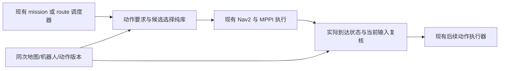

决策点只计算、不发速度。mission/route 各 profile 的 action 所有权维持单一链路，
不再套一个争抢 `/navigate_to_pose` 的公共服务器；狗洞 profile 中复用现有公共→内部
Nav2 边界。未来新增 goal-checker 或 sidecar 消费者须单列接口变更与接入验收，
本设计没有修改 topic/action/msg，也没有将 shadow 输出升级成控制权。

建议交接状态：Requested → Evaluating → Selected → Navigating → ArrivalCheck →
ActionReady → ActionExecuting。任何阶段 action/request generation 改变先作废旧选择。
导航 SUCCEEDED 只触发 ArrivalCheck，不直接授权下一动作；取消回调延迟到达也不能
触发旧动作。保持旧任务的取消/失败上限，不以终点重选构造无限恢复循环。

ArrivalCheck 至少要求：当前输入有效、实际 `(pose,twist,mode)` 落在合法终态集合内，
估计误差与停车/执行初段的扫掠包络也在安全域内。选定点安全不代表实际偏离位置安全。
对普通导航不要求无意义的固定 yaw；对 Spin，原地轴周围整个旋转包络必须安全；
对狗洞，检查实际模式、入口条件及既有准入/承诺边界。

不能通过 `yaw_goal_tolerance=π` 全局绕过姿态控制，不能把输出 quaternion 设为无效值。
若先采用原 Nav2 goal-checker 的兼容试验，仍要选具体 yaw 并按旧门到点；这只是受限
兼容候选，不能宣称完成了 yaw 自由的终态集合合同。原圆规划器继续拒绝的姿态候选
先保持离线；只有控制器路径、停止/偏差包络合同完备才可引入 SE(2) 末端连接。

## 7. 持续更新与安全余量

- raw master 254/255 与边界按闭格占用；253 继续中心禁入，不重复膨胀。不要把
  PreparedGrid 当 raw 地图。地图原点改变、重置、footprint 变化也使旧证书失效。
- 初版沿用当前完整 snapshot 不一致即拒收的语义，不在终点工作中顺便放宽它。
  地图不断更新可能导致无法交接；按缺失/过期证据返回，不凭历史空闲快照执行。
- 静态 sweep 只针对快照。高速 Spin 持续时间可能超过动态预测覆盖，必须有当前
  执行栈的持续监控及可安全制动的已验证能力；短时 shadow CLEAR 不覆盖整次 Spin。
- 普通 preemptible 阶段交接失败请求已有执行者取消/保持；已进入狗洞 committed
  段则遵守既有承诺通行与紧急规则。选择器不擅自在洞内停车，不发布另一股 cmd_vel。
- 保留实际 footprint、原 padding 0.03 m、clearance 0.02 m 和实测车体 0.05 m 门。
  三者不是任意形状都能简单相加的参数；必须分别记录使用的形状及物理间隙下界。
  数值 guard 只用于保守计算，不能拿来抵扣安全距离。

允许的参数来自几何尺寸、地图分辨率、动作目标区域、速度/制动能力、观测误差/延迟
及输入新鲜度。预算/最大细化深度是计算资源限制，耗尽返回 Unknown，不影响安全门。
现有速度/时效/噪声界需引用已验证来源；不能用地图分辨率推导定位误差。
例如 `v τ + v²/(2 a_brake)` 只在延迟和最小制动能力已验证时才可用于停车位移界；
缺少这些数据时只能交付离线几何结论，不能凭公式设一个经验安全系数宣称可高速执行。

## 8. 开发顺序与当前交付

1. **本轮完成：设计及复用审查。** 冻结 heading 125 份证据再次核对；无新的闭环结果。
2. **下一实现：离线、test-only 的普通停放/完整 Spin 可行性 + 有限候选选择。**
   合成完整 raw 地图；复用 pose_geometry；先分别报告几何和选择结果，执行准入固定
   NotEvaluated。加入拒收/未知/最近性边界用例；不接入 mission/Nav2，也不扩展狗洞/占领。
   可达性适配器先复用原圆模型的已认证路径；未实现 SE(2) 连接保持 Unknown。
3. **随后：精确完整 raw snapshot 回放与规划可达性。** 导出成功和拒收请求的同次
   输入，不从当前只有 witness 的日志重建一张虚假的全自由地图。
4. **再后：状态集合到点、实际状态交接与单一执行权接入。** 配置/接口独立实验；
   先无硬件状态机/故障注入，再低速静态仿真。先验证完整 Spin 的端点选择；
   普通姿态相关连接必须另过 MPPI 执行合同门，不与朝向 A/B 合并统计。
5. 狗洞/占领 provider 在动作几何与执行能力输入齐备后分别推进；高速 Spin、
   动态障碍和实车保持独立后续验收，不开启新的定位/MPC/UWB/因子图开发。

详细预期与停止条件见 [验收计划](p2b_terminal_selection_validation_plan.md)。
**设计检查不计入 87/87 或 56/56 的新通过数，不改变 P2B 尚未通过的状态。**
````

<a id="D0323"></a>

## D0323 — Terminal selection：离线到执行的验收计划

来源：`docs/tdt_migration/p2b_terminal_selection_validation_plan.md`；版本：`e680b1430db6efd8dc601d5585ee207e5f9b42a4`。
阅读副本：[独立原文](history_documents_20261004/legacy_e680b143/docs/tdt_migration/p2b_terminal_selection_validation_plan.md).
以下仅为历史资料，不构成继续研究授权。

````text
# Terminal selection：离线到执行的验收计划

2026-09-16。**下表为待实现/待执行的要求，不是测试结果。**
对应 [设计](p2b_terminal_selection_design.md)；当前只有既有 pose_geometry 19 项历史回归，
没有新 selector、动作 provider 或执行准入实现。

## 离线合成全图（下一实现阶段）

| ID | 输入/触发 | 必须得到的结果 |
| --- | --- | --- |
| T01 | nominal footprint 在指定 yaw 安全，但旋转中间碰撞 | 普通停放几何 Certified、完整 Spin Rejected；复用长旋转检查，不比较同 yaw 端点就放行 |
| T02 | nominal 支持完整旋转，附近也有自由格 | nominal 优先；yaw 选择不改变 Spin 扫掠判断 |
| T03 | nominal 不能旋转，稍远存在合法可达点 | 选有限候选集中最近合法点，报告位移和原点拒收 witness；不缩 footprint |
| T04 | 两个点都安全，较近点路径更长 | 仍优先较近点；只有距离相等才按路径长度、间隙、转角、ID 排序 |
| T05 | 最近安全点隔墙不可达，更远点可达 | 保留完整到达路径证据；不可达/优化超时分别报告，不把点安全当路径安全 |
| T06 | 253、254、255、边界、非零原点和临界闭格 | 维持原 raw 语义、闭格和未知处理，无第二次膨胀 |
| T07 | 正负 pi、2π、多圈、不同初始 yaw | 不把长旋转折成零或最短转角；完整 Spin 几何结论与初始 yaw 一致 |
| T08 | 比 incumbent 更近的候选因预算/几何 guard 未决 | 可记录安全 incumbent，但 selection=Incomplete，execution=NotEvaluated |
| T09 | 同距离次级比较未决、输入遍历顺序改变 | 无伪最近结论；可比较时结果确定，不能依赖哈希表遍历顺序 |
| T10 | 格中心均失败而格间确实有安全姿态 | NoCandidateInRepresentedSet 或 Incomplete，不输出“连续空间无解” |
| T11 | 开集只存在最优距离下确界、细化预算耗尽 | 不宣称找到了精确连续最小值；保留距离界与未决单元 |
| T12 | nominal 域外、局部地图截断、所需区域未知 | InvalidInput/Incomplete，不能默默贴边或扩大为全场地无解 |
| T13 | 缺 action、未知动作、缺占领条件、狗洞尺寸/ACK 不全 | Unknown/Unsupported；不兜底为普通导航，不直接读 spin_safe 布尔 |
| T14 | 输入数组被调用者随后修改、地图/footprint/action 版本变更 | 自持有快照不被污染；旧证书不能匹配新版本 |
| T15 | 两端安全但到达连接中间碰撞、姿态可行却圆规划器拒收 | 不发可执行证书；后者保留执行栈不兼容证据，不缩圆或伪造无路证明 |
| T16 | 相同输入交给独立几何/排序 oracle | 假安全为零；逐项核对候选集合与排序。密集采样只能反驳，不能替代连续证明 |

第一版只能报告有限候选集合的最近性；如果动作能力和运动误差尚未建模，整体
candidate_validity 不得写成全条件 Certified，即使 geometry 已通过。
普通停放 provider 对缺失的 yaw 搜索覆盖必须如实记录；其未找到有效 yaw 不能证明
该 XY 对所有朝向都不可行。

## 精确输入回放（独立后续阶段）

- 捕获完整 raw master 字节、原点/尺寸/分辨率、snapshot 身份、请求、padded/body
  footprint、动作版本、约束和构建提交；成功与失败都捕获。
- 核对序列中的 reset、rolling origin、unknown→free/occupied、地图晚于规划变化；
  发布 OccupancyGrid 与 planner snapshot 不等价，禁止用邻帧替代。
- 回放必须得到相同拒收原因、证书绑定和排序；预算退出可不同，但不得产生假安全。
- 当前 endpoint witness 只有局部拒收证据，无法重建整张真实地图；历史朝向 A/B
  不补写成 selector 回放通过。合成图严格标记 synthetic。

## 运行时交接（接口实现后才执行）

| ID | 触发 | 门 |
| --- | --- | --- |
| R01 | Nav2 SUCCEEDED，但实际停车位不能完整旋转 | 不启动 Spin，不把成功回调当准入 |
| R02 | 选点安全，实际偏移/速度或误差包络侵入障碍 | 拒收或 Unknown，由已有执行者停车；不能借 XY tolerance 绕过 |
| R03 | nominal yaw 任意改变，动作是普通导航 | 可行集合不受该无关 yaw 限制；实际 footprint 和到达合同仍严格检查 |
| R04 | 新目标/新动作到来、取消中的旧回调晚到 | generation 隔离，无旧动作启动，无重复 goal 或速度发布者 |
| R05 | 地图、机器人形状、语义区、动作参数改变；时间倒退 | 旧选择和准入失效，重新检查；不重复套用旧 READY |
| R06 | 地图持续变化、输入过期、低资源、服务超时 | 记录 Unknown/Incomplete；有限重试/保持，不以清图恢复掩盖语义失败 |
| R07 | Spin 目标多圈，预测时域仅覆盖短段 | 静态全转证明不能代替整个动作动态执行保护 |
| R08 | 狗洞进入前取消/进入 committed 后语义丢失 | 两阶段分别保持现有执行规则，选择器不擅自改通行承诺 |
| R09 | 到点误差看似可接受但新鲜停止命令/反馈缺失 | 不宣布动作准备好；区分命令为零与实际速度已停止 |
| R10 | 已有 mission 与狗洞 action profile 分别启用 | 各自唯一公共 action 入口、取消传播、单一最终命令链保持一致 |

## 新的仿真系列与报告口径

待上述接口具备后使用新 series；heading_follow_v1 只读。
首次执行前保存设计版本、源码、镜像、场景、动作输入和 profile 完整差异。只改变
terminal selection 一项，path-heading 开关与 controller 参数在对照两组保持相同。
第一轮优先用原 QP 默认 heading=false 对比“原 QP + Spin 终点选择”，不把两个功能
一起加入；之后才单独组合它们。未证实安全的 SE(2) 接口不能加入此比较。

同时保存：nominal 与 selected 的位移、实际位姿对两者的误差、动作可行性证据、
实际转速/停止状态、map/action revision、搜索未决、路径可达证明、recovery、
原 0.05 m 车体间隙与 padded 无接触、停止命令、导航与后续动作各自 status。
导航对 selected 的旧 0.15 m / 0.20 rad 检查只是兼容阶段条件，还必须过实际终态准入；
绝不能把 selected 当 nominal 改写旧指标。普通 XY-only 后续采用集合合同，应单独命名
验收 schema，不继承旧固定 yaw 验收结论。

首个有效功能/安全失败停止该组重复，共用记录/启动错误停止所有组。不得缩 footprint、
加大安全容差、改变断言、反复跑到通过；设备问题归档，不淘汰算法。
完整普通回归、相关新测试、统一 sanitizer 链应在新仿真前通过。
实现前不虚报新增测试数量，本设计阶段不重复运行无关 Gazebo 或全套构建。
````

<a id="D0324"></a>

## D0324 — P2B 静态仿真：Terra 验证交接

来源：`docs/tdt_migration/p2b_terra_handoff.md`；版本：`e680b1430db6efd8dc601d5585ee207e5f9b42a4`。
阅读副本：[独立原文](history_documents_20261004/legacy_e680b143/docs/tdt_migration/p2b_terra_handoff.md).
以下仅为历史资料，不构成继续研究授权。

````text
# P2B 静态仿真：Terra 验证交接

状态：**static_v3 常规 45 项通过，sanitizer 失败；构建链修复待 Terra 复验**。
本轮优先读 [sanitizer 构建链修复交接](p2b_sanitizer_chain_handoff.md)，使用 `static_v4`。
本文是执行规范，不是当前修复版的验证报告。
开发基线为 `ca608e5`；本交接属于 `experiment/tdt-planner-phase2`，实际交接提交号
由用户提供并与下文 `git rev-parse HEAD` 核对。P2A 的历史结果仍属于其原提交，
不要拿 P2A 的实现哈希清单检查本轮新增代码后就宣布历史证据损坏。

## 分工与范围

设计者负责架构、算法和业务代码、记录器及验收标准；Terra 负责按本文执行、保留
原始证据、分类问题并回传。Terra 不自行改算法、测试断言、目标坐标、footprint、
padding、clearance、控制器、安全门或超时来获得通过。涉及这些问题时停下对应阶段，
报告最小失败证据，交回设计者。报告和证据整理可由 Terra 完成。

当前设备造成的 CPU、内存、渲染速度、实时率问题只记录，不做性能补丁，也不作为
放弃方案的理由。保留运行时已有迟到拒收/停止语义；不能把等待新设备验证写成算法
已经淘汰。退出码或日志本身不一定能证明原因，例如 137 不能单独证明 OOM。

本交接只完成 **P2B 静态场景**：现有 Phase 1.5D 场景、原 MPPI、四个全局规划器，
目标 `(4.3, 0, 0)`，每组最多 5 次全新容器。移动障碍、现场 LIO/STVL 负载、实车
均不在此轮执行范围。历史 Phase 1.5D 动态安全失败记录仍有效。

## 持久路径与恢复

| 内容 | 路径 |
| --- | --- |
| 代码 | `/home/wpie/worktrees/rm2027_tdt_phase2` |
| 依赖、构建、配置、日志 | 代码目录下 `build/tdt_p2b/` |
| 本次试验原始数据 | `build/tdt_p2b/runs/static_v4/<planner>_<trial>/` |
| 回传报告模板 | `docs/tdt_migration/p2b_result_template.md` |
| 当前进度 | `docs/tdt_migration/p2b_work_status.md` |

容器内 `/ws` 为只读代码，`/work` 为上述持久数据目录；容器没有主机网络或设备
挂载，ROS domain=174、localhost only。内部临时文件也定向到 `/work/tmp`。
`build/` 已由仓库规则忽略；不要删除它来清理 git status，也不要提交整个构建目录。
会话中断后先查看 git 状态、已有日志和各次 `summary.json`，不得覆盖或重跑已有编号。
缺少末尾 summary 的目录属于未完成证据，不算一次通过。

## 1. 核对交接版本

在主机执行以下命令；无需在主机安装 ROS：

```bash
cd /home/wpie/worktrees/rm2027_tdt_phase2
git branch --show-current
git log -1 --oneline
git status --short
pkg="$PWD/experiments/tdt_planner/rm_tdt_planner"
work="$PWD/build/tdt_p2b"
mkdir -p "$work/handoff_logs"
```

预期分支为 `experiment/tdt-planner-phase2`，提交号与用户提供的交接提交一致，
相关代码没有未提交改动。不要切换主实车工作区分支或操作其三个现场配置改动。
`run` 会拒绝未提交的相关源码；编译/日志产物不会导致此项失败。

读取 `p2b_work_status.md`。e85b076 构建、39 项测试和两组基线静态验证已通过，
T-DT 两组首例失败。74f68e2 常规 45 项通过，sanitizer 失败；保留 static_v1/v2/v3。

## 2. 依赖与构建

只有依赖缺失或其固定 SHA/安装前缀不完整时才执行 `deps`。它会在主机显式取回
固定版本，然后在离线容器构建；不运行上游 setup 或安装系统软件。

```bash
set -o pipefail
# 按需执行；已有 build/tdt_p2b/deps_source 与 deps 可先核对后复用。
bash "$pkg/tools/p2b_validation.sh" deps 2>&1 | tee "$work/handoff_logs/dependencies.txt"

bash "$pkg/tools/p2b_validation.sh" build 2>&1 | tee "$work/handoff_logs/build.txt"
```

预期：6 个既有仿真相关包可构建，随后 `rm_tdt_planner` 构建成功。
构建选项包含 `BUILD_TESTING=ON` 和 `RM_TDT_BUILD_BENCHMARK=ON`。
若依赖已验证，不要重复下载；如果源 SHA 不符、包缺失或链接失败，保留完整命令、
退出码和首个有效错误，停止后续仿真。不要临时升级求解器或改变构建配置。

## 3. 自动测试与配置核对

```bash
bash "$pkg/tools/p2b_validation.sh" check 2>&1 | tee "$work/handoff_logs/tests.txt"
bash "$pkg/tools/p2b_validation.sh" sanitizers 2>&1 | tee "$work/handoff_logs/sanitizers.txt"
bash "$pkg/tools/p2b_validation.sh" profiles 2>&1 | tee "$work/handoff_logs/profiles.txt"
```

修复版预期 CTest 有四个入口：

| 入口 | 期望测试数 | 检查内容 |
| --- | --- | --- |
| `planner_safety` | 25 个 GTest | 原 24 项及 1 项求解器跨库分配/析构回归 |
| `nav2_plugin_contract` | 4 个 GTest | 原插件合同及 master 内切区/原地图不变回归 |
| `simulation_evidence_tools` | 13 个 Python unittest | 多边形几何、间隙/到点分离、缺证据拒绝、性能约束、四配置一致性 |
| `simulation_ros_messages` | 4 个 Python unittest | 真实消息序列化与回调、日志等级、有符号 costmap、异常证据与清理 |

**共 46 个用例是本修复版预期值，尚未实测。** 74f68e2 的 45 项通过仅属于旧版。
只有全部通过才进入下一步。Python fixture 不是 Gazebo，4 个 CTest 入口也不是 4 个场景。
本轮按新交接统一插桩构建求解器与 core，执行构建链审计、边界用例 1 项及全套
25 项核心 sanitizer（边界用例已包含在 25 项中）；未修改 core/vendor 规划算法。默认离线语义保留，无需无理由重跑 P2A 的 3,200 次比较。

`profiles` 生成 `profiles_p2b/{navfn,smac2d,tdt_astar,tdt_qp}.yaml`。重复调用仅核对，
不会覆盖。唯一不同的配置块是 `planner_server.ros__parameters.GridBased`。
MPPI、BT、costmap、footprint、padding 保持原仿真值。配置被修改时脚本应拒绝。

这里车体模型是原仿真 0.60×0.50 m、padding=0.03 m，与 P2A 旧车 0.64×0.54 m
不同，不能直接拼接两轮统计。Smac2D 保留 Humble 自带平滑；T-DT 的后端仍输出
几何折线。所有方案保留自己的原生代价处理，没有声称完全相同的优化目标。

## 4. 每组第一次静态试验

使用上述统一入口，每次命令都会新建隔离容器、启动同一场景，自动预检查一次
`ComputePathToPose`，再发送一次 `NavigateToPose`。不用手动发布 `/cmd_vel`。
先逐条执行并查看每条结果，**不要先批量循环**：

```bash
export P2B_SERIES=static_v4
bash "$pkg/tools/p2b_validation.sh" run navfn 1
bash "$pkg/tools/p2b_validation.sh" run smac2d 1
bash "$pkg/tools/p2b_validation.sh" run tdt_astar 1
bash "$pkg/tools/p2b_validation.sh" run tdt_qp 1
```

每个命令结束后检查对应目录：

```bash
cat "$work/runs/$P2B_SERIES/navfn_1/observation/summary.json"
```

将路径中的方案名替换为实际方案。命令持续期间可通过另一个终端读取该次日志；
若记录资源，只查看该次 `container_id` 指向的容器，例如：

```bash
trial_dir="$work/runs/$P2B_SERIES/navfn_1"
docker stats --no-stream --format '{{json .}}' "$(cat "$trial_dir/container_id")" \
  >> "$trial_dir/resources.jsonl"
```

若试验仍在运行，可在另一个终端只读记录该容器的节点与 TF。下面的 timeout 退出码
124 表示观察窗口正常结束，不能单独算 TF 失败：

```bash
trial_id=$(cat "$trial_dir/container_id")
docker exec "$trial_id" bash -c 'source /opt/ros/humble/setup.bash; ros2 node list' \
  > "$trial_dir/node_list.txt" 2>&1
docker exec "$trial_id" bash -c 'source /opt/ros/humble/setup.bash; timeout 5s ros2 run tf2_ros tf2_echo map odom' \
  > "$trial_dir/map_odom_tf.txt" 2>&1
```

需要核对：

1. `launch.log` 有两条 `[TDT_P2B] spawn_course_wall_{north,south} exit=0` 标记，
   Nav2 lifecycle 激活、scan/odom/costmap 到达。记录器据此等待，缺输入不会发目标。
2. 读取静态 SDF 与本次 costmap/路径/轨迹，确认中心块和两条通道墙的感知符合场景。
   spawn 进程成功不单独证明所有墙面已被感知；这项需要复核数据。
3. 原模拟链保持 `map_odom_stub` 的恒等 map/odom、`lio_adapter` 的 odom/base、
   robot_state_publisher 静态 TF。场景假定 map 与 odom 相同；若 launch/TF 与该
   前提不符，应停止并报告，不能通过另建 TF 修正轨迹图。
4. `preflight.status`、`action_status`、`checks`、间隙和最终误差分别报告。
   action status=4 只说明 Nav2 返回成功，不能替代几何检查。
5. 查看 `events.jsonl` 中 costmap/footprint changed、deadline、起终点不可行、
   恢复等事件，并对照 `plans.jsonl`、`trajectory.jsonl`、`commands.jsonl`。
   未观察到并发 snapshot 拒收时，写“未覆盖”，不能把 0 次拒收写成这项已经通过。

试验结束后可以在主机导出 SVG，查看中心块、两条通道墙、全部已发布路径、实际轨迹
和抽样 padded footprint；无需安装绘图库：

```bash
python3 "$pkg/tools/plot_simulation.py" "$trial_dir/observation" \
  --output "$trial_dir/trajectory_review.svg"
```

打开 SVG 并对照原始 costmap 与统计检查。图是检查辅助，不能凭线条好看宣布通过。
没有 trajectory 的启动失败不能画导航轨迹，应保留原始启动日志。

记录器以消息时间保存约 25 Hz 的位姿、全局规划折线、最终 `/cmd_vel`、完整发布的
costmap 和警告。`costmap.jsonl` 是 Nav2 发布快照，不能据此精确重建两次发布间
每一版内部代价图。预检查的 wall_ms 包含 action 往返，不是纯 core 求解时间。

单次退出码：0 为有限静态几何/到点检查通过；1 为检查未通过；2 为证据或工具/启动
不完整。容器异常还可能产生其他码；先读日志分类，**均不是自动淘汰算法的信号**。
任一组首次有功能或安全失败时，停止该组剩余重复；其他独立组可继续首次检查。
如果是共用启动、依赖或记录器错误，则停止全部仿真，交回设计者处理。

## 5. 完成静态矩阵

只对首次已通过且人工核对无问题的方案执行剩余编号。例：

```bash
for trial in 2 3 4 5; do
  bash "$pkg/tools/p2b_validation.sh" run navfn "$trial" || break
done
```

逐组将 `navfn` 替换为其他已通过方案。每次都是新容器与新场景；首例计入 5 次。
命令拒绝覆盖已有编号。中断或新设计版本需要另一个 `P2B_SERIES`，旧目录保留并在
报告说明；不能删除失败记录后以同一矩阵补成 5/5。不同源码/镜像/场景哈希不得混为
一组。仿真噪声未冻结为相同序列，这是相同场景多次重启，不是严格同噪声回放。

静态检查采用：5/5 Nav2 成功、最终位置误差 <=0.15 m、yaw <=0.20 rad、无恢复、
原 footprint 间隙 >=0.05 m、padded footprint 无接触、末尾有新鲜停止命令。
轨迹采样缺口 >0.20 s 会标为证据不完整；此阈值用于记录质量，不用于淘汰算法。

几何量必须按以下含义解释：

- 对原静态方块/墙体计算旋转矩形的精确距离；接触/相交距离为 0。
- 另给相邻位姿线性平移与 yaw 插值的保守距离下界；它不是对采样间真实 Gazebo
  运动的无条件证明，更不是对所有机器人几何或真实接触传感器的替代。
- cross_track 是到最近收到的全局折线的距离，重规划会改变参照；不是 MPPI 内部
  局部参考的误差。用轨迹图和 plan revision 一起复核。
- command acceleration 是命令差分，不是测得的动力学加速度或 jerk。本轮不验收 MPC。
- CPU、wall time、控制周期告警与数据缺口单独记录。明确由当前设备资源限制导致
  的项目留待新设备，不改 MPPI 参数、渲染精度或数据频率来获得当前设备通过。

## 6. 汇总与回传

完整或中断的矩阵均运行汇总，输出可审查结果：

```bash
bash "$pkg/tools/p2b_validation.sh" summarize
```

输出保存在当前 series 的 `aggregate_<UTC>.json`，不会覆盖之前汇总。汇总会回读
原始 trajectory/commands/events 复算统计，核对 profile、源码/镜像/场景一致性并
生成原始文件 SHA。缺样本、缺试次或报告不一致不会得到通过；部分矩阵仍能出报告。

从 `p2b_result_template.md` 创建一个新的实际验证报告，建议保存在
`docs/tdt_migration/evidence/p2b_static_<日期>/`。放入报告、aggregate、构建/测试日志
和必要失败片段；较大的 costmap/trajectory/ros 日志留在持久 `build/tdt_p2b/runs/`，
在报告写绝对路径与 SHA。不要将整套 build、求解器源码或 Gazebo 缓存加入 git。
允许 Terra 写报告；源码修正、修改验收门、发布或合并代码由设计者复核后处理。

## 故障归类与停止条件

| 现象 | 本轮处理 |
| --- | --- |
| 构建/导入/脚本错误 | 保留首个有效错误及命令；停止依赖此工具的后续步骤，不临时改源码 |
| 缺 scan/clock/墙体/lifecycle | 记录 readiness 和 launch 日志；先标基础设施/输入问题，不归因规划算法 |
| T-DT 起终点在保守自由区外 | 保存同次 costmap、目标和 profile；不要移动目标或缩 footprint。需要设计者分析二次膨胀等语义 |
| 规划时 costmap 改变被拒收 | 记录次数、后续 action 和停止/重试；偶发拒收与持续无进展需分开 |
| Nav2 成功但间隙/终点/停止失败 | 静态检查失败，保留轨迹与相应命令，停止该组重复 |
| 明确的设备资源不足 | 记录观测与证据，标待新设备验证，不做性能优化、不淘汰方案 |
| 记录器证据矛盾/丢失 | 标 UNKNOWN/未覆盖，不能把缺数据填成 0 或通过 |

## 可直接交给 Terra 的任务说明

> 请在 `/home/wpie/worktrees/rm2027_tdt_phase2` 执行
> `docs/tdt_migration/p2b_sanitizer_chain_handoff.md`，再按本文继续。
> 先核对用户提供的修复提交号，保留 static_v1/v2/v3，使用新 static_v4。
> 你负责验证和报告，不改算法、业务代码、测试断言或安全参数。按顺序运行工具检查、
> 构建/CTest、四配置核对、各组首次静态试验，再按门完成最多 5 次矩阵。失败按文档
> 分类并保存原始证据，不为通过而修改配置。设备性能问题只记录，后续换设备验收。
> 所有目录放在 `/home`，不要覆盖已有运行或删除 build。用回传模板写报告，给出
> 提交号、执行命令/退出码、aggregate 与原始日志的绝对路径，明确未执行和未覆盖项。
> 不执行移动障碍、实车、push 或 merge。完成后将结果返回给设计者复核。
````

<a id="D0325"></a>

## D0325 — P2B 无实车期间的推进边界

来源：`docs/tdt_migration/p2b_without_hardware_plan.md`；版本：`e680b1430db6efd8dc601d5585ee207e5f9b42a4`。
阅读副本：[独立原文](history_documents_20261004/legacy_e680b143/docs/tdt_migration/p2b_without_hardware_plan.md).
以下仅为历史资料，不构成继续研究授权。

````text
# P2B 无实车期间的推进边界

2026-09-22 用户确认：新车尚未制造完成；老车雷达线故障、正在更换，当前没有可用实车。
**这不阻塞当前软件/仿真工作，实车验收保持待执行。** 不用占位尺寸补写机械确认项。

## 当前可以完成

- 已冻结的 `snapshot_revalidation_v1`：A*、QP各5/5静态通过、十次零恢复。
- 复用既有Phase1.5D移动障碍，独立记录Gazebo实际模型/连杆位姿与ROS轨迹，
  计算新车参考polygon、旧车矩形和仿真载体各自的动态间隙；不拿障碍指令当真实运动。
- 新动态首例试验单独归档：原参数、安全门、heading开关保持；目标采用已有动态规程的 `(5.6,0,0)`。
  原12m滚动窗口不足以满足这个目标的完整footprint边界要求，保留首例失败后，
  按几何覆盖需求派生13m宽度，另开series。该变化只在动态实验profile，不改部署默认。
- 在固定证据上审查规划拒收、A*安全回退、MPPI行为、数据间隔、障碍标记/清除。
  只有实际覆盖的项目才给结论，不用action成功替代动态安全，也不把首例当10次验收。
- 继续保留纯软件的边界/未知cell/新增障碍回归；故障注入、完整持锁时间测量和目标设备全负载可另立试验。

## 仍缺少的机械资料

本地 `main-new-car` 仍指向 `bd6cf68`，没有比上轮审查更新的已确认整车包络。
当前采用已有382/126mm八边形，用户近似127mm的差异仍只保留为敏感性分析；
base_link、几何中心、Spin中心共点已经用户确认。

新车轮组/附件最终外伸、轮径/轮距、质量/惯量等尚不能从现有占位SDF推出。
因此暂不修改SDF假装完成真实整车建模，不为通过而删掉突出轮组或关闭碰撞。
动态仿真沿用载体，报告明确区分“目标平台算法参考几何”和“真实物理整车”。
资料确认后再复用同一来源生成完整碰撞包络，不需要等整车造好才开始几何审查。

## 哪些阶段需要车辆

| 阶段 | 是否需要实车 | 作用与边界 |
| --- | --- | --- |
| 软件回归、sanitizer、记录器和几何复算 | 不需要 | 当前可持续完成 |
| 静态/移动障碍算法仿真 | 不需要 | 验证接口与已声明模型，不能替代真实雷达、定位、制动 |
| LIO/双STVL/MPPI全负载 | 不必有运动底盘 | 需要目标计算设备及有代表性的传感器/回放输入；尚未完成 |
| 老车修复后的低速验证 | 需要可用老车 | 验证定位/传感器时序、跟踪、停止与真实clearance；保留旧车独立物理安全oracle |
| 新车最终部署验收 | 需要可用新车 | 确认真实包络、轮组/速度符号、动力学、外参、Spin扫掠与整机闭环 |

老车试验不证明新车动力学；新车reference footprint安全也不授权老车通过。
狗洞保持专项流程。当前不接管真实底盘，不启动新的定位、MPC、UWB、因子图或terminal selector，
航向A/B保持冻结。下一步依据独立动态试验真实结果决定，不为填满矩阵反复试到通过。

## 本轮已完成及下一步

[动态首例真实回传](evidence/dynamic_reference_20260922/validation_20260922.md)：
A*与QP均action成功，但恢复分别1/13次，实际移动障碍与参考本体均发生平面重叠。
两个组停止重复；QP导航后参数服务查询超时也原样保留，没有补造完整raw图。
下一步使用已冻结的失败时间窗审查障碍观测、局部图、MPPI与停令响应，可在无车辆条件下完成。
该问题尚未归因到单一模块，不因终点最终成功而忽略动态安全失败，也不立即开发terminal selector。
````

<a id="D0326"></a>

## D0326 — P2B 持久工作记录

来源：`docs/tdt_migration/p2b_work_status.md`；版本：`e680b1430db6efd8dc601d5585ee207e5f9b42a4`。
阅读副本：[独立原文](history_documents_20261004/legacy_e680b143/docs/tdt_migration/p2b_work_status.md).
以下仅为历史资料，不构成继续研究授权。

````text
# P2B 持久工作记录

2026-09-22 离线动态诊断更新：**碰撞前已有匹配雷达回波与100致命格；首次重叠时最近发布图仍显示本体间隙0.093/0.131m。**
原数据只记录平滑后/恢复共用的cmd_vel，缺少原始cmd_vel_nav与MPPI同次内部图/rollout，不能单独归因控制器或平滑器。
原“99个lethal”更正为99/100两类合计；实际几何侵入结论不变。新离线测试5/5，新增导航试次0。
[失败时间窗审查及下一项观测范围](evidence/dynamic_failure_analysis_20260922/validation_20260922.md)。
下一步补齐独立诊断series的控制输入/输出与运行footprint证据；不调heading、terminal selector或安全门。

2026-09-22 动态阶段更新：**A*、QP首例均到点，但分别恢复1/13次，参考八边形与实际移动障碍均发生平面重叠；动态安全门失败，已停止两组重复。**
[动态报告](evidence/dynamic_reference_20260922/validation_20260922.md)、
[审计汇总](evidence/dynamic_reference_20260922/aggregate.json)、[无实车推进边界](p2b_without_hardware_plan.md)。
新车未造好、老车雷达线维修不阻塞下一步仿真诊断。新增动态oracle测试5/5通过；运行时源码未改。
原12m地图对动态goal5.6m的边界拒收已保留，独立v2仅按几何覆盖推导13m窗口；没有缩小footprint或放宽安全门。
QP导航后参数服务超时，缺少最终完整raw图/footprint独立确认，不能称证据全项完整。
下一步在已冻结的碰撞前时间窗审查scan/局部图、MPPI评分与停令响应，暂不归因到单一模块。
terminal selector仍暂缓、heading A/B冻结；新车最终整车包络和实车验收保持待执行。

此前静态阶段（证据与结论保持）：**快照复查修复 `a419654` 已接入并完成验证：A*、QP各5/5静态通过，十次零恢复。**
构建、常规101/101、独立统一sanitizer链及core70/70通过。
全新 `snapshot_revalidation_v1` 完成10次T-DT目标矩阵，实际8次快照变化复查通过；
QP采用63条、安全A*回退13条，没有endpoint拒收。未运行本轮Navfn/Smac2D，不能称四组20次全通过。
[完整回传](evidence/snapshot_revalidation_20260922/validation_20260922.md)、
[审计汇总](evidence/snapshot_revalidation_20260922/aggregate.json)、
[修复审查与授权](p2b_snapshot_revalidation_review.md)。

当前nominal在已有382/126 mm八边形参考几何下合法；terminal selector继续暂缓，航向A/B冻结。
后续仍需闭环新车真实整车/轮组碰撞包络和目标设备全负载；动态首例进展见顶部。
全局T-DT仍使用新polygon派生保守圆，最终CAD/动力学、动态footprint同步与完整持锁时间未验收。
保留老车实际运动独立安全oracle，狗洞专项隔离；没有部署、push或merge。

以下为历史检查点，不替代上述最新结果。

状态（2026-09-21）：**新车八边形参考几何已消除当前 nominal endpoint blocker；
A*、QP 均到点但各一次恢复，静态零恢复门仍未通过。terminal selector 暂缓；航向 A/B 冻结。**
基线 `cb48ba4`。本轮仅采用已有 382/126 mm 参考顶点，127 mm 做敏感性复算，未确认最终 CAD。

完整审查与本轮回传见 [新车几何审查](p2b_new_car_geometry_review.md)：
Spin 本体半径0.339020 m；保留 padding/clearance 后要求0.400789 m，旧 witness距离0.430116 m。
v2目标平台轨迹/停车/静态Spin检查通过，唯一失败门为 no_recovery；2/10目标组试次后停止重复。
QP实际采用14次、安全A*回退2次；没有 endpoint拒收。全局T-DT仍为从新polygon自动推导的
保守圆，尚未完成纯polygon路径准入；占位轮组与最终整车包络也未闭环。

该阶段下一步为诊断 snapshot 更新拒收与恢复时序（现已完成，见顶部）；安全门保持，不实施 selector、不调航向。
旧车真实运动仍须独立真实几何安全检查，狗洞专项保持隔离。

以下为此前阶段记录，不能替代本轮验证。

## 2026-09-16 航向实验历史证据

- 87/87 常规回归、统一 sanitizer 链审计和 56/56 core 通过。
- `heading_follow_v1`：原 QP / 航向跟随 QP 首例均 action=6、静态门 false，恢复
  18/22 次。两组均停止重复；没有将旧 series 结果填入本 A/B。
- 航向跟随候选复用已有 `828d4d8` path_aligned 策略，增加连续路径 yaw 和原生
  MPPI 对 orientation 的评分。实际运行参数已核对。
- 行进 yaw-to-path RMS 0.977 → 0.321 rad、yaw-to-motion RMS 1.004 → 0.506 rad；
  整段实际 wz RMS 0.293 → 0.366 rad/s，峰值均 1.0 rad/s，未消除终点旋转/恢复。
- 两组间隙门通过，终点位置/yaw/action 均未通过。候选 16 条端点拒收全部含
  同次快照的 goal blocked 证据，圆模型不等式未因路径 yaw 改变。
- 保留为默认关闭的跟踪候选；一对 A/B 不能证明稳定收益或总体成功率，不推广部署。
- [真实回传与冻结证据](evidence/heading_follow_20260916/validation_20260916.md)、
  [复用/差异/命令](p2b_heading_follow_experiment.md)。

## 工作顺序

由开发者完成实现、验证和复核；Terra 可做独立审查。所有文件在 `/home`。
此前朝向实验结束，不继续在同一系列调参；当时下一项独立讨论用户提出的
`nominal goal + next action + map + robot geometry` 自动推导与选择合法终端状态。
本轮没有实现该机制，也没有改变固定 goal yaw、安全门、控制权或部署默认。

此前 test-only 的离线 SE(2) 连续几何库已有 19 项回归，并在2026-09-16轮统一 sanitizer 中
通过；未接入 Nav2，不构成新的终点合同或闭环通过证据。
旧 v1–v5、endpoint_witness_v1 和用户后来以 cb48ba4 归档的 v4 报告保持不变。
当时规划迁移到可部署候选的阶段估计约55%；本轮未重新估计百分比，不能将它解释为测试通过率或工时。
未部署、push、merge，动态障碍、新设备全负载与实车仍待验证。

## 2026-09-16 终端选择设计检查点

已完成 [接口、复用与算法设计](p2b_terminal_selection_design.md) 及
[离线/交接验收计划](p2b_terminal_selection_validation_plan.md)。先区分普通停放与
完整 Spin 的可行集合；复用已有 mission/狗洞执行权和 test-only pose_geometry。
当时计划下一实现只做离线普通停放/Spin provider 与有限候选选择（现已暂缓），执行准入保持 NotEvaluated；
尚无 selector 测试、真实快照回放或新闭环通过证据。狗洞/堡垒先保留动作接口和缺失项，
不扩展执行器，不同时改控制器。此次只改文档，旧 heading 125 份证据保持不变。
````

<a id="D0327"></a>

## D0327 — T-DT 规划候选：2026-09-12 离线验证

来源：`docs/tdt_migration/validation_20260912.md`；版本：`e680b1430db6efd8dc601d5585ee207e5f9b42a4`。
阅读副本：[独立原文](history_documents_20261004/legacy_e680b143/docs/tdt_migration/validation_20260912.md).
以下仅为历史资料，不构成继续研究授权。

````text
# T-DT 规划候选：2026-09-12 离线验证

结论：**规划前后端隔离集成与自动化回归通过；当前证据不足以替换 Navfn/MPPI
部署基线。** 未做 Gazebo 导航闭环、录包运行负载回放或实车验收。

## 可复核输入

- 项目基线 `46c521b`，实验分支 `experiment/tdt-planner-intake`。
- 上游 `a4bddc467f84d2418a4de06c65c8c79403eb4a13`，精确范围/依赖/补丁见
  [`../external/tdt_nav_kit.md`](../external/tdt_nav_kit.md)。
- 机器：Intel Core i7-10710U；镜像 `rm2027_navigation:humble`。
  GCC 11.4.0、Eigen 3.4.0、Nav2 Humble `1.1.20-1jammy.20260607.*`。
- 容器 `--network none`、UID 1000、工作区只读、无设备挂载；ROS_DOMAIN_ID=173，
  ROS_LOCALHOST_ONLY=1。仅依赖构建目录允许写入生成头文件。
- 当前实验文件 SHA256：[`evidence/implementation_sha256.json`](evidence/implementation_sha256.json)。
- 用户定位稿 SHA256：`1224d5defc4a776ee3676fbdee99fdc4f95a6c0d4abb159c8295b3c0d3afdb0b`；
  导航稿：`68abeba991a908f0e0ddc4b79737c2a2b11e75cd6948396621ec84629cb116ed`。
  稿件原文件未改、未复制进仓库。

## 构建和回归

| 检查 | 结果 |
| --- | --- |
| OSQP 0.6.3 / OsqpEigen 0.8.1 固定 SHA 校验与离线构建 | PASS；仓库脚本实际执行，5 份依赖版权/NOTICE 已复制 |
| 常规 `colcon list --base-paths /ws` | 23 个现有包，不含实验包 |
| 显式指定实验 package 的 colcon 构建 | PASS，1 个 package；不依赖日常 install |
| 算法/适配核心 | **17 tests passed** |
| pluginlib 实际加载、Humble API、生命周期与基准 | **3 tests passed** |
| ASan + UBSan + leak detection 核心测试 | **17 tests passed**；使用匹配 ASan OsqpEigen |
| 上游补丁可应用、逐文件原始/本地 SHA | PASS |
| 新完整 profile 生成 | PASS，仅 GridBased 配置变化；保留 controller/costmap/BT |
| 覆盖同名输出负例 | PASS，拒绝写入；包括不覆盖用户 baseline 的语义 |

证据：[ROS2 测试全文](evidence/tests_ros2_20260912.txt)、
[内存检查测试全文](evidence/tests_sanitized_core_20260912.txt)。CTest 显示 2 个
test executable，内部是 17 + 3 个 GTest case，不能把“2 tests”误报为只有 2 个场景。

核心场景包括：非零/负地图原点、精确起终点、同格/同点、完整墙无解、未知和
inscribed cost、窄口外接圆拒绝、NaN/非法尺寸/参数、边线终点、超时拒收、
稀疏输出跨障碍检查、地图变化后不复用旧路径、关闭后端、控制点超预算回退、
真实 QP/几何拒收回退、20 组确定性随机障碍及独立几何距离 oracle。
上游修补另用 10 组确定性场景与独立 Dijkstra 最短代价结果对照。

ASan 第一次混用了 release OsqpEigen 和插桩调用者。Eigen `Memory.h` 根据
`__SANITIZE_ADDRESS__` 选择不同的 aligned malloc/free 分支，导致跨库释放模式
不匹配。重新构建同模式 OsqpEigen 后通过；没有屏蔽该错误或关闭检测。
ASan 覆盖本地 core、导入 T-DT 与 OsqpEigen；OSQP C 库保持原 release 构建，
这不是对所有第三方依赖的完整 sanitizer 审计，也不是 ROS 插件的 sanitizer 验收。

## 同一静态 snapshot 的微基准

100×80、0.1 m 栅格；全向矩形 footprint，由 Costmap2DROS 提供 padded footprint；
测试没有运行局部控制器。两场景为开放区域与带软膨胀 cost 的墙体绕行。
每个方案每场景重复 20 次，共 120 次调用，所有调用均返回路径。
Navfn 为安装版本默认 Dijkstra，T-DT 分为 optimize=false / true。

| 场景 | 方案 | 成功 | P50 ms | P95 ms | 最大 ms | 平均路径长度 m |
| --- | --- | --- | --- | --- | --- | --- |
| 开放 | Navfn Dijkstra | 20/20 | 0.217 | 0.298 | 0.303 | 7.397 |
| 开放 | T-DT A* | 20/20 | 1.099 | 1.423 | 1.545 | 7.548 |
| 开放 | T-DT A* + QP | 20/20 | 1.283 | 1.548 | 2.540 | 7.456 |
| 绕墙 | Navfn Dijkstra | 20/20 | 0.295 | 0.422 | 0.817 | 11.009 |
| 绕墙 | T-DT A* | 20/20 | 1.734 | 2.115 | 2.563 | 13.027 |
| 绕墙 | T-DT A* + QP | 20/20 | 2.259 | 2.775 | 2.957 | 12.072 |

原始每次数据：[`evidence/benchmark_20260912.csv`](evidence/benchmark_20260912.csv)。
P95 使用 20 个样本中的第 19 个值，不用如此小的样本估计可靠 P99。
QP 模式具有安全回退；CSV 记录的是选择模式，不包含每次优化采用标志。
核心测试独立证明了至少开放场景确实采用后端输出，并证明回退场景有效。

解释：QP 在这两幅图上相对 T-DT A* 缩短了折线，仍比 Navfn 慢且路径更长。
这不能推出 Navfn 在所有任务更好，也不能宣称 T-DT 已胜过现有系统：T-DT 包括
保守 footprint 再膨胀、独立线段检查、额外 snapshot 检查，并且重建势场后没有保留
Navfn 输入中的所有软 cost；两者并非完全相同的碰撞/代价问题。
本轮没有测实际横向跟踪误差、加速度/jerk、最小执行间隙、全负载 CPU/RSS 或长期
规划成功率，也没有复制分享稿的“十万次”实验。

## 保留的限制和下一门

1. 仅验证几何折线，未恢复连续时间轨迹。没有多项式全程碰撞、速度/加速度硬约束
   或 TinyMPC/IPOPT 控制验收。
2. 外接圆与 253 区域再次膨胀可能拒绝窄通道；狗洞/坡道继续使用现有专项流程。
3. 时间预算只能拒收迟到结果；大图 EDT 和单次 QP 不可硬抢占。负例已观察到
   1 ms 预算后仍需等待大图计算退出，所以不宣称硬实时。
4. 源码实现了求解结束 snapshot/footprint 变化时拒收；已测试跨调用地图变化。
   持续并发 costmap 更新、TF/时钟异常和动态障碍闭环仍需仿真/回放压力验证。
5. 未执行完整仓库回归：改动是被默认排除的独立 package 与文档，现有 src 配置和
   launch 未修改。原工作区仍在 `fix/old-car-fast-lio-high-spin`，保留 3 个 tracked
   现场改动以及 bags/logs。

下一步按 [`assessment_and_plan.md`](assessment_and_plan.md) P2 做相同碰撞口径的
Nav2 仿真/匹配地图回放比较，再决定是否保留 QP 或改用成熟 Nav2 A*。本轮不把插件
写入部署默认，也不自动进入实车或开启其他冻结实验。
````

<a id="D0328"></a>

## D0328 — T-DT P2A：2026-09-13 统一几何的离线比较

来源：`docs/tdt_migration/validation_20260913.md`；版本：`e680b1430db6efd8dc601d5585ee207e5f9b42a4`。
阅读副本：[独立原文](history_documents_20261004/legacy_e680b143/docs/tdt_migration/validation_20260913.md).
以下仅为历史资料，不构成继续研究授权。

````text
# T-DT P2A：2026-09-13 统一几何的离线比较

**P1 保存完整；P2A 已完成。保留 T-DT 前后端候选，下一步验证 MPPI 跟踪与连续
costmap 更新。未替换部署默认，未执行 Gazebo 闭环或实车运动。**

按用户本日补充要求，当前设备造成的性能问题不进行专项优化，也不作为放弃方案
的因素。下表耗时只保留原始观测；后续换高性能设备再验完整导航负载。方案价值以
正确性、安全性、接口语义和实际跟踪效果判断。

## 保存核对与本轮范围

- 用户提交 `359fd7115b0052e7196cc00fae464646f42977e0`：34 个文件已保存。
  本轮实际通过 `git ls-remote` 确认 Gitee 的
  `refs/heads/experiment/tdt-planner-intake` 指向同一提交；P1 工作区干净。
- P1 工作区实际在 `/home/wpie/worktrees/rm2027_tdt_planner`，不再是旧 `/tmp`
  路径。P1 实现清单与提交中的文件核对通过；原 P1 报告保留其日期和统计口径。
- P2 从 `359fd71` 创建 `experiment/tdt-planner-phase2`，最终保存到
  `/home/wpie/worktrees/rm2027_tdt_phase2`。构建和原始运行先在独立 `/tmp` 目录
  进行，日志中的 `/ws`、`/work` 是容器挂载路径。
- 恢复已清除的临时求解器依赖，继续使用 P1 固定 SHA；没有升级上游或重复导入。
- 新增不可变配置空间输入、四方案比较程序、独立连续折线几何检查与配对汇总。
  `PreparedGrid` 仅由原膨胀算法构造，拒绝不同 footprint/clearance 的规划选项。
  Nav2 插件仍走原来的 raw snapshot → 膨胀 → 规划 → 更新检查流程。
- 现有 `src/`、现场地图、录包和用户三个未提交的配置/launch 文件未修改。

## 输入与可复现条件

| 项目 | 固定值 |
| --- | --- |
| 机器 | Intel Core i7-10710U，12 逻辑 CPU；未固定频率/绑核 |
| 镜像 | `rm2027_navigation:humble`，ID 见 `manifest.json` |
| 工具链 | GCC 11.4.0、Eigen 3.4.0、ROS2 Humble Nav2 1.1.20 |
| 求解器 | OSQP 0.6.3、OsqpEigen 0.8.1；沿用 intake lock |
| 隔离 | `--network none`、UID 1000、代码与地图只读、无设备挂载；ROS domain 174、localhost only |
| 车体模型 | 与旧车已提交 dual STVL 配置相同：矩形 0.64×0.54 m，padding 0.02 m |
| 规划半径 | padded 矩形外接圆 `hypot(0.34,0.29)`，另加 clearance 0.02 m |
| 合成地图 | 200×160，0.05 m/cell，origin=(-3.25,-1.75) |
| 场景 | 开放、绕墙、0.8 m 窄口、1.4 m 通道、完全堵路、撤障恢复、未知墙、现场候选图 |
| 请求 | 每场景 100 个不同起终点对；mt19937 seed=20260913；四方案共享输入、轮换执行顺序 |
| 输出 | 800 组配对请求、3,200 次调用；CSV/JSON 与代码 SHA 均保存 |

非跨墙场景从最大四连通自由区域采样，起终点相距超过 2 m。窄口、堵路、撤障、
未知墙使用相同的跨墙请求，确保失败不是由于抽到了不同目标；每次调用前恢复地图
字节和元数据，避免某个基线清除起点等内部修改污染后续方案。

现场输入为主工作区
`artifacts/maps/old_car_field/20260912T070820Z/old_car_field.yaml` 及对应 PGM。
由安装版本 map_server 解释 trinary/阈值/图像方向，再转为 0/254/255；没有使用
PCD 或重做地图。它仍是需要人工审查的 **candidate**，本轮没有批准或推广该地图。
输入哈希见 [manifest](evidence/phase2_20260913/manifest.json)。

检查过的 `20260903_high_spin_native20_hold_01` 录包没有 map/costmap/plan 主题，
故这里是现场地图静态输入与人工构造的成对障碍快照，**不是该录包的动态回放**。

## 共同几何与统计含义

所有方案先使用一次相同的保守膨胀，0 为自由、254 为阻塞；unknown 和地图边界
阻塞。Navfn 为 Dijkstra；Smac2D 保留 Humble 1.1.20 自带平滑；T-DT 两种模式
仅差 `optimize`。Navfn/Smac2D tolerance=0，allow_unknown=false。
本机版本的 [Smac2D 源码](https://github.com/ros-navigation/navigation2/blob/1.1.20/nav2_smac_planner/src/smac_planner_2d.cpp)
会调用 smoother，没有 `smooth_path` 参数；未使用其他发行版的参数说明。

共同几何并不等于相同代价函数：T-DT 仍使用自身距离反比势场、DP 化简和可选 QP；
基线保持各自算法。该输入没有部署的软 inflation/语义 cost，不可把结果解释为当前
实车 dual STVL 配置的性能或可靠性排名。

- 独立 oracle 对每一条折线段计算到原始占用方格的距离，验证全段扫掠外接圆。
  `physical_clearance_m` 扣除了外接圆和 0.02 m clearance，正值最高报告 0.25 m。
  它能区分实际侵入此模型与“只是越过保守膨胀格”；没有用稀疏点采样冒充全段检查。
- `common_geometry_ok` 是更严格的栅格 supercover 检查。部分 Navfn/Smac2D
  插值路径未通过它，但本轮均通过独立扫掠圆检查，因此没有被误报为物理碰撞。
- `accepted` 要求返回路径、扫掠圆无侵入（数值容差 1e-9 m）、起终点误差不超过
  一格，且 `prepare_ms + planner_ms <= 250 ms`。该数值是当前实验的执行条件，
  不是用户要求的算法淘汰条件。所有方案本次都未超过此建模预算。
- 每幅图仅测一次预处理耗时；将其加到每个请求上是“每次重建时”的比较模型。
  不包括 reset、独立 oracle、完整插件锁内复制/事后比对、Nav2 action 调度，
  也没有 LIO、双 STVL、MPPI 同时运行。不能声称已通过完整链路实时性验收。
- P99 是每组 100 次的最近秩第 99 个值；没有排除冷启动样本，未证明尾延迟稳定。
  `rss_max_kb` 是整个比较进程累计高水位（本次最高 54,256 KiB），不是各算法 RSS。
  本次没有测全系统 CPU 占用；当前设备性能限制按用户要求只记录。
- `turning_rad` 是忽略近零长度段后的累计绝对方向变化，不是角速度、曲率硬约束
  或物理 jerk。QP 输出仍是折线；旋转车体由外接圆保守覆盖，未执行实际自转轨迹。

## 结果

| 场景（每方案 100 次） | Navfn 接受 | Smac2D 接受 | T-DT A* 接受 | T-DT QP 接受／采用 QP |
| --- | --- | --- | --- | --- |
| 开放 | 98 | 100 | 100 | 100 / 100 |
| 绕墙 | 95 | 100 | 100 | 100 / 100 |
| 0.8 m 窄口 | 0 | 0 | 0 | 0 / 0 |
| 1.4 m 通道 | 100 | 100 | 100 | 100 / 98 |
| 完全堵路 | 0 | 0 | 0 | 0 / 0 |
| 撤障恢复 | 100 | 100 | 100 | 100 / 98 |
| 未知墙 | 0 | 0 | 0 | 0 / 0 |
| 现场候选图 | 94 | 100 | 100 | 100 / 97 |

三个无解场景共 1,200 次调用全部返回空，是正确拒绝；0.8 m 口小于保守圆直径，
不能据此认定真实矩形所有朝向都不可通过，也不能缩小 footprint 强行通过。
2,000 次可行调用中返回 1,987 条路径；所有返回路径均通过所设扫掠圆检查。
Navfn 的 13 次空路径属于本二值/tolerance=0 实验条件，未据此归因当前实车故障。
QP 在 500 次可行请求中采用优化 493 次、回退 7 次；现场图为 2 次优化几何拒收、
1 次 waypoint/time 预算预检回退，均保留该次已验证的 A*，不是规划失败或旧路径复用。

现场地图的时间与几何汇总：

| 方案 | P50 / P95 / P99 / 最大 ms | 接受路径平均长度 m | 平均转折量 rad |
| --- | --- | --- | --- |
| Navfn | 28.73 / 30.26 / 31.48 / 32.02 | 3.226（94 条） | 4.042（94 条） |
| Smac2D | 28.52 / 29.65 / 30.99 / 31.75 | 3.258 | 1.395 |
| T-DT A* | 41.11 / 50.01 / 53.12 / 53.98 | 3.459 | 1.720 |
| T-DT QP | 41.59 / 49.20 / 54.80 / 55.40 | 3.283 | 0.679 |

不能直接比较 Navfn 的 94 条均值与其他方案的 100 条均值。汇总另保存双方都接受
的请求差值：现场图 QP 对 Smac2D 的 100 对请求平均长 0.025 m、转折少 0.716 rad；
对自身前端平均短 0.176 m、转折少 1.041 rad。它说明几何优化有待检验的跟踪价值，
不证明 MPPI 已更平稳或耗能更低。本机耗时差异不改变继续保留候选的决定。

## 验证与下一步

- 固定依赖从干净临时目录重新获取并构建；实验包显式 colcon 构建通过。
- 19 个核心 GTest + 3 个 Nav2 插件 GTest 通过。新增覆盖 raw/prepared 等价、
  snapshot 不受原图修改影响、footprint 不匹配拒绝，以及独立线段几何 oracle。
- 汇总器拒绝缺方案、不同输入、残缺场景/试次、非有限耗时；配对与统计检查通过。
- 此次未重新执行 sanitizer；P1 的 17 例 ASan/UBSan 结果仅属于其历史版本。
- 原始 [CSV](evidence/phase2_20260913/benchmark.csv)、
  [JSON 汇总](evidence/phase2_20260913/summary.json)、
  [编译日志](evidence/phase2_20260913/build.txt)、
  [22 例测试日志](evidence/phase2_20260913/tests.txt)、
  [运行日志](evidence/phase2_20260913/benchmark.log) 与
  [复现命令](evidence/phase2_20260913/commands.md) 随代码保存。

下一阶段依 [路线图](assessment_and_plan.md) P2B，在既有 Gazebo/MPPI 工程对比四组，
优先补连续更新 snapshot 拒收、静态绕障/窄口和实际横向误差证据；随后才做移动障碍。
现有 Phase 1.5D 的动态安全门历史未通过，必须保留其失败记录及 0.05 m 间隙门。
若观察到当前设备资源不足，将其归档为设备约束并转到后续新设备验证，不做性能补丁
或因此淘汰算法。控制器保持 MPPI；定位后续优先考虑无初值、多候选检索接既有 GICP，
MPC、UWB、因子图依各自未满足的模型/数据门推进。
````

<a id="D0329"></a>

## D0329 — Old-Car Field Debug Competition 更新报告

来源：`docs/validation/old_car_field_debug_20260717.md`；版本：`d735ee12bd950dca0e691cdf2f2c61f35cef8ffc`。
现存文档（已整理，原文保留在下方）：[阅读入口](../validation/old_car/old_car_field_debug_20260717.md).
以下仅为历史资料，不构成继续研究授权。

````text
# Old-Car Field Debug Competition 更新报告

日期：2026-07-17

仓库：`/home/wpie/rm2027_navigation`

分支：`feature/field-debug-competition-inputs`

HEAD：`f58f30ed7e53ad96fed3375c605be02422314206`

容器：`rm2027_navigation_humble`

> 整理说明（2026-07-17）：本报告正文冻结的是 `f58f30e` 时刻的现场
> checkpoint，因此第 6、7、9 节保留了归档当时的工作区描述。随后这些
> dirty 修改已在 `fix/field-debug-linux-consolidation` 上按主题拆成独立中文
> commit，并逐提交完成无硬件构建/测试；提交哈希、测试边界和持久化日志
> 清单见 [证据索引](old_car_field_debug_20260717_evidence.md)。本次整理没有
> 批准 candidate 地图，也没有新增 mapping quality 或定位人工确认功能。

## 1. 结论

真实旧车的主链路已经完成到以下边界：左 MID360、FAST-LIO、TF、candidate 地图部署、AMCL、唯一 `map->odom`、Nav2、Global/Local Costmap、真实串口底盘运动、synthetic referee、mission、home、patrol、hold、mission disable、遥控器手动接管和低血量回家均有实车或运行时证据。

这属于“Old-Car 软件候选和受控实车功能通过”，不是“比赛系统全部验收”。当前不能批准地图资产，也不能把 AMCL readiness 当成全局重定位正确性的证明。真实 referee 协议、右雷达/双雷达、真实比赛点位、最终外参和完整比赛环境仍未验收。

2026-07-17 环境中只有小障碍发生移动，墙面、桌子等主要结构未变。该变化不阻塞离线诊断，也通常不阻塞以主要结构为约束的 AMCL；它可能改变 Local Costmap，并在小物体靠近机器人、窄通道或墙边时干扰局部规划/匹配。正式重建静态地图前仍需清场。

## 2. 能力状态矩阵

| 能力 | 接口/骨架 | Linux 构建 | 模块 smoke | 集成/实车证据 | 剩余门槛 |
|---|---|---|---|---|---|
| 左 MID360 + FAST-LIO | 有 | 已通过既有构建 | 无硬件链已有记录 | 实际点云、里程计、静态/运动对齐通过 | 驱动版本和长期运行仍需比赛环境验收 |
| TF 所有权 | 有 | 已通过 | 已检查 | `lio_adapter` 为 `odom->base_link` owner；`map_odom_from_global_pose` 为 `map->odom` owner | 修改 TF/外参后需重验 |
| candidate 地图部署 | 有 hash/path/schema 门 | 已通过 | 部署通过 | 当前 `old_car_clean_20260715_field01` 可加载和导航 | 地图质量不通过，禁止 approved |
| AMCL 2D | 有 | 已通过 | fake 链已有记录 | 准确初值后点云/地图对齐并完成实车导航 | 错误初值可自信收敛到相同局部峰；不是 place recognition |
| Global/Local Costmap | 有 | 已通过 | 清除/动态障碍 smoke 通过 | 动态障碍出现与清除通过；真实导航通过 | PGM 脏点；inflation 视觉偏大，待清图后再调 |
| Nav2 规划与控制 | 有 | 已通过 | 无硬件 action/速度链已有记录 | 前向、侧向、斜向转角目标通过 | patrol 中出现一次 abort/retry；控制参数仍需赛场调优 |
| 真实串口底盘 | 有 | 已通过 | dry-run 记录存在 | `/dev/ttyACM0` 实际驱动车辆完成多种运动 | 仅当前旧车协议/限速边界；不等于真实 referee 验收 |
| Mission BT | 有 | BehaviorTree.CPP v3 已构建 | hold/service/action/cancel/retry 已测 | home、patrol、disable、低 HP 优先级通过 | 真实比赛点位、完整赛程和长时间稳定性 |
| 遥控器手动接管 | 有物理底盘门 | 不适用 | 不适用 | 用户切手动后车辆停止；随后 mission disabled/hold | ROS mission 在物理手动期间仍会继续，必须及时 disable |
| synthetic referee | 有 | 已通过 | gate/mock 已测 | 400 HP 到 100 HP 后 mission 进入 home | mock 参数是启动时读取；真实协议未验收 |
| 真实 referee | 接口有 | 软件边界已构建 | 未做真实输入 | 未验证 | 被真实协议与现场设备阻塞 |
| 右 MID360 / 双雷达 | 接口有 | 既有无硬件证据 | 本轮保持关闭 | 未做真实旧车验证 | 右侧外参、IMU 隔离与实车安全门 |
| pursuit | 接口有 | 既有无硬件证据 | 本轮保持关闭 | 未做真实目标链 | 上游目标协议/置信度/赛场验收 |

## 3. 实车验证摘要

### 3.1 普通导航

- 直线目标：完成真实运动。
- 侧向目标：完成约 0.47 m；存在有限角速度，用户确认现象正常。
- 斜向转角目标：完成约 0.45 m；用户确认现象正常。
- 动态障碍：Local Costmap 中出现并在移除后清除。
- 用户观察到 inflation 相对点云团偏大；按约定只记录，不在脏地图上调参。

### 3.2 Home 与 Patrol

- 运行时 home：`[0.441, 0.208, -0.030]`。
- patrol P1：`[0.409, 0.752, -0.051]`。
- patrol P2：`[0.811, 0.965, -0.029]`。
- 第一次 home action 成功，结束误差约 0.124 m，小于 0.15 m 容差。
- Patrol 已完成多轮 P1/P2 循环，未发现旧 goal 并发。一次早期 hold 测试脚本误判历史 action ID，导致多跑循环；这是临时测试脚本问题，不是产品代码。
- 第二次 home 遇到断电，用户观察车辆似乎到达 home，但软件 result 不完整；后续低 HP home 已提供第二次完整回家证据。

### 3.3 手动接管

Rosbag 状态链：

`disabled/hold -> enabled/patrol -> disabled/hold`

- 用户在 patrol 运动中切回手动，确认车辆物理停止。
- Mission 随后禁用，最终状态为 `holding`。
- `/cmd_vel` 最后一条为全零；最后非零样本后还有 15 条连续零速样本。
- 物理手动只阻断底盘执行，不自动停止 ROS mission；测试期间 ROS 仍继续 patrol，直到显式 disable。这是操作合同的重要安全要求。

### 3.4 低血量回家

Rosbag 状态链：

`400 HP + patrol -> referee freshness 空窗时 hold/cancel -> 100 HP + home -> goal_complete -> disabled/hold`

- 400 HP 时 `active_branch=patrol`。
- 由于 mock 的 `current_hp` 只在启动时读取，本轮通过停止 400 HP mock、启动 100 HP mock 注入低血量。
- mock 替换造成约 2.4 秒输入 freshness 空窗；mission 先安全 hold/cancel，100 HP 有效后进入 `home`。
- 最新 home action 状态为 `4=SUCCEEDED`。
- 用户观察到“巡逻一段时间后回到 home”。
- `/cmd_vel` 最后一条为全零；最后非零样本后有 16 条连续零速样本。

该测试验证了低 HP 下 home 的高优先级和输入失效时的安全取消，但不是“无缝真实 referee 数据切换”验收。

## 4. 当前地图质量

资产：

`/data/rm27_maps/old_car_clean_20260715_field01/20260715T025927Z/old_car_clean_20260715_field01.bundle.yaml`

状态仍为 `candidate`。定量结果：

- 尺寸 333×398，分辨率约 0.05 m。
- occupied 15,310，free 48,304，unknown 68,920。
- 725 个 occupied 8 邻接连通域。
- 686 个连通域不超过 25 像素，共 1,686 像素。
- PGM 上半部 occupied 密度 3.41%，下半部 19.69%，下半部约为 5.8 倍。
- 稳定 PCD 共 12,750 点；0.10–1.80 m 高度带 5,776 点。
- 7,095 个 occupied 像素在 0.10 m 内没有稳定 PCD 高度带支持。
- 633/725 个 occupied 连通域没有上述 PCD 支持。
- bundle 记录 536 个 accepted clouds，其中 357 个使用 latest-TF fallback。

结论：用户观察到的下半部脏点有数据支持。当前 PGM 来自 OctoMap 最新投影，而 PCD 使用 `min_observations=2` 稳定体素，两条资产路径的持久化合同不同。不能靠缩小 inflation 掩盖，也不能只删除单像素。

本轮只生成诊断统计和 overlay，没有覆盖、修改或重新生成部署资产。

## 5. AMCL 错误初值诊断

受控 bag 含 3 次 `/initialpose`：

- seed 1 `(1.742, 1.208, 0.664)`，末态 `(1.607, 0.083, 0.020)`。
- seed 2 `(2.404, 1.180, 0.417)`，末态 `(2.423, 0.132, 0.033)`。
- seed 3 `(3.354, 1.292, 0.530)`，末态 `(2.477, 0.114, 0.021)`。

seed 2 和 seed 3 的最终位置只差约 0.057 m，但各自离输入种子约 1.05 m 和 1.47 m。最终 x/y/yaw 协方差下降到约 `1e-4`；`amcl_backend_valid` 与 `global_localization_valid` 在记录内没有 false。

当前 validity gate 只验证时间、frame、有限值、姿态和协方差上限，因此无法识别“自信但错误”的匹配。

使用同一真实 LaserScan 的离线 likelihood 对照：

- AMCL 最终落点在原始 PGM 上近似分数 0.809。
- 排除无稳定 PCD 支持的占用格后，分数仍为 0.795。
- 主要局部峰结构仍存在。

因此脏 PGM 会影响整体质量和规划，但不是相同 AMCL 吸引点的唯一原因。当前 AMCL 是带 seed 的局部定位，不应宣称任意错误初值的 place recognition。现阶段启动 mission 前仍需准确 2D Pose Estimate 和人工确认点云/地图对齐。

## 6. 工作区与修改

2026-07-17 没有修改产品代码、地图资产或控制参数。只创建 `/tmp` 离线分析脚本、统计和本报告。

当前工作区已有变更：19 个 tracked 路径（约 +223/-54）、`livox_ros_driver2_humble` 子模块状态变化，以及未跟踪 `core.205`。这些变更属于此前调试过程，未 commit、未 push。完整 diff 见日志。

已知已有改动包括：

- mission 配置文件兼容与运行时配置装载；
- RViz 增加独立静态 `/map` 显示；
- AMCL 静止更新参数；
- global pose validity 传播；
- old-car Nav2 所有速度 producer remap 到 `/cmd_vel_nav`；
- map 导出 unknown 阈值和 all-unknown 拒绝；
- launch 导入、参数与依赖修复。

运行时 `/data/rm27_maps/runtime/mission_old_car.yaml` 已设置 home/patrol 点，并保留 `.bak`。它不在 Git 工作区内。

## 7. 构建与测试边界

最新保存的既有证据包括：

- 全工作区 build 成功：`89_final_full_workspace_build.log`。
- first-party tests：`85_first_party_tests_after_cmd_vel_fix.log`。
- 隔离 test-result：`87_first_party_test_results_isolated.log`，无失败。
- map export threshold build/tests：`94`–`97` 日志。
- map candidate quality gate build/tests：`98`–`99` 日志。

2026-07-17 没有产品代码变化，因此未重复构建。不能用这些记录替代未来地图合同或 AMCL gate 修改后的重建与测试。

## 8. 残留风险与下一步

1. 不批准当前 candidate 地图；清场后再建新 revision，保留旧 revision/hash。
2. 新建图前先决定统一 PGM 与 PCD 的持久化合同，并把 PCD 支持率、连通域、fallback 比例加入 candidate 审查门；不要直接后处理覆盖旧 PGM。
3. 尽量消除 timestamped TF 失败，正式候选不应依赖高比例 latest-TF fallback。
4. AMCL 启动仍要求近似真实初值；readiness true 不能单独授权 mission。应增加人工对齐门，未来若需要无人工冷启动则引入可验证的全局 place recognition/外部地标，而不是把 GICP 或 AMCL 局部收敛描述成全局识别。
5. 清图后再复测 inflation 和窄通道；现在调 inflation 会掩盖静态图污染。
6. 只有地图、AMCL 合同或控制参数发生变化时，才重跑已通过的静态链和三类运动，避免今天小障碍移动导致无意义重复。
7. 真实 referee、右雷达/双雷达、pursuit、比赛点位和长时间赛场运行仍需独立验收。

## 9. 推荐合并策略

- 不要把当前脏工作区整体一次性合并。
- 先审查 `core.205` 与 submodule 状态，避免误带入提交。
- 按最小主题拆分：launch/依赖修复、global-pose validity、mission 配置、Nav2 速度所有权、map-export 合同。
- 地图资产使用独立 candidate revision 和独立人工审查，不与代码提交混合。
- 当前不 commit、不 push；待 diff 审查和对应 build/test 重跑后再决定合并。

## 10. 证据路径

- 更新工作区状态：`/tmp/rm27_field_debug_full_validation/20260717_update/01_git_state.log`
- 完整 worktree diff：`/tmp/rm27_field_debug_full_validation/20260717_update/02_worktree.diff`
- 当前地图统计：`/tmp/rm27_field_debug_full_validation/current_map_analysis/summary.log`
- 地图 PCD/PGM overlay：`/tmp/rm27_field_debug_full_validation/current_map_analysis/pcd_pgm_support_overlay.png`
- initialpose 分段：`/tmp/rm27_field_debug_full_validation/relocalization_analysis/initialpose_segments.log`
- scan likelihood：`/tmp/rm27_field_debug_full_validation/relocalization_analysis/scan_likelihood.log`
- mission bag 汇总：`/tmp/rm27_field_debug_full_validation/final_analysis/mission_bag_summary.log`
- 手动接管原始 bag：`/tmp/rm27_field_debug_full_validation/manual_takeover/patrol_manual_takeover/`
- 低 HP 原始 bag：`/tmp/rm27_field_debug_full_validation/low_hp_return_home/patrol_low_hp_home/`
- 7 月 14 日基础报告与完整日志：`/tmp/rm27_field_debug_full_validation/20260714T130902+0800/`
````

<a id="D0330"></a>

## D0330 — fresh03 候选有限现场验收

来源：`docs/validation/old_car_fresh03_field_validation_20260720.md`；版本：`d735ee12bd950dca0e691cdf2f2c61f35cef8ffc`。
现存文档（已整理，原文保留在下方）：[阅读入口](../validation/old_car/old_car_fresh03_field_validation_20260720.md).
以下仅为历史资料，不构成继续研究授权。

````text
# fresh03 候选有限现场验收

日期：2026-07-20

## 结论与边界

用户确认当前地图视觉效果可接受，决定先用 fresh03，后期再替换。这是
明确的临时现场使用决定，不改变以下技术边界：

- bundle 状态仍为 `candidate` / `candidate_for_field_validation`；
- `approved: false`，正式 deployment manifest 未替换；
- 启动时必须显式使用 `map_acceptance_policy:=allow_candidate`；
- 该地图是 occupancy-only，因此重定位使用 `amcl_2d`，不使用 GICP；
- exact-min2 后端本身仍是被否决的实验原型，没有恢复到产品 package
  或 launch 链。

## 冻结资产

```text
map_id: old_car_fresh03_field_validation
revision: 20260720T012237Z
size: 381 x 397
resolution: 0.05000000074505806 m/cell
origin: [-4.599999809265137, -8.15, 0.0]
occupied/free/unknown: 11291 / 52975 / 86991
PGM:      3c45f3cd97b6d82f5c83ef9d8a98e32b4ec54385fc9ace6180aa03aab68d8e8a
YAML:     2934040273915b22d70c0a7b3eb1ee15e37fc35521d54a3ea159888637f60d41
manifest: fa3144f85a9a0c2cfac1898de4e3e424403c8423c730831c1c69aae1819e9909
```

仓库外冻结证据：

`/home/wpie/rm2027_validation_archives/20260718_pcd_pgm_diag_checkpoint/diag/20260720_fresh03_candidate_freeze/`

真实地图 bundle 和运行日志依照仓库规则保留在 `artifacts/maps/` 和外部验证归档，
不提交到 Git。

## 已完成验收

- bundle 严格解码通过；
- live `/map` 与离线 PGM 共 151,257 格逐格一致，差异为 0；
- map_server、AMCL、planner、controller、BT navigator 均为 active；
- 任务全程为 `enabled=false` / `hold`；
- 用户确认静止时实时扫描、主要墙面、机器人位置和方向对齐；
- 用户人工低速移动并停车后，再次确认 RViz 对齐正常；
- 一次无运动 `ComputePathToPose` 成功；
- 在用户明确开启自动模式、确认前方清空后，完成一次 0.15 m/s 限速的
  短距离 `NavigateToPose`；action 返回 `SUCCEEDED`，recovery 为 0；
- 用户确认车辆正常前进并已停车；结束后 3 秒内无 `/cmd_vel`，定位仍有效，
  测试限速已清除。

限制：AMCL 曾偶发“90% 以上观测不在地图”警告；用户表示基础导航功能已在
早期测试覆盖，本轮不再扩展导航基本功能测试。本记录不等于比赛地图批准。

## 必须遵守的自动模式规则

以后每次发送任何可能让 Nav2 驱动车辆的命令前：

1. 明确告知操作员本次将使用导航，要求开启自动模式。
2. 说明目标、运动方式、停车条件和失败回滚方式。
3. 等待操作员同时确认“自动模式已开启”和“运动区域已清空”。
4. 运动期间操作员必须手持遥控器，随时准备接管停车。
5. 完成后检查零速和 action 结果；不再需要自主运动时，要求切回手动模式。

## 每次开机的临时启动清单

宿主机终端：

```bash
cd /home/wpie/rm2027_navigation
sudo systemctl start docker
xhost +local:docker
export SERIAL_DEVICE=/dev/ttyACM0
export DIALOUT_GID=20
export USER_UID="$(id -u)"
export USER_GID="$(id -g)"
sudo -E docker compose \
  -f docker/docker-compose.yml \
  -f docker/docker-compose.serial.yml \
  up -d --force-recreate rm2027_nav
sudo docker exec -it rm2027_navigation_humble bash
```

容器内：

```bash
cd /workspace/rm2027_navigation
source /opt/ros/humble/setup.bash
source /workspace/rm2027_navigation/install/setup.bash
export MAP_MANIFEST=/data/rm27_maps/old_car_fresh03_field_validation/20260720T012237Z/old_car_fresh03_field_validation.bundle.yaml
export MISSION_CONFIG=/data/rm27_maps/runtime/mission_fresh03_candidate.yaml
export NAV2_PARAMS=/workspace/rm2027_navigation/src/rm_nav_config/config/nav2_old_car_2026_left_stvl.yaml

ros2 launch rm_navigation_bringup old_car_2026_competition.launch.py \
  enable_competition_stack:=true \
  use_driver:=true \
  use_lio_backend:=true \
  use_map_server:=true \
  relocalization_backend:=amcl_2d \
  map_bundle_manifest:="$MAP_MANIFEST" \
  map_acceptance_policy:=allow_candidate \
  nav2_params:="$NAV2_PARAMS" \
  use_nav2:=true \
  use_real_serial:=true \
  serial_device:=/dev/ttyACM0 \
  serial_baudrate:=115200 \
  use_rviz:=true \
  use_referee_interface:=true \
  use_referee_mock:=true \
  referee_mock_game_progress:=4 \
  referee_mock_current_hp:=400 \
  use_mission:=true \
  mission_startup_enabled:=false \
  mission_config:="$MISSION_CONFIG" \
  allow_field_debug_inputs:=true \
  use_operator_chassis_authority:=true \
  use_chassis_mode_interface:=false \
  use_mission_safety_mock:=false \
  use_pursuit:=false \
  use_target_mock:=false \
  use_dual_obstacle_fusion:=false \
  use_right_driver:=false
```

该命令是已验证的实验室现场调试配置：裁判数据为 mock，任务节点启动但保持
`disabled/hold`，不是最终比赛自动运行配置。
````

<a id="D0331"></a>

## D0331 — 旧车动态障碍全局重规划验证记录（2026-08-06）

来源：`docs/validation/old_car_global_dynamic_replanning_20260806.md`；版本：`e680b1430db6efd8dc601d5585ee207e5f9b42a4`。
阅读副本：[独立原文](history_documents_20261004/legacy_e680b143/docs/validation/old_car_global_dynamic_replanning_20260806.md).
以下仅为历史资料，不构成继续研究授权。

````text
# 旧车动态障碍全局重规划验证记录（2026-08-06）

## 结论

旧车在现有地图和左 MID360 配置下已经完成动态障碍绕行验证：当原路径被持续障碍物完全阻断时，控制器先安全停止，随后触发新的全局规划并执行替代路线。最终现场反馈为“现在没问题了”。

本结论属于当前场地的受控实车软件验证，不等同于任意障碍形态、脏地图或双雷达配置下的完整比赛验收。

## 最终实现

- 三个旧车 STVL 配置的全局代价地图改为完整静态地图，并增加由 `/localization/scan` 驱动的动态 `ObstacleLayer`。
- 全局动态层同时 marking/clearing，使用 `+inf` 清除射线，观测保留 2 s，标记和清除距离统一为 6 m。
- 保留已经实车使用的 Navfn、矩形 footprint 和 MPPI 主体参数。
- 新增 Nav2 内部树 `old_car_replan_on_follow_failure.xml`：每个目标只规划一次；`FollowPath` 正常运行时不周期重规划；仅在目标更新或跟踪失败后重规划。
- 失败恢复只执行静止等待 1 s，不包含 `Spin`、`BackUp` 或清空代价地图，最多重试 6 次。
- 进度检测改为 `PoseProgressChecker`：4 s 内要求平移至少 0.15 m 或旋转至少 0.50 rad，避免障碍物前的小幅抖动持续被误判为有效进展。

## 调试过程与取舍

早期周期重规划会在原路线和替代路线之间反复切换。随后尝试的 `IsPathValid` 门在 Humble/Navfn 与当前脏地图上会用完整 footprint 拒绝规划器已接受的路径。Smac 与圆形 footprint 候选又出现无有效路径或起点处于 lethal cell，并可能进入默认运动恢复。

最终方案恢复 Navfn 和实车 footprint，只把重规划触发绑定到 `FollowPath` 失败。最后一个关键问题是旧 `SimpleProgressChecker` 的 0.05 m / 10 s 门槛：车头在障碍物前抖动超过 5 cm 就会不断刷新进度基线，导致控制器长期不失败。提高有效进展门槛并缩短超时后，替代路线能够稳定触发。

当前仍有明确边界：若障碍物前振荡超过 0.15 m，或累计旋转超过 0.50 rad，仍可能被视为进展；这一边界以后应通过更多障碍形态现场回归，而不是继续放宽本轮参数。

## 右雷达与避障边界

> 2026-08-23 状态更新：操作员确认旧车右雷达外参已完成实车标定。
> `feature/old-car-dual-dog-hole-field` 因此默认启用 `dual_fusion` 和
> `right_lidar`，并选择 `nav2_old_car_2026_dual_stvl.yaml`。仓库仍缺原始标定产物，
> 因此这是旧车现场分支的显式操作员覆盖，不是 2027 新车外参验收。

截至本文原始验证日期（2026-08-06），`old_car_full_navigation.launch.py` 默认没有启用 `dual_fusion` 和 `right_lidar`，并默认加载左雷达 STVL 配置。因此当时的默认全功能导航运行时，右雷达没有启动、没有融合，也没有参与局部或全局避障。

仓库已具备双雷达软件链路。显式启用后，双雷达配置的局部 STVL 使用：

- `/points/obstacles_fused`：左右过滤点云融合后的 marking 数据；
- `/livox/left/pointcloud_filtered_fusion`：左雷达 clearing 数据；
- `/livox/right/pointcloud_filtered_fusion`：右雷达 clearing 数据。

但全局动态 `ObstacleLayer` 仍只订阅由左 MID360 生成的 `/localization/scan`。所以即使启用双雷达，右雷达目前只能增强局部避障；一个只能被右雷达看到的障碍物不会单独触发本次新增的全局绕路规划。

启用双雷达至少需要同时满足：

1. 在全功能入口启用 `dual_fusion` 和 `right_lidar`；
2. 选择 `nav2_old_car_2026_dual_stvl.yaml`；
3. 确认左右设备地址、话题与 frame 对应正确；
4. 完成右雷达外参实车确认后，才允许真实运动时开启临时外参覆盖门。

本次没有把这些开关改成默认开启，因为右雷达可视化和遮挡测试通过并不能替代外参、局部动态避障以及运动状态下的安全验收。

## 自动化验证

`rm_nav_config` 新增六组合同测试，覆盖：

- 三个 STVL 配置的完整全局动态层；
- Navfn 和矩形 footprint 未被意外替换；
- `PoseProgressChecker` 的最终阈值；
- 事件驱动行为树及无运动恢复约束；
- AMCL 扫描投影的全水平清除语义；
- 旧车全功能入口的默认左雷达扫描链路。

验证结果：

```text
rm_nav_config 定向构建：通过
pytest：6 passed
colcon test-result：7 tests，0 errors，0 failures，0 skipped
git diff --check：通过
受控实车动态障碍绕行：通过
右雷达动态避障实车验收：未执行
```

## 主要文件

- `src/rm_nav_config/behavior_trees/old_car_replan_on_follow_failure.xml`
- `src/rm_nav_config/config/nav2_old_car_2026_left_stvl.yaml`
- `src/rm_nav_config/config/nav2_old_car_2026_left_stvl_three_point_spin_test.yaml`
- `src/rm_nav_config/config/nav2_old_car_2026_dual_stvl.yaml`
- `src/rm_nav_config/test/test_old_car_global_dynamic_replanning.py`
- `src/rm_nav_config/README.md`

`core.205` 和 `src/livox_ros_driver2_humble` 的本地修改不属于本次工作，不应进入提交。
````

<a id="D0332"></a>

## D0332 — 老车高速自转全局定位漂移：根因分析、工程治理与实车闭环报告

来源：`docs/validation/old_car_high_spin_localization_engineering_report_20260825.md`；版本：`e680b1430db6efd8dc601d5585ee207e5f9b42a4`。
阅读副本：[独立原文](history_documents_20261004/legacy_e680b143/docs/validation/old_car_high_spin_localization_engineering_report_20260825.md).
以下仅为历史资料，不构成继续研究授权。

````text
# 老车高速自转全局定位漂移：根因分析、工程治理与实车闭环报告

日期：2026-08-25

平台：ROS 2 Humble、MID360、FAST-LIO、Nav2 AMCL（Omni）、Nav2

车辆：2026 旧车定位与导航链

代码分支：`fix/old-car-amcl-correction-gate`

报告状态：**故障传播隔离与自主恢复已完成实车闭环 smoke；高速自转触发源没有被证明消失，完整比赛验收仍需扩大样本。**

## 1. 摘要

旧车在高速原地自转时会偶发全局定位米级跳变，RViz 中 RobotModel、点云和 costmap
随后可能同时消失。多层证据表明，首个米级错误主要出现在 AMCL 全局定位层，不是
FAST-LIO 同时产生同量级平移；错误 AMCL 粒子群还可能收敛到很小协方差，因此仅用
协方差判断“定位可信”是不充分的。

离线确定性回放把主要触发机制收敛为：低观测更新频率下单次 AMCL 运动更新累积较大
旋转量，Omni 模型的 `alpha4` 又把旋转量耦合成过大的平移粒子噪声；点云帧内运动
畸变、场地重复结构、随机采样和重采样共同帮助错误峰获胜并被固化。

项目先实现了降低 `alpha4` 和严格逐点 SE(3) deskew 的预防候选。该组合在固定 bag 的
唯一 seeds 1--100 上达到 `100/100 safe`，但后续实车仍出现低协方差错误峰，证明单一
历史 bag 的多 seed 成功不能等价于所有现场工况已经解决。

为此增加了第二条独立的工程安全链：在唯一 canonical `map→odom` 所有者中，对候选
全局修正做物理创新门控；异常时锁存 invalid、停止续发 canonical TF，车辆停车后用
最后可信修正和当前 LIO 位姿自主向 AMCL 重播种，连续 5 帧一致后才恢复 TF。第一版
恢复又暴露了有限差分 twist 静止尖峰问题，最终通过“超阈值持续 0.12 秒才确认运动”
的去抖修复完成实车闭环。

2026-08-25 最终运行日志记录到 4 次自主恢复完成：最大被拒绝候选为 `1.928 m` 平移和
`2.873 rad` yaw 创新；其中 3 次从首次重播种到恢复约 `1.05--1.09 s`，1 次困难场景
需要 11 次重播种、约 `21.80 s`。操作员确认等待后位姿正确恢复，随后 8 秒探针中
recovery state 全部为 `healthy`，global-valid 全部为 true，AMCL、global pose 和 scan
均持续约 8--9 Hz。

当前结论不是“AMCL 再也不会漂”，而是：**高速自转仍可能在数秒内触发 AMCL 错误；
错误修正已能被隔离，并已观察到无需人工初始位姿的正确恢复。恢复耗时仍有长尾，必须
继续进行独立重复和整机安全验收。**

## 2. 系统边界与故障定义

### 2.1 定位链路

```text
MID360 / IMU
    │
    ├── FAST-LIO ──> /odometry/lio ──> odom→base_link
    │
    └── PointCloud2
          └── self filter
                └── strict per-point SE(3) deskew
                      └── /localization/scan
                            └── AMCL (tf_broadcast=false)
                                  └── /localization/amcl_pose_raw
                                        └── covariance/frame/time gate
                                              └── /localization/global_pose
                                                    └── correction innovation gate
                                                          └── map→odom
```

`map→odom` 只允许 `map_odom_from_global_pose` 发布。AMCL 不直接拥有 canonical TF，
FAST-LIO 只拥有 `odom→base_link`。这个所有权边界使 AMCL 错误不会绕过安全门直接修改
整套导航的全局坐标。

### 2.2 本报告中的“漂移”

本报告区分三类现象：

1. **LIO 局部里程计误差**：`odom→base_link` 本身发生异常；
2. **AMCL 全局错误峰**：`map` 下 AMCL pose 跳到错误位置或朝向；
3. **错误全局修正传播**：错误 pose 被换算为 `map→odom` 并影响 RViz、Nav2 和 costmap。

本轮主要故障属于第 2 类；旧架构下会继续演化为第 3 类。隔离层解决的是第 3 类后果，
自主恢复把第 2 类从必须人工干预改为可自动恢复。它们都不能修复已经发散的 LIO。

## 3. 事件和迭代时间线

| 日期/阶段 | 现场或实验现象 | 当时结论 | 后续动作 |
|---|---|---|---|
| 2026-07 | 高速自转后 AMCL 米级跳变；LIO 只有厘米级真实位移 | 先把 LIO、AMCL、`map→odom` 三条链分离分析 | 保存 rich bag，建立确定性回放 |
| 2026-07-20 | baseline seeds 1--30 中 18 次 catastrophic | `delta_rot × alpha4` 是最强主因，deskew 是重要共因 | 实现 `alpha4=0.02 + SE(3) deskew` 候选 |
| 2026-07-22 | 三点巡逻/自转实车流程反馈可用，但无完整量化时间线 | 只能称为 smoke，不能宣布根治 | 保留独立候选和后续验收门 |
| 2026-08-25 第一次复发 | 候选配置已生效，AMCL 仍锁入低协方差错误峰 | 单 bag 100 seeds 不能覆盖现场全部工况；协方差门不够 | 增加 `map→odom` 修正创新门 |
| 2026-08-25 第二次复发 | 错误修正被拒绝，但正确/错误模式交替使 canonical TF 闪烁；最终需人工 `/initialpose` | “下一帧正确就恢复”不安全，比赛也不能依赖人工 | 增加故障锁存和自主重播种 |
| 2026-08-25 第三次复发 | bridge 已自动发 `/initialpose`，但停车后长期不恢复 | 静止 twist 尖峰反复清零 0.6 秒保持和 5 帧一致计数 | 增加 0.12 秒持续运动确认 |
| 2026-08-25 最终复验 | 日志内 4 次故障均记录 recovery completed，操作员确认最终位姿正确 | 隔离与自主恢复实车链跑通；恢复长尾仍存在 | 保留 gate，扩大独立样本和整机验收 |

这条时间线说明后续修改不是重复堆补丁：预防、传播隔离、恢复和停车去抖分别处理不同
失效层级；每次修改都有上一轮现场反例作为输入。

## 4. 根因分析

### 4.1 最强主因：Omni 运动模型把大旋转耦合成平移粒子噪声

Nav2 Humble AMCL 1.1.20 的 Omni 运动模型中：

```text
sigma_trans  = sqrt(alpha3 * delta_trans² + alpha4 * delta_rot²)
sigma_strafe = sqrt(alpha4 * delta_rot² + alpha5 * delta_trans²)
sigma_rot    = sqrt(alpha1 * delta_rot² + alpha2 * delta_trans²)
```

历史 trial02 高速段中值输入：

```text
观测更新频率             约 8.35 Hz
delta_rot               0.8370408076 rad/update
delta_trans             0.0106820600 m/update
baseline alpha1..5      0.2
```

代入后：

```text
sigma_trans             0.3743665103 m/update
sigma_strafe            0.3743665103 m/update
二维平移 RMS             0.5294341961 m/update
```

`0.374` 的单位是本次更新中的 `m/update`，不是传感器测得的真实平移，也不是
`m/rad`。这意味着原地高速旋转时，粒子滤波器自身会在一次更新内主动注入数十厘米的
前向与侧向离散，远大于车辆约厘米级真实平移。

### 4.2 重要共因：scan 帧内运动畸变

旧链路中 self-filter 重建了 xyz-only PointCloud2，删除了 Livox 的逐点
`intensity/tag/line/timestamp`；投影器随后只能对整帧查一次 TF，无法按点补偿高速旋转
期间约 20 ms 的采样跨度。离线几何代理显示，完整 SE(3) deskew 把地图最近邻距离中值
从约 `7.02 cm` 降到 `4.69 cm`，148 帧中有 127 帧改善。

deskew 单独使用消除了该 bag 中的 catastrophic，但 30/30 仍为 transient，说明它是
重要共因而不是唯一根因。

### 4.3 环境、随机性和重采样

- 场地平行边、重复结构和地图中的竞争峰，使错误位置也可能得到较高观测分数；
- 同 bag、同参数只改变随机 seed，会得到 safe、transient 或 catastrophic 不同结果；
- 在失败样本中，真值附近粒子比例可在重采样附近从约 `92.4%` 跌到 `0.2%`；
- 错误峰获胜后，重采样会清除正确粒子并形成“低协方差但位置错误”的稳定模式。

### 4.4 为什么 RViz 中模型、点云和 costmap 会一起消失

修正创新门检测到异常后会主动令 global-valid=false，并停止续发 canonical
`map→odom`。RViz 固定 frame 为 `map` 时，`map→odom→base_link` 链断开，因此所有依赖
`map` 的显示看似同时消失。这是安全隔离的可见结果，不代表 MID360、FAST-LIO、
RobotStatePublisher 和 costmap 进程同时崩溃。

现场曾确认在该现象发生时：左雷达仍约 52 Hz、`odom→base_link` 仍更新、严格 deskew
没有持续失败，LIO 也没有与 AMCL 同量级的平移发散。

### 4.5 第一版自主恢复为什么停车后仍不恢复

老车 `lio_adapter` 使用有限差分估计 twist。第三次现场复发后的静止采样为：

```text
10 秒样本数                         482（约 50.48 Hz）
瞬时线速度最大值                   0.154 m/s
瞬时角速度最大值                   0.235 rad/s
同时低于 0.08/0.15 阈值的样本       79.0%
最长连续低阈值区间                 0.396 s
任意 0.6 s 位姿最大平移范围         0.034 m
任意 0.6 s 位姿最大 yaw 范围        0.022 rad
```

位姿窗口表明车辆基本静止，但单帧 twist 尖峰使旧逻辑永远凑不满 0.6 秒连续低阈值，
也会清零恢复的一致位姿计数。这是恢复状态机与输入语义不匹配，不是 AMCL、scan 或
LIO 话题停发。

## 5. 被实验排除或降级的解释

| 假设或做法 | 实验结果 | 结论 |
|---|---|---|
| FAST-LIO 同步米级漂移 | 失败时 LIO 保留约厘米级位移，yaw 与 IMU 积分累计差约 0.77% | 不是本次首发主因 |
| 小协方差代表定位正确 | 现场错误峰协方差可继续变小 | 被反证 |
| 只清理 PGM 小脏点 | 删除 334 个小连通域后 catastrophic 20/30 | 不是根因修复 |
| 增大 `resample_interval` | interval=2 时 catastrophic 15/30；interval=3 时 26/30 | 可能更差 |
| 开启 classic recovery | `0.001/0.1` 时 catastrophic 21/30 | 不阻止首次错误峰 |
| 只做旋转 deskew | 29 transient / 1 catastrophic | 不充分 |
| 只做完整 SE(3) deskew | 30 transient / 0 catastrophic | 改善明显但仍不充分 |
| 迁移的动态障碍 tracker 造成定位耦合 | tracker 不拥有 TF，默认关闭；故障链证据集中在 AMCL 与 global correction | 当前无证据支持 |

## 6. 离线实验设计和结果

### 6.1 可复现方法

历史 rich trial02 输入包含 532 帧 scan、2,981 帧 odom，高速段约 16.60 秒。通过
`LD_PRELOAD` 固定 AMCL 内部两处 `srand48()` seed，使同一输入、地图、参数、初值和
seed 的两次 JSON 输出字节一致，然后进行单变量消融。

### 6.2 主要实验矩阵

| 组 | 唯一变化 | safe / transient / catastrophic | 解释 |
|---|---|---:|---|
| baseline | `alpha4=0.2`，原投影 | 0 / 12 / 18 | 60% catastrophic |
| `alpha4=0.02` | 只降低 alpha4 | 22 / 8 / 0 | 主因剂量响应明显 |
| `alpha4=0.002` | 更低 alpha4 | 30 / 0 / 0 | 诊断有效，低速泛化风险更大 |
| rotation deskew | 只补偿逐点旋转 | 0 / 29 / 1 | 几何改善但不充分 |
| full SE(3) deskew | 只做完整补偿 | 0 / 30 / 0 | 消灾难但仍全 transient |
| 50 Hz current | 只提高更新率 | 30 / 0 / 0 | `delta_rot` 中值降为 0.141 rad |
| `resample=2` | 只改重采样间隔 | 0 / 15 / 15 | 不保护正确峰 |
| `resample=3` | 只改重采样间隔 | 0 / 4 / 26 | 明显恶化 |
| classic recovery | 开启经典恢复 | 0 / 9 / 21 | 不预防首发 |
| clean map | 删除小连通域 | 0 / 10 / 20 | 地图清理不能替代定位修复 |
| `alpha4=.02 + SE(3)` | 第一版组合 | 100 / 0 / 0 | 固定 trial02 seeds 1--100 |

组合实验的 100/100 safe 证明候选值得实车测试，但零失败的 Wilson 95% 上界仍约
`3.70%`，而且 100 次只覆盖同一 bag。后续实车复发正是这一证据边界的体现。

## 7. 工程解决方案

### 7.1 预防层：保留逐点时间字段

self-filter 改为按 `point_step` 复制完整 point record，不再创建 xyz-only cloud。
输出保留字段布局、datatype、offset、count、endianness 以及 Livox 的 FLOAT64
`timestamp`。逐点时间合同经源码和 bag 共同确认：绝对纳秒，header 为包 base time。

### 7.2 预防层：严格逐点 SE(3) deskew

对每个点按其时间插值 `T_odom_base(t)`，先应用一次正确的雷达到车体外参，再变换到
cloud header 参考时刻：

```text
p_base(t) = T_base_sensor · p_sensor(t)
p_odom    = T_odom_base(t) · p_base(t)
p_ref     = inverse(T_odom_base(t_ref)) · p_odom
```

平移线性插值，旋转使用四元数 SLERP。时间字段、odom coverage、插值、TF 或 frame 任一
不满足合同时丢弃整帧，不静默回退到未 deskew scan。

### 7.3 预防层：降低 Omni `alpha4`

旧车高速自转 field profile 使用：

```yaml
alpha4: 0.02
resample_interval: 1
recovery_alpha_fast: 0.0
recovery_alpha_slow: 0.0
```

只降低已经通过剂量实验确认的 `alpha4`；没有把 `alpha1/2/3/5` 一起任意缩小。通用和
新车 profile 不自动继承该旧车参数。

### 7.4 传播隔离层：canonical correction innovation gate

bridge 根据时间匹配的全局 pose 与 odom 计算：

```text
T_map_odom_candidate = T_map_base_candidate × inverse(T_odom_base)
```

再相对最后可信修正测量：

```text
translation_innovation = hypot(candidate.x - trusted.x,
                               candidate.y - trusted.y)
yaw_innovation = shortest_angle(candidate.yaw - trusted.yaw)
```

老车阈值：

```yaml
max_correction_translation_step_m: 0.35
max_correction_yaw_step_rad: 0.35
```

超过任一阈值即拒绝候选、global-valid=false、保留最后可信修正但停止发布 canonical TF。
故障状态锁存，单帧偶然返回阈值内也不会立即恢复，避免 TF 在正确/错误模式之间闪烁。

### 7.5 自主恢复层

恢复过程为：

```text
检测异常并锁存
    ↓
等待 LIO 判断底盘静止
    ↓
预测全局位姿 = last_trusted(T_map_odom) × current(T_odom_base)
    ↓
自动发布 /initialpose 给 AMCL
    ↓
等待 0.5 s settle
    ↓
连续 5 个候选均在可信修正门内
    ↓
恢复 global-valid 和 canonical map→odom
```

关键参数：

```yaml
autonomous_recovery_enabled: true
recovery_linear_speed_threshold_mps: 0.08
recovery_angular_speed_threshold_radps: 0.15
recovery_motion_confirmation_sec: 0.12
recovery_stationary_hold_sec: 0.6
recovery_reseed_cooldown_sec: 2.0
recovery_settle_sec: 0.5
recovery_required_consistent_poses: 5
recovery_initial_pose_xy_variance: 0.09
recovery_initial_pose_yaw_variance: 0.0685
```

孤立超阈值 twist 会禁止当帧重播种，但不清零静止保持；只有超阈值连续维持 0.12 秒
才确认真实运动并清零。人工 `/initialpose` 和 `/localization/reset_map_to_odom` 继续作为
明确兜底，不会被删除。

## 8. 2026-08-25 最终实车复验

### 8.1 运行条件

- 用户使用 `colcon build` 编译后重新启动
  `old_car_dog_hole_navigation.launch.py`；
- 实际进程加载 `alpha4=0.02`、严格逐点 SE(3) deskew、0.35 m / 0.35 rad gate、
  0.12 秒运动确认和自主恢复；
- 用户反馈自转约 2 秒后失去全局定位显示，随后无需人工发布初始位姿即可恢复，且
  恢复位姿正确；
- 本轮未记录精确底盘自转开始/停止时刻，因此日志中的“首次拒绝到首次重播种”包含
  车辆继续旋转和操作员停车时间，不能直接当作纯算法恢复延迟。

### 8.2 日志中的四次自主恢复

| 事件 | 首次拒绝时间 | 首次重播种时间 | 完成时间 | 重播种次数 | 首次重播种→恢复 | 首次拒绝→恢复* |
|---:|---:|---:|---:|---:|---:|---:|
| 1 | 1787631103.883 | 1787631117.943 | 1787631139.747 | 11 | 21.803 s | 35.864 s |
| 2 | 1787631157.866 | 1787631162.551 | 1787631163.609 | 1 | 1.058 s | 5.743 s |
| 3 | 1787631192.525 | 1787631208.890 | 1787631209.985 | 1 | 1.095 s | 17.460 s |
| 4 | 1787631263.424 | 1787631348.690 | 1787631349.742 | 1 | 1.052 s | 86.318 s |

\* 该列包含未知的继续运动/停车等待，不代表纯恢复计算耗时。

四次事件最大被拒绝创新：

```text
最大平移创新    1.928 m
最大 yaw 创新  2.873 rad
```

第一次困难事件中，AMCL 在前 10 次重播种后仍给出约 `0.385--0.548 m` 平移创新，略高于
0.35 m 稳态门，因此 bridge 正确地没有提前恢复。第 11 次之后才形成连续 5 帧可信
修正并恢复。这说明 gate 的 fail-safe 生效，也说明恢复时延目前存在明显长尾。

后三次从首次重播种到恢复都约 1.1 秒，与 `0.5 s settle + 5 帧约 8--10 Hz AMCL`
的预期一致。

### 8.3 恢复后 8 秒只读探针

```text
recovery state              全部 healthy
global-valid                全部 true
backend-valid               true
AMCL raw                    70 帧
global pose                 71 帧
LaserScan                   70 帧
LIO odom                    272 帧
静止线速度瞬时最大值         0.165 m/s
静止角速度瞬时最大值         0.230 rad/s
```

恢复后即使有限差分 twist 仍有超过原阈值的孤立尖峰，定位状态保持 healthy，说明去抖
没有通过粗放增大安全阈值来掩盖问题。

### 8.4 测试结论

实车日志支持以下结论：

1. 高速自转触发的 AMCL 错误仍存在，且可能在启动初值后数秒内出现；
2. 最大米级/近 π 错误修正均被挡在 canonical `map→odom` 之前；
3. AMCL 确实接收到 bridge 自主发布的每次 `/initialpose`；
4. 日志记录 4 次 recovery completed，恢复后持续接受 global pose；
5. 操作员确认最终恢复位姿正确；
6. 不能据此声称恢复时间始终小于 2 秒，第一次事件存在 21.8 秒的重播种长尾；
7. 不能据此声称完整比赛安全已关闭，因为尚未量化失效期间底盘运动权是否实际撤销。

## 9. 软件验证

最终修改在 ROS 2 Humble 隔离容器中完成增量构建：

```bash
colcon build --packages-select rm_relocalization_bridge \
  --cmake-args -DBUILD_TESTING=ON
colcon test --packages-select rm_relocalization_bridge
colcon test-result --verbose
```

结果：

```text
21 tests
0 errors
0 failures
0 skipped
```

完整节点回归覆盖：

- 首帧建立可信基准；
- 小创新更新正常接受；
- 0.90 m 大创新被拒绝且 canonical TF 不更新；
- 连续运动期间禁止重播种；
- 每 4 帧注入一次 `0.12 m/s / 0.25 rad/s` 短 twist 尖峰仍能进入恢复；
- 自主初值等于最后可信 `map→odom × 当前 odom→base_link`；
- 4/5 一致时仍 invalid，第 5 帧才恢复；
- 人工 `/initialpose` 仍可清除基准并建立远处新基准；
- 通用 profile 自主恢复默认关闭，只有旧车专用 profile 开启。

## 10. 已解决、部分解决与未解决

### 10.1 已解决或已有直接实车证据

- AMCL 不再直接发布 canonical TF；
- 米级错误 correction 可被 0.35 m / 0.35 rad 创新门拒绝；
- invalid 后 TF 不再因单帧正确结果闪烁恢复；
- 停车后能根据 LIO 和最后可信 correction 自主给 AMCL 重播种；
- 有限差分 twist 孤立尖峰不再永久阻塞恢复；
- 已观察到无需人工初始位姿且操作员确认位置正确的恢复；
- 通用/新车配置不被旧车恢复策略默认影响。

### 10.2 部分解决

- `alpha4=0.02 + SE(3) deskew` 显著降低历史 bag 风险，但实车反例证明不能消除所有
  AMCL 错误峰；
- 自主恢复通常可在首次重播种后约 1.1 秒完成，但存在 11 次重播种的长尾；
- TF invalid 能使 Nav2 缺少完整全局链，但尚未用底盘实际反馈证明所有失效情况下运动
  权都及时撤销。

### 10.3 未解决

- 没有从 AMCL 内部彻底消除高速自转错误峰；
- 没有证明 LIO 严重发散时可恢复；
- 没有不同地图、不同位置、不同朝向和整场时长的统计；
- 没有当前最终版的精确自转角速度和物理停车时间记录；
- 没有独立外部真值测量恢复误差；当前正确性包含操作员现场确认；
- 没有证明恢复长尾满足具体比赛规则的最大失效时间要求。

## 11. 比赛验收建议

### 11.1 最低重复门

至少完成 10 次彼此独立的受控触发，每次记录：

- 物理自转开始、停止时间；
- `/cmd_vel`、底盘反馈和 `/odometry/lio` 实际 yaw rate；
- AMCL raw、global pose、particle cloud；
- scan、deskew diagnostics；
- correction、global-valid、recovery state；
- 首次拒绝、首次重播种、恢复完成时间；
- 重播种次数、恢复位置误差、是否人工干预；
- invalid 期间底盘是否真正停止接受自动导航运动。

建议 PASS 门：

```text
错误 correction 进入 canonical TF       0 次
人工 initialpose                         0 次
错误位置恢复                             0 次
invalid 期间自动导航继续运动              0 次
正常低速运动误触发                        0 次
恢复成功率                                10/10
```

恢复时间指标应在取得物理停车 timestamp 后再设定，不能用“首次拒绝到恢复”替代。

### 11.2 运行策略

- 比赛任务层应避免没有战术价值的长时间极限自转；
- 自转结束后给定位恢复留出明确停车窗口；
- global-valid=false 时任务层应进入 hold，不发送新的 Nav2 目标；
- 现场操作界面应显示 recovery state 和重播种次数，而不是只看 RViz；
- 不要为追求更快恢复直接放宽 0.35 m 稳态 gate；第一事件证明 0.4--0.55 m 的候选可能
  持续存在，应先增加独立 scan 一致性证据或设计单独的 recovery acceptance gate；
- RViz 在本轮曾占用约 3.5 个 CPU 核。它不是本次恢复失败根因，但比赛部署应关闭或
  限制不必要显示，保留定位和控制实时预算。

### 11.3 后续可研究但未实现的方向

1. 使用 scan-to-map 独立一致性 verifier，为恢复候选增加与 AMCL covariance 无关的证据；
2. 将“稳态 correction 门”和“受控重播种恢复门”分离，但仍要求多帧一致和导航 hold；
3. 提升有效 scan 更新率，减少单次 `delta_rot`，同时评估 CPU 和粒子更新代价；
4. 在相同地图和动作下进行 AMCL/GICP 分时 A/B；
5. 新车雷达若安装在云台上，必须重新验证动态外参和点时间，不能照搬旧车静态外参结论。

## 12. 复现和诊断接口

关键话题：

```text
/odometry/lio
/localization/scan
/localization/scan_deskew/active
/localization/scan_deskew/status
/localization/amcl_pose_raw
/localization/amcl_backend_valid
/localization/global_pose
/localization/map_to_odom
/localization/global_localization_valid
/localization/correction_recovery_state
/initialpose
/tf
/tf_static
```

主要 recovery state：

```text
healthy
latched_waiting_for_stop
latched_waiting_for_stationary_hold
reseeded_waiting_for_consistency
waiting_for_baseline
```

## 13. 证据与版本

### 13.1 关键提交

```text
df779fb  功能：增加点云去畸变支持
53ba817  配置：增加高速自转定位候选
3fdfc6a  文档：记录高速自转定位分析
3614be3  修复：隔离老车高速自转定位跳变
62f6e0d  功能：增加老车定位自主恢复
dbb3dc7  修复：容忍老车静止里程计速度尖峰
```

### 13.2 关联文档

- `docs/validation/amcl_high_spin_root_cause_and_candidate_20260720.md`：离线确定性回放、
  公式、消融和第一版候选；
- `docs/validation/old_car_three_point_spin_field_test_20260722.md`：早期三点巡逻/自转
  smoke 及其证据边界；
- `docs/validation/old_car_map_odom_correction_gate_20260825.md`：现场复发、修正门、自主
  恢复和详细复验步骤；
- 本报告：跨阶段汇总与最终实车闭环结论。

### 13.3 本轮临时原始日志

```text
/tmp/rm2027_old_car_recovery_success_20260825
```

关键 SHA-256：

```text
ef017ee3d34d7c66e0c84dd45d0c5b8051862cdca924fc8faf84a77ebe5d96f9  bridge log
d495764a217dee4659b17feccf878cc67dae812956de0f75072c7dddf813730a  AMCL log
d816bf709cc02de991f13e5d13824fb26bc4b0ebde21f705f6abbd7f2824784c  global pose gate log
962bed1822a86d02e5ac4868d2dd9202ff866e9f7a04aa6d5d6f7fbf3aa76939  LIO adapter log
1753af6f584c173d18a3b93fb8cd3a179391a696f889404aeacf70257d3a13c4  scan projector log
1301cbd170fbda67e5624e63b33bdbe0f366cfbea549318118e88031bf1ce502  post-recovery probe
```

`/tmp` 不是长期归档。比赛提交前应把脱敏后的证据复制到正式 validation archive，并
重新计算哈希。

## 14. 知识产权和工作边界

本项目使用 ROS 2/Nav2 AMCL、FAST-LIO 和 Livox 驱动等已有开源组件。本报告不把这些
上游算法宣称为团队原创。团队在本问题中的工程工作包括：

- 定位链分层和失败首发位置识别；
- 可重复随机 seed 回放与单变量消融；
- Livox 逐点时间字段保留和严格 SE(3) deskew 集成；
- AMCL 参数候选与通用/旧车 profile 隔离；
- canonical TF 单一所有权和 correction 创新门；
- 故障锁存、自主重播种、连续一致恢复和 twist 去抖；
- Linux/ROS 自动化回归和多轮实车证据闭环。

比赛材料应按实际贡献陈述，避免把参数调优、系统集成和安全状态机写成新定位算法，
也不要把操作员主观确认写成独立测量真值。

## 15. 最终结论

1. 高速自转漂移不是单一传感器故障，而是 AMCL 运动噪声模型、scan 运动畸变、重复
   结构、随机采样和重采样共同形成的错误峰问题；
2. `alpha4=0.02 + strict SE(3) deskew` 有强离线改善证据，但实车证明它是降概率措施，
   不是绝对根治；
3. 小 covariance 不能证明 AMCL 正确，必须在 canonical `map→odom` 边界增加独立
   correction 创新约束；
4. 锁存 invalid、防 TF 闪烁、停车后可信预测重播种、5 帧一致恢复构成了可解释的
   fail-safe 链；
5. 有限差分 twist 的静止尖峰必须做时间去抖，不能简单增大安全速度阈值；
6. 最终实车运行中 4 次错误 correction 均被隔离并记录自主恢复完成，操作员确认最终
   位姿正确，说明工程闭环已跑通；
7. 第一次恢复需要 11 次重播种，说明系统仍有长尾，当前应称为“实车 smoke 通过、
   扩大验收中”，不能称为“比赛风险完全关闭”。

用于比赛答辩时，最准确的一句话是：

> 我们没有假设定位算法永不失败，而是通过可复现实验降低高速自转失效概率，并在唯一
> 全局 TF 边界隔离错误修正；实车中即使 AMCL 再次锁入错误峰，系统也能停车后依据最后
> 可信状态自主重播种并恢复，同时保留可量化的失败和长尾证据。
````

<a id="D0333"></a>

## D0333 — 旧车导航当前状态与后续收敛报告

来源：`docs/validation/old_car_navigation_status_and_roadmap_20260720.md`；版本：`d735ee12bd950dca0e691cdf2f2c61f35cef8ffc`。
现存文档（已整理，原文保留在下方）：[阅读入口](../validation/old_car/old_car_navigation_status_and_roadmap_20260720.md).
以下仅为历史资料，不构成继续研究授权。

````text
# 旧车导航当前状态与后续收敛报告

日期：2026-07-20

仓库：`/home/wpie/rm2027_navigation`

分支：`fix/field-debug-linux-consolidation`

基线 HEAD：`ed6c7ddb7110cdca99c37120461fcfa3f30e5665`

## 1. 总体结论

旧车已经具备“操作员参与、受控启动、可完成基础比赛导航任务”的能力。左 MID360、
FAST-LIO、AMCL、唯一 TF 链、Nav2、Global/Local Costmap、动态障碍、真实串口底盘、
home、patrol、hold 和低血量回家已有软件或实车证据。当前主要缺口不再是基础规划和
控制，而是真实比赛状态输入、最终比赛配置及完整赛程验收。

本阶段接受以下工程取舍：

1. 暂不开发定位人工确认门。每次启动由操作员发布近似真实的 2D Pose Estimate，
   目视确认点云与地图对齐后才启用 mission。
2. 暂不开发遥控器 manual/auto 自动锁存。比赛运行期间不切换手动模式；日常异常时
   先用遥控器切手动并确认车辆停止，再 disable mission 或重启 launch。
3. 真实裁判数据不直接连接官方裁判系统，而由下位机通过现有 USB 串口转发；ROS 在
   同一串口通信链内增加接收和解析。
4. `old_car_fresh03_field_validation` 继续作为当前可用 candidate。暂不继续开发新的
   OctoMap 去污后端，也不批准为正式地图。
5. pursuit 等待视觉/自瞄同事共同定义真实目标协议后再继续。

因此当前定位应为：**旧车受控导航候选可用，比赛输入和整场验收尚未闭环。**

## 2. 当前能力矩阵

| 能力 | 接口存在 | Linux 编译 | 模块 smoke | 集成/实车 | 当前决定与剩余门槛 |
|---|---|---|---|---|---|
| 左 MID360 + FAST-LIO | 是 | 通过 | 通过 | 静止、人工移动、导航运动均验证 | 保持当前主定位源；比赛时做启动检查和长期运行观察 |
| TF 所有权 | 是 | 通过 | 通过 | `lio_adapter` 唯一 `odom->base_link`，global-pose bridge 唯一 `map->odom` | 外参或定位链变化后重验 |
| AMCL 2D | 是 | 通过 | 通过 | 正确初值后对齐并完成实车目标 | 每次比赛人工发布初值并目视确认；不宣称全局 place recognition |
| GICP 3D | 是 | 通过 | fake 链通过 | 未作为 fresh03 运行后端 | seeded registration，不是任意位置全局识别；当前不列入主线 |
| 地图部署 | hash/path/schema 门齐全 | 通过 | 通过 | fresh03 加载、规划、短导航成功 | 继续按 `candidate + allow_candidate` 使用，不宣称 approved |
| 地图质量诊断 | 是 | 通过 | 39 项测试通过 | 已完成回放分析和 map_server 逐格核对 | 主因已定位，但没有通过保护门的生产去污后端 |
| Global/Local Costmap | 是 | 通过 | 清除与动态障碍通过 | 实车观察和短导航通过 | 暂不为掩盖脏点调整 inflation；现场若可用则保持参数 |
| Nav2 规划与控制 | 是 | 通过 | action/速度所有权通过 | 直线、侧向、转角及 fresh03 短目标通过 | 只需正式赛程、长时间和异常恢复验收 |
| 真实串口底盘 | 是 | 通过 | dry-run 通过 | 已真实驱动车辆 | 继续保持 velocity smoother 为最终 `/cmd_vel` owner |
| Referee gate/mock | 是 | 通过 | 合法、非法、超时已测 | mock 低血量回家通过 | 缺少下位机转发帧的真实串口接收和解析 |
| 真实裁判状态 | 仅 ROS 合同存在 | 相关边界通过 | 未做真实帧 | 未验证 | 当前近期最高优先级功能 |
| Mission BT | 是 | 通过 | hold/service/action/cancel/retry 通过 | home、patrol、hold、低血量 home 通过 | 固化比赛点位、真实 referee 联调和整场验收 |
| 遥控器权限闭环 | gate 接口存在 | 通过 | fake 输入通过 | 物理手动接管可停车 | 软件自动锁存延期，执行人工 SOP |
| Pursuit | 中间边界存在 | 通过 | mock 通过 | 无真实目标链 | 延期，等待视觉/自瞄同事 |
| 右 MID360 / 双雷达 | 软件配置和融合边界存在 | 通过 | 无硬件 smoke 有记录 | 未实车验收 | 非当前最小比赛链必需；后续标定外参、对齐和资源占用 |
| Readiness | 是 | 通过 | freshness 通过 | 可诊断导航/任务输入 | 只作诊断，不代表 AMCL 一定落在真实位置 |

## 3. 地图问题的最终阶段判断

### 3.1 已经确认的事实

PGM 并不是由保存后的 PCD 直接转换得到。二维占用图来自过滤点云进入 OctoMap 后的
`/mapping/projected_map`；PCD 则由另一条稳定体素累计链生成。两条链的输入、ray
tracing 和持久化标准不同。

离线回放已经把主要残留机制收敛为：少量高层瞬态 endpoint 留在 OctoMap 三维树中，
后续 free ray 因空间错开未命中同一 voxel，最终二维高度坍缩把它们投影成 PGM 脏点。
PGM 写出、YAML origin 和 map_server 加载不是主要故障来源。

已有 exact-min2 等实验原型未同时达到清污效果和真实障碍保护门，因此这些原型已从
产品链撤销。当前不能把“诊断工具完成”写成“建图算法已经修好”。

### 3.2 当前使用决定

当前冻结地图：

```text
map_id: old_car_fresh03_field_validation
revision: 20260720T012237Z
policy: candidate_for_field_validation
approved: false
relocalization_backend: amcl_2d
```

该地图已经完成严格解码、live `/map` 逐格一致性、AMCL 对齐、静态规划和一次限速短
导航，可以继续用于实验室和当前受控比赛准备。它仍可能造成额外静态障碍、错误局部
匹配和绕行，因此不称为正式 approved 地图。

### 3.3 后期人工修图规则

允许后期人工清理明确不存在的孤立脏点，但必须遵守：

1. 不覆盖现有 candidate，复制为新的 map revision。
2. 不缩放、不旋转、不裁剪画布，不改变分辨率和 YAML origin。
3. 保持严格灰度语义：occupied `0`、unknown `205`、free `254`；关闭抗锯齿、
   色彩管理和有损压缩，避免产生中间灰度。
4. 不凭视觉删除墙、桌柜、低矮真实障碍或 unknown 边界；只处理有现场证据支持的
   虚假占用。
5. 修改后重新计算哈希、生成新 manifest，运行 bundle 校验、map_server 逐格核对、
   规划检查和一次低速短导航。

人工修图属于受审资产修订，不代表建图算法缺陷已经解决。

## 4. 定位运行合同

定位人工确认服务延期后，比赛启动合同改为人工 SOP：

1. 车辆保持遥控器手动、静止，启动左雷达、LIO、candidate 地图、AMCL 和 Nav2。
2. 操作员在 RViz 中发布大致正确的 2D Pose Estimate，不能故意使用任意远距离初值。
3. 等待扫描、global pose 和 costmap 稳定，目视核对主要墙面、点云、机器人方向。
4. 未对齐时重新发布初值；禁止仅凭 `localization_valid=true` 启用 mission。
5. 对齐后再检查路径、串口、referee freshness，最后切自动并显式启用 mission。

该合同接受人工参与，因此近期不要求自动全局冷启动。AMCL 和 seeded GICP 均不应被
描述为 place recognition。

## 5. 遥控器与任务安全合同

当前旧车没有可信的真实 `/chassis/mode_raw`，所以 ROS 无法自动感知遥控器的
manual/auto 转换。自动锁存功能延期后执行以下规则：

- 比赛 mission 运行期间不切手动再切回自动；若必须接管，本次 mission 视为中止。
- 异常时先切遥控器手动并确认车辆已经物理停止，再调用 mission disable/hold。
- 若状态难以判断，在车辆保持手动和静止的前提下重启 launch；不能把“重启 launch”
  本身当作物理急停。
- 再次进入自动前，重新执行定位对齐、零速、referee 和目标区域安全检查。

这是一项明确接受的操作风险，不等于真实 chassis authority 软件闭环已经完成。

## 6. 近期唯一新增功能：串口转发裁判状态

计划的数据链为：

```text
官方裁判系统
  -> 下位机接收并整理
  -> 现有 USB 串口转发帧
  -> rm_serial_driver 同一串口接收循环和帧解析
  -> /referee/state_raw
  -> referee_state_gate
  -> /referee/state + /referee/state_valid
  -> readiness / mission BT
```

实现原则：

- 不新增第二个裁判串口设备，也不让 ROS 直接解释官方裁判系统协议。
- 底盘发送和裁判转发接收可以共用同一串口进程，但接收解析不得阻塞速度发送。
- 串口层只还原并发布状态，不在串口代码里加入 home/patrol/低血量决策。
- 继续由 `rm_referee_interface` 负责范围、时间戳和 freshness gate。
- 协议必须明确帧头、长度、版本、消息类型、CRC/校验、字节序、序号和超时。
- 断帧、粘包、错 CRC、未知版本、串口断开和停止输入必须使 referee validity 变 false。

最低验收顺序：

1. 保存真实下位机转发样帧并编写 parser 单元测试。
2. 伪终端测试收发并行、拆包、粘包、坏帧、超时和重连。
3. 接真实串口但保持 mission disabled，核对 HP、比赛阶段和 freshness。
4. 使用真实转发数据测试 hold 和低血量 home，先观察 goal，再做低速实车。
5. 做至少一次整场时长 soak，检查串口错误率、CPU、内存和延迟。

## 7. Mission 与比赛配置还需完成

基础 BT 不需要重写，也不应在上层复制 Nav2 recovery。还需完成：

1. 在 fresh03 或其后续 revision 上测量并复核最终 home、patrol 点和朝向。
2. 定义真实 referee 字段到 hold/home/patrol 的规则，包括比赛未开始、结束、低血量、
   数据过期和串口断开。
3. 保持 `mission_startup_enabled=false`，完成定位和安全检查后再服务启用。
4. 完成一次真实 referee 驱动的全流程：启动 hold、patrol、低血量 home、输入失效
   cancel、恢复后人工重新授权。
5. 完成冷启动、节点重启、串口重连和整场时长运行；记录 action result、零速、TF、
   costmap、CPU、内存和网络负载。

## 8. 明确延期项

以下项目保留接口和现有测试，不进入近期主线：

- 定位 `confirm_alignment/revoke_alignment` 人工确认服务及自动失效门。
- 真实 `/chassis/mode_raw`、manual transition 自动 cancel 和重新授权锁存。
- 自动全局冷启动、place recognition 或多假设前端。
- pursuit 的真实视觉目标生产者、置信度标定和实车追击。
- 右 MID360 外参、双雷达实车融合和长时间资源验收。
- 新的生产级 OctoMap 去污后端。

延期不代表接口通过实车验收；比赛配置必须保持相关模块关闭。

## 9. 推荐近期执行顺序

```text
冻结当前 fresh03 candidate 和启动 SOP
-> 获取下位机裁判转发协议与真实样帧
-> 在现有串口链增加非阻塞接收和 parser
-> 无运动验证 referee 状态与 freshness
-> 固化 home/patrol 比赛点位
-> 真实 referee 驱动的 mission 无运动/低速验证
-> 冷启动、断线恢复和整场时长 soak
-> 形成旧车比赛候选版本
```

除非定位、地图、外参或 Nav2 参数发生变化，不再重复已经通过的普通直线、侧向和转角
基础导航测试。

## 10. 准入结论

- **软件候选通过**：左雷达定位、Nav2、costmap、真实串口底盘和基础 mission。
- **Linux 边界通过**：当前已整理功能的构建、first-party 测试和既有 runtime probe。
- **受控实车导航通过**：人工初始位姿、目视确认和 operator 自动模式 SOP 下可运行。
- **地图临时可用**：fresh03 可继续使用，但仍为 candidate，不是 approved。
- **比赛完整链未通过**：被真实下位机裁判转发协议、最终比赛点位和整场验收阻塞。
- **延期且关闭**：定位确认门、遥控器自动锁存、pursuit、右/双雷达和自动全局定位。

## 11. 证据索引

- `docs/validation/old_car_fresh03_field_validation_20260720.md`
- `docs/validation/pcd_pgm_map_quality_implementation_20260717.md`
- `docs/validation/old_car_field_debug_20260717.md`
- `docs/validation/old_car_field_debug_20260717_evidence.md`
- `docs/competition_capability_status.md`
- `docs/phase3a_competition_state_boundary.md`
- `docs/phase3b_pursuit_boundary.md`
- `docs/phase3c_competition_mission_bt.md`
- `docs/phase3d_competition_bringup.md`

本报告只记录状态和执行决策，没有修改产品代码、运行参数或地图资产。
````

<a id="D0334"></a>

## D0334 — 老车无标注坡道实车录包分析与共享跟踪修复报告

来源：`docs/validation/old_car_ramp_live_tracking_report_20260830.md`；版本：`e680b1430db6efd8dc601d5585ee207e5f9b42a4`。
阅读副本：[独立原文](history_documents_20261004/legacy_e680b143/docs/validation/old_car_ramp_live_tracking_report_20260830.md).
以下仅为历史资料，不构成继续研究授权。

````text
# 老车无标注坡道实车录包分析与共享跟踪修复报告

日期：2026-08-30

车辆：2026 旧车，双 MID360，FAST-LIO，AMCL，Nav2 MPPI/STVL

代码分支：`fix/old-car-ramp-live-tracking`

状态：**原故障已由实车包复现，修复已通过同包离线 A/B 和软件测试；修复后的主动上车重复验收仍待执行。**

## 1. 结论

现场现象不是“坡道检测器完全没有工作”。原实现中的融合障碍点云 tracker 能确认坡面并
过滤，但左雷达定位点云的另一套独立 tracker 在同一段数据中一次也没有达到五帧确认，
所以 AMCL 链仍然看到完整坡面；两套 tracker 的状态分歧会让局部障碍与全局定位行为不
一致，也是车辆有时上坡、有时绕行以及坡上左右修正的一个直接软件原因。

原实现还把确认和失效时间绑定到输入点云帧率：融合点云约 100 Hz 时，八个 missed
frames 只有约 0.08 s；同时两个节点分别逐帧运行 RANSAC 并逐帧发布诊断。实车包中自动
坡道诊断合计约 153 Hz，这既放大了偶发漏检，也产生了没有必要的计算和诊断负载。

本次修复收敛为单一坡道事实源：

```text
/points/obstacles_fused（主检测源）
        ↓  odom 中积累 300 ms，10 Hz RANSAC
        ↓  五次检测周期确认，允许两个 pending 漏检周期
同一个 confirmed odom 坡面模型
        ├── 过滤融合障碍点云 → local STVL
        └── 过滤左雷达定位点云 → AMCL/global scan
```

修复后的同包 2× 回放中，前 50 s 平地基线两路均为零误删；看到坡道后，融合障碍流有
4,295 个共同时间戳帧发生有效剔除，左雷达定位流有 2,252 帧发生有效剔除。诊断频率降至
4.53 Hz。该结果证明原来“两路不一致”的软件故障已被修复，但不替代修复后车辆真实
上、下坡的主动安全验收。

## 2. 原始证据和可复现输入

实车原始包保存在宿主机，不纳入 Git：

```text
artifacts/bags/ramp_detector_real_20260830_live01/
  metadata.yaml
  ramp_detector_real_20260830_live01_0.db3
```

属性：

- 时长：123.936997851 s；
- 消息数：84,325；
- DB3 大小：3,543,158,784 bytes；
- SHA256：`133524ba034d1498cbf0125559df5c962d31154b1a94fe23de74f542c6372d15`；
- 点云：融合输入 12,100 帧、左雷达输入 6,185 帧；
- 另含 `/tf`、`/tf_static`、LIO、AMCL、定位有效性、local costmap 和原实现诊断；
- `/plan` 与 `/cmd_vel` 为零帧，因为本段主要是人工分段停留和遥控取样，不用于评价
  MPPI 跟踪质量。

分段动作包括平地原位、坡下观察、坡上停留和返回坡下。离线按 LIO 高度和俯仰复核：
前约 50 s 高度中值约 0.008 m、俯仰约 -1.3°；约 75--90 s 高度约 0.23 m、俯仰约
-18.7°，与车辆位于斜坡上的动作一致。

## 3. 原实现复现结果

### 3.1 两个 tracker 产生分歧

| 原实现链路 | 诊断样本 | candidate | 最大确认计数 | confirmed 样本 | 有效剔除点云帧 |
|---|---:|---:|---:|---:|---:|
| 左雷达定位 | 6,189 | 1,969 | 4 | 0 | 0 / 6,182 common |
| 融合障碍 | 12,316 | 4,244 | 6 | 4,819 | 3,508 / 12,072 common |

左雷达链并非看不到斜面：候选坡度中值为 18.22°、长度中值 1.46 m、宽度中值
1.21 m，但确认计数最高只到 4，刚好达不到五帧门。融合链候选坡度中值 16.72°，能够
确认并剔除坡面。由此排除“阈值完全不适配这个实物坡道”，将根因收敛到独立输入采样与
时序跟踪。

### 3.2 为什么现场看起来是偶发的

两套输入的帧率、视角、点密度和融合时刻不同；逐帧 RANSAC 又允许某一帧因遮挡或采样
稀疏而没有候选。原 pending candidate 遇到一次空检测就归零，而 confirmed model 的
八帧 TTL 在融合流中只有约 80 ms。因此相同接近路径的细小时间差就可能决定是否凑够
五个连续候选，表现在 Nav2 上就是有时把坡面清掉、有时仍把它标成黑色障碍并绕行。

## 4. 修复内容和安全边界

### 4.1 单一共享 tracker

`automatic_ramp_filter_node` 新增可选 secondary 输入/输出。主融合点云独占检测和跟踪
状态，左雷达流只使用已确认模型做过滤，不再运行第二套 RANSAC。人工 `map_regions`
回退仍保持两个无状态过滤节点，行为不变。

### 4.2 时间化检测和短时积累

默认配置为：

```yaml
detection.update_period_sec: 0.10
detection.accumulation_window_sec: 0.30
diagnostics.publish_period_sec: 0.20
tracking.confirmation_frames: 5
tracking.pending_max_missed_frames: 2
tracking.max_missed_frames: 8
```

每帧仍先在机器人坐标系 ROI 内取二维体素最低回波，再把候选点变换到 `odom` 做 300 ms
积累。RANSAC 只按 10 Hz 检测周期运行。确认大约需要 0.5 s，confirmed 模型在连续约
0.8 s 没有同轨候选后撤销，不再随 50/100 Hz 输入话题改变物理时间含义。

### 4.3 保留的 fail-closed 合同

- 未确认、禁用、TF 缺失、零时间戳或点云缺字段时原样直通，不错误放行；
- 只删除确认平面多边形内、表面容差范围内的点；高于坡面的凸起继续保留；
- 不发布 TF、速度、路径、Nav2 action，不修改 PGM/PCD；
- shadow 仍不被 AMCL、costmap 或底盘消费；
- active 只改变既有的 AMCL 点云输入和 local STVL 点云输入，静态 PGM 若把坡道画成
  occupied，global planner 仍会拒绝路径。

## 5. 修复后同包 A/B

使用隔离的 `ROS_DOMAIN_ID`，只回放原包中的融合点云、左雷达点云、`/tf` 和
`/tf_static`，不启动串口、Nav2、mission 或底盘。以 2× 回放比较相同 header stamp 的
输入和新输出：

| 修复后链路 | 输入帧 | 输出/输入共同时间戳 | 有效剔除帧 | 单帧剔除中值 | 最大值 |
|---|---:|---:|---:|---:|---:|
| 融合障碍 | 12,100 | 10,876 | 4,295 | 369 | 1,171 |
| 左雷达定位 | 6,179 | 6,087 | 2,252 | 376 | 1,171 |

2× SensorDataQoS 回放时部分融合帧没有形成共同时间戳，因此通过 common 集合评价是否
剔除，不把回放丢帧误写成节点功能失败。真实输入速率只有该回放的一半。

关键分箱结果：

| 原包时间 | 场景 | 融合剔除率 | 左雷达剔除率 |
|---|---|---:|---:|
| 0--50 s | 平地基线 | 0.000 | 0.000 |
| 50--55 s | 进入坡面视野的过渡 | 0.009 | 0.008 |
| 55--75 s | 坡下/接近 | 0.716--0.763 | 0.732--0.760 |
| 75--95 s | 坡上 | 0.481--0.511 | 0.368--0.448 |
| 95--124 s | 返回坡下/持续观察 | 0.725--0.785 | 0.708--0.776 |

新诊断共 295 条、覆盖 65.16 s 的 2× 回放，频率 4.53 Hz；168 条有 candidate，164 条
为 confirmed，最大确认计数为 5。平地零误删和两路同步剔除均达到离线门槛。

## 6. 软件验证

在 ROS 2 Humble 容器执行：

```bash
colcon build --symlink-install --packages-select \
  rm_mid360_driver_bridge rm_navigation_launch
colcon test --packages-select rm_mid360_driver_bridge rm_navigation_launch
```

结果：两个包构建通过；`rm_mid360_driver_bridge` 的 5 个 test target 全部通过，包括
17 个 C++ case 和 3 个 runtime pytest。新增 runtime 用例证明：一次空检测不会清空
pending candidate；第三次匹配后主流和 secondary 流同时过滤；坡面上方障碍在两路
输出中均保留。

注意：若直接对整个历史 `build/` 运行无范围的 `colcon test-result --verbose`，会列出
Livox 上游第三方目录遗留的 lint 失败；它们不是本次测试产生的失败。应使用本次包的
测试结果目录或先清理历史结果再汇总。

## 7. 仍需执行的实车验收

修复后的代码还没有重新驱动车辆经过斜坡，所以当前只能称为“软件完成、待主动实车
验收”。重新接电后按以下顺序执行。

### 7.1 构建与启动

```bash
colcon build --symlink-install --packages-select \
  rm_mid360_driver_bridge rm_navigation_launch
source install/setup.bash

ros2 launch rm_navigation_launch old_car_full_terrain_navigation.launch.py \
  activate_ramp_filter:=true
```

发布初始位姿后先不要发 Nav2 目标。确认只有一个自动节点：

```bash
ros2 node list | grep ramp_filter
```

自动模式预期只有 `/old_car_shared_ramp_filter`；同时确认以下输出持续更新：

```bash
ros2 topic hz /points/obstacles_ramp_filtered
ros2 topic hz /livox/left/pointcloud_ramp_filtered
```

### 7.2 V00 平地回归

平地静止、直行、转弯各 30 s。PASS：`confirmed` 不持续为 true、两路删除点数为零、
定位有效性不丢失，local costmap 不出现由过滤器造成的新空洞。

### 7.3 V01 坡前静止

车停在坡前 10 s。PASS：约 0.5--1.0 s 内确认；两路删除点数同时大于零；原始点云仍
显示坡面，过滤点云中坡面主体减少；PGM 可通行且 local costmap 的黑色坡面逐步清除。

若诊断已经 `confirmed=true` 且融合删除点数大于零，但 local costmap 仍一直全黑，应
检查 STVL 订阅和体素衰减；若 global costmap/PGM 本身为黑，则应修 PGM，而不是放宽
坡道检测阈值。

### 7.4 V02 障碍保留

在坡面固定至少 0.12 m 高的障碍，只观察不自动行驶。PASS：坡面被删，但障碍仍在过滤
点云和 local costmap 中形成 lethal cell。障碍一起消失为硬 FAIL。

### 7.5 V03 主动重复

清场、有人持急停、mission 保持 disabled，从单个 RViz 目标开始。以 0.20 m/s 完成至少
3 次上坡和 3 次下坡，每次坡中停车约 5 s。PASS：不再选择绕过坡道，不持续左右振荡，
不发生定位 invalid/自主重定位，停车后位姿与地图一致。通过后才能提高到 0.35 m/s。

建议同时录制：

```bash
ros2 bag record \
  /livox/left/pointcloud_filtered \
  /livox/left/pointcloud_ramp_filtered \
  /points/obstacles_fused \
  /points/obstacles_ramp_filtered \
  /odometry/lio /localization/global_pose \
  /localization/global_localization_valid \
  /local_costmap/costmap /plan /cmd_vel_nav \
  /tf /tf_static /diagnostics
```

## 8. 完成度

- 原故障复现和根因证据：100%；
- 共享 tracker、时间积累、运行时测试和同包 A/B：100%；
- 修复后旧车主动坡道重复验收：0%；
- 新车机械/坡道能力与比赛级跨地形合同：不在本分支范围。

按“老车本次无标注坡道修复”计，当前约 **85%**；剩余约 15% 是不可由离线包替代的
修复后实车 V00--V03。即使这些通过，也只代表旧车对该类坡道的验证，不代表已有
HWSentry terrain planner、轮腿 FDDP 或新车下位机专用爬坡合同。
````

<a id="D0335"></a>

## D0335 — 旧车无标注坡道选择性验证

来源：`docs/validation/old_car_ramp_selective_validation.md`；版本：`e680b1430db6efd8dc601d5585ee207e5f9b42a4`。
阅读副本：[独立原文](history_documents_20261004/legacy_e680b143/docs/validation/old_car_ramp_selective_validation.md).
以下仅为历史资料，不构成继续研究授权。

````text
# 旧车无标注坡道选择性验证

## 结论与来源

旧车不重新实现整套地形导航。本分支复用 `main-new-car` 已有的坡面几何和仿真资产：

- `eda100c`：地图绑定 PointCloud2 坡面过滤和 11°/15° 合成点云；
- `070b5f2`：狗洞/斜坡统一仿真入口和可碰撞三维坡道；
- `1e8f44a`：仿真 LaserScan 主动过滤和 Nav2 物理穿越。

在此基础上增加无标注自动检测。它没有迁移 HWSentry 的空间/Kino A*、MINCO、轮腿
FDDP、terrain planner 或 terrain FSM。

## 默认工作方式

```text
带时间戳的 odom <- cloud_frame / base_link TF
                    +
机器人附近未经语义标注的三维点云
                    ↓
融合点云在 odom 中积累 300 ms，10 Hz RANSAC 拟合重力系斜面
                    ↓
坡度、宽度、长度、高差、残差和点数门控
                    ↓
同一 odom 平面 5 个检测周期确认，短时漏检后自动过期
                    ↓
共享模型同时过滤融合/左雷达流；坡上凸起继续作为障碍
```

不需要填写坡道坐标、多边形、坡脚高度、方向或坡度。默认输出：

- `/perception/ramp/localization_filtered_shadow`
- `/perception/ramp/obstacles_filtered_shadow`

shadow 点云不被 AMCL、costmap、Nav2、串口或底盘消费。缺少精确时间 TF、点云格式
异常、候选尚未确认或候选超时，节点都原样直通。显式 active A/B 才会把左雷达过滤
点云送给 AMCL/global scan，把融合过滤点云送给 local STVL，并使用低速、前向优先的
DiffDrive MPPI 候选。

自动检测只改变实时点云，不能越过 Nav2 静态层：PGM 中坡道对应通道必须本来就是可
规划区域。否则 global planner 仍会拒绝路径，这是正确的 fail-closed 行为。

## 通用阈值而非场地标注

默认参数在 `old_car_automatic_ramp_filter.yaml`。这些参数描述机器人和传感器能力，可以
跨场地使用：

- 搜索范围：车前约 3 m、左右各 1.2 m；
- 可接受坡度：5°–25°；
- 最小坡面：长 0.60 m、宽 0.55 m、高差 0.08 m；
- 平面拟合容差 0.025 m，实际滤除容差 0.05 m；
- 每 0.10 s 检测一次、积累 0.30 s 点云；
- 确认 5 个检测周期，pending 允许漏 2 个周期，confirmed 连续漏 8 个周期后撤销。

先改机器人能力阈值，不要为某一张地图填坐标。人工 `map_regions` 仅保留为重复实验或
比赛场地已知坡道的确定性回退，不是默认前置条件。

## 构建与静态测试

```bash
colcon build --symlink-install --packages-select \
  rm_mid360_driver_bridge rm_navigation_bringup rm_navigation_launch rm_nav_config
source install/setup.bash

colcon test --packages-select rm_mid360_driver_bridge rm_nav_config
colcon test-result --verbose
```

必须确认自动检测的未标注 11°/15° 坡面、纯平地拒绝、窄斜面拒绝和坡上障碍保留测试
通过，并确认 launch 默认是 `automatic + SHADOW`。

## R00：平地零误触发

不需要准备区域文件：

```bash
ros2 launch rm_navigation_launch old_car_ramp_validation.launch.py
```

该入口现在使用独立的 `map_bundle_override` 参数；留空时继承全功能入口用户配置区中的
地图，不会再把空字符串传成 `map_bundle_manifest`。临时换图时使用：

```bash
ros2 launch rm_navigation_launch old_car_ramp_validation.launch.py \
  map_bundle_override:=/absolute/path/field.bundle.yaml
```

在平地执行静止、直线、转弯和原地旋转，每项至少 30 秒。PASS：

- 日志显示 `SHADOW/automatic`；
- 原导航继续消费原始话题；
- 诊断可以短时出现 candidate，但 `confirmed` 不得持续变成 true；
- shadow 输出与原点云点数基本一致；
- 节点不发布 `/cmd_vel`、TF、Path 或 Nav2 action。

平地、矮台阶、墙脚或机器人自身点云被连续确认为坡道是硬 FAIL，必须先收紧检测条件。

## R01：静止坡面自动识别

将车停在坡前，不启动 mission。RViz 同时显示原始和 shadow 点云，并记录：

```bash
ros2 bag record \
  /livox/left/pointcloud_filtered \
  /points/obstacles_fused \
  /perception/ramp/localization_filtered_shadow \
  /perception/ramp/obstacles_filtered_shadow \
  /odometry/lio /localization/global_pose \
  /localization/global_localization_valid /tf /tf_static /diagnostics
```

PASS：约 0.5--1.0 s 后 `confirmed=true`，诊断坡度接近实物、宽度/长度超过下限；坡面主体
显著减少，坡外固定结构不消失。确认前的原样直通是预期行为。

## R02：坡上障碍保留

在坡面放置至少 0.12 m 高的固定障碍，重复 R01。PASS：坡面回波减少，但凸起点保留，
过滤后的 local costmap 候选仍形成致命障碍。坡面和障碍一起消失是硬 FAIL。

## R03：接近、上坡和候选连续性

保持 shadow，人工遥控以 0.10–0.20 m/s 接近、驶上、停在坡中，再退出。PASS：

- 候选在 `odom` 中保持相近中心、方向和坡度；
- 进入坡面后不会因为 `base_link` 俯仰立即丢失；
- 短时遮挡允许保留，超过约 0.8 s missed-cycle TTL 后恢复原样直通；
- 定位完整性和 TF 不受影响。

## R04：低速主动 A/B

前置条件：R00–R03 通过、路线清场、PGM 通道可规划、遥控/急停能立即夺权、mission
保持 disabled，先用 RViz 单目标测试。

```bash
ros2 launch rm_navigation_launch old_car_ramp_validation.launch.py \
  activate_filter:=true \
  max_forward_speed:=0.20 max_yaw_rate:=0.40
```

按顺序执行平地回归、坡前停车、0.20 m/s 上坡、0.20 m/s 下坡；全部通过后才尝试
0.35 m/s。PASS：

- global/local costmap 不再把已确认坡面主体标为不可通行；
- 坡上障碍仍能令控制器停车或绕行；
- `/localization/global_localization_valid` 全程为 true；
- 没有 correction gate 锁存、TF 消失或 AMCL 重定位；
- 没有明显横移、坡面自转、触底或持续打滑；
- 停车后位姿仍与地图对齐。

## R05：失效保护

分别断开 `odom <- cloud_frame` TF、回放零时间戳/缺字段点云，并让坡面离开视野超过 8
个检测周期（默认约 0.8 s）。PASS：诊断说明原因、删除点数为 0、原始点云直通，Nav2 把未确认结构继续当作
障碍，而不是错误放行。

## 可选：人工地图合同回退

只有自动检测无法稳定区分某个固定场地结构时，才复制并测量
`old_car_ramp_regions.example.yaml`，然后运行：

```bash
ros2 launch rm_navigation_launch old_car_ramp_validation.launch.py \
  detection_mode:=map_regions \
  regions_file:=/data/rm27_maps/old_car_ramp_regions.yaml \
  active_map_id:=MAP_ID active_map_revision:=REVISION
```

地图 ID/revision 或时间戳 TF 失配时同样原样直通。当前合同未绑定 manifest SHA256，
因此该回退文件仍不能自动称为比赛正式语义地图。

## 2026-08-30 实车录包进展

- 已取得 123.94 s 旧车真实斜坡包并复现两套 tracker 分歧；
- 已改为融合点云单一检测源和共享模型，同包回放实现平地零误删、两路同步滤坡；
- 详细证据、参数和复验步骤见
  `old_car_ramp_live_tracking_report_20260830.md`；
- 修复后的车辆主动 R00--R05 尚未重新执行，因此不能宣布比赛级通过；
- 自动几何只能判断“像可通行坡面”，不能证明机械离地间隙、抓地力或承载能力；
- 没有自动地形方向规划、弧长速度剖面或坡道 COMMITTED 状态；
- 没有下位机专用爬坡/悬挂模式合同。

因此本分支完成的是无标注感知、隔离接入和可复现实验合同，不是宣布旧车或新车已经
具备比赛级跨地形能力。
````

<a id="D0336"></a>

## D0336 — PCD/PGM 地图脏点诊断、收敛与交付总结报告

来源：`docs/validation/pcd_pgm_dirty_map_end_to_end_report_20260720.md`；版本：`d735ee12bd950dca0e691cdf2f2c61f35cef8ffc`。
现存文档（已整理，原文保留在下方）：[阅读入口](../validation/old_car/pcd_pgm_dirty_map_end_to_end_report_20260720.md).
以下仅为历史资料，不构成继续研究授权。

````text
# PCD/PGM 地图脏点诊断、收敛与交付总结报告

日期：2026-07-20

仓库：`/home/wpie/rm2027_navigation`

分支：`fix/field-debug-linux-consolidation`

当前 HEAD：`ed6c7ddb7110cdca99c37120461fcfa3f30e5665`

对应提交：`ed6c7dd 功能：新增地图质量诊断与回放分析`

## 1. 报告结论

本轮工作已从最初的“地图看起来很脏”，收敛为一个有明确输入链、可回放
证据、自动指标、失败门和回滚路径的工程问题。

最终结论为：

1. PGM 不是由保存后的 PCD 直接转换而来；PCD 和 PGM 是两条并行资产链。
2. PGM 行翻转、YAML origin/阈值、灰度语义和 Nav2 `map_server` 没有凭空制造
   脏点；脏点已经存在于 `/mapping/projected_map` 上游。
3. 受控临时障碍实验确认的主要残留机制是：人员/物体进入静态建图区时
   产生少量高层瞬态 endpoint，它们在 OctoMap 三维树中持久占用；后续 free ray
   因空间错开未命中同一 voxel，二维高度坍缩又把它们投影到 PGM。
4. 低层立方体本体实际已被 free rays 清除。这不是 Nav2 导航期间动态障碍
   clearing 失效，也不否定早期导航清障测试。
5. hit/miss 参数、endpoint-only 门、精确 min2、邻域门和投影概率门都未能
   同时满足“脏点减少”和“真实障碍保护”。最终原生派生 exact-min2 原型在
   loop r1/r2 的 0.10 m 保护召回率仅为 96.64%/96.11%，低于 99% 硬门，
   因此被否决并从产品链彻底回滚。
6. 没有为了让地图“看起来更干净”而提交一个过度过滤的生产算法。当前
   产品侧最小可用收敛方案是静态建图过程中严格使用 `/mapping/stop`、
   `/mapping/start` 和 `/mapping/recording`，跳过人员进入、搬运物体和移除物体的
   transition 段，恢复后重新覆盖受影响视角。
7. 用户决定先使用视觉效果更可接受的 fresh03 冻结地图，后期再替换。该
   地图已通过严格解码、`map_server` 逐格一致、AMCL/RViz 对齐、静态规划、
   人工低速移动和一次限速短距离 Nav2 验收。它仍是 `candidate` /
   `candidate_for_field_validation`，不是 `approved`。

所以，如果以后来缩减的目标“尽快结束建图环节，交付一张可受控使用、可回滚的
地图并进入后续功能”评估，本轮工作已完成。如果以最初的理想目标“交付一个
通用、自动、通过 99% 真实障碍保护门的 PGM 去污生产后端”评估，该部分没有
完成，而是因证据证明存在过滤真障碍风险而主动停止上线。

## 2. 最初计划与安全边界

最初执行计划分为八个阶段：

1. 只读冻结工作区、版本、环境和 baseline；
2. 补齐两段以上可重放 bag 与现场真值；
3. 为 raw、filtered、registered、稳定 PCD 和 PGM 生成分层投影与机器可读证据；
4. 受控区分原始点云污染、建图累计污染、投影算法和参数问题；
5. 只在两段独立 bag 和 ROI 真值完整后执行受约束单变量搜索；
6. 仅选择一个由证据唯一支持的最小修复；
7. 验证 PGM/YAML/坐标/origin/`map_server`/无运动规划；
8. 最后才进入 RViz 和实车验收，并且只能由人工 reviewer 批准。

全程遵守以下约束：

- 不覆盖任何 PCD、PGM、YAML、bundle 或 deployment manifest；
- 所有诊断输出使用独立 run ID，大型 bag 和日志保留在仓库外证据目录；
- 不假设主机一定有 ROS、PCL、numpy 或完整测试数据；
- 不用 PCD support ratio 单独删点或批准地图；
- 不把 PCD 链的 latest-TF fallback 直接归因为 PGM 问题；
- 不从 final `octomap_full` 反推精确 hit/miss 次数，精确次数必须标记为回放推导；
- 不为通过数字门而降低真障碍召回标准；
- 不触碰用户原有 Livox 子模块修改和 `core.205`。

## 3. 环境、基线和真实调用链

### 3.1 环境核对

- 仓库中未发现项目级 `AGENTS.md`；
- 主机当时没有可直接使用的 ROS/colcon/numpy 工具链；
- `rm2027_navigation_humble` 容器提供 ROS 2 Humble、colcon、numpy、OpenCV、
  `octomap_server 2.3.1` 和 `nav2_map_server 1.1.20`；
- 诊断脚本因此不依赖 `pcl_viewer` 等 PCL 命令行程序。

### 3.2 真实 PGM 链

```text
/livox/left/pointcloud
  -> old_car_left_pointcloud_filter
  -> /livox/left/pointcloud_filtered
  -> mapping_pointcloud_sampler (<=5 Hz)
  -> /mapping/sensor_cloud
  -> octomap_server
  -> /mapping/projected_map
  -> mapping_session_node
  -> occupancy_values_to_pgm() (OccupancyGrid Y 行翻转)
  -> PGM + YAML
```

### 3.3 并行 PCD 链

```text
/lio/cloud_registered_transformed
  -> mapping_session_node (0.20 s 采样)
  -> 5 cm 三维体素累计
  -> 每帧同体素只计一次
  -> min_observations=2
  -> ASCII XYZ PCD
```

两条链只共享建图时段，不共享输入、ray tracing、稳定观测门和持久化规则。
所以“PGM 格子附近没有稳定 PCD 点”只能作为可疑特征，不能等价为虚假障碍。

### 3.4 冻结 baseline

```text
map_id/revision: old_car_clean_20260715_field01/20260715T025927Z
PGM: 333 x 398, 0.05000000074505806 m/cell
origin: [-6.200000190734864, -8.450000190734864, 0.0]
occupied/free/unknown: 15310 / 48304 / 68920
occupied components: 725
components <=25 cells: 686, totaling 1686 cells
PCD points: 12750
PCD points in 0.10-1.80 m: 5776
occupied cells without <=0.10 m stable-PCD support: 7095
```

```text
PCD:      f0232b2f2c1560e901af03bbec6b32b6d80f5d94dc1a226178220ddb237a5b47
PGM:      af476fe72d2eb790ce3ec67c17618d1b510761079aa1c7ff2baa4dd99478a155
YAML:     f065edea59d3d682a89ca5564100b91fdfc389920e359b5efc90e92bf1321fa4
manifest: 142f93ddfa44fef6c61c183ccc7f9a78345add99c65e2931f2cb90a19e8958b7
```

## 4. 执行时间线

### 4.1 诊断基础设施

首先新增只读地图质量工具，将“看起来脏”转换为可重复指标：

- `analyze_map_quality`：严格解码 ASCII PCD、P2/P5 PGM 和 YAML，生成 8 个 Z 层、
  密度图、连通域、支持距离、ROI/障碍/墙/地标指标与 JSON/CSV/PNG；
- `sweep_map_projection plan`：生成 baseline + 单变量候选，不做全排列，证据不足时
  必须保持 blocked；
- `sweep_map_projection rank`：先执行关键障碍 100%、总障碍 99%、墙缝、地标、
  known-free 和双数据集复验硬门，再排序脏点指标；
- `verify_map_server`：把 live `/map` 的 frame、尺寸、resolution、origin 四元数和每一个
  OccupancyGrid cell 与离线解码逐项比较。

分析器精确复现了 baseline 的所有主要数字。工具只允许在
`/tmp/rm27_pcd_pgm_diag/` 下创建新 run 目录，拒绝覆盖 bundle，拒绝静默误读
binary/binary-compressed PCD。

### 4.2 现场数据采集

按照“需要移车时必须明确告知”的规则，与操作员分步完成：

- 三个静止位置 `static_p1/p2/p3`，每段约 29--30 秒；
- 两段独立近似闭环 `loop_r1/r2`，约 119.5 秒和 94.7 秒；
- 一个边长约 20--30 cm 的泡沫立方体五阶段实验：
  `baseline_clean`、`place_transition`、`object_present`、
  `remove_transition`、`post_remove`；
- 后续清场重建的 fresh03：197.873 秒、66,227 条消息、十个必需话题全部
  非零、`/mapping/sensor_cloud` 760 帧；
- known-free 四点 ROI，墙和柜子两段，小箱子/机器人/大箱子场景障碍，
  以及三个固定桌角 F1/F2/F3。

完整 bag 包含 raw、filtered、sensor cloud、registered cloud、odometry、TF、
projected map、full OctoMap 和 recording 状态。所有大型 bag 在删除容器临时
重复前先做主机/容器哈希对比。现在完整证据归档约 14 GiB、1767 个文件。

### 4.3 四类根因的受控区分

| 假设 | 最终证据结论 |
|---|---|
| PCD/原始点云污染 | filtered/sampled endpoint 中确实存在少量瞬态空间点，尤其在人员/物体过渡段；但证据不支持把所有脏点简化为雷达硬件原始噪声或仅用 self-filter 解决。 |
| 建图累计污染 | 已确认。单帧/少帧 endpoint 可在三维树中长时保留，后续射线因 voxel 错开未能清除。 |
| 投影算法问题 | 已确认为放大因素。不同 Z 的三维残留被折叠到同一二维列，使 PGM 显示附近脏点。 |
| 参数问题 | 普通 hit/miss/高度/邻域门只能部分缓解；能明显减少脏点的组合又会损失受保护结构，没有通过生产硬门。 |

辅助结论：PCD 累计中的 latest-TF fallback 是 PCD 质量风险，但它不能被直接
当作 PGM 脏点根因。

### 4.4 受控立方体的关键证据

`object_present` 中提取到 6 格低障碍证据块，每格有 13--41 个独立帧支持。
表面上它们在 `post_remove` 后仍有 4/6 二维格 occupied；但 full OctoMap 逐列检查
证明，六个低层立方体 voxel 已获得大量 free rays 并全部清除。真正残留是
同列/邻列约 `z=0.775--1.225 m` 的八个高层瞬态叶节，通常只有一帧命中。

跳过 `place_transition` 和 `remove_transition`，只向标准 OctoMap 回放三个稳定段后：

```text
baseline_clean: 6/6 exact free
object_present: 5/6 exact occupied, 6/6 within 0.05 m
post_remove:    6/6 exact free, 0/6 occupied within 0.10 m
```

这是最终选择“暂停静态建图、跳过人员/物体过渡段”作为最小产品修复的
直接实验依据。

### 4.5 算法原型筛选与否决

先后筛选了：

- hit/miss 参数变体；
- endpoint-only min-frame gate；
- 保留 free rays 的 ray-aware min-frame 方案；
- 精确 3D min2；
- 跨帧空间邻域 min2/min3/min4；
- 二维竖直列多帧门；
- `occupancy probability >= 0.71` 投影门；
- 单帧 radius outlier 邻域门；
- 直接派生自原生 `octomap_server` 的投影期 exact-min2 C++ 原型。

最后一个原型完整处理 fresh03 760/760 帧：

```text
native standard occupied: 15674
exact-min2 occupied:      11291
occupied reduction:       4383 (27.96%)
known coverage change:    -0.2902 percentage points
known-free ROI:           593/593 free
```

但在两段独立闭环的双遍保护代理上：

| 指标 | loop r1 | loop r2 |
|---|---:|---:|
| protected proxy cells | 2,469 | 2,752 |
| 0.10 m recall | **96.64%** | **96.11%** |
| 要求 | >=99% | >=99% |

它还在 r1 把小连通域像素从 606 增加到 728，显示结构碎片化风险。因此结论
不是“数字改善，所以上线”，而是“清污有效，但可能删掉真障碍，所以否决”。
原型、launch、reset、package 和 build/install 残留都已从产品链撤回，源码与结果只保存
在外部否决归档。

### 4.6 fresh03 冻结、文件验证与现场验收

应用层最后没有恢复被否决的算法，而是把历史已生成的 fresh03 终态格栅单独
封装为 occupancy-only immutable candidate：

```text
map_id/revision: old_car_fresh03_field_validation/20260720T012237Z
status: candidate / candidate_for_field_validation
approved: false
size: 381 x 397
resolution: 0.05000000074505806 m/cell
origin: [-4.599999809265137, -8.15, 0.0]
occupied/free/unknown: 11291 / 52975 / 86991
```

```text
PGM:      3c45f3cd97b6d82f5c83ef9d8a98e32b4ec54385fc9ace6180aa03aab68d8e8a
YAML:     2934040273915b22d70c0a7b3eb1ee15e37fc35521d54a3ea159888637f60d41
manifest: fa3144f85a9a0c2cfac1898de4e3e424403c8423c730831c1c69aae1819e9909
```

已完成：

- P5 payload、`0/205/254`、trinary/negate/阈值、Y 行翻转、resolution、origin 和哈希；
- live `/map` 共 151,257 格与离线解码完全一致，`data_mismatches=0`；
- home、P1、P2 和 known-free 中心点的无运动 `ComputePathToPose`；
- 左 MID360、FAST-LIO、fresh03、AMCL、Nav2、真实串口、裁判 mock、mission hold 集成启动；
- 用户发布 `2D Pose Estimate` 后，定位有效，用户目视确认地图/扫描/方向对齐；
- 用户人工低速移动并停车后，对齐仍正常；
- 用户明确开启自动模式后，执行一次 0.15 m/s 限速短距离 Nav2 目标，
  action `SUCCEEDED`、recovery 0，用户确认车辆正常前进并停车；
- 结束后任务仍为 `disabled/hold`，3 秒内无 `/cmd_vel`，定位仍有效，测试
  限速已清除。

已知限制：AMCL 曾偶发“90% 以上观测不在地图”警告，但用户在静止和移动后都
目视确认对齐正常。该结果支持受控临时使用，不构成正式批准。

### 4.7 代码收敛与 Gitee 交付

工作区中曾存在大量临时回放、原型、build/install 和证据输出。它们不等价于
“大量产品代码修改”。回滚和归档后，正式提交收敛为 14 个文件、3131 行新增，
包含三个 CLI、核心诊断算法、测试、标签模板和文档；不包含原型后端和地图资产。

验证结果：

```text
rm_map_tools build: passed
rm_map_tools tests: 39 passed, 0 failed, 0 skipped
Python compileall: passed
ament_flake8: passed
package.xml xmllint: passed
CLI help smoke: passed
```

提交已上传 Gitee：

```text
branch: fix/field-debug-linux-consolidation
commit: ed6c7ddb7110cdca99c37120461fcfa3f30e5665
subject: 功能：新增地图质量诊断与回放分析
local/remote divergence after push: 0 / 0
```

Gitee 中只有源码、测试和文档；fresh03 PGM/YAML/bundle、bag、日志和大型证据没有上传。

## 5. 交付物清单

### 5.1 已提交工具

- `src/rm_map_tools/rm_map_tools/map_quality.py`
- `src/rm_map_tools/rm_map_tools/analyze_map_quality.py`
- `src/rm_map_tools/rm_map_tools/sweep_map_projection.py`
- `src/rm_map_tools/rm_map_tools/verify_map_server.py`
- `src/rm_map_tools/config/map_quality_labels.example.yaml`
- `src/rm_map_tools/test/test_map_quality.py`
- `src/rm_map_tools/test/test_mapping_pause_contract.py`
- `src/rm_map_tools/setup.py`、`package.xml`、`README.md` 对应入口和依赖。

### 5.2 已提交文档

- `docs/phase2i_managed_mapping.md`：静态建图暂停/恢复 SOP 与诊断入口；
- `docs/validation/pcd_pgm_map_quality_implementation_20260717.md`：实施、数据、
  原型筛选和回滚全记录；
- `docs/validation/old_car_fresh03_field_validation_20260720.md`：fresh03 哈希、
  现场验收、自动模式规则和启动命令；
- `docs/validation/old_car_field_debug_20260717_evidence.md`：外部证据索引。

### 5.3 未入 Git 的必要资产

- baseline：`artifacts/maps/old_car_clean_20260715_field01/20260715T025927Z/`；
- fresh03：`artifacts/maps/old_car_fresh03_field_validation/20260720T012237Z/`；
- 现场运行证据：`artifacts/maps/runtime/fresh03_field_validation_20260720/`；
- 完整外部归档：
  `/home/wpie/rm2027_validation_archives/20260718_pcd_pgm_diag_checkpoint/`；
- 候选冻结报告：
  `diag/20260720_fresh03_candidate_freeze/FREEZE_REPORT_20260720.md`；
- 被否决原型：`diag/20260720_native_min2_rejected/`。

外部归档当前约 14 GiB、1767 个文件。它们是项目证据，不是应删除的脏残留。

## 6. 当前运行和部署状态

### 6.1 当前临时地图

fresh03 由用户决定先行使用，后期再替换。启动必须使用：

```text
relocalization_backend:=amcl_2d
map_acceptance_policy:=allow_candidate
map_bundle_manifest:=/data/rm27_maps/old_car_fresh03_field_validation/20260720T012237Z/old_car_fresh03_field_validation.bundle.yaml
```

该地图不含共同生成的 PCD，所以不能用它启动 GICP 三维重定位。

### 6.2 当前实验室启动配置边界

已证实可同时启动：真实串口、左 MID360、FAST-LIO、fresh03、AMCL、Nav2、
referee mock、readiness 和 mission node。但当前启动档是现场调试档：

- `use_referee_mock:=true`；
- `mission_startup_enabled:=false`；
- mission 启动后保持 `disabled/hold`；
- 它不是真实裁判数据驱动的最终比赛自动启动档。

完整开机命令已记录在 `old_car_fresh03_field_validation_20260720.md`。

### 6.3 必须遵守的遥控器规则

用户明确要求：以后每次准备发送任何可能驱动车辆的 Nav2 目标前，都必须先
明确告知用户开启自动模式，说明目标、移动方式、停车条件和回滚，并等待
用户确认“自动模式已开启”和“区域已清空”。

导航结束后必须检查 action 结果和零速；不再需要自主运动时，要求用户切回手动
模式。

## 7. 回滚和不可破坏项

### 7.1 地图回滚

- fresh03 从未替换正式 deployment manifest；
- 不启动 candidate 时，无需修改任何正式文件；
- 候选 map_server 已启动时，先停止当前 launch，再使用冻结归档中的
  `ROLLBACK_OLD_MAP.sh`；
- 旧 baseline 哈希已冻结，回滚时不重新导出、不覆盖原 revision。

### 7.2 必须保留

- `src/livox_ros_driver2_humble` 中的用户修改：
  `livox_lidar_callback.cpp`、`pub_handler.cpp`；
- 未跟踪 `core.205`，逻辑大小 480,518,144 bytes；
- 完整 bag、原型否决证据、fresh03 source 和现场运行日志。

本轮没有清理、暂存、提交或修改上述用户内容。

## 8. 完成度评估

| 范围 | 状态 | 说明 |
|---|---|---|
| 调用链确认 | 完成 | 已明确 PGM 与 PCD 两条并行链。 |
| 基线与自动诊断 | 完成 | 数字、哈希、分层图、连通域和坐标合同可重现。 |
| 完整现场数据 | 完成 | 三个静止位置、两段 loop、立方体五阶段和 fresh03 已归档。 |
| 四类根因区分 | 完成 | 主因为瞬态 endpoint + 3D 持久化 + 2D 高度坍缩。 |
| 参数/原型筛选 | 完成 | 已执行且有明确否决依据。 |
| 通用生产去污后端 | **未交付** | 候选未过 99% 真障碍保护门，已主动回滚，不以过滤安全性换视觉清洁度。 |
| 静态建图最小治理 SOP | 完成 | pause transition + 重新覆盖已通过受控立方体回放。 |
| fresh03 冻结与文件链 | 完成 | immutable candidate、hash、map_server 和无运动规划已通过。 |
| fresh03 有限实车验收 | 完成 | 静态/手动移动对齐和一次限速短导航已通过。 |
| 正式地图批准 | 未执行 | 用户决定临时使用 candidate，未将它标记为 approved。 |
| 建图阶段收尾 | **完成** | 已有可用图、回滚、证据、SOP 和启动命令，停止新算法研发。 |
| 完整比赛功能 | 本报告范围外 | 真实裁判串口转发、最终比赛点位和整场 soak 等仍需在后续阶段完成。 |

## 9. 后续建议

### 9.1 近期不再做的事

- 不继续新增参数扫描、证据门变体、投影器、代理真值和连通域删点算法；
- 不恢复被否决的 `rm_octomap_evidence` 或 exact-min2 产品链；
- 不用 YAML threshold、inflation 或按小连通域删除的方式掩盖脏点；
- 不重复已通过的普通直线/侧向/转角基础导航测试。

### 9.2 后期换图或人工修图

后期如使用图像工具人工清理：

1. 复制为新 revision，不覆盖 fresh03；
2. 不缩放、不旋转、不裁剪画布，不改 resolution 和 YAML origin；
3. 严格保持 PGM `occupied=0`、`unknown=205`、`free=254`，关闭抗锯齿和有损压缩；
4. 只删除有现场证据支持的虚假占用，不删墙、桌柜、低矮障碍和 unknown 边界；
5. 重新计算哈希并生成新 manifest，重跑 bundle 校验、`map_server` 逐格核对、
   无运动规划和一次低速实车验收。

### 9.3 进入后续比赛功能

建图环节不再是近期主阻塞。后续优先顺序应转为：

```text
获取下位机裁判转发协议和真实样帧
-> 在现有串口链增加非阻塞接收与 parser
-> 无运动验证 referee state/freshness
-> 复核最终 home/patrol 比赛点位
-> 真实 referee 驱动 mission 的无运动与低速验收
-> 冷启动、断线恢复和整场时长 soak
```

更完整的旧车导航后续路线见
`docs/validation/old_car_navigation_status_and_roadmap_20260720.md`。

## 10. 证据索引

- 详细实施记录：
  `docs/validation/pcd_pgm_map_quality_implementation_20260717.md`
- fresh03 现场验收与启动命令：
  `docs/validation/old_car_fresh03_field_validation_20260720.md`
- 建图 SOP：`docs/phase2i_managed_mapping.md`
- 现场证据索引：
  `docs/validation/old_car_field_debug_20260717_evidence.md`
- 断网/关机检查点：
  `/home/wpie/rm2027_validation_archives/20260718_pcd_pgm_diag_checkpoint/diag/CHECKPOINT_20260718.md`
- fresh03 冻结报告：
  `/home/wpie/rm2027_validation_archives/20260718_pcd_pgm_diag_checkpoint/diag/20260720_fresh03_candidate_freeze/FREEZE_REPORT_20260720.md`
- 被否决原型归档：
  `/home/wpie/rm2027_validation_archives/20260718_pcd_pgm_diag_checkpoint/diag/20260720_native_min2_rejected/`
- 现场运行报告：
  `artifacts/maps/runtime/fresh03_field_validation_20260720/FIELD_VALIDATION_RECORD_20260720.md`

---

本报告是总结文档，未修改产品代码、参数、地图资产或 deployment manifest。
````

<a id="D0337"></a>

## D0337 — PCD/PGM 地图脏点诊断工具实施记录

来源：`docs/validation/pcd_pgm_map_quality_implementation_20260717.md`；版本：`d735ee12bd950dca0e691cdf2f2c61f35cef8ffc`。
现存文档（已整理，原文保留在下方）：[阅读入口](../validation/old_car/pcd_pgm_map_quality_implementation_20260717.md).
以下仅为历史资料，不构成继续研究授权。

````text
# PCD/PGM 地图脏点诊断工具实施记录

日期：2026-07-17（2026-07-18 断线后续验）

分支：`fix/field-debug-linux-consolidation`

基线 HEAD：`e1a822a85262f06c0c218442ea1a41fdfd87274a`

## 1. 实施边界与结论

本次实施完成了不改变建图结果的离线诊断、证据门、受约束 sweep 计划、
PGM/YAML 坐标验证和运行中 `map_server` 逐格核对。没有修改
`mapping_octomap.yaml`、点云过滤参数、mapping launch、bundle schema 或任何
PCD/PGM/YAML/manifest，也没有批准或替换 candidate。

后续已补齐三个静止位置、两段独立近似闭环和五阶段临时立方体 bag，并完成确定性
ray-aware replay。当前主因已收敛为：少量高层瞬态 endpoint 在 OctoMap 三维树中
持续占用，后续 free rays 因空间错开无法命中这些 voxel，二维高度坍缩再把它们投影
为 PGM 脏点。低层立方体本体实际已经清除；exporter、YAML 和 map_server 不是脏点
来源。简单 hit/miss、endpoint-only gate、精确 min2、跨帧邻域候选，以及后续直接
派生自原生 `octomap_server` 的投影期 exact-min2 原型，均未同时通过清污与 99%
双遍保护门，因此仍没有提交生产修复参数或后端。fresh03 已补齐 known-free、墙/柜、
场景障碍和三个固定地标标签；原生派生原型在该标签集上没有损失，但在 loop r1/r2
的双遍保护代理上仅达到 96.64%/96.11%，已按回滚规则从产品链撤销。任何当前候选
都不能生成或批准地图资产。

## 2. 已复核的实际资产链

PGM 不是由保存后的 PCD 转换而来。当前二维链为：

```text
/livox/left/pointcloud
  -> old_car_left_pointcloud_filter
  -> /livox/left/pointcloud_filtered
  -> mapping_pointcloud_sampler (<=5 Hz)
  -> /mapping/sensor_cloud
  -> octomap_server
  -> /mapping/projected_map
  -> mapping_session_node
  -> occupancy_values_to_pgm() (OccupancyGrid Y 行翻转)
  -> PGM + YAML
```

并行 PCD 链为：

```text
/lio/cloud_registered_transformed
  -> mapping_session_node (0.20 s 采样)
  -> 5 cm 三维体素累计
  -> 每帧同体素只计一次
  -> min_observations=2
  -> ASCII XYZ PCD
```

两条链只共享建图时段，不共享输入、投影、ray tracing 或持久化规则。保存后的
PCD 没有 sensor origin，工具明确禁止把它单独解释为 free/unknown 真值。

`mapping_session` 的 `latest_transform_fallback_clouds` 只直接描述 registered
cloud 到 PCD 累计链。除非另行证明 OctoMap 插入 sensor cloud 时也使用了错误或
latest TF，否则该计数不能解释 PGM 脏点。类似地，`octomap_full` 只保存最终
posterior node 状态；精确 endpoint hit 和 free-ray 次数必须标为 bag replay
推导值，不能从 final OctoMap 反推。

## 3. 新增工具与接口

### `analyze_map_quality`

输入 immutable `occupancy_with_pcd` bundle，输出：

- P2/P5 PGM、trinary YAML 和 ASCII scalar XYZ PCD 的严格解码；
- occupied/free/unknown 直方图、8 邻接连通域和 4 边周长；
- 八个固定 Z 层的点数、图内点数、栅格数和 log-density PNG；
- 0.05/0.10/0.25 m PCD 支持统计和 support overlay；
- 上下半区、四象限密度和显式 world/grid/PGM 坐标合同；
- 可选 known-free、关键障碍、墙体连续性和地标验收；
- 可选 rosbag metadata 话题覆盖检查。

输出必须是 `/tmp/rm27_pcd_pgm_diag/` 下不存在的新目录。CLI 拒绝写入 bundle
目录、拒绝覆盖已有输出、拒绝 binary/binary-compressed PCD，不会生成删除 mask。

### `sweep_map_projection`

`plan` 生成 baseline 加单变量候选，不做全排列。当前生成 23 个候选，固定：

- resolution 0.05 m；
- `incremental_2D_projection=false`；
- 禁止改 YAML threshold“清图”；
- 禁止按连通域面积删障碍；
- 禁止覆盖 baseline。

`rank` 先执行过度过滤硬门，再比较噪声指标。缺少以下任何证据都会将候选标为
不可选：有效 known-free/障碍/墙/三个地标标注、关键低障碍 100% recall、总体
障碍 99% recall、逐帧时序证据、两段独立数据集复验。

### `verify_map_server`

订阅 transient-local `/map`，读取 `/map_server/get_state`，并把 live
`OccupancyGrid` 的 frame、尺寸、resolution、origin position/quaternion 和每一个
cell 与 bundle 的 PGM/YAML 离线解码逐项比较。它只验证地图加载合同，不批准地图。

## 4. 冻结 baseline 与复现结果

主 baseline：

`artifacts/maps/old_car_clean_20260715_field01/20260715T025927Z/`

哈希在实施前、map_server 验证后和断线续验时均保持：

```text
PCD      f0232b2f2c1560e901af03bbec6b32b6d80f5d94dc1a226178220ddb237a5b47
PGM      af476fe72d2eb790ce3ec67c17618d1b510761079aa1c7ff2baa4dd99478a155
YAML     f065edea59d3d682a89ca5564100b91fdfc389920e359b5efc90e92bf1321fa4
manifest 142f93ddfa44fef6c61c183ccc7f9a78345add99c65e2931f2cb90a19e8958b7
```

新分析器精确复现：

```text
PGM: 333 x 398, 0.05000000074505806 m/cell
origin: [-6.200000190734864, -8.450000190734864, 0.0]
occupied/free/unknown: 15310 / 48304 / 68920
occupied components: 725
components <=25 cells: 686, totaling 1686 cells
PCD points: 12750
PCD points in 0.10-1.80 m: 5776
occupied cells unsupported within 0.10 m: 7095
fully unsupported occupied components: 633
```

上述支持统计只表示 PCD/PGM 合同差异，不能单独证明这些格子是虚假障碍。

## 5. 自动测试与 ROS 集成结果

新增测试覆盖：

- 非对称 3x2、PGM 行翻转和非零 origin yaw；
- 半开 Z 层、密度投影、8 邻接组件和欧氏距离；
- binary PCD 明确拒绝；
- known-free、关键低障碍、墙体断口和地标；
- rosbag 必需话题缺失；
- immutable 输出和 bundle 写入保护；
- map_server 逐格对比；
- sweep 单变量约束和过度过滤门；
- 当前 field baseline 精确回归。

容器内结果：`rm_map_tools` build 成功，39 tests、0 errors、0 failures，新增
Python 文件 `ament_flake8` 无问题。

独立 `map_deployment.launch.py` 使用 `allow_candidate` 加载 baseline：

```text
map_server lifecycle: active
live/offline cell mismatches: 0 / 132534
live occupied/free/unknown: 15310 / 48304 / 68920
other cell values: 0
```

随后只启动 `planner_server`、global static layer、现有 0.65 m inflation 和临时
静态 `map -> base_link`，没有启动 controller、serial、driver 或车辆运动。以现场
记录的 home `(0.441, 0.208)` 为 start，home、patrol P1 `(0.409, 0.752)` 和
patrol P2 `(0.811, 0.965)` 三个 `ComputePathToPose` 均 `SUCCEEDED`。这只证明
当前文件和旧车 footprint/config 能完成无运动静态规划，不等于现场地图质量通过。

## 6. 证据路径

证据已从主机 `/tmp` 原子移动到持久化归档：

`/home/wpie/rm2027_validation_archives/20260718_pcd_pgm_diag_checkpoint/`

以下原 `/tmp/rm27_pcd_pgm_diag/` 路径现在都位于归档的 `diag/` 子目录；现场 bag
位于 `field_capture/`，临时 C++ 原型分别位于 `octomap_column_inspector_ws/` 和
`spatial_evidence_ws/`：

- baseline 分析：
  `diag/20260718_final_baseline_e1a822a/`
- 受约束 sweep 计划：
  `diag/20260718_final_sweep_no_complete_bag/`
- map_server 逐格核对：
  `diag/20260717_map_server_reload_e1a822a/`
- planner 无运动 smoke：
  `diag/20260717_planner_smoke_e1a822a/`

这些证据不是部署资产，不提交 Git；11 个 bag 数据库、参数 dump、JSON/CSV、日志和
可视化均保留在上述外部目录，并记录 SHA-256。

## 7. 分阶段状态与下一步门槛

| 阶段 | 当前状态 | 继续条件 |
|---|---|---|
| 0 冻结 baseline | 完成 | 修改前后继续核对哈希和 dirty 文件 |
| 1 补齐 replay 数据 | 完成 | 三个静止位置、两段 loop 和临时障碍五阶段 bag 已归档 |
| 2 分层诊断 | 完成 | fresh03 人工标签和 r1/r2 双遍保护代理均已加入验收 |
| 3 四类根因区分 | 主因已确认 | 高层瞬态 endpoint + 3D 持久化 + 2D 高度坍缩 |
| 4 参数/原型搜索 | 已执行，无通过候选 | 原生派生 exact-min2 双遍召回仅 96.64%/96.11% |
| 5 最小修复 | 回滚到采集工作流 | 被否决后端已撤销；保留 `/mapping/stop`/`start` 过渡段规则 |
| 6 文件/map_server | 完成 | 新 candidate 生成后重复同一验证 |
| 7 RViz/实车 | 阻塞 | 清场、雷达/LIO 在线、准确初值和人工 reviewer |

不得把当前 7,095 个低支持 occupied cells 直接删除，也不得把任何已筛选候选写入
生产配置。当前结论确认的是受控残留机制，不代表所有现场脏点都只有这一种来源。

## 8. 回滚

没有修改或回滚产品参数和地图资产。代码层保留新增诊断模块、CLI、测试、模板和
文档；原生派生 exact-min2 后端只为验证短暂加入工作树，在双遍硬门失败后连同 launch、
reset 和依赖改动一起撤销。被否决源码与结果先保存为本地临时证据归档，待外部归档
写权限恢复后再复制。运行时验证进程已经停止，容器 ROS 图恢复为空。
`src/livox_ros_driver2_humble` 的用户子模块状态和未跟踪 `core.205` 全程未清理、暂存
或修改。

## 9. 2026-07-18 现场采集进度

用户清理出一片可用于诊断的区域后，先执行了不保存地图的安全预检。只启动左
MID360、FAST-LIO、self-filter、OctoMap 和 mapping session；Nav2、controller、
serial、mission 和 RViz 均未启动。左右雷达地址均可达，但 integrated mapping
仍按已验证合同只消费左雷达 `192.168.1.3`。

7.46 秒 preflight bag 的十个必需话题全部非零，随后完成当前位置正式
`static_p1`：

```text
duration: 30.455314459 s
continuous-topic receive-time overlap: 29.220624 s
messages: 10226
raw pointcloud: 1471
filtered pointcloud: 1522
registered transformed cloud: 1523
mapping sensor cloud: 153
odometry/lio: 1473
projected_map: 110
octomap_full: 106
tf: 3866
tf_static: 1 (latched)
mapping/recording: 1 (latched)
```

证据路径：

`/tmp/rm27_pcd_pgm_field_capture/20260718_static_p1/`

```text
metadata SHA-256: 234c2e979628b2da5b588f57eb9b2c50df8c884c4dccfd5a0ab2e8e31e8dbaed
bag DB SHA-256: 86398320d51b1f58f93aaef415d7aa9e9731343705019b7b756bb5ecb33701f4
```

采集期间 PGM 链正常生成 known cells。PCD 累计链仍出现较高比例的 latest-TF
fallback，但该现象单独列为 PCD 质量风险，不作为 PGM 根因。没有调用
`/mapping/save`，`static_p1` 没有生成 candidate。

车辆从位置 1 前进约 1--2 m 并逆时针旋转约 45--60 度，完全静止后完成第二段
`static_p2`：

```text
duration: 30.162044967 s
continuous-topic receive-time overlap: 27.965952433 s
messages: 9950
raw pointcloud: 1434
filtered pointcloud: 1509
registered transformed cloud: 1429
mapping sensor cloud: 141
odometry/lio: 1428
projected_map: 148
octomap_full: 145
tf: 3714
tf_static: 1 (latched)
mapping/recording: 1 (latched)
```

证据路径：

`/tmp/rm27_pcd_pgm_field_capture/20260718_static_p2/`

```text
metadata SHA-256: cb8ea8eb99ff7c7e9bc297744cf6e83e6c60a22a930ff77eac698a5048f474df
bag DB SHA-256: edff496aebf9a279f8bac8274679e161a86a5a3a13c045a9cd9dd6a527480ab3
OctoMap parameter SHA-256: ac70abb192109b5a8c011c6e3406262bc6e164dd658c7d9a88922b5a0f9ca19c
self-filter parameter SHA-256: 2dc6ce9632fd4f743b1e9ef118e009191ceae735ce15a896db0823578d9f9a77
```

十个必需话题均非零，连续话题的接收时间相交；采集进程已停止，且同样没有调用
`/mapping/save` 或生成 candidate。位置 2 期间的 latest-TF fallback 仍只作为 PCD
累计链风险记录。

位置 3 完全静止后完成第三段 `static_p3`：

```text
duration: 29.013439342 s
continuous-topic receive-time overlap: 28.400504365 s
messages: 10033
raw pointcloud: 1446
filtered pointcloud: 1451
registered transformed cloud: 1460
mapping sensor cloud: 143
odometry/lio: 1446
projected_map: 150
octomap_full: 145
tf: 3790
tf_static: 1 (latched)
mapping/recording: 1 (latched)
```

证据路径：

`/tmp/rm27_pcd_pgm_field_capture/20260718_static_p3/`

```text
metadata SHA-256: e0abea6242add98ac4b451f8c4d2ac7c0bd183ea34850affbb1c4dd13c938a19
bag DB SHA-256: 15b537b1297c49cab9c645b4052248a6d76889abe15b78f626b8109f0e44ebea
OctoMap parameter dump SHA-256: 9427b0099c98a71e8287adc7c6f4c80509a8e91e095c11f07ff235b847ca9b74
self-filter parameter dump SHA-256: 625f165e39c5c69c712b736a1f941cb353b651275b3f3eef03e83db8e552afb1
```

位置 3 的十个必需话题也全部非零，连续接收时间相交，采集进程已停止，没有调用
`/mapping/save` 或生成 candidate。位置 2/3 参数 dump 的逐行差异仅为文件末尾空行；
忽略空白后的内容完全一致，不构成参数漂移。三个静止位置已经采齐，下一步需要执行
两次相同路线的连续闭环 bag，并补齐现场 ROI/低障碍/墙体/地标标注；在此之前参数
sweep 保持阻塞。

随后从位置 3 出发，按位置 3 -> 位置 2 -> 位置 1 -> 位置 2 -> 位置 3 完成第一遍
连续闭环 `loop_r1`。各位置没有地面标记，用户明确说明返回位置为人工近似，因此该
bag 可用于累计/投影/TF 分层诊断，但不能作为厘米级重复路线真值：

```text
duration: 119.542965017 s
continuous-topic receive-time overlap: 119.135015762 s
messages: 41133
raw pointcloud: 5972
filtered pointcloud: 5978
registered transformed cloud: 5972
mapping sensor cloud: 597
odometry/lio: 5978
projected_map: 530
octomap_full: 526
tf: 15578
tf_static: 1 (latched)
mapping/recording: 1 (latched)
```

LIO 轨迹的起终点平面距离为 0.228254 m，航向差为 -6.128 度，最大离起点距离为
3.921692 m；这支持“已形成回环”，但不是外部测量真值。逐样本积分路径长度
21.400407 m 对高频位置抖动敏感，只保留为诊断值，不解释为人工实际里程。

证据路径：

`/tmp/rm27_pcd_pgm_field_capture/20260718_loop_r1/`

```text
metadata SHA-256: a170f000e8406d8c9a2727271ad287a3cd52bea21b0644b82dc9441a838e9824
bag DB SHA-256: 05aceafd1f4b1438201ad0520ce2ad7579aadf18fd4c691d8602c0543645166e
```

容器原件与主机副本的两个哈希完全一致后，为给第二遍采集释放空间，仅删除了容器
内临时重复目录 `/tmp/rm27_loop_r1_no_save`；上述主机证据仍完整保留。第一遍同样
没有调用 `/mapping/save` 或生成 candidate。

以第一遍返回后的当前停车点和朝向作为新基准，沿相同位置顺序完成第二遍连续闭环
`loop_r2`。路线仍为人工近似，但运动尺度与第一遍接近：

```text
duration: 94.742082742 s
continuous-topic receive-time overlap: 93.434445814 s
messages: 32471
raw pointcloud: 4738
filtered pointcloud: 4739
registered transformed cloud: 4738
mapping sensor cloud: 474
odometry/lio: 4687
projected_map: 398
octomap_full: 394
tf: 12301
tf_static: 1 (latched)
mapping/recording: 1 (latched)
```

第二遍 LIO 轨迹起终点平面距离为 0.200977 m，航向差为 4.695 度，最大离起点距离
为 4.307325 m，逐样本积分路径长度为 18.372236 m。两遍都形成有效回环，但由于
没有外部定位或地面路线标记，只能称为独立近似重复路线，不能声称路径逐点一致。

证据路径：

`/tmp/rm27_pcd_pgm_field_capture/20260718_loop_r2/`

```text
metadata SHA-256: 1c59af5447c969ae2fdc45e9d7c1c3f7e6c9b63635c450ede2de703812fb6443
bag DB SHA-256: c99da317f0d614dd5c1f2fd1b759d51f9307128c83e55b773f2def69250cb3d7
```

第二遍主机副本与容器原件哈希一致后，仅删除容器临时重复目录
`/tmp/rm27_loop_r2_no_save`。主机证据完整保留；没有调用 `/mapping/save`，没有生成
candidate。至此三个静止噪声位置和两段独立、话题完整的连续回环 bag 已采齐；阶段
1 仍缺人工 known-free ROI、受保护障碍、墙体和地标标签，以及临时障碍放入/移除
对照，故参数 sweep 继续阻塞。

之后将机器人移回大致位置 1，在车辆始终静止且同一个 LIO/OctoMap 会话持续运行的
条件下，使用边长约 0.20--0.30 m 的泡沫立方体完成临时低矮障碍对照。立方体被
放在车辆正前方约 1.5--2.0 m、原先为空且与其他障碍保持间隔的地面上；位置和尺寸
均为人工估计，尚未用卷尺或外部定位复测。五段数据为：

| 阶段 | 时长 (s) | 连续话题重叠 (s) | 消息数 |
|---|---:|---:|---:|
| `baseline_clean` | 25.222557781 | 23.943660467 | 6,003 |
| `place_transition` | 59.578794041 | 59.199211042 | 20,538 |
| `object_present` | 25.568730245 | 23.696951435 | 8,521 |
| `remove_transition` | 59.509935992 | 57.954858848 | 20,425 |
| `post_remove` | 25.527923389 | 23.944678613 | 8,376 |

每段的十个必需话题均非零；transition 段保留人员进入/离开和物体放置/移除过程，
稳定段只在人员离开雷达视野后采集。证据路径：

`/tmp/rm27_pcd_pgm_field_capture/20260718_temp_cube/`

```text
baseline metadata: 5b829194633b496c5fcbe0b8f52d25195499ff73037d9949424c226106ac712f
baseline DB:       4fa09f3f6124c63c7e9068f0af391778bb044f170f3dcf92677a956e4fadc37e
place metadata:    50b89fdc1a6e28f2821c5a4cf6fc583945546bf3a990cf92552accb1b6417d44
place DB:          24dc10cae4c362d6bc490dcaaf8dadde2eb338535687daa6fc649cf62514e8ae
present metadata:  13e0a17b1573111551e59ee103979d32966c4b5f4f673661ca739ae48c9765db
present DB:        e411f928c7166ad7a7c768ede68818111bad516ebd2215f65359cbb5d51af7b8
remove metadata:   b1c5b8f148b0a5a2d4e9e23908d4dc278cede732b9eebd7100ec60a0e4b42dc1
remove DB:         34f72ac5a2460b7fd02b1262e6ab0a1b8b88c1b59be28eb748b53a2c953c466e
post metadata:     ab518c9ff29fbca633c2b578a56b3278960594f5f6f5061187df5eb62492c996
post DB:           0414b752bc0c7753d3d0f8d56abb8052cfb669ea6a3d1cac10c1911ab4cbcabc
```

每段主机副本都与删除前的容器原件逐文件哈希一致。为避免 `/tmp` 写满，仅删除了
容器内已经核验的重复 bag 和最终临时运行目录；主机端约 3.0 GiB 的五段原始证据、
参数 dump、节点和话题清单完整保留。实验没有调用 `/mapping/save`，没有生成或覆盖
任何 PCD、PGM、YAML 或 candidate。该对照补齐了临时障碍证据，但自动验收所需的
known-free ROI、墙体/地标和立方体精确 world-frame mask 仍需从离线投影图配合人工
标注建立；完成标签前参数 sweep 仍保持阻塞。

## 10. 首轮 bag 增量分析

临时立方体实验在统一 world 网格上比较了各稳定段的末张
`/mapping/projected_map`。宽松的车辆前方 ROI 在 `object_present` 相对
`baseline_clean` 新增 205 个 occupied cells，其中 191-cell 主连通块范围约为
1.20 x 0.90 m，明显大于立方体；该主块混入了人员放置路径和其他瞬时端点，不能
作为立方体真值。

进一步只保留在 `object_present` 的 0.05--0.50 m 高度带内由至少 5 个独立
`/mapping/sensor_cloud` 帧支持、而在 clean/post 段最多 1 帧支持的端点，得到一个
6-cell 主证据块：

```text
world bbox: x=1.975..2.025 m, y=-0.025..0.175 m
centroid:   x=2.017 m, y=0.067 m
per-cell present support: 13..41 independent frames
baseline map state: 6 free
present map state:  6 occupied
post-remove state:  4 occupied, 2 free
```

最终 `/mapping/octomap_full` 的逐列检查修正了上述表面现象：六个低层立方体 voxel
在移除后获得大量 free rays，实际均已清除；4/6 二维格仍 occupied，是因为同列或
相邻列 z 约 0.775--1.225 m 的八个更高叶节点仍占用。它们通常仅由一个独立帧
命中，概率多为 0.70；后续射线与节点相差约 0.06--0.40 m，无法精确 clearing。
二维高度坍缩随后把高层瞬态点投到立方体附近。因此已确认的是 **高层瞬态 endpoint、
三维持久化和二维投影残留**，不是低层立方体本体未清除；它不等价于 Nav2
costmap 动态障碍 clearing 失效，也不否定此前 observation/clearing layer 实车测试。

两段闭环 bag 都在 mapping 会话初始化后才开始录制，因此全图中“最终 occupied 但
bag 内无端点”的数量会混入 recorder 启动前已经累积的节点，不能用于根因判断。
可靠分析只比较 bag 首张投影之后新出现、末张仍 occupied 的增量：

| 指标 | loop r1 | loop r2 |
|---|---:|---:|
| 新增 occupied cells | 2,759 | 3,297 |
| 0 帧支持（0.10 m 内） | 0 | 0 |
| 1 帧支持 | 51 | 107 |
| 2--3 帧支持 | 171 | 299 |
| >=4 帧支持 | 2,537 | 2,891 |
| 从 initial-free 变 occupied | 1,226 | 1,235 |
| 其中仅 1 帧支持 | 9 | 15 |
| 新增小连通域中的低支持 components/cells | 37 / 46 | 55 / 78 |

这证明 recorded interval 内的新 occupied 都能追溯到 filtered/sampled sensor
endpoint，二维投影没有无输入地凭空生成它们。单帧 endpoint 持久化在两段 bag 中
均可复现，但只占新增 occupied 的约 1.8% 和 3.2%；低支持小连通域的高度又分布在
0.10--1.80 m 全带，并非只集中在地面边缘。与此同时，>=4 帧支持的格子占新增量约
92.0% 和 87.7%，其中既可能是真实墙体/障碍，也可能是重复可见的环境杂物、人员或
系统性输入异常；没有 ROI 真值时不能把它们自动删除。

首轮可视化输出保存在独立诊断目录
`diag/20260718_field_bag_analysis_v3/`，没有写入任何地图 bundle：

| 文件 | SHA-256 | 内容 |
|---|---|---|
| `cube_before_present_post.png` | `51e9177c000a4783157f0759dbbaa1442af4c89aa17afcae16c573ce37bffbf5` | clean/present/post-remove 三阶段、低层证据与高层残留修正 |
| `cube_temporal_truth_detail.png` | `d2946a58ded390646fef70c5f2e460c9518fc10740c7b6d1cff29f1407ec1d01` | 六格时序真值和高层瞬态 endpoint 细节 |
| `loop_r1_endpoint_support.png` | `2ce87fa849997885a42ed9c375f45f13989af2d221601f303f5a262e5db8d9db` | 第一遍闭环新增 occupied 的独立帧支持分层 |
| `loop_r2_endpoint_support.png` | `edb55223feca17f5da03204562445fb98840dc622ca3db6bde9c7d9016ef663b` | 第二遍闭环新增 occupied 的独立帧支持分层 |

这些图只用于定位人工标注对象和核对统计，不把视觉上孤立的像素自动当作 false
positive；known-free、protected obstacle 和地标仍须由现场真值确定。

当前证据支持的暂定排序为：

1. 瞬时人员/障碍及其 OctoMap endpoint/三维投影残留已经由受控实验直接证实；
2. filtered sensor cloud 内的单帧空间端点会形成一小部分可复现脏点；
3. 大多数新增 occupied 是多帧观测，是否属于真实障碍仍需人工 ROI/地标标签；
4. PGM exporter/map_server 不是脏点来源；
5. 仅调 `occupancy_min_z` 或只删除小连通域缺乏证据，且可能删除 20--30 cm 低障碍。

在 known-free/protected-obstacle 标签完成前，不执行生产参数修改或 candidate 批准。

## 11. 受约束 replay 与候选结论

完整筛选报告位于外部证据归档：

`diag/20260718_spatial_ray_screen/SCREENING_REPORT_20260718.md`

关键结论：

- hit/miss 单变量不能清除受控 4/6 残留；降低 hit 只会无差别减少全图 occupied；
- endpoint-only 过滤会损失 free-ray/覆盖合同或重新放过相邻瞬态点；
- 始终保留 free rays 的精确 3D min2 能清除受控残留，但 loop r1 过度拆分结构；
- 跨帧邻域 min2/min3 分别在 post-remove 残留 3/6、1/6；min4 达到 6/6 free，
  且低障碍在 0.05 m 容差内召回 100%；
- min4 在 loop r1/r2 分别减少 643/1,057 个 occupied，已知覆盖率不下降，且在
  24,523 个双遍共同 free 格内没有新增 occupied；
- 但双遍一致 protected proxy 的 0.10 m 召回仅 97.71%/98.12%，低于 99% 硬门。

因此阶段 4 的结论是“找到有效但可能过度过滤的实验候选”，不是“修复已完成”。
后续曾把一个更小的原生派生 C++ 原型临时接入工作树进行 byte-parity、launch/reset
和三段 bag 验证；第 13 节记录其失败与回滚。最终产品树仍不包含该后端，未修改
生产参数、未生成 candidate，也未降低验收阈值迁就结果。

## 12. 投影候选淘汰与暂停过渡段结论

在新增清场闭环和现场标签后，继续筛选了三类隔离原型：二维竖直列多帧门、只在
二维投影时应用的 `occupancy probability >= 0.71` 门，以及单帧半径邻域过滤。
完整淘汰报告位于：

`diag/20260718_projection_screen_rejected/PROJECTION_AND_LOCAL_NEIGHBOR_AUDIT_20260718.md`

关键反证如下：

- 竖直列 `min3/exact XY` 虽能使 cube post-remove 达到 6/6 free，但 loop r1 的
  双遍 protected proxy 0.10 m 召回仅 96.49%，occupied components 从 115 增至
  156；允许一个 XY 邻格后，受控残留又恢复为 4/6。
- 投影概率门同样通过 cube，但 loop r1 保护召回仅 95.93%，components 增至 176。
- 能按派生体素键精确回溯的六个高层残留事件全部来自 `place_transition` 的
  约 1.4 秒窗口；它们在单帧 0.10 m 内仍有 5--9 个邻点。真实低 cube 点的邻域
  分布与之重叠，因此它们不是可由简单 radius outlier 门安全删除的孤立噪声。

这组证据把受控残留进一步收敛为“人员/物体进入时的短时动态表面被静态 OctoMap
接收”，而不是 self-filter 漏掉的典型孤点。随后使用标准 `octomap_server 2.3.1`
和原参数做暂停过渡段回放：保留 `baseline_clean`、人员离开后的
`object_present`、人员离开后的 `post_remove`，跳过放入和移除过渡段。结果为：

```text
baseline_clean: 6/6 exact free
object_present: 5/6 exact occupied, 6/6 within 0.05 m
post_remove:    6/6 exact free, 0/6 occupied within 0.10 m
```

成功报告位于：

`diag/20260718_paused_transition_replay/PAUSED_TRANSITION_REPLAY_REPORT_20260718.md`

因此当前最小修复不需要修改 OctoMap、self-filter 或地图文件，而是严格使用现有
`/mapping/stop`、`/mapping/start` 和 `/mapping/recording` 合同：人员进入、搬运
物体或改变静态场景前暂停；人员离开且场景稳定后恢复，并重新覆盖受影响视角。
该规则只约束静态建图采集，不否定 Nav2 导航期间已经验证的动态障碍 clearing。

## 13. fresh03 标签与原生派生 exact-min2 最终否决

2026-07-19 在清理区域重新采集 fresh03：正式 bag 197.873 秒、66,227 条消息，十个
必需话题全部非零，`/mapping/sensor_cloud` 共 760 帧。用户明确说明闭环终点停车只
是人工近似，因此起终点差异不作为定位或建图失败硬门。归档位置：

`field_capture/20260719_clean_area_fresh03/`

```text
DB3 SHA-256:      54bd27ef00733cac31cb3dee5cb2935be595c9d35f96c36741caab7ac6c33bd0
metadata SHA-256: a8643ad7841a7923988a40a6f8ca09e2564dc59fcd75f829ac2dcaf9b066a999
```

跨 session 标签使用一次性拟合的刚体变换 `dx=+0.425 m`、`dy=+0.275 m`、
`yaw=-1.75 deg`。known-free 593 格全部为 free；墙 187/187、柜 135/135 个采样点在
0.05 m 内连续；F1/F2/F3 和大箱子均在 0.05 m 内有占用支持。小箱子标签为人工粗点，
基线和候选最近支持都约 0.1176 m，只能证明候选没有继续损失，不能冒充严格 0.10 m
自动批准真值。

随后实现并隔离验证了一个直接继承 Humble `octomap_server::OctomapServer` 的最小
原型。它保留原生三维 hit/miss、ray clearing、tree、free 投影和地图边界，只在二维
投影 occupied leaf 时要求同一个 full-resolution endpoint voxel 来自至少两个独立
采样帧。`minimum_independent_frames=1` 为无条件原生旁路；fresh03 前 100 帧与上游
server 的 OccupancyGrid 数据 SHA-256 完全一致：

`3ce7f87ec86b0e197ca9a7ee62d78b97fcd97530b0c6f7cfe9f2e8b365434c65`

完整 fresh03 逐帧 ACK 对比均处理 760/760 帧：occupied `15,674 -> 11,291`，known
coverage 仅下降 0.2902 个百分点，标签墙/柜/地标/known-free 无差异。这只允许进入
第二数据集复验，不构成批准。

旧 loop r1/r2 使用相同的逐 cloud timestamped projected-map ACK 合同重新验证。r1
为 597/597 帧，occupied `5,081 -> 3,693`；r2 为 474/474 帧，occupied
`5,983 -> 4,050`。以“双遍 baseline occupied 在另一遍 0.10 m 内也有 occupied 支持”
建立保护代理后：

| 指标 | loop r1 | loop r2 |
|---|---:|---:|
| protected proxy cells | 2,469 | 2,752 |
| exact-min2 0.10 m recall | **96.64%** | **96.11%** |
| 非一致 baseline cells | 2,612 | 3,231 |
| 非一致格删除比例 | 27.87% | 38.63% |

两遍共有 24,336 个 exact common-free 格，候选都没有新增 occupied；但保护召回明显
低于 99% 硬门，且 r1 小连通域像素从 606 增至 728，说明结构碎裂风险不能用总点数
下降掩盖。因此原型被正式否决：不进入产品 package/launch/reset，不请求车辆现场
测试，不生成 candidate。

完整否决报告和原型归档：

```text
diag/20260720_native_min2_rejected/
20260720_native_r2_confirmation/NATIVE_MIN2_REJECTION_REPORT_20260720.md
20260720_rejected_native_min2_archive.tar.gz
archive SHA-256: 75a718be981bb8323a9041724b0876a3596d8337eff906f9725cd60ab0a220bc
```

外部归档在用户重置用量并明确要求重试后完成：

`diag/20260720_native_min2_rejected/`

初次复制的 44/44 个结果文件以及原型 tar 均完成哈希核对；随后追加 5 个回滚后
默认 mapping smoke 文件，归档现共 50 个文件。关键报告、双遍 JSON、原型 tar 和
回滚 reset response 的本地/外部 SHA-256 逐项一致。回滚后增量构建成功，
`rm_map_tools` 39/39 测试通过，`rm_octomap_evidence` 不再可被 ROS package index
发现，默认 mapping smoke 通过。当前可交付的最小修复仍是第 12 节已经通过受控
立方体回放的暂停过渡段采集合同。

## 14. fresh03 冻结候选与有限现场验收

exact-min2 实现的产品化结论仍为“否决”，但用户后续要求将已存在的
fresh03 `11,291` occupied 结果单独冻结为可回滚的现场候选，用于临时地图
验收，不恢复原型到产品链。该 bundle 保持 `candidate` /
`candidate_for_field_validation`，未修改正式 deployment manifest，也未自动
批准。

2026-07-20 的有限现场检查完成了 PGM/YAML 严格解码、live `/map`
151,257 格逐格一致、AMCL/RViz 静态对齐、人工低速移动后对齐，以及一次
0.15 m/s 限速的短距离 Nav2 → 真实串口链路。短距离 action 以零 recovery
返回 `SUCCEEDED`；后续复核为任务 `disabled/hold`、3 秒内无
`/cmd_vel`、定位仍有效，测试限速已清除。AMCL 曾偶发“90% 以上观测
不在地图”警告，因此该结果只支持用户决定的临时使用，不将 candidate
提升为 approved。

候选哈希、现场证据、操作员自动模式规则和临时启动清单见
[fresh03 候选有限现场验收](old_car_fresh03_field_validation_20260720.md)。
````

<a id="D0338"></a>

## D0338 — rm_competition_interfaces

来源：`src/rm_competition_interfaces/README.md`；版本：`652f14cea66edc0fcd77401de7db41cb6ffa7477`。
阅读副本：[独立原文](../../src/rm_competition_interfaces/README.md).
以下仅为历史资料，不构成继续研究授权。

````text
# rm_competition_interfaces

This package defines data contracts only. It contains no runtime node and owns
no TF, odometry, navigation action, chassis command, serial device or hardware
protocol.

`DynamicObstaclePredictionArray` is the experimental tracker consumer boundary.
Its default v1 schema contains a filtered visible-cluster anchor; explicit
`v2_observation_anchor` uses the latest associated detection centroid advanced
from `last_observation_stamp` to the scan epoch with the estimated velocity.
Consumers select one schema strictly. The added schema constant creates no
serialized field; rebuild interface users to expose that constant. Both schemas
retain visible extents and estimated velocity without full-object or motion
certification. See [the geometry contract](../../docs/contracts/dynamic_obstacle_geometry_contract_2027.md).

- `RefereeState` is the normalized, validated match-state boundary.
- `ChassisMode` keeps lower-controller authority separate from referee data.
- `TargetTrack` is the perception-to-pursuit boundary with frame, timestamp,
  confidence and velocity.
- `MissionState` reports decision execution without becoming a control topic.
- `SystemReadiness` reports missing runtime requirements without granting
  motion authority.
- `SetMissionMode` is the explicit enable/mode gate for competition mission
  execution.
````

<a id="D0339"></a>

## D0339 — rm_competition_mission

来源：`src/rm_competition_mission/README.md`；版本：`d735ee12bd950dca0e691cdf2f2c61f35cef8ffc`。
阅读副本：[独立原文](../../src/rm_competition_mission/README.md).
以下仅为历史资料，不构成继续研究授权。

````text
# rm_competition_mission

The package runs a BehaviorTree.CPP mission selector and is the sole Phase 3
owner allowed to convert mission choices into the standard Nav2
`/navigate_to_pose` action. An opt-in test tree may also request Nav2's `/spin`
action after a patrol arrival; it never publishes velocity commands directly.

Priority in the default tree:

1. close the safety gate and hold;
2. return home when explicitly requested or HP is below threshold;
3. pursue a fresh validated candidate when explicitly allowed;
4. follow the configured patrol route;
5. hold.

The safe config starts disabled and contains no home or patrol coordinates.
Enabling the node is not the same as enabling motion: the operator must call
`/mission/set_mode`, and required localization, referee and chassis-authority
inputs must all be valid.

No-hardware example inputs are opt-in. They must never be used as real safety
authority.

## Three-point spin test

`competition_three_point_spin_test.xml` and
`mission_fresh03_three_point_spin_test.yaml` form an isolated fresh03 candidate.
Low HP has priority over patrol and cancels an active Spin before home is sent.
Because `ShouldReturnHome` compares with `<=`, the candidate uses a threshold of
199 to mean HP below 200.

The matching Nav2 limits live in
`nav2_old_car_2026_left_stvl_three_point_spin_test.yaml`. The 10 rad/s request is
a target and limit, not a measured chassis guarantee; Nav2 acceleration,
collision checks, the velocity smoother and the lower controller still govern
the physical trajectory. This profile starts disabled and is not a production
default.

`old_car_2026_three_point_spin_test.launch.py` binds the mission, Nav2, AMCL
high-spin and deskew candidate profiles, including the final serial limits.
Every hardware and motion switch still defaults to false, and mission startup
is fixed to disabled.

## Current Old-Car Gap

The isolated three-point candidate now covers patrol, waypoint Spin actions
and low-HP preemption to home. It has passed an initial field smoke test, while
the exact achieved yaw rate, complete match-duration behavior and final field
coordinates still require review. The home branch does not yet react to low
projectile allowance, and real lower-controller competition-state serial RX is
not implemented.

The minimum field behavior, accepted candidate boundary and remaining work are
specified in `docs/old_car_competition_minimum_behavior.md`. Do not describe
the isolated test profile as the final match configuration.
````

<a id="D0340"></a>

## D0340 — rm_dynamic_clearance

来源：`src/rm_dynamic_clearance/README.md`；版本：`e680b1430db6efd8dc601d5585ee207e5f9b42a4`。
阅读副本：[独立原文](history_documents_20261004/legacy_e680b143/src/rm_dynamic_clearance/README.md).
以下仅为历史资料，不构成继续研究授权。

````text
# rm_dynamic_clearance

This package adapts one low-coupling HWSentry route-monitor idea: before an
annotated special corridor is entered, compare the planned arrival time with
short-horizon dynamic-obstacle predictions. It is an opt-in shadow evaluator,
not a navigation or safety authority.

Inputs:

- the standard Nav2 `/plan`;
- the exact-revision `/navigation/annotated_path` sidecar;
- `/perception/dynamic_obstacles_shadow/predictions`;
- canonical `map -> base_link` read at the prediction source timestamp.

Output:

- `/navigation/dynamic_clearance_shadow`, with `CLEAR`, `BLOCKED`, or `UNKNOWN`.

The evaluator selects the nearest segment whose policy is
`ADMISSION_DYNAMIC_CLEARANCE`, projects the timestamped robot pose onto the
unchanged global plan, samples that path interval, derives remaining ETA from
the provisional nominal speed plus annotated speed caps, and interpolates each
confirmed/coasting track at the corresponding time. A tentative overlap remains
`UNKNOWN` until confirmed or cleared. A stale/wrong-frame source,
revision mismatch, unavailable timestamped TF, ambiguous/off-path projection,
insufficient prediction horizon, a truncated track frame, excessive input, or
invalid contract produces `UNKNOWN` (or rejects the input), never a synthetic
`CLEAR`. Latest-TF fallback is forbidden.

The launch is disabled by default:

```bash
ros2 launch rm_dynamic_clearance dynamic_clearance_shadow.launch.py enabled:=true
```

This node publishes no Path, TF, costmap, goal, action, posture request, or
velocity command. No existing dog-hole executor or mission node consumes the
report yet. A future consumer must match `path_revision`,
`region_set_sha256`, and freshness, and must treat anything other than `CLEAR`
as “do not commit”. `COMMITTED` traversal and emergency release remain an
execution-layer contract outside this package.
````

<a id="D0341"></a>

## D0341 — rm_dynamic_obstacle_critic

来源：`src/rm_dynamic_obstacle_critic/README.md`；版本：`652f14cea66edc0fcd77401de7db41cb6ffa7477`。
阅读副本：[独立原文](../../src/rm_dynamic_obstacle_critic/README.md).
以下仅为历史资料，不构成继续研究授权。

````text
# rm_dynamic_obstacle_critic

The explicit observation-anchor experiment adds static `input_schema` to the
critic and guard. Default is strictly `rm_dynamic_obstacle_predictions/v1`;
selecting `rm_dynamic_obstacle_predictions/v2_observation_anchor` requires the
matching tracker mode. Unknown configuration schemas, mismatched input,
schema transitions and inconsistent observation epochs are rejected. The CV
consumer formula, visible-size radius heuristic and pass/brake algorithm remain.
This interface repair does not certify complete physical support. The subsequent
explicit diameter experiment adds `obstacle_radius_mode=nominal_diameter`,
`nominal_obstacle_diameter` in (0,3] m and `geometry_prior_source`. This mode
requires v2, uses the full diameter as radius, and remains a nominal CV proxy;
it does not certify measurement error, association or future motion. Default
`visible_extent` requires zero/empty nominal settings and keeps the original
visible-size formula. Both critic and guard use the same geometry function.

Private v2 consumption files now record schema, radius mode, diameter and prior;
`replay_observation_consumption` explicitly reads RMDYNRP2. Old helper/formats
remain v1 and refuse the new binary. Mixed-version traces are rejected. Actual
plugin fixtures are replayed exactly; old 347-cycle input/risk output remains
byte-identical. Existing simulation profiles remain v1. New explicit
`nav2_cv_observation_{visible,nominal}.yaml` and matching
`guard_observation_{visible,nominal}.yaml` use `tracker_observation_cv.yaml`.
The trial runner requires a selected radius mode and all native/dynamic/cost
evidence flags, checks the complete typed profile transformations and actual
three-node settings, then gates the goal on a fresh complete v2 receipt.
The nominal profile uses 1.6970562748477143 m under its recorded manual
conditions, with no certified e/B. `evaluate_observation_processed_cv` uses
RMDYNRP2 explicitly; the old helper refuses it. See
[the observation-anchor experiment](../../docs/dynamic_obstacle_critic/observation_anchor_cv_experiment.md).
The ongoing scope and strict gates are in
[the diameter/consumption registration](../../docs/dynamic_obstacle_critic/observation_diameter_consumption_experiment.md).

Opt-in development package for the route `Tracker → CV → native MPPI critic → smoother → safety guard`.
It targets the repository's Nav2 Humble 1.1.20 runtime. It is not enabled by any competition launch.

The existing tracker/message contract is reused. `model.hpp` validates the boundary and computes source-age-aware CV;
`geometry.hpp` contains the reviewed research geometry subset; `dynamic_obstacle_critic.cpp` exports
`mppi::critics::DynamicObstacleCritic`; `guard.hpp` and `safety_guard.cpp` independently inspect the final command.
The package does not contain or modify a Nav2 optimizer or noise generator.

The active follow-up is documented in [the stage-two plan](../../docs/dynamic_obstacle_critic/stage2_plan.md).
Guard diagnostics now identify the rejecting response branch, time, pose,
reserve and first raw-costmap cell, without changing the acceptance check.
`tools/audit_guard_rejections.py` cross-checks those witnesses with saved raw map
receipts. Trial readers accept original JSONL and archived JSONL.gz.

`experiment/static-stopping-critic` adds a separately configured native
`StaticStoppingCritic` to convey the unchanged guard's static stopping objective
to MPPI. Its offset-one candidate command is an unsmoothed proxy, not the final
SG/smoother command; the final guard remains mandatory. The original profile
does not load it. Hypothesis, version assumptions, acceptance and rollback are
recorded in [the experiment plan](../../docs/dynamic_obstacle_critic/static_stopping_experiment.md).

`experiment/map-uncertainty-stopping` separately tests a 0.11 m planning
allowance in `nav2_cv_map_uncertainty.yaml`. The new critic parameter defaults
to zero; the final guard retains its original raw203 and footprint checks.
The observer also records source-time scans. Evidence, limits and fixed gates
are preregistered in [the map uncertainty experiment](../../docs/dynamic_obstacle_critic/map_uncertainty_experiment.md).
That trial failed the task gate (0.480 m progress), despite a conditional sampled
raw203 pass. Common measured-path rejection made the added penalty equal for
all proxies in nine sampled batches. `tools/audit_scan_geometry.py` uses frozen
scene inputs, source-time canonical poses and independent box labels; it keeps
ray mismatches and angular-interior statistics separate. Future trials freeze
scene files before launch. The documented trial's scene snapshot was post-run.

`experiment/soft-map-clearance` separately preregisters a continuous planning
band in `nav2_cv_soft_map_clearance.yaml`, preserving the original hard stopping
check. The optional nearest-map query belongs to this objective; guard witnesses
retain first-rejection semantics. See [the continuous clearance experiment](../../docs/dynamic_obstacle_critic/soft_map_clearance_experiment.md).
Its full trial reached 4.638 m but failed physical body/padded, raw203 and task
gates, with 31 controller deadline warnings. Guard was already braking before
an approaching actor made contact with the stationary robot. Offline source
matching and the limits of a pass/brake layer are recorded in [the near-field review](../../docs/dynamic_obstacle_critic/nearfield_failure_review.md).
`tools/plot_contact_witness.py` is an optional offline Matplotlib tool; it adds
no ROS runtime dependency. The archived figure used host Matplotlib 3.6.3.

`experiment/soft-clearance-performance` skips polygon-box `hypot` terms whose
L-infinity lower bound cannot improve the current minimum. Exact frozen-distance
and full-map witnesses, plus 21,600 native cost values across old/new/old library
loads, agree. The offline benchmark is built only with `BUILD_TESTING`; it does
not link this package's plugin, allowing the same ELF to load either version.
Its synthetic controls are neither historical MPPI rollouts nor SG/coverage
witnesses. Microtimings and independent physical gates are documented in
[the performance experiment](../../docs/dynamic_obstacle_critic/soft_clearance_performance_experiment.md).
The corresponding full trial improved sampled critic time (35.51 ms median)
but retained 13 controller deadline warnings and failed body/padded, raw203 and
goal gates. Mechanical projection found a wheel reaching the actor before the
base margin failed. `audit_contact_witness.py --mechanical-events` adds those
offline triggers in a separate report; `plot_contact_witness.py --mechanical`
optionally shows wheel projections. Neither implies engine 3D contact evidence.

`experiment/mechanical-footprint-contract` provides a separate planning envelope
covering the base box and all four wheel sphere projections in the frozen fixture.
Select `nav2_cv_mechanical_footprint.yaml` together with
`guard_mechanical_footprint.yaml`; the latter is passed via `guard_params_file`.
The planning half extents are 0.325/0.300 m, with the original 0.03 m padding;
guard half extents are 0.355/0.330 m. The default profiles retain their earlier
geometry. Offline audits distinguish the actual SDF base box, the full mechanical
projection union and the configured padded envelope. New trial policies require
the full union's dynamic and static clearance to reach 0.05 m as well.
See [the footprint contract experiment](../../docs/dynamic_obstacle_critic/mechanical_footprint_experiment.md).
Its e3f9b4a physical trial still failed: base sample minimum 0.022236 m,
wheel projection/padded contact, 716/2265 raw203 violations and no goal success.
The first wheel margin failure occurred while recent poses and commands were
zero and guard already rejected. Containment is corrected; dynamic safety remains
unresolved. `replay_mechanical_trial.py ARCHIVE NEW_OUTPUT` verifies frozen hashes
and rebuilds all eleven reports and the two figure formats byte for byte.

`experiment/native-cycle-evidence` adds a separate `NativeCycleSnapshotCritic`
that only records CriticData after all scoring plugins. The default profiles do
not load it. `nav2_cv_native_cycle_snapshot.yaml` appends it last and preserves
every mechanical profile setting. Use the trial runner's `--native-snapshots` to
set a new output directory and start the independent command observer. Capture
budgets and command observer parameters stay in their YAML files; existing
evidence is never overwritten. The command observer identifies controller and
behavior publishers by DDS GID without changing command routes.

Snapshots include actual measured pose/speed, the complete native candidate
control/velocity/pose tensors, pre-regularization critic costs, path, padded
footprint and current raw grid. They omit the control mean, SG history and exact
dynamic consumer input. Pre-regularization costs are not final MPPI weights.
GID identifies a command publisher, not the optimizer cycle that produced it.
See [the native evidence experiment](../../docs/dynamic_obstacle_critic/native_cycle_evidence_experiment.md).

The checkpoint `1339803` full trial remains FAILED: mechanical/padded contact,
392/2264 raw203 violations, base gap below 0.05 m and no goal acknowledgement.
All 349 captured native batches retain the full 300 × 30 grid and measured first
velocity. A BUILD_TESTING-only native optimizer replay reconstructs the mean and
four SG history entries under the recorded fixed-noise/reset trace. All 349 full
control inputs and actual command outputs match bit for bit; clearing history or
omitting resets fails. Its pinned SDK SIMD/FMA flags apply only to the offline
target. Runtime binaries and the upstream optimizer remain unchanged. These are
numerically verified reconstructed states, not direct live snapshots or a full
three-second safe-control/coverage certificate.

`replay_native_trial.py ARCHIVE NEW_OUTPUT` verifies archive hashes, regenerates
the complete replay input and checks frozen reports and saved native outputs.
`--native-outputs DIRECTORY` additionally checks outputs independently re-executed
against the pinned Humble library. Exact comparisons never substitute tolerances.

The subsequent full-horizon witness audit found a separate input contract
failure: all 349 native speed inputs were zero while source-aligned canonical
odometry showed motion in 295 cycles. The configured controller subscribed to
default `/odom`; the experimental profile set `/odometry/lio` only for the BT
navigator and smoother. `odom_topic` is declared during controller configure,
so constructor-only parameter checks are insufficient. Numerical witnesses
under the saved zero-input context do not establish a physically measured-speed
safe control. The isolated next step is an explicit controller-level odometry
parameter and actual input verification. See
[the full-horizon witness experiment](../../docs/dynamic_obstacle_critic/native_safe_control_witness_experiment.md).

`nav2_cv_controller_odom.yaml` isolates this parameter repair. The trial runner
reads the configured controller parameter and actual subscription after explicit
lifecycle startup, requires one canonical Odometry publisher, and saves the
readback before sending a goal. `test_controller_odom_preflight.py NEW_OUTPUT`
exercises the legacy rejection and canonical acceptance against the installed
inactive controller without publishing messages or activating it. Route checks
do not certify effective native speed or physical safety. See
[the controller odometry experiment](../../docs/dynamic_obstacle_critic/controller_odom_contract_experiment.md).

The c775723 trial recovered nonzero native speed in all 253 source-aligned
canonical motion cycles; all 350 speed values matched thresholded canonical
measurements in the frozen 0.15 s window. The actual native subscriber source
stamp remains unavailable. Full native inputs and actual SG outputs reproduced
bit for bit, including independent negative controls. Physical acceptance still
failed: base minimum 0.004790 m, mechanical/padded contact, 736 raw203
violations and no goal completion. The trial archive and input contract report
preserve every failed gate. Full-horizon offline witnesses remain separate.

`replay_native_optimizer --weights-audit` additionally reconstructs the pinned
SDK softmax from installed post-gamma costs and verifies the entire bounded mean
bit for bit; it restores the installed mean before the unchanged SG chain.
The explicit `--uniform-weight-probe` is an offline negative test. Across 350
cycles, native reaggregation passed 350/350 and the uniform probe 0/350, while
all actual SG output chains stayed byte exact. At selected cycle 196, the 239
individually bounded/SG safe-progress labels received only 0.04066% of total
weight. Raw-control costs and these filtered labels have distinct semantics;
per-critic causality still requires exact dynamic consumer evidence. See
[the weight attribution experiment](../../docs/dynamic_obstacle_critic/native_weight_attribution_experiment.md).

The default-off `DynamicObstacleCritic.consumption_evidence_directory` records
only fields actually consumed in successful scores, the score clock and used
transform/footprint, native rollouts, before/after float costs and double risk.
`consumption_evidence_max_records` defaults to 400 and is bounded at 1000.
`nav2_cv_dynamic_consumption.yaml` and runner options
`--dynamic-consumption-evidence --native-snapshots` enable it explicitly. Empty
absolute directories have exclusive writer ownership; runtime I/O failures stop
evidence without changing scores. Initialization rejects busy directories and
invalid budgets before a goal. `test_dynamic_consumption_preflight.py NEW_OUTPUT`
checks the actual inactive controller with no goal, command or TF publication.
The BUILD_TESTING-only `replay_dynamic_consumption` recomputes existing pure CV
scores using runtime arithmetic; it does not use the SG tool's fast-math flags.
`prepare_dynamic_consumption_replay.py SCORES NEW_OUTPUT` preserves exact input
bytes and identities. Separate native snapshots must match full rollout and
pose/speed identities, and recording I/O requires new physical evidence.
See [the consumption experiment](../../docs/dynamic_obstacle_critic/dynamic_consumption_evidence_experiment.md).

The default guard endpoints are `/dynamic_test/cmd_vel_smoothed` and `/dynamic_test/cmd_vel_guarded`.
Only the explicit Gazebo launch selects `/cmd_vel`. That launch routes recovery commands through the smoother too,
using node-qualified remaps, and the trial runner rejects unexpected command publishers before sending a goal.

Build in a clean Humble overlay (never source research build/install directories):

```bash
source /opt/ros/humble/setup.bash
colcon build --packages-up-to rm_dynamic_obstacle_critic rm_simulation rm_chassis_interface rm_description rm_nav_config rm_localization_adapters
source install/setup.bash
colcon test --packages-select rm_dynamic_obstacle_critic rm_dynamic_obstacle_tracking
colcon test-result --verbose
ros2 launch rm_dynamic_obstacle_critic cv_course.launch.py enabled:=true
```

The launch defaults `enabled:=false`. The fixture, sensor, physics world and chassis stub come from stable main.
The independent static map contains only the world's center block, with no predicted moving-obstacle sweep.
`config/nav2_cv_experiment.yaml` preserves all seven original critic settings and native sampling settings;
`config/tracker_cv.yaml` explicitly selects 30 × 0.1 s CV display; `config/guard.yaml` contains the final command route,
padded footprint, timeouts, bounds and brake model. All experiment parameters stay in these YAML files.

For the fixed physical trial, run `tools/run_gazebo_trial.py OUTPUT --mode baseline|critic|guard --config CONFIG` in an
isolated ROS/Gazebo environment, then `tools/analyze_trial.py OUTPUT`. Its policy is written before launch:
phase 2 after 16 s, goal x=5.6, at most 35 s, 3.5 s tail, physical body clearance ≥0.05 m and padded clearance >0,
original bounds tolerance 5e-5. `baseline` removes experimental critics and bypasses this experimental guard;
`critic` keeps the profile's experimental plugins; `guard` additionally enables
the final guard. With stopping profiles, `baseline` removes both experimental
critics to preserve the original seven. Outputs preserve failures instead of overwriting them.
`--guard-config FILE` selects and freezes the actual guard parameter file; without
it the installed default is used. The raw203 audit remains a separate required gate.

`tools/test_guard_runtime.py OUTPUT` starts an actual guard on isolated test topics and verifies pass, collision,
stale-input, missing-odometry and unknown-map behavior. This is a node integration test, not deployment acceptance.
Its optional `--config FILE` exercises another explicit guard profile.

RViz: fixed frame `odom`; add MarkerArray `/dynamic_critic/predictions` to see the exact source-age-adjusted CV centers.
Tracker markers remain on `/perception/dynamic_obstacles_shadow/markers` in `map`. Record DynamicObstaclePredictionArray,
`/dynamic_critic/diagnostics`, `/dynamic_guard/diagnostics`, `/cmd_vel`, odometry and independent physical truth.

The critic's best clearance/TTC is for its lowest **dynamic-cost rollout**, not MPPI's weighted/filtered output.
The guard supplies the final-command check. Visible cluster size and long CV extrapolation are model assumptions;
zero-command publication does not guarantee physical stopping. Formal acceptance requires independent full physics
and hardware validation; consult `docs/dynamic_obstacle_critic/validation.md` for the actual verdict.

The 9f73d72 consumption trial captured 348 native batches and 104,400 exact
risk/after-cost rows, with all native SG/weight reconstructions exact. Independent
archive replay passed 31 checks including five re-executed C++ outputs. Task,
raw203 and one final-snapshot velocity age window still failed; exact consumed
CV support was 0/278 at 0, 1, 2 and 3 seconds. No deployment promotion follows.
The updated offline figures handle trials without contact and use the actual
velocity verdict; four earlier figure artifacts remain byte-identical.

`config/ground_robot_extent_prior_offline.yaml` is a data-only 2026 manual
reference for hero, engineer, infantry and sentry; no node or launch consumes it.
`tools/robot_extent_prior.py` bounds current projection by diameter plus an
explicit anchor-to-convex-hull error bound. It assumes neither a centered visible
cluster nor a certified future CV motion bound. Eight geometry tests include
5,000 rotated irregular cases and the surface-anchor half-diagonal counterexample.
Frozen consumed-score hypotheses cover 278/278 current actors with the 1.697 m
all-ground diameter, but only 89/278 at three seconds; 46 propagated current
anchors are outside the actor projection, so zero error remains a hypothesis.
`tools/replay_ground_extent_prior.py ARCHIVE NEW_OUTPUT` verifies both referenced
manifests and reproduces four report/figure artifacts byte for byte.
See [the extent-prior experiment](../../docs/dynamic_obstacle_critic/ground_robot_extent_prior_experiment.md).

`config/nav2_cv_cost_accumulator_evidence.yaml` adds two default-off observers
in a separate library immediately around the unchanged SDK CostCritic. The
isolated runner requires `--native-cost-accumulator-evidence` together with
native snapshots, dynamic consumption evidence and guard mode. It verifies
the complete base profile before assigning exclusive directories, then reads
back all explicit FollowPath settings before its goal. Files carry a local
committed before token plus all nine matrices, path and map/context bytes;
tokens never become native optimizer cycle ids. The pure reader rejects
malformed records, and incomplete/failed/map-mismatched pairs remain UNKNOWN.
The actual f32 accumulator difference includes accumulation rounding. See
[the cost accumulator experiment](../../docs/dynamic_obstacle_critic/native_cost_accumulator_evidence_experiment.md).

The fresh fixed trial records 349 actual pairs and 347 exact native/consumption
output chains. Actual risk, weights and SG/control reconstruction are exact;
physical/raw203/task gates fail and two pairs have no final-output association.
`verify_cost_accumulator_chain.py` verifies the full recorded chain, while seven
corruption probes retain changed files and rejection reasons. A zero rounded
increment or highest-weight raw row never becomes an output safety label.

`replay_cost_accumulator_trial.py ARCHIVE NEW_OUTPUT` verifies the frozen
manifest and reproduces 31 report/input/figure bytes. Supply independently
reexecuted risk/SG/zero-history/weights/uniform files with `--native-outputs`
for 36 byte checks. The original trial and separate SDK verification archives
remain immutable; reproducing failed gates does not constitute acceptance.

The public geometry contract distinguishes filtered anchors/visible extents,
budget completeness, display predictions and unverified physical support.
`tools/audit_raw_rollout_objective.py SOURCE WITNESS_ARCHIVE NEW_REPORT` checks
the frozen full consumption/weight chain before comparing the preregistered raw
source298 paths with dynamic physical labels. Of 236 model-margin-clear raw
paths, 92 fail the dynamic geometry gates; 76 actually contact the padded body
on the original grid, carrying about 72.54% native weight. Highest-weight row73
has model clearance 0.02506 m and no TTC, but the same raw path contacts truth.
Two independent scalar 9,000-pose checks agree; a corrupted contact is rejected.
These labels certify neither post-SG output nor execution/static/task safety.
See [the raw-path audit](../../docs/dynamic_obstacle_critic/raw_rollout_objective_experiment.md).

The BUILD_TESTING-only `evaluate_processed_cv ACTUAL_INPUT PROCESSED_PATHS
NEW_JSONL` applies the original runtime CV arithmetic to explicitly marked SDK
processed paths. `prepare_processed_cv.py SOURCE WITNESS_ARCHIVE NEW_OUTPUT`
keeps the actual source298 context and original measured prefix; it exports
311 paths with the reconstructed actual aggregate separated from counterfactuals.
Shared-reader regressions preserve all 104,400 raw score bits and four actual
fixture outputs; 16 executable checks pass and five runtime ELF hashes remain
unchanged. The aggregate has CV risk 0.5494/minimum 0.1145 m/no TTC, while the
same-score-clock physical path contacts mechanical/padded geometry. Zero retains
CV risk0 and passes dynamic geometry. These offline costs do not become native
weights or a control choice. See [the processed-path experiment](../../docs/dynamic_obstacle_critic/processed_cv_objective_experiment.md).

The BUILD_TESTING-only `evaluate_cv_support_factors ACTUAL_INPUT FACTOR_INPUT
NEW_JSONL` compares four explicitly offline inputs on the same 300 raw and 311
SDK processed paths. Nineteen executable checks preserve all baseline bits;
independent truth checks reject six coordinated metadata/binary tampering cases.
Source geometry and finite local truth slope retain three-second CV contact
misses; only the inadmissible future-circle oracle reports aggregate TTC2.6s.
No new weights, commands or prediction model follow. Five runtime and two prior
offline ELF hashes remain unchanged. `replay_cv_support_factors.py ARCHIVE
NEW_OUTPUT [--cpp-output FILE]` rebuilds inputs and full reports/figures from
frozen manifests. See [the factor audit](../../docs/dynamic_obstacle_critic/cv_support_factor_experiment.md).

`tools/conditional_cv_support.py` supplies pure conditional set-support math,
with explicit diameter, anchor error, complete-projection motion bound and
source validity. Source age is included; missing conditions/provenance or an
expired interval yield UNKNOWN/null. Source-time-only queries need diameter
and anchor error. It certifies no supplied physical assumptions. The default
data-only `cv_support_assumptions_offline.yaml` leaves every bound unknown;
all four actual source298 queries remain unknown. Eight tests include 8,000
irregular deforming cases; 14 CLI checks and ten byte-exact independent replay
checks pass. See [the support-bound experiment](../../docs/dynamic_obstacle_critic/cv_support_bound_experiment.md).

The BUILD_TESTING-only `evaluate_native_factor_aggregation INPUT NEW_PATHS
NEW_JSONL` applies four explicit offline costs to the same source298 sampled
controls, actual warm sequence and SG history. Installed native aggregation,
constraints, SG and integration preserve every actual baseline bit. The pure
`evaluate_cv_aggregate_factors` instance scores these four new paths; the default
311 instance and all its artifacts remain unchanged. All four full three-second
conditional gate sets fail. Future-circle risk improves dynamic mechanical
clearance to 0.176 m and padded clearance to 0.130 m, but the new aggregate
contacts frozen raw216 cell (78,38) at +2.982 s under the original 203 threshold.
This is a captured map label, not an executed physical collision. Independent
native/score re-execution and 15 report/input/figure byte checks pass. No online
producer, physical support bounds or control acceptance is established. See
[the native aggregation experiment](../../docs/dynamic_obstacle_critic/native_factor_aggregation_experiment.md).

`evaluate_native_sg_stages` and `evaluate_cv_stage_factors` are separate
BUILD_TESTING-only instances for eight explicitly private before/after paths.
All four after paths and scores preserve the earlier factor audit bits; all
twelve prior ELF identities and 86 default artifacts/reports remain unchanged.
The future-circle aggregate already contacts the same raw216 cell before SG
at +2.982 s, with mechanical lower bounds 0.189 m before and 0.176 m after.
Both stages give zero full conditional safe-progress factors in both epochs.
No closed-loop SG/sampler causal claim follows. Thirty-one native, nineteen
pure score, twelve format and five evidence probes pass; independent native
re-execution preserves all fifteen replay artifacts. See
[the SG stage experiment](../../docs/dynamic_obstacle_critic/native_sg_stage_experiment.md).

`audit_native_factor_safe_mass.py` joins original raw row i to the distinct
individual SDK bounds/SG row 11+i. All 311 source-pose full labels remain exact;
300 sampled individuals include 38 full conditional safe-progress paths at
the actual score clock and the earlier 39 at source pose. Row63 loses its
padded interval lower gate without a sampled contact. The four native weight
fractions on the 38 paths are 16.46%, 11.46%, 4.99% and 40.86%; all aggregates
still fail. Exact rational verification of eight groups and 32 disjoint
partitions has zero mass error. Thirteen integrity/CLI probes and a 43-path
raw scalar subset cover all positive labels. Six independently recomputed
report/figure artifacts match byte for byte; all fourteen prior ELF identities
remain unchanged. See [the safe mass audit](../../docs/dynamic_obstacle_critic/native_factor_safe_mass_experiment.md).

`native_cost_map_queries INPUT NEW_JSONL` is a BUILD_TESTING-only file tool
calling the installed `FootprintCollisionChecker<Costmap2D*>` on original map
bytes. It creates no ROS node or costmap wrapper; complete actual CostCritic
state and scoring remain unknown. Independent scalar grid checks match all
21,165 queries on eight stages and 43 individual SG paths in two epochs.
Center costs are all zero. Local-CV stage boundary queries top out at 202,
while whole-polygon checks contact raw216 and fail the original raw203 gate;
future-circle stages return216 at the recorded +2.982s contact. Seventy-nine
native/format probes and nine provenance probes pass; all fourteen prior ELF
identities remain unchanged. Independent actual SDK re-execution and ten
replay checks match byte for byte. See [the map contract audit](../../docs/dynamic_obstacle_critic/native_cost_map_contract_experiment.md).

`native_raw_map_queries` is a separate BUILD_TESTING instance for the original
300 raw paths. Original 30-point f32 poses and dense full-horizon queries are
distinct; all 142,500 installed SDK queries match independent scalar grids.
Whole-polygon vector gates pass 90/300 at the score clock and 92/300 at source
pose. The ten-path exact cell subset distinguishes three sampled contacts
from four negative interval bounds among seven primary SDK-below203 failures.
Raw185 has a positive exact map margin; its different bounds/SG path fails.
Raw cost sums and weights remain attached to raw paths; individual CostCritic
increments and accepted-control labels remain unknown. The immutable archive
and explicit replay-verifier amendment are documented in
[the original raw map audit](../../docs/dynamic_obstacle_critic/native_raw_map_contract_experiment.md).

`native_individual_stages` is a separate BUILD_TESTING macro instance sharing
the original witness source. The default ELF and full old311 outputs stay
bit exact. Its private raw300/bounded311/SG311 format retains the original
auxiliary layout; raw rows use offsets 0/11/11. Raw185 has positive exact
raw203 margins before and after constraints, then sampled raw210 contact
after SG. The all300 map counts also show SG gains and losses, so this one
individual effect is not a global optimizer or SG claim. Sixty-three compiled
format and association checks pass. See
[the individual stage experiment](../../docs/dynamic_obstacle_critic/native_individual_stage_experiment.md).

离线 `audit_surface_reveal.py`/`audit_brake_response.py` 从完整冻结manifest
审计实际源ray的材料分区揭露和模拟刹停观察，缺失/未揭露与真实tau/a
仍unknown；无TF或命令发布。`audit_observation_native_witness.py`显式
关联v2全周期native条件3s输出，保持旧v1报告语义。详情见
`docs/dynamic_obstacle_critic/dynamic_surface_reveal_experiment.md`；C未运行。
````

<a id="D0342"></a>

## D0342 — rm_dynamic_obstacle_tracking

来源：`src/rm_dynamic_obstacle_tracking/README.md`；版本：`e680b1430db6efd8dc601d5585ee207e5f9b42a4`。
阅读副本：[独立原文](history_documents_20261004/legacy_e680b143/src/rm_dynamic_obstacle_tracking/README.md).
以下仅为历史资料，不构成继续研究授权。

````text
# rm_dynamic_obstacle_tracking

This package provides an opt-in, shadow-only 2D dynamic-obstacle tracker. It
uses `/map` and timestamped `/local_scan` endpoints, subtracts static occupied
cells, clusters unexplained endpoints, tracks them with a constant-velocity
Kalman model, and visualizes current velocity and short-horizon predictions.
The shadow profile additionally requires a small observed displacement before a
track can become confirmed, so stationary map/projection residuals remain
tentative instead of being labeled as dynamic obstacles.
After endpoint subtraction, a second static-clearance check on each cluster
centroid removes compact wall residuals without discarding all points from a
person moving close to mapped structure. Multi-target association uses a gated
greedy assignment in the field profile; a gated global minimum-cost mode is
available for controlled A/B tests but remains disabled after the D05 field bag
showed no fragmentation improvement.

It intentionally does **not** publish TF, costmaps, plans, goals, or velocity
commands. Its outputs are:

- `/perception/dynamic_obstacles_shadow/predictions`
- `/perception/dynamic_obstacles_shadow/markers`
- `/perception/dynamic_obstacles_shadow/diagnostics`

The versioned prediction array is the only machine-readable consumer boundary.
It carries the scan source stamp, prediction step, state, footprint and centers.
Consumers must reject stale or wrong-frame data and must not parse markers or
diagnostic strings. Output is deterministically bounded by `prediction.max_tracks`;
if that bound truncates a frame, `complete=false` and consumers must not infer
clearance. The diagnostics and MarkerArray remain operator aids.

The launch defaults to disabled:

```bash
ros2 launch rm_dynamic_obstacle_tracking dynamic_obstacle_tracking_shadow.launch.py \
  enabled:=true
```

Use a timestamp-correct `/local_scan`. The old-car PointCloud2-to-LaserScan
adapter can provide it, including optional deskew. The first field trial must
measure false tracks, confirmation latency, ID switches, coasting lifetime,
velocity stability, prediction error, callback latency, CPU, and memory before
any controller integration is considered.
````

<a id="D0343"></a>

## D0343 — rm_map_tools

来源：`src/rm_map_tools/README.md`；版本：`d735ee12bd950dca0e691cdf2f2c61f35cef8ffc`。
阅读副本：[独立原文](../../src/rm_map_tools/README.md).
以下仅为历史资料，不构成继续研究授权。

````text
# rm_map_tools

`validate_map_bundle` checks a versioned, reproducible map asset. Schema 1
contains a 3D PCD and Nav2 occupancy map. Schema 2 explicitly supports either
that dual artifact or an `occupancy_only` map with no fake PCD.

It validates:

- canonical `map` frame declarations;
- bundle-local artifact paths;
- SHA-256 hashes;
- PCD headers, dimensions and point count;
- occupancy YAML, PGM dimensions, thresholds and image references;
- deployment status and shared-origin confirmation.

The included `phase2e_test` bundle is synthetic and must never be deployed.
Real hardware bringup should eventually require an `approved` bundle.

```bash
ros2 run rm_map_tools validate_map_bundle \
  /path/to/map.bundle.yaml --require-approved
```

Runtime launch files use the stricter resolver:

```bash
ros2 run rm_map_tools resolve_map_bundle /path/to/map.bundle.yaml
```

It prints the approved occupancy YAML and optional PCD path consumed by
`rm_navigation_bringup`. The synthetic fixture requires an explicit offline
override:

```bash
ros2 run rm_map_tools resolve_map_bundle \
  /path/to/phase2e_test.bundle.yaml --allow-test-map
```

Never use `--allow-test-map` on a robot.

## Managed Mapping Session

`mapping_session_node` is the artifact boundary for real mapping. It consumes a
world-registered PointCloud2 and an OccupancyGrid, then saves one immutable
`candidate` bundle through `/mapping/save`.

```bash
ros2 service call /mapping/save std_srvs/srv/Trigger {}
```

The response contains the generated manifest path. The node also provides
`/mapping/start`, `/mapping/stop`, and `/mapping/reset`. It does not start a
sensor, publish TF, control the chassis, or approve a map.

See `docs/phase2i_managed_mapping.md` for the OctoMap projection and full
operator flow.

## Offline PCD/PGM Quality Diagnostics

`analyze_map_quality` validates an immutable bundle, reads the exporter ASCII
XYZ PCD and trinary PGM/YAML, and writes a new evidence directory containing:

- occupied-component CSV and pixel/coverage statistics;
- eight fixed Z-layer log-density PNGs;
- 0.05/0.10/0.25 m stable-PCD support statistics and overlay;
- the explicit world/grid/PGM row-direction contract;
- optional known-free, protected-obstacle and landmark hard-gate results;
- optional rosbag topic-coverage status.

It refuses binary PCDs instead of silently guessing their layout. It also
refuses existing output paths or paths outside `/tmp/rm27_pcd_pgm_diag`, so it
cannot overwrite a bundle:

```bash
ros2 run rm_map_tools analyze_map_quality \
  /path/to/map.bundle.yaml \
  --labels /external/evidence/map_quality_labels.yaml \
  --bag /external/evidence/mapping_bag \
  --output /tmp/rm27_pcd_pgm_diag/field01_baseline
```

The installed `map_quality_labels.example.yaml` is a template only. Replace
its map hash and all coordinates from field measurements; it must never be
treated as ground truth as shipped.

`sweep_map_projection plan` creates a baseline-plus-single-variable matrix.
It deliberately does not create a Cartesian product. A plan remains blocked
until at least two bags contain every required mapping topic. Complete topic
counts only advance the plan to message-level time-overlap and TF-coverage
preflight; metadata alone never marks a bag replay-ready:

```bash
ros2 run rm_map_tools sweep_map_projection plan \
  --baseline-config /path/to/mapping_octomap.yaml \
  --bag /external/evidence/closed_loop_1 \
  --bag /external/evidence/closed_loop_2 \
  --output /tmp/rm27_pcd_pgm_diag/sweep_plan
```

`sweep_map_projection rank` applies the over-filtering hard gates to analyzer
summaries. Missing labels, per-frame evidence, or two-dataset replication makes
a candidate ineligible; it never promotes a candidate or changes a deployment
manifest. Bag replay, ray evidence, TF timestamp/fallback attribution,
map-server reload, RViz review and robot validation remain separate stages.

After launching an isolated `map_deployment.launch.py`, verify that Nav2 loaded
the exact PGM/YAML contract, including every cell and lifecycle state:

```bash
ros2 run rm_map_tools verify_map_server /path/to/map.bundle.yaml --timeout 10
```

This command is read-only. A successful comparison proves serialization and
reload consistency; it does not prove obstacle truth, localization quality, or
approval readiness.
````

<a id="D0344"></a>

## D0344 — rm_mid360_driver_bridge

来源：`src/rm_mid360_driver_bridge/README.md`；版本：`d735ee12bd950dca0e691cdf2f2c61f35cef8ffc`。
阅读副本：[独立原文](../../src/rm_mid360_driver_bridge/README.md).
以下仅为历史资料，不构成继续研究授权。

````text
# rm_mid360_driver_bridge

Phase 1 MID360 driver bridge for the 2027 gimbal-mounted LiDAR layout.

This package does not copy or modify `livox_ros_driver2`. It only keeps the local bridge boundary: placeholder Livox config files, canonical topic naming, and launch skeletons that can start `livox_ros_driver2_node`.

The ROS2 Humble driver itself is tracked as the external submodule `src/livox_ros_driver2_humble`. See `docs/external/livox_ros_driver2_humble.md` for URL, commit, license, SDK install commands, and submodule notes.

## Contract

Expected canonical topics:

- `/livox/left/lidar`: left MID360 Livox custom point cloud.
- `/livox/right/lidar`: right MID360 Livox custom point cloud.
- `/livox/left/pointcloud`: left MID360 PointCloud2, if that driver mode is enabled.
- `/livox/right/pointcloud`: right MID360 PointCloud2, if that driver mode is enabled.
- `/livox/lio_imu_raw`: selected MID360 internal IMU directly remapped from the driver.
- `/livox/lio_imu`: canonical LIO IMU after `imu_frame_adapter` rewrites `header.frame_id` to `lio_imu_link`.
- `/livox/left/pointcloud_filtered`: old-car local-costmap PointCloud2 after bridge-side self filtering.
- `/local_scan`: optional old-car LaserScan projection from the filtered left MID360 point cloud for local costmap clearing experiments.

This package must not publish localization TF, odometry, navigation goals, serial packets, referee data, or behavior-tree commands.

## Old-Car PointCloud2 Filter

`pointcloud_self_filter_node` is an experiment-only bridge for the 2026 old car.
It removes points that fall inside a configurable self box in `base_link` before
Nav2 local costmap marking. The node keeps the published cloud in the original
sensor frame, so it does not take ownership of TF or localization data.
The old-car defaults live in `config/old_car_pointcloud_filter.yaml`.

The filter copies complete retained point records instead of reconstructing an
XYZ-only cloud. This preserves `intensity`, `tag`, `line`, the Livox
`timestamp` field, offsets, datatypes, `point_step` and endianness. Output is
compacted to `height=1`, but bytes inside each retained point record are not
reinterpreted. Downstream localization deskew depends on this preservation;
costmap consumers may continue to read only XYZ.

Default old-car chain:

```text
/livox/left/pointcloud
  -> pointcloud_self_filter_node
  -> /livox/left/pointcloud_filtered
  -> local costmap voxel_layer
```

The filter can be disabled without changing costmap YAML:

```bash
ros2 launch rm_navigation_bringup old_car_2026_validation.launch.py \
  use_driver:=true use_lio_backend:=true use_nav2:=true \
  pointcloud_filter_enabled:=false
```

With `pointcloud_filter_enabled:=false`, the node republishes the raw input
cloud to the filtered topic for A/B comparison. Full rollback is to point the
old-car local costmap topic back to `/livox/left/pointcloud`.

## Old-Car PointCloud2 To LaserScan Projection

`pointcloud_to_laserscan_node` is an experiment-only clearing aid for the 2026
old car. It projects `/livox/left/pointcloud_filtered` into `/local_scan` in
`base_link`. Empty angular bins are published as `+inf`, allowing Nav2
`ObstacleLayer` with `inf_is_valid: true` to raytrace free space after a person
or other dynamic obstacle leaves.

This is a switchable alternative to the VoxelLayer path above; it does not
replace the raw driver topic or take ownership of TF. Defaults live in
`config/old_car_pointcloud_to_laserscan.yaml`.

## Experimental Localization Scan Deskew

The same executable has an explicit strict-deskew profile for AMCL localization
only. It is separate from `/local_scan` costmap clearing:

```text
/livox/left/pointcloud_filtered + /odometry/lio + timestamped sensor TF
  -> per-point SE(3) compensation to the cloud header time
  -> /localization/scan in base_link
```

The verified old-car PointCloud2 convention is `timestamp` as `FLOAT64`
absolute nanoseconds, with the cloud header representing the first-point/base
time. The profile does not guess alternate field names or units.

If timing, odometry coverage, interpolation, frame semantics or timestamped TF
is invalid, the entire scan frame is dropped. Diagnostics are published on
`/localization/scan_deskew/active` and `/localization/scan_deskew/status`.
There is no degraded raw-scan fallback while active is reported true.

The strict profile is selected by the isolated
`old_car_2026_amcl_spin_candidate.launch.py` wrapper. It is not selected by the
normal old-car or competition launches and has not yet passed real high-speed
rotation acceptance. See
`docs/validation/amcl_high_spin_root_cause_and_candidate_20260720.md`.

## Dual PointCloud2 Obstacle Fusion

`dual_pointcloud_obstacle_fusion.launch.py` filters the left and right streams
independently, transforms accepted clouds at their own timestamps, and
publishes `/points/obstacles_fused` in `base_link`. It is obstacle perception
only; the selected left MID360 remains the default single LIO source.

The runtime regression covers left-only, right-only, dual-stream and stale-input
degradation. It also checks the launch-time string-array parameter boundary so
the fusion process cannot silently exit while the two filter nodes remain up.

## Driver Policy

Phase 1 keeps `use_driver:=false` as the safe default so that the workspace builds and launch files can be inspected without real hardware or `livox_ros_driver2`.

When the driver submodule and Livox-SDK2 are installed and sourced on Linux:

```bash
ros2 launch rm_mid360_driver_bridge dual_mid360_driver.launch.py use_driver:=true
```

Single-device fallback:

```bash
ros2 launch rm_mid360_driver_bridge single_mid360_driver.launch.py side:=left use_driver:=true
```

The default `xfer_format` is `4`, matching the locally inspected Livox ROS driver behavior that publishes both Livox `CustomMsg` and `PointCloud2`. LIO backends usually need `CustomMsg` for per-point timing, while `PointCloud2` is useful for debugging, perception, and future costmap tools.

## Placeholder Values

The JSON files contain placeholder host IP, LiDAR IP, ports, and timing settings. They are not 2027 final hardware configuration. The current old-car assignment is left/L1 `192.168.1.3` and right/L2 `192.168.1.166`; the real values must still be checked after MID360 network setup.

The `extrinsic_parameter` values intentionally stay zero in the Livox config. The canonical robot/sensor extrinsics belong in `rm_description` and the TF contract, not in scattered driver config.

The locally inspected Livox ROS driver hard-codes IMU `header.frame_id` as `livox_frame`, while point cloud messages use the launch `frame_id` parameter. The bridge therefore remaps selected driver IMU data to `/livox/lio_imu_raw`; `rm_localization_adapters/imu_frame_adapter` publishes canonical `/livox/lio_imu` with `header.frame_id=lio_imu_link`.

## Notes for Dual MID360

The dual launch starts one multi-device `livox_ros_driver2` process. Two SDK
instances are not safe on the old car: each instance discovers both MID360s and
the later process redirects both devices to its own UDP ports. The single
process loads `dual_mid360_config.json` and publishes IP-specific PointCloud2
topics. `livox_pointcloud_adapter_node` restores the canonical left/right frame
ids and topics, and reconstructs the per-side Livox `CustomMsg` while preserving
the point timestamps required by FAST-LIO. The left MID360 remains the default
LIO IMU source.
````

<a id="D0345"></a>

## D0345 — rm_nav_config

来源：`src/rm_nav_config/README.md`；版本：`d735ee12bd950dca0e691cdf2f2c61f35cef8ffc`。
阅读副本：[独立原文](../../src/rm_nav_config/README.md).
以下仅为历史资料，不构成继续研究授权。

````text
# rm_nav_config

Phase 1 navigation configuration package.

This package stores placeholder Nav2 configuration and test maps. It does not contain final competition parameters.

`config/nav2_phase1.yaml` remains the no-sensor Phase 1 baseline.
`config/nav2_phase1_5_gazebo.yaml` is simulation-only and adds `/scan`
obstacle layers, a placeholder rectangular footprint, and the DWB
`BaseObstacle` critic. It is not final MID360 or competition tuning.
`config/nav2_phase1_5_mppi.yaml` is the accepted Phase 1.5 simulation baseline.
It keeps DWB as the Phase 1 fallback and uses a conservative 10 Hz, `300 x 30`
CPU budget for the Nav2 Humble omnidirectional model. Real-robot acceptance is
still blocked on the complete LIO, sensor, serial, and chassis workload.
`config/nav2_phase2f_deployment.yaml` keeps the MPPI baseline but expects an
approved map bundle to be loaded through `nav2_map_server`. Its global costmap
uses a static map layer plus the current obstacle layer. It is still not final
competition tuning because real MID360 point-cloud obstacle input is not wired
yet.
`config/nav2_phase2g_pointcloud.yaml` is a simulation-only boundary profile for
PointCloud2 obstacle input. It uses Nav2 VoxelLayer on `/points/obstacles` and
does not consume `/scan`.
`config/nav2_old_car_2026_left.yaml` is an experiment-only old-car profile for
real left MID360 PointCloud2 input. Its local costmap subscribes to
`/livox/left/pointcloud_filtered`, produced by `rm_mid360_driver_bridge` from
the raw `/livox/left/pointcloud`, so chassis/self returns can be filtered before
VoxelLayer marking. It aligns Nav2 output limits with the gated real serial
transport clamp. Its current limits are an old-car landing-debug profile chosen
to stay above the observed chassis dead zone while remaining below
competition-speed tuning. Its rolling costmaps are intentionally wider than the
first dry-run profile to keep the old-car MID360 sensor origin inside the
window, uses wall time instead of simulation time, and gives VoxelLayer a
generous vertical span for the approximate old-car mounting. It is not 2027
competition tuning.
`config/nav2_old_car_2026_left_local_scan.yaml` is an experiment-only
alternative for dynamic-obstacle clearing. It keeps the same old-car Nav2
limits and global costmap policy, but local costmap consumes `/local_scan`
through `nav2_costmap_2d::ObstacleLayer` with `inf_is_valid: true`. The scan is
projected from `/livox/left/pointcloud_filtered` by
`rm_mid360_driver_bridge/pointcloud_to_laserscan_node`.
`config/nav2_old_car_2026_left_stvl.yaml` is an experiment-only profile for
dynamic-obstacle residuals. It keeps the default old-car controller, planner,
serial, behavior-tree, footprint, inflation, and global-costmap policy, but
replaces the local VoxelLayer with
`spatio_temporal_voxel_layer/SpatioTemporalVoxelLayer`. It is enabled only by
explicitly passing that file through `nav2_params:=...`. The project Docker
image installs the Humble binary package
`ros-humble-spatio-temporal-voxel-layer=2.3.4-1jammy.20260607.082704` and its
matching `ros-humble-openvdb-vendor` dependency. Do not replace this with a
floating source checkout from the upstream `ros2` branch; that branch currently
depends on newer packages such as `nav2_ros_common` and `point_cloud_transport`
that are not part of this old-car Humble baseline.
`config/nav2_old_car_2026_dual_stvl.yaml` is the explicit counterpart for the
optional `/points/obstacles_fused` stream. It keeps localization on the left
MID360 and is never selected automatically.
`rviz/old_car_2026.rviz` is the matching visualization profile for old-car
debugging. It shows TF, RobotModel, left MID360 point cloud, LIO odometry,
local/global costmaps, and Nav2 plans.
In this RViz profile, `Global Plan` is `/plan` from `planner_server` and the
global costmap. It may cross obstacles that exist only in the local costmap.
Use `/local_plan` or MPPI visualization, when available, to inspect controller
local intent.
For the old-car profile, dynamic MID360 PointCloud2 is intentionally used only
by the local costmap, and it enters through the filtered topic above. The global
costmap does not subscribe to the raw point cloud because PointCloud2 does not
provide LaserScan-style max-range free rays, and feeding it globally caused
self/ground ghosts to persist while the robot moved.

Both Phase 1.5 LaserScan profiles enable `inf_is_valid` so Gazebo max-range
returns can clear cells previously occupied by moving simulated obstacles.

## Costmap Inspector

`costmap_inspector` is a read-only helper for old-car costmap debugging. It
subscribes to `/local_costmap/costmap_raw` (`nav2_msgs/Costmap`) or
`/local_costmap/costmap` (`nav_msgs/OccupancyGrid`), looks up `base_link` in
the costmap frame, and summarizes a square window around the robot.

Example one-shot checks:

```bash
ros2 run rm_nav_config costmap_inspector \
  --topic /local_costmap/costmap_raw \
  --window-size 2.0

ros2 run rm_nav_config costmap_inspector \
  --topic /local_costmap/costmap \
  --window-size 2.0 \
  --csv /tmp/local_costmap_window.csv
```

The summary separates `free`, `intermediate`, `inscribed`, `lethal`, and
`unknown` cells. Use it before and after dynamic obstacle tests to check
whether lethal or inscribed residuals actually disappear rather than relying on
RViz color alone.

Phase 1 constraints:

- `global_frame: map`
- `robot_base_frame: base_link`
- `odom_frame: odom`
- `odom_topic: /odometry/lio`
- default controller: DWB holonomic
- Phase 1.5 simulation controller: MPPI Omni
- Phase 2G point-cloud obstacle input: Nav2 VoxelLayer

`pb_omni_pid_pursuit_controller` remains a fallback comparison if the complete
real-robot workload exceeds the accepted MPPI profile's CPU budget.
````

<a id="D0346"></a>

## D0346 — rm_navigation_launch

来源：`src/rm_navigation_launch/README.md`；版本：`d735ee12bd950dca0e691cdf2f2c61f35cef8ffc`。
阅读副本：[独立原文](../../src/rm_navigation_launch/README.md).
以下仅为历史资料，不构成继续研究授权。

````text
# rm_navigation_launch

这个包只保存面向日常使用的启动入口，不实现驱动、定位、规划、串口或行为树逻辑。
实际节点仍由各自原包拥有，避免在用户 launch 中复制实现。

## 入口

### 旧车建图

编辑 `launch/old_car_mapping.launch.py` 顶部的用户配置区，然后运行：

```bash
ros2 launch rm_navigation_launch old_car_mapping.launch.py
```

默认启动左 MID360、FAST-LIO、OctoMap/地图保存节点和 RViz；不会启动 Nav2、串口或
mission。`FEATURES.add(...)` 每行都是一个模块，注释对应行即可关闭。

### 旧车全功能导航

编辑 `launch/old_car_full_navigation.launch.py` 顶部的用户配置区，然后运行：

```bash
ros2 launch rm_navigation_launch old_car_full_navigation.launch.py
```

主要路径为：

- `MAP_BUNDLE_YAML`：地图 bundle YAML；它内部引用真正的 occupancy YAML/PGM/PCD；
- `MISSION_TREE_XML`：行为树 XML，留空使用三点巡逻自转候选；
- `MISSION_CONFIG_YAML`：home、巡逻点和任务参数；
- `NAV2_CONFIG_YAML`：Nav2 参数；
- `RELOCALIZATION_CONFIG_YAML`：AMCL/GICP 参数；
- `SCAN_PROJECTION_CONFIG_YAML`：点云转扫描及 deskew 参数。

这些路径也可以在命令行临时覆盖：

```bash
ros2 launch rm_navigation_launch old_car_full_navigation.launch.py \
  map_bundle_yaml:=/absolute/path/field.bundle.yaml \
  mission_tree_xml:=/absolute/path/tree.xml \
  mission_config_yaml:=/absolute/path/mission.yaml \
  nav2_config_yaml:=/absolute/path/nav2.yaml
```

为保留现有地图 hash/path/schema 门，入口不直接接受裸 `map.yaml`。应把该文件放入
`rm_map_tools` bundle，再将 `*.bundle.yaml` 填入 `MAP_BUNDLE_YAML`。

`FEATURES` 中注释某一行会关闭该模块。若它是必要上游，依赖模块也会自动关闭。例如
注释 `relocalization` 后，Nav2、真实串口和 mission 会一起关闭，而不是创建未经全局
定位的可运动系统。

默认全功能入口使用实车高限速候选，但 `mission_startup_enabled` 固定为 false。启动、
发布 2D Pose Estimate 并确认定位后，仍需显式调用 mission 服务。裁判 gate 默认不使用
mock；同一 `serial_transport_node` 使用已确认的 `hpm_crc_v1` 接收当前下位机 45 字节
状态帧并发布 `/referee/state_raw`。

修改源码中的 launch 文件后需要重新构建并 source：

```bash
colcon build --symlink-install --packages-select rm_navigation_launch
source install/setup.bash
```
````

<a id="D0347"></a>

## D0347 — rm_simulation

来源：`src/rm_simulation/README.md`；版本：`d735ee12bd950dca0e691cdf2f2c61f35cef8ffc`。
阅读副本：[独立原文](../../src/rm_simulation/README.md).
以下仅为历史资料，不构成继续研究授权。

````text
# rm_simulation

Phase 1.5 Gazebo Fortress simulation boundary for the 2027 sentry.

The first milestone intentionally contains only:

- one robot with placeholder four-wheel holonomic geometry;
- Gazebo `MecanumDrive` physics driven from ROS `/cmd_vel`;
- Gazebo ground-truth odometry bridged to `/simulation/ground_truth/odom`;
- the existing `lio_adapter` converting that input to canonical
  `/odometry/lio` and `odom -> base_link`;
- the existing Nav2 DWB and chassis-interface stub;
- optional RViz and Gazebo GUI.

Phase 1.5B adds a simulation-only planar GPU lidar, one static blocking
obstacle, a scan-frame adapter, and Nav2 obstacle layers. The planar scan is a
costmap test instrument, not a MID360 model and not a substitute for later
3D point-cloud validation.

Phase 1.5C adds an official Nav2 MPPI comparison profile for the same world.
It uses the omnidirectional motion model and full footprint collision scoring.
The initial profile passed the documented stability, safety, and CPU gates and
is the baseline for subsequent Phase 1.5 simulation. The Phase 1 DWB launch and
configuration remain available as a fallback and historical comparison.

Phase 1.5D uses `phase1_5_mppi_course.launch.py` to spawn two static walls that
form a 0.8 m passage plus an optional laterally moving obstacle. The movement
controller publishes only `/simulation/moving_obstacle/target`; a dedicated
one-way bridge sends that target to Gazebo without exposing model TF to ROS.

Phase 2G adds `phase2g_pointcloud_obstacle.launch.py`, which disables the
LaserScan adapter and publishes a synthetic `PointCloud2` obstacle on
`/points/obstacles` in `sim_lidar_link`. It validates the Nav2 VoxelLayer
boundary only; it is not a MID360 physics or timing simulation.

It does not simulate MID360 point clouds, FAST-LIO, serial, referee, or the
competition mission tree. Those concerns remain separate milestones.

The wheel radius, wheelbase, track width, mass, inertia, and directional
friction in `worlds/phase1_omni.sdf` are placeholders. They are not accepted
2027 chassis parameters. The built-in Gazebo mecanum model is an initial
holonomic-equivalent test model; final wheel geometry and sign conventions
must be aligned with the mechanical and lower-controller teams.

Gazebo TF is deliberately not bridged into ROS. The canonical ROS TF owners
remain `map_odom_stub`, `lio_adapter`, and `robot_state_publisher`.

`scan_frame_adapter` rewrites only the simulation scan message frame to
`sim_lidar_link`. It does not publish TF. `sim_lidar_link` is enabled in the
robot description only by the simulation launch.

`fake_pointcloud_obstacle_publisher` publishes only PointCloud2 test data. It
does not publish TF, odometry, velocity commands, or navigation goals.
````

<a id="D0348"></a>

## D0348 — Temporal MPC：独立最小研究架构

来源：`docs/dynamic_navigation/temporal_mpc_architecture.md`；版本：`04291a410f193c009e043af88e014cf420e1f68b`。
阅读副本：[独立原文](history_documents_20261004/temporal_mpc_04291a41/docs/dynamic_navigation/temporal_mpc_architecture.md).
以下仅为历史资料，不构成继续研究授权。

````text
# Temporal MPC：独立最小研究架构

2026-10-04，Asia/Shanghai。状态：用户要求 **Research Frozen / Not Accepted for Deployment**；
[冻结记录](temporal_mpc_freeze_20261004.md)。保留T-DT问题压缩＋实时QP，不继续实现或运行新试次。
旧SLSQP仅保留为失败对照，第10节及最新进度记录是当前实施边界。
本轮由用户新请求授权，不恢复旧 R1/R2、一个月计划或自动续跑安排。
实现位于直接从 main 创建的独立 `experiment/temporal-mpc-main-20261004` 分支及
`experiments/temporal_mpc/`，正式 main、历史冻结研究和既有未提交开发保留。

## 1. 问题、当前审计和研究边界

要验证的是：相同有效预测能否在直接受约束的时间域控制中产生安全进展、
减速、等待和重新通行。算法名称不能替代几何支持、预测有效性或最终命令验收。

| 对象 | 当前源码/连接 | 本轮处理 |
|---|---|---|
| 正式基线 B0 | `rm_nav_config/config/nav2_old_car_2026_left_stvl.yaml`；STVL当前点云 marking/clearing/decay，标准 Nav2 MPPI | 保留；不是所有启动 profile 都使用 STVL。真正A/B须读回实际参数/ROS图 |
| tracker | `rm_dynamic_obstacle_tracking/core.py` 和 node；静态地图剔除、Euclidean cluster、gated greedy/KF、tentative/confirmed/coasting；lost删除 | 复用公共消息，不复制检测器；既有 dirty 成员证据不纳入新实现 |
| predictor | 公开 xy/vxy/size 与源时间；`prediction[]` 是显示路径，v1可能衰减/裁剪 | 从公开状态重算CV；不消费 markers/diagnostic 或私有滤波字段 |
| R1 预测占用层 | 当前及历史审计未找到可构建加载的 future occupancy Nav2 layer | 保留历史分析，标记未实现，不能虚构R1实测对照 |
| R2 | native `DynamicObstacleCritic`、原生 MPPI、smoother、guard | 已有 visible 接触 / nominal 任务失败；原试次是 ObstacleLayer，不冒充STVL对照 |
| 旧V1 | `codex/dynamic-differential-risk` 下 `experiments/dynamic_prediction_v1` | 原生时间critic旧路线；冻结证据保留，不与R1占用层混称 |
| T-DT / timed reference | 历史 `rm_tdt_planner` 和 annotated path / dynamic-clearance shadow | 不是当前可运行 timed-reference→MPPI闭环，不假设第三路线已经完成 |
| 几何和oracle | 公共几何契约；机械足迹配置；既有独立实际扫掠审计 | 保持 unknown 含义；本轮另有独立标量polygon oracle，后续Gazebo复用原oracle |

审计基点 `03d5dfa64b3d66efb9a90bb993da065e9c73ff94`；main
`d735ee12bd950dca0e691cdf2f2c61f35cef8ffc`。审计历史记录为 `03d5dfa:docs/dynamic_navigation/hws_migration_audit_20261003.md`；
[几何契约只读副本](../../experiments/temporal_mpc/reference_inputs/dynamic_obstacle_geometry_contract_2027.md)及
[开发规范](../development_workflow.md)。合同、运行profile优先于历史报告。

## 2. HWS 源码审查与复用决定

来源 [Polyacetone/HWSentryNav26](https://github.com/Polyacetone/HWSentryNav26)，
pin `f5f941288197e14c867d711a4c4cd85bfd7a3194`，MIT，Copyright 2025 Polyacetone。
本轮从原工作区已缓存的 `build/hws_audit/upstream_main` 读取固定源码，并核对上游链接。
没有导入HWS代码、子模块或运行依赖；本地实现独立编写。

| 上游实现（固定pin） | 实际机制 | 决定 |
|---|---|---|
| [object_tracker.cpp](https://github.com/Polyacetone/HWSentryNav26/blob/f5f941288197e14c867d711a4c4cd85bfd7a3194/map_server/src/object_tracker.cpp) | raster morphology/connected components、Hungarian、4D CV KF、连续hits、旧局部形状衰减融合 | 参考观测形状与生命周期思想；当前tracker和接口直接复用，不复制上游前端 |
| [prediction_cost_map_renderer.cpp](https://github.com/Polyacetone/HWSentryNav26/blob/f5f941288197e14c867d711a4c4cd85bfd7a3194/map_server/src/prediction_cost_map_renderer.cpp) | 当前/未来图分别渲染；平移局部轮廓；衰减速度积分；静态保底 | 参考分时刻表达；原型直接存几何序列，不建立第二套costmap管线 |
| [obstacle_semantics.cpp](https://github.com/Polyacetone/HWSentryNav26/blob/f5f941288197e14c867d711a4c4cd85bfd7a3194/nav_executor/src/common/environment/obstacle_semantics.cpp) | planner作未来空间max并集；follower保留时间图 | 控制不作未来并集；并集仅作为离线负对照 |
| [follow_problem.cpp](https://github.com/Polyacetone/HWSentryNav26/blob/f5f941288197e14c867d711a4c4cd85bfd7a3194/nav_executor/src/path_executor/mpc/follow_problem.cpp) | stage k选 floor(k·0.05/0.1) 帧，超出取末帧；障碍为采样栅格软残差 | 参考时间消费；改为明确绝对epoch、有效期和硬几何约束，不夹持末帧外推 |
| [lpv_model.cpp](https://github.com/Polyacetone/HWSentryNav26/blob/f5f941288197e14c867d711a4c4cd85bfd7a3194/nav_executor/src/path_executor/mpc/lpv_model.cpp) | 纵向速度/角速度、隐藏LPV状态和命令变化率，无全向vy | 必须重写为四全向轮模型，不能直接移植 |
| [mpc_solver.cpp](https://github.com/Polyacetone/HWSentryNav26/blob/f5f941288197e14c867d711a4c4cd85bfd7a3194/nav_executor/src/path_executor/mpc/mpc_solver.cpp)及fddp_solver.hpp | warm start、rollout、受限控制、失败/stop处理、辅助反馈 | 参考求解生命周期；第一轮用现有SciPy SLSQP验证可行性，不引入整套FDDP/FSM |

HWS用回调steady-clock间隔更新KF、cloud preprocessing使用latest TF；相对选帧
不能证明端到端源时间对齐。公开源码闭环完整不是同条件效果证据。

## 3. 状态、控制和离散动力学

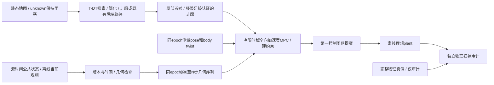

状态 `z=[x,y,yaw,vx,vy,wz]`，位置在同一固定世界frame，速度在base_link。
控制 `u=[ax,ay,alpha]` 是机体系速度导数；不是直接称为世界加速度。

每个dt内用中点积分：

```
v_next = v + dt * a
yaw_mid = yaw + 0.5*dt*wz + 0.125*dt²*alpha
xy_next = xy + dt * R(yaw_mid) * (vxy + 0.5*dt*axy)
yaw_next = yaw + dt*wz + 0.5*dt²*alpha
command = [vx_next, vy_next, wz_next]
```

初版dt=0.1s，horizon=1.5s；5个等长acceleration blocks降维。
扫查0.5/1.0/1.5/2.0s时重新建立完整网格，不截断障碍序列后称对齐。
限速 `vx∈[-0.5,0.8], |vy|≤0.5, |wz|≤1.2`，分轴
`|ax|,|ay|≤1m/s², |alpha|≤2rad/s²`。这些为本次离线实验固定上限，
不是正式main参数，也未实车辨识。正式STVL MPPI的vx_max=0.5、vx_min=-0.3
保持；未来同场景A/B必须另行登记统一限速，不能比较不同限速的成绩。

自身完整机械投影半长/半宽0.325/0.300m，规划padding=0.03m，
约束足迹0.355/0.330m；独立oracle使用未padding的完整机械矩形并要求
净空≥0.05m。原始SDF base-only与机械包络分别登记，不偷缩自身几何。

## 4. 预测契约与时间对齐

适配目标仍为原 `DynamicObstaclePredictionArray`。main本身没有tracker/这两个消息；
本轮只将冻结 `b5645eca` 的core、两个.msg和几何契约作为只读离线参考放在
`reference_inputs/`，逐文件哈希见其provenance.json；没有导入旧路线ROS包或改
main的接口生成/启动。公开消息的实际DDS接入仍属于M2/M3门。
离线adapter是消费者内部值对象，不新增公共ROS消息或读tracker私有类。
必须验证schema、shadow_only授权、map frame、complete/count/ID、finite值、
源/观测年龄、dt/steps、状态及尺寸/速度范围。处理时间不替代source stamp。
v2的position已推进到array源时刻，不能重复加coasting年龄。

预测序列有 `evaluation_epoch`、`relative_times=[0,dt,...,Ndt]` 和
`centers[i]=position(source)+velocity*(evaluation-source+relative_times[i])`。
机器人输入必须已在同一evaluation_epoch；原型拒绝混frame/混epoch，
不偷偷用latest pose。未来Nav2 adapter负责源时间pose推进、一次有年龄上限的
map↔odom平面变换、twist旋转、输出延迟和定位跳变处理。

| 输入情况 | 原型策略 |
|---|---|
| 新鲜confirmed/coasting，受限已知运动夹具 | CV全网格；coasting从array stamp起算，另检查last observation age |
| tentative | 当前占用静止延续，明确current-only假设；不伪造可信速度 |
| velocity reliability未知 | 公共消息没有confidence/covariance，不能按虚构概率降权；运行接受尚未建立 |
| stale/future/invalid/incomplete/错schema/frame/坏新消息 | 拒绝新快照，不保留旧预测；仅产生受加速度约束的制动提案并标记无安全认证 |
| lost/完全失流 | 不把缺失当free；独立运行接入前必须由当前地图和上层故障策略处理 |

完整新鲜空数组只表达tracker列表为空，不证明没有未检出物体。

## 5. 两种几何及静态环境

- `observed_polygon`：当前实际观测点凸包，随锚点平移。离线夹具显式提供
  观测点；隐藏部分保持未认证。既有v1/v2只有size，没有实际轮廓，adapter
  只能叫`visible_extent_proxy`，不把平滑extent冒充observed polygon。
- `nominal_diameter`：以观测锚点为圆心，使用完整名义直径D作半径。
  缺少物体中心时不能用D/2；D=1.6970562748477143m来自原条件手册代理，
  不宣称适用于全部真实2027目标。名义模式仍无未来误差支持证书。

第一组已知CV夹具可提供完整当前polygon，专门隔离控制可行性；后续近面
观测和突然停止/反向夹具负责揭露几何/预测失败，全部保留。
旧SLSQP静态输入是显式凸多边形与有限可行区域；当前QP消费认证走廊，
静态raw map只进入T-DT前端。没有地图的unknown→free转换。
原M1没有在线raw costmap检查；继续轮原生Nav2边界已实现整足迹内部cell/unknown/地图外检查，真实Gazebo输入门仍待验证。

## 6. 旧SLSQP对照：优化、硬约束和输出选择

直接shooting优化acceleration blocks；只执行第一段，再从新测量状态求解。
objective包含逐时reference位置/航向误差、速度、加速度、相邻控制差、
dynamic/static soft clearance及terminal误差。轨迹由加速度积分生成，
没有优化后再做SG或混合候选的步骤。

硬约束独立于成本权重：全过程速度/加速度范围、当前与全部未来时刻padded
足迹净空、有限环境边界、terminal速度=0。相邻时间点加入相对最大位移的
半步reserve，防止只检查离散端点漏过穿越；该充分条件仅针对声明的CV和
中点运动模型，不能覆盖未知急转/执行滞后。terminal停止使可行解包含完整
模型内刹停路径，不能证明horizon之后接近中的障碍不会撞上静止机器人。

warm start与从参考路径生成的seed均进入同一优化/约束检查。求解结果必须
finite、约束通过并在配置deadline内；即使SLSQP返回成功也独立重算。
失败、不可行或超时选择受加速度限制的制动提案，保留reason；若制动路径
也不通过则标记`unsafe_brake`，零命令不叫安全结果。原型没有ROS命令发布。

## 7. Nav2双控制器与运行时fallback边界

最终部署结构必须在同一个Controller Server同时加载`FollowPathMPPI`和
`FollowPathTemporalMPC`。单个server持有唯一速度发布权；两插件只返回提案，
不各自发布cmd_vel。修改正式配置二选一不能满足本设计。

实验内部BT使用每次tick执行的`ControllerSelector`，输出selected_controller
传给FollowPath的controller_id。可靠+transient_local topic由一个选择监督器
发布。已核对[Humble 1.1.20 Controller Server](https://github.com/ros-navigation/navigation2/blob/1.1.20/nav2_controller/src/controller_server.cpp)、
[FollowPath action](https://github.com/ros-navigation/navigation2/blob/1.1.20/nav2_behavior_tree/plugins/action/follow_path_action.cpp)和
[ControllerSelector](https://github.com/ros-navigation/navigation2/blob/1.1.20/nav2_behavior_tree/plugins/action/controller_selector_node.cpp)：
FollowPath运行期间controller_id变更会更新动作目标；server接受pending goal后
选择新插件并setPlan。Selector必须处在会持续tick的ReactiveSequence中，不能
放在只执行一次的普通Sequence内。由此设计可保留上层Mission、Planner和
NavigateToPose接口，并在同一目标执行期间双向切换，无需重新编译或改配置。
继续轮已在项目Humble 1.1.20镜像实测原生BT/action preemption；工程链路通过，实际tracker/Gazebo物理门另计。

[集成示例](../../experiments/temporal_mpc/integration/README.md)包含双插件参数片段、
BT子树和ROS选择监督器。默认MPPI；明确请求且健康新鲜才允许选择MPC。
MPC timeout/infeasible、预测失效、健康100ms失流请求MPPI；恢复健康不自动
弹回MPC，避免来回切换。双向选择/故障保持政策有离线测试。

2026-10-04继续授权后，新增隔离可加载原生Controller、类型明确的异步worker
提案协议、完整profile和BT。正式src/配置仍不变；T-DT完整迁移不删除。
原生侧实现生命周期/setPlan/speedLimit、测量输入、零等待TF、raw-grid内部cell /
unknown和执行区间验证，Nav2保留goal checker。profile仅验证map帧固定航向子域；
历史odom/v1输入缺失authority及同步TF/odom，真实接入尚未通过。
速度限制会对违反新限制的提案制动并请求MPPI，QP还未自适应速度限制。
详见[实现与运行限制](../../experiments/temporal_mpc/integration/README.md)。

QP失败时先将上一条控制序列移位、从新测量状态重积分，并用新预测、当前
静态走廊、全量tracks及终态重新验收；计划改变/epoch断续/失效输入禁止复用。
复用不可行则返回受加速度限制的制动提案；制动也不可认证时明确标记
uncertified_brake。每种失败同时请求MPPI，交接完成前持续提供有界提案，
不以solver异常直接中断输出。模型内刹停不能阻止迎面物体后续撞上静止车。
Nav2 controller_id切换属于BT/action协调，MPC插件不能自行改变server当前ID。

离线plant计算期间暂停；实际机器人继续运动。Python预算/OSQP time_limit只
能限制求解和拒绝迟到结果，不能保证OS调度、DDS、costmap锁或系统调用的硬
实时上界。M2必须测量全负载输入→输出延迟、硬件响应和外部wall watchdog；
M3须实测双插件加载、MPPI→MPC→MPPI、故障注入后的命令连续性和唯一命令权威。

## 8. 测试矩阵、指标、退出门和里程碑

先固定单横穿CV场景，起点/目标、自身/障碍几何、限速/加速度、安全oracle
和随机性；本轮优化确定性，不用oracle真值选择控制参数。离线基线
`current_only`和`future_union`仅是机制对照，均不是B0/R1/R2的实测替身。
保留原Gazebo横穿 `A=0.9m,T=8s,goal=(5.6,0),phase=2s` 作为后续同plant
注册场景；解析正弦目标不能当有joint PD的真实Gazebo轨迹。

矩阵包括静止、低/高速横穿、迎面、突然停止、突然反向、短遮挡、窄道横穿、
等待后通行和离开后重开放；比较观测/名义模式并扫查四个horizon。
实际最小场景没有收益之前不扩展检测器或换复杂solver。

记录：模型目标到达（ROS action success离线为null）、独立碰撞及minimum
physical clearance、完成/等待时间、平均速度/距离/绕行、recovery（离线null）、
solver失败、deadline miss、process CPU时间、vx/vy/wz max/RMS、加速度、
jerk/delta-u和可行/不可行周期。false_block只有同条件B0安全成功见证才成立；
当前离线不能判定B0相关false_block_count/duration，置null，另记录停滞。

接受需要目标成功、无接触、机械净空≥0.05m和实际控制deadline/约束同时过门。
近面或CV失配失败不降低安全门，不靠反复权重调整隐藏失败。
首次闭环比较B0与MPC（相同实际tracker输入/oracle/plant）；R2可恢复为对照，
R1和timed-reference路线须先证明已实现再列实测组。

M0：审计/设计；M1：离线core、契约/物理约束测试、固定夹具及独立oracle；
M2：实际源时间回放和Gazebo shadow输入/预算门；M3：独立Nav2 plugin与统一
B0/R2配对闭环；M4：仅有稳定净收益才扩大工况和实车响应辨识。
原轮M0/M1已完成；用户“继续进行”授权后独立完成M3工程切片，M2真实tracker/Gazebo及M3配对B0物理门、M4仍未完成。

同场景MPC明显改善才继续；复杂度/CPU增加却无收益则冻结；大量碰撞、
false block、optimizer failure或振荡先归因geometry/prediction/feasibility。
任何正式定位/TF/串口高优先级问题出现即优先处理主线。

## 9. 分支来源修正与最小迁入范围

用户补充要求从正式主线分出。初始空实验分支从文档归档HEAD创建，随后改为
从 `main@d735ee12bd950dca0e691cdf2f2c61f35cef8ffc` 创建独立worktree。
没有merge/cherry-pick任何旧研究提交。迁入白名单仅本次新原型/文档/证据，
及上面登记的四个离线参考文件和第10节逐文件登记的T-DT前端库；src、正式配置、运行profile、TF和消息生成
相对main无改动。原工作区既有dirty开发保留。旧归档仍暂停。

## 10. 用户补充后的实时QP版本：当前实施

职责为`static map → 已迁移T-DT/NEU前后端 → simplified reference/corridor →
Temporal MPC → 未来1–2s动态控制`。MPC不读原始静态地图、不做A*、不选静态
绕行拓扑。迁移好的MinimumSnap后端仍保留；可消费其几何轨迹。最小切片实际
复用冻结T-DT的YAstar、collision-aware Douglas-Peucker和SfcSquare，不为了
MPC删除或改写现有规划器。选择性导入[来源清单](../../experiments/temporal_mpc/frontend/provenance.json)
与MIT许可；桥接在控制周期外处理map原点、保守整足迹膨胀和走廊。

SfcSquare的offset约定与YAstar不同；桥接以零原点局部坐标调用并显式平移。
复核器直接对raw occupied/unknown cell检查整个矩形走廊能容纳padded
完整足迹，失败拒绝。只在矩形hull仍通过同一raw-map证书时合并相邻局部
squares。拓扑和走廊计算在静态快照改变时执行，不计入MPC求解器但单独计时。
每周期参考在当前包含测量位置的一个认证区域内推进；等待时不会被时间表
强制推进到另一个走廊。真实rolling costmap变化必须使旧证书失效，属于M2。

实时core为固定yaw、wz=0的全向平移子域：body ax/ay → world x/y及body vx/vy。
保留0.65×0.60m物理足迹、0.03m padding、原速度/加速度与0.05m物理安全门。
需要转动的路径/测量wz非零直接请求MPPI；不宣称第一阶段已实现完整yaw MPC。
世界位置是输入body加速度的线性函数，精确condense为30个决策量。

| 约束 | 已实现固定值 |
|---|---|
| 控制周期 | 0.05s / 20Hz |
| model节点 | 15，dt=0.1s |
| horizon | 1.5s；配置允许1–2s，0.5s只属于旧消融 |
| 几何验收网格 | 0.05s，含相对运动半步reserve |
| solver | OSQP 1.0.5，一个QP/周期，一个局部分离面选择，不做多次非线性收敛 |
| 时间/迭代 | solver≤15ms，整个core预算40ms，最多400迭代，迟到解拒绝 |
| 动态障碍 | QP最多4个相关track，公开输入最多64，输出验收仍检查全部 |
| warm start | 移位上一周期控制、从新状态重积分，primal warm start；本版不复用factorization |
| terminal | body平移速度=0；输出是下一控制周期末body速度提案 |

每个ti的约束只对O(ti)。在warm/braking轨迹附近选择一个支持平面，使用完整
矩形支持函数和目标polygon/circle支持函数构成凸QP半空间；不查询未来并集。
objective为局部reference、terminal误差、速度、加速度及相邻控制变化。
静态cost通过认证走廊压缩为centre bounds；动态碰撞依靠硬约束和全量独立
重验，不用权重掩盖。相关障碍超过4个就请求MPPI，不截断后声称安全。
允许达到迭代上限的次优解，但只有finite、全部硬约束及terminal通过才执行。

OSQP只安装到本次临时实验Python目录，不改系统ROS或main依赖。
[依赖来源](../../experiments/temporal_mpc/dependency_intake.json)、
[官方solver设置](https://osqp.org/docs/interfaces/solver_settings.html)和
[Python接口](https://osqp.org/docs/interfaces/python.html)记录版本/许可及预算设置。
旧SLSQP的0.5s开发预算不是当前实时方案。本版的5,659周期P95约7.6ms、
最大14.8ms仅是当前主机离线计时；25试次有2次迎面接触，不能授权部署。


## 11. 继续轮：异步问题与原生执行重验

QP在独立进程求解；Controller Server不等待solver，plugin只消费有限提案。
状态请求、提案和计划采用实验独立类型；规范公开预测保持原消息定义，main
canonical接口包只在隔离overlay选择性加两条冻结预测msg。引入身份见
[ros2/intake.json](../../experiments/temporal_mpc/ros2/intake.json)，没有更改正式消息生成。

对M1模型的两个工程修正都有原始失败日志：ROS调度抖动用真实elapsed移位warm
inputs；QP数值残差先做执行器/停止投影，再以原margin完整重验。DDS新扫描
可能先于旧状态callback到达，4帧有界历史选择source<=request epoch，异常
receipt立刻清空；不回填新扫描到过去。Nav2实际保持速度，原生层对新速度
预留剩余horizon停止能力并全量重验，防止沿用ramp终态。最后一段clamp处理
浮点极限，不减小足迹或放宽terminal tolerance。

地图变化/计划变化让旧提案失效；静态走廊只由已规划路径通过T-DT SfcSquare
生成，supplied-path模式不搜索。static-map内容/时间revision变更必须重新取得证书。
原生全未来动态约束基于最新公开CV；当前raw costmap只验证正在执行的保持
速度区间，避免把当前动态占用错误要求为整个未来区间静态不动。

原生检查10ms、worker40ms/solver15ms均为预算/迟到拒绝；不是操作系统硬实时。
当前costmap try-lock与零等待TF避免原生shadow锁反转；仍需实际负载和独立wall
watchdog验证。健康ready只是本周期工程条件，不授予比赛部署资格。

## 实际Gazebo阶段边界补充（2026-10-04后续）

[真实输入与配对结果](temporal_mpc_gazebo_results_20261004.md)已完成输入CDR/源epoch TF、
标准T-DT路径action、实际STVL端点、测量odom、双控制器与BT交接的隔离仿真。
固定仿真map原点用唯一static map->odom，lio_adapter仍持有odom->base；oracle位姿
是单独话题，不接TF/预测/controller。主线包复用，tracker只选择性引入未改代码。

v2 tentative允许一次漏检时观察epoch<array epoch，当前position已推进，消费不
第二次coast。confirmed仍要求同源，coasting仍要求旧源，观察TTL等检查不变。
物理完整机械包络（含球形轮）和Contact独立；仅采样净空诊断，不声称连续响应证书。

阶段状态：M2真实输入成立、M3实际MPC短暂参与和交接成立；两组物理接受失败，
候选不进入部署冻结。正式src/默认MPPI保持。静态course可外侧绕行，控制不搜索。

## 执行模型与共同回退保护继续轮

[运行前登记](temporal_mpc_execution_registration_20261004.md)：实时QP/原生重验统一
固定yaw速度ZOH，每50ms一次；15个100ms目标差决策、全部预算及安全几何不变。
旧SLSQP/机械oracle证据不重算。所有形状重验使用全局速度采样reserve。
重验可行的previous/brake在执行回调可返回当次，同时请求BT交接；shadow也能提前交接，
不保证每次都实际经历previous段。旧安全verdict从不复用。
原生健康携带确切epoch/初态/重验状态/步号/约束/track/余量，接收先后不冒充因果。

T-DT SfcSquare maxRange=6m在控制周期外扩展静态可行空间；raw map完整足迹证书
仍是进入门，不修改vendor、不由MPC全局搜索。开放路径中心y约[-2.44,2.39]。
实验链为ControllerServer→VelocitySmoother→共同ExecutionGuard→/cmd_vel→主线stub。
共用保护只限命令差与检查1.5s制动尾，最新公共v2与原始静态地图是输入；无oracle。
不取代native当次STVL检查，不保证所有未跟踪动态物体或连续底盘误差有界。
保护异常/输入失流保持有限输出；无法认证的减速不叫安全停车。主线默认未接入。
新增实验topic `/temporal_mpc/smoothed_cmd_vel`、`/temporal_mpc/execution_health`；
`test_guard_fault`仅隔离测试。标准Mission/Planner/NavigateToPose及双插件IDs不变。

## 侧向参考与生产节拍继续轮

[登记](temporal_mpc_lateral_registration_20261004.md)和[新论文对照](temporal_mpc_literature_review_20261004.md)。
单QP前增加一个局部侧向偏好：当前公共几何与局部路径方向投影相交、位于前方6m
以内时，在当前认证矩形中选较近的可容纳侧向目标并锁定方向。目标使用障碍
包络radius＋padded足迹外接半径＋margin＋采样reserve＋.12m偏好buffer；这是
偏好初始化，不是新增安全证书。距离目标侧向水平不足.08m前暂停纵向参考推进，
随后沿原静态路径方向通过，障碍完全在后方后恢复原参考。只有已有矩形空间能
容纳完整目标才采用；原QP速度/停止/全部几何和native重验决定最终可行性。
它不搜索静态拓扑，不超过1.5s预测合同，不是T-MPC++多同伦优化器。

共同保护在地图回调建立阻塞方格中心cKDTree；每个状态先取一个方格距离上界，
枚举该距离＋半格对角线以内的全部中心，再精确计算点到方格距离。因此结果与
全图穷举一致，地图边界/unknown不变。构建索引在周期外；周期内对剩余track逐个
检查deadline，迟到立即继续限差制动并取消模型认证。单个调用/OS调度不可抢占，
预算仍是迟到拒绝，不能写成硬执行时间界。

健康新增producer_start/output整数monotonic epoch、生产开始/发布间隔、到输出CPU
及墙钟耗时。nominal_expected/lateness/missed_slots是本地50ms参考栅格，非rclpy
TimerInfo，也不是DDS接收时延；CPU测量截止输出后的诊断构造前，不含诊断发布。
每实际run增加启动前二进制/dependency/CPU affinity身份文件，镜像身份另记。
`solver_diagnostic.local_reference_mode/track`为求解完成后的偏好状态；失败reset会
清除偏好，不能凭该字段推断失败前具体同伦类。

侧向参考四轮物理采集之后，原生执行投影改为velocity_and_stop/v2：新状态重锚
后将每个下一速度投影到固定vx[-.5,.8]/vy[-.5,.5]与剩余停止区间交集，随后
仍以全量硬几何和当前raw STVL重验。不是允许速度超限的容差。健康新增
`reanchor_projection`用于历史版本重放；缺字段保持旧投影。新投影已做模型/ROS
工程验证，本轮物理配对使用的是旧投影，见[结果](temporal_mpc_lateral_results_20261004.md)。

随后完成v2独立物理配对，见[结果与模型占用诊断](temporal_mpc_projection_results_20261004.md)。
控制实现未再改动；横穿/迎面持续MPC参与后因未来净空veto回退，动态接受仍false。
新增只读`gazebo/audit_model_occupancy.py`以原公共v2、实际目标/容差及确切native epoch
检查当前目标容差区和认证截面；source采样不重复coast，没有oracle输入。固定yaw
模型的采样目标排除不等于连续或真实任务不可行，正宽度当前截面也不是时域轨迹。
几何检查样本必须有明确constraint，不能仅凭input健康残留step。worker目前未记录
确切消费的prediction identity，因此暂不唯一分解预测更新与测量重锚的余量损失。

## 有限候选与确切输入继续轮

[登记](temporal_mpc_candidates_registration_20261004.md)、[结果](temporal_mpc_candidates_results_20261004.md)。
worker的strategy=single（默认）/portfolio只在实验profile选择；双Nav2插件IDs与BT
runtime选择接口不变。portfolio最多左右/等待三个局部参考，首个完整重验可行优化
解即停止，每项130迭代/5ms、合计390/15ms、worker40ms；独立warm start与原
previous/brake/MPPI链保留。内部另收紧.03m动态规划buffer，原生/保护几何门不变。

桥接可选corridor_range[1,12]（legacy6，open_long10）只在周期外扩展T-DT SFC，
vendor/raw-cell完整足迹证书保持。open_long map240×200、origin(-1,-5)、目标8.5m，
原legacy及机械/actor配置保留。MPC不获得静态全局搜索职责。

solver_diagnostic新增v2_inputs schema，携带实际消费source/observation epoch、
generation/map、初态/走廊、source age、偏好前后、逐项候选与qp.solve耗时。
invalid输入字段明确null，不能当作有效消费证据。只读2×2审计固定native epoch，
分开标记实际和shadow拒绝，不反填缺失或过期数据；公共预测消息语义不变。

raw /tf_static独立记录采用可靠transient-local depth100，并在启动前要求原始
记录含map→odom和base_link→sim_lidar_link。它不更改TF发布/所有权或控制输入。
修复前迎面失败门完整保留，不能用单独TF listener的成功查找代替raw证据链。

六有效试次任务均取消，目标模型已开放但有限候选仍未稳定通过；迎面portfolio
由状态请求合同拒绝、QP未运行，下一阶段需判定时刻与队列证据。动态接受false。

## Worker时序与提案老化继续轮

[登记](temporal_mpc_timing_registration_20261004.md)、[结果](temporal_mpc_timing_results_20261004.md)。
实验String `/temporal_mpc/worker_timing`分别记录request/frontend/prediction回调，
含callback_id、原始请求有限字段、signed ROS clock判定、solver/publish/body monotonic。
duplicate/no causal/silent保留独立disposition，不覆盖有效solver身份。
solver_diagnostic以timing_callback_id关联，native health包含真实request publish
前后时刻、ROS clock及proposal receipt。StateRequest与公开消息wire不变。

原map/非未来/age≤100ms条件保持，future/stale/frame分别报错；非法stamp
诊断使用nullable epoch，避免catch后重解析而丢失诊断，不允许非法控制输入。
Humble executor只有msg参数，DDS metadata明确不可用，不能将system timestamp
与ROS/steady混减。同主机monotonic只支持总interval，不能唯一分配DDS/排队原因。
timing自身发布在callback_body测量之外，worker40ms核心门位置保持。

只读提案老化工具检查不同epoch/相对网格、移位与速度/停止投影，完整实际slack
复算保留。未修停止尾的轨迹可能终速非零，只作反事实，不能执行或替代安全门。
新迎面一次配对全部请求current，MPC短暂通过后新测量重锚未来净空拒绝；最终
接收连续性未通过，不回填旧模糊时钟失败，动态接受false。QP/native validate、
静态T-DT职责和双插件runtime回退保留。
````

<a id="D0349"></a>

## D0349 — 目标可开放场景与有限候选登记

来源：`docs/dynamic_navigation/temporal_mpc_candidates_registration_20261004.md`；版本：`04291a410f193c009e043af88e014cf420e1f68b`。
阅读副本：[独立原文](history_documents_20261004/temporal_mpc_04291a41/docs/dynamic_navigation/temporal_mpc_candidates_registration_20261004.md).
以下仅为历史资料，不构成继续研究授权。

````text
# 目标可开放场景与有限候选登记

2026-10-04，起点c2029010；保留直接main派生分支、正式src、原dirty及全部历史证据。
先登记后实现/运行，不调整已有试次。新输出build/temporal_mpc_candidates_20261004。

新增open_long场景profile：map240×200、.05m、origin(-1,-5)，目标(8.5,0)，其余
同原crossing/head_on障碍、主线底盘/激光/tracker/TF/STVL、sim10s目标与40s窗口。
拓宽静态空间和移远终点是新任务条件，不比较旧窄场景净收益。原legacy保持默认。
准入先用T-DT/raw-cell证书核对目标和左右空间，再只读核对真实公共模型目标占用；
 authored actor范围只用于离线场景设计，绝不输入控制器或改造tracker中心/形状。

两场景各三策略：MPPI+共同保护、single MPC+回退+共同保护、portfolio MPC+回退+
共同保护，共六个全新容器物理试次，各仅一次，固定顺序B0→single→portfolio。
基线CDR/源TF审计及独立校准进入门后才启动候选；控制期间不并发重型检查。
所有代码先完成工程检查再冻结六轮，不按结果调参或重跑挑最好，内部MPPI噪声
未锁种子，不能声称统计净收益。两个候选共用同一场景B0，不当作独立重复基线。

single保留原单QP行为，仅增加输入身份/耗时诊断。portfolio依次尝试锁定侧优先的
两侧局部偏好和当前位姿等待参考；首个完整重验可行优化解使用，其他候选明确
not_run，最多三个QP。每个最多130迭代/5ms，合计≤390迭代/15ms，完整worker
仍40ms；每次根据剩余预算限制下一候选，迟到拒绝并有限减速/请求MPPI。
warm start分候选保存，每次在新输入重验；没有优化解时仍previous feasible→brake→
MPPI链。单周期不追求三个候选全收敛，也不在MPC内读raw map或搜索静态拓扑。

portfolio仅在原动态几何门之外再加.03m规划buffer，试验降低重锚时小余量损失；
single buffer=0。这是额外保守规划空间，不是已校准预测置信界，native/共同保护
仍按原完整D=1.6970562748477143、完整padded足迹(.355,.330)、margin.02、
采样reserve、全量64track、TTL.4与速度/停止硬门重验。20Hz、1.5s/15节点、
最多4相关障碍、native/共同保护10ms保持，不修改任何公共预测接口。

worker诊断记录确切消费的source/observation epoch、generation/map、初态/走廊、
偏好前后、候选逐项状态和求解时间。新增只读拒绝分解：在相同native epoch/
proposal下用记录的worker/native初态与旧/新公共预测做2×2模型反事实；只算
模型动态余量，不把反事实当已执行或安全轨迹，不补造不可用/过期输入。

工程门：预算/首次可行停止、另一侧/等待/全失败/截止、全量硬检查、真实T-DT
宽场景证书、输入身份/source年龄与反事实重放。物理门仍任务成功、实际MPC、
完整机械oracle/正Contact、75ms接收间隔及预算；连续plant/检测支持尚未认证。
默认MPPI、双插件/BT runtime切换和上层Mission/Planner/NavigateToPose保持。
只建立实验检查点，不推送/合并/冻结部署。

工程预检补充（尚未物理运行）：range6的T-DT SFC在宽地图仍只给约±3m矩形，
不能容纳最不利侧向偏好。桥接CLI新增有界range[1,12]，open_long范围10，legacy
默认6；仅控制周期外扩展已inflated静态自由空间，Python/native完整raw-cell证书
保持，vendor不改。首次主机测试113通过/3失败原样保留：两项把合法制动/等待
误当合同绕过的断言修正，第三项实际揭示上述走廊不足并促成范围参数。

记录端修正登记（横穿三轮已结束，迎面候选尚未启动）：head_on_b0_01仅记录
map→odom的静态消息，遗漏robot_state_publisher的base_link→sim_lidar_link；
760条源TF独立重放全部失败，进入门false，single启动被runner拒绝，portfolio
不启动。原失败基线/审计/false门完整保留，不补写TF，不绕过门或挑性能结果。
查明原raw /tf_static订阅depth=1，多个transient-local writer回放可能挤掉样本；
改为depth100，并在sim9.5s前要求原始记录确实包含两条必要静态边。单独真实DDS
两writer、各仅一次发布、late join验证后，另以head_on_{b0,single,portfolio}_02
登记一次完整迎面对照。仅采集端变化，控制/场景/预算参数保持；三轮横穿仍用
原快照，三轮新迎面共同用新采集快照。初始计划与失败启动元数据保留。
````

<a id="D0350"></a>

## D0350 — 目标开放场景：单候选与有限候选对照

来源：`docs/dynamic_navigation/temporal_mpc_candidates_results_20261004.md`；版本：`04291a410f193c009e043af88e014cf420e1f68b`。
阅读副本：[独立原文](history_documents_20261004/temporal_mpc_04291a41/docs/dynamic_navigation/temporal_mpc_candidates_results_20261004.md).
以下仅为历史资料，不构成继续研究授权。

````text
# 目标开放场景：单候选与有限候选对照

2026-10-04，起点c2029010，[预登记及采集修正](temporal_mpc_candidates_registration_20261004.md)。
分支experiment/temporal-mpc-main-20261004仍直接派生main@d735ee12。

## 结果

目标移至(8.5,0)、静态空间拓宽后，六个有效试次的记录模型都允许目标位置区域，
但MPPI、single MPC、portfolio MPC仍全部在40s窗口取消。横穿两个MPC分别
228/229、237/238次实际执行检查通过；迎面分别15/15、1/2，随后回退MPPI。
有限候选没有形成稳定通过或净收益证据，动态接受false、部署冻结false。

本轮完成有限候选、共享实时预算、确切输入诊断与拒绝分解。T-DT继续负责静态
路径/认证走廊；MPC只处理1.5s局部时域，不读取raw map或搜索静态拓扑。正式src、
默认MPPI和上层Mission/Planner/NavigateToPose保持；双Nav2插件及运行时双向切换保留。

## 工程变化及检查

single保持一个QP，规划buffer=0。portfolio首个完整重验可行优化解即返回，最多
尝试左右两个固定侧偏好和当前位置等待参考；已选侧优先，每候选独立warm start。
每个QP最多130迭代/5ms，合计390迭代/15ms，完整worker仍40ms；迟到拒绝，
无优化解仍新输入重验previous feasible→有限制动→请求MPPI。额外.03m规划buffer
只收紧内部动态门，native/共同保护的原完整D、足迹、margin、reserve和TTL不变。
这不是T-MPC++、Scenario或CBF实现，不构成全局最优或概率安全保证。

实际portfolio最大尝试3项，横穿迭代max380、迎面390；QP调用累计墙钟max
4.281/4.245ms，完整worker max36.844/37.439ms，全部可行输出共享预算观察门通过。
横穿628个可行优化提案中left577/right51，迎面26个均right；等待参考实际被尝试，
没有成为可行优化输出。失败时chosen_candidate可能指回退来源，不能当作优化胜出。
这些计数包括shadow提案，只有上面的执行次数表示原生实际参与。

116项控制/候选/场景测试在主机和Humble各通过，另2项输入分解测试在两环境通过。
首次主机113通过/3失败、修正后输出均保留；两项是合法制动/等待断言问题，一项
揭示T-DT原range6仍限制侧向空间。桥接增加有界range[1,12]，open_long用10、
legacy默认6，vendor文件hash全部保持。实际frontend给中心矩形
[-.389999986,10.3900003]×[-4.44000006,4.39000034]，完整raw-cell认证保持。

真实Humble Nav2工程fixture通过14类故障、MPPI↔MPC、SpeedLimit回退/恢复、
worker SIGKILL后原生有限制动、唯一命令发布者等工程门。活跃命令gap max54.248ms，
native max.208ms。完整fixture包含action间空窗，整体gap214.710ms不能写成连续控制。
该fixture用合成预测/ZOH测试plant，独立于下列Gazebo物理接受。

## 固定物理对照

open_long map240×200、.05m、origin(-1,-5)，sim10s相同目标、40s窗口。
主线机械模型/扫描/tracker/TF/STVL、actor运动与原legacy相同；改变地图/目标属于新
任务条件，不能和旧窄场景相减声称收益。每场B0→single→portfolio各一次新禁网容器；
两个候选共享同一B0，不作为两份独立重复。MPPI内部噪声seed未锁定。

| 场景/策略 | 终态 | 正Contact消息 | 完整机械采样净空min | MPC通过/执行 | 最终cmd接收gap max |
|---|---|---:|---:|---:|---:|
| 横穿B0 | 取消=5 | 0 | 1.621529m | 0/0 | 67.877ms |
| 横穿single | 取消=5 | 0 | .963321m | 228/229 | 65.303ms |
| 横穿portfolio | 取消=5 | 0 | .908365m | 237/238 | 61.487ms |
| 迎面B0_02 | 取消=5 | 0 | .675851m | 0/0 | **81.572ms** |
| 迎面single_02 | 取消=5 | 0 | .850000m | 15/15 | 71.970ms |
| 迎面portfolio_02 | 取消=5 | 0 | .807846m | 1/2 | 68.573ms |

横穿B0、迎面B0/single的中间ControllerServer接收gap分别76.918、87.163、85.663ms，
超过75ms观察门。最终输出的迎面B0也失败。六轮保护生产发布间隔max54.363ms，
nominal missed slots=0；生产与独立订阅接收分别记录，不能唯一归因于DDS或调度。
零正Contact与50Hz净空不替代连续plant误差/速度界或检测支持；大量uncertified_brake
仍不是安全停车证书。没有成功B0见证，false_block=null。

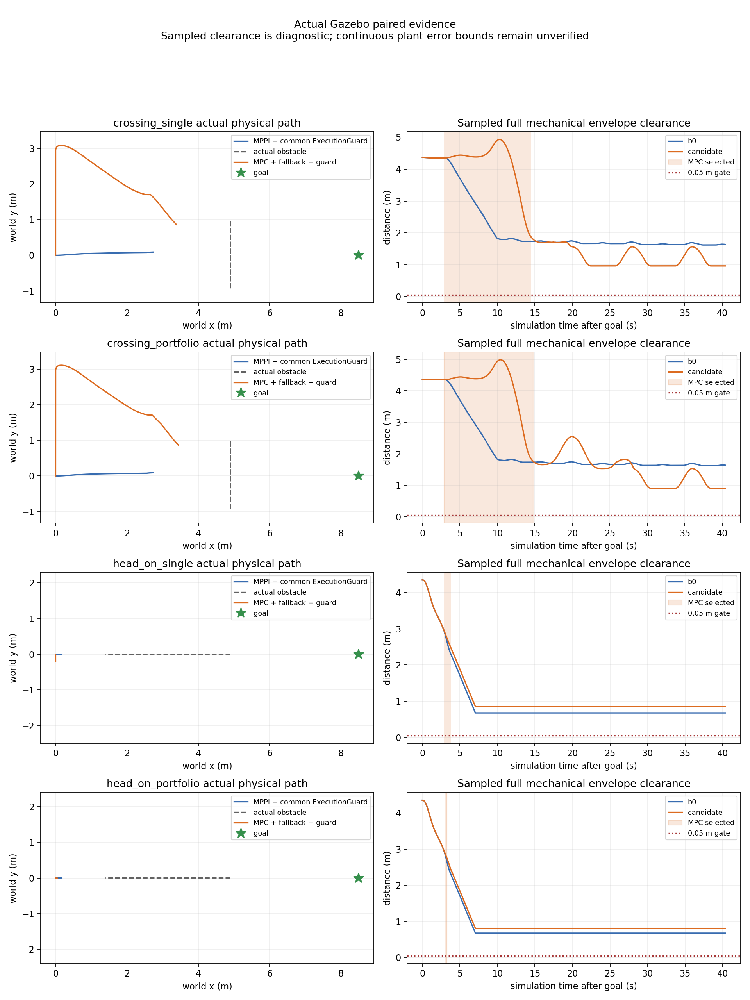

## 目标开放与拒绝分解

六轮目标后有效公共采样数依次608/612/611/610/610/611，没有样本排除目标点或
整个.15m位置容差区。目标点slack最小1.607507m，减去.15m仍为正；在记录时刻、
固定yaw=0和当前完整D模型下，整个位置容差圆盘有余量。原生1597个几何epoch
也没有目标排除。只证明这些采样的当前模型，不证明连续未来轨迹或真实物体形状。
因此本轮任务失败不能继续解释成旧(5.6,0)目标被完整D模型恒常覆盖。

输入分解固定同一个native evaluation/proposal epoch，在完整原生ZOH重锚模型中
替换记录的worker/native初态及旧/新公共预测，四种组合都独立检查。旧状态替换
是模型反事实，不是传播后的真实plant；不补造过期输入，不把组合当实际执行。
下表是记录的首个拒绝track/step余量，单位mm：

| 拒绝 | 旧状态/旧预测 | 旧状态/新预测 | 新状态/旧预测 | 新状态/新预测 |
|---|---:|---:|---:|---:|
| 横穿single实际，24.401s，step30 | -.308 | -.308 | -.308 | -.308 |
| 横穿portfolio实际，24.781s，step30 | 9.511 | -2.661 | 9.511 | -2.661 |
| 迎面single shadow，13.725s，step30 | 12.425 | -.640 | 2.112 | -11.119 |

横穿single的worker/native预测源同为24.355s、测量状态基本相同，worker原提案
时刻动态min=10.552mm；19ms后移到执行时刻并重锚/投影/延长停止尾，余量变负。
此例不是新预测包或新测量状态造成的损失，但本轮没有进一步分解时间推进与停止投影。
横穿portfolio worker源24.685→native24.751s，测量状态基本相同；执行时刻换新预测
即可失去约12.172mm。原worker时刻动态min43.005mm，.03m规划buffer仍未避免拒绝。
迎面single在15次实际通过后由shadow检查触发回退：公共更新使旧状态组合变负，
新状态替换还降低余量。四组合不是可加的唯一因果分配。

迎面portfolio第二次实际调用是input拒绝，不是动态净空拒绝。对应worker提案理由
为state request stale/frame、input_validated=false、QP not_run，耗时.0869ms。
记录request frame确为map，独立订阅receipt距request epoch约6ms；没有记录worker
用于判定的本地clock时刻，无法区分其过期/未来判断或clock回调顺序。不能称作
solver timeout或三候选不可行。此时原生有限制动、选择回MPPI，输出继续。

六轮102,290条CDR/JSON一致、4,562个源TF重放可查；6,433个共同保护精确输入、
1,597个原生状态及输入join、92个动态拒绝余量均匹配，无缺失输入。分解保留两次
实际动态拒绝和90次shadow检查，后者单独标记。worker完整周期max37.439ms，
实际native max.226ms、保护tick到输出max6.194ms；原40/10/10ms观察门通过。
worker计时截止提案发布前，solver_s单指qp.solve，不包含诊断构造/发布或调度等待，
不据此声称硬实时。

## 采集失败与证据保留

head_on_b0_01实际完成但raw记录仅收到map→odom的静态消息，遗漏激光静态边；
16,721条CDR仍匹配，760个源TF重放全部失败。进入门false，single_01被runner
启动门拦截，portfolio_01未启动。它作为输入证据失败保留，不进入有效配对。
原raw静态订阅depth1不足以可靠保留多writer回放；只改为depth100，并在固定
启动阶段要求记录到两条必要静态边。真实DDS两writer各一次历史发布/late join
回归通过后，按补登记完成head_on_02三轮。没有补写TF或按性能挑选基线。

同场三轮控制源码和配置逐字节一致，全部七轮启动前二进制/dependency一致。
跨横穿/修复迎面源快照仅record_run.py与新增verify_static_capture.py不同，算法保持。
迎面B0_02在取消后的进程清理出现scene_node退出段错误，调用端诊断单独保留；
完整记录及后续CDR核对完成。首次离线审计环境失误、执行检查扩展到shadow的
旧输出、一次误选工程fixture事件格式的只读审计失败均保留。物理数据不覆盖。
采集后仅修正画图读取goal和扩展只读审计，未再改控制行为或重跑性能试次。

[完整manifest](evidence/temporal_mpc_candidates_20261004/manifest.json)归档全部七轮原始
记录无损gzip、工程fixture、源快照、实际二进制、初始失败测试、日志/审计/图及进入门。
[完整性检查](temporal_mpc_candidates_integrity_20261004.json)和
[空白检查范围](temporal_mpc_candidates_whitespace_20261004.json)记录最终核验。
归档314文件（不含manifest）、57,771,830字节；16份完整JSONL解压后219,743行
全部解析及摘要核对通过。源码/文档空白检查通过，68条原始日志空白诊断保留。
原dirty文件、main及冻结研究refs保持；不推送、合并或冻结部署候选。

下一阶段先记录worker判定clock/回调开始/结束和原始request身份，分离输入排队与
QP开销；再登记包含提案年龄与完整停止尾的余量检查。几何未知支持与运动残差仍
需独立留出整试次校准，不以调小D、放宽负余量或自动重新选MPC制造成功。
````

<a id="D0351"></a>

## D0351 — Temporal MPC 执行模型与回退保护登记

来源：`docs/dynamic_navigation/temporal_mpc_execution_registration_20261004.md`；版本：`04291a410f193c009e043af88e014cf420e1f68b`。
阅读副本：[独立原文](history_documents_20261004/temporal_mpc_04291a41/docs/dynamic_navigation/temporal_mpc_execution_registration_20261004.md).
以下仅为历史资料，不构成继续研究授权。

````text
# Temporal MPC 执行模型与回退保护登记

2026-10-04，起点280056ef；独立main派生experiment/temporal-mpc-main-20261004。
正式src、默认MPPI、已冻结研究与既有物理失败证据保持。先登记后运行。

## 本轮顺序与约束

1. 原生拒绝记录evaluation/proposal/prediction整数epoch、步号、具体约束、track和余量；
   保留10ms原生检查上限。记录诊断用于定位，不以DDS接收先后推断因果。
2. worker QP和原生重验采用同一固定yaw、50ms速度零阶保持模型。15个100ms加速度
   决策节点仍展开为30个命令，速度目标差限1m/s²；不把实际瞬态加速度认定为已认证。
   旧SLSQP/离线oracle模型和旧证据不重写。双方使用相同最大速度采样余量。
3. T-DT SfcSquare在控制周期外将范围上限2m扩大到6m；所有矩形仍独立用原始静态
   地图认证完整padding足迹。不更改vendor、拓扑搜索归属或任何安全几何。
4. 为两插件共用的实验命令链加入20Hz执行保护：限速/限命令差、最新公共预测、
   完整制动尾、原始静态地图重验。提议不可行/过期时持续限差减速；若减速也无法
   认证，明确标记uncertified，不宣称停车必然安全。不使用oracle或未来actor target。
   仅实验launch接入，标准Nav2控制器选择及上层action不变。
5. 对横穿、迎面各运行新B0与候选一对，固定sim10s目标、40s任务窗、相同scene/profile/
   tracker/保护层；B0名称明确为MPPI+共同保护，不与上一轮未保护B0混称。全部保留，
   不重复挑最好结果。任何启动/采集故障保留并单列，不算有效配对。

模型、保护预算：20Hz、1.5s、15节点、4相关/64总track；QP15ms/core40ms/400iterations，
原生10ms；共同执行保护10ms观察上限。足迹(.325,.300)+padding.03、margin.02、
nominal近表面锚点radius=完整D1.6970562748477143、源/观察TTL.4s保持。

接受仍要求任务成功、无物理接触、完整机械oracle净空、实际MPC参与、真实输入合同、
持续输出与预算门。低计算时长或无正接触消息不能替代动态接受；连续plant误差和
诊断point-speed界尚未认证，任何结果均为仿真研究，不冻结部署候选。

## 启动修正记录（有效配对前）

第一轮crossing_b0不是有效B0：共同保护在首次可行诊断发布时发生numpy.bool_
JSON序列化异常而退出；原始日志/CDR/启动源码保留。core结果改成原生bool，
加入结果JSON回归检查与ROS边界异常限差制动；另记录精确输入、previous、tick计数
以独立重放保护逻辑。有效配对命名crossing_b0_02/crossing_mpc_01及
head_on_b0_01/head_on_mpc_01；不用失败启动的数据作保护策略效果证据。

顺序运行修正：crossing_mpc_01在同容器第二次启动时收到遗留Gazebo的sim65s clock，
进入门主动拒绝，goal=null。它是采集/清理故障，不算算法试次。run.sh现给每个
子进程独立process group并清理全部launch后代；正式配对仍每次新建隔离容器，
候选改名crossing_mpc_02。crossing_b0_02第一轮独立世界和endpoint有效，保留配对。

8类保护故障fixture首轮guard_faults_01持续减速/恢复成立，但all_pass=false：
测试误用model_certified=false作为唯一退化条件，NaN/指令失流时轨迹已认证的
certified_brake被错判。保护行为未修改；判定使用status!=pass或无证书，并新增
每例注入前实际vx>.35的运动门与最终恢复门。首轮完整记录保留，修正后guard_faults_02。

故障fixture判定修正时一次范围过大的文本替换破坏了final_recovery表达式，
guard_faults_02在启动阶段SyntaxError，尚无运动/故障试次。修复后全实验Python
语法预检通过，再运行guard_faults_03；原始源码/日志保留，不算性能重复挑选。
````

<a id="D0352"></a>

## D0352 — Temporal MPC 执行重验、静态走廊与回退保护结果

来源：`docs/dynamic_navigation/temporal_mpc_execution_results_20261004.md`；版本：`04291a410f193c009e043af88e014cf420e1f68b`。
阅读副本：[独立原文](history_documents_20261004/temporal_mpc_04291a41/docs/dynamic_navigation/temporal_mpc_execution_results_20261004.md).
以下仅为历史资料，不构成继续研究授权。

````text
# Temporal MPC 执行重验、静态走廊与回退保护结果

2026-10-04，起点280056ef，仍在直接从main@d735ee12派生的
`experiment/temporal-mpc-main-20261004`。正式src、默认MPPI、旧研究工作区和冻结ref保持。
本轮完成执行模型统一、约束诊断、认证走廊扩展、共用保护和新物理配对。
**动态接受=false，共同保护的严格连续性门也未全部通过，不冻结部署候选。**

[运行前登记及失败修正](temporal_mpc_execution_registration_20261004.md)、
[配对汇总](evidence/temporal_mpc_execution_20261004/paired_summary.json)、
[完整证据清单](evidence/temporal_mpc_execution_20261004/manifest.json)。

## 改动和职责

实时QP与原生重验共同采用固定yaw、50ms保持速度目标的模型。15个100ms目标差
决策展开30个执行节点；旧SLSQP/机械oracle模型及既有失败证据不改。
目标差限1m/s²，不能把它说成物理瞬态加速度认证；上一轮实测约1.94m/s²仍保留。
两端的采样reserve都用同一全局速度上限，不缩足迹、padding、margin、nominal D或TTL。
QP15ms/core40ms/400iterations、原生10ms、20Hz/1.5s、4相关/64全量track仍保持。

原生健康记录exact evaluation/proposal/prediction epoch、初态/检查态、步号、约束、
track、slack。重锚仍使用新测量和最新预测，停止修正后全部重新验。
不再仅因fallback_requested丢弃model_feasible提案：执行回调允许重验后当次返回
previous/brake并请求MPPI交接；shadow也能提前请求交接，因此并不承诺每次都实际
执行一次previous段。不可行/过期提案仍原生有限减速，没有等待worker。

T-DT YAstar、简化路径和SfcSquare仍在控制周期外提供路径/静态问题压缩。
SFC maxRange由2m到6m，开放路径中心y从约±.94扩到[-2.44,2.39]m；所有矩形
继续用raw-cell检查完整padding足迹。course仍能从外侧找到|y|max1.75m路径，
0.8m窄通道捷径仍拒绝；course动态运行未开展。vendor未改，MPC不全局搜索。

实验公共命令链为ControllerServer→VelocitySmoother→ExecutionGuard→/cmd_vel→主线stub。
两插件仍同时加载、默认MPPI、通过原标准BT/controller_id切换；上层action不改。
保护层只允许限命令差通过或减速，检查最新公共v2与原始静态地图下1.5s完整制动尾；
不优化、不找路、不消费oracle、不替代原生当前STVL检查。state age增加保守位移reserve。
异常/失流仍返回有限输出；模型制动无法认证时明确uncertified。
最终publisher改为ExecutionGuard，新增实验输入/健康topic见架构及README；正式launch未接入。

## 固定物理配对

每场景一对有效试次，sim10s目标、40s任务窗，两方共同保护；世界/profile/tracker/
bridge逐字节一致。四次启动前源码快照中，影响控制行为的源码也相同。
清理脚本与后加只读审计/测试文件差异单列。MPPI内部noise seed未锁，不能声称统计净收益。
本次B0名为**MPPI+共同保护**；上一轮未保护B0仍单独保留，不能混称。

| 场景/策略 | 任务终态 | 正机器人接触消息 | 采样完整机械净空min | 扫掠诊断下界 | MPC实际通过周期 | 最终cmd最大接收间隔 |
|---|---|---:|---:|---:|---:|---:|
| 横穿 B0+保护 | 40s取消=5 | 0 | 1.60840m | 1.55340m | 0 | 62.376ms |
| 横穿 MPC+回退+保护 | 40s取消=5 | 0 | 1.61885m | 1.56385m | 66/66 | 70.592ms |
| 迎面 B0+保护 | 40s取消=5 | 0 | .47830m | .42330m | 0 | **88.093ms** |
| 迎面 MPC+回退+保护 | 40s取消=5 | 0 | .44352m | .38852m | 9/9 | **77.022ms** |

四轮均没有记录到正接触消息，也均没有成功到达。两种策略在共同保护下出现停滞，
不能把停车、较大净空或没有正Contact消息当成有效避障/连续安全成功。
迎面两方最终cmd均超过75ms观察门，B0中间controller cmd也为76.290ms。
完整机械oracle仍独立于tracker，50Hz、最大20ms采样缺口；扣5.5m/s的.055m reserve
仍仅是诊断，point-speed/连续plant误差界尚未认证。false_block=null，没有安全成功B0见证。

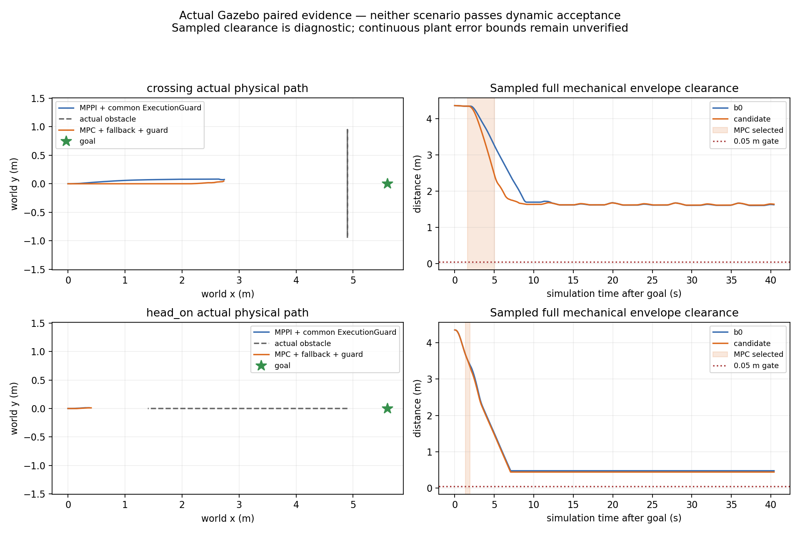

## 重验拒绝已经定位

横穿实际选中MPC sim11.631–15.029s；回退附近shadow在evaluation15.025s、
proposal14.993s、prediction14.983s检查第27步、track1时，动态净空slack=
**-.0003347296m**。迎面MPC sim11.334–11.929s；shadow在evaluation11.928s、
proposal11.913s、prediction11.881s第29步、track1的slack=**-.0099516281m**。
两次执行回调本身全部通过，shadow在下一周期前触发了交接，不能把它误写成实际
执行回调失败。latest prediction和新测量重锚后的轨迹不再满足模型净空，veto保留。

精确输入重放4,298个共同保护周期、518个原生ZOH状态、131个动态拒绝数值，
全部匹配；原生状态误差最大1.34e-15量级。它证明记录/模型一致性，不证明连续plant安全。
不同DDS订阅的健康接收相对选择偏移为横穿+0.243ms、迎面-.929ms；因果故障切换
延迟字段保持null，不把接收顺序当因果时延。

因此“扩大走廊/统一模型”已经实现，但没有解决侧向运动选择与异步更新的可行余量。
本輪直线路径仍主要沿x分离面制动；这是后续局部避障初始化需要检验的方向，
不是已经证明的唯一停滞原因。

## 实时性、故障与记录完整性

候选横穿/迎面原生P95=.156/.141ms，max=.201/.142ms；可行worker周期
P95=18.767/17.066ms、max=21.568/18.600ms。共同保护整tick到输出P95在四轮为
5.188–6.525ms、max7.621ms，core及记录tick数逐条匹配且无接收tick跳号。
这不覆盖调度/DDS间隔门，不能据计算时长宣称实时性全部通过。

91项测试主机及固定Humble均通过、无skip，8包Humble构建成功。pytest6的pythonpath
配置警告保留，显式PYTHONPATH有效。四轮反序列化16,761/17,048/16,774/16,816条
CDR与JSON无差异；762/762/763/760条预测的canonical源TF重放全部可查。
即时可用与回放可用仍分别记录，oracle未进入TF或控制输入。

更新的原生Nav2 fixture通过14类故障、双向BT交接、SpeedLimit拒绝/恢复、worker
SIGKILL后独立减速、唯一endpoint及活跃输出门：241条命令，活跃gap max65.620ms，
原生P95=.171ms/max=.185ms。人为cancel到另一直接会话的总体gap212.844ms单列，
不算活跃中断，也不冒充目标到达。这仍是合成输入工程检查。

共同保护fixture8类异常（exception、NaN、cmd/odom/prediction失流、complete=false、
未来odom、非平面odom）均在注入前实际vx>.35后减速到零并恢复；然而严格总门
**all_pass=false**：cmd失流阶段接收gap136.625ms，生产侧该次tick到输出88.097ms，
触发guard deadline并继续有限减速，随后有一周期测量/目标差不一致也拒绝认证。
该轮主机有只读配对审计/绘图并发；没有调度profiling，不能确定唯一原因，不能
据“其他负载”删除失败。独立wall watchdog、生产侧调度证据和最坏负载门仍未完成。

启动/测试失败均保留：crossing_b0诊断numpy.bool_序列化退出；crossing_mpc_01因
同容器遗留Gazebo sim65s clock被进入门拒绝（goal=null）；guard_faults_01误把
certified_brake当输入未退化；guard_faults_02测试脚本文本替换造成SyntaxError。
修复前完整源码/记录/日志不覆写，guard_faults_03的真实间隔失败也不重跑挑最好。
run.sh现用独立process group清理launch后代，每物理试次另用新容器。退出阶段
偶发context invalid日志和Matplotlib临时cache提示原样保留，不掩盖运行问题。

## 阶段处理

保留检查点和完整证据，拒绝部署冻结；不推送、不改默认、不合并旧方案。
下一步应在T-DT认证走廊内验证局部侧向参考/分离面初始化，并对新测量和预测更新
消耗的余量建立保守提案界，保持短horizon、预算和全量重验。同时压缩或原生化
共同保护检查，记录生产侧节拍并补独立wall watchdog/负载分层；不得放宽75ms、
安全几何或以这次无接触超时替代安全成功配对。
````

<a id="D0353"></a>

## D0353 — Temporal MPC 离线第一轮预登记

来源：`docs/dynamic_navigation/temporal_mpc_experiment_registration.md`；版本：`04291a410f193c009e043af88e014cf420e1f68b`。
阅读副本：[独立原文](history_documents_20261004/temporal_mpc_04291a41/docs/dynamic_navigation/temporal_mpc_experiment_registration.md).
以下仅为历史资料，不构成继续研究授权。

````text
# Temporal MPC 离线第一轮预登记

2026-10-04；设计检查后、场景执行前记录。源码与参数哈希由每次运行manifest保存。

固定自身机械矩形0.65×0.60m，padding0.03m、动态margin0.02m；独立physical
clearance门0.05m。控制dt0.1s，碰撞网格0.05s，oracle网格≤0.01s且有连续
区间reserve。horizon主试次1.5s、5 acceleration blocks；限速/加速度见架构。
SLSQP最多45 iterations、最多2 seeds，离线配置预算0.5s；另外记录严格20Hz
50ms预算超期，离线预算放宽不代表实时门通过。

固定场景12项：10项核心矩阵，加near-face与analytic course sine诊断。
观测模式前10项与正弦提供完整当前polygon/当前速度用于控制可行性隔离；
near-face只提供近面。名义模式以近面锚点+完整D=1.6970562748477143m圆，
不按结果缩小D。场景时间窗12s、到点位置误差≤0.12m/航向≤0.1rad/速度≤0.05。
有接触则保留首接触后停止该离线试次，不删除失败。短遮挡丢帧区间2.0–2.6s，
源epoch保留，超过0.4s必须拒绝；不是oracle输入给控制器。

主矩阵24个试次，不调权重/足迹/时间窗让失败通过。wait_then_pass另比较
current_only/future_union机制消融；它们不叫STVL、R1或R2。主矩阵之后固定
wait_then_pass观测模式扫查0.5/1.0/1.5/2.0s。所有试次使用相同oracle。

正弦来自当前Gazebo场景的几何与target参数，但离线是解析运动、无joint PD、
无激光检测/KF误差/控制传输延迟。其结果不与旧Gazebo试次直接算净收益。
controller看当下snapshot，不看future truth；oracle独立读取完整真实box运动。

M1通过意味着核心契约/约束验证成立并且至少已知CV横穿可在模型内过物理任务门。
20Hz预算、真实感知或广泛场景失败保留为下一阶段风险；不宣布优于B0/R2。
若基础CV也不进展，则只作失败归因并停止扩展，不能改几何/放松oracle门。

## 执行后修正登记：制动保持周期

首轮独立回放发现小速度制动在collision_dt提前归零，实际执行却保持整个dt，
可能越过零点。`pre_fix/`保留原全部输出及拒绝记录；其接受判断作废。
修正只将制动在control_dt计算后重复到collision grid，保持原全部参数、
几何、权重、场景、时间窗和oracle。增加全周期命令一致性/禁止制动反向测试，
重新执行同一矩阵、消融和horizon扫描。deadline分支依赖主机时间，不能将
manifest原`deterministic_model_outputs=true`理解为跨主机确定性。


## 用户补充后的第4轮执行身份（补记，不冒称预注册）

职责改为既有T-DT静态前端压缩→局部reference/corridor→Temporal QP。
固定yaw/wz=0全向平移，20Hz执行、1.5s/15节点、solver 15ms、core 40ms、
400迭代、4相关track，全量最多64track重验。几何/速度/加速度/物理0.05m门
保留。支持1–2s配置；本轮固定1.5s，不继续以0.5s作为实时候选。
正式矩阵是12场景×2几何及1个静态map绕行，共25试次；run开始写出manifest
固定该参数和源码身份。完整结果与失败在单独realtime目录，不覆盖旧SLSQP。

实际T-DT path/corridor来自保守静态图，物理map包含边界occupied cell条带；
不是只替换solver的同输入配对实验。不准据此声称超过B0/R2，MPPI切换请求
只留shadow证据、不执行handoff。计时control_elapsed包括每周期window生成，
预测、QP组装/求解、输出重验；map规划另计。模拟计算暂停，真实wall执行门
另行取得。测试增加/parser加固后的来源差异如实登记，runtime QP未变化。


## 继续轮工程实验身份（2026-10-04，补记）

用户继续授权，独立Humble 1.1.20 / main派生worktree，不改正式src/默认。
完整参数固定在dual_controller_humble.yaml；真实Nav2 plugin/BT/action/DDS，
合成空预测与静态地图、wall-clock ZOH测试模型。保持20Hz/1.5s/15节点/
400迭代/4相关障碍、整足迹与原净空门；本轮只验工程故障与交接，不能替代
Gazebo/tracker或B0配对净收益。14类故障逐项要求MPC已实际输出并稳定选中，
注入后发生新的MPPI selector变更且控制继续。末尾人为cancel导航目标，再
直接FollowPath持有MPC，验证SpeedLimit与worker进程退出后的持续制动。
连续性门75ms只覆盖两个活跃控制会话；总体最大间隔也记录，不隐藏cancel空档。
原生重验门10ms；迟到或无证书输出仅叫有界制动。

run01–run05工程失败/测试门问题保留；run02早期“通过”由因果审查撤销。
run06通过但非最终helper/speed-limit身份；run07最终源码构建后重跑。
全部故障/结果/开发修正见独立nav2证据目录；旧物理矩阵不覆盖、不重解释。
````

<a id="D0354"></a>

## D0354 — Temporal MPC 研究冻结记录

来源：`docs/dynamic_navigation/temporal_mpc_freeze_20261004.md`；版本：`04291a410f193c009e043af88e014cf420e1f68b`。
阅读副本：[独立原文](history_documents_20261004/temporal_mpc_04291a41/docs/dynamic_navigation/temporal_mpc_freeze_20261004.md).
以下仅为历史资料，不构成继续研究授权。

````text
# Temporal MPC 研究冻结记录

2026-10-04，Asia/Shanghai。依据用户本轮“这个方案也冻结”的明确请求，停止
当前动态障碍预测＋Temporal MPC路线的继续实现、调参、新试次及自动续跑。
状态为 **Research Frozen / Not Accepted for Deployment**。
这表示研究停在当前可恢复检查点，不表示候选已经通过部署冻结验收。

## 冻结身份和范围

- 独立分支：`experiment/temporal-mpc-main-20261004`。
- 直接main基点：`d735ee12bd950dca0e691cdf2f2c61f35cef8ffc`；未从旧三轮分支派生。
- 最后实现及实验提交：`2d95b02648723eca52373a81aed70c4cf72077d7`。
- annotated冻结tag：`research/temporal-mpc-frozen-20261004`，指向包含本记录的冻结文档提交；不覆盖已有tag。
- 冻结`experiments/temporal_mpc/`、本路线文档、已提交无损证据、预启动源码/二进制身份与本地ignored实验产物。工作树保留，不删除原始数据或构建结果。
- 正式main、默认MPPI、T-DT/NEU已迁移规划前后端、旧研究tag以及原工作区dirty成员证据和未知core保留；无merge、push或部署。

本次只写冻结和历史归档文档，没有启动算法/物理实验，没有改变控制行为。
本轮及旧文档的“下一步”、示例启动命令、研究日历和聊天建议均为历史记录，
不能作为继续工作或自动执行的授权。恢复须用户另行明确要求并重新确认范围。

## 已完成的限定成果

静态map经T-DT搜索/路径简化/完整raw-cell走廊认证，压缩为reference/corridor；
MPC只负责下一1.5s全向平移、动态避障和有界控制。默认single QP保持，实验
portfolio最多左右/等待3个局部参考、共享390迭代/15ms预算。20Hz执行、15节点、
warm start、少量活跃障碍、全量重验及worker40ms/native10ms门均保留。

真实Humble Nav2同时加载`FollowPathMPPI`和`FollowPathTemporalMPC`，在同一上层
NavigateToPose任务中经controller selector双向切换；上一解新输入重验、有界减速
及MPPI回退链已做工程检查。实际Gazebo扫描、tracker v2、测量odom和源时刻TF
消费已核验，未来真值只供独立审计。共同保护不提供未经标定的连续安全保证。

最新主机/Humble各130项不同测试通过；真实DDS受控clock的8项检查与真实Nav2
14类故障门通过。测试、源码快照、binary副本、消息记录、失败和修正均已归档。

## 未通过的门和冻结原因

旧SLSQP与实时QP离线均有迎面接触或任务停滞；后续实际Gazebo首轮横穿双方
接触。引入共同保护后的多轮试次虽没有正Contact消息，却仍未形成稳定完成任务
和连续安全证据。目标排除、速度投影缺陷、未来净空veto、模糊时间合同拒绝及
接收连续性问题分别有记录，不能合成“solver不好”或“预测方向无效”的结论。

最后迎面对照双方40s取消；候选仅实际1个MPC通过周期，随后新测量重锚的
未来终态净空-14.953267mm而回退。1,998个请求全部current，未复现旧时间拒绝。
候选最终命令接收gap95.474ms、B0 Controller gap82.702ms超过75ms观察门，
B0另保留一次worker40ms截止拒绝。生产端约50ms节拍不能替代执行端证书。

可见表面锚点不是完整物体中心/隐藏形状；完整D与CV运动误差是两种不确定性。
当前没有留出数据校准的概率支持、短时实际响应误差包络、硬实时保证、比赛
部署净收益或公平多场景统计。dynamic_acceptance=false，部署候选冻结=false。
研究冻结不将这些字段改成true。

## 保留与阅读入口

- [最新结果和限制](temporal_mpc_timing_results_20261004.md)。
- [完整阶段进度](temporal_mpc_progress.md)、[架构](temporal_mpc_architecture.md)。
- [最新完整性复核](temporal_mpc_timing_integrity_20261004.json)、[冻结身份机器记录](temporal_mpc_freeze_20261004.json)。
- [全研究历史总文档](/home/qihei/rm2027_navigation/docs/dynamic_navigation/dynamic_obstacle_prediction_full_history_20261004.md)。

全部八个实现/验证提交与九组核心证据目录在此tag中保留；原提交中的接受撤回、
缺TF进入门失败、命令空档、启动/清理异常和原始日志空白均不覆盖。
原始大数据与源码以冻结Git路径为准；历史阅读副本不冒充重新执行的实验。
````

<a id="D0355"></a>

## D0355 — Temporal MPC 实际仿真输入与配对实验预登记

来源：`docs/dynamic_navigation/temporal_mpc_gazebo_registration_20261004.md`；版本：`04291a410f193c009e043af88e014cf420e1f68b`。
阅读副本：[独立原文](history_documents_20261004/temporal_mpc_04291a41/docs/dynamic_navigation/temporal_mpc_gazebo_registration_20261004.md).
以下仅为历史资料，不构成继续研究授权。

````text
# Temporal MPC 实际仿真输入与配对实验预登记

2026-10-04，继续授权后，运行前登记。main派生worktree，已有M1/M3失败证据保留；
不修改正式src/默认，不接硬件。Humble镜像81b325bebf2f…，Nav2 1.1.20。

## 次序与进入门

1. 同一SDF底盘、实际15Hz激光和joint PD动态actor，在单障碍开放地图采集完整v2
预测、processing/source/receipt时间、TF、canonical测量odom、实际cmd_vel和Gazebo物理pose。
tracker从项目冻结b5645eca选择性引入，无算法修改；显式启用last_observation_cv。
Gazebo pose只给观察/物理oracle，不进入预测或MPC。仿真canonical odom按项目
已有GT->lio_adapter边界产生；这是仿真定位，不冒充实车传感器。
2. MPC先shadow，不控制底盘。确认schema/authority、同源TF、整数epoch、源延迟、
confirmed输入、状态/执行子域；保留所有拒绝。控制输出仍由MPPI。
3. 输入门成立才运行同配置B0=STVL+MPPI与MPC/MPPI故障策略配对；同一静态地图、
T-DT规划路径层、动态actor、目标、物理oracle、速度/加速度与sim phase。
不将实际观测extent代理当完整物体；默认名义D圆。若为归因使用代理，单列实验不
作为部署接受，不随结果缩小它。失败不删除，超时/接触保留。
4. 主横穿后验证迎面及完整course静态窄通道；当前外接圆走廊比0.8m通道保守，
不降低足迹/unknown门。若路线或实际输入/动态可靠性明显失败，先归因再有限修正。

## 固定基准

单横穿：从main phase1_omni SDF保留整套底盘/轮子/激光/物理系统；仅移除center_block，
不加入course墙，以隔离动态作用。actor保留main moving_obstacle.sdf，x=4.9、A=.9、T=8s；
goal=(5.6,0)，robot=(0,0)，物理自身外包矩形0.65×0.60m、actor0.45×0.55m。
需要另建head_on时使用同actor机械形状、沿x的prismatic joint和注册固定目标运动，
真实pose独立记录，不拿解析目标充当真实轨迹。

MPC保持20Hz、1.5s/15节点、400iterations、solver15ms/core40ms、4相关/64全量track。
MPPI同时加载，20Hz，Omni，vx[-.5,.8]/vy±.5，角控制0（单切片固定yaw），
非零wz采样方差避免数值除零；VelocitySmoother公共限ax/ay=1、alpha=2。
source-age .4s、原生10ms提案重验、影子状态/时间/plan/map校验保持。
使用实测canonical twist，不用指令代替测量。MPC若因实测子域不成立全部退化，
如实记录，不作为MPC有效闭环成功。

两控制器使用相同STVL当前点云与静态层，不加入未来占用。实际LaserScan转PointCloud2
只保留source header与端点，不生成真值云。T-DT YAstar/SfcSquare承担路径/走廊；
控制核不搜索静态拓扑。上层NavigateToPose与BT接口不变；实验可用固定的T-DT
ComputePathToPose动作前端。此匹配B0是受控profile，不等于旧车正式10Hz基线。

## 判据与完整记录

分别记录action终态、接触、独立真实扫掠净空下界、到达/等待/距离/速度、输出间隔、
source->receipt/solve/command延迟、实际响应偏差、fallback与MPC参与比例。
物理任务接受：成功到达、无接触、完整机械净空>=.05m、实际控制门成立。
物理oracle以真实SDF物体pose和完整矩形独立计算，时间缺口使用相对位移reserve；
收集全shape pose不可用或间隔过大则接受=false，不能拿tracker框替代。
没有同条件B0成功见证则false_block仍null；不要将工程输入通过等同部署接受。
每轮至少保留manifest/固定源码与配置哈希/完整输入事件/action与系统日志/指标；
首次配对完成再决定有限重复，失败先定位输入、可行性、响应或回退。

启动修正登记（正式运动试验前）：v2显式设置display decay_tau/max_speed=0，符合冻结
README要求；Python动作前端使用4线程避免规划阻塞激光与action acknowledgement；
BT acknowledge上限1s，仅路径动作等待，MPC solver/core/native限时不变。目标固定
在sim=10s（8s周期phase=2），输入须9.5s前ready，否则保留启动失败，不随控制器改phase。
世界SceneBroadcaster桥接丢失外层stamp，物理oracle只使用带stamp且启用nested model
PosePublisher的model+link组合；world桥接仅额外原始观察，不能用于净空接受。

后续归因登记（shadow04失败后，未改MPC模型门）：固定已知仿真地图原点用唯一
static map->odom替代main动态identity占位stub，仍由lio_adapter发布odom->base，
不桥Gazebo TF。目的是消除固定原点TF的插值等待，不能修复实际旋转速度越界。
增加actor物理Contact sensor +系统，机器人接触单列（排除地面）；仍保留独立完整
3D机械外包体投影净空，只能称诊断采样下界，未辨识全程速度界则不称物理安全证书。
另建无actor actuator场景，保留同底盘/物理/激光，20Hz ax/ay<=1斜坡脉冲：
[2,5)s vx=.4；[8,11)s vy=.3；[14,17)s vx=.4/vy=.3；[20,23)s vx=-.3，
其余指令0，全部wz=0，sim26s结束，不加载导航控制器，不用于动态性能比较。
迎面真实PD target固定sim10s开始沿x-.5m/s，从x4.9到1.4（17s后保持）；
与解析目标误差按实际pose计算。MPC输入/测量门失败时只做MPPI+MPC shadow归因，
配对候选闭环不进入，不借回退MPPI将其判成MPC成功。

生成器修正登记：shadow01..04/calibration01/head_on01将XML ignition扩展前缀重写为
ns0；摩擦fdir1 expressed_in可能因此未被Gazebo解析，横移实测0。其运动结论不能
作为原main底盘见证，也不能作为有效B0；只保留调试失败。后续固定保留literal
ignition namespace并增加回归断言，再重新辨识/采集。源激光/v2契约记录依然真实，
但不借其宣称动态导航性能。

配对进入门明确化（修正namespace、calibration02与shadow05完整回放后，候选闭环前）：
calibration02四个轴向/组合脉冲稳定误差<1e-4、全程|wz|<=1e-8；shadow05
623/623公共预测按修正消费者接受、623/623源TF由canonical CDR回放可用；
目标前1s至少30条实际测量状态满足原模型门。此联合门允许开始独立候选实验。
完整MPPI影子轮接触/速度越界/非平面拒绝仍记false，不能消除或算物理接受；
它不应把另一个从无接触初始条件开始的MPC试验判为无法启动。运行中仍按原
source/observation/model/足迹/时间/solver全部门检查，任意退化立即原生制动+BT回退。
不改模型容差、足迹或名义D，不用当前捕获来选取proxy或缩小障碍。
固定最终两对：crossing B0(shadow06)/MPC(mpc01)，head_on B0(head_on02)/MPC(head_on_mpc01)。
每场景同SDF/config静态地图和goal phase=sim10s；最多各1轮，失败不寻找有利种子。
Contact topic按镜像内官方示例置于sensor/contact/topic并always_on；旧head_on01
Contact消息0为采集缺失，不判无碰撞。完整source快照在启动前生成。
````

<a id="D0356"></a>

## D0356 — Temporal MPC 实际输入、Gazebo 配对与阶段结论

来源：`docs/dynamic_navigation/temporal_mpc_gazebo_results_20261004.md`；版本：`04291a410f193c009e043af88e014cf420e1f68b`。
阅读副本：[独立原文](history_documents_20261004/temporal_mpc_04291a41/docs/dynamic_navigation/temporal_mpc_gazebo_results_20261004.md).
以下仅为历史资料，不构成继续研究授权。

````text
# Temporal MPC 实际输入、Gazebo 配对与阶段结论

2026-10-04。继续工作仍在 `experiment/temporal-mpc-main-20261004`，直接基于
main@d735ee12；没有合并前三个研究分支。正式src、默认MPPI、硬件与Mission接口不改。
本轮完成真实激光/tracker/TF/测量odom/物理pose输入、实际MPC控制与BT回退、两组
固定配置的物理配对。**动态验收仍失败，不冻结为部署候选。**

[运行前登记及修正顺序](temporal_mpc_gazebo_registration_20261004.md)、
[完整配对汇总](evidence/temporal_mpc_gazebo_20261004/paired_summary.json)、
[证据清单与哈希](evidence/temporal_mpc_gazebo_20261004/manifest.json)。

## 真实输入与职责

主线底盘/激光/物理SDF，Gazebo Fortress、固定Humble1.1.20镜像，软件渲染；
无host network、设备或串口。实际15Hz LaserScan，经冻结b5645eca tracker生成
完整v2 `shadow_only` 预测；0.1s×15节点、不衰减、不截速，源时间整数ns。
tracker的9个选择性文件哈希未变，参数与导入边界独立登记。

canonical定位仍由主线GT odom→lio_adapter→`/odometry/lio`与odom→base TF产生。
它是仿真定位，不是实车LIO或轮端测量。地图原点明确固定，因此实验用唯一static
map→odom替代动态identity占位stub；没有桥接Gazebo位姿到`/tf`。
物理PosePublisher model+link只进入oracle话题，完整3D机械外包体投影包含四个
r=.075m球形轮子，不能拿tracker可见框替代。机械xy外包体0.65×0.60m。

静态地图→T-DT YAstar/简化路径/SfcSquare→Path/corridor在控制周期外处理，
仍通过标准ComputePathToPose/NavigateToPose接口。worker只消费既有路径构造走廊，
不做全局搜索。STVL仅使用实际扫描端点PointCloud2，header/TF保持源时间；
两控制器同用当前STVL、静态层、足迹和速度限制。VelocitySmoother输出`/cmd_vel`，
Controller Server是`/nav2/cmd_vel`唯一观察到的endpoint，两插件同时加载。

最终两对SDF、Nav2 profile、tracker、bridge配置**逐字节一致**，目标sim10s发送。
每场景只运行一对；MPPI内部随机噪声seed未锁定。结果是探索性单次配对，不能
据到达差异声称统计净收益。这个固定yaw/20Hz受控B0也不代表旧车正式调优基线。

## 输入和执行进入门

shadow05有623条完整预测；独立反序列化检查7430条CDR与记录JSON完全一致，
只回放canonical `/tf`、`/tf_static`，623/623源epoch TF可插值查询，无oracle参与。
四轮最终配对预测分别489/515/763/763条，全部公共消费与源TF回放通过。
即时记录器曾有少量TF查询失败，后续回放结果单列，不能把后到数据当即时可用。

修复消费者对tentative一次漏检的错误拒绝：冻结tracker在tentative_max_misses=1时
保留tentative状态和旧观察时间；其公开position已推进到array epoch。Python与
native允许该合法旧观察，仍按当前占用处理，不再推进第二遍，仍保留0.4s观察age、
confirmed同源、coasting旧源、future/重复/预算/速度等所有检查；tracker本身未改。

calibration02无障碍脉冲验证vx=.4、vy=.3、两者组合、vx=-.3的稳定体速度，
误差<1e-4，全程|wz|max=3.20e-9；goal前1s的49条测量通过原模型门。
此联合门只准许开始实验，运行中仍实时重验和回退。
**实测瞬态ax/ay约1.94m/s²，超过模型1m/s²**：命令斜坡通过，不能因此声称
下位机连续响应已校准。ZOH、模型爬升、测量/预测误差全程界仍待量化。

## 物理配对结果

接触数是物理传感器消息数，不是独立碰撞次数。候选列指MPC+MPPI回退整体策略。

| 场景/策略 | Nav2终态 | 真实机器人接触消息 | MPC原生通过周期 | 采样完整净空min | 扫掠诊断下界 | 接受 |
|---|---|---:|---:|---:|---:|---|
| 横穿 B0 MPPI | aborted=6 | 720 | 0 | 0 | -0.055m | false |
| 横穿 MPC+回退 | succeeded=4 | 706 | 69/70 | 0 | -0.055m | false |
| 迎面 B0 MPPI | 40s超时后cancelled=5 | 0 | 0 | 0.06479m | 0.00979m | false |
| 迎面 MPC+回退 | 40s超时后cancelled=5 | 0 | 5/6 | 0.06646m | 0.01146m | false |

横穿MPC在sim11.831–15.686s选中，首次物理接触在23.842s，已经回退MPPI；
没有将回退后的到达算作纯MPC成功。迎面MPC只短暂参与，随后停滞，不能成为有效
动态闭环。双方没有安全成功B0见证，false_block保持null。

oracle同源model/link位姿50Hz、最大缺口20ms。完整机械外包体投影距离与Contact
数据独立计算；扫掠下界扣5.5m/s诊断point-speed reserve，但该上界及连续plant
误差未认证，所以它是诊断，不是安全证书。迎面Contact话题无正接触消息并不能
单独证明绝无接触；任务超时及净空门已经失败。不改变足迹、margin或名义D来过门。

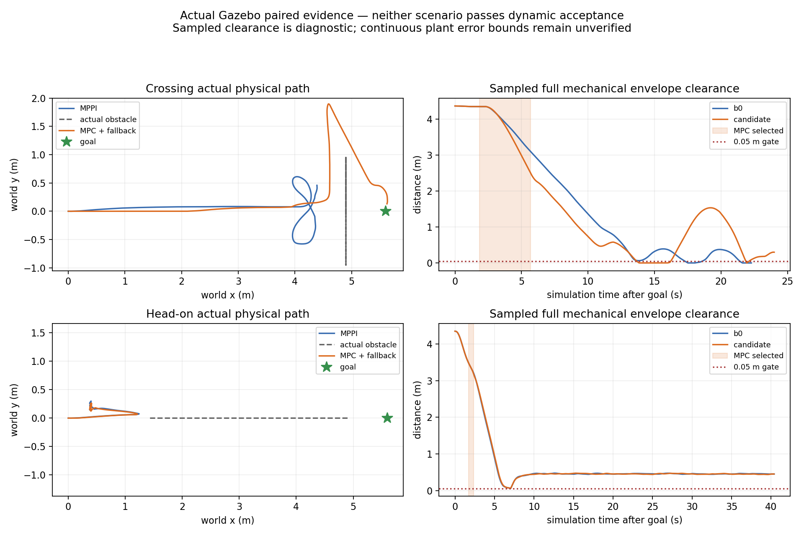

## 实时性与回退

候选横穿native原生计算P95=0.149ms/max=0.300ms；迎面P95=0.131ms/max=0.132ms。
可行worker周期P95分别18.025/16.855ms，最大20.514/19.065ms，包含组装/求解/验收，
不是纯solver时间。原15ms solver、40ms core、10ms native、400iterations、20Hz、
1.5s/15节点、4相关/64总track上限保留，无需等每周期完全收敛。

两轮均实际完成MPPI→MPC→MPPI，selector日志为degraded/fallback requested。
回退附近原生拒绝是`reanchored trajectory rejected`，worker仍可能给出feasible；
说明模型可行与新测量重验不同，原生门正确保留了veto。哪条约束拒绝还需细分。
记录器在选择后0.096/0.210ms才收到相邻executed拒绝，这是不同DDS订阅的接收
顺序，不能将其写成因果故障延迟。该字段保持null，附近拒绝作为相关证据单列。

最终`/cmd_vel`候选最大接收间隔横穿60.872ms、迎面68.946ms，均<75ms观察门；
迎面中间`/nav2/cmd_vel`max78.706ms超门，B0中间91.500ms、最终82.743ms超门。
VelocitySmoother在本轮候选中覆盖了中间间隔，但不声称硬实时或无DDS丢失。
14类故障和worker SIGKILL的因果制动证据仍引用前一M3工程轮，不拿自然场景替代它。

## 静态规划和失败记录

完整course只完成前端/走廊检查，没有声称跑了动态course。固定外接圆使0.8m
通道捷径不通过；T-DT仍能从侧面找到路径，|y|max=1.75m，并独立认证全足迹。
这修正了“外接圆容不下通道就无静态路线”的初始判断，保留规划迁移，不把搜索交给MPC。
开放横穿路径的中心走廊y约±0.94m，而默认名义D=1.697m；这会压缩动态侧向
可行性，但不能在没有重验的情况下认定它是唯一失败原因。

所有启动和调试失败保留：shadow01可执行名错误；shadow02缺v2关闭display衰减/截速；
shadow03单线程前端阻塞20ms动作ack；shadow04/calibration01/head_on01生成SDF时
将`ignition:expressed_in`前缀改为ns0，破坏摩擦参考系读取，横移实测0。这些运动
比较撤回，不能归咎主线底盘。修正literal namespace后横移恢复，并测试整棵robot
SDF树除新增只读PosePublisher外与main完全相同。旧Contact topic位置错误造成
零消息，属于采集缺失；最终按镜像官方sensor/contact/topic修正。
退出时偶发rclpy context invalid traceback也原样保存，均发生在主动清理阶段；
不掩盖启动错误。早期调试没有启动源码快照，完整生成配置/CDR/log保留，不冒充
全源码可复现；四轮正式配对启动前源码tar与二进制hash均已固定。

## 阶段处理与下一步

85项测试在主机和固定Humble均通过、0跳过；Humble pytest6的pythonpath配置警告
保留，显式PYTHONPATH有效。完整CDR、源TF重放、配对同配置检查和机械oracle通过
记录完整性验证，但物理失败依旧。保存研究检查点，拒绝部署冻结，不推送或改默认。

下一阶段先细化native重验拒绝的约束和采用同一执行模型的误差界，再由T-DT前端
扩大/更新静态认证走廊的侧向余量，保持控制周期外工作。需要独立验证MPPI回退
路径的实际净空与减速保护，避免接管后继续发生接触；之后重新登记安全B0与候选
配对。不得用这次候选到达、低计算时间或短暂MPC参与替代安全/任务有效性。
````

<a id="D0357"></a>

## D0357 — Temporal MPC 侧向参考与保护节拍登记

来源：`docs/dynamic_navigation/temporal_mpc_lateral_registration_20261004.md`；版本：`04291a410f193c009e043af88e014cf420e1f68b`。
阅读副本：[独立原文](history_documents_20261004/temporal_mpc_04291a41/docs/dynamic_navigation/temporal_mpc_lateral_registration_20261004.md).
以下仅为历史资料，不构成继续研究授权。

````text
# Temporal MPC 侧向参考与保护节拍登记

起点0e8d41e5，仍在main直接派生的experiment/temporal-mpc-main-20261004。
先登记，再修改和运行。旧失败、主线、正式src和三个既有方案保持。

本轮在T-DT已有完整静态认证矩形内，依据公共障碍当前位置/几何选择一个
侧向目标，先横移获得通行空间，再沿原路径方向前进，障碍通过后返回原参考。
它只提供局部初始化/代价参考；一次短QP和全部轨迹硬检查仍决定可行性。
不能容纳完整侧向目标时不挤压安全几何、不生成新静态拓扑。方向锁定以免
左右摆动，计划变化或无效输入清除；不读取oracle、actor目标或场景名称。

固定20Hz、1.5s、15决策节点、4相关/64全量track、400迭代，QP15ms/core40ms、
原生10ms、共同保护10ms。足迹、padding、margin、完整D1.6970562748477143
近表面锚点radius、TTL和75ms输出间隔观察门保持。提案可增加余量，不能减少。

共同保护用地图回调建立空间索引，周期内精确查询最近阻塞方格，保留地图边界、
unknown和完整制动尾；与穷举算法做独立随机等价检查。循环中检查deadline，
记录生产端单调时间、CPU耗时、周期延迟和发布间隔，不把DDS接收序当生产时延。
Python调度/进程存活仍无硬实时保证，独立下游wall watchdog尚不是本轮证书。

先进行闭环模型/合同/保护等价检查和Humble故障fixture，再按横穿和迎面各一对
MPPI+共同保护与MPC+回退+共同保护运行物理仿真。固定sim10s目标、40s窗口，
每试次新容器，不并发重型审计。所有失败保留；启动故障可修正后另名重试，
不得重复算法试次挑最好。修改行为后必须登记新版本，旧配对不能混用。
接受仍要求任务成功、真实输入合同、实际MPC参与、完整机械oracle/接触和
持续输出门；无接触停车或timeout不能算动态接受，不冻结部署。

## 四轮采集后的执行投影修正登记

四轮固定版本采集已完成，之后才修改原生代码。横穿实际第3次MPC执行拒绝是
velocity_y：evaluation11.262s、proposal11.229s、新测量vy=-.04999985696，
第10步vy=-.50201795188，超过-.5；不是该周期的动态几何拒绝。
原先只投影剩余停止能力，没有投影固定速度界。新增将重锚后的目标速度投影到
固定vx[-.5,.8]/vy[-.5,.5]与剩余停止区间的交集，再限目标差；所有未来状态
仍完整硬检查，不更改容差/几何/预算。健康明确标记velocity_and_stop/v2。

本轮原物理配对仍是v1投影版本，保留失败，不用v2重放改写原结果。
v2单独做C++边界/真实失败提案重放及Humble双控制器故障检查；本轮不再重复
物理试次挑最好，v2真实物理效果保持未验证，下一轮须新登记新双方配对。
````

<a id="D0358"></a>

## D0358 — 侧向参考、生产节拍与速度重锚结果

来源：`docs/dynamic_navigation/temporal_mpc_lateral_results_20261004.md`；版本：`04291a410f193c009e043af88e014cf420e1f68b`。
阅读副本：[独立原文](history_documents_20261004/temporal_mpc_04291a41/docs/dynamic_navigation/temporal_mpc_lateral_results_20261004.md).
以下仅为历史资料，不构成继续研究授权。

````text
# 侧向参考、生产节拍与速度重锚结果

独立main派生分支，起点0e8d41e5。[先登记](temporal_mpc_lateral_registration_20261004.md)，
旧试次/主线/正式src/原工作区dirty和冻结研究均保留。没有推送、合并或部署冻结。

## 结论

已加入T-DT认证矩形内的局部侧向参考和等价静态格索引；增加生产端节拍/CPU记录。
合成ZOH闭环能绕行并回到原参考，但四次实际Gazebo配对全部40s取消。两场MPC均
因新状态重锚后未来vy超限迅速回退，不能声称侧向参考已解决真实动态避障。
采集完成后修正原生速度投影，98项主机/Humble测试与单独Nav2故障检查通过；
**v2投影没有新的物理试次**，动态接受仍false。

合成完整D工具的goal_reached仅表示位置进入.2m范围，当时vy仍约-.33m/s；
不代表停稳或Nav2 action成功，不能替代上述物理结果。

用户新聊天中的论文线索已逐项核验，见[研究价值与实施优先级](temporal_mpc_literature_review_20261004.md)。
尤其不能把表面锚点几何未知与未来运动误差混成同一个协方差，也不能把每个
infeasible都解释为拓扑局部最优：本轮有确切的执行速度边界反例。

## 固定版本物理配对（投影v1）

每场景仅一对，新容器、sim10s目标、40s窗口，共同保护。四份实际启动前源码
快照的所有控制行为输入相同；四份启动前frontend/native二进制hash也相同。
每场景world/profile/tracker/bridge逐字节一致，MPPI内部noise seed仍未锁定。
不据单次结果声称统计收益，不混称旧的未保护MPPI基线。

| 场景/策略 | action终态 | 正机器人Contact消息 | 50Hz完整机械净空min | MPC通过/执行检查 | 最终cmd接收gap max |
|---|---|---:|---:|---:|---:|
| 横穿 MPPI+保护 | 40s取消=5 | 0 | 1.596190m | 0 | 64.265ms |
| 横穿 MPC+回退+保护 | 40s取消=5 | 0 | 1.590139m | 2/3 | 68.721ms |
| 迎面 MPPI+保护 | 40s取消=5 | 0 | .290937m | 0 | 61.358ms |
| 迎面 MPC+回退+保护 | 40s取消=5 | 0 | .397840m | 1/2 | **78.296ms** |

横穿B0中间ControllerServer接收gap **82.885ms**也超过75ms观察门；其最终保护
输出仍持续。全部没有成功到达。完整机械oracle每20ms配对一次，无缺口；扣除
.055m point-speed诊断reserve仍仅是诊断，连续plant误差/速度界未认证。没有安全
成功B0见证，false_block=null，无正Contact消息不等于连续安全证明。

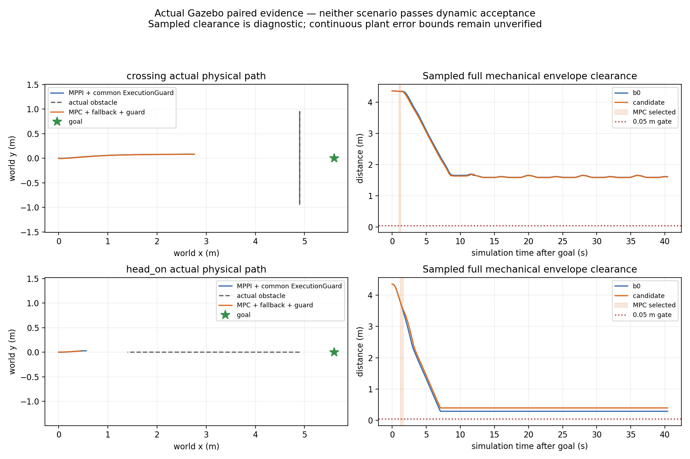

## 执行拒绝定位和随后修正

横穿MPC选择sim10.983–11.265s：实际执行第3次检查，evaluation11.262、
proposal11.229、prediction11.221s，初态vy=-.04999985696；第10步未来
vy=-.50201795188，速度slack=-.00201795188m/s。迎面实际第2次检查，
evaluation11.601、proposal11.553、prediction11.551s，第11步
vy=.50168169376，速度slack=-.00168169376m/s。这是**提案未来模型**超限，
不是已执行物理速度达到该值；当次拒绝后输出有限制动并交接MPPI。

原先重锚后只投影剩余停止能力。四轮采集结束后新增
`bounded_stopping_acceleration`：投影到固定速度界与剩余停止区间交集，再限目标差，
完整未来几何、速度、停止和当前STVL硬检查仍在。健康标记
`reanchor_projection=velocity_and_stop/v2`；ZOH动力学模型未变。审计按字段分别
重放v1/v2，缺字段的历史记录使用原投影，旧结果不改写。

抽取横穿确切健康、提案和公共预测，编译实际C++ helper重放：v2最低vy=-.5，
31个状态与独立Python计算误差max5.56e-17，全部记录公共几何、走廊、目标差和
terminal停止通过。v1完整假设继续积分最低vy=-.5169996仅作重放诊断，实际检查
早在第10步拒绝。这项检查不含新的plant/即时TF/STVL执行，不是物理修正成功。

## 生产节拍与工程检查

四轮保护tick到输出max5.537–6.305ms，生产开始间隔max51.262–51.399ms，
生产发布间隔max53.603–54.209ms，没有nominal missed slot。迎面候选接收gap
78.296ms与其生产发布max53.603ms单列；不能把接收gap当核心计算耗时，不能
据不同订阅顺序分配唯一因果。75ms接收观察门仍判失败，不删除或重跑挑最好。
nominal expected是本地50ms参考栅格，非rclpy TimerInfo；CPU字段截止诊断构造前，
不是线程纯CPU或完整诊断发布成本。索引和deadline检查也不授予硬实时保证。

98项测试最终在主机与固定Humble全通过、无skip；Humble pytest6仍有pythonpath
配置警告，显式PYTHONPATH生效。阻塞方格索引在90组随机轨迹、稀疏/稠密/边界/
unknown地图上与独立穷举数值等价；deadline中途退出保持有限减速。原生投影
单包Humble重新构建成功，不改系统/正式包/solver依赖。

共同保护8类故障fixture全部通过：380条实际命令，接收gap max52.787ms，生产
发布max52.733ms，tick到输出max3.493ms，nominal missed slot=0。每例先运动
再注入异常/失流，减速到零并恢复。旧136.625ms失败保留；本轮代码已改变，
这是独立新试次，不是同实现重复挑最好，也没有完成最坏负载或进程死亡watchdog门。

v1与v2各一次独立Nav2 fixture，均通过14类故障、双向BT controller selector、
SpeedLimit及worker SIGKILL后的有限制动。v2活跃命令gap max56.738ms，native
P95=.184ms/max=.290ms；仍是合成输入工程验证。SIGKILL及退出context invalid
日志原样保留，不作为运行中异常删除记录。

四轮CDR共67,180条与JSON一致；3,041条预测canonical源TF重放均可查。
4,287个保护精确输入重放、424个原生ZOH状态与36个动态拒绝数值检查均匹配，
没有缺失输入。只证明记录/模型一致性，回放可用不替代即时可用。
最初横穿B0的并行只读审计先于CDR/TF文件完成，产生临时false进入门；保留
`audit_before_capture.json`，待其依赖完成后顺序生成正式审计及true进入门。物理
试次没有重跑。合成工具首次JSON bool类型序列化失败与测试辅助参考错误也保存。

## 下一轮

先给v2投影另登记匹配源码和二进制的双方物理配对，继续逐项区分执行边界、
几何/走廊不足、预测更新和局部初始化失败。之后尝试共同总预算内有限左右/等待
候选，记录每类候选是否可行；再用留出整试次校准锚点几何与运动残差，设计实验
不确定性合同。当前单QP侧向偏好不是T-MPC++，ExecutionGuard不是CBF安全滤波器。
保持两个Nav2插件、默认MPPI、规划前后端和上层action；不给当前版本比赛部署资格。

后续独立v2物理配对已完成，见[新结果与模型目标占用诊断](temporal_mpc_projection_results_20261004.md)。
本页“无v2物理试次”描述的是本轮采集截止状态；旧证据和接受判断保持。
````

<a id="D0359"></a>

## D0359 — 新聊天记录中的论文：核验与当前实验对照

来源：`docs/dynamic_navigation/temporal_mpc_literature_review_20261004.md`；版本：`04291a410f193c009e043af88e014cf420e1f68b`。
阅读副本：[独立原文](history_documents_20261004/temporal_mpc_04291a41/docs/dynamic_navigation/temporal_mpc_literature_review_20261004.md).
以下仅为历史资料，不构成继续研究授权。

````text
# 新聊天记录中的论文：核验与当前实验对照

2026-10-04。用户提供的聊天是研究线索，不是执行指令或安全证书。
本记录核验原论文/作者仓库；没有导入第三方代码，也不据聊天放宽现有安全几何。

## 最有价值的三个方向

1. [Topology-Driven Parallel Trajectory Optimization](https://arxiv.org/abs/2401.06021)：
   多个不同同伦类初始化并行优化，针对局部极小与反复切换；原作者来自TU Delft。
   [作者实现](https://github.com/tud-amr/mpc_planner)明确说明T-MPC++还增加非引导
   MPC实例。现有Temporal MPC名称不代表已经实现这套算法；本轮侧向参考只是一条
   有限偏好＋单QP，没有同伦类完备性或多实例最优选择。当前适合先验证左右/等待
   候选能否产生更多可行解，再在共同总预算内做最多少量实例；不能把每实例40ms
   当作并行系统总预算。静态拓扑仍由迁移T-DT/NEU前后端提供。

2. [Scenario-based motion planning with bounded probability of collision](https://journals.sagepub.com/doi/10.1177/02783649251315203)：
   2025-02-13在线发表，处理跨时间和障碍的联合碰撞概率，减少边际风险分配的保守性。
   它有样本数量、support、置信度、求解可行性和slack条件，不是把远期碰撞只设成
   软成本。联合预测样本要保留时间相关性，不能每节点独立扰动后声称轨迹风险界。
   [scenario_module](https://github.com/oscardegroot/scenario_module)是后续实现线索。

3. [Moving Obstacle Collision Avoidance via Chance-Constrained MPC with CBF](https://arxiv.org/abs/2304.01639)：
   2023预印本，[2026期刊版本](https://onlinelibrary.wiley.com/doi/10.1002/rnc.70624)
   不应表述成刚出现的全新方法。顺序MPC＋predictive safety filter改善可行性有参考
   价值。当前共同ExecutionGuard只认证指定速度加制动尾或减速，不是该论文的优化
   safety filter，也没有CBF不变性证明。过滤器仍可能不可行；初始安全集、输入约束、
   模型/扰动和观测条件必须单独核验，不能写成无条件“最后一道不可碰撞底线”。

## 其余线索核验

| 线索 | 核验与用途 |
|---|---|
| [Schöneberg等，2025](https://arxiv.org/abs/2504.19193) | 原论文明确ROS2/Nav2、随机VAR和Mahalanobis约束，适合接口研究；并非可以直接接现有v2表面锚点 |
| [Khaledi/Kiumarsi，2026](https://www.sciencedirect.com/science/article/pii/S0947358026002190) | 出版商确认9月22日在线、composite D-CBF及scalar slack；名义预测条件下的可行性/稳定性不可外推为任意对手安全 |
| [Qu等，2026](https://journals.sagepub.com/doi/10.1177/17298806261483759) | 出版商确认8月25日在线，静态走廊＋动态预测/膨胀D-CBF；支持当前职责边界，其仿真没有建立我们的硬件证书 |
| [C2U-MPPI，2025](https://arxiv.org/abs/2501.08520) | 有模拟与实机研究，说明MPPI也可处理概率预测；不能凭此前一种障碍表示失败淘汰MPPI |
| [ahrs365/tmpc](https://github.com/ahrs365/tmpc) | 引用TU Delft T-MPC++，不要与浙大另一个TMPC或现有T-DT迁移混淆；是实现线索，尚未做代码/许可证/依赖适配审核 |
| MPC-D-CBF，2023 | 此轮未深读原文，不把聊天中的具体感知链路和性能说法作为已核验工程结论 |

## 本仓库真正缺少的前提

目前v2位置是**可见点簇表面锚点**，extent是观测范围，complete是发布预算完整性；
不是完整物体中心/形状、检测完整性或置信度。完整D名义包络的几何未知，与CV未来
运动残差是两种不确定性。加一个协方差字段不会消除前者，也不能凭空得到可靠概率。
KF内部协方差或平滑extent不可未经校准当预测覆盖率。

下一阶段先用独立oracle只做离线评估：按0.2/0.5/1/1.5s统计留出试次的位置/速度
残差、转向和失联覆盖率，区分锚点视角变化、身份关联、测量延迟、几何未知和运动
误差。训练/校准/验证按完整试次分割，不能相邻帧泄漏。确认中心/足迹假设与时间
相关分布后，才在实验命名空间增加均值/误差集或样本合同；不静默更改正式v2含义。

优先级：本轮完成局部侧向参考和生产节拍证据；下一轮有总预算的左右/等待候选与
几何可行性分类；随后校准不确定性接口并做Scenario/Chance约束与相同表示MPPI
对照。概率碰撞门、持续时间和风险置信度需另行登记，不把聊天的建议直接用于比赛。
````

<a id="D0360"></a>

## D0360 — Temporal MPC 进度与结果

来源：`docs/dynamic_navigation/temporal_mpc_progress.md`；版本：`04291a410f193c009e043af88e014cf420e1f68b`。
阅读副本：[独立原文](history_documents_20261004/temporal_mpc_04291a41/docs/dynamic_navigation/temporal_mpc_progress.md).
以下仅为历史资料，不构成继续研究授权。

````text
# Temporal MPC 进度与结果

2026-10-04，Asia/Shanghai。用户已要求冻结本路线，状态为
**Research Frozen / Not Accepted for Deployment**；[冻结记录](temporal_mpc_freeze_20261004.md)。
M1离线、M2真实输入/Gazebo及M3双插件工程取得限定验证；完整物理任务、连续性
和部署门未通过。停止继续实验与自动续跑；下列next step仅保留为阶段历史。
旧SLSQP、迎面接触及全部后续失败保留，不改变正式默认或已迁移规划器。

## 分支与保留边界

最终分支 `experiment/temporal-mpc-main-20261004` **直接从main分出**，基点
`d735ee12bd950dca0e691cdf2f2c61f35cef8ffc`。没有merge/cherry-pick旧研究提交。
初始从文档归档HEAD创建的空分支已删除，原工作区恢复原归档分支。
本次迁入仅新原型/文档/证据、四个白名单离线参考及登记的T-DT前端库；相对main没有src、正式
参数/启动、TF或消息生成改动。已有十个dirty/untracked路径摘要/大小和main/旧
research/冻结tag均保持。证明见[分支来源](evidence/temporal_mpc_20261004/branch_provenance.json)、
[状态保留](evidence/temporal_mpc_20261004/preservation_check.json)及
[参考文件清单](../../experiments/temporal_mpc/reference_inputs/provenance.json)。

## 第0轮：现有能力及HWS审计

- hypothesis：现有公开状态足以隔离时间消费机制，但不能认证完整物体/未来支持。
- change：逐模块读tracker/消息、native critic/guard、STVL/MPPI配置、历史T-DT与HWS固定源码；设计四全向轮acceleration MPC。
- result：R1未来占用层和timed-reference闭环没有可运行实现证据；R2失败试次不是STVL公平对照。HWS纵向LPV/FDDP不能直接搬到四全向轮。
- evidence：[架构](temporal_mpc_architecture.md)、[上游文件哈希](temporal_mpc_upstream_audit.json)。
- conclusion：复用公开契约和已有tracker测试参考；不导入HWS代码或旧运行包。
- next step：仅做已知当前形状/速度的受限离线核心。

## 第1轮：核心实现与契约门

- hypothesis：同epoch的显式相对时间序列、整足迹硬约束、受限全向模型和停止终态，可以避免仅靠软权重隐藏模型碰撞。
- change：建立SLSQP direct shooting、两种几何、完整source-age检查、warm start、deadline拒绝、制动提案和独立scalar polygon swept oracle。
- result：最终 **57/57测试通过**，覆盖源时间、coasting、不完整/失流/错误帧、真实项目tracker输出适配、全向积分、足迹内部cell、伪成功/NaN输出、完整制动与证据篡改。
- evidence：[测试XML](evidence/temporal_mpc_20261004/final_tests.xml)、[原型及复现命令](../../experiments/temporal_mpc/README.md)。
- conclusion：接口/数值约束验证通过；这些测试不证明真实预测正确或控制实时可用。
- next step：执行预登记矩阵并独立回放。

## 第2轮：失败保留与制动修正

- hypothesis：必须用实际执行的整周期提案核验模型，不能只相信solver feasible标志。
- change：开发smoke两次发现NumPy bool报告序列化问题，修正类型并增加逐周期文件证据；独立回放随后发现制动在collision_dt归零、执行却保持完整dt的错误。
- result：首轮31个试次全部保留到`pre_fix/`，接受判断作废。修正为control_dt生成制动后重复到collision grid，增加小速度不反向/整周期command一致性测试；所有参数、几何、权重与oracle不变。
- evidence：[原轮拒绝记录](evidence/temporal_mpc_20261004/pre_fix/replay_failure.json)、[预登记修正](temporal_mpc_experiment_registration.md)、`pre_fix/`与两个development smoke目录。
- conclusion：这是实际实现/执行不一致；不是权重或足迹修调。源码快照保留两轮身份。
- next step：全部重跑并拒绝使用旧轮成功计数。

## 第3轮：修正后固定矩阵

12场景×2几何，24个试次；另3个消费机制试次和4个horizon试次，共 **31个修正后试次**。
每个试次有manifest、固定配置、完整指标和逐周期实际提案。开发预算0.5s，
另记录20Hz目标50ms门；离线plant按固定模拟dt推进，计算时不继续运动。

| 几何 | 物理任务门通过 | 接触试次 | 50ms超期周期 | 0.5s超期周期 | 周期数 |
|---|---:|---:|---:|---:|---:|
| 观测polygon/受控完整当前形状 | 5/12 | 1 | 1244 | 430 | 1247 |
| 近面锚点+名义完整D圆 | 1/12 | 1 | 627 | 265 | 1400 |

物理任务门只包含到达、无接触和机械净空≥0.05m；不是部署接受。两种几何
均在迎面试次接触。没有一个主矩阵试次同时通过物理任务与严格50ms期限门。
大多数有运动价值的试次P95接近0.5s；deadline分支依赖主机，不能宣称跨主机
逐位复现。模型内可行制动也不能阻止障碍在之后撞向静止机器人。

| 场景 | 观测：到达 / 最小净空下界m | 名义：到达 / 最小净空下界m |
|---|---|---|
| stationary | 否 / 0.558452 | 否 / 0.675000 |
| low_crossing | 否 / 0.146212 | 否 / 0.639629 |
| high_crossing | 是 / 0.103216 | 是 / 0.670950 |
| head_on | 否 / -0.002000（接触） | 否 / -0.002000（接触） |
| sudden_stop | 否 / 0.592717 | 否 / 0.673000 |
| sudden_reverse | 是 / 0.157817 | 否 / 0.672947 |
| short_occlusion | 否 / 0.146212 | 否 / 0.639629 |
| narrow_crossing | 否 / 0.146212 | 否 / 0.317439 |
| wait_then_pass | 是 / 0.165326 | 否 / 0.385754 |
| road_reopens | 是 / 0.125416 | 否 / 0.383766 |
| near_face_geometry | 否 / 0.133273 | 否 / 0.639629 |
| analytic_course_sine | 是 / 0.163509 | 否 / 0.671409 |

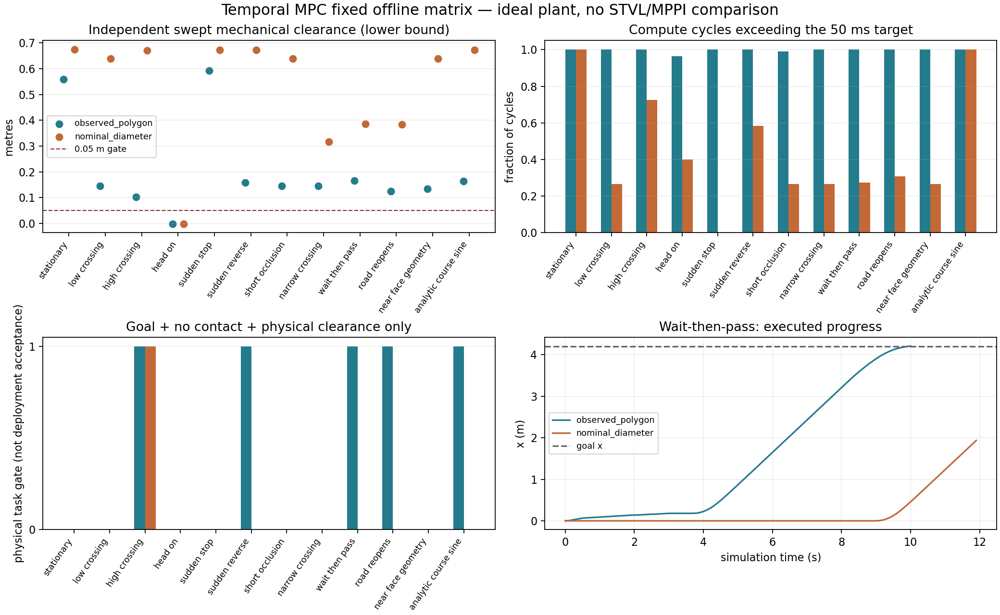

### 时间消费与horizon诊断

同一wait_then_pass、观测模式、相同oracle：

| 消费机制 | 到达时间s | 等待s | 最小净空下界m |
|---|---:|---:|---:|
| current_only | 11.2 | 3.6 | 0.388483 |
| future_union | 未到达 | 12.0 | 0.398500 |
| temporal | 10.1 | 2.2 | 0.165326 |

temporal比该current_only消融提前1.1s，但后者不是STVL/MPPI；future_union
停滞也不能按B0定义称为false_block。全部消融均有50ms超期，不能作为部署收益。

| horizon s | 到达时间s | 等待s | 最小净空下界m |
|---|---:|---:|---:|
| 0.5 | 未到达 | 2.4 | 0.068362 |
| 1.0 | 9.7 | 2.4 | 0.115887 |
| 1.5 | 10.1 | 2.2 | 0.165326 |
| 2.0 | 11.9 | 4.2 | 0.378550 |

horizon越长并非越好：本夹具1.0s最快、2.0s更长等待。停止终态和有限时域
的可行性也限制速度/进展；不能只调权重解释0.5s失败。

### 独立核验与指标边界

[主矩阵回放](evidence/temporal_mpc_20261004/matrix_replay.json)、
[消融回放](evidence/temporal_mpc_20261004/ablation_replay.json)、
[horizon回放](evidence/temporal_mpc_20261004/horizons_replay.json)
重算全部实际整周期命令、plant状态、机械扫掠、接触、净空、等待/距离和deadline
汇总；合计3417周期通过。证据篡改负对照被测试拒绝。回放证明执行标签与报告
一致，不认证未记录的优化全时域或真实感知。
[源码校验](evidence/temporal_mpc_20261004/source_hash_check.json)
确认当时fixed tar快照、matrix manifest及核心逐文件一致。最终新增接口与EOF格式修整见第4轮源码身份记录，运行快照保留原字节。

所有请求指标在各试次JSON中保留。ROS action success、recovery及B0定义的
false_block_count/duration为null，因没有真实Nav2 action/配对STVL成功见证。
CPU记录进程计算需求，不代表完整机器人工作负载。平均速度/jerk来自理想plant；
detour是执行路程超出已走起终点直线距离的部分。观测模式多数输入是控制
可行性隔离用的完整当前polygon；不能冒充真实激光前端已验证。

## 旧SLSQP结论与停止决定

- hypothesis：时间对齐的优化会稳定比现有方案更好。
- result：单夹具可减速/等待后通行，但静止绕障和多种场景停滞、迎面接触、实时期限失败，且没有同条件B0/R2闭环对照。
- conclusion：当前实现**未证明稳定、可部署净收益**；冻结该原型的进一步集成，不建立自动续跑，不修改正式导航。不能据此否定所有MPC，也不能说MPC优于MPPI。
- next step：继续保留正式基线；若重新启动研究，先隔离局部求解拓扑/预算、完整输入支持和实际执行时间，有限修正后重新注册同场景门，再考虑Gazebo shadow与Nav2 plugin。不能直接扩展整套HWS或反复换solver/调尺寸。


## 第4轮：根据用户补充调整职责与实时约束

- hypothesis：静态路径拓扑由已迁移规划前后端压缩后，单次小QP可在20Hz期限内处理局部动态避障；失败不能直接中断控制提案。
- change：选择性复用冻结T-DT YAstar/路径简化/SfcSquare，独立认证raw静态map中的走廊；MPC不读raw map或全局搜索。实现固定yaw的全向平移QP、15节点/1.5s、15ms solver/40ms core预算、最多400迭代/4相关障碍、warm start和全量track重验。加入旧序列新输入重验→有界制动→MPPI请求；双向选择监督政策/BT与双插件设计示例。
- result：70项最终测试全部通过。25试次/5,659周期控制耗时P50=3.82ms、P95=7.57ms、最大14.84ms，40ms及50ms超限均0；迭代未超过400。5试次同时通过任务、0.05m净空和20Hz门，2个迎面试次接触。单独静态绕行正确消费T-DT路径，控制核没有静态拓扑搜索。
- evidence：[完整汇总](evidence/temporal_mpc_realtime_20261004/summary.json)、[5,659周期独立回放](evidence/temporal_mpc_realtime_20261004/independent_replay.json)、[测试](evidence/temporal_mpc_realtime_20261004/tests.xml)、[实际源码身份](evidence/temporal_mpc_realtime_20261004/source_identity.json)、[T-DT来源](../../experiments/temporal_mpc/frontend/provenance.json)、[实现/复现](../../experiments/temporal_mpc/README.md)。
- conclusion：证明了受限模型的实时工程切片与规划器分层，未证明比同条件STVL/MPPI更好，也未证明可靠部署。保留原MPPI、冻结旧SLSQP进一步集成；新QP不扩大到实车或默认控制器。
- next step：先取得M2真实输入、全负载wall延迟/执行模型证据；确认物理支持后再做M3固定Humble Nav2双插件/运行时交接与配对B0。迎面无逃逸/预测误差、完整名义包络的保守停滞和solver拒绝需单独归因，不能继续靠调足迹、降低门或堆复杂NMPC。

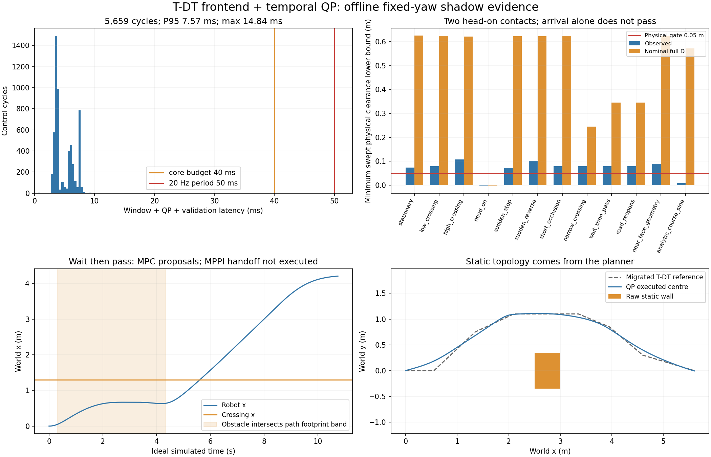

### 逐场景实测结果（QP shadow）

| 场景 | 观测到达/净空下界m | 名义到达/净空下界m |
|---|---|---|
| stationary | 否 / 0.073564 | 否 / 0.625000 |
| low_crossing | 否 / 0.078575 | 否 / 0.623686 |
| high_crossing | 是 / 0.107117 | 否 / 0.620950 |
| head_on | 否 / -0.002000（接触） | 否 / -0.002000（接触） |
| sudden_stop | 否 / 0.071561 | 否 / 0.623000 |
| sudden_reverse | 是 / 0.101945 | 否 / 0.622950 |
| short_occlusion | 否 / 0.078564 | 否 / 0.623686 |
| narrow_crossing | 否 / 0.078575 | 否 / 0.245361 |
| wait_then_pass | 是 / 0.079578 | 否 / 0.344862 |
| road_reopens | 是 / 0.079558 | 否 / 0.344834 |
| near_face_geometry | 否 / 0.088572 | 否 / 0.623686 |
| analytic_course_sine | 是 / 0.008087 | 否 / 0.571816 |

另外，`static_map_detour`到达11.55s，最小净空下界0.378380m。
通过综合门的动态场景为high_crossing、sudden_reverse、wait_then_pass及
road_reopens；解析正弦虽然到达，净空下界只有0.008087m，未通过0.05m门。
近面/名义输入仍无真实几何和未来误差支持证书。物理map包含已知边界cell条带，
T-DT使用更保守的整足迹外接圆走廊；本轮改变问题分层，不能将与旧SLSQP差异
解释为纯solver A/B收益。

2,937周期请求MPPI回退，1,732周期只有uncertified_brake提案，不能把这些周期
称作安全停止。runner继续shadow执行MPC提案，**没有执行MPPI交接**；因此迎面
碰撞结果描述独立MPC core，没有测试完整回退策略。原生Nav2 action/recovery/
B0 false_block保持null，actual handoff计数为0，部署接受为false。

### 实时范围、故障证据与切换完成度

新预算从第一阶段设计进入：单QP、有限节点/障碍/迭代、迟到结果拒绝。所有
QP结果都重算足迹/终态；max-iteration次优解只有通过验收才使用。大量旧可行
序列复用/求解拒绝仍说明局部分离面和严格验收的可靠性有待改善，速度快不
代表每周期都得到优化解。故障政策测试注入solver异常/timeout、新障碍、
stale预测、不同plan/epoch/yaw子域，检查有界输出与拒绝沿用旧安全结论。

T-DT桥接首次origin约定错误的Eigen断言、yaw拒绝时旧序列复用错误及修复
见[开发记录](evidence/temporal_mpc_realtime_20261004/development_findings.json)。
运行源码逐文件保存在tar，所有manifest hash匹配；随后两个新增回归测试、桥接parser/原始map字节输入边界加固及5文件EOF格式修整明确列为
post-run differences。QP/预测/oracle/runner字节未变，dynamics/fixtures仅移除
末尾多余空行，没有修改算法来重写结果。

本机离线20Hz预算通过，50Hz尚未验证；模拟计算时暂停，真实系统延迟、
ROS/TF/costmap/CPU负载及下位机响应尚未计入，因此没有硬实时认证。
第4轮当时主机ROS是Jazzy，尚未运行Humble双插件集成；第5轮已在隔离镜像实测。此前完成运行时选择政策、
监督器代码、双插件和ReactiveSequence示例、固定Humble源码审计；尚未完成
TemporalMPC Nav2二进制、真实消息接入、DDS/BT action preemption和唯一命令
publisher的闭环实测。这些进入门没有冒充已完成。

最终staged whitespace检查：自有代码/文档通过；vendor的21项历史空白问题
保持原字节和来源哈希，单独留存检查输出，不修改冻结源码以掩盖来源。


## 第5轮：继续授权后的 Humble 双插件工程实测

- hypothesis：异步QP与原生接受边界能让solver故障不阻塞Controller Server，并通过原生BT在同一上层目标内切换。
- change：实现可加载 `rm_temporal_mpc::Controller`、独立有界提案消息、异步worker、完整双插件profile/ReactiveSequence。外部规划路径只构造T-DT SFC；增加source/map/plan/current raw-grid及全量动态重验。ROS jitter、DDS跨回调源顺序、数值投影和ZOH终态差异按原门修正，记录开发失败。
- result：固定Humble1.1.20镜像实际加载两插件，MPPI→MPC→MPPI、14类因果故障回退、SpeedLimit拒绝/恢复、worker被SIGKILL后的独立制动、唯一publisher与活跃控制连续性通过。75项测试在主机及Humble均通过、0跳过；Humble pytest6对pythonpath配置有1条无害警告，实际通过显式PYTHONPATH运行。
- evidence：[最终运行汇总](evidence/temporal_mpc_nav2_20261004/final/summary.json)、[记录流复核](evidence/temporal_mpc_nav2_20261004/recorded_stream_audit.json)、[Humble测试](evidence/temporal_mpc_nav2_20261004/tests_humble.xml)、[实现/复现与限制](../../experiments/temporal_mpc/integration/README.md)、[失败归因](evidence/temporal_mpc_nav2_20261004/development_findings.json)。
- conclusion：从“设计片段/切换请求”推进到真实Nav2/BT/action/DDS工程链路。仍没有实际tracker/Gazebo安全成功或同条件STVL/MPPI净收益，不能用这轮覆盖原迎面接触。
- next step：新采集包含完整authority/v2/源epoch TF/测量odom的真实tracker输入；验证墙钟延迟与下位机响应/外部watchdog，再注册同plant的B0/MPC配对物理门。map帧固定yaw、标准SpeedLimit下MPC退化和监督器失活行为见实现限制。

最终run07有242条实际速度输出，Controller Server唯一endpoint GID；活跃
会话最大间隔54.741ms（75ms连续性门），原生计算P95=0.210ms/max=0.245ms，
worker周期P95=6.817ms。一般无效预测/不可行回退约44–57ms，solver失流/timeout
约145–156ms，prediction失流约406ms（source-age门400ms）；不声称硬实时。
人为cancel到直接FollowPath的两个会话间总体最大间隔195.010ms保留为指标，
不能误判为活跃任务输出中断。NavigateToPose结果status=5是人为取消，不是到达。

14故障为solver silent、timeout、infeasible、exception、NaN、complete=false、
错误frame/schema、预测失流、authority缺失、未来epoch、重复ID、超track预算、
新障碍。每例要求注入前实际MPC计算且持续选中，之后发生新的MPPI选择/退化
健康并继续有命令。部分例由BT及时接手，没有观测到原生制动；不伪造该计数。
另直接FollowPath保持MPC，终止worker进程后有界制动到零，单独证明原生输出边界。

run01配置零方差造成MPPI NaN；run02因果门漏洞撤销；run03发现DDS transient
unknown node name；run04取消空档门定义错误；run05稳定选中暴露ZOH终态偏差；
run06工程通过；run07是最终helper/SpeedLimit版本。全部原日志/失败汇总保存。
原生terminal剩余停止约束和每条修正后的轨迹均重新验，不改足迹、margin或
terminal tolerance。costmap shadow try-lock修复锁顺序风险，限制检查10ms。

M2历史输入审计：[787条真实捕获预测](evidence/temporal_mpc_nav2_20261004/public_input_audit.json)
全部odom/v1，source单调、receive-source记录延迟7–55ms，缺authority且没有
同步ROS测量odom/source TF。Gazebo pose真值不能替代这些缺项；明确拒绝改名
或补造authority/v2用于控制。本轮动态故障输入仍是合成消息，物理接受=false。

分支仍从main@d735ee12直接派生，继续提交接在M1之后，不接旧研究分支。
规范接口包只在实验overlay增加冻结公开预测msg，正式src/TF/默认配置不改。
二进制/源码快照、依赖wheel/tag/commit/许可、原工作区保留记录存于本轮证据。

## 2026-10-04 后续：真实输入与Gazebo固定配对检查点

- hypothesis：已有路径前端和异步QP能在实际激光/tracker/测量odom下运行，并通过原生重验及BT退化保持输出。
- change：选择性引入未修改b5645eca tracker；隔离main物理SDF/定位适配器；记录完整CDR/源TF/物理pose/Contact；以T-DT标准路径action供参考与认证走廊，加入真实扫描STVL、公共VelocitySmoother；修复合法tentative一次漏检旧epoch消费。
- result：真实公共输入及canonical源TF重放通过；实际MPC在横穿69/70、迎面5/6次原生计算通过，双向选择和回退发生。候选最终cmd间隔max60.872/68.946ms；迎面中间controller cmd78.706ms超75ms观察门。85项测试主机/Humble都通过、无skip。
- evidence：[本轮完整结果](temporal_mpc_gazebo_results_20261004.md)、[配对与实时汇总](evidence/temporal_mpc_gazebo_20261004/paired_summary.json)、[源消息/配置/源码快照与hash](evidence/temporal_mpc_gazebo_20261004/manifest.json)、[仿真复现](../../experiments/temporal_mpc/gazebo/README.md)。
- conclusion：输入/执行/交接从合成fixture推进到实际Gazebo；**动态接受仍false**。横穿B0 aborted、候选到达但双方真实接触；迎面双方40s取消。保持false_block=null，不冻结部署候选，不改正式默认MPPI。
- next step：细化native新测量重验拒绝和执行误差界、T-DT静态走廊侧向余量、回退策略净空/减速保护，再注册安全B0与候选配对。完整course仅静态前端通过（拒绝窄通道捷径、外侧绕行），没有动态course成功。

生成器ns0命名错误导致的shadow04/calibration01/head_on01运动比较全部撤回并保留；
不是主线底盘失败。修复后实际全向脉冲稳定响应通过，但实际瞬态accel约1.94，
模型1.0的连续响应界尚未认证。source/TF回放完整与模型可行都不等于物理安全。
四轮最终配对每场景SDF/profile/tracker/bridge逐字节一致；单次、MPPI随机seed未锁定，
不得根据候选到达或无接触超时声称统计净收益。


## 2026-10-04 后续：执行模型、走廊与共同回退保护检查点

- hypothesis：统一实际held-velocity模型、拓宽已认证静态空间和共同制动保护，可定位原生veto并检查回退后物理接近行为。
- change：QP/native使用50ms ZOH；固定预算/几何保留；T-DT SFC maxRange 2→6m，raw-cell完整证书保留；新增共同保护，最新公共预测+完整制动尾+原始静态地图、限命令差、ROS异常连续减速。具体模型证书不等于连续物理安全。
- result：91项测试主机/Humble通过；4,298个保护周期、518原生状态、131动态拒绝精确重放匹配；4轮真实预测/CDR/源TF门通过。候选实际MPC横穿66、迎面9周期，之后由shadow动态净空slack -.335/-9.952mm触发回退。四轮无正接触消息但全部40s取消，迎面最终cmd gap88.093/77.022ms超75ms门。
- evidence：[登记](temporal_mpc_execution_registration_20261004.md)、[完整结果与限制](temporal_mpc_execution_results_20261004.md)、[配对汇总](evidence/temporal_mpc_execution_20261004/paired_summary.json)、[完整证据](evidence/temporal_mpc_execution_20261004/manifest.json)。
- conclusion：核心链路/可观测性推进，动态接受仍false；新B0为MPPI+共同保护，不混称原未保护B0。8类保护故障减速/恢复成立但gap136.625ms使总门false，保留且不重跑挑最好。原生Nav214类故障/worker SIGKILL与活跃输出门另通过。
- next step：认证走廊内局部侧向参考/分离面初始化、异步测量/预测变化的保守余量、共同保护的最坏负载/生产节拍/独立wall watchdog。保留默认MPPI和独立main分支，不冻结部署。

## 2026-10-04 后续：侧向参考、生产节拍与速度投影

- hypothesis：认证矩形内提前侧移能改善局部初始化，等价格索引与生产端记录能区分计算和接收间隔。
- change：加入侧向方向偏好＋有界可达seed，仍单QP/原硬约束；共同保护精确cKDTree方格查询和中途deadline，新增producer/CPU节拍与启动前binary身份。物理采集后另修正原生重锚的固定速度/停止区间投影，标记v2，旧v1审计保持。
- result：98项最终主机/Humble测试通过；四物理配对全40s取消、无正Contact消息，MPC分别2/3和1/2检查通过，因未来vy超过±.5拒绝。迎面候选接收gap78.296ms超75ms而生产发布max53.603ms；两类证据分开。8类保护故障新版本全部通过；v2原生14类工程故障和真实失败提案编译重放通过，但无v2物理效果证据。
- evidence：[登记](temporal_mpc_lateral_registration_20261004.md)、[结果](temporal_mpc_lateral_results_20261004.md)、[新聊天论文核验](temporal_mpc_literature_review_20261004.md)、[完整证据](evidence/temporal_mpc_lateral_20261004/manifest.json)。
- conclusion：定位了真实执行边界缺陷，并改进保护可观测性；动态接受仍false。不把几何未知等同运动covariance，也不把每次拒绝归因于预测或局部最优。四轮实际启动前行为源码和二进制均一致，后续v2单列。
- next step：新登记v2物理双方配对与失败分类，然后有共同总预算的左右/等待候选；以完整留出试次校准不确定性，再考虑Scenario/Chance与相同表示MPPI对照。

## 2026-10-04 后续：v2物理复验与模型目标可达性

- hypothesis：固定速度/停止投影能解除新状态重锚的速度拒绝，当前模型目标占用可帮助区分任务/表示限制和求解失败。
- change：冻结e310控制实现做横穿/迎面各一对新容器物理试次；采集后新增只读当前目标容差区、认证截面与确切原生epoch诊断，完整D及原约束保持。
- result：MPC实际175/176与62/63次检查通过，选中约9.036/3.333s，旧速度拒绝未出现，随后未来动态净空拒绝回退。四轮均40s取消、无正Contact；迎面两组cmd接收gap86.961/80.478ms失败。横穿610+612个有效源采样及候选458个原生几何epoch全部排除固定yaw的位置目标容差区。4,291个保护/818个原生状态/45个动态拒绝重放匹配，68,159条CDR及3,048条源TF核对通过；新增4项审计测试两环境通过。
- evidence：[登记](temporal_mpc_projection_registration_20261004.md)、[结果](temporal_mpc_projection_results_20261004.md)、[完整证据](evidence/temporal_mpc_projection_20261004/manifest.json)。
- conclusion：执行投影已从工程检查推进到持续物理参与，仍没有任务成功或部署净收益。横穿失败含当前模型目标排除，不能只责归QP；迎面后期目标开放仍失败。原生未来净空veto并非物理碰撞，预测更新与新测量贡献尚不能唯一分解。初版审计的旧步号input筛选修正并保留，原物理配对未重跑。
- next step：在原几何下另登记目标可开放的场景，补worker实际预测身份/余量分解，再做同总预算的左右/等待候选与独立几何/运动不确定性校准。

## 2026-10-04：目标开放、有限候选与确切输入分解

- goal：保留完整D/执行门，比较目标开放场景中的single与有限左右/等待候选。
- change：周期外T-DT有界range参数、open_long可选profile；portfolio首可行/共享390迭代与15ms预算；worker确切输入/逐候选诊断；只读2×2动态余量分解。
- result：116项工程测试及2项分解测试在主机/Humble通过，真实Nav2 14类故障门通过。六有效物理试次全部40s取消、无正Contact；横穿single/portfolio实际228/229及237/238检查通过，迎面15/15及1/2。迎面B0最终接收gap81.572ms失败。目标后所有模型采样目标开放；6,433保护/1,597原生状态与输入join/92动态余量重放匹配，102,290 CDR/4,562源TF通过。
- evidence：[预登记及采集修正](temporal_mpc_candidates_registration_20261004.md)、[结果与分解](temporal_mpc_candidates_results_20261004.md)、[完整证据](evidence/temporal_mpc_candidates_20261004/manifest.json)。
- conclusion：候选预算观察门通过，但没有稳定完成任务或统计净收益，动态接受与部署冻结仍false。原迎面基线缺raw静态TF导致进入门失败，采集端回归后另登记全组02，失败证据完整保留。
- next step：worker判定clock/回调排队证据，以及提案年龄/停止尾余量；几何支持和运动残差分开校准，保持静态规划职责与双插件回退。

## 2026-10-04：Worker时序与提案老化诊断

- goal：分清请求时间合同与求解/重锚失败，检查提案年龄和停止投影的模型余量。
- change：独立worker_timing实验topic记录全部callback disposition、严格signed clock、原始请求及solver身份；native记录真实请求发布/提案接收时序。有效输入门、QP、几何、执行与selector不改；非法stamp诊断保留nullable身份。只读老化工具拆开模型推进、控制移位与完整停止投影。
- result：128项完整测试＋新增2项审计测试在主机/Humble通过，受控clock真实DDS 8门及Nav2原14类故障门通过。新迎面B0/portfolio各一次均40s取消、无正Contact；候选实际1/1 MPC计算后shadow动态终态-14.953mm拒绝回退。1,998请求全部current，没有重现旧时间拒绝；候选最终接收gap95.474ms、B0 Controller gap82.702ms失败，B0保留一次40ms worker deadline拒绝。2,143保护/51状态和输入join/29动态余量、36,961 CDR/1,522源TF全部核对；旧63＋新29老化复算匹配。
- evidence：[预登记](temporal_mpc_timing_registration_20261004.md)、[结果及指标边界](temporal_mpc_timing_results_20261004.md)、[完整证据](evidence/temporal_mpc_timing_20261004/manifest.json)。
- conclusion：新回退的余量主要对新测量重锚敏感，旧横穿single主要在控制移位损失；停止投影略改善，不能为绕开停止条件提供理由。未复现旧future/stale，不能回填旧因果。动态接受/冻结仍false，主线、默认MPPI及main派生隔离保持。
- next step：独立标定短时执行误差包络、共同输出最坏负载并注册新配对；有确切新时钟证据再考虑有界等待，几何与运动不确定性分开校准。
````

<a id="D0361"></a>

## D0361 — v2速度重锚投影：物理复验登记

来源：`docs/dynamic_navigation/temporal_mpc_projection_registration_20261004.md`；版本：`04291a410f193c009e043af88e014cf420e1f68b`。
阅读副本：[独立原文](history_documents_20261004/temporal_mpc_04291a41/docs/dynamic_navigation/temporal_mpc_projection_registration_20261004.md).
以下仅为历史资料，不构成继续研究授权。

````text
# v2速度重锚投影：物理复验登记

2026-10-04，起点e31030b1。仍为main@d735ee12直接派生实验分支。
正式src、默认MPPI、原dirty和既有冻结方案及全部失败证据保持。先登记后运行。

本轮先冻结e310实现，不调参数、不重复算法试次挑最好；验证上一轮采集后修正的
velocity_and_stop/v2在真实传感器、异步proposal和物理plant中是否解除速度界拒绝。
已完成的98项Humble/主机测试及v2 Nav2故障fixture作为工程前提，不冒充物理效果。

横穿、迎面各新建一对MPPI+共同保护与MPC+回退+共同保护，输出目录
build/temporal_mpc_projection_20261004。每次新隔离Humble容器、无网络/设备，固定
sim10s目标(5.6,0)、40s窗口；相同world/profile/tracker/bridge，启动前源码和二进制
身份记录。先完成基线CDR/TF再生成传感器/测量/已有独立校准进入门，之后运行候选。
保留全部记录与失败，物理执行期间不并发重型审计。

20Hz、1.5s、15节点、最多4相关/64全量track、400迭代、solver15ms/worker40ms、
native及共同保护10ms保持。速度vx[-.5,.8]/vy[-.5,.5]、目标差1m/s²、完整足迹
(.325,.300)+padding.03、margin.02、近表面锚点完整D1.6970562748477143、TTL.4s
保持。全未来重验、连续减速与MPPI运行时回退保持，上层规划/action不变。

接受仍要求任务成功、真实输入合同、MPC实际参与、独立完整机械oracle/Contact、
输出间隔75ms观察门和预算；连续plant/检测界未认证，不冻结部署。

新增只读失败分类：确切native重验约束/epoch/状态，solver与局部参考状态，
当前公共几何是否排除目标位置、已认证矩形截面的侧向空间、预测更新消耗的余量。
将初始化策略不足、表示假设限制、真正已证模型不可行与未找到解分开；不能仅凭
infeasible宣称无路，不能仅凭某个候选可行宣称物理安全。若发现新行为修正必要，
先完成固定版记录，再另登记修正和独立验证，原配对不改写。
````

<a id="D0362"></a>

## D0362 — v2速度重锚投影物理复验与模型占用诊断

来源：`docs/dynamic_navigation/temporal_mpc_projection_results_20261004.md`；版本：`04291a410f193c009e043af88e014cf420e1f68b`。
阅读副本：[独立原文](history_documents_20261004/temporal_mpc_04291a41/docs/dynamic_navigation/temporal_mpc_projection_results_20261004.md).
以下仅为历史资料，不构成继续研究授权。

````text
# v2速度重锚投影物理复验与模型占用诊断

2026-10-04，起点e31030b1，[先登记](temporal_mpc_projection_registration_20261004.md)。
独立分支仍直接从main@d735ee12派生。本轮冻结控制行为，新增工具仅作采集后的只读审计。

## 结果

v2在两次实际MPC试验中没有再次产生旧的未来vy超限拒绝。横穿持续选中约9.036s，
175/176次原生执行检查通过；迎面约3.333s，62/63次通过。两者随后均因未来动态
净空不足回退MPPI，未完成通过并回原路径。四轮均40s取消、没有正机器人Contact
消息，动态接受仍false。不能根据单次试次把参与时长改善写成统计收益或部署资格。

新增诊断发现：横穿目标(5.6,0)及固定yaw=0下的0.15m位置容差区，在双方所有
目标后的有效公共预测采样时刻都被当前完整D模型排除。因此横穿的任务失败不能
只归因于局部优化。迎面目标仅在早期部分采样被排除，后期目标开放仍未到达，
需要另外处理局部提案/停止尾和异步执行重验。

## 固定物理配对

四轮各使用新隔离Humble容器，无网络/设备；sim10s发送相同NavigateToPose目标，
40s窗口。四份启动前快照的119个文件内容相同，frontend/native二进制身份相同，
每对world/nav2/tracker/bridge逐字节一致。实际健康均标记velocity_and_stop/v2。
源TF/CDR审计完成后再生成基线进入门，候选随后启动；没有调参或重复挑最好。

| 场景/策略 | action终态 | 正Contact消息 | 完整机械采样净空min | MPC通过/执行 | 最终cmd接收gap max |
|---|---|---:|---:|---:|---:|
| 横穿 MPPI+共同保护 | 40s取消=5 | 0 | 1.591696m | 0/0 | 74.779ms |
| 横穿 MPC+回退+共同保护 | 40s取消=5 | 0 | 1.441794m | 175/176 | 74.921ms |
| 迎面 MPPI+共同保护 | 40s取消=5 | 0 | .353152m | 0/0 | **86.961ms** |
| 迎面 MPC+回退+共同保护 | 40s取消=5 | 0 | 1.205338m | 62/63 | **80.478ms** |

迎面B0中间ControllerServer接收gap也达89.869ms。两场迎面最终输出超过75ms
观察门；全部结果保留。MPPI内部噪声seed未锁定，重复数=1，没有安全成功B0
见证，false_block=null。零Contact消息与50Hz净空只作物理诊断，连续plant误差/
速度界未认证；保护中大量uncertified_brake也不能称作安全停车。

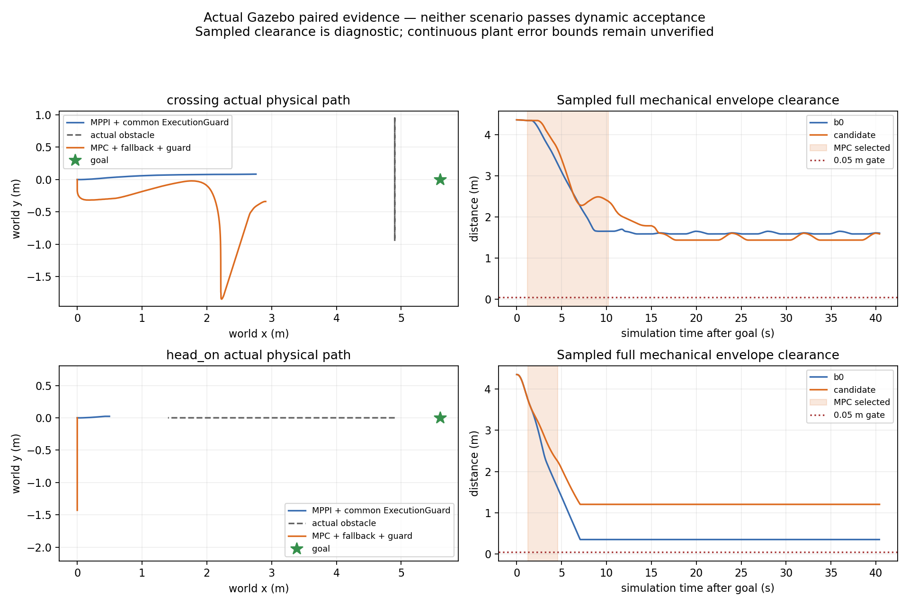

## 实际执行拒绝

横穿：evaluation20.202、proposal20.172、prediction20.131s，第176次执行检查，
第27步track1动态净空slack=-.003330680344m。初态(2.215995,-1.737599)，
未来检查点(2.632334,-1.581912)，当次拒绝并有限减速；选择于20.208s回MPPI。

迎面：evaluation14.565、proposal14.526、prediction14.521s，第63次执行检查，
第29步track1动态净空slack=-.000559651293m。初态(-.000250,-1.364901)，
未来检查点(-.165015,-1.126142)，当次拒绝；选择于14.568s回MPPI。

这些是完整未来模型的拒绝，不能解释为物理机器人已经碰撞。原生重锚后始终
保留速度/停止投影及全部几何检查，没有放宽负slack。记录订阅顺序不测量唯一
因果延迟。worker诊断尚未携带其确切使用的prediction source identity，因此本轮
没有把剩余拒绝唯一归因于“预测更新”或“新测量状态”；需补该身份才能分解。

## 当前模型是否允许目标

只读工具[audit_model_occupancy.py](../../experiments/temporal_mpc/gazebo/audit_model_occupancy.py)
消费原公共v2输入，不读取oracle或actor未来目标。源采样在source epoch求当前占用，
原生采样使用健康记录中的evaluation/prediction epoch，不重复推进coasting锚点。
使用原完整D=1.6970562748477143、padded足迹半长(.355,.330)、margin.02和原采样
reserve；不改变控制几何。目标及xy容差从实际goal/config读取，诊断固定yaw=0。

令g为目标处“圆锚点到完整矩形距离−D−margin−采样reserve”。平移矩形的距离
函数为1-Lipschitz；若g+.15<0，同一采样时刻整个位置容差圆盘都被该track排除。
这只是当前模型在记录时刻的结论，不证明真实完整物体几何、未采样时间或全任务
连续不可行；也不把yaw_goal_tolerance范围内所有方向当作已检查。

| 记录 | 目标后有效源采样 | 排除目标点 | 排除整位置容差区 | 容差区slack上界max |
|---|---:|---:|---:|---:|
| 横穿B0 | 610 | 610 | 610 | -.770321m |
| 横穿MPC | 612 | 612 | 612 | -.742691m |
| 迎面B0 | 612 | 37 | 32 | 2.481940m |
| 迎面MPC | 611 | 37 | 32 | 2.390692m |

横穿候选458个确切原生几何检查epoch也全部排除整位置容差区，上界max=-.723444m。
不能把D直接减半：公开位置仍是近表面观测锚点，没有完整物体中心/外形证书。
表面几何未知也不能用运动协方差或complete标志替代。

工具同时解析当前认证矩形的连续横向截面，对全量track取阻塞区间并集，并比较
原局部偏好的目标是否容纳。当前截面有正宽度只证明该时刻有空间，不证明整个
1.5s轨迹可行，也不重建侧向锁定历史。横穿/迎面候选postsolve诊断有167/18次
corridor_insufficient、494/691次primal infeasible；失败会reset偏好，这些计数均
不能作为“静态走廊无路”或“模型已证不可行”的证明。

首版只读筛选仅看step非负，纳入少量携带旧步号的input拒绝健康；修正为还须
明确几何/速度检查constraint。四份初版完整输出以initial_step_filter后缀保留，
正式几何样本数与独立原生重放一致，目标结论未变，物理试次没有重跑。

## 核验与实时范围

68,159条CDR与JSON一致，3,048条预测的canonical源TF重放全部可查。4,291个
共同保护精确输入重放、818个原生ZOH状态与45个动态拒绝数值检查均匹配，无
缺失输入。回放证明记录/模型一致，不替代实际即时TF可用或真实检测支持。

worker整周期耗时最大30.798ms，实际native执行检查最大.195ms，保护tick到输出
最大6.546ms；原40/10/10ms预算观察门通过。保护生产开始间隔max51.663ms、
发布间隔max54.251ms，nominal missed slot=0。两场迎面接收gap仍失败，生产/接收
分别保留，不能据序号分配调度或DDS的唯一原因，也没有硬实时保证。

新增只读工具4项测试在主机与Humble通过：独立全量几何对照、目标点与容差区
区别、偏好不足与硬空间区别、源/native epoch与stale及旧步号负对照。此前98项
控制测试和v2故障fixture证据保持，本轮没有改控制实现或重复构建。Humble旧pytest
仍有pythonpath配置警告，显式PYTHONPATH生效，各版测试输出均保留。

[完整证据manifest](evidence/temporal_mpc_projection_20261004/manifest.json)包含四轮
原始记录无损gzip、源快照、实际二进制身份、镜像信息、审计/进入门/日志/图及初版
诊断。旧失败证据不覆盖；主线、正式src、原dirty和冻结研究refs均通过保留核对。
归档共157文件、31,120,229字节；12份完整记录流解压后128,317行JSON及全部
摘要核对通过，见[完整性检查](temporal_mpc_projection_integrity_20261004.json)。
源码/文档空白检查通过；原始Nav2日志的末尾空白原样保存，见[检查范围](temporal_mpc_projection_whitespace_20261004.json)。

## 下一阶段

先把模型目标可达性列为对照场景准入：保留本轮任务失败，另登记在原完整D/足迹/
margin下目标容差区可开放且有侧向空间的场景，不能用缩几何制造成功。补worker
实际输入身份及重锚余量分解，再在共同总预算内比较有限左右/等待候选。
真实几何支持与未来运动残差分别用留出整试次校准，再设计实验不确定性接口。
保留T-DT静态拓扑/走廊、20Hz短时控制、双Nav2插件与MPPI回退，上层action和
正式默认MPPI保持；本轮不冻结部署候选。
````

<a id="D0363"></a>

## D0363 — Worker时序与提案老化诊断登记

来源：`docs/dynamic_navigation/temporal_mpc_timing_registration_20261004.md`；版本：`04291a410f193c009e043af88e014cf420e1f68b`。
阅读副本：[独立原文](history_documents_20261004/temporal_mpc_04291a41/docs/dynamic_navigation/temporal_mpc_timing_registration_20261004.md).
以下仅为历史资料，不构成继续研究授权。

````text
# Worker时序与提案老化诊断登记

2026-10-04，起点ca89b527，仍直接main派生的独立实验分支。
输出build/temporal_mpc_timing_20261004；原dirty/main/冻结refs和旧失败全部保留。

本轮只增加时序/原始请求诊断与采集后的模型检查，不改QP/有限候选、native v2
重锚/停止投影、几何/TTL/预算/selector回退或公共消息。StateRequest wire格式不变。
worker严格100ms且不接受未来请求的现有门不放宽；精确记录本地判定clock和有符号
age，将future/stale/frame/invalid分开。所有callback disposition（含duplicate、
no causal snapshot、silent）在独立worker_timing实验topic记录，避免覆盖有效solver
identity或将未求解回调算成solver输出。原预测回调与周期外frontend阻塞也记录。

原生health增加实际request publish前/后monotonic、publish时ROS clock及原始epoch/
generation，另记录proposal接收monotonic。worker记录callback start/check/solver/
publish/end与ROS clock、完整原始请求有限字段；DDS源/接收时间仅若可用则记录。
跨进程monotonic差仅限同一Linux主机/隔离容器；不能把差值唯一分为网络/DDS/
executor排队。DDS时间为单独system epoch，不与ROS/steady时钟混减。

提案老化只读工具将旧完整记录中的原worker轨迹、在同一旧公共模型推进到新的
评估epoch而保持原相对控制网格的轨迹、以及完整native移位/投影/停止尾分别检查。
后两者都是明确反事实，不能充当执行、传播plant或独立可加原因。保留原生已记录
实际状态/slack校验；不补过期输入、不重复coast，相对检查网格保持1.5s。

工程门：精确signed clock边界、duplicate/no causal路径诊断、真实DDS请求/消息info、
完整native构建与原14类Nav2故障门、分解实际已记录末端拒绝与负对照。
工程完成冻结后，只做新open_long迎面B0→portfolio各一次新禁网容器物理诊断；
两者都strategy=portfolio以匹配shadow计算负载，sim10s/40s保持，进入门依旧先审计。
登记名head_on_b0_01/head_on_portfolio_01（新目录，不覆盖上一阶段）。
运行时不并发重检查，不按结果调参/挑选重复。物理目的为新timing字段和拒绝身份，
不能将单次结果声称统计净收益。动态接受、部署冻结仍false，正式默认MPPI不变。
````

<a id="D0364"></a>

## D0364 — Worker时序与提案老化诊断结果

来源：`docs/dynamic_navigation/temporal_mpc_timing_results_20261004.md`；版本：`04291a410f193c009e043af88e014cf420e1f68b`。
阅读副本：[独立原文](history_documents_20261004/temporal_mpc_04291a41/docs/dynamic_navigation/temporal_mpc_timing_results_20261004.md).
以下仅为历史资料，不构成继续研究授权。

````text
# Worker时序与提案老化诊断结果

2026-10-04，接续ca89b527；[预登记](temporal_mpc_timing_registration_20261004.md)。
本轮补齐请求发布、worker判定、求解、提案接收的身份与时钟证据，并对旧提案做
只读老化分解。新迎面对照没有重现请求时间拒绝，却再次在新状态重锚后发生
未来净空拒绝。两组均40s取消，候选最终命令接收间隔95.474ms超过75ms观察门。
**动态接受与部署冻结仍false，正式默认MPPI保持。**

## 实现和职责边界

新增实验String topic `/temporal_mpc/worker_timing`，schema为
`temporal_mpc_worker_timing/v1`。request/frontend/prediction回调各有唯一callback_id；
duplicate、no causal snapshot和故障silent也记录，不把没有运行QP的回调冒充solver
输出。原solver_diagnostic增加timing_callback_id，原生health增加实际请求publish
前后monotonic、publish时ROS clock、request epoch及proposal接收monotonic。
原StateRequest、Proposal及公共预测wire格式不改。

worker保持原来的map frame、非未来、age≤100ms门，拒绝原因拆成future/stale/frame。
原始请求13个字段记录有限值，非法值明确null。另修复非法stamp异常后的诊断
重复解析：现在保留nullable epoch，不再在catch之后再次解析而中断诊断；不接纳
非法输入。QP、有限候选、TTL、几何、原生validate及重锚/停止尾、共同保护与
selector行为不改。T-DT仍在控制周期外提供静态路径/认证走廊，MPC只做短时局部
控制；双插件IDs及上层NavigateToPose接口保持。

安装的Humble rclpy executor只向subscription callback传一个msg，没有可用的
MessageInfo，因此DDS source/received时间明确null，未伪造。跨进程monotonic仅
在同一Linux主机/容器比较；ROS clock用于输入age。publish开始到callback包含
传输、executor排队及clock回调顺序，不能唯一拆成各自时延。callback_body截止
timing序列化/发布之前；40ms core门仍截止proposal发布之前，两个指标分别报告。

## 工程验证

主机和Humble均通过128项完整测试，再通过最后新增的2项时序join审计测试；
无skip。Humble旧pytest对pythonpath配置有一条警告，运行使用显式PYTHONPATH。
原生插件构建成功；受控ROS clock的实际DDS/worker检查8项全部通过，覆盖错误
frame、未来2ms、超过100ms一纳秒、恰好100ms、duplicate、silent、no causal
snapshot，以及真实T-DT+QP的完整发布时序。该fixture使用空预测，是合同工程检查。

真实Humble Nav2/BT的原14类故障门、MPPI↔MPC切换、SpeedLimit恢复、worker
SIGKILL后独立制动、唯一publisher及有界输出全部通过。活跃输出最大间隔56.302ms，
native compute max0.234ms。跨action会话总体间隔187.285ms保留，不能算活跃任务
连续性。部分故障由selector先接手，不能声称每例实际执行了原生制动。

## 一次新迎面配对

输出目录`build/temporal_mpc_timing_20261004`；B0→portfolio各一个全新禁网容器，
双方都strategy=portfolio以匹配shadow负载。open_long、goal(8.5,0)、sim10s发目标、
40s取消、完整D=1.697056m及全部预算/几何保持。先完成B0的CDR、源TF、目标前
状态及原校准联合进入门，再启动MPC；运行期间没有并发重审计。无调参或重复挑选。

| 观察项 | MPPI＋共同保护 | MPC＋MPPI回退＋共同保护 |
|---|---:|---:|
| action结果 | 取消/40s | 取消/40s |
| 正Contact消息 | 0 | 0 |
| 采样完整机械包络最小净空 | 0.737290m | 0.840517m |
| 诊断sweep下界 | 0.682290m | 0.785517m |
| 实际MPC计算通过/次数 | 0 | 1/1 |
| 最终命令接收最大间隔 | 69.219ms | **95.474ms** |
| Controller命令接收最大间隔 | **82.702ms** | 64.697ms |
| 共同保护实际发布最大间隔 | 53.879ms | 53.586ms |
| worker core最大耗时 | **51.904ms** | 39.687ms |

B0的一个worker shadow周期触发40ms截止拒绝，保留该失败；候选没有这个拒绝。
所有已优化候选共享预算观察门通过，最多3项、390迭代，solver调用合计最大
3.823/5.553ms。共同保护tick到输出max5.365/5.658ms，nominal missed slots均0。
实际发布节拍、命令接收间隔和core耗时属于不同指标，不据此声称硬实时。
候选95.474ms接收空档附近保护生产仍每约50ms发布，但命令无生产序号，不能唯一
区分传输丢失、延迟与采集调度，更不能称执行端已连续。

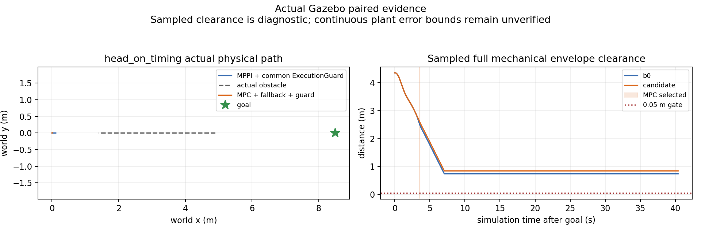

两个run的源码逐文件、启动前实际binary/dependencies及SDF/Nav2/tracker/bridge
配置一致。新native hash为`147ae6bc66ff90511098bdc8d464cfbf82012cf72b88f929377345511b558973`；
frontend仍为`daa5069041ebb22075f6e7ef94271940a8397e295f40a5378dcf37a55d7e587a`。
当前模型在612+610个目标后源采样及32+19个确切native几何epoch均未排除目标
位置容差区；这不证明连续时域路线可行。采样零Contact和正净空也不是连续安全证书。
MPPI内部随机seed未固定，单次物理差异不能作为统计净收益。

## 请求与提案时序

| 观察项 | B0 shadow worker | portfolio worker |
|---|---:|---:|
| 请求callback/与producer精确join | 1000/1000 | 998/998 |
| 严格时钟分类current | 1000 | 998 |
| 本地请求signed age最大值 | 13ms | 16ms |
| publish开始→callback P95/max | 0.812/13.729ms | 0.946/16.818ms |
| proposal发布→native接收已join数量 | 997 | 995 |
| 已join提案接收P95/max | 0.283/0.818ms | 0.279/0.492ms |
| callback body最大值 | 52.383ms | 39.981ms |
| 周期外frontend body最大值 | 173.682ms | 439.626ms |

共1,998次请求分类、原始测量字段和solver身份核对无错误；1,992次提案接收join。
没有可join的6项不补造，也不据此断言DDS丢包。双方各2项请求区间与记录的
frontend回调重叠，重叠只解释已知阻塞的一部分；QoS深度1与采集覆盖不允许从
observer数量差推算完整队列时延。本轮future/stale/frame均0，不能反推旧迎面
portfolio那次模糊`state request stale/frame`的真实原因已确定或已修复。

候选sim13.518s选中MPC，13.569s回MPPI，实际执行1个通过周期。sim13.565s
shadow检查的是proposal13.515s、旧source13.465s、新source13.531s；终态step30
slack=-14.953267mm。对应请求是current，QP曾运行，不能归因本轮时间合同拒绝。
health在observer的接收比selector晚0.102ms，作为相关事件保留，不伪造因果切换时延。

在同一native评估epoch的2×2重验中，旧测量＋旧预测为+56.979820mm，旧测量＋
新预测为+54.727613mm，新测量＋旧预测为-12.701103mm，实际二者更新为
-14.953267mm。新测量delta约vx+0.049288m/s、vy-0.003609m/s。该反事实显示
本次余量主要对新测量重锚敏感；它不是传播后的plant，也不是唯一可加原因。

## 提案年龄与停止尾

新只读`audit_proposal_age.py`对旧4个run的63个动态记录及新2个run的29个记录
全部精确复算实际slack，无错误。保留以下不同检查：原worker epoch/轨迹；相同
旧初态和控制网格但推进公共模型到native epoch；移位而不修停止尾；完整native
移位/速度与停止投影；实际新测量与新预测。相对网格仍1.5s，不补过期输入。

旧横穿single的代表性实际拒绝（proposal age19ms）：原worker余量+10.552437mm，
推进模型而保持原相对控制为+6.881221mm，移位不修停止尾为-0.463964mm，完整
投影为-0.308216mm，实际值相同。原始移位终速19mm/s不满足停止，不是可执行
替代方案；停止投影略改善余量，这次主要损失在控制移位。

旧横穿portfolio（age50ms）从原worker+43.004946mm，经旧输入完整native移位
为+9.510960mm，再由新预测变为实际-2.661158mm。新迎面候选（age50ms）从
原worker+88.960764mm，经模型推进+64.049321mm、未修停止尾移位+56.440530mm、
完整旧输入投影+56.979820mm，最后新输入为-14.953267mm。未投影移位终速50mm/s，
仍不可作为控制提案。不能将这些不同epoch/反事实差额写成独立可加因果分解。

## 证据、保留与后续边界

新物理记录共36,961条CDR及1,522条源TF核对通过；2,143个共同保护周期、51个
native状态及worker输入join、29个动态余量重放全部匹配。旧数据分解有独立
输入hash/谱系，旧失败和历史证据不覆盖。完整JSONL无损gzip、所有原始日志、
工程fixture、初次/最终测试、预启动源码和实际二进制保存于
[manifest](evidence/temporal_mpc_timing_20261004/manifest.json)，
[独立完整性复核](temporal_mpc_timing_integrity_20261004.json)。140文件＋manifest，
22,143,632bytes（不含manifest）、8条完整JSONL.gz流共68,032行，hash/gzip/JSON
及历史输入谱系全部通过。
源码/文档空白检查通过；原始日志的27项空白/EOF问题单独保存在
[空白复核](temporal_mpc_timing_whitespace_20261004.json)，原日志不修饰。
完整采集和子进程清理阶段保留rclpy context失效的RCLError traceback，含候选
worker在shutdown后发布timing的异常；不改已冻结运行实现或重跑物理试次。

独立分支仍直接从main@d735ee12派生，正式src无diff；原工作区dirty文件、原分支
和冻结refs均核对保留。没有push、merge或部署。

下一阶段优先处理新测量重锚下的执行误差余量与共同输出最坏负载，而不是盲目
放宽时钟门、缩小几何或增加候选数量。需要独立标定短时响应/误差包络并注册
新配对；时钟拒绝只有在新的确切证据出现后才讨论有界等待。Scenario/Chance
仍需真实分布及几何支持校准，本轮不提供这些资格。
````

<a id="D0365"></a>

## D0365 — Temporal MPC offline prototype

来源：`experiments/temporal_mpc/README.md`；版本：`04291a410f193c009e043af88e014cf420e1f68b`。
阅读副本：[独立原文](history_documents_20261004/temporal_mpc_04291a41/experiments/temporal_mpc/README.md).
以下仅为历史资料，不构成继续研究授权。

````text
# Temporal MPC offline prototype

2026-10-04用户要求研究冻结；[冻结记录](../../docs/dynamic_navigation/temporal_mpc_freeze_20261004.md)。
停止新实现/试次；保留全部命令为历史复现资料，不自动续跑，不具备部署接受。

独立研究候选；`COLCON_IGNORE`阻止常规workspace构建自动接入。核心没有TF/costmap/goal/velocity发布者、Nav2插件或串口依赖。
`integration/`有未接入正式launch的选择监督器及明确标记为示例的未来双插件/BT片段。正式MPPI与所有已有研究保留。

设计、审计与条件：[架构](../../docs/dynamic_navigation/temporal_mpc_architecture.md)、
[预登记](../../docs/dynamic_navigation/temporal_mpc_experiment_registration.md)、
[进度和结果](../../docs/dynamic_navigation/temporal_mpc_progress.md)。
`PublicAdapter`消费既有v1/v2公共状态；冻结项目tracker→公开字段的适配有测试。
分支直接从main分出；`reference_inputs/provenance.json`记录四个选择性离线参考，
没有继承旧研究运行包/配置/launch，也没有合并旧分支。
既有size只能作为visible_extent代理，不能当作完整observed polygon。

旧SLSQP使用已有NumPy/SciPy。当前实时QP另用固定OSQP 1.0.5，
只安装到临时目录；T-DT选择性导入及依赖登记见`frontend/provenance.json`和
`dependency_intake.json`。没有复制HWS代码。
`pyproject.toml`记录依赖边界，实际版本由运行manifest锁定。HWS的固定版本、
MIT许可和只读文件哈希在`temporal_mpc_upstream_audit.json`；不是运行依赖。

旧SLSQP失败对照的复现命令，在本目录执行：

```bash
OPENBLAS_NUM_THREADS=1 OMP_NUM_THREADS=1 python3 -m pytest -q
OPENBLAS_NUM_THREADS=1 OMP_NUM_THREADS=1 python3 run_experiment.py --output /tmp/mpc-new-matrix
OPENBLAS_NUM_THREADS=1 OMP_NUM_THREADS=1 python3 run_experiment.py \
  --output /tmp/mpc-new-ablation --scenarios wait_then_pass --modes observed_polygon \
  --consumptions temporal current_only future_union
OPENBLAS_NUM_THREADS=1 OMP_NUM_THREADS=1 python3 run_experiment.py \
  --output /tmp/mpc-new-horizons --scenarios wait_then_pass --modes observed_polygon \
  --horizons 0.5 1.0 1.5 2.0
python3 verify_evidence.py /tmp/mpc-new-matrix --output /tmp/mpc-new-matrix-replay.json
```

输出目录必须全新；重跑使用新目录。每周期证据立即写出，即使中断也保留已执行
轨迹；完整运行另有汇总与环境/源码manifest。时间超限会改变控制分支，
有deadline miss时结果不能称为跨机器逐位确定性复现；物理执行轨迹可独立重放。

求解器使用机体系acceleration直接shooting、速度/几何/终态停止硬约束。
`Result.command`是下一个dt末的base_link速度提案，离线plant在这个dt内按
`Result.acceleration`连续爬升；实车能否实现该响应尚未辨识。
`model_feasible`只表示声明的模型/输入下通过约束，不等于物理安全认证。
`invalid_input_brake`没有预测支持；`unsafe_brake`表示连刹停路径都无模型证书。
离线10Hz循环另记录未来20Hz目标的50ms超期，0.5s开发预算不是实时接受门。

独立oracle用0.65×0.60m完整机械矩形、凸polygon精确距离和≤0.01s扫掠网格，
再扣除区间运动reserve。安全门为0.05m；物理接触与仅reserve下界为负分开记录。
`current_only/future_union`是消费机制消融，不是STVL/MPPI实现。没有配对B0安全
见证，`false_block_*`、ROS action success和recovery保持null。
CPU指标是进程计算需求，不包含完整ROS/定位/感知/串口负载。

后续Gazebo shadow、完整raw costmap支持和Nav2 Controller plugin有独立进入门；
本目录没有提供可误连实车的启动入口。暂不声称任何部署净收益。


## 当前实时切片复现

在本目录执行，已有NumPy 1.26.4 / SciPy 1.11.4 / pytest 7.4.4、C++20及Eigen3：

```bash
python3 -m pip install --target /tmp/mpc-deps --no-deps osqp==1.0.5
bash frontend/build.sh /tmp/mpc-tdt-frontend
PYTHONPATH=/tmp/mpc-deps OPENBLAS_NUM_THREADS=1 OMP_NUM_THREADS=1 python3 -m pytest -q
PYTHONPATH=/tmp/mpc-deps OPENBLAS_NUM_THREADS=1 OMP_NUM_THREADS=1 \
  python3 run_realtime.py --frontend /tmp/mpc-tdt-frontend --output /tmp/mpc-qp-new
PYTHONPATH=/tmp/mpc-deps OPENBLAS_NUM_THREADS=1 OMP_NUM_THREADS=1 \
  python3 run_realtime.py --verify-only --output /tmp/mpc-qp-new
```

`realtime_qp.py`只解决固定yaw、wz=0的全向平移；需要转动时请求MPPI。
20Hz执行、1.5s horizon、15节点、15ms solver/40ms core预算、400迭代上限、
最多4个相关动态障碍。每次返回前重验整条轨迹及全量tracks。失败先重新验收
移位的旧序列，再提供有界制动，并记录FollowPathMPPI回退请求。离线runner
**不执行回退交接**，所以此矩阵属于MPC shadow核心验证，不是完整策略闭环。
静态map由已迁移T-DT生成简化路径和认证走廊；静态搜索在控制周期外。

`run_realtime.py`的control_elapsed计入局部参考采样、输入预测、QP组装/求解、
几何验收；planning另记。Linux调度和接口阻塞需要真实wall watchdog，不用
离线host计时声称硬实时。5,659周期全部小于50ms，但迎面接触及停滞保留。
70项最终测试包含实际T-DT静态绕行/unknown封路、solver fault/timeout、上一条
可行解新输入重验、以及双向selector及故障保持。OSQP缺失时该模块测试skip；
验收必须安装realtime依赖并确认无skip。

正式Nav2双插件加载、实际跟踪消息/TF/raw-grid接入、Gazebo及实车、MPPI
handoff均未完成；[集成边界](integration/README.md)明确下一阶段的验收门。

已保存的QP图可由`python3 plot_realtime_evidence.py /tmp/mpc-qp-new`重建（需要matplotlib，非控制运行依赖）。


2026-10-04继续轮已实现隔离 Humble 原生双插件和异步 QP，运行命令、约束与
尚未完成的真实输入/部署门见 [integration/README.md](integration/README.md)。
独立主线派生分支和默认src/正式配置保持；历史离线碰撞与失败证据不覆盖。

2026-10-04后续已完成真实Gazebo扫描/tracker/测量TF/物理pose的隔离配对，见
[gazebo/README.md](gazebo/README.md)和[实际结果](../../docs/dynamic_navigation/temporal_mpc_gazebo_results_20261004.md)。
前述M1/M3历史“尚未完成”状态保留为阶段记录；当前动态接受仍false，85项测试
两环境通过。MPC实际短暂参与，整体策略接触/超时，没有冻结部署候选。

后续目标开放/有限候选实现、确切输入与共享预算见
[最新结果](../../docs/dynamic_navigation/temporal_mpc_candidates_results_20261004.md)。
strategy=portfolio是实验可选项，single保持默认；静态T-DT职责、双Nav2插件与原硬门
保留。六有效物理试次全部取消，没有部署资格；全部失败/输入门与工程证据保存。

后续[时序与提案老化结果](../../docs/dynamic_navigation/temporal_mpc_timing_results_20261004.md)
增加独立callback/严格clock/真实publish与receipt身份，不放宽原门或更改QP/几何。
128项完整测试及2项新增审计测试两环境通过，真实DDS clock/14类Nav2故障门通过；
新迎面配对仍40s取消、候选最终接收gap95.474ms失败。提案年龄反事实和实际重锚
余量分开记录，动态接受保持false，默认MPPI与双插件切换保留。
````

<a id="D0366"></a>

## D0366 — T-DT前端桥接

来源：`experiments/temporal_mpc/frontend/README.md`；版本：`04291a410f193c009e043af88e014cf420e1f68b`。
阅读副本：[独立原文](history_documents_20261004/temporal_mpc_04291a41/experiments/temporal_mpc/frontend/README.md).
以下仅为历史资料，不构成继续研究授权。

````text
# T-DT前端桥接

选择性复用已迁移且冻结的YAstar、collision-aware路径简化、SfcSquare；来源/上游pin/许可/范围/逐文件哈希见[provenance.json](provenance.json)。vendor源码逐字保留旧迁移补丁。桥接独立编写，唯一改变是输入契约适配及验证，没有修改vendor。

搜索/静态走廊在控制循环之外执行，不发布速度；完整MinimumSnap/规划器迁移仍在冻结research提交e680b143中，未删除或废弃。本切片不加载完整ROS插件或旧动态路线，可以用既有后端生成的路径替换这里的简化路径，仍必须提供同样静态走廊证书。

YAstar采用地图原点；SfcSquare冻结版本采用不同offset约定，桥接在零原点局部坐标调用SfcSquare后显式平移。第一次小地图测试触发Eigen断言，已定位为该桥接原点约定错误；修复未缩小足迹或改unknown。Python StaticRoute独立逐cell认证矩形走廊，并仅在同一证书通过时合并局部squares。地图原点、占用判定和走廊内容均留证据。

以C++20、Eigen3构建：`bash frontend/build.sh /tmp/mpc-tdt-frontend`（在原型根目录）。GCC13对未调用的vendor _removeRedundant产生stringop-overflow警告，原构建日志已保存；当前桥接调用getBound，不调用该冗余合并函数。尚未取得全vendor运行域的安全接受。

替换/删除本目录只影响离线原型，正式planner与Nav2保持原状。


继续轮新增 `--path` 输入模式：Nav2/既有前后端给出路径，仅使用冻结 SfcSquare
构造走廊，并独立验原始地图；该模式不会执行 YAstar 搜索或改变路径拓扑。
密集 Nav2 路径只删除共线点；256点以上、碰撞/未知路径或不支持的map输入
明确拒绝，由规划前端压缩/重规划，不能让 MPC 改道。离线默认搜索模式保留。
````

<a id="D0367"></a>

## D0367 — Isolated actual Gazebo research

来源：`experiments/temporal_mpc/gazebo/README.md`；版本：`04291a410f193c009e043af88e014cf420e1f68b`。
阅读副本：[独立原文](history_documents_20261004/temporal_mpc_04291a41/experiments/temporal_mpc/gazebo/README.md).
以下仅为历史资料，不构成继续研究授权。

````text
# Isolated actual Gazebo research

2026-10-04用户要求研究冻结；[冻结记录](../../../docs/dynamic_navigation/temporal_mpc_freeze_20261004.md)。
所有物理失败与原始证据保留，以下命令/下一步为历史资料，不启动新试次。

[登记](../../../docs/dynamic_navigation/temporal_mpc_gazebo_registration_20261004.md)、
[结果与限制](../../../docs/dynamic_navigation/temporal_mpc_gazebo_results_20261004.md)、
[进度](../../../docs/dynamic_navigation/temporal_mpc_progress.md)。
动态验收=false：上一轮横穿两策略接触；本轮共同保护四轮均超时，连续性门也未全部通过。
保留独立main派生分支与默认MPPI。

在已有固定Humble容器中挂载worktree为`/workspace`，不使用host网络或设备：

```bash
bash /workspace/experiments/temporal_mpc/gazebo/build.sh
bash /workspace/experiments/temporal_mpc/gazebo/run.sh /workspace/build/mpc-gazebo-shadow-new shadow crossing
bash /workspace/experiments/temporal_mpc/gazebo/run.sh /workspace/build/mpc-calibration-new calibration actuator
# 完成audit_ros_capture、audit_run、calibration_audit及联合entry_gate后才能传入MPC模式。
bash /workspace/experiments/temporal_mpc/gazebo/run.sh /workspace/build/mpc-gazebo-candidate-new mpc crossing /absolute/entry_gate.json
```

run目录须全新，脚本拒绝覆盖。源码在启动前打包；所有动态真值仅记录。
`simulation.launch.py`复用主线description/localization/chassis adapter，实验固定map原点
取代动态identity占位stub；用真实测量odom，不用stub的指令反馈当测量。
`scene_node.py`只发布静态map、真实扫描端点云、T-DT规划Path，不发布预测/TF/速度。
冻结tracker只发布shadow预测；QP worker只发布proposal；两控制器同时在Controller
Server中，由既有标准BT/action选择。VelocitySmoother输出`/temporal_mpc/smoothed_cmd_vel`，共同ExecutionGuard是最终
`/cmd_vel`唯一publisher；无搜索/优化/oracle输入，只允许限差通过或减速。
`actor_target.py`只给独立物理PD joint target，不提供未来真值给控制。

只读审计：

```bash
python3 gazebo/audit_ros_capture.py /absolute/run  # Humble overlay：CDR和exact-source canonical TF
python3 gazebo/audit_run.py /absolute/run
python3 gazebo/audit_execution.py /absolute/run  # 精确回放共同保护输入及原生模型/净空拒绝
python3 gazebo/audit_model_occupancy.py /absolute/run  # 当前模型目标位置容差区/认证截面，拒绝覆盖
python3 gazebo/calibration_audit.py /absolute/calibration
python3 gazebo/entry_gate.py /absolute/shadow /absolute/calibration /absolute/entry_gate.json
python3 gazebo/static_frontend_audit.py /absolute/frontend /absolute/static-audit.json
```

运行前需要已有独立private Python deps和frontend binary，见integration/README.md。
`COLCON_IGNORE`确保正常工作区不自动引入实验overlay。shadow/scenario隔离，不是实车入口。
源码pin与license记录在ros2/tracker_intake.json和已有frontend/runtime dependency intake。

`audit_run`保留整轮测量域失败；`entry_gate`只依据校准+目标前状态批准开始实验，
不能宣称整轮部署接受。正式配对每场景一轮，内部MPPI噪声seed未固定。
物理oracle读取带epoch的model+link、投影完整机械3D外包体，绝不取tracker框；
50Hz距离和reserve只称诊断下界，连续误差/速度界未认证。Contact正消息证明接触，
零消息不单独证明绝无接触。结果、终止、接触、拒绝、output gap全部保留。

本轮执行模型/回退保护登记见[登记](../../../docs/dynamic_navigation/temporal_mpc_execution_registration_20261004.md)。
QP/native同用50ms held-velocity模型；T-DT SFC maxRange由2m到6m，仍经raw-cell完整足迹证书。
run.sh每个子进程独立process group以清理Gazebo后代；一轮一个全新容器避免旧clock。
输入进入门拒绝旧sim clock的轮次属于启动失败，不能算MPC性能试次。
保护层失流/异常仍限差减速，certificate仅指模型，不代表实际连续安全。
原来的未保护B0证据与本次共同保护B0分别保留，不混称同一基线。

[本轮结果与限制](../../../docs/dynamic_navigation/temporal_mpc_execution_results_20261004.md)：
4轮共同保护配对全部超时，无正接触消息；迎面cmd间隔和8故障fixture连续性门失败。
91项测试及原生14故障门通过，不等于动态接受。共同保护合成fault复现：
`bash /workspace/experiments/temporal_mpc/integration/run_guard_humble.sh /absolute/new-output`。
# 侧向参考继续轮

本轮登记见`docs/dynamic_navigation/temporal_mpc_lateral_registration_20261004.md`。
默认实验worker在现有T-DT认证矩形内产生侧移/通过/回原参考的局部偏好；仍只有
一个有界QP，所有硬约束保持。共同保护改为等价精确方格索引查询，新增生产端
monotonic与CPU字段，不将低CPU耗时或接收间隔误当硬实时证书。
每新run启动前生成`runtime_identity.json`，记录实际frontend/native二进制hash、
Python依赖版本及CPU affinity。仍每次新隔离容器、唯一输出目录、完整失败保存。
论文新线索只登记对照；未导入T-MPC++、Scenario或CBF实现，未改变正式v2消息含义。

v2投影独立物理复验见[结果](../../../docs/dynamic_navigation/temporal_mpc_projection_results_20261004.md)。
四轮控制源码/实际启动前二进制身份一致；横穿175/176、迎面62/63次MPC检查通过后
未来净空拒绝回退，任务全取消。横穿模型在所有目标后有效源采样排除固定yaw=0
位置容差区；只读工具不缩几何、不补造完整物体中心、不将当前空间当时域证书。
原始记录、失败与首版审计筛选修正均保存，动态接受仍false。

目标开放/有限候选继续轮见[登记](../../../docs/dynamic_navigation/temporal_mpc_candidates_registration_20261004.md)
和[结果](../../../docs/dynamic_navigation/temporal_mpc_candidates_results_20261004.md)。
可选TEMPORAL_MPC_FIXTURE_PROFILE=legacy（默认）/open_long；后者地图240×200、
origin(-1,-5)、目标(8.5,0)，T-DT corridor_range=10（原默认6，桥接有界[1,12]）。
TEMPORAL_MPC_STRATEGY=single（默认）/portfolio，后者共享15ms/390迭代预算，
单项5ms/130迭代、最多3局部参考，内部动态planning_buffer=.03m，原生硬门不变。

```bash
TEMPORAL_MPC_FIXTURE_PROFILE=open_long TEMPORAL_MPC_STRATEGY=single \
  bash /workspace/experiments/temporal_mpc/gazebo/run.sh /absolute/new-b0 shadow head_on
# 完成CDR、audit_run及校准联合进入门，另启全新禁网容器：
TEMPORAL_MPC_FIXTURE_PROFILE=open_long TEMPORAL_MPC_STRATEGY=portfolio \
  bash /workspace/experiments/temporal_mpc/gazebo/run.sh /absolute/new-portfolio mpc head_on /absolute/gate.json
python3 /workspace/experiments/temporal_mpc/gazebo/audit_reanchor_inputs.py /absolute/finished-run
python3 /workspace/experiments/temporal_mpc/gazebo/verify_static_capture.py /absolute/new-dds-fixture
```

原始静态TF采用可靠transient-local depth100，ready需确实记录两条必要静态边，
失败在固定phase前拒绝，不补TF。输入分解工具只适用于Gazebo event schema；
实际/shadow分开，旧测量替换是反事实，不能当传播后的plant或已执行轨迹。
六有效试次仍全部取消，另外保留缺静态TF失败基线；不形成部署接受。

时序/提案老化继续轮见[登记](../../../docs/dynamic_navigation/temporal_mpc_timing_registration_20261004.md)
和[结果](../../../docs/dynamic_navigation/temporal_mpc_timing_results_20261004.md)。
新实验worker_timing记录全部回调disposition、严格signed clock与monotonic身份，
原请求wire和100ms/非未来门不变。安装的Humble executor无MessageInfo，DDS时刻
明确null；不能把同主机总interval解释成唯一传输/排队时延。

```bash
# 新run采集结束后执行，只读且拒绝覆盖各自结果：
python3 /workspace/experiments/temporal_mpc/gazebo/audit_worker_timing.py /absolute/finished-run
python3 /workspace/experiments/temporal_mpc/gazebo/audit_proposal_age.py /absolute/finished-run /absolute/new-age-audit.json
# 实际DDS/worker受控clock工程检查；不是物理/检测接受：
python3 /workspace/experiments/temporal_mpc/integration/verify_worker_clock.py /absolute/new-clock-fixture /workspace/build/temporal_mpc_ros2/frontend
```

本轮双方strategy=portfolio匹配shadow负载，B0进入门通过后各一个新容器迎面run。
1,998请求均current，候选仅实际1个通过周期，shadow新状态未来净空拒绝后回退。
双方40s取消，候选最终命令接收gap95.474ms；保留失败，不追跑挑选。老化反事实
中的未修停止尾移位不是可执行提案，完整slack重放不等于连续物理证书。
````

<a id="D0368"></a>

## D0368 — Humble 双控制器实验

来源：`experiments/temporal_mpc/integration/README.md`；版本：`04291a410f193c009e043af88e014cf420e1f68b`。
阅读副本：[独立原文](history_documents_20261004/temporal_mpc_04291a41/experiments/temporal_mpc/integration/README.md).
以下仅为历史资料，不构成继续研究授权。

````text
# Humble 双控制器实验

2026-10-04用户要求研究冻结；[冻结记录](../../../docs/dynamic_navigation/temporal_mpc_freeze_20261004.md)。
双插件与既有证据保留，以下启动/测试命令仅供将来明确授权后的复现，不继续运行。

本目录现在包含可构建的 `rm_temporal_mpc::Controller` 原生 Nav2 插件、异步
OSQP worker、选择监督器、完整隔离参数和 BT。正式 `src/`、Mission、Planner、
NavigateToPose、启动与硬件接口未改动；父目录 `COLCON_IGNORE` 保持隔离。
`*.example.*` 保留为 M1 历史设计片段，运行请用 `dual_controller_humble.yaml`
和 `runtime_tree.xml`，不要把片段直接当配置。

同一个 Controller Server 同时加载 `FollowPathMPPI` 和
`FollowPathTemporalMPC`；默认 MPPI。实验 BT 每 tick 重新执行 ControllerSelector，
运行中向 `temporal_mpc/request_controller` 发布 ID 即可双向切换，既有
NavigateToPose 目标继续执行。上层动作签名没有改变。若直接使用 FollowPath，
调用者发送保留 path/goal checker 的更新目标；选择 topic 自身不改变该直接动作。

## 控制与故障边界

worker 只发布类型明确、长度最多 30 的加速度提案；不发布速度命令。原生插件
订阅测量里程计和源预测，按当前状态重积分，检查源/观测年龄、plan/map generation、
全部 tracks、终态、整足迹静态证书与当前 raw costmap 执行区间。未知/足迹内部
occupied cell 均阻塞。输出由 Controller Server 唯一发布。costmap 锁采用 try-lock，
shadow 使用零等待 TF；原生重验限 10ms，失败返回有界制动并发布退化健康。

时间域为 map、固定 yaw/wz=0；不支持把 odom 帧消息直接改名接入。
默认几何是近面锚点加完整名义 D 圆；可见尺寸代理仅供隔离实验。两者都缺少
实际完整物体/未来运动支持证书。`ready` 表示本周期工程验收可用，**不表示
比赛部署通过**。制动没有有效碰撞证书时只叫有界制动，不能叫安全停止。

QP 仍为 20Hz、1.5s/15节点、最多4相关障碍/64全量重验、400迭代、solver15ms /
core40ms。原序列在新状态/预测重验后才可复用。ROS 抖动用真实 elapsed 时间
移位 warm inputs；4帧有界历史只选择不晚于状态请求的源帧，异常 receipt 清空
缓存。数值残差先投影到执行器界限/停止终态，再过原几何门，不放宽门。

worker QP与原生重验现在共同使用固定yaw的50ms速度ZOH模型；15个100ms
决策节点仍展开30个速度目标差，加速度上限表示目标差约束，不表示实际底盘瞬态
已校准。全量采样余量一致使用全局速度上限；新状态重锚与终态停止保留。
若worker返回重验可行的previous/brake并请求交接，原生执行回调允许重验后当次返回，并
发布fallback_requested供选择器交MPPI；shadow也会提前请求交接，不保证每次实际经历previous段。不可行提案仍直接原生限差减速。
健康诊断新增精确输入epoch、step、constraint、track_id、slack和重验状态。
连续真实响应与检测完整性仍未认证。

Gazebo实验命令链在VelocitySmoother之后增加共同ExecutionGuard，最终唯一
`/cmd_vel` publisher是该节点；输入`/temporal_mpc/smoothed_cmd_vel`。它只做限差
和预测/静态制动扫掠重验，不搜索、不优化、不消费oracle。失流/异常继续输出
有界减速，无法认证时明确uncertified。10ms为core迟到拒绝与整个tick的观察门，
不是硬实时。节点进程死亡仍需独立下位机wall watchdog；本层不宣称部署安全。
`execution_guard_harness.py`单独覆盖8类合成ROS异常，不作物理输入接受证据。

选择监督器只发可靠 transient_local ID，健康失流100ms/退化请求 MPPI；恢复
健康不自动跳回。插件失去 worker 后自身继续制动，不依赖监督器或 BT 活着。
监督器进程失效时，原生制动仍工作，但 stock ControllerSelector 会保留最后 ID，
因此自动 MPPI 交接需要存活的监督器；部署还需要监督器和 Controller Server 的
独立 wall watchdog。现阶段 speedLimit<默认值会拒绝不符合新限制的 MPC 提案，
有界制动/交给已同时接收 SpeedLimit 的 MPPI；QP尚未自适应该限制。
Nav2 自身仍持有 goal checker；固定航向 MPC 不能完成任意最终转向，应使用 MPPI。

## 复现（隔离容器）

使用现有 `rm2027_navigation:humble`，镜像 digest、Nav2 1.1.20 和依赖身份见证据。
不使用 host network、设备或串口。运行时依赖装入 worktree 的
`build/temporal_mpc_ros2/python_deps`，不装入系统；源码/构建输出可删除回退。

```bash
# 在挂载实验 worktree 为 /workspace 的 Humble 容器中
bash /workspace/experiments/temporal_mpc/integration/build_humble.sh
bash /workspace/experiments/temporal_mpc/integration/run_humble.sh /workspace/build/temporal_mpc_ros2/new-run
```

run 脚本设置独立 ROS_DOMAIN_ID=87、localhost DDS、单线程 BLAS，只启动 Nav2 /
worker / supervisor / 受控测试模型。依赖轮子版本和 sha256 见
`runtime_dependencies.json`；colcon 构建不要继承 worker 的依赖 PYTHONPATH。
测试故意终止自己的 worker 子进程，退出时清理全部子进程。

该模型按 wall clock 积分实际 ZOH 命令，不暂停计算期间运动；输入为合成空数组，
故障时再注入当前同位置的合成 track 等。它验证真实 ROS / BT / action / plugin
链路，**不是 Gazebo、tracker、物理净空或公平 STVL/MPPI 对比**。
同一个 NavigateToPose 目标在测试末尾人为 cancel（status=5），不是到达成功。
取消到下一直接 FollowPath 是两个显式控制会话；连续性只在每个活跃会话内计，
总体最大间隔同时保留。

固定 Humble 原始接口依据：[Controller Server 1.1.20](https://github.com/ros-navigation/navigation2/blob/1.1.20/nav2_controller/src/controller_server.cpp)、
[FollowPath action](https://github.com/ros-navigation/navigation2/blob/1.1.20/nav2_behavior_tree/plugins/action/follow_path_action.cpp)、
[ControllerSelector](https://github.com/ros-navigation/navigation2/blob/1.1.20/nav2_behavior_tree/plugins/action/controller_selector_node.cpp)。
当前构建还直接验证该镜像安装头文件和真实加载结果。

## 实际输入后续

上述M3合成fixture和14故障证据保留。后续`../gazebo/`已完成主线物理底盘/激光、
冻结v2 tracker、canonical测量odom、源TF CDR重放、真实STVL、T-DT路径动作和
实际MPC/BT交接的隔离仿真。两组物理配对仍失败，未达到部署接受。
见[实际结果](../../../docs/dynamic_navigation/temporal_mpc_gazebo_results_20261004.md)。
消费者新增合法tentative漏检旧观察epoch支持，既有stale/future/confirmed/coasting门不变。

有限候选工程验证可在既定禁网Humble镜像中设置TEMPORAL_MPC_STRATEGY=portfolio
后运行run_humble.sh /absolute/new-output（默认single）。两插件及selector接口不变。
worker诊断v2_inputs记录实际source/observation/generation/map/初态/走廊及候选轨迹
状态，solver_s只含qp.solve；invalid字段null。真实14类故障fixture通过，物理策略
仍未完成任务，见[最新结果](../../../docs/dynamic_navigation/temporal_mpc_candidates_results_20261004.md)。
````

<a id="D0369"></a>

## D0369 — Frozen offline project references

来源：`experiments/temporal_mpc/reference_inputs/README.md`；版本：`04291a410f193c009e043af88e014cf420e1f68b`。
阅读副本：[独立原文](history_documents_20261004/temporal_mpc_04291a41/experiments/temporal_mpc/reference_inputs/README.md).
以下仅为历史资料，不构成继续研究授权。

````text
# Frozen offline project references

Selected from project commit `b5645ecaf6b4575a6537a0a0a9907f4891955955`.
Per-file original paths and SHA256 are in `provenance.json`.

- `core.py`: existing ROS-independent tracker, Apache-2.0 as declared by its package.
- Two `.msg` files: wire schema read-only references; not registered with main ROS interface generation.
- Geometry contract: exact historical document, retaining original relative links. Those links refer to the source revision's directory tree, not this offline fixture folder.

Only tests load `core.py`. The controller reads public-value snapshots and does not import tracker internals. No node, launch, configuration, MPPI critic, guard or runtime package from the prior route is imported. The new experiment branch was created directly from main.
````

<a id="D0370"></a>

## D0370 — 动态障碍公共输入：几何语义与未知边界

来源：`experiments/temporal_mpc/reference_inputs/dynamic_obstacle_geometry_contract_2027.md`；版本：`04291a410f193c009e043af88e014cf420e1f68b`。
阅读副本：[独立原文](history_documents_20261004/temporal_mpc_04291a41/experiments/temporal_mpc/reference_inputs/dynamic_obstacle_geometry_contract_2027.md).
以下仅为历史资料，不构成继续研究授权。

````text
# 动态障碍公共输入：几何语义与未知边界

2026-10-02，根据实际tracker生成端、公共v1消息和critic/guard消费代码
核对。本文件明确既有字段，不新增公共结构、话题或TF所有者；尚未
建立完整物体/未来运动安全认证。适用于独立实验路线，不能作为实车
或2027合规证明。

## 既有字段的实际含义

表中描述默认 v1。显式 `prediction.anchor_mode=last_observation_cv` 采用
`rm_dynamic_obstacle_predictions/v2_observation_anchor`，只改变 position 的
锚点语义：最近真实关联检测质心 q_o，由本次滤波速度 v_hat 外推至
scan 源时间 s，`position=q_o+v_hat*(s-o)`。匹配/滤波/可见尺寸算法
保持；显示严格使用未裁剪、未衰减 CV，整数 ROS 观测 stamp 原样保留。
critic/guard 静态 input_schema 必须同步选择，schema 转换拒绝并替换
旧快照，非 coasting 的 o 必须等于 s、coasting 的 o 必须早于 s。
公开字段仍无真实误差界或完整轮廓；错关联的质心也不属于真实物体。
详见[实验登记](../dynamic_obstacle_critic/observation_anchor_cv_experiment.md)。

| 字段/数据 | 生成与时间 | 可以表达 | 尚不能表达 |
|---|---|---|---|
| array.header.stamp / frame_id | 输入LaserScan源时间，map世界frame | 该次更新的滤波状态epoch；扫描通过源时间TF投影 | 发布到达时间、完整物体瞬时几何或逐束同步误差界 |
| position.x/y | 可见端点算术质心观测，CV Kalman滤波；coasting时预测 | 滤波可见簇锚点 | 几何中心、质心在完整物体凸包内的可信界 |
| velocity.x/y | 同一滤波器的速度状态；实际公开值未用显示速度裁剪 | 锚点的估计平面速度 | 材料点/车体中心的真实速度界或三秒误差界 |
| size.x/y | map轴可见点max-min，至少cluster_tolerance；匹配时0.7旧+0.3新 | 平滑可见范围，可能随视角变化 | 完整机械长宽、保守上界、带朝向的矩形或尺寸误差认证 |
| last_observation_stamp | 最近真实匹配观测源时间 | 区分观测与coasting年龄 | 全部物体一直可见或跟踪ID关联正确 |
| prediction[] | 显示配置的速度裁剪/衰减或CV外推，步数/步长在array | 显示锚点序列 | 自然与critic实际CV一致；消费者从xy/vxy重算CV |
| complete / total_track_count | 输出轨迹条数预算，截断时complete=false | 消息列表没有被本预算截断 | 全场障碍均检出、无遮挡/漏检、没有未知物体 |
| 内部Kalman方差 | tracker私有滤波状态 | 当前算法内部估计参数 | v1公开covariance、完整物体置信度或严格确定性误差界 |

`processing_stamp`是诊断时间，不能替代源时间。v1没有目标车型分类、
物体朝向、完整轮廓、geometry reference point、可认证的anchor error
或未来motion bound。消费者不能从markers/diagnostics或感知私有类
补读这些内容；不能把`confirmed`等同几何/动力学认证。

## 当前和未来支持是两个条件

观测锚点模式的条件支持从 o 起算，不能从更新后的 s 重新开始：
`h=(s-o)+(n-s)+t`，`R=D(o)+e(o)+(B+|v_hat|)*h`。其中 e 必须覆盖
测量、source-time TF、关联及表示/运算误差，B 约束完整投影而非仅
车体平移。`conditional_observation_support.py` 只做条件数学，显式
last_observation_epoch 与 observation-origin motion semantics；未知或
到期仍输出 UNKNOWN/null。旧 source-epoch 数学接口保持原样。该公式
未接入在线半径，默认可见尺寸圆依旧无法证明三秒真实支持。

后续显式 `obstacle_radius_mode=nominal_diameter` 在 v2 下选择
`max(minimum_radius, nominal_obstacle_diameter)`，完整D作半径，避免给
未知物体中心使用半直径。配置限定0<D≤3m及非空来源；默认visible模式
要求D=0/来源空，并保持旧公式。固定D只是名义代理，未加真实e或
coasting/未来运动项，仍不证明未来支持。新的私有v2消费文件完整
记录所选模式/D/来源，不能把metadata来源标识当物理认证。范围与
原门见[登记](../dynamic_obstacle_critic/observation_diameter_consumption_experiment.md)。

对物体某时刻完整机械投影集合S，其直径有可信上界D；若锚点q到
conv(S)距离另有可信上界e，则任意p∈S满足`|p-q|≤D+e`。q不必
在规则矩形中心，任意不规则形状也适用。半对角线只在额外已知矩形
几何中心时成立，不能直接放到可见面质心上。

用户要求覆盖全部地面机器人。2026 V2.0.0手册条件下四类目标的
未知类别最大D≈1.697056m；来源、工程两种条款和2027适用性限制见
[尺寸参考](../dynamic_obstacle_critic/robot_extent_manual_review.md)。该D
要求所有目标确属所列四类、符合任意机械状态的完整伸展包络；未核实
载物/附件不能暗中并入保证。原v1消息不提供这些认证，尺寸YAML只是
离线参考数据，当前不加载到在线critic/guard。

源时刻s、评价时刻n、未来t，实际CV锚点为
`q_CV(n+t)=p(s)+v(s)*(n-s+t)`。当前界e(s)不能自动用作n或n+t
的界；预测锚点到该时刻完整投影凸包的e(n+t)必须另外建立，覆盖
观测/滤波/关联/定位误差、源年龄、遮挡和物体运动。超时只限制外推
时长，不证明误差大小。`validation.max_speed`是异常输入拒绝阈值，
显示`prediction.max_speed`是显示裁剪，两者都不是物理最大速度认证。

冻结消费试次中D且e=0假设当前支持278/278，但3s仅89/278；46个
外推至scoreclock的锚点在实际投影外。见
[离线包络实验](../dynamic_obstacle_critic/ground_robot_extent_prior_experiment.md)。
这些真值标签只能诊断条件失败，不能选择在线e、半径或物体类别。

固定source298同路径因子对照进一步表明：补足源时刻物理中心/尺寸后，
实际aggregate的CV风险下降但仍无TTC；换成有限局部真值斜率继续CV
时风险为0，只有不可在线获得的未来真值圆报TTC2.6s。该周期需要未来
运动支持，不能只修当前几何。见
[离线因子审计](../dynamic_obstacle_critic/cv_support_factor_experiment.md)。
它没有建立真实机器人运动上界、观测误差界或在线prediction认证。

后续固定native上下文重加权显示：future-circle真值可使新aggregate
完整动态mechanical/padded下界达到0.176/0.130m，但在+2.982s接触
冻结raw216单元，四因子均未通过全部条件门。模型支持、原生输出及
当前地图门必须分别核验，不能把未来真值诊断当可消费契约或输出
安全认证。见[聚合因子审计](../dynamic_obstacle_critic/native_factor_aggregation_experiment.md)。

同权重的bounded mean与actual-history SG完整路径对照确认该周期
future-circle raw216采样接触在SG前已经存在；两stage原全部门
仍0/4，不能用滤波修正推导输出安全或宣布采样器失败。见
[SG阶段审计](../dynamic_obstacle_critic/native_sg_stage_experiment.md)。

个体SDK见证在源pose有39/300完整条件正进展，实际scoreclock为
38/300，差异row63仅padded连续区间保守下界未通过，不能据此声称
接触。原raw风险成本与11+row个体SG标签属于不同路径；即使future
oracle给正见证40.86%权重，aggregate仍失败。见
[权重质量审计](../dynamic_obstacle_critic/native_factor_safe_mass_experiment.md)。

原SDK地图足迹helper进一步确认：中心raw、边界栅格返回值与完整
多边形/连续reserve门属于不同检查。固定局部CV路径边界最高202，
整足迹仍接触raw216；future路径主epoch边界216与原接触见证一致。
不得由任一sample/helper低成本推导整足迹clear，也不得从独立查询
猜测实际CostCritic择支或增量。真实完整内部状态与map单元来源均
unknown，见[地图契约审计](../dynamic_obstacle_critic/native_cost_map_contract_experiment.md)。

原300 raw同路径查询进一步分开原30点网格、密集SDK边界、整多边形
及连续reserve。主7条SDK低于203而保守门失败的路径中，显式十行
单元标量复核证实3条采样接触、4条仅负区间下界；原raw185精确
地图下界为正，而不同的个体bounds/SG路径失败。不能把处理后的
标签接到原风险路径，也不能据此推导SG单一因果或已接受控制。
全300只有保守vector标签，精确单元范围仍是十行。见
[原raw地图审计](../dynamic_obstacle_critic/native_raw_map_contract_experiment.md)。

固定个体三阶段复核将raw185的约束和SG效果分开：原raw与约束后
精确地图下界均为正，SG后出现raw210采样接触。整批主epoch地图
vector通过数90→90→92，约束到SG既有8条通过变失败也有10条失败
变通过。这个个体的阶段效果不认证聚合/闭环，不替换原raw成本，
也不支持禁用SG的全局结论；精确单元范围仅raw185三阶段。见
[个体阶段实验](../dynamic_obstacle_critic/native_individual_stage_experiment.md)。

离线纯函数已将一个可复算的充分条件具体化：若完整未来投影到源
集合的有向Hausdorff位移≤B*h，源集合直径≤D、锚点到凸包≤e，
则原CV锚点可用`D+e+(B+|v_hat|)*h`支持，h包含source age。
这里B涵盖所有机械点/展开/附件，底盘平移速度上界不能单独替代。
bound/来源及源有效区间显式给出；缺失或过期返回unknown/null，
默认真实查询全部unknown。严格源时刻h=0只需D/e。该充分条件不
修改v1字段或在线模型，不把来源字符串当认证。见
[条件支持界实验](../dynamic_obstacle_critic/cv_support_bound_experiment.md)。

## Unknown和退化边界

当前实现对消息不完整/非法/stale/跳变/错误frame失败：critic fail_flag，
guard零输出；完整新鲜空列表仍依赖当前costmap。该行为已有实测，
零输出不代表瞬时物理停车或完整未来支持。

新的原生CostCritic观察试次再次给出实际消费支持0/235（0/1/2/3s）。
首次机械余量失败前0.2s最终命令为零、物理pose不变；接近中的actor
随后在48.108s触及机械投影。这里只是固定试次的物理/诊断关系，不
扩大成全局brake因果证明；已执行停车不是未来完整支持或安全证书。
349组实际CostCritic两侧float变化也不提供目标完整外形/未来运动界。
见[直接成本证据](../dynamic_obstacle_critic/native_cost_accumulator_evidence_experiment.md)。

当前缺失的物理支持条件不会被v1现有validator识别，属于明确的未解决
模型假设。正式消费若需要物理安全保证，应当经公共契约提供或在明确
受限场景配置中建立上述条件，并对unknown停止宣称“clear/safe”；保留
当前地图及最终完整刹停检查，不能把未来支持缺失当成无障碍。是否对
unknown一律制动、缩小授权运行域或由上层拒绝运行，需在后续显式
实验策略中验证任务可行性；本文件不暗中改变当前行为。

若将来需要扩展消息，必须在原`rm_competition_interfaces`版本边界
定义参考点、时间/有效范围、保守误差/支持含义和unknown值，兼容性
与失败策略一同登记。不复制tracker类，不让critic读取感知内部数据，
不靠真值/SDF在线填字段，也不制造未经验证的概率模型。

TF维持[唯一所有者契约](tf_contract_2027.md)：tracker仅在源时刻消费
sensor→map；critic/guard仅消费有年龄限制的同一map→odom世界修正。
尺寸规范或显示需求均不改变TF方向、frame层级、yaw或发布者。
````

<a id="D0371"></a>

## D0371 — rm_competition_interfaces

来源：`experiments/temporal_mpc/ros2/rm_competition_interfaces/README.md`；版本：`04291a410f193c009e043af88e014cf420e1f68b`。
阅读副本：[独立原文](history_documents_20261004/temporal_mpc_04291a41/experiments/temporal_mpc/ros2/rm_competition_interfaces/README.md).
以下仅为历史资料，不构成继续研究授权。

````text
# rm_competition_interfaces

This package defines data contracts only. It contains no runtime node and owns
no TF, odometry, navigation action, chassis command, serial device or hardware
protocol.

- `RefereeState` is the normalized, validated match-state boundary.
- `ChassisMode` keeps lower-controller authority separate from referee data.
- `TargetTrack` is the perception-to-pursuit boundary with frame, timestamp,
  confidence and velocity.
- `MissionState` reports decision execution without becoming a control topic.
- `SystemReadiness` reports missing runtime requirements without granting
  motion authority.
- `SetMissionMode` is the explicit enable/mode gate for competition mission
  execution.
````

<a id="D0372"></a>

## D0372 — rm_dynamic_obstacle_tracking

来源：`experiments/temporal_mpc/ros2/rm_dynamic_obstacle_tracking/README.md`；版本：`04291a410f193c009e043af88e014cf420e1f68b`。
阅读副本：[独立原文](history_documents_20261004/temporal_mpc_04291a41/experiments/temporal_mpc/ros2/rm_dynamic_obstacle_tracking/README.md).
以下仅为历史资料，不构成继续研究授权。

````text
# rm_dynamic_obstacle_tracking

The offline `observed_surface_geometry.py` prototype keeps every selected scan
endpoint and original beam identity. Only consecutive beams with short spatial
and range gaps become nominal chords; gaps, isolated returns and hidden space
retain explicit unknown semantics. Chord interiors and short CV propagation are
uncertified assumptions. The ROS node does not invoke this prototype yet.
`tools/audit_observed_surface_geometry.py` verifies legacy detections before
offline truth labels, including measured-range disagreement. See
[the surface/reveal experiment](../../docs/dynamic_obstacle_critic/dynamic_surface_reveal_experiment.md).

`experiment/observation-anchor-cv` adds the explicit
`prediction.anchor_mode=last_observation_cv` mode. It retains the most recent
associated detection centroid, then advances it to the scan epoch using the
current filter velocity. Coasting uses the full observation-to-scan duration.
It requires `prediction.velocity_decay_tau=0.0` and `prediction.max_speed=0.0`
so display points match the public CV anchor. Schema is
`rm_dynamic_obstacle_predictions/v2_observation_anchor`; integer ROS observation
stamps survive publication without a float-seconds round trip. Markers and
diagnostics use the same selected anchor. Default `filtered` mode and v1 data
remain numerically unchanged. Association, filter and visible extent estimation
are shared and unchanged; neither mode certifies full object geometry or motion.
See [registration and preflight evidence](../../docs/dynamic_obstacle_critic/observation_anchor_cv_experiment.md).

The CV experiment consumes this package through its existing public prediction
message. `position` estimates the **visible cluster centroid** and `size` the
visible cluster extent; neither is a validated physical object center/footprint.
Changing the observation angle can produce apparent centroid motion even when
the physical object is stationary. The isolated, ROS-independent
`tools/audit_viewpoint_bias.py` records this effect with synthetic ray labels and
the actual tracker/configuration. It is an offline perception diagnostic, not a
runtime input or acceptance test. See
[the stage-two evidence](../../docs/dynamic_obstacle_critic/stage2_progress.md).

The isolated `visible_box_geometry.py` prototype reconstructs a rectangle only
from conditional two-face/ray-boundary evidence. `cluster_point_indices` retains
original endpoint membership; the runtime still uses the same visible-centroid
aggregation. `tools/audit_visible_box_geometry.py` tests every cluster against a
fixed synthetic matrix and source-time frozen-scan replay before truth labels.
Missing/occluded boundaries and one-face ambiguity are explicit refusals.
Accepted fits remain uncertified: mixed objects and noisy stationary tracking
still fail, and strict boundary evidence yielded no eligible real-trial fits.
The prototype is not invoked by the ROS node or exported through v1. Parameters,
full failures and replay instructions are in
[the geometry experiment](../../docs/dynamic_obstacle_critic/visible_box_geometry_experiment.md).

This package provides an opt-in, shadow-only 2D dynamic-obstacle tracker. It
uses `/map` and timestamped `/local_scan` endpoints, subtracts static occupied
cells, clusters unexplained endpoints, tracks them with a constant-velocity
Kalman model, and visualizes current velocity and short-horizon predictions.
The shadow profile additionally requires a small observed displacement before a
track can become confirmed, so stationary map/projection residuals remain
tentative instead of being labeled as dynamic obstacles.
After endpoint subtraction, a second static-clearance check on each cluster
centroid removes compact wall residuals without discarding all points from a
person moving close to mapped structure. Multi-target association uses a gated
greedy assignment in the field profile; a gated global minimum-cost mode is
available for controlled A/B tests but remains disabled after the D05 field bag
showed no fragmentation improvement.

It intentionally does **not** publish TF, costmaps, plans, goals, or velocity
commands. Its outputs are:

- `/perception/dynamic_obstacles_shadow/predictions`
- `/perception/dynamic_obstacles_shadow/markers`
- `/perception/dynamic_obstacles_shadow/diagnostics`

The versioned prediction array is the only machine-readable consumer boundary.
It carries the scan source stamp, prediction step, state, visible extents and
the schema-selected anchors. `complete` indicates output-budget completeness; it does not
certify detection completeness or physical geometry. Display speed may be
clipped/decayed, while the published velocity remains the filter estimate.
See [the geometry and unknown-bound contract](../../docs/contracts/dynamic_obstacle_geometry_contract_2027.md).
Consumers must reject stale or wrong-frame data and must not parse markers or
diagnostic strings. Output is deterministically bounded by `prediction.max_tracks`;
if that bound truncates a frame, `complete=false` and consumers must not infer
clearance. The diagnostics and MarkerArray remain operator aids.

The launch defaults to disabled:

```bash
ros2 launch rm_dynamic_obstacle_tracking dynamic_obstacle_tracking_shadow.launch.py \
  enabled:=true
```

Use a timestamp-correct `/local_scan`. The old-car PointCloud2-to-LaserScan
adapter can provide it, including optional deskew. The first field trial must
measure false tracks, confirmation latency, ID switches, coasting lifetime,
velocity stability, prediction error, callback latency, CPU, and memory before
any controller integration is considered.
````

<a id="D0373"></a>

## D0373 — mpc_proposal

来源：`/home/qihei/.codex/attachments/34946cdf-6294-43aa-8c58-b6a40cf2dc8e/已粘贴的文本.txt`；版本：`用户附件，历史参考`。
阅读副本：[独立原文](history_documents_20261004/reference_chats/mpc_proposal.txt).
以下仅为历史资料，不构成继续研究授权。

````text
# RM2027 动态障碍预测 + MPC 实验方案

请基于当前 `rm2027_navigation` 仓库，启动一条新的 **动态障碍预测 + Temporal MPC** 研究路线。

这是一条独立实验候选，不替换当前正式导航主线。

## 一、项目背景

当前正式/保底导航基线为：

```text
Localization
→ Nav2 Global Planner
→ STVL
→ MPPI
→ cmd_vel
```

这套链路必须完整保留，任何时候都可以回退。

此前针对动态障碍已经研究过两类方案：

### R1：预测占用进入 costmap
动态障碍跟踪 / KF
→ future occupancy
→ costmap
→ MPPI

主要问题包括：
- 时序信息被空间化；
- 不同未来时刻的障碍可能形成 false block；
- 原本 STVL 可以等待后通过的道路可能被预测占用提前堵死。

### R2：MPPI DynamicObstacleCritic
动态障碍跟踪 / KF
→ future prediction
→ 按 MPPI rollout 时间对齐
→ custom critic
→ MPPI

该方案时序表达更加正确，但目前实验仍出现：
- safe raw candidate 存在但最终没有被采用；
- start blocked；
- optimizer failure；
- 可见几何模式仍可能碰撞；
- 完整名义尺寸模式过于保守、无法完成任务；
- 动态预测收益不稳定。

这两个方案当前均保留，不删除、不破坏，作为 Research Frozen / comparison baseline。

目前还有第三条正在尝试的路线：

```text
prediction
→ temporal planner / timed reference
→ MPPI
```

如果该方案证明 MPPI 无法稳定保留上游的时间规划意图，计划转向本任务所研究的：

```text
dynamic tracking
→ prediction
→ temporal obstacle representation
→ MPC
→ cmd_vel
```

本任务可以先独立研究和搭建，不要求立即替换第三方案。

---

# 二、本任务核心问题

本任务不是简单地“把 MPPI 换成 MPC”。

真正需要验证的问题是：

> 如果把动态障碍预测和机器人未来运动放在同一个时间域优化问题中，是否能比当前 MPPI-based 动态避障方案更自然、更稳定地完成动态避障？

核心逻辑应该是：

```text
Obstacle:
O(t0), O(t1), O(t2), ..., O(tN)

Robot MPC prediction:
X(t0), X(t1), X(t2), ..., X(tN)

对应时间比较：
X(ti) ↔ O(ti)
```

而不是：

```text
X(ti) ↔ union(O(t0)...O(tN))
```

必须真正保留时间语义。

---

# 三、参考 HWSentryNav26，但不要整套照搬

重点研究并参考：

`Polyacetone/HWSentryNav26`

特别关注其：

- dynamic point extraction
- clustering
- tracking
- KF / velocity estimation
- track confirmation
- velocity decay
- future obstacle prediction
- future obstacle shape
- temporal obstacle cost
- MPC prediction horizon 与 obstacle prediction horizon 对齐
- stale / uncertain prediction handling

但是：

**不要直接照搬 HWS 的机器人动力学模型。**

HWS 是轮腿机器人，其 LPV / FDDP 动力学模型与本项目四全向轮不一致。

可以复用：
- tracker/predictor 思想；
- temporal obstacle representation；
- MPC cost 设计；
- solver / optimization architecture 中与机器人模型无关的部分；
- failure handling；
- temporal alignment。

必须重新定义：
- omnidirectional robot dynamics；
- state；
- control；
- velocity / acceleration constraints；
- yaw dynamics；
- robot footprint；
- command interface。

---

# 四、机器人模型

当前底盘为四全向轮，上位机最终给下位机：

```text
vx
vy
wz
```

下位机当前基本不主动限制加速度，因此控制器应自行考虑控制变化和加速度。

请先从**最简单、可验证的模型**开始，不要一开始就做复杂动力学辨识。

建议优先评估：

## Model A：加速度控制模型

状态：

```text
x
y
yaw
vx
vy
wz
```

控制：

```text
ax
ay
alpha
```

离散积分得到下一时刻状态。

或者：

## Model B：一阶速度响应模型

控制输入：

```text
vx_cmd
vy_cmd
wz_cmd
```

动力学近似：

```text
dvx/dt = (vx_cmd - vx) / tau_x
dvy/dt = (vy_cmd - vy) / tau_y
dwz/dt = (wz_cmd - wz) / tau_w
```

第一阶段可以先使用合理的实验参数，后续再通过实车阶跃响应进行辨识。

不要为了追求模型复杂度拖慢第一阶段验证。

---

# 五、建议架构

尽量保持现有系统其它模块不变：

```text
Localization
FAST-LIO / localization bridge
        ↓
robot state
        │
        │
Global Planner / Reference
        │
        ↓
     Temporal MPC
        ↑
        │
Dynamic Tracker
        ↓
KF / predictor
        ↓
PredictionSequence
```

MPC 输出：

```text
vx_cmd
vy_cmd
wz_cmd
```

第一阶段尽量不要修改：

- localization
- map
- TF ownership
- mission
- behavior tree
- serial protocol
- global planner
- formal main configuration

---

# 六、Nav2 集成方式

优先评估将 MPC 做成独立：

```text
nav2_core::Controller
```

目标是最终能够通过 controller plugin 切换：

```text
FollowPathMPPI
FollowPathTemporalMPC
```

例如：

```text
controller_plugins:
  - FollowPath
```

根据配置选择 MPPI 或 Temporal MPC。

这样：

```text
BT
Planner Server
NavigateToPose
Recovery
Mission
```

均不需要重新实现。

但如果第一阶段为了快速验证，完整 Nav2 Controller Plugin 会显著增加工作量，可以：

1. 先做 standalone/offline MPC core；
2. Gazebo shadow controller；
3. 验证算法成立以后再包装成 Nav2 plugin。

不要为了接口工程阻塞算法可行性验证。

---

# 七、动态障碍输入接口

优先复用当前项目已有 tracker / predictor，而不是重新写一套完全不同的检测系统。

建议定义清晰接口，例如：

```text
TrackedObstacle
{
    id
    timestamp

    x
    y

    vx
    vy

    confidence
    track_state

    observed_shape
}
```

预测输出：

```text
PredictedObstacle
{
    id

    t[0...N]

    pose[0...N]

    shape[0...N]

    confidence[0...N]
}
```

必须明确所有时间是：

```text
relative_time_from_prediction_epoch
```

例如：

```text
0.0
0.1
0.2
...
2.0 s
```

不要只依赖 ROS message timestamp 而没有明确的相对时间索引。

---

# 八、障碍物几何

当前这是一个关键研究变量。

至少支持两种模式：

### Mode A：Observed Geometry

只使用当前激光实际观测到的障碍物几何，并随预测质心平移。

原则：

> 看到什么，就基于什么做决策。

优点：
- 不凭空假设完整机器人尺寸；
- 更不容易 false block。

风险：
- 遮挡可能低估真实实体。

### Mode B：Nominal Robot Envelope

假设动态目标为完整 RoboMaster 机器人包络。

优点：
- 更保守；
- 减少遮挡导致的低估。

风险：
- 很容易过度堵塞通道。

两种模式必须作为实验变量比较。

不要偷偷调整几何尺寸让实验通过。

---

# 九、MPC objective

第一阶段保持简单。

至少考虑：

```text
J =
  J_reference
+ J_dynamic_obstacle
+ J_static_obstacle
+ J_velocity
+ J_acceleration
+ J_control_smoothness
+ J_terminal
```

重点是：

## Dynamic obstacle cost

必须满足：

```text
robot_state(t_i)
只和
obstacle_prediction(t_i)
比较
```

不能把全部未来位置 union 后计算。

根据距离设置：
- collision / hard constraint；
- safety distance；
- soft cost。

优先明确物理安全边界，不允许仅靠调权重隐藏碰撞。

---

# 十、预测可信度与退化机制

不要假设预测始终正确。

建议明确状态：

```text
tentative
confirmed
coasting
lost
```

只有达到足够可信度的 track 才允许未来预测对控制产生强影响。

建议至少实现：

```text
confirmed + velocity reliable
→ temporal prediction

confirmed but velocity uncertain
→ shorter horizon / lower weight

tentative
→ current occupancy only

prediction stale
→ discard prediction

lost
→ STVL/current obstacle/fallback
```

预测 horizon 不要默认越长越好。

优先实验：

```text
0.5 s
1.0 s
1.5 s
2.0 s
```

必要时采用 velocity decay。

---

# 十一、第一阶段不要追求“完整迁移”

先做一个最小 vertical slice。

只验证：

```text
single moving obstacle
+
known motion
+
simple CV prediction
+
real robot footprint
+
simple omni dynamics
+
MPC
```

场景优先复用当前动态避障已经失败、已有证据链的横穿场景。

固定：
- map；
- start；
- goal；
- robot geometry；
- obstacle trajectory；
- velocity limit；
- acceleration limit；
- safety oracle。

先回答：

> 同样的预测信息交给 Temporal MPC 后，能否比现有 DynamicObstacleCritic 更稳定地完成任务？

如果连这个最小场景都没有明显改善，不要继续扩大迁移。

---

# 十二、核心测试场景

最少包含：

1. 静止障碍；
2. 低速横穿；
3. 高速横穿；
4. 迎面接近；
5. 障碍突然停止；
6. 障碍突然反向；
7. 短暂遮挡；
8. 窄通道附近横穿；
9. STVL 可以“等待后通过”的场景；
10. 动态障碍离开道路后重新开放。

特别关注：

```text
等待
```

一个好的动态方案不应该只有：

```text
绕过去
or
失败
```

还应能够自然产生：

```text
减速
→ 等待
→ 障碍离开
→ 继续通过
```

---

# 十三、对比对象

保留四组：

### B0
```text
STVL + MPPI
```

### R1
```text
Predicted occupancy
→ costmap
→ MPPI
```

### R2
```text
Prediction
→ DynamicObstacleCritic
→ MPPI
```

### R3
```text
Prediction
→ Temporal MPC
```

如果第三种：

```text
temporal planner
→ timed reference
→ MPPI
```

已经完成，也加入对比。

要求尽可能复用同一个：
- tracker；
- predictor；
- obstacle trajectory；
- robot geometry；
- safety oracle。

这样比较的是：

> 同样的预测信息被不同层消费时，最终效果有什么差异？

---

# 十四、指标

必须至少记录：

```text
action success
physical collision
minimum physical clearance
completion time
average velocity
stop / wait duration
detour distance
recovery count
optimizer failure
control deadline miss
CPU usage
max / RMS vx
max / RMS vy
max / RMS wz
max acceleration
control jerk / delta-u
```

额外定义：

## false_block

如果：

```text
STVL baseline
```

可以通过等待或合理绕行安全完成任务，而预测方案持续判断无解、停止或拒绝通过，则记为：

```text
false_block
```

记录：

```text
false_block_count
false_block_duration
```

这是当前研究的重要指标之一。

---

# 十五、安全 oracle

不要仅依赖：

```text
Nav2 action SUCCEEDED
```

判断成功。

必须继续使用独立碰撞审计：

```text
robot swept footprint
vs
obstacle geometry
```

并计算：

```text
minimum physical clearance
```

Controller 自己认为安全不能作为最终安全证据。

---

# 十六、开发边界

本研究必须遵守：

1. 不修改正式 `main` 默认导航行为；
2. 不删除 STVL + MPPI；
3. 不删除 R1 / R2 已有实验；
4. 不降低安全门以制造“成功”；
5. 不偷偷缩小 robot footprint；
6. 不把 unknown 改成 free 以提高成功率；
7. 不一次迁移 HWS 整套系统；
8. 不同时修改定位、全局规划、控制和预测导致变量混杂；
9. 所有关键实验必须可复现；
10. 所有失败也要保留证据。

优先建立独立 experiment branch/package。

---

# 十七、停止条件

本路线是研究候选，不是无限期项目。

如果出现以下情况：

### 情况 A
最小横穿场景中 Temporal MPC 明显优于 R1 / R2：

继续扩展场景。

### 情况 B
Temporal MPC 与 R1 / R2 表现相近，但复杂度和计算量显著增加：

停止扩大迁移。

### 情况 C
仍然存在大量：
- false block；
- collision；
- optimizer failure；
- oscillation；
- 无法等待后通过；

优先判断问题是否来自：
- prediction；
- geometry；
- feasibility；

不要默认继续换 solver 或增加算法复杂度。

### 情况 D
出现定位、重定位、TF、串口、基础控制稳定性等影响正式导航系统的高优先级问题：

暂停本研究，优先修正式主线。

---

# 十八、第一轮任务

现在先不要直接大规模写代码。

第一轮请完成：

1. 审计当前 `rm2027_navigation` 中：
   - tracker；
   - predictor；
   - dynamic obstacle messages；
   - R1；
   - R2；
   - STVL；
   - MPPI；
   - T-DT planner；
   - geometry/safety oracle。

2. 审计 HWSentryNav26 中与以下内容有关的实现：
   - dynamic tracking；
   - prediction；
   - temporal obstacle representation；
   - MPC/FDDP；
   - robot dynamics；
   - obstacle cost。

3. 明确：
   - 哪些代码可以直接复用；
   - 哪些只能参考思想；
   - 哪些必须针对四全向轮重写。

4. 设计最小 Temporal MPC 架构。

5. 给出：
   - state；
   - control；
   - discrete dynamics；
   - horizon；
   - dt；
   - objective；
   - constraints；
   - obstacle input；
   - output；
   - Nav2 integration boundary。

6. 制定第一个横穿动态障碍实验。

7. 在确认架构没有明显问题后，再开始实现最小 prototype。

不要因为看到 HWS 有完整代码就直接整套复制。

---

# 十九、输出文档

先生成：

```text
docs/dynamic_navigation/temporal_mpc_architecture.md
```

内容至少包括：

- 当前问题；
- 为什么尝试 MPC；
- 与 STVL + MPPI 的关系；
- 与 R1/R2/R3 的关系；
- HWS 可复用内容；
- HWS 不可直接复用内容；
- omnidirectional dynamics；
- obstacle prediction contract；
- MPC formulation；
- temporal alignment；
- fallback；
- Nav2 integration；
- test plan；
- metrics；
- failure criteria；
- implementation milestones。

并维护：

```text
docs/dynamic_navigation/temporal_mpc_progress.md
```

记录每一轮：
- hypothesis；
- change；
- result；
- evidence；
- conclusion；
- next step。

禁止只记录“继续调参”。

---

最终目标不是证明：

> MPC 比 MPPI 高级。

而是回答：

> **在 RoboMaster 动态障碍场景中，把障碍预测和机器人控制放进统一时间域优化问题，是否比现有 STVL + MPPI 或 MPPI temporal critic 提供稳定、可复现、值得部署复杂度的收益？**

如果答案是否定的，应明确冻结该研究路线并继续使用现有基线，而不是为了算法名称继续投入。
````

<a id="D0374"></a>

## D0374 — mpc_literature_chat

来源：`/home/qihei/.codex/attachments/dad653b4-8d0a-4eca-a2e7-b7623b87f55c/已粘贴的文本.txt`；版本：`用户附件，历史参考`。
阅读副本：[独立原文](history_documents_20261004/reference_chats/mpc_literature_chat.txt).
以下仅为历史资料，不构成继续研究授权。

````text
有，而且我查下来发现：**你们最近这条“动态障碍预测 → 不确定性建模 → T-MPC/MPC 在时间域里做避障”的路线，在论文里其实已经有一条很清晰的技术演进链。** 其中有几篇几乎就是在回答你们这几天碰到的问题。

先给一个重要纠正：你们最近参考的 **T-MPC++（Topology-Driven MPC）原始工作来自 TU Delft 的 Oscar de Groot 等人**。网上那个 `ahrs365/tmpc` 纯 C++ 项目是在这个工作的基础上去 ROS 化重写的，并不是浙大提出的 T-MPC++。它本身也明确引用了 TU Delft 的论文。:chatgpt-content-reference{index="0"}

我建议你按下面这个顺序读：

1. **Topology-Driven Parallel Trajectory Optimization in Dynamic Environments — de Groot et al., IEEE T-RO, 2024/2025**  
   这篇就是 **T-MPC++ 的核心论文**，也是目前与你们最新实验最直接对应的一篇。核心不是“把 MPC 调得更聪明”，而是承认动态避障优化本身高度非凸：如果只跑一个 MPC，它可能一开始决定从障碍左边过，之后发现右边更好，却因为已经陷入局部最优而出不来，或者左右反复切换。因此作者先产生**不同拓扑/同伦类别的避障方案**，例如左绕、右绕、后方穿过，然后让多个 MPC 并行优化，最后选可行且代价最低的。:chatgpt-content-reference{index="1"}  
   这对你们非常重要，因为之前你们出现的“预测是对的，但优化器还是给不出一个好的安全候选”，不一定是预测问题，很可能就是**单个局部优化问题选错了拓扑类别**。  
   [arXiv 论文全文](https://arxiv.org/abs/2401.06021?utm_source=chatgpt.com)  
   

2. **Scenario-based motion planning with bounded probability of collision — de Groot et al., IJRR, 2025**  
   **这篇我认为是你们现在最应该仔细看的。** 它专门处理“动态障碍预测有不确定性”以及“预测导致过度保守”的问题。作者指出，一个常见做法是：对每一个未来时刻分别限制碰撞概率。问题是，你把很多时间步的安全约束叠加起来以后，整条路径会变得远比实际需要更保守。论文因此直接处理**整条规划轨迹的碰撞风险**，通过从障碍物未来分布里采样 scenario，再进行几何裁剪，使计算还能实时完成，而且能处理非高斯预测。:chatgpt-content-reference{index="4"}  
   这和你之前问我的：
   > “一直预测动态障碍，会不会导致看上去可能能通过的路实际被判定成不能通过？”
   
   几乎就是同一个研究问题。你们现在如果还是“未来每帧一个确定位置 + footprint 膨胀”，我会优先研究这里，而不是继续扩大/缩小预测框。  
   [论文页面](https://doi.org/10.1177/02783649251315203?utm_source=chatgpt.com)  
   官方 `mpc_planner` 已经集成了对应的 **Safe Horizon MPC / scenario_module**。:chatgpt-content-reference{index="6"}

3. **Trajectory Planning with Model Predictive Control for Obstacle Avoidance Considering Prediction Uncertainty — Schöneberg et al., IFAC, 2025**  
   这篇特别适合你们，是因为它直接面向 **ROS2 + Nav2**。它没有假定障碍未来一定在 `(x+vx·t, y+vy·t)`，而是用随机 VAR 模型预测未来位置分布，然后根据 **Mahalanobis distance** 建立 MPC 避碰约束。:chatgpt-content-reference{index="7"}  
   你们不一定要照搬 VAR，但它给了一个很好的工程接口思想：
   `tracker → 均值轨迹 + covariance → MPC`
   
   而不是：
   `tracker → 一条绝对正确的未来轨迹 → 硬约束 MPC`
   
   对你们现在只有 `x,y,vx,vy` 的动态目标接口尤其有参考意义。  
   [arXiv 全文](https://arxiv.org/abs/2504.19193?utm_source=chatgpt.com)

4. **Dynamic Control Barrier Function-based Model Predictive Control to Safety-Critical Obstacle-Avoidance of Mobile Robot — Jian et al., ICRA 2023**  
   这篇其实和你们以前做的链路非常像：**LiDAR → DBSCAN → 数据关联 → KF → 动态障碍速度估计 → 未来椭圆序列 → MPC + Dynamic CBF**。:chatgpt-content-reference{index="9"}  
   所以它很适合拿来当你们当前 `动态障碍跟踪 → 预测 → 控制` 的基线。
   
   但这里也有一个我特别希望你注意的地方：它会把障碍物表示为未来的一系列椭圆，而且还会为了不确定性继续扩大椭圆。:chatgpt-content-reference{index="10"} **这正可能复现你们之前“预测越远，占据空间越大，路被堵死”的问题。** 所以我更倾向于把它当作 baseline，而不是最终设计。
   
   [论文 arXiv](https://arxiv.org/abs/2209.08539?utm_source=chatgpt.com)  
   [官方代码 MPC-D-CBF](https://github.com/jianzhuozhuTHU/MPC-D-CBF?utm_source=chatgpt.com)

5. **Moving Obstacle Collision Avoidance via Chance-Constrained MPC With Control Barrier Function — Li et al., IJ Robust and Nonlinear Control, 2026**  
   这是今年的新论文，非常值得你们看。它直接比较了普通的 **MPC 距离约束（MPC-DC）** 和 **MPC-CBF**，指出 CBF 可以用较短预测时域实现类似的提前避让；随后又把测量/预测不确定性放进 **chance-constrained MPC-CBF**。更有意思的是，他们发现安全约束太多以后可能导致可行域为空，于是改成了“**先正常 MPC，再做 predictive safety filter**”的顺序结构。:chatgpt-content-reference{index="13"}  
   这对你们最近的现象非常有启发：
   
   **“MPC 求不出来”不一定意味着现实中无路可走，可能只是安全约束和动力学约束的交集被我们自己构造成空集了。**
   
   这正是你们需要区分的“场景真的不可行”与“优化问题人为不可行”。  
   [论文页面](https://doi.org/10.1002/rnc.70624?utm_source=chatgpt.com)

6. **Obstacle Avoidance of Mobile Robots Based on MPC with Dynamic Control Barrier Functions — Khaledi & Kiumarsi, European Journal of Control, 2026**  
   这篇是 **2026 年 9 月 22 日才上线**的，很新。它针对的一个问题就是：如果每个动态障碍分别建立一套 barrier constraint，障碍多了之后约束之间容易冲突，不仅计算量增加，而且会造成 **MPC infeasible**。他们提出把多个障碍组合成一个 composite D-CBF。:chatgpt-content-reference{index="15"}  
   如果你们以后仿真从“单个横穿机器人”扩展到 RM 场地上同时多个机器人，这篇的重要性会明显上升。

7. **Safety corridor and pedestrian prediction integrated sequential MPC for safe robot navigation in dynamic environments — Qu et al., 2026**  
   这是今年 8 月的新工作。它的架构很值得借鉴：**静态障碍和动态障碍不要硬塞进同一种表示里。** 静态环境用 safety corridor 最大程度利用真实自由空间；动态目标则使用预测 + robust D-CBF 进入 MPC。:chatgpt-content-reference{index="16"}  
   这其实和你之前“看到什么就是什么”“动态机器人是不是没必要变成巨大膨胀墙”的思路比较契合。静态几何负责回答“这里客观上能不能过”，动态预测只负责回答“**这个时间点能不能过**”，不要让长期预测永久改变静态自由空间。

8. **Chance-Constrained Sampling-Based MPC for Collision Avoidance in Uncertain Dynamic Environments — Mohamed et al., IEEE RA-L, 2025**  
   这篇是 C2U-MPPI。虽然你们现在已经倾向从 MPPI 往 MPC/T-MPC 转，但它仍然非常值得作为对照实验：它把 obstacle uncertainty、chance constraint 和 sampling MPC 结合起来，并且在真实动态环境做了验证。:chatgpt-content-reference{index="17"}  
   对你们最大的价值不是“重新回 MPPI”，而是可以拿它回答一个研究问题：**到底是 MPPI 本身不适合你们，还是以前给 MPPI 的动态障碍表示方式不合适？**

---

把这些论文串起来，我现在反而越来越明确你们下一版动态避障应该长什么样。

**不要再试图把动态障碍未来轨迹预测得“非常准确”。** RM 对手的运动本身就可能突然变向，长时间确定性预测在这里没有太大物理意义。更合理的是：

`当前真实观测`
→ `tracker: x,y,vx,vy`
→ `短时预测 μ(t) + 不确定性 Σ(t)`
→ **多个可能的避让拓扑**
→ `T-MPC++`
→ `风险/CBF 安全约束`
→ `第一步控制`
→ 下一帧重新求解。

也就是说，未来 0.2、0.4、0.6……秒障碍物**不是一堵越来越大的“绝对禁止墙”**，而应该更接近：

> “它在这里的概率比较高，所以经过这里成本/风险较高；真正接近碰撞的短时区域才是硬安全约束。”

而且 T-MPC++ 再同时保留：

> 左绕 / 右绕 / 后穿 / 减速等待

这些不同拓扑可能性。

这样正好能解决你们前一阶段那个矛盾：**既不能像 STVL 那样完全只看当前帧、等障碍来了才躲；又不能因为预测了未来，就把实际上可以通过的空间全部提前封死。** Scenario MPC / chance constraint 本质上就是在这两者之间找一个数学上更合理的中间点。:chatgpt-content-reference{index="18"}

如果只让我现在挑 **3 篇给 Codex 深读并和你们当前实现逐项对照**，我会选：

**T-MPC++ 原论文 → Scenario-based Motion Planning → 2026 Chance-Constrained MPC-CBF。**

这三篇刚好对应你们现在的三个核心问题：**怎么产生不同绕行方案、怎么避免预测过保守、怎么在安全与 MPC 可行性之间做平衡。**

而且这里已经隐约有一个比“把浙江大学 TMPC 搬过来”更清晰的最终方向：**T-MPC++ 负责多拓扑运动生成，概率预测负责表达“我们不知道对手未来一定去哪”，CBF/安全过滤负责最后一道不可碰撞底线。** 我觉得这个架构比继续在“预测框大小”和“未来几秒算碰撞”上反复调参数更值得你们往下验证。
````

