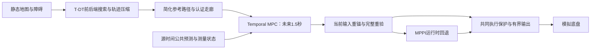

# 动态障碍预测与避障全研究记录：从R1到Temporal MPC冻结

2026-10-04，Asia/Shanghai。本文汇总截至用户本轮冻结请求的全部研究范围、实现、
有效结果、失败、未执行计划和恢复入口。旧V1已冻结，原生CV/surface与一个月
计划保持暂停，Temporal MPC现也冻结；**当前没有获比赛部署接受的显式预测方案。**
本次只归档文档，不继续开发、调参或运行实验，不修改正式导航和已迁移规划器。

本文提供完整历程与结论；[全部文档索引](all_dynamic_avoidance_documents_20261004.md)
保留每份资料的版本入口；[完整原文合订本](dynamic_obstacle_prediction_all_text_20261004.md)
提供逐份原文、来源与内容哈希，便于在一个文件中搜索。原文里的命令、计划和
“下一步”均为历史引用，不能作为自动执行授权。两份ChatGPT聊天仅作参考材料。

## 1. 路线编号、研究轮次和当前状态

“R1/R2/R3”是讨论中的架构分类，原文档的“三轮方案”是研究历程分类，两者
不能强行一一对应。一个月计划还把唯一短时CV候选命名为R1；这是该计划内部
编号，和最早的“预测占用写入costmap”不是同一实现。

| 名称 | 实际含义 | 证据与状态 |
|---|---|---|
| B0/保底 | current costmap（适用profile含STVL）＋标准MPPI；预测增强失败时保留反应式导航 | 正式配置保持；不是每个历史试次都用了STVL，必须以实际YAML/图为准 |
| R1，原聊天路线 | tracker/KF→future occupancy→costmap→MPPI | 审计未找到可构建加载的future occupancy Nav2 layer；时序空间化/false block是机制风险，不是已完成的R1闭环A/B结论 |
| 旧V1及后续风险研究，历史方案一 | tracker→按时间重算未来占用→PredictionV1Critic→MPPI；后续采样、排序、聚合与输出诊断 | 是时间critic路线，不等于R1占用层；源码/试次丰富，但未稳定过任务安全门，已冻结 |
| R2，原生CV路线，历史方案二 | 公共状态→CV时间评分→原生DynamicObstacleCritic→原装MPPI/smoother→guard | 从main独立建立；模块/原生消费验证成立，visible接触、nominal未到达，研究暂停 |
| temporal planner→timed reference→MPPI | 上游时间规划给MPPI参考 | 有annotated path、dynamic-clearance shadow与T-DT记录；没有已完成的该动态闭环证据，不列为已成功第三方案 |
| HWS重审/一个月计划，历史方案三 | 模块审计、STVL公平基线、短时CV有限矩阵和A/B/C退出门 | 文档已完成，计划的新实验未启动；暂停，当前选C，不倒填为MPC研究的实测 |
| R3，Temporal MPC，新增独立路线 | 静态T-DT前后端→reference/corridor；公共动态预测＋测量状态→短时MPC→执行重验/回退 | 八个实现/验证提交，真实双插件、Gazebo与诊断已运行；现在研究冻结，未接受部署 |

编号依据：[MPC架构审计](history_documents_20261004/temporal_mpc_04291a41/docs/dynamic_navigation/temporal_mpc_architecture.md)、
[旧V1范围](history_documents_20261004/legacy_e680b143/docs/dynamic_navigation/v1_prediction_scope.md)、
[一个月计划](prediction_one_month_exit_plan.md)。聊天里对既有路线“已经研究过”的
概括不能替代仓库消费者、运行记录或验收证据。

## 2. 起点：为什么研究预测，保留了什么基础

前置工作包括旧车动态重规划/STVL诊断、HWS选择性迁移、tracker shadow、canonical
TF和source-time输入、T-DT/东北大学规划前后端迁移及静态闭环。T-DT的A*、路径
简化/轨迹与走廊能力及验证过的失败回退保留，动态研究不能把这部分成果废弃。
它是独立候选，不能将有限静态仿真自动写成新车实物或比赛整体接受。

最初的明确问题是：**Navigation Action成功不等于动态几何安全。** 移动箱体
试次中，激光已看到目标、local costmap有占用，任务仍可能到达但本体/padded
重叠。MPPI raw map可以是最近完成的地图，观测却仍有source age。曾修复真实
controller odom接线、rolling origin快照假拒绝和footprint等通用问题；修复后
动态失败仍存在，不能无限重复责归“没看到”“T-DT没迁好”或已修正接线。

仿真停车探针也表明停车需要时间和位移：0.4m/s附近约0.415–0.422s、约0.09–
0.10m追加运动。这仅属于当时仿真，不能当新车实物制动下界。0.05m几何门
不能直接替代停车距离。相关前置资料在总索引的HWS、T-DT和基础合同分组。

## 3. 旧V1：预测占用、连续风险和“不漏/不堵”矛盾

V1复用HWS风格的静态剔除、聚类、关联、KF `[x,y,vx,vy]`与生命周期；以source
timestamp补偿年龄，在MPPI每步时刻评价CV未来几何，使用独立PredictionV1Critic。
STVL/普通CostCritic仍供当前占用保护，未把所有未来帧变成默认地图墙。

固定相位首例有净空改善和recovery下降；重复/交叉试次仍有碰撞或严重停滞。
冻结周期162中300条rollout有16条真实动态安全候选，但V1首步300/300相交，
安全候选总权重仅约3.14%。共同硬罚不能帮助分叉后的排序；减去同一个常数
也不会改变softmax。批量中已有安全轨迹时，单纯加batch或weight没有充分依据。

连续面积/侵入/时间风险改善过排序，唯一预登记闭环候选有动态间隙和零recovery，
却90s未到达。完整尺寸补全、directional/scan/calibrated/multi-scan支持分别
检验了漏覆盖与过保守：某些留出样本覆盖改善，目标附近封堵有所缓解，关键
周期共同相交和不安全聚合仍没有普遍解决。单一硬包络难兼顾不漏与不过度封路。

2026-09-25首次冻结后，独立风险路线继续做受限机制诊断，到2026-10-01再次
收尾，停在`e680b143`。后续分层记录不能被首次冻结文档的旧“最后实验”覆盖。

### 3.1 后续Sampling A / Ranking B / Aggregation C研究

| 层或实验族 | 得到的证据 | 保留的失败与边界 |
|---|---|---|
| 源时间与可见面motion、扫描中心/方向/残差 | 因果近面估计改善过当前位置和速度；多帧/留出支持有局部阳性 | 可见面变化不等于车体运动；1–3s换向和完整几何仍不可靠，邻帧不能代替独立holdout |
| raw采样、batch/noise/温度、零控制见证、AR/mixture | 某些状态原batch无安全候选，但有限零控制见证存在；AR可增加raw安全覆盖 | 经原bounds/SG后的可用输出覆盖仍可失败；density修正下权重退化，不能删修正救结果 |
| CV/CA、连续overlap/风险、总成本分解 | CA在一个固定输入产生安全首名和较高安全质量 | 独立协议证据不足；Ranking PASS后returned控制仍可能破门，不是意图/换向模型认证 |
| weighted/bounded/SG、filter history、候选输出风险 | 拆开raw、过滤候选、最终聚合及returned offset时间口径 | 非凸安全集合不由加权平均保留；安全首名或safe-only也不能直接保证最终输出 |
| 原生critic/CostCritic/PathAlign/设备重复与SDK身份 | 记录真正消费对象、实际噪声、成本、权重、滤波历史和输出，限定重放有精确核对 | 有捕获超时、字节重复差异、图/UUID/TF/完整尾段等失败；工具PASS不等于算法PASS |
| 全窗口物理执行与取消停止 | 分开8s动态窗口和取消尾段 | 一个取消尾段本体0.029603m且继续控制；不能用较早3s周期解释该尾段或指定未知责任节点 |

最终六个标准任务critic评分对象对齐，使两个已冻结输入的filtered输出通过原门，
但晚期raw排序仍FAIL；协议整体FAIL，未进入runtime。全部216份旧路线文档
及细分结果在索引方案一，不将某项局部阳性扩大为整条路线成功。

核心入口：[V1冻结](history_documents_20261004/legacy_e680b143/docs/dynamic_navigation/v1_research_freeze_20260925.md)、
[最终阶段结论](history_documents_20261004/legacy_e680b143/docs/dynamic_navigation/research_stage_conclusion_20261001.md)、
[最后输出成本对齐](history_documents_20261004/legacy_e680b143/docs/dynamic_navigation/standard_output_cost_alignment_20261001.md)。

## 4. R2：回到原装MPPI，建立原生CV critic和独立guard

2026-10-01从main独立创建`feature/dynamic-obstacle-critic`，按白名单复制旧tracker/
消息和纯几何，不整体merge旧research，不复制CA、AR/mixture、sampler、SG或
optimizer修改。原装Nav2 Humble1.1.20经pluginlib加载DynamicObstacleCritic。

其目标是完整时间对齐连续成本：`p_i(t)=T[p_source+v(source_age+t)]`，以padded
机器人与动态几何间隙评分；真实当前costmap仍独立参与MPPI和guard。初版
使用可见size外接圆，随后逐项审查源状态、raw map、完整机械几何和输出语义。

| 初版固定物理试次 | 任务 | 真实动态结果 | 综合结论 |
|---|---|---|---|
| 原MPPI基线 | 成功，18.692s | 本体/padded平面重叠 | FAILED |
| 加CV critic | 成功，19.679s | 本体/padded平面重叠 | FAILED |
| 加CV critic＋guard | 35s取消，推进0.452237m | 停在远处，未进入动态近场 | 未完成任务，不能用无碰撞宣称PASS |

初版有效圆对完整真实箱体当前与1/2/3s均0/261覆盖；源中心误差中位约0.208m，
3s中心误差中位约2.006m。输入几何和长CV已不充分，缺少对应新试次精确候选
快照时，不能把这个失败先归因sampler或优化器。详见[初版验收](../dynamic_obstacle_critic/validation.md)。

### 4.1 第二阶段完整推进内容

第二阶段沿36份文档推进：controller odom值/epoch、raw rollout与processed目标、
native周期/SG阶段/权重/聚合/个体约束、安全见证；raw203与unknown/map足迹语义；
机械包络、静态停止、地图预留/连续静态clearance性能；visible双面几何、CV当前/
未来支持因子、条件误差界与地面机器人尺寸先验；v2 observation anchor及名义D；
实际消费、完整三秒、reveal/stopping、离线表面链和真实成员/关联证据。
逐项实施、构建/预运行、失败及NOT RUN以[阶段进度](../dynamic_obstacle_critic/stage2_progress.md)为准。

公共v2明确锚定最近真实观测质心，coasting先推进到发布source epoch；消费者
不能再次重复coast。extent是可见范围，不是完整车辆尺寸；名义完整D=1.697056m
从近面锚点使用全直径半径，不冒充精确车中心，也不是未来误差界。

| 最新visible/nominal固定配对 | visible | nominal D circle |
|---|---:|---:|
| 实际原生消费周期 | 349 | 350 |
| 完整机械动态净空诊断下界 | -0.006576701m | 0.909401996m |
| 接触/任务 | 39.966s接触，未到达 | 未到达 |
| raw203违规/物理样本 | 750/2264 | 0/2264，条件结果 |
| 推进 | 4.943238m | 3.379103m |
| aggregate全3s同时条件安全 | 31/349 | 75/350 |

名义几何当前/1s全箱体覆盖284/284，但2s降到192/284、3s98/284；visible各时域
0/285。扩大当前几何没有解决换向运动支持。两组消费risk/float成本与SDK控制/
权重/SG可精确核对，均综合FAILED；原试次是ObstacleLayer，不能当公平STVL净收益对照。

surface离线原型21项测试，两组各583个检测值/顺序与旧算法一致，保留beam断裂
和未知端点。revealing审计说明相关表面在接触前已可见，自车停车后仍被对方
逼近；无真实端到端tau/a保证。**没有C的surface控制闭环。** 真实scan成员、TF、
地图与权威关联捕获有部分未提交开发，原工作区保留；不将其写成已验收在线消费者。
入口：[配对](../dynamic_obstacle_critic/observation_diameter_consumption_experiment.md)、
[reveal/停止](../dynamic_obstacle_critic/dynamic_surface_reveal_experiment.md)、
[成员证据](../dynamic_obstacle_critic/observed_surface_members_experiment.md)。

## 5. HWS重新审计和未启动的一个月计划

HWS固定pin为`f5f941288197e14c867d711a4c4cd85bfd7a3194`。本地只选择性吸收前端
思想/模块；HWS的多帧3D观测局部raster、时间代价图、完整规划器与FDDP/MPC
没有整体迁入正式运行链。HWS源码链完整不等于本地同条件效果已验证。

两者检测、Hungarian/greedy、KF噪声std/variance、时间来源、确认/丢失语义、
观测形状保留及衰减速度消费均不同。同名参数数字不可直接当等价。HWS纵向/
角速度LPV控制也不能直接用于四全向轮vy模型。

一个月计划原窗口2026-10-03至11-03，预算最多120 runs/24h主动工时/32h机器占用，
定义九场景、holdout、confirmed/suspected false_block和A/B/C退出门。其内部R1
是0.5或1s短时原生CV候选；没有启动计划新实验，用户10-04暂停，当前选C。
日期不是自动调度，不因MPC后来另获授权而倒填为该计划完成。
入口：[审计](hws_migration_audit_20261003.md)、[逐模块对照](hws_vs_current_prediction_analysis.md)、
[原计划](prediction_one_month_exit_plan.md)。

## 6. Temporal MPC：静态问题压缩、实时控制和双插件

用户另行授权新独立路线，并明确必须直接从main分出，保留T-DT/NEU规划器、
职责边界、实时预算和Nav2双插件。最终分支`experiment/temporal-mpc-main-20261004`
直接基于main@`d735ee12`；没有沿旧三轮分支派生或整体merge/cherry-pick。

静态前后端负责从哪里走，MPC负责短时如何执行；MPC没有承担全局搜索或raw map
静态绕障职责。主模型固定yaw、wz=0全向平移，vx[-0.5,0.8]、vy±0.5，target
速度差约束axy1。20Hz、1.5s/15节点，单QP最多400迭代/15ms、worker40ms；
最多4个活跃动态障碍，全量最多64个重验，warm start和终态停止保持。

原生接受前用新测量和最新有效公共预测重锚移位序列，全足迹/所有tracks与raw
STVL重验；失败链为旧可行解重新验收→有界减速→MPPI。不能把无法认证的
减速称安全停车，solver不能直接中断控制输出。双插件保留为
`FollowPathMPPI`、`FollowPathTemporalMPC`，经controller_id/BT selector运行时
MPPI→MPC→MPPI，上层Mission/Planner/NavigateToPose保持。

### 6.1 八个实现/验证提交和物理结果

下表测试数是各检查点，不累计为独立样本；相邻周期/重复source也不是独立holdout。
每轮有预登记、实际源码/二进制身份、完整失败与结果，详见快照文档链接。

| 提交/阶段 | 做了什么 | 有效结果与失败 |
|---|---|---|
| `90c05f9b`，初始离线/实时切片 | 先SLSQP，再按用户补充采用T-DT压缩＋有界QP | SLSQP修正后31试次保留迎面接触/实时失败；QP 25试次/5659周期，70测试，max14.84ms，5试次任务＋净空＋20Hz门通过，2迎面接触；未执行完整ROS回退 |
| `d6ec90d6`，Humble工程 | 原生插件、异步worker、真实BT/action/DDS、SpeedLimit与worker失活 | 75测试，最终14类故障/双向切换/独立制动通过；run01–05开发失败及run02早期接受撤回保留；不是实际tracker安全接受 |
| `280056ef`，真实Gazebo输入 | 激光/tracker v2、canonical源TF/测量odom、真实STVL/smoother/机械oracle | 85测试；横穿实际MPC69/70、迎面5/6；横穿双方接触（候选虽到达），迎面双方取消，controller gap超门；初始namespace无效比较撤回 |
| `0e8d41e5`，执行模型/共同保护 | 50ms ZOH、扩展认证走廊、双方共享ExecutionGuard | 91测试；四有效物理run均40s取消、无正Contact；迎面最终gap88.093/77.022ms失败，8故障fixture gap136.625ms失败；无法认证减速明确标记 |
| `e31030b1`，侧向参考/投影v2 | 局部侧移seed、精确cKDTree、生产节拍；采集后修复固定速度/剩余停止投影 | 98测试；旧投影四run因未来vy超限拒绝，全取消；新v2仅工程与历史提案编译重放通过，不能冒充本轮v2物理效果 |
| `c2029010`，v2独立物理复验 | 冻结v2再配对；只读目标容差区/认证截面检查 | 实际MPC175/176、62/63，旧速度拒绝消失后未来净空回退；四run全取消；横穿模型采样目标被排除，迎面gap86.961/80.478ms失败 |
| `ca89b527`，目标开放/有限候选 | open_long、左右/等待首可行、共享390迭代/15ms、确切输入2×2分解 | 116＋2测试；六有效run全取消，横穿single/portfolio228/229、237/238，迎面15/15、1/2；另保留缺raw静态TF基线失败，修采集后另登记全组02 |
| `2d95b026`，时序/老化诊断 | 独立callback时序、严格signed clock、原始请求/发布接收身份；只读老化 | 两环境130不同测试、8clock＋14Nav2故障门通过；新迎面双方40s取消，实际MPC1/1后shadow未来净空拒绝；1998请求current，候选final gap95.474ms失败，B0保留一次40ms截止拒绝 |

原始SLSQP制动在collision_dt提前归零而实际保持整control_dt的错误已被独立重放
发现；首轮接受撤回，pre_fix完整保留。QP离线计算时plant暂停，host耗时过门
不能代表真实机器人20–50Hz。实际模拟瞬态加速度约1.94，也不是模型axy1的
连续响应误差保证。各轮B0保护配置不同，不能跨轮拼接成统一性能A/B。
离线current_only/future_union只检验时间消费机制，不是R1占用层、STVL或R2的实测对照。

### 6.2 最新时序与余量分解的确切结论

worker严格map/非未来/age≤100ms，没有放宽时间门。新topic记录所有callback
disposition，solver身份另关联；Humble executor没有MessageInfo，DDS时戳明确
null。同主机monotonic区间只支持总延迟，不能唯一分成网络、DDS或排队。

新迎面候选proposal age50ms：原worker余量+88.960764mm，推进模型而保持原
相对控制+64.049321mm，移位不修停止尾+56.440530mm，完整旧输入停止投影
+56.979820mm；实际新测量/新预测为-14.953267mm。2×2固定epoch反事实显示
新测量重锚影响较大。旧横穿single则主要在控制序列随年龄移位后余量变负，
停止投影略改善。未经停止投影的移位终速非零，不是可执行替代方案。

这些替换不是传播后的plant，也不是唯一可加原因。新请求全current不能倒推
旧迎面portfolio那次模糊stale/frame已经被解释或修复。生产约50ms和低compute
成本也不能掩盖95.474ms接收空档。单次无正Contact不能证明绝无接触或连续安全。

### 6.3 文献参考和没有实现的内容

聊天中的T-MPC++、Scenario/SH-MPC、Chance-MPC/CBF等经原论文/作者仓库核验，
记录在[文献对照](history_documents_20261004/temporal_mpc_04291a41/docs/dynamic_navigation/temporal_mpc_literature_review_20261004.md)。
TU Delft T-MPC++不能与东北大学T-DT或其他同名TMPC混淆；当前有限候选不具备
同伦类完备性。共同ExecutionGuard不是CBF优化安全滤波器，没有不变性证明。
未引入Scenario/Chance/学习预测实现，也没有校准的概率安全声明。

## 7. 所有路线共同留下的结论

1. **观测、运动、几何必须分开。** 可见点簇质心/extent不等于车体中心/全形；KF
   covariance、confirmed或complete不能未经校准当完整检测/预测置信度。v2
   source/coasting语义必须保持，不用marker或诊断字符串替代行为输入。
2. **安全候选不等于安全输出。** raw覆盖、总排序/权重、bounds/SG/聚合以及实际
   新测量执行可以先后不同层失败；无候选不必证明场景无解，有候选也不保证采用。
3. **静态空间不等于动态时域可行。** 当前目标开放、正宽度截面或静态路径认证
   不能证明未来能安全通过；完整D覆盖当前不等于1–3s换向运动支持。
4. **截止拒绝和回退仍需验证整链。** 不可行/超时结果拒绝是必要边界，但有限
   输出、制动成功、节点存活、观察端连续与真实底盘连续分别验，不能合称安全。
5. **基线与证据身份必须明确。** STVL和ObstacleLayer、原装/遥测副本、single/
   portfolio、共同保护和无保护、投影v1/v2、source/consumer/observer epoch
   不能混用。对失败不缩几何、放门或按未来标签挑相位。
6. **局部阳性不能覆盖完整否定。** 到达、净空、recovery、false block、资源、
   holdout和任务恢复共同验收；缺因果/真值/完整尾段保持UNKNOWN/NOT RUN。
   几何未知与运动残差需独立校准，不能加一个cov字段就获得概率保证。

## 8. 冻结与可恢复版本

| 保存对象 | 明确版本/位置 | 当前状态 |
|---|---|---|
| 首次V1冻结 | `dynamic-prediction-v1-frozen-20260925`→`f85149e0` | 历史冻结，最后状态以之后的e680记录补充 |
| 旧风险路线 | `research/dynamic-differential-risk-frozen-20261001`→`e680b143`；`codex/dynamic-differential-risk`同 | Research Frozen / Not Accepted |
| 原生CV/surface | `feature/dynamic-obstacle-critic@91d7eda0`；`experiment/dynamic-surface-reveal@b5645eca`及原实验族 | 暂停；原工作区部分成员证据未提交，保留原样 |
| HWS/一个月计划 | `652f14ce`审计、`03d5dfa6`三轮目录 | 新计划实验NOT RUN，暂停，C |
| Temporal MPC最后代码/试次 | `2d95b02648723eca52373a81aed70c4cf72077d7` | 全部结果保留，无部署接受 |
| Temporal MPC研究冻结 | annotated `research/temporal-mpc-frozen-20261004`→`04291a410f193c009e043af88e014cf420e1f68b` | 用户明确冻结，只有文档变化，无新实验 |
| 正式main基点 | `d735ee12bd950dca0e691cdf2f2c61f35cef8ffc` | 本次不修改/合并/推送/部署 |

MPC冻结记录和机器身份分别见[冻结文档](history_documents_20261004/temporal_mpc_04291a41/docs/dynamic_navigation/temporal_mpc_freeze_20261004.md)、
[冻结JSON](history_documents_20261004/temporal_mpc_04291a41/docs/dynamic_navigation/temporal_mpc_freeze_20261004.json)。
原工作区未知core不删除；dirty tracker/成员证据不混入冻结提交。MPC独立worktree
和ignored原始产物也保留；已提交源码/二进制/压缩事件在冻结tag可恢复。

未来只有用户明确重新授权才继续。历史计划、恢复树、论文建议和旧next step
全部保留为材料；本文件没有安排续跑、提醒或实验。恢复时应依据未通过门确定
有限范围，保持静态规划职责、双插件回退和原几何/时间/物理验收边界。

## 9. 文档覆盖、原文和原始数据的区别

原目录包含347份Markdown，核心/前置304、关联43；首次检索覆盖96个本地引用、
86个Git快照，279份只读历史副本逐字节保存。本次在该清单上追加冻结MPC的
全部25份研究/复现Markdown，包括参考输入说明；不重写或删除旧347份。
合计372份Markdown，另保留2份用户提供的聊天原文。不是374次实验。
逐字节复核结果见[完整性记录](dynamic_obstacle_prediction_history_integrity_20261004.json)：
372份来源/阅读版本、46份选定阅读资产、374段原文全部匹配，总文档/索引无断链；
合订本2,551,443bytes。它不替代各阶段的算法与物理验收。
自写总文档/索引/元数据检查通过；63项原文空白/EOF问题在
[空白复核](dynamic_obstacle_prediction_history_whitespace_20261004.json)单列，保留原文字节。

完整原文合订本按每份实际阅读版本嵌入，不改内部原文；来源commit/blob、原
路径、SHA256、工作区差异和合订本字节区间在[机器清单](all_dynamic_avoidance_documents_20261004.json)
记录。旧资料未提交扩展明确标注；冻结MPC25份为tag中的确切提交版本。
原文中的历史命令/文献说法不是本次新的执行指令或重新核验结论。

源代码、bag、raw trace、图示、ELF和完整JSONL不拼入文字合订本。MPC九组证据
目录在冻结tag，最新归档140文件＋manifest、8条完整JSONL.gz共68,032行通过
无损/JSON/hash复核。旧数据按其原manifest/tag查阅。历史阅读副本仅复制文档
及选定阅读资产，不能称完整原始实验包，也不表示重新运行全部历史实验。

R1无在线layer、timed-reference闭环未完成、一个月新矩阵未运行、surface C未
运行、Scenario/Chance未实现均在正文与原文保留；不以“全部内容”把缺失项补成
已完成。全部记录入口见下表，完整路径与每份原文仍以总索引/机器清单为准。

### 基础/契约/运行背景 — 42份

| 原文编号 | 文档 | 来源 |
|---|---|---|
| [D0001](dynamic_obstacle_prediction_all_text_20261004.md#D0001) | [2027 Architecture Decision](../2027_architecture_decision.md) | 652f14ce |
| [D0002](dynamic_obstacle_prediction_all_text_20261004.md#D0002) | [2027 Phase 1 Plan](../2027_phase1_plan.md) | 652f14ce |
| [D0003](dynamic_obstacle_prediction_all_text_20261004.md#D0003) | [Chassis Heading Motion Policy](history_documents_20261004/other_8598b8c0/docs/chassis_heading_motion_policy.md) | 8598b8c0 |
| [D0004](dynamic_obstacle_prediction_all_text_20261004.md#D0004) | [Competition Capability Status](../competition_capability_status.md) | d735ee12 |
| [D0006](dynamic_obstacle_prediction_all_text_20261004.md#D0006) | [2027 TF Contract](../contracts/tf_contract_2027.md) | 652f14ce |
| [D0007](dynamic_obstacle_prediction_all_text_20261004.md#D0007) | [2027 Topic Contract](../contracts/topic_contract_2027.md) | 652f14ce |
| [D0008](dynamic_obstacle_prediction_all_text_20261004.md#D0008) | [导航小型遗留项冻结记录（2026-09-03）](history_documents_20261004/other_2c0620c1/docs/deferred_navigation_issues_20260903.md) | 2c0620c1 |
| [D0009](dynamic_obstacle_prediction_all_text_20261004.md#D0009) | [Docker Usage](../docker_usage.md) | d735ee12 |
| [D0263](dynamic_obstacle_prediction_all_text_20261004.md#D0263) | [Gazebo Fortress Systems Record](../external/gazebo_fortress_systems.md) | d735ee12 |
| [D0264](dynamic_obstacle_prediction_all_text_20261004.md#D0264) | [Nav2 MPPI PathAlign 隔离边界修正来源记录](history_documents_20261004/legacy_e680b143/docs/external/nav2_mppi_path_align_guard.md) | e680b143 |
| [D0265](dynamic_obstacle_prediction_all_text_20261004.md#D0265) | [Old-Car Field Debug Competition Tutorial](../field_debug_competition_tutorial.md) | d735ee12 |
| [D0276](dynamic_obstacle_prediction_all_text_20261004.md#D0276) | [Old-Car Navigation Integrity Field Validation Plan](history_documents_20261004/legacy_e680b143/docs/navigation_integrity/field_validation_plan.md) | e680b143 |
| [D0277](dynamic_obstacle_prediction_all_text_20261004.md#D0277) | [Navigation Integrity 第一版实现报告](history_documents_20261004/legacy_e680b143/docs/navigation_integrity/implementation_report.md) | e680b143 |
| [D0278](dynamic_obstacle_prediction_all_text_20261004.md#D0278) | [Shadow Localization Verifier 设计](history_documents_20261004/legacy_e680b143/docs/navigation_integrity/localization_verifier_design.md) | e680b143 |
| [D0279](dynamic_obstacle_prediction_all_text_20261004.md#D0279) | [Mission / Nav2 Stale Result 审计](history_documents_20261004/legacy_e680b143/docs/navigation_integrity/mission_stress_audit.md) | e680b143 |
| [D0280](dynamic_obstacle_prediction_all_text_20261004.md#D0280) | [新场地比赛部署与狗洞穿越作业手册](history_documents_20261004/other_8598b8c0/docs/new_field_competition_deployment_runbook.md) | 8598b8c0 |
| [D0281](dynamic_obstacle_prediction_all_text_20261004.md#D0281) | [Old-Car Debug Knowledge Base](../old_car_debug_knowledge_base.md) | d735ee12 |
| [D0282](dynamic_obstacle_prediction_all_text_20261004.md#D0282) | [Old-Car Self-Test Guide](../old_car_self_test_guide.md) | d735ee12 |
| [D0283](dynamic_obstacle_prediction_all_text_20261004.md#D0283) | [Phase 1.5D Multi-Obstacle Course Validation](../phase1_5d_course_validation.md) | d735ee12 |
| [D0284](dynamic_obstacle_prediction_all_text_20261004.md#D0284) | [Phase 2I Managed Mapping Pipeline](../phase2i_managed_mapping.md) | d735ee12 |
| [D0285](dynamic_obstacle_prediction_all_text_20261004.md#D0285) | [Phase 2L Dual-LiDAR Obstacle Fusion](../phase2l_dual_lidar_obstacle_fusion.md) | d735ee12 |
| [D0286](dynamic_obstacle_prediction_all_text_20261004.md#D0286) | [Phase 3 Competition Software Validation](../phase3_software_validation.md) | d735ee12 |
| [D0287](dynamic_obstacle_prediction_all_text_20261004.md#D0287) | [Phase 3D Competition Bringup And Readiness](../phase3d_competition_bringup.md) | d735ee12 |
| [D0288](dynamic_obstacle_prediction_all_text_20261004.md#D0288) | [Project Structure And Documentation Index](../project_structure_and_documentation_index.md) | 652f14ce，阅读版本有既有工作区差异 |
| [D0289](dynamic_obstacle_prediction_all_text_20261004.md#D0289) | [New-Car Ramp Perception Shadow Validation](history_documents_20261004/other_8598b8c0/docs/ramp_perception_shadow_validation.md) | 8598b8c0 |
| [D0290](dynamic_obstacle_prediction_all_text_20261004.md#D0290) | [Runtime Profiles](../runtime_profiles.md) | 652f14ce |
| [D0329](dynamic_obstacle_prediction_all_text_20261004.md#D0329) | [Old-Car Field Debug Competition 更新报告](../validation/old_car_field_debug_20260717.md) | d735ee12 |
| [D0330](dynamic_obstacle_prediction_all_text_20261004.md#D0330) | [fresh03 候选有限现场验收](../validation/old_car_fresh03_field_validation_20260720.md) | d735ee12 |
| [D0331](dynamic_obstacle_prediction_all_text_20261004.md#D0331) | [旧车动态障碍全局重规划验证记录（2026-08-06）](history_documents_20261004/legacy_e680b143/docs/validation/old_car_global_dynamic_replanning_20260806.md) | e680b143 |
| [D0332](dynamic_obstacle_prediction_all_text_20261004.md#D0332) | [老车高速自转全局定位漂移：根因分析、工程治理与实车闭环报告](history_documents_20261004/legacy_e680b143/docs/validation/old_car_high_spin_localization_engineering_report_20260825.md) | e680b143 |
| [D0333](dynamic_obstacle_prediction_all_text_20261004.md#D0333) | [旧车导航当前状态与后续收敛报告](../validation/old_car_navigation_status_and_roadmap_20260720.md) | d735ee12 |
| [D0334](dynamic_obstacle_prediction_all_text_20261004.md#D0334) | [老车无标注坡道实车录包分析与共享跟踪修复报告](history_documents_20261004/legacy_e680b143/docs/validation/old_car_ramp_live_tracking_report_20260830.md) | e680b143 |
| [D0335](dynamic_obstacle_prediction_all_text_20261004.md#D0335) | [旧车无标注坡道选择性验证](history_documents_20261004/legacy_e680b143/docs/validation/old_car_ramp_selective_validation.md) | e680b143 |
| [D0336](dynamic_obstacle_prediction_all_text_20261004.md#D0336) | [PCD/PGM 地图脏点诊断、收敛与交付总结报告](../validation/pcd_pgm_dirty_map_end_to_end_report_20260720.md) | d735ee12 |
| [D0337](dynamic_obstacle_prediction_all_text_20261004.md#D0337) | [PCD/PGM 地图脏点诊断工具实施记录](../validation/pcd_pgm_map_quality_implementation_20260717.md) | d735ee12 |
| [D0338](dynamic_obstacle_prediction_all_text_20261004.md#D0338) | [rm_competition_interfaces](../../src/rm_competition_interfaces/README.md) | 652f14ce |
| [D0339](dynamic_obstacle_prediction_all_text_20261004.md#D0339) | [rm_competition_mission](../../src/rm_competition_mission/README.md) | d735ee12 |
| [D0343](dynamic_obstacle_prediction_all_text_20261004.md#D0343) | [rm_map_tools](../../src/rm_map_tools/README.md) | d735ee12 |
| [D0344](dynamic_obstacle_prediction_all_text_20261004.md#D0344) | [rm_mid360_driver_bridge](../../src/rm_mid360_driver_bridge/README.md) | d735ee12 |
| [D0345](dynamic_obstacle_prediction_all_text_20261004.md#D0345) | [rm_nav_config](../../src/rm_nav_config/README.md) | d735ee12 |
| [D0346](dynamic_obstacle_prediction_all_text_20261004.md#D0346) | [rm_navigation_launch](../../src/rm_navigation_launch/README.md) | d735ee12 |
| [D0347](dynamic_obstacle_prediction_all_text_20261004.md#D0347) | [rm_simulation](../../src/rm_simulation/README.md) | d735ee12 |

### HWS迁移前置 — 12份

| 原文编号 | 文档 | 来源 |
|---|---|---|
| [D0266](dynamic_obstacle_prediction_all_text_20261004.md#D0266) | [动态通道准入 Shadow 验证](history_documents_20261004/legacy_e680b143/docs/hwsentry_migration/dynamic_clearance_shadow_validation.md) | e680b143 |
| [D0267](dynamic_obstacle_prediction_all_text_20261004.md#D0267) | [动态目标与 Nav2 Humble MPPI 集成评估](history_documents_20261004/legacy_e680b143/docs/hwsentry_migration/dynamic_mppi_integration_plan.md) | e680b143 |
| [D0268](dynamic_obstacle_prediction_all_text_20261004.md#D0268) | [Execution Contract 与 Annotated Path 审计](history_documents_20261004/legacy_e680b143/docs/hwsentry_migration/execution_and_annotated_path_review.md) | e680b143 |
| [D0269](dynamic_obstacle_prediction_all_text_20261004.md#D0269) | [Factor-Graph LIO 实验计划](history_documents_20261004/legacy_e680b143/docs/hwsentry_migration/factor_graph_lio_experiment_plan.md) | e680b143 |
| [D0270](dynamic_obstacle_prediction_all_text_20261004.md#D0270) | [开源选择性迁移冻结与验证交接](history_documents_20261004/legacy_e680b143/docs/hwsentry_migration/frozen_validation_handoff.md) | e680b143 |
| [D0271](dynamic_obstacle_prediction_all_text_20261004.md#D0271) | [HWSentryNav26 Phase1 Linux Validation Report](history_documents_20261004/legacy_e680b143/docs/hwsentry_migration/hwsentrynav26_phase1_linux_validation_report_20260824.md) | e680b143 |
| [D0272](dynamic_obstacle_prediction_all_text_20261004.md#D0272) | [离线射线证据地图清理原型](history_documents_20261004/legacy_e680b143/docs/hwsentry_migration/offline_map_cleanup.md) | e680b143 |
| [D0273](dynamic_obstacle_prediction_all_text_20261004.md#D0273) | [HWSentryNav26 选择性迁移 Phase 1](history_documents_20261004/legacy_e680b143/docs/hwsentry_migration/phase1_design.md) | e680b143 |
| [D0274](dynamic_obstacle_prediction_all_text_20261004.md#D0274) | [Phase 1 Linux 与旧车验证流程](history_documents_20261004/legacy_e680b143/docs/hwsentry_migration/phase1_linux_validation.md) | e680b143 |
| [D0275](dynamic_obstacle_prediction_all_text_20261004.md#D0275) | [HWSentryNav26 选择性迁移状态](history_documents_20261004/legacy_e680b143/docs/hwsentry_migration/selective_migration_status.md) | e680b143 |
| [D0340](dynamic_obstacle_prediction_all_text_20261004.md#D0340) | [rm_dynamic_clearance](history_documents_20261004/legacy_e680b143/src/rm_dynamic_clearance/README.md) | e680b143 |
| [D0342](dynamic_obstacle_prediction_all_text_20261004.md#D0342) | [rm_dynamic_obstacle_tracking](history_documents_20261004/legacy_e680b143/src/rm_dynamic_obstacle_tracking/README.md) | e680b143 |

### T-DT迁移及早期动态诊断 — 38份

| 原文编号 | 文档 | 来源 |
|---|---|---|
| [D0291](dynamic_obstacle_prediction_all_text_20261004.md#D0291) | [东北大学 T-DT 导航吸收：项目判断与分阶段实施](history_documents_20261004/legacy_e680b143/docs/tdt_migration/assessment_and_plan.md) | e680b143 |
| [D0292](dynamic_obstacle_prediction_all_text_20261004.md#D0292) | [P2B 动态失败时间窗：观测、地图与停令的离线审查](history_documents_20261004/legacy_e680b143/docs/tdt_migration/evidence/dynamic_failure_analysis_20260922/validation_20260922.md) | e680b143 |
| [D0293](dynamic_obstacle_prediction_all_text_20261004.md#D0293) | [P2B 动态安全：已知扫掠区命令过滤首例](history_documents_20261004/legacy_e680b143/docs/tdt_migration/evidence/dynamic_guard_pilot_20260923/validation_20260923.md) | e680b143 |
| [D0294](dynamic_obstacle_prediction_all_text_20261004.md#D0294) | [P2B 移动障碍首例验证：到点成功，动态安全未通过](history_documents_20261004/legacy_e680b143/docs/tdt_migration/evidence/dynamic_reference_20260922/validation_20260922.md) | e680b143 |
| [D0295](dynamic_obstacle_prediction_all_text_20261004.md#D0295) | [P2B 动态安全：HWNav 先例核对与冻结首例制动反事实](history_documents_20261004/legacy_e680b143/docs/tdt_migration/evidence/dynamic_safety_contract_20260923/validation_20260923.md) | e680b143 |
| [D0296](dynamic_obstacle_prediction_all_text_20261004.md#D0296) | [P2B 移动障碍：扫掠路由与命令停车候选首例](history_documents_20261004/legacy_e680b143/docs/tdt_migration/evidence/dynamic_viability_guard_20260924/validation_20260924.md) | e680b143 |
| [D0297](dynamic_obstacle_prediction_all_text_20261004.md#D0297) | [P2B endpoint_witness_v1：精确端点证据与实际验证](history_documents_20261004/legacy_e680b143/docs/tdt_migration/evidence/endpoint_witness_20260915/validation_20260916.md) | e680b143 |
| [D0298](dynamic_obstacle_prediction_all_text_20261004.md#D0298) | [Chassis Heading Motion Policy](history_documents_20261004/legacy_e680b143/docs/tdt_migration/evidence/heading_follow_20260916/reused_chassis_heading_policy.md) | e680b143 |
| [D0299](dynamic_obstacle_prediction_all_text_20261004.md#D0299) | [P2B 航向跟随路径 A/B：2026-09-16 实际回传](history_documents_20261004/legacy_e680b143/docs/tdt_migration/evidence/heading_follow_20260916/validation_20260916.md) | e680b143 |
| [D0300](dynamic_obstacle_prediction_all_text_20261004.md#D0300) | [P2B 动态失败：局部地图内部更新时间与观测年龄诊断](history_documents_20261004/legacy_e680b143/docs/tdt_migration/evidence/map_age_diagnostic_20260923/validation_20260923.md) | e680b143 |
| [D0301](dynamic_obstacle_prediction_all_text_20261004.md#D0301) | [P2B 移动障碍：MPPI 同周期诊断首例](history_documents_20261004/legacy_e680b143/docs/tdt_migration/evidence/mppi_cycle_diagnostic_20260922/validation_20260923.md) | e680b143 |
| [D0302](dynamic_obstacle_prediction_all_text_20261004.md#D0302) | [P2B 动态闭环：MPPI odom 输入与冻结周期反事实重放](history_documents_20261004/legacy_e680b143/docs/tdt_migration/evidence/mppi_replay_20260923/validation_20260923.md) | e680b143 |
| [D0303](dynamic_obstacle_prediction_all_text_20261004.md#D0303) | [P2B 静态仿真验证回传](history_documents_20261004/legacy_e680b143/docs/tdt_migration/evidence/p2b_static_20260913/validation_20260913.md) | e680b143 |
| [D0304](dynamic_obstacle_prediction_all_text_20261004.md#D0304) | [P2B static_v2 静态仿真验证回传](history_documents_20261004/legacy_e680b143/docs/tdt_migration/evidence/p2b_static_v2_20260913/validation_20260913.md) | e680b143 |
| [D0305](dynamic_obstacle_prediction_all_text_20261004.md#D0305) | [P2B static_v3 代价语义修复验证回传](history_documents_20261004/legacy_e680b143/docs/tdt_migration/evidence/p2b_static_v3_20260914/validation_20260914.md) | e680b143 |
| [D0306](dynamic_obstacle_prediction_all_text_20261004.md#D0306) | [P2B static_v4 静态仿真验证回传](history_documents_20261004/legacy_e680b143/docs/tdt_migration/evidence/p2b_static_v4_20260914/validation_20260914.md) | e680b143 |
| [D0307](dynamic_obstacle_prediction_all_text_20261004.md#D0307) | [P2B static_v5：端点连接修复后的实际验证](history_documents_20261004/legacy_e680b143/docs/tdt_migration/evidence/p2b_static_v5_20260915/validation_20260915.md) | e680b143 |
| [D0308](dynamic_obstacle_prediction_all_text_20261004.md#D0308) | [P2A 复现命令](history_documents_20261004/legacy_e680b143/docs/tdt_migration/evidence/phase2_20260913/commands.md) | e680b143 |
| [D0309](dynamic_obstacle_prediction_all_text_20261004.md#D0309) | [P2B 动态安全：仿真停车响应与完整障碍扫掠影子检查](history_documents_20261004/legacy_e680b143/docs/tdt_migration/evidence/sim_stop_probe_20260923/validation_20260923.md) | e680b143 |
| [D0310](dynamic_obstacle_prediction_all_text_20261004.md#D0310) | [P2B 最新快照复查：隔离实验验证回传](history_documents_20261004/legacy_e680b143/docs/tdt_migration/evidence/snapshot_revalidation_20260922/validation_20260922.md) | e680b143 |
| [D0311](dynamic_obstacle_prediction_all_text_20261004.md#D0311) | [P2B：Nav2 代价语义修复与 static_v3 交接](history_documents_20261004/legacy_e680b143/docs/tdt_migration/p2b_costmap_semantics_handoff.md) | e680b143 |
| [D0312](dynamic_obstacle_prediction_all_text_20261004.md#D0312) | [P2B 精确端点连接修复与验证](history_documents_20261004/legacy_e680b143/docs/tdt_migration/p2b_endpoint_connections.md) | e680b143 |
| [D0313](dynamic_obstacle_prediction_all_text_20261004.md#D0313) | [P2B 精确端点拒收证据](history_documents_20261004/legacy_e680b143/docs/tdt_migration/p2b_endpoint_witness.md) | e680b143 |
| [D0314](dynamic_obstacle_prediction_all_text_20261004.md#D0314) | [P2B 航向跟随路径：独立 A/B](history_documents_20261004/legacy_e680b143/docs/tdt_migration/p2b_heading_follow_experiment.md) | e680b143 |
| [D0315](dynamic_obstacle_prediction_all_text_20261004.md#D0315) | [P2B 新车 footprint 审查与参考几何验证](history_documents_20261004/legacy_e680b143/docs/tdt_migration/p2b_new_car_geometry_review.md) | e680b143 |
| [D0316](dynamic_obstacle_prediction_all_text_20261004.md#D0316) | [离线姿态几何检查器开发检查点](history_documents_20261004/legacy_e680b143/docs/tdt_migration/p2b_pose_geometry_checkpoint.md) | e680b143 |
| [D0317](dynamic_obstacle_prediction_all_text_20261004.md#D0317) | [P2B 记录器修复复核与 static_v2 重验交接](history_documents_20261004/legacy_e680b143/docs/tdt_migration/p2b_recorder_fix_20260913.md) | e680b143 |
| [D0318](dynamic_obstacle_prediction_all_text_20261004.md#D0318) | [P2B 静态仿真验证回传（复制为新报告后填写）](history_documents_20261004/legacy_e680b143/docs/tdt_migration/p2b_result_template.md) | e680b143 |
| [D0319](dynamic_obstacle_prediction_all_text_20261004.md#D0319) | [P2B：sanitizer 构建链修复与 static_v4 交接](history_documents_20261004/legacy_e680b143/docs/tdt_migration/p2b_sanitizer_chain_handoff.md) | e680b143 |
| [D0320](dynamic_obstacle_prediction_all_text_20261004.md#D0320) | [P2B 滚动快照拒收诊断、修复与验证](history_documents_20261004/legacy_e680b143/docs/tdt_migration/p2b_snapshot_revalidation_review.md) | e680b143 |
| [D0321](dynamic_obstacle_prediction_all_text_20261004.md#D0321) | [P2B 终点合同：姿态相关连接的下一阶段设计](history_documents_20261004/legacy_e680b143/docs/tdt_migration/p2b_terminal_contract_design.md) | e680b143 |
| [D0322](dynamic_obstacle_prediction_all_text_20261004.md#D0322) | [P2B：由后续动作定义终端可行性与自动选点](history_documents_20261004/legacy_e680b143/docs/tdt_migration/p2b_terminal_selection_design.md) | e680b143 |
| [D0323](dynamic_obstacle_prediction_all_text_20261004.md#D0323) | [Terminal selection：离线到执行的验收计划](history_documents_20261004/legacy_e680b143/docs/tdt_migration/p2b_terminal_selection_validation_plan.md) | e680b143 |
| [D0324](dynamic_obstacle_prediction_all_text_20261004.md#D0324) | [P2B 静态仿真：Terra 验证交接](history_documents_20261004/legacy_e680b143/docs/tdt_migration/p2b_terra_handoff.md) | e680b143 |
| [D0325](dynamic_obstacle_prediction_all_text_20261004.md#D0325) | [P2B 无实车期间的推进边界](history_documents_20261004/legacy_e680b143/docs/tdt_migration/p2b_without_hardware_plan.md) | e680b143 |
| [D0326](dynamic_obstacle_prediction_all_text_20261004.md#D0326) | [P2B 持久工作记录](history_documents_20261004/legacy_e680b143/docs/tdt_migration/p2b_work_status.md) | e680b143 |
| [D0327](dynamic_obstacle_prediction_all_text_20261004.md#D0327) | [T-DT 规划候选：2026-09-12 离线验证](history_documents_20261004/legacy_e680b143/docs/tdt_migration/validation_20260912.md) | e680b143 |
| [D0328](dynamic_obstacle_prediction_all_text_20261004.md#D0328) | [T-DT P2A：2026-09-13 统一几何的离线比较](history_documents_20261004/legacy_e680b143/docs/tdt_migration/validation_20260913.md) | e680b143 |

### 旧V1与风险/采样/输出 — 216份

| 原文编号 | 文档 | 来源 |
|---|---|---|
| [D0010](dynamic_obstacle_prediction_all_text_20261004.md#D0010) | [冻结周期 162 的 MPPI 采样空间对照](history_documents_20261004/legacy_e680b143/docs/dynamic_navigation/batch_sampling_probe_20260926.md) | e680b143 |
| [D0011](dynamic_obstacle_prediction_all_text_20261004.md#D0011) | [冻结CA候选的独立近场验证](history_documents_20261004/legacy_e680b143/docs/dynamic_navigation/ca_independent_holdout_20261001.md) | e680b143 |
| [D0012](dynamic_obstacle_prediction_all_text_20261004.md#D0012) | [扫描外廓中心预测：历史拟合、留出验证与冻结 MPPI 重放](history_documents_20261004/legacy_e680b143/docs/dynamic_navigation/calibrated_scan_support_holdout_20260925.md) | e680b143 |
| [D0013](dynamic_obstacle_prediction_all_text_20261004.md#D0013) | [在候选输出计划上评价冻结CA风险](history_documents_20261004/legacy_e680b143/docs/dynamic_navigation/candidate_output_risk_20261001.md) | e680b143 |
| [D0014](dynamic_obstacle_prediction_all_text_20261004.md#D0014) | [仅用过去近面观测估计速度：离线预登记（2026-09-30）](history_documents_20261004/legacy_e680b143/docs/dynamic_navigation/causal_face_velocity_preregistration_20260930.md) | e680b143 |
| [D0015](dynamic_obstacle_prediction_all_text_20261004.md#D0015) | [过去四帧近面速度：有明显增益，但九步门仍失败（2026-09-30）](history_documents_20261004/legacy_e680b143/docs/dynamic_navigation/causal_face_velocity_result_20260930.md) | e680b143 |
| [D0016](dynamic_obstacle_prediction_all_text_20261004.md#D0016) | [过去扫描推导的条件运动界：离线留出与冻结周期](history_documents_20261004/legacy_e680b143/docs/dynamic_navigation/causal_scan_bound_probe_20260925.md) | e680b143 |
| [D0017](dynamic_obstacle_prediction_all_text_20261004.md#D0017) | [关键源时刻的因果减速信号：二次外推不足](history_documents_20261004/legacy_e680b143/docs/dynamic_navigation/causal_turn_signal_20260929.md) | e680b143 |
| [D0018](dynamic_obstacle_prediction_all_text_20261004.md#D0018) | [动态障碍中心分布的历史留出校验](history_documents_20261004/legacy_e680b143/docs/dynamic_navigation/center_marginal_calibration_20260926.md) | e680b143 |
| [D0019](dynamic_obstacle_prediction_all_text_20261004.md#D0019) | [冻结混合采样库上的间隙风险形状对照](history_documents_20261004/legacy_e680b143/docs/dynamic_navigation/clearance_shape_risk_20261001.md) | e680b143 |
| [D0020](dynamic_obstacle_prediction_all_text_20261004.md#D0020) | [两telemetry副本组合加载的累计评分门预注册](history_documents_20261004/legacy_e680b143/docs/dynamic_navigation/combined_trace_fixture_preregistration_20261001.md) | e680b143 |
| [D0021](dynamic_obstacle_prediction_all_text_20261004.md#D0021) | [两telemetry副本组合加载：八critic离线结果](history_documents_20261004/legacy_e680b143/docs/dynamic_navigation/combined_trace_fixture_result_20261001.md) | e680b143 |
| [D0022](dynamic_obstacle_prediction_all_text_20261004.md#D0022) | [V1 保守占用的相交时长差异：冻结窗口否定实验](history_documents_20261004/legacy_e680b143/docs/dynamic_navigation/conflict_exposure_probe_20260928.md) | e680b143 |
| [D0023](dynamic_obstacle_prediction_all_text_20261004.md#D0023) | [Consumer trace fixture固定时钟类型错误：失败记录](history_documents_20261004/legacy_e680b143/docs/dynamic_navigation/consumer_trace_fixture_clock_failure_20261001.md) | e680b143 |
| [D0024](dynamic_obstacle_prediction_all_text_20261004.md#D0024) | [现有shadow tracker的consumer trace离线转发门预注册](history_documents_20261004/legacy_e680b143/docs/dynamic_navigation/consumer_trace_fixture_preregistration_20261001.md) | e680b143 |
| [D0025](dynamic_obstacle_prediction_all_text_20261004.md#D0025) | [Consumer trace离线转发门结果](history_documents_20261004/legacy_e680b143/docs/dynamic_navigation/consumer_trace_fixture_result_20261001.md) | e680b143 |
| [D0026](dynamic_obstacle_prediction_all_text_20261004.md#D0026) | [冻结周期的原生 CostCritic 碰撞判据与 batch 可行数](history_documents_20261004/legacy_e680b143/docs/dynamic_navigation/costmap_mask_probe_20260926.md) | e680b143 |
| [D0027](dynamic_obstacle_prediction_all_text_20261004.md#D0027) | [动态危险窗口中的 MPPI critic 排序分解](history_documents_20261004/legacy_e680b143/docs/dynamic_navigation/critic_rank_decomposition_20260926.md) | e680b143 |
| [D0028](dynamic_obstacle_prediction_all_text_20261004.md#D0028) | [147/263 冻结周期的 MPPI batch 敏感性](history_documents_20261004/legacy_e680b143/docs/dynamic_navigation/cross_cycle_batch_sensitivity_20260929.md) | e680b143 |
| [D0029](dynamic_obstacle_prediction_all_text_20261004.md#D0029) | [147/263 冻结周期的原生首步输出复核](history_documents_20261004/legacy_e680b143/docs/dynamic_navigation/cross_cycle_first_step_audit_20260928.md) | e680b143 |
| [D0030](dynamic_obstacle_prediction_all_text_20261004.md#D0030) | [周期 613 物理占用连续重叠排序：固定离线判别（2026-09-30）](history_documents_20261004/legacy_e680b143/docs/dynamic_navigation/cycle613_face_xy_overlap_preregistration_20260930.md) | e680b143 |
| [D0031](dynamic_obstacle_prediction_all_text_20261004.md#D0031) | [周期 613：连续重叠有信息，但固定评分未改变危险控制（2026-09-30）](history_documents_20261004/legacy_e680b143/docs/dynamic_navigation/cycle613_face_xy_overlap_result_20260930.md) | e680b143 |
| [D0032](dynamic_obstacle_prediction_all_text_20261004.md#D0032) | [周期 613 可见面二维预测评分：离线预登记（2026-09-30）](history_documents_20261004/legacy_e680b143/docs/dynamic_navigation/cycle613_face_xy_rank_preregistration_20260930.md) | e680b143 |
| [D0033](dynamic_obstacle_prediction_all_text_20261004.md#D0033) | [周期 613 可见面二维占用：九步评分仍饱和（2026-09-30）](history_documents_20261004/legacy_e680b143/docs/dynamic_navigation/cycle613_face_xy_rank_result_20260930.md) | e680b143 |
| [D0034](dynamic_obstacle_prediction_all_text_20261004.md#D0034) | [周期 613 七项原生 critic 归因：预登记（2026-09-30）](history_documents_20261004/legacy_e680b143/docs/dynamic_navigation/cycle613_native_term_attribution_preregistration_20260930.md) | e680b143 |
| [D0035](dynamic_obstacle_prediction_all_text_20261004.md#D0035) | [周期 613：原生 Goal 与 PathAlign 压过动态重叠排序（2026-09-30）](history_documents_20261004/legacy_e680b143/docs/dynamic_navigation/cycle613_native_term_attribution_result_20260930.md) | e680b143 |
| [D0036](dynamic_obstacle_prediction_all_text_20261004.md#D0036) | [周期 613 第 2 步预测相交：全控制域上界预登记（2026-09-30）](history_documents_20261004/legacy_e680b143/docs/dynamic_navigation/cycle613_step2_reachability_preregistration_20260930.md) | e680b143 |
| [D0037](dynamic_obstacle_prediction_all_text_20261004.md#D0037) | [周期 613：增大 batch 无法解除第 2 步预测硬碰撞（2026-09-30）](history_documents_20261004/legacy_e680b143/docs/dynamic_navigation/cycle613_step2_reachability_result_20260930.md) | e680b143 |
| [D0038](dynamic_obstacle_prediction_all_text_20261004.md#D0038) | [周期 47 std4 聚合独立数值门差异预注册](history_documents_20261004/legacy_e680b143/docs/dynamic_navigation/device_aggregation_attribution_preregistration_20261001.md) | e680b143 |
| [D0039](dynamic_obstacle_prediction_all_text_20261004.md#D0039) | [周期 47 std4 离线聚合参考差异定位结果](history_documents_20261004/legacy_e680b143/docs/dynamic_navigation/device_aggregation_attribution_result_20261001.md) | e680b143 |
| [D0040](dynamic_obstacle_prediction_all_text_20261004.md#D0040) | [新设备磁盘清理记录](history_documents_20261004/legacy_e680b143/docs/dynamic_navigation/device_disk_cleanup_result_20260930.md) | e680b143 |
| [D0041](dynamic_obstacle_prediction_all_text_20261004.md#D0041) | [新设备隔离有界反事实数值门结果（2026-09-30）](history_documents_20261004/legacy_e680b143/docs/dynamic_navigation/device_guarded_gate_result_20260930.md) | e680b143 |
| [D0042](dynamic_obstacle_prediction_all_text_20261004.md#D0042) | [动态预测研发设备迁移记录（2026-09-30）](history_documents_20261004/legacy_e680b143/docs/dynamic_navigation/device_migration_20260930.md) | e680b143 |
| [D0043](dynamic_obstacle_prediction_all_text_20261004.md#D0043) | [新设备冻结回放复现协议（2026-09-30）](history_documents_20261004/legacy_e680b143/docs/dynamic_navigation/device_replay_preregistration_20260930.md) | e680b143 |
| [D0044](dynamic_obstacle_prediction_all_text_20261004.md#D0044) | [新设备环境与原冻结回放结果（2026-09-30）](history_documents_20261004/legacy_e680b143/docs/dynamic_navigation/device_replay_result_20260930.md) | e680b143 |
| [D0045](dynamic_obstacle_prediction_all_text_20261004.md#D0045) | [新设备周期 47 样本字节复现差异预注册](history_documents_20261004/legacy_e680b143/docs/dynamic_navigation/device_sample_reproduction_preregistration_20260930.md) | e680b143 |
| [D0046](dynamic_obstacle_prediction_all_text_20261004.md#D0046) | [周期 47 新设备样本字节复现否定结果](history_documents_20261004/legacy_e680b143/docs/dynamic_navigation/device_sample_reproduction_result_20260930.md) | e680b143 |
| [D0047](dynamic_obstacle_prediction_all_text_20261004.md#D0047) | [新设备周期 47 评分差异归因预登记（2026-09-30）](history_documents_20261004/legacy_e680b143/docs/dynamic_navigation/device_score_discrepancy_preregistration_20260930.md) | e680b143 |
| [D0048](dynamic_obstacle_prediction_all_text_20261004.md#D0048) | [动态预测：可见面方向与占用可行性复核](history_documents_20261004/legacy_e680b143/docs/dynamic_navigation/directional_support_feasibility_20260924.md) | e680b143 |
| [D0049](dynamic_obstacle_prediction_all_text_20261004.md#D0049) | [动态预测 + MPPI 本轮决策记录（2026-09-29）](history_documents_20261004/legacy_e680b143/docs/dynamic_navigation/dynamic_prediction_stage_decision_20260929.md) | e680b143 |
| [D0050](dynamic_obstacle_prediction_all_text_20261004.md#D0050) | [2027 TF Contract](history_documents_20261004/legacy_e680b143/docs/dynamic_navigation/evidence/near_x_graph_attribution_inputs_20261001/11_tf_contract_2027.md) | e680b143 |
| [D0051](dynamic_obstacle_prediction_all_text_20261004.md#D0051) | [near-X v2图门失败只读归因预注册](history_documents_20261004/legacy_e680b143/docs/dynamic_navigation/evidence/near_x_graph_attribution_inputs_20261001/13_near_x_graph_attribution_preregistration_20261001.md) | e680b143 |
| [D0052](dynamic_obstacle_prediction_all_text_20261004.md#D0052) | [动态预测 V1：物理外形界离线影子检查](history_documents_20261004/legacy_e680b143/docs/dynamic_navigation/evidence/v1_extent_shadow_20260924/validation_20260924.md) | e680b143 |
| [D0053](dynamic_obstacle_prediction_all_text_20261004.md#D0053) | [动态预测 V1：冻结 phase 0 重复的恢复时窗复核](history_documents_20261004/legacy_e680b143/docs/dynamic_navigation/evidence/v1_failure_window_20260924/validation_20260924.md) | e680b143 |
| [D0054](dynamic_obstacle_prediction_all_text_20261004.md#D0054) | [动态预测 V1：独立 MPPI critic 固定相位 A/B](history_documents_20261004/legacy_e680b143/docs/dynamic_navigation/evidence/v1_mppi_ab_20260924/validation_20260924.md) | e680b143 |
| [D0055](dynamic_obstacle_prediction_all_text_20261004.md#D0055) | [动态预测 V1：Navfn 首例与固定配置复现的分叉审查](history_documents_20261004/legacy_e680b143/docs/dynamic_navigation/evidence/v1_navfn_repeatability_20260924/validation_20260924.md) | e680b143 |
| [D0056](dynamic_obstacle_prediction_all_text_20261004.md#D0056) | [动态预测 V1：Navfn 交叉首例与一次固定配置复现](history_documents_20261004/legacy_e680b143/docs/dynamic_navigation/evidence/v1_navfn_transfer_20260924/validation_20260924.md) | e680b143 |
| [D0057](dynamic_obstacle_prediction_all_text_20261004.md#D0057) | [动态预测 V1 输入首例：跟踪可用，直接使用可见框不够](history_documents_20261004/legacy_e680b143/docs/dynamic_navigation/evidence/v1_tracker_probe_20260924/validation_20260924.md) | e680b143 |
| [D0058](dynamic_obstacle_prediction_all_text_20261004.md#D0058) | [实验基础设施统一notes](history_documents_20261004/legacy_e680b143/docs/dynamic_navigation/experiment_infrastructure_notes_20261001.md) | e680b143 |
| [D0059](dynamic_obstacle_prediction_all_text_20261004.md#D0059) | [冻结连续风险单一输入支持替换预注册](history_documents_20261004/legacy_e680b143/docs/dynamic_navigation/face_support_rank_preregistration_20261001.md) | e680b143 |
| [D0060](dynamic_obstacle_prediction_all_text_20261004.md#D0060) | [固定源区间支持替换：排序比例改善，首选安全仍失败](history_documents_20261004/legacy_e680b143/docs/dynamic_navigation/face_support_rank_result_20261001.md) | e680b143 |
| [D0061](dynamic_obstacle_prediction_all_text_20261004.md#D0061) | [近面速度不确定区间探针预登记（2026-09-30）](history_documents_20261004/legacy_e680b143/docs/dynamic_navigation/face_velocity_uncertainty_preregistration_20260930.md) | e680b143 |
| [D0062](dynamic_obstacle_prediction_all_text_20261004.md#D0062) | [近面速度区间：当前静止视角有效段全覆盖，仍待移动视角验收（2026-09-30）](history_documents_20261004/legacy_e680b143/docs/dynamic_navigation/face_velocity_uncertainty_result_20260930.md) | e680b143 |
| [D0063](dynamic_obstacle_prediction_all_text_20261004.md#D0063) | [周期 47 固定允许控制原型可行性对照预注册](history_documents_20261004/legacy_e680b143/docs/dynamic_navigation/fast_x_control_prototype_preregistration_20261001.md) | e680b143 |
| [D0064](dynamic_obstacle_prediction_all_text_20261004.md#D0064) | [周期 47 固定允许控制原型可行性结果](history_documents_20261004/legacy_e680b143/docs/dynamic_navigation/fast_x_control_prototype_result_20261001.md) | e680b143 |
| [D0065](dynamic_obstacle_prediction_all_text_20261004.md#D0065) | [周期 47 新设备控制矩阵冻结离线诊断预注册](history_documents_20261004/legacy_e680b143/docs/dynamic_navigation/fast_x_device_frozen_control_preregistration_20260930.md) | e680b143 |
| [D0066](dynamic_obstacle_prediction_all_text_20261004.md#D0066) | [快运动源时间条件化的既有二维占用迁移预注册](history_documents_20261004/legacy_e680b143/docs/dynamic_navigation/fast_x_face_coverage_preregistration_20261001.md) | e680b143 |
| [D0067](dynamic_obstacle_prediction_all_text_20261004.md#D0067) | [快运动五周期条件化二维占用覆盖结果](history_documents_20261004/legacy_e680b143/docs/dynamic_navigation/fast_x_face_coverage_result_20261001.md) | e680b143 |
| [D0068](dynamic_obstacle_prediction_all_text_20261004.md#D0068) | [周期 47 固定随机控制集合风险迁移预注册](history_documents_20261004/legacy_e680b143/docs/dynamic_navigation/fast_x_frozen_batch_risk_preregistration_20261001.md) | e680b143 |
| [D0069](dynamic_obstacle_prediction_all_text_20261004.md#D0069) | [周期 47 固定四 seed 在线风险迁移否定结果](history_documents_20261004/legacy_e680b143/docs/dynamic_navigation/fast_x_frozen_batch_risk_result_20261001.md) | e680b143 |
| [D0070](dynamic_obstacle_prediction_all_text_20261004.md#D0070) | [周期 47 新设备固定控制 std4 覆盖、排序与输出结果](history_documents_20261004/legacy_e680b143/docs/dynamic_navigation/fast_x_frozen_device_result_20261001.md) | e680b143 |
| [D0071](dynamic_obstacle_prediction_all_text_20261004.md#D0071) | [固定原型风险与原生最终输出一致性预注册](history_documents_20261004/legacy_e680b143/docs/dynamic_navigation/fast_x_native_risk_consistency_preregistration_20261001.md) | e680b143 |
| [D0072](dynamic_obstacle_prediction_all_text_20261004.md#D0072) | [固定原型在线风险与原生输出一致性结果](history_documents_20261004/legacy_e680b143/docs/dynamic_navigation/fast_x_native_risk_consistency_result_20261001.md) | e680b143 |
| [D0073](dynamic_obstacle_prediction_all_text_20261004.md#D0073) | [快运动冻结周期在线输入可用性审计预注册](history_documents_20261004/legacy_e680b143/docs/dynamic_navigation/fast_x_online_input_audit_preregistration_20261001.md) | e680b143 |
| [D0074](dynamic_obstacle_prediction_all_text_20261004.md#D0074) | [快运动输入：源时间可构造，实际在线可用尚未证明](history_documents_20261004/legacy_e680b143/docs/dynamic_navigation/fast_x_online_input_audit_result_20261001.md) | e680b143 |
| [D0075](dynamic_obstacle_prediction_all_text_20261004.md#D0075) | [周期 47 固定原型在线风险区分预注册](history_documents_20261004/legacy_e680b143/docs/dynamic_navigation/fast_x_prototype_risk_preregistration_20261001.md) | e680b143 |
| [D0076](dynamic_obstacle_prediction_all_text_20261004.md#D0076) | [周期 47 固定原型在线连续风险区分结果](history_documents_20261004/legacy_e680b143/docs/dynamic_navigation/fast_x_prototype_risk_result_20261001.md) | e680b143 |
| [D0077](dynamic_obstacle_prediction_all_text_20261004.md#D0077) | [周期 47 新设备离线诊断执行补充（2026-09-30）](history_documents_20261004/legacy_e680b143/docs/dynamic_navigation/fast_x_scale4_device_protocol_20260930.md) | e680b143 |
| [D0078](dynamic_obstacle_prediction_all_text_20261004.md#D0078) | [MPPI滤波history快照：隔离副本离线结果](history_documents_20261004/legacy_e680b143/docs/dynamic_navigation/filter_history_fixture_result_20261001.md) | e680b143 |
| [D0079](dynamic_obstacle_prediction_all_text_20261004.md#D0079) | [MPPI滤波history只读快照副本预注册](history_documents_20261004/legacy_e680b143/docs/dynamic_navigation/filter_history_trace_preregistration_20261001.md) | e680b143 |
| [D0080](dynamic_obstacle_prediction_all_text_20261004.md#D0080) | [滤波候选评分与控制聚合表述对照](history_documents_20261004/legacy_e680b143/docs/dynamic_navigation/filtered_aggregate_alignment_20260928.md) | e680b143 |
| [D0081](dynamic_obstacle_prediction_all_text_20261004.md#D0081) | [单条滤波候选的七项原生 critic 重评分](history_documents_20261004/legacy_e680b143/docs/dynamic_navigation/filtered_all_critic_replay_20260928.md) | e680b143 |
| [D0082](dynamic_obstacle_prediction_all_text_20261004.md#D0082) | [固定周期 162 的滤波候选批量敏感性](history_documents_20261004/legacy_e680b143/docs/dynamic_navigation/filtered_batch_candidate_rank_20260928.md) | e680b143 |
| [D0083](dynamic_obstacle_prediction_all_text_20261004.md#D0083) | [滤波候选的预测排序与真实安全标签](history_documents_20261004/legacy_e680b143/docs/dynamic_navigation/filtered_candidate_rank_audit_20260928.md) | e680b143 |
| [D0084](dynamic_obstacle_prediction_all_text_20261004.md#D0084) | [滤波候选跨周期七项原生评分复核](history_documents_20261004/legacy_e680b143/docs/dynamic_navigation/filtered_cross_cycle_native_20260928.md) | e680b143 |
| [D0085](dynamic_obstacle_prediction_all_text_20261004.md#D0085) | [单条滤波轨迹上的连续预测评分：固定大 batch 诊断](history_documents_20261004/legacy_e680b143/docs/dynamic_navigation/filtered_graded_batch_20260928.md) | e680b143 |
| [D0086](dynamic_obstacle_prediction_all_text_20261004.md#D0086) | [滤波候选连续 V1 评分的三个预选周期筛查](history_documents_20261004/legacy_e680b143/docs/dynamic_navigation/filtered_graded_cross_cycle_20260928.md) | e680b143 |
| [D0087](dynamic_obstacle_prediction_all_text_20261004.md#D0087) | [动态预测 V1：同周期 MPPI 诊断](history_documents_20261004/legacy_e680b143/docs/dynamic_navigation/frozen_cycle_probe_20260924.md) | e680b143 |
| [D0088](dynamic_obstacle_prediction_all_text_20261004.md#D0088) | [动态障碍冻结周期的完整 MPPI 回放契约](history_documents_20261004/legacy_e680b143/docs/dynamic_navigation/full_frozen_mppi_replay_contract_20260926.md) | e680b143 |
| [D0089](dynamic_obstacle_prediction_all_text_20261004.md#D0089) | [连续预测重叠在固定大 batch 下的离线上界](history_documents_20261004/legacy_e680b143/docs/dynamic_navigation/graded_overlap_batch_20260928.md) | e680b143 |
| [D0090](dynamic_obstacle_prediction_all_text_20261004.md#D0090) | [动态预测 V1：保守占用内的连续排序实验](history_documents_20261004/legacy_e680b143/docs/dynamic_navigation/graded_overlap_candidate_20260924.md) | e680b143 |
| [D0091](dynamic_obstacle_prediction_all_text_20261004.md#D0091) | [冻结周期 PathAlign C++ 边界修正验证](history_documents_20261004/legacy_e680b143/docs/dynamic_navigation/guarded_path_align_cpp_validation_20260928.md) | e680b143 |
| [D0092](dynamic_obstacle_prediction_all_text_20261004.md#D0092) | [冻结周期的 PathAlign 有界回放](history_documents_20261004/legacy_e680b143/docs/dynamic_navigation/guarded_path_align_replay_20260928.md) | e680b143 |
| [D0093](dynamic_obstacle_prediction_all_text_20261004.md#D0093) | [冻结周期的 MPPI 温度敏感性](history_documents_20261004/legacy_e680b143/docs/dynamic_navigation/guarded_temperature_sensitivity_20260928.md) | e680b143 |
| [D0094](dynamic_obstacle_prediction_all_text_20261004.md#D0094) | [动态预测：方向区间的独立试次核查](history_documents_20261004/legacy_e680b143/docs/dynamic_navigation/heldout_directional_audit_20260924.md) | e680b143 |
| [D0095](dynamic_obstacle_prediction_all_text_20261004.md#D0095) | [历史扫描残差分布留出检查：现有数据不能支撑软排序](history_documents_20261004/legacy_e680b143/docs/dynamic_navigation/historical_scan_residual_calibration_20260929.md) | e680b143 |
| [D0098](dynamic_obstacle_prediction_all_text_20261004.md#D0098) | [同运行晚期固定时刻三层诊断](history_documents_20261004/legacy_e680b143/docs/dynamic_navigation/late_fixed_time_three_gate_20261001.md) | e680b143 |
| [D0099](dynamic_obstacle_prediction_all_text_20261004.md#D0099) | [晚期零安全批次的固定零控制见证](history_documents_20261004/legacy_e680b143/docs/dynamic_navigation/late_zero_control_witness_20261001.md) | e680b143 |
| [D0100](dynamic_obstacle_prediction_all_text_20261004.md#D0100) | [原bounds/filter映射的非可逆反例预注册](history_documents_20261004/legacy_e680b143/docs/dynamic_navigation/mapped_control_preimage_preregistration_20261001.md) | e680b143 |
| [D0101](dynamic_obstacle_prediction_all_text_20261004.md#D0101) | [原bounds/filter映射存在不同raw的相同完整像](history_documents_20261004/legacy_e680b143/docs/dynamic_navigation/mapped_control_preimage_result_20261001.md) | e680b143 |
| [D0102](dynamic_obstacle_prediction_all_text_20261004.md#D0102) | [高算力 miniPC 算法验证交接（无雷达、串口）](history_documents_20261004/legacy_e680b143/docs/dynamic_navigation/minipc_algorithm_handoff_20260924.md) | e680b143 |
| [D0103](dynamic_obstacle_prediction_all_text_20261004.md#D0103) | [已归档移动机器人试次交叉检查预登记（2026-09-30）](history_documents_20261004/legacy_e680b143/docs/dynamic_navigation/moving_view_crosscheck_preregistration_20260930.md) | e680b143 |
| [D0104](dynamic_obstacle_prediction_all_text_20261004.md#D0104) | [移动机器人相位 2：冻结近面区间的侵入前交叉检查（2026-09-30）](history_documents_20261004/legacy_e680b143/docs/dynamic_navigation/moving_view_crosscheck_result_20260930.md) | e680b143 |
| [D0105](dynamic_obstacle_prediction_all_text_20261004.md#D0105) | [新设备MPPI / V1动态链接身份前置门预注册](history_documents_20261004/legacy_e680b143/docs/dynamic_navigation/mppi_module_link_preregistration_20261001.md) | e680b143 |
| [D0106](dynamic_obstacle_prediction_all_text_20261004.md#D0106) | [新设备MPPI / V1链接身份与capture接口核查](history_documents_20261004/legacy_e680b143/docs/dynamic_navigation/mppi_module_link_result_20261001.md) | e680b143 |
| [D0107](dynamic_obstacle_prediction_all_text_20261004.md#D0107) | [多帧扫描可行集：历史留出与两个冻结周期](history_documents_20261004/legacy_e680b143/docs/dynamic_navigation/multi_scan_bound_probe_20260925.md) | e680b143 |
| [D0108](dynamic_obstacle_prediction_all_text_20261004.md#D0108) | [冻结 MPPI 原生计算核心的重复耗时与内存](history_documents_20261004/legacy_e680b143/docs/dynamic_navigation/native_core_benchmark_20260928.md) | e680b143 |
| [D0109](dynamic_obstacle_prediction_all_text_20261004.md#D0109) | [冻结周期原生 critic 与 batch 敏感性（2026-09-28）](history_documents_20261004/legacy_e680b143/docs/dynamic_navigation/native_critic_batch_sensitivity_20260928.md) | e680b143 |
| [D0110](dynamic_obstacle_prediction_all_text_20261004.md#D0110) | [冻结控制输入的原生 MPPI 核心回放](history_documents_20261004/legacy_e680b143/docs/dynamic_navigation/native_full_cycle_replay_20260928.md) | e680b143 |
| [D0111](dynamic_obstacle_prediction_all_text_20261004.md#D0111) | [固定连续风险：新输入排序与完整输出](history_documents_20261004/legacy_e680b143/docs/dynamic_navigation/near_field_fixed_continuous_risk_20261001.md) | e680b143 |
| [D0112](dynamic_obstacle_prediction_all_text_20261004.md#D0112) | [固定恒速/恒加速度消融：完整控制期的软风险](history_documents_20261004/legacy_e680b143/docs/dynamic_navigation/near_field_kinematic_risk_20261001.md) | e680b143 |
| [D0113](dynamic_obstacle_prediction_all_text_20261004.md#D0113) | [因果近面运动估计与排序信号](history_documents_20261004/legacy_e680b143/docs/dynamic_navigation/near_field_surface_motion_20261001.md) | e680b143 |
| [D0114](dynamic_obstacle_prediction_all_text_20261004.md#D0114) | [新设备近场holdout三层诊断](history_documents_20261004/legacy_e680b143/docs/dynamic_navigation/near_field_three_gate_holdout_20261001.md) | e680b143 |
| [D0115](dynamic_obstacle_prediction_all_text_20261004.md#D0115) | [周期 162 的近场候选排序归因与四步风险消融](history_documents_20261004/legacy_e680b143/docs/dynamic_navigation/near_term_rank_attribution_20260929.md) | e680b143 |
| [D0116](dynamic_obstacle_prediction_all_text_20261004.md#D0116) | [原控制图精确身份fixture输入冻结](history_documents_20261004/legacy_e680b143/docs/dynamic_navigation/near_x_command_graph_fixture_inputs_20261001.md) | e680b143 |
| [D0117](dynamic_obstacle_prediction_all_text_20261004.md#D0117) | [原Humble控制图精确身份fixture预注册](history_documents_20261004/legacy_e680b143/docs/dynamic_navigation/near_x_command_graph_fixture_preregistration_20261001.md) | e680b143 |
| [D0118](dynamic_obstacle_prediction_all_text_20261004.md#D0118) | [原控制图精确身份fixture结果](history_documents_20261004/legacy_e680b143/docs/dynamic_navigation/near_x_command_graph_fixture_result_20261001.md) | e680b143 |
| [D0119](dynamic_obstacle_prediction_all_text_20261004.md#D0119) | [近场 `x` 穿越周期 73：冻结输入扩批预登记（2026-09-30）](history_documents_20261004/legacy_e680b143/docs/dynamic_navigation/near_x_crossing_batch_preregistration_20260930.md) | e680b143 |
| [D0120](dynamic_obstacle_prediction_all_text_20261004.md#D0120) | [`x` 轴移动箱体近场穿越：单次闭环预登记（2026-09-30）](history_documents_20261004/legacy_e680b143/docs/dynamic_navigation/near_x_crossing_holdout_preregistration_20260930.md) | e680b143 |
| [D0121](dynamic_obstacle_prediction_all_text_20261004.md#D0121) | [`x` 轴移动箱体近场穿越与 MPPI 冻结周期 73（2026-09-30）](history_documents_20261004/legacy_e680b143/docs/dynamic_navigation/near_x_crossing_result_20260930.md) | e680b143 |
| [D0122](dynamic_obstacle_prediction_all_text_20261004.md#D0122) | [`x` 轴箱体较快运动的单次近场留出试次预登记（2026-09-30）](history_documents_20261004/legacy_e680b143/docs/dynamic_navigation/near_x_fast_motion_preregistration_20260930.md) | e680b143 |
| [D0123](dynamic_obstacle_prediction_all_text_20261004.md#D0123) | [较快 `x` 轴箱体近场留出试次：冻结周期结果（2026-09-30）](history_documents_20261004/legacy_e680b143/docs/dynamic_navigation/near_x_fast_motion_result_20260930.md) | e680b143 |
| [D0124](dynamic_obstacle_prediction_all_text_20261004.md#D0124) | [原生goal UUID日志fixture输入冻结](history_documents_20261004/legacy_e680b143/docs/dynamic_navigation/near_x_goal_uuid_fixture_inputs_20261001.md) | e680b143 |
| [D0125](dynamic_obstacle_prediction_all_text_20261004.md#D0125) | [near-X原生goal UUID记录fixture预注册](history_documents_20261004/legacy_e680b143/docs/dynamic_navigation/near_x_goal_uuid_fixture_preregistration_20261001.md) | e680b143 |
| [D0126](dynamic_obstacle_prediction_all_text_20261004.md#D0126) | [原生goal UUID日志fixture结果](history_documents_20261004/legacy_e680b143/docs/dynamic_navigation/near_x_goal_uuid_fixture_result_20261001.md) | e680b143 |
| [D0127](dynamic_obstacle_prediction_all_text_20261004.md#D0127) | [near-X图归因输入冻结](history_documents_20261004/legacy_e680b143/docs/dynamic_navigation/near_x_graph_attribution_inputs_20261001.md) | e680b143 |
| [D0128](dynamic_obstacle_prediction_all_text_20261004.md#D0128) | [near-X v2图门失败只读归因预注册](history_documents_20261004/legacy_e680b143/docs/dynamic_navigation/near_x_graph_attribution_preregistration_20261001.md) | e680b143 |
| [D0129](dynamic_obstacle_prediction_all_text_20261004.md#D0129) | [near-X图门来源归因结果](history_documents_20261004/legacy_e680b143/docs/dynamic_navigation/near_x_graph_attribution_result_20261001.md) | e680b143 |
| [D0130](dynamic_obstacle_prediction_all_text_20261004.md#D0130) | [南北近场冻结周期安全支撑上界预登记（2026-09-30）](history_documents_20261004/legacy_e680b143/docs/dynamic_navigation/near_x_safe_support_oracle_preregistration_20260930.md) | e680b143 |
| [D0131](dynamic_obstacle_prediction_all_text_20261004.md#D0131) | [南北近场安全支撑上界结果（2026-09-30）](history_documents_20261004/legacy_e680b143/docs/dynamic_navigation/near_x_safe_support_oracle_result_20260930.md) | e680b143 |
| [D0132](dynamic_obstacle_prediction_all_text_20261004.md#D0132) | [南侧出发的独立 `x` 轴近场穿越预登记（2026-09-30）](history_documents_20261004/legacy_e680b143/docs/dynamic_navigation/near_x_south_crossing_preregistration_20260930.md) | e680b143 |
| [D0133](dynamic_obstacle_prediction_all_text_20261004.md#D0133) | [南侧出发的独立 `x` 轴近场穿越结果（2026-09-30）](history_documents_20261004/legacy_e680b143/docs/dynamic_navigation/near_x_south_crossing_result_20260930.md) | e680b143 |
| [D0134](dynamic_obstacle_prediction_all_text_20261004.md#D0134) | [新设备独立周期采集前置条件只读核查](history_documents_20261004/legacy_e680b143/docs/dynamic_navigation/new_device_capture_inventory_preregistration_20261001.md) | e680b143 |
| [D0135](dynamic_obstacle_prediction_all_text_20261004.md#D0135) | [新设备独立采集前置核查结果](history_documents_20261004/legacy_e680b143/docs/dynamic_navigation/new_device_capture_inventory_result_20261001.md) | e680b143 |
| [D0136](dynamic_obstacle_prediction_all_text_20261004.md#D0136) | [新设备near-X首次完整采集工具失败](history_documents_20261004/legacy_e680b143/docs/dynamic_navigation/new_device_near_x_capture_failure_20261001.md) | e680b143 |
| [D0137](dynamic_obstacle_prediction_all_text_20261004.md#D0137) | [near-X采集v2前置图门失败与原始数据冻结](history_documents_20261004/legacy_e680b143/docs/dynamic_navigation/new_device_near_x_capture_failure_v2_20261001.md) | e680b143 |
| [D0138](dynamic_obstacle_prediction_all_text_20261004.md#D0138) | [near-X capture v3原生UUID记录失败](history_documents_20261004/legacy_e680b143/docs/dynamic_navigation/new_device_near_x_capture_failure_v3_20261001.md) | e680b143 |
| [D0139](dynamic_obstacle_prediction_all_text_20261004.md#D0139) | [新设备near-X完整采集输入冻结](history_documents_20261004/legacy_e680b143/docs/dynamic_navigation/new_device_near_x_capture_inputs_20261001.md) | e680b143 |
| [D0140](dynamic_obstacle_prediction_all_text_20261004.md#D0140) | [near-X采集v2输入冻结](history_documents_20261004/legacy_e680b143/docs/dynamic_navigation/new_device_near_x_capture_inputs_v2_20261001.md) | e680b143 |
| [D0141](dynamic_obstacle_prediction_all_text_20261004.md#D0141) | [near-X capture v3输入冻结](history_documents_20261004/legacy_e680b143/docs/dynamic_navigation/new_device_near_x_capture_inputs_v3_20261001.md) | e680b143 |
| [D0142](dynamic_obstacle_prediction_all_text_20261004.md#D0142) | [near-X capture v4输入冻结](history_documents_20261004/legacy_e680b143/docs/dynamic_navigation/new_device_near_x_capture_inputs_v4_20261001.md) | e680b143 |
| [D0143](dynamic_obstacle_prediction_all_text_20261004.md#D0143) | [新设备near-X完整输入capture预注册](history_documents_20261004/legacy_e680b143/docs/dynamic_navigation/new_device_near_x_capture_preregistration_20261001.md) | e680b143 |
| [D0144](dynamic_obstacle_prediction_all_text_20261004.md#D0144) | [near-X采集工具属性修复v2预注册](history_documents_20261004/legacy_e680b143/docs/dynamic_navigation/new_device_near_x_capture_v2_preregistration_20261001.md) | e680b143 |
| [D0145](dynamic_obstacle_prediction_all_text_20261004.md#D0145) | [near-X capture v3原控制图工具接入预注册](history_documents_20261004/legacy_e680b143/docs/dynamic_navigation/new_device_near_x_capture_v3_preregistration_20261001.md) | e680b143 |
| [D0146](dynamic_obstacle_prediction_all_text_20261004.md#D0146) | [near-X capture v4 UUID记录接入预注册](history_documents_20261004/legacy_e680b143/docs/dynamic_navigation/new_device_near_x_capture_v4_preregistration_20261001.md) | e680b143 |
| [D0147](dynamic_obstacle_prediction_all_text_20261004.md#D0147) | [动态预测输入：偏置视角完整记录预登记（2026-09-29）](history_documents_20261004/legacy_e680b143/docs/dynamic_navigation/offset_view_observation_preregistration_20260929.md) | e680b143 |
| [D0148](dynamic_obstacle_prediction_all_text_20261004.md#D0148) | [动态预测输入：偏置视角完整记录结果（2026-09-29）](history_documents_20261004/legacy_e680b143/docs/dynamic_navigation/offset_view_observation_result_20260929.md) | e680b143 |
| [D0149](dynamic_obstacle_prediction_all_text_20261004.md#D0149) | [冻结周期安全样本的滤波与加权上界（2026-09-28）](history_documents_20261004/legacy_e680b143/docs/dynamic_navigation/oracle_aggregation_probe_20260928.md) | e680b143 |
| [D0150](dynamic_obstacle_prediction_all_text_20261004.md#D0150) | [冻结输出过滤前后控制约束审计预注册](history_documents_20261004/legacy_e680b143/docs/dynamic_navigation/output_control_bounds_preregistration_20261001.md) | e680b143 |
| [D0151](dynamic_obstacle_prediction_all_text_20261004.md#D0151) | [冻结原生输出约束审计结果](history_documents_20261004/legacy_e680b143/docs/dynamic_navigation/output_control_bounds_result_20261001.md) | e680b143 |
| [D0152](dynamic_obstacle_prediction_all_text_20261004.md#D0152) | [最终控制序列的原生首步动力学复核](history_documents_20261004/legacy_e680b143/docs/dynamic_navigation/output_first_step_audit_20260928.md) | e680b143 |
| [D0153](dynamic_obstacle_prediction_all_text_20261004.md#D0153) | [动态预测输入：南北成对可见面观测预登记（2026-09-29）](history_documents_20261004/legacy_e680b143/docs/dynamic_navigation/paired_view_observation_preregistration_20260929.md) | e680b143 |
| [D0154](dynamic_obstacle_prediction_all_text_20261004.md#D0154) | [动态预测输入：首组成对观测结果（2026-09-29）](history_documents_20261004/legacy_e680b143/docs/dynamic_navigation/paired_view_observation_result_20260929.md) | e680b143 |
| [D0155](dynamic_obstacle_prediction_all_text_20261004.md#D0155) | [新设备被动仿真 raw receipt / TF 前置门预注册](history_documents_20261004/legacy_e680b143/docs/dynamic_navigation/passive_sim_receipt_preregistration_20261001.md) | e680b143 |
| [D0156](dynamic_obstacle_prediction_all_text_20261004.md#D0156) | [被动仿真 receipt / TF 前置门：未通过](history_documents_20261004/legacy_e680b143/docs/dynamic_navigation/passive_sim_receipt_result_20261001.md) | e680b143 |
| [D0157](dynamic_obstacle_prediction_all_text_20261004.md#D0157) | [真实被动capture的因果TF到达归因预注册](history_documents_20261004/legacy_e680b143/docs/dynamic_navigation/passive_tf_arrival_preregistration_20261001.md) | e680b143 |
| [D0158](dynamic_obstacle_prediction_all_text_20261004.md#D0158) | [真实被动capture的因果TF到达归因结果](history_documents_20261004/legacy_e680b143/docs/dynamic_navigation/passive_tf_arrival_result_20261001.md) | e680b143 |
| [D0159](dynamic_obstacle_prediction_all_text_20261004.md#D0159) | [冻结 MPPI 回放：PathAlign 路径末端越界前提审计](history_documents_20261004/legacy_e680b143/docs/dynamic_navigation/path_align_bound_audit_20260928.md) | e680b143 |
| [D0160](dynamic_obstacle_prediction_all_text_20261004.md#D0160) | [预测重叠的九步峰值排序：固定输入否决](history_documents_20261004/legacy_e680b143/docs/dynamic_navigation/peak_temporal_rank_20260928.md) | e680b143 |
| [D0161](dynamic_obstacle_prediction_all_text_20261004.md#D0161) | [独立 Navfn+V1 相位 2 采集预登记（2026-09-29）](history_documents_20261004/legacy_e680b143/docs/dynamic_navigation/phase2_holdout_preregistration_20260929.md) | e680b143 |
| [D0162](dynamic_obstacle_prediction_all_text_20261004.md#D0162) | [Navfn+V1 独立相位 2 留出试次：输入、300 条候选与排序（2026-09-29）](history_documents_20261004/legacy_e680b143/docs/dynamic_navigation/phase2_holdout_result_20260929.md) | e680b143 |
| [D0163](dynamic_obstacle_prediction_all_text_20261004.md#D0163) | [相位 2 实际消费源帧的可见表面偏差复核（2026-09-29）](history_documents_20261004/legacy_e680b143/docs/dynamic_navigation/phase2_source_surface_result_20260929.md) | e680b143 |
| [D0164](dynamic_obstacle_prediction_all_text_20261004.md#D0164) | [Navfn+V1 相位 6 新闭环输入：预登记（2026-09-30）](history_documents_20261004/legacy_e680b143/docs/dynamic_navigation/phase6_control_holdout_preregistration_20260930.md) | e680b143 |
| [D0165](dynamic_obstacle_prediction_all_text_20261004.md#D0165) | [Navfn+V1 相位 6 闭环与冻结周期 816（2026-09-30）](history_documents_20261004/legacy_e680b143/docs/dynamic_navigation/phase6_control_holdout_result_20260930.md) | e680b143 |
| [D0166](dynamic_obstacle_prediction_all_text_20261004.md#D0166) | [相位 6 首次启动失败与固定环境修正（2026-09-30）](history_documents_20261004/legacy_e680b143/docs/dynamic_navigation/phase6_control_holdout_setup_failure_20260930.md) | e680b143 |
| [D0167](dynamic_obstacle_prediction_all_text_20261004.md#D0167) | [相位 6 冻结周期的旧规则迁移门（2026-09-30）](history_documents_20261004/legacy_e680b143/docs/dynamic_navigation/phase6_fixed_transfer_preregistration_20260930.md) | e680b143 |
| [D0168](dynamic_obstacle_prediction_all_text_20261004.md#D0168) | [北侧相位匹配残差的冻结排序：仍未过门](history_documents_20261004/legacy_e680b143/docs/dynamic_navigation/phase_conditioned_rank_20260929.md) | e680b143 |
| [D0169](dynamic_obstacle_prediction_all_text_20261004.md#D0169) | [原V1完整物理执行与单周期输出一致性](history_documents_20261004/legacy_e680b143/docs/dynamic_navigation/physical_execution_consistency_20261001.md) | e680b143 |
| [D0170](dynamic_obstacle_prediction_all_text_20261004.md#D0170) | [新设备near-X可移植资产与只读launch门预注册](history_documents_20261004/legacy_e680b143/docs/dynamic_navigation/portable_near_x_assets_preregistration_20261001.md) | e680b143 |
| [D0171](dynamic_obstacle_prediction_all_text_20261004.md#D0171) | [可移植near-X首次只读preflight失败](history_documents_20261004/legacy_e680b143/docs/dynamic_navigation/portable_near_x_preflight_failure_20261001.md) | e680b143 |
| [D0172](dynamic_obstacle_prediction_all_text_20261004.md#D0172) | [可移植near-X只读preflight v2结果](history_documents_20261004/legacy_e680b143/docs/dynamic_navigation/portable_near_x_preflight_result_v2_20261001.md) | e680b143 |
| [D0173](dynamic_obstacle_prediction_all_text_20261004.md#D0173) | [可移植near-X只读preflight v2预注册](history_documents_20261004/legacy_e680b143/docs/dynamic_navigation/portable_near_x_preflight_v2_preregistration_20261001.md) | e680b143 |
| [D0174](dynamic_obstacle_prediction_all_text_20261004.md#D0174) | [冻结过滤输出bounds投影反事实预注册](history_documents_20261004/legacy_e680b143/docs/dynamic_navigation/post_filter_projection_preregistration_20261001.md) | e680b143 |
| [D0175](dynamic_obstacle_prediction_all_text_20261004.md#D0175) | [冻结过滤输出原 bounds 投影结果](history_documents_20261004/legacy_e680b143/docs/dynamic_navigation/post_filter_projection_result_20261001.md) | e680b143 |
| [D0177](dynamic_obstacle_prediction_all_text_20261004.md#D0177) | [V1实际prediction快照：隔离副本离线结果](history_documents_20261004/legacy_e680b143/docs/dynamic_navigation/prediction_snapshot_fixture_result_20261001.md) | e680b143 |
| [D0178](dynamic_obstacle_prediction_all_text_20261004.md#D0178) | [V1实际prediction快照telemetry隔离副本预注册](history_documents_20261004/legacy_e680b143/docs/dynamic_navigation/prediction_snapshot_trace_preregistration_20261001.md) | e680b143 |
| [D0179](dynamic_obstacle_prediction_all_text_20261004.md#D0179) | [动态障碍：滤波轨迹的接近风险离线复核](history_documents_20261004/legacy_e680b143/docs/dynamic_navigation/proximity_margin_probe_20260926.md) | e680b143 |
| [D0180](dynamic_obstacle_prediction_all_text_20261004.md#D0180) | [同N原始时间相关提案与原white目标](history_documents_20261004/legacy_e680b143/docs/dynamic_navigation/raw_temporal_proposal_20261001.md) | e680b143 |
| [D0181](dynamic_obstacle_prediction_all_text_20261004.md#D0181) | [历史扫描坐标来源统一：未修复冻结候选倒排](history_documents_20261004/legacy_e680b143/docs/dynamic_navigation/reflected_residual_odom_frame_20260929.md) | e680b143 |
| [D0182](dynamic_obstacle_prediction_all_text_20261004.md#D0182) | [观测侧镜像残差进入冻结 MPPI 软排序：否决](history_documents_20261004/legacy_e680b143/docs/dynamic_navigation/reflected_residual_rank_probe_20260929.md) | e680b143 |
| [D0183](dynamic_obstacle_prediction_all_text_20261004.md#D0183) | [冻结observer事件顺序的独立TF replay预注册](history_documents_20261004/legacy_e680b143/docs/dynamic_navigation/replay_event_tf_preregistration_20261001.md) | e680b143 |
| [D0184](dynamic_obstacle_prediction_all_text_20261004.md#D0184) | [冻结事件顺序的因果TF replay通过，预载未来TF改变三条记录](history_documents_20261004/legacy_e680b143/docs/dynamic_navigation/replay_event_tf_result_20261001.md) | e680b143 |
| [D0185](dynamic_obstacle_prediction_all_text_20261004.md#D0185) | [原始CDR observer协议预注册](history_documents_20261004/legacy_e680b143/docs/dynamic_navigation/replay_receipt_raw_cdr_preregistration_20261001.md) | e680b143 |
| [D0186](dynamic_obstacle_prediction_all_text_20261004.md#D0186) | [原始CDR只读observer记录协议通过隔离夹具](history_documents_20261004/legacy_e680b143/docs/dynamic_navigation/replay_receipt_raw_result_20261001.md) | e680b143 |
| [D0187](dynamic_obstacle_prediction_all_text_20261004.md#D0187) | [冻结replay只读消息身份与接收证据记录器预注册](history_documents_20261004/legacy_e680b143/docs/dynamic_navigation/replay_receipt_recorder_preregistration_20261001.md) | e680b143 |
| [D0188](dynamic_obstacle_prediction_all_text_20261004.md#D0188) | [Typed消息重新序列化不能作为原始CDR身份](history_documents_20261004/legacy_e680b143/docs/dynamic_navigation/replay_receipt_typed_failure_result_20261001.md) | e680b143 |
| [D0189](dynamic_obstacle_prediction_all_text_20261004.md#D0189) | [动态避障研究持续工作检查点](history_documents_20261004/legacy_e680b143/docs/dynamic_navigation/research_continuation_checkpoint_20260930.md) | e680b143 |
| [D0190](dynamic_obstacle_prediction_all_text_20261004.md#D0190) | [研发方向纠正：三层算法判定](history_documents_20261004/legacy_e680b143/docs/dynamic_navigation/research_direction_reset_20261001.md) | e680b143 |
| [D0191](dynamic_obstacle_prediction_all_text_20261004.md#D0191) | [动态预测与 MPPI 阶段结论（2026-10-01）](history_documents_20261004/legacy_e680b143/docs/dynamic_navigation/research_stage_conclusion_20261001.md) | e680b143 |
| [D0192](dynamic_obstacle_prediction_all_text_20261004.md#D0192) | [扫描中点点估计用于软排序：固定输入否决](history_documents_20261004/legacy_e680b143/docs/dynamic_navigation/scan_midpoint_soft_probe_20260928.md) | e680b143 |
| [D0193](dynamic_obstacle_prediction_all_text_20261004.md#D0193) | [关键周期的扫描相位与观测侧联合支持](history_documents_20261004/legacy_e680b143/docs/dynamic_navigation/scan_phase_view_support_20260929.md) | e680b143 |
| [D0194](dynamic_obstacle_prediction_all_text_20261004.md#D0194) | [原shadow tracker实际consumer采集预注册](history_documents_20261004/legacy_e680b143/docs/dynamic_navigation/shadow_consumer_capture_preregistration_20261001.md) | e680b143 |
| [D0195](dynamic_obstacle_prediction_all_text_20261004.md#D0195) | [原shadow tracker实际consumer capture：数据冻结](history_documents_20261004/legacy_e680b143/docs/dynamic_navigation/shadow_consumer_capture_result_20261001.md) | e680b143 |
| [D0196](dynamic_obstacle_prediction_all_text_20261004.md#D0196) | [Shadow真实consumer/observer字段与TF结果对齐预注册](history_documents_20261004/legacy_e680b143/docs/dynamic_navigation/shadow_receiver_alignment_preregistration_20261001.md) | e680b143 |
| [D0197](dynamic_obstacle_prediction_all_text_20261004.md#D0197) | [实际shadow consumer与raw observer对齐结果](history_documents_20261004/legacy_e680b143/docs/dynamic_navigation/shadow_receiver_alignment_result_20261001.md) | e680b143 |
| [D0198](dynamic_obstacle_prediction_all_text_20261004.md#D0198) | [动态障碍：软风险时域与 MPPI 控制滤波离线复核](history_documents_20261004/legacy_e680b143/docs/dynamic_navigation/short_horizon_filter_probe_20260926.md) | e680b143 |
| [D0199](dynamic_obstacle_prediction_all_text_20261004.md#D0199) | [原始扫描构造箱体 `x` 中心区间：预登记（2026-09-30）](history_documents_20261004/legacy_e680b143/docs/dynamic_navigation/source_x_interval_preregistration_20260930.md) | e680b143 |
| [D0200](dynamic_obstacle_prediction_all_text_20261004.md#D0200) | [扫描端点约束 `x` 中心：已观察夹具源时刻覆盖（2026-09-30）](history_documents_20261004/legacy_e680b143/docs/dynamic_navigation/source_x_interval_result_20260930.md) | e680b143 |
| [D0201](dynamic_obstacle_prediction_all_text_20261004.md#D0201) | [标准任务成本的候选输出对象一致性](history_documents_20261004/legacy_e680b143/docs/dynamic_navigation/standard_output_cost_alignment_20261001.md) | e680b143 |
| [D0202](dynamic_obstacle_prediction_all_text_20261004.md#D0202) | [时间相关提案协方差双线性项：仅代数必要条件审计](history_documents_20261004/legacy_e680b143/docs/dynamic_navigation/temporal_covariance_algebra_preregistration_20261001.md) | e680b143 |
| [D0203](dynamic_obstacle_prediction_all_text_20261004.md#D0203) | [相关提案协方差代数通过，mapped控制与latent提案需另证](history_documents_20261004/legacy_e680b143/docs/dynamic_navigation/temporal_covariance_algebra_result_20261001.md) | e680b143 |
| [D0204](dynamic_obstacle_prediction_all_text_20261004.md#D0204) | [周期 47 固定扰动时间结构覆盖预注册](history_documents_20261004/legacy_e680b143/docs/dynamic_navigation/temporal_coverage_preregistration_20261001.md) | e680b143 |
| [D0205](dynamic_obstacle_prediction_all_text_20261004.md#D0205) | [周期 47 固定时间结构覆盖结果](history_documents_20261004/legacy_e680b143/docs/dynamic_navigation/temporal_coverage_result_20261001.md) | e680b143 |
| [D0206](dynamic_obstacle_prediction_all_text_20261004.md#D0206) | [固定候选30步失效时刻归因预注册](history_documents_20261004/legacy_e680b143/docs/dynamic_navigation/temporal_failure_timing_preregistration_20261001.md) | e680b143 |
| [D0207](dynamic_obstacle_prediction_all_text_20261004.md#D0207) | [完整三秒失效归因：相关组固定首选均在九步域外破门](history_documents_20261004/legacy_e680b143/docs/dynamic_navigation/temporal_failure_timing_result_20261001.md) | e680b143 |
| [D0208](dynamic_obstacle_prediction_all_text_20261004.md#D0208) | [冻结时间结构候选的在线风险排序预注册](history_documents_20261004/legacy_e680b143/docs/dynamic_navigation/temporal_risk_rank_preregistration_20261001.md) | e680b143 |
| [D0209](dynamic_obstacle_prediction_all_text_20261004.md#D0209) | [固定时间结构候选在线风险排序否定结果](history_documents_20261004/legacy_e680b143/docs/dynamic_navigation/temporal_risk_rank_result_20261001.md) | e680b143 |
| [D0210](dynamic_obstacle_prediction_all_text_20261004.md#D0210) | [冻结 MPPI 周期的真实箱体评分上界](history_documents_20261004/legacy_e680b143/docs/dynamic_navigation/truth_geometry_score_probe_20260929.md) | e680b143 |
| [D0211](dynamic_obstacle_prediction_all_text_20261004.md#D0211) | [冻结周期 162：理想接近信号与 MPPI batch 敏感性](history_documents_20261004/legacy_e680b143/docs/dynamic_navigation/truth_near_batch_sensitivity_20260929.md) | e680b143 |
| [D0212](dynamic_obstacle_prediction_all_text_20261004.md#D0212) | [动态预测 V1：收缩后的独立实验边界](history_documents_20261004/legacy_e680b143/docs/dynamic_navigation/v1_prediction_scope.md) | e680b143 |
| [D0213](dynamic_obstacle_prediction_all_text_20261004.md#D0213) | [动态预测导航 V1 研究冻结说明](history_documents_20261004/legacy_e680b143/docs/dynamic_navigation/v1_research_freeze_20260925.md) | e680b143 |
| [D0214](dynamic_obstacle_prediction_all_text_20261004.md#D0214) | [扫描中心残差的观测侧镜像：留出分布诊断](history_documents_20261004/legacy_e680b143/docs/dynamic_navigation/view_reflection_calibration_20260929.md) | e680b143 |
| [D0215](dynamic_obstacle_prediction_all_text_20261004.md#D0215) | [扫描近面几何探针预登记（2026-09-29）](history_documents_20261004/legacy_e680b143/docs/dynamic_navigation/visible_face_geometry_probe_preregistration_20260929.md) | e680b143 |
| [D0216](dynamic_obstacle_prediction_all_text_20261004.md#D0216) | [扫描近面规则：源时刻纵向几何结果（2026-09-29）](history_documents_20261004/legacy_e680b143/docs/dynamic_navigation/visible_face_geometry_probe_result_20260929.md) | e680b143 |
| [D0217](dynamic_obstacle_prediction_all_text_20261004.md#D0217) | [近面输入九步预测覆盖预登记（2026-09-30）](history_documents_20261004/legacy_e680b143/docs/dynamic_navigation/visible_face_nine_step_preregistration_20260930.md) | e680b143 |
| [D0218](dynamic_obstacle_prediction_all_text_20261004.md#D0218) | [近面输入九步覆盖结果：源位置准确仍不足以预测运动（2026-09-30）](history_documents_20261004/legacy_e680b143/docs/dynamic_navigation/visible_face_nine_step_result_20260930.md) | e680b143 |
| [D0219](dynamic_obstacle_prediction_all_text_20261004.md#D0219) | [九步误差归因：物理源速度 oracle 预登记（2026-09-30）](history_documents_20261004/legacy_e680b143/docs/dynamic_navigation/visible_face_oracle_velocity_preregistration_20260930.md) | e680b143 |
| [D0220](dynamic_obstacle_prediction_all_text_20261004.md#D0220) | [九步归因：物理源速度 oracle 结果（2026-09-30）](history_documents_20261004/legacy_e680b143/docs/dynamic_navigation/visible_face_oracle_velocity_result_20260930.md) | e680b143 |
| [D0221](dynamic_obstacle_prediction_all_text_20261004.md#D0221) | [箱体沿 `x` 轴运动的南北视角输入验证：预登记（2026-09-30）](history_documents_20261004/legacy_e680b143/docs/dynamic_navigation/x_axis_motion_observation_preregistration_20260930.md) | e680b143 |
| [D0222](dynamic_obstacle_prediction_all_text_20261004.md#D0222) | [`x` 轴观察九步标签边界说明（2026-09-30）](history_documents_20261004/legacy_e680b143/docs/dynamic_navigation/x_axis_motion_observation_protocol_note_20260930.md) | e680b143 |
| [D0223](dynamic_obstacle_prediction_all_text_20261004.md#D0223) | [箱体沿 `x` 轴运动：新观察输入的固定规则覆盖（2026-09-30）](history_documents_20261004/legacy_e680b143/docs/dynamic_navigation/x_axis_motion_observation_result_20260930.md) | e680b143 |
| [D0224](dynamic_obstacle_prediction_all_text_20261004.md#D0224) | [`x` 轴运动北侧近视角：完整九步窗口预登记（2026-09-30）](history_documents_20261004/legacy_e680b143/docs/dynamic_navigation/x_axis_near_view_preregistration_20260930.md) | e680b143 |
| [D0225](dynamic_obstacle_prediction_all_text_20261004.md#D0225) | [`x` 轴运动北侧近视角：完整九步输入门通过（2026-09-30）](history_documents_20261004/legacy_e680b143/docs/dynamic_navigation/x_axis_near_view_result_20260930.md) | e680b143 |
| [D0226](dynamic_obstacle_prediction_all_text_20261004.md#D0226) | [`x` 轴移动箱体 + 移动机器人：独立闭环预登记（2026-09-30）](history_documents_20261004/legacy_e680b143/docs/dynamic_navigation/x_motion_control_holdout_preregistration_20260930.md) | e680b143 |
| [D0227](dynamic_obstacle_prediction_all_text_20261004.md#D0227) | [`x` 轴移动箱体闭环：近场输入门失败（2026-09-30）](history_documents_20261004/legacy_e680b143/docs/dynamic_navigation/x_motion_control_holdout_result_20260930.md) | e680b143 |
| [D0228](dynamic_obstacle_prediction_all_text_20261004.md#D0228) | [当前与零均值双Gaussian提案](history_documents_20261004/legacy_e680b143/docs/dynamic_navigation/zero_mean_proposal_20261001.md) | e680b143 |

### 原生CV critic/几何/surface — 36份

| 原文编号 | 文档 | 来源 |
|---|---|---|
| [D0005](dynamic_obstacle_prediction_all_text_20261004.md#D0005) | [动态障碍公共输入：几何语义与未知边界](../contracts/dynamic_obstacle_geometry_contract_2027.md) | 652f14ce |
| [D0229](dynamic_obstacle_prediction_all_text_20261004.md#D0229) | [CV DynamicObstacleCritic 第一版](../dynamic_obstacle_critic/architecture.md) | 652f14ce |
| [D0230](dynamic_obstacle_prediction_all_text_20261004.md#D0230) | [Controller里程计输入契约实验](../dynamic_obstacle_critic/controller_odom_contract_experiment.md) | 652f14ce |
| [D0231](dynamic_obstacle_prediction_all_text_20261004.md#D0231) | [显式条件下的CV支持界：离线开发登记](../dynamic_obstacle_critic/cv_support_bound_experiment.md) | 652f14ce |
| [D0232](dynamic_obstacle_prediction_all_text_20261004.md#D0232) | [当前几何与未来CV支持：离线因子审计登记](../dynamic_obstacle_critic/cv_support_factor_experiment.md) | 652f14ce |
| [D0233](dynamic_obstacle_prediction_all_text_20261004.md#D0233) | [DynamicObstacleCritic精确消费证据实验](../dynamic_obstacle_critic/dynamic_consumption_evidence_experiment.md) | 652f14ce |
| [D0234](dynamic_obstacle_prediction_all_text_20261004.md#D0234) | [可见动态表面与 reveal / stopping 证据实验](../dynamic_obstacle_critic/dynamic_surface_reveal_experiment.md) | 652f14ce |
| [D0235](dynamic_obstacle_prediction_all_text_20261004.md#D0235) | [全部地面机器人尺寸先验：离线契约实验登记](../dynamic_obstacle_critic/ground_robot_extent_prior_experiment.md) | 652f14ce |
| [D0236](dynamic_obstacle_prediction_all_text_20261004.md#D0236) | [静态地图不确定性规划预留实验（预登记）](../dynamic_obstacle_critic/map_uncertainty_experiment.md) | 652f14ce |
| [D0237](dynamic_obstacle_prediction_all_text_20261004.md#D0237) | [仿真机械足迹契约实验](../dynamic_obstacle_critic/mechanical_footprint_experiment.md) | 652f14ce |
| [D0238](dynamic_obstacle_prediction_all_text_20261004.md#D0238) | [原CostCritic累计成本变化：证据实验登记](../dynamic_obstacle_critic/native_cost_accumulator_evidence_experiment.md) | 652f14ce |
| [D0239](dynamic_obstacle_prediction_all_text_20261004.md#D0239) | [原 CostCritic 与 raw203 地图足迹语义：离线实验登记](../dynamic_obstacle_critic/native_cost_map_contract_experiment.md) | 652f14ce |
| [D0240](dynamic_obstacle_prediction_all_text_20261004.md#D0240) | [原生候选周期证据实验](../dynamic_obstacle_critic/native_cycle_evidence_experiment.md) | 652f14ce |
| [D0241](dynamic_obstacle_prediction_all_text_20261004.md#D0241) | [输入因子的原生聚合后果：离线实验登记](../dynamic_obstacle_critic/native_factor_aggregation_experiment.md) | 652f14ce |
| [D0242](dynamic_obstacle_prediction_all_text_20261004.md#D0242) | [四因子原生权重与个体安全见证：离线实验登记](../dynamic_obstacle_critic/native_factor_safe_mass_experiment.md) | 652f14ce |
| [D0243](dynamic_obstacle_prediction_all_text_20261004.md#D0243) | [原个体控制约束与SG阶段：离线实验登记](../dynamic_obstacle_critic/native_individual_stage_experiment.md) | 652f14ce |
| [D0244](dynamic_obstacle_prediction_all_text_20261004.md#D0244) | [原300 raw轨迹地图查询：离线实验登记](../dynamic_obstacle_critic/native_raw_map_contract_experiment.md) | 652f14ce |
| [D0245](dynamic_obstacle_prediction_all_text_20261004.md#D0245) | [原生完整三秒安全控制见证实验](../dynamic_obstacle_critic/native_safe_control_witness_experiment.md) | 652f14ce |
| [D0246](dynamic_obstacle_prediction_all_text_20261004.md#D0246) | [原生聚合 SG 前后路径：离线实验登记](../dynamic_obstacle_critic/native_sg_stage_experiment.md) | 652f14ce |
| [D0247](dynamic_obstacle_prediction_all_text_20261004.md#D0247) | [原生成本、权重与聚合归因实验](../dynamic_obstacle_critic/native_weight_attribution_experiment.md) | 652f14ce |
| [D0248](dynamic_obstacle_prediction_all_text_20261004.md#D0248) | [连续目标对照后的动态近场失败复盘](../dynamic_obstacle_critic/nearfield_failure_review.md) | 652f14ce |
| [D0249](dynamic_obstacle_prediction_all_text_20261004.md#D0249) | [最近真实观测锚点 CV：接口与条件支持实验登记](../dynamic_obstacle_critic/observation_anchor_cv_experiment.md) | 652f14ce |
| [D0250](dynamic_obstacle_prediction_all_text_20261004.md#D0250) | [观测锚点＋完整直径名义代理：实际消费实验登记](../dynamic_obstacle_critic/observation_diameter_consumption_experiment.md) | 652f14ce |
| [D0251](dynamic_obstacle_prediction_all_text_20261004.md#D0251) | [实际扫描成员与跟踪关联证据登记](../dynamic_obstacle_critic/observed_surface_members_experiment.md) | 652f14ce，阅读版本有既有工作区差异 |
| [D0252](dynamic_obstacle_prediction_all_text_20261004.md#D0252) | [聚合/SG路径的纯CV目标：离线实验登记](../dynamic_obstacle_critic/processed_cv_objective_experiment.md) | 652f14ce |
| [D0253](dynamic_obstacle_prediction_all_text_20261004.md#D0253) | [原始rollout与实际Dynamic目标：离线审计登记](../dynamic_obstacle_critic/raw_rollout_objective_experiment.md) | 652f14ce |
| [D0254](dynamic_obstacle_prediction_all_text_20261004.md#D0254) | [路线切换前仓库审查（2026-10-01）](../dynamic_obstacle_critic/repository_audit.md) | 652f14ce |
| [D0255](dynamic_obstacle_prediction_all_text_20261004.md#D0255) | [动态障碍尺寸参考：2026制作规范](../dynamic_obstacle_critic/robot_extent_manual_review.md) | 652f14ce |
| [D0256](dynamic_obstacle_prediction_all_text_20261004.md#D0256) | [连续静态目标的等价性能实验](../dynamic_obstacle_critic/soft_clearance_performance_experiment.md) | 652f14ce |
| [D0257](dynamic_obstacle_prediction_all_text_20261004.md#D0257) | [连续地图预留目标实验（预登记）](../dynamic_obstacle_critic/soft_map_clearance_experiment.md) | 652f14ce |
| [D0258](dynamic_obstacle_prediction_all_text_20261004.md#D0258) | [CV 路线第二阶段：失败诊断与接口修复](../dynamic_obstacle_critic/stage2_plan.md) | 652f14ce |
| [D0259](dynamic_obstacle_prediction_all_text_20261004.md#D0259) | [第二阶段进度记录](../dynamic_obstacle_critic/stage2_progress.md) | 652f14ce |
| [D0260](dynamic_obstacle_prediction_all_text_20261004.md#D0260) | [原生静态刹停约束实验（预登记）](../dynamic_obstacle_critic/static_stopping_experiment.md) | 652f14ce |
| [D0261](dynamic_obstacle_prediction_all_text_20261004.md#D0261) | [第一版验收与最终结论（2026-10-01）](../dynamic_obstacle_critic/validation.md) | 652f14ce |
| [D0262](dynamic_obstacle_prediction_all_text_20261004.md#D0262) | [可见双面矩形观测实验](../dynamic_obstacle_critic/visible_box_geometry_experiment.md) | 652f14ce |
| [D0341](dynamic_obstacle_prediction_all_text_20261004.md#D0341) | [rm_dynamic_obstacle_critic](../../src/rm_dynamic_obstacle_critic/README.md) | 652f14ce |

### HWS重审与未执行计划 — 3份

| 原文编号 | 文档 | 来源 |
|---|---|---|
| [D0096](dynamic_obstacle_prediction_all_text_20261004.md#D0096) | [HWSentryNav26 选择性迁移审计 — 2026-10-03](hws_migration_audit_20261003.md) | 652f14ce |
| [D0097](dynamic_obstacle_prediction_all_text_20261004.md#D0097) | [HWS 与当前动态预测路线逐模块对照](hws_vs_current_prediction_analysis.md) | 652f14ce |
| [D0176](dynamic_obstacle_prediction_all_text_20261004.md#D0176) | [显式动态预测：一个月退出计划](prediction_one_month_exit_plan.md) | 652f14ce，阅读版本有既有工作区差异 |

### Temporal MPC至冻结 — 25份

| 原文编号 | 文档 | 来源 |
|---|---|---|
| [D0348](dynamic_obstacle_prediction_all_text_20261004.md#D0348) | [Temporal MPC：独立最小研究架构](history_documents_20261004/temporal_mpc_04291a41/docs/dynamic_navigation/temporal_mpc_architecture.md) | 04291a41 |
| [D0349](dynamic_obstacle_prediction_all_text_20261004.md#D0349) | [目标可开放场景与有限候选登记](history_documents_20261004/temporal_mpc_04291a41/docs/dynamic_navigation/temporal_mpc_candidates_registration_20261004.md) | 04291a41 |
| [D0350](dynamic_obstacle_prediction_all_text_20261004.md#D0350) | [目标开放场景：单候选与有限候选对照](history_documents_20261004/temporal_mpc_04291a41/docs/dynamic_navigation/temporal_mpc_candidates_results_20261004.md) | 04291a41 |
| [D0351](dynamic_obstacle_prediction_all_text_20261004.md#D0351) | [Temporal MPC 执行模型与回退保护登记](history_documents_20261004/temporal_mpc_04291a41/docs/dynamic_navigation/temporal_mpc_execution_registration_20261004.md) | 04291a41 |
| [D0352](dynamic_obstacle_prediction_all_text_20261004.md#D0352) | [Temporal MPC 执行重验、静态走廊与回退保护结果](history_documents_20261004/temporal_mpc_04291a41/docs/dynamic_navigation/temporal_mpc_execution_results_20261004.md) | 04291a41 |
| [D0353](dynamic_obstacle_prediction_all_text_20261004.md#D0353) | [Temporal MPC 离线第一轮预登记](history_documents_20261004/temporal_mpc_04291a41/docs/dynamic_navigation/temporal_mpc_experiment_registration.md) | 04291a41 |
| [D0354](dynamic_obstacle_prediction_all_text_20261004.md#D0354) | [Temporal MPC 研究冻结记录](history_documents_20261004/temporal_mpc_04291a41/docs/dynamic_navigation/temporal_mpc_freeze_20261004.md) | 04291a41 |
| [D0355](dynamic_obstacle_prediction_all_text_20261004.md#D0355) | [Temporal MPC 实际仿真输入与配对实验预登记](history_documents_20261004/temporal_mpc_04291a41/docs/dynamic_navigation/temporal_mpc_gazebo_registration_20261004.md) | 04291a41 |
| [D0356](dynamic_obstacle_prediction_all_text_20261004.md#D0356) | [Temporal MPC 实际输入、Gazebo 配对与阶段结论](history_documents_20261004/temporal_mpc_04291a41/docs/dynamic_navigation/temporal_mpc_gazebo_results_20261004.md) | 04291a41 |
| [D0357](dynamic_obstacle_prediction_all_text_20261004.md#D0357) | [Temporal MPC 侧向参考与保护节拍登记](history_documents_20261004/temporal_mpc_04291a41/docs/dynamic_navigation/temporal_mpc_lateral_registration_20261004.md) | 04291a41 |
| [D0358](dynamic_obstacle_prediction_all_text_20261004.md#D0358) | [侧向参考、生产节拍与速度重锚结果](history_documents_20261004/temporal_mpc_04291a41/docs/dynamic_navigation/temporal_mpc_lateral_results_20261004.md) | 04291a41 |
| [D0359](dynamic_obstacle_prediction_all_text_20261004.md#D0359) | [新聊天记录中的论文：核验与当前实验对照](history_documents_20261004/temporal_mpc_04291a41/docs/dynamic_navigation/temporal_mpc_literature_review_20261004.md) | 04291a41 |
| [D0360](dynamic_obstacle_prediction_all_text_20261004.md#D0360) | [Temporal MPC 进度与结果](history_documents_20261004/temporal_mpc_04291a41/docs/dynamic_navigation/temporal_mpc_progress.md) | 04291a41 |
| [D0361](dynamic_obstacle_prediction_all_text_20261004.md#D0361) | [v2速度重锚投影：物理复验登记](history_documents_20261004/temporal_mpc_04291a41/docs/dynamic_navigation/temporal_mpc_projection_registration_20261004.md) | 04291a41 |
| [D0362](dynamic_obstacle_prediction_all_text_20261004.md#D0362) | [v2速度重锚投影物理复验与模型占用诊断](history_documents_20261004/temporal_mpc_04291a41/docs/dynamic_navigation/temporal_mpc_projection_results_20261004.md) | 04291a41 |
| [D0363](dynamic_obstacle_prediction_all_text_20261004.md#D0363) | [Worker时序与提案老化诊断登记](history_documents_20261004/temporal_mpc_04291a41/docs/dynamic_navigation/temporal_mpc_timing_registration_20261004.md) | 04291a41 |
| [D0364](dynamic_obstacle_prediction_all_text_20261004.md#D0364) | [Worker时序与提案老化诊断结果](history_documents_20261004/temporal_mpc_04291a41/docs/dynamic_navigation/temporal_mpc_timing_results_20261004.md) | 04291a41 |
| [D0365](dynamic_obstacle_prediction_all_text_20261004.md#D0365) | [Temporal MPC offline prototype](history_documents_20261004/temporal_mpc_04291a41/experiments/temporal_mpc/README.md) | 04291a41 |
| [D0366](dynamic_obstacle_prediction_all_text_20261004.md#D0366) | [T-DT前端桥接](history_documents_20261004/temporal_mpc_04291a41/experiments/temporal_mpc/frontend/README.md) | 04291a41 |
| [D0367](dynamic_obstacle_prediction_all_text_20261004.md#D0367) | [Isolated actual Gazebo research](history_documents_20261004/temporal_mpc_04291a41/experiments/temporal_mpc/gazebo/README.md) | 04291a41 |
| [D0368](dynamic_obstacle_prediction_all_text_20261004.md#D0368) | [Humble 双控制器实验](history_documents_20261004/temporal_mpc_04291a41/experiments/temporal_mpc/integration/README.md) | 04291a41 |
| [D0369](dynamic_obstacle_prediction_all_text_20261004.md#D0369) | [Frozen offline project references](history_documents_20261004/temporal_mpc_04291a41/experiments/temporal_mpc/reference_inputs/README.md) | 04291a41 |
| [D0370](dynamic_obstacle_prediction_all_text_20261004.md#D0370) | [动态障碍公共输入：几何语义与未知边界](history_documents_20261004/temporal_mpc_04291a41/experiments/temporal_mpc/reference_inputs/dynamic_obstacle_geometry_contract_2027.md) | 04291a41 |
| [D0371](dynamic_obstacle_prediction_all_text_20261004.md#D0371) | [rm_competition_interfaces](history_documents_20261004/temporal_mpc_04291a41/experiments/temporal_mpc/ros2/rm_competition_interfaces/README.md) | 04291a41 |
| [D0372](dynamic_obstacle_prediction_all_text_20261004.md#D0372) | [rm_dynamic_obstacle_tracking](history_documents_20261004/temporal_mpc_04291a41/experiments/temporal_mpc/ros2/rm_dynamic_obstacle_tracking/README.md) | 04291a41 |

### 聊天参考原文 — 2份

- [D0373](dynamic_obstacle_prediction_all_text_20261004.md#D0373)：[mpc_proposal](history_documents_20261004/reference_chats/mpc_proposal.txt).
- [D0374](dynamic_obstacle_prediction_all_text_20261004.md#D0374)：[mpc_literature_chat](history_documents_20261004/reference_chats/mpc_literature_chat.txt).
