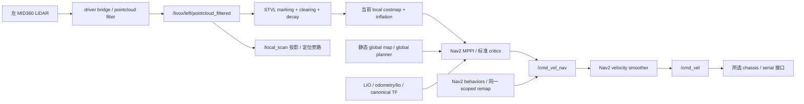
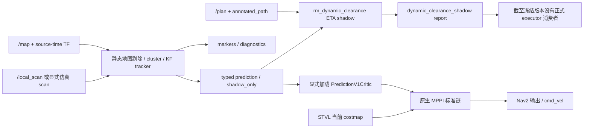
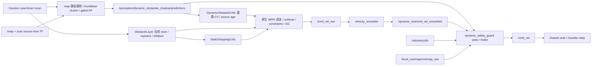

# HWSentryNav26 选择性迁移审计 — 2026-10-03

## Executive Summary

**正式 `main` 没有消费显式动态障碍预测。** 本地 `main` 与缓存 `origin/main` 均为 `d735ee12bd950dca0e691cdf2f2c61f35cef8ffc`。其中没有 `rm_dynamic_obstacle_tracking`、`rm_dynamic_clearance`、两种动态预测消息或动态预测 critic；正式启动文件没有 tracker 接线，所检查的旧车 STVL 配置也没有动态预测 critic。STVL 的观测衰减是障碍记忆管理，不是未来位置预测。

**迁移并非只有纸面前端，也不能称为完整 HWS 闭环迁移。** 2026-08 的独立 tracker 已实现静态地图剔除、聚类、关联、位置速度 KF、生命周期和显示预测；随后有真实构建和 ROS 回环的特殊通道 shadow 准入消费者。2026-09 的 `PredictionV1Critic` 已在隔离实验中影响 MPPI 成本和导航行为。2026-10 的 `DynamicObstacleCritic` 与最终命令 guard 又形成了新的原生 MPPI 实验闭环，但这些均未进入 `main`。

**HWS 的多帧占据渲染、时间代价图接口、整套规划器和 FDDP/MPC 没有迁移。** HWS 使用观测局部栅格形状平移；当前在线 critic 使用观测质心、估计速度、可见尺寸/名义半径重算 CV，并直接给原生 MPPI rollout 加成本。当前研究是在复用前端后发展另一条控制路线，不能用“补完迁移”解释所有后续工作。

**当前部署判断为 `RESEARCH FROZEN`。** 已有小夹具 A/B 中存在净空改善，也存在恢复与绕行代价；最新可见/名义几何两试次均未通过综合接受。没有证据证明该路线对 RoboMaster 代表工况稳定优于同条件 STVL + MPPI。有限评估及截止判据见[一个月退出计划](prediction_one_month_exit_plan.md)，具体机制见[逐模块对照](hws_vs_current_prediction_analysis.md)。本次仅新增审计文档和清单，没有修改正式代码、配置、安全门、TF、旧归档或研究算法。

## 1. 审计范围、版本和判定方法

审计源头为 `experiment/dynamic-surface-reveal@b5645ecaf6b4575a6537a0a0a9907f4891955955`；文档工作使用独立 `experiment/hws-migration-audit-20261003`。开始写文档前有 95 个本地引用、85 个不同提交快照，58 个引用含检索到的 HWS/动态 critic 语义命中。检索相关目录历史共 469 条提交；规范路径去重后 546 条。完整引用、路径和历史消息见[机器清单](hws_migration_audit_inventory_20261003.json)。数量含测试、离线工具、文档，不代表 546 个运行模块；证据归档中的重复源码另计，不能作为第二个消费者。

检索覆盖所有本地 heads、remote-tracking refs、tags、提交消息、相关路径历史，以及 `docs/`、`experiments/`、`src/` 的源码、构建、launch/config、接口、测试和历史记录。没有查询仓库远端最新分支，故“所有分支”指审计时本地可见引用；`origin/*` 是缓存，不代表远端实时状态。未使用名称相似作为迁移依据。

对每个能力依次检查：源码存在 → `setup.py`/CMake/消息生成登记 → launch 条件 →实际参数 → publisher/subscriber → controller/costmap/最终命令消费者。历史执行另以冻结 ROS 图、插件加载、实际输入/成本/输出证据确认。**本次没有启动实车或重新观测正式 ROS 图**；正式链图描述被所述入口配置选中的代码连接，而不是声称现场进程正在运行。

已有未提交的 tracker 成员证据开发、其测试/工具、`observed_surface_members_experiment.md` 和未知未跟踪 `core` 均保留。它们不计为已提交的 `b5645ec` 功能，也不纳入本次文档提交。已提交的 observed-surface 纯模块与未提交的在线成员采集应区分。

### 上游来源

上游 [Polyacetone/HWSentryNav26](https://github.com/Polyacetone/HWSentryNav26)，原迁移审阅 `20ef3d14ac0dc10e331691407b07663887cd0a73`，本次实际读取 `f5f941288197e14c867d711a4c4cd85bfd7a3194`，MIT（Copyright 2025 Polyacetone）。本次逐文件比较这两个 pin 的 `map_server/` 与 `nav_executor/`，**无差异**。上游只读源码置于 ignored `build/hws_audit/upstream_main`，没有 vendoring、submodule 或运行依赖接入。

HWS 原生实现与本地历史 clean-room 改写的对应关系以代码为准；“参考 HWS”不等于逐行移植。

上游公开快照不含默认配置所需的 `RMUC202605.msgpack` 和 `RMUC202608af.pcd`；本次未构建/运行HWS。非空PCD文件名加载失败会抛异常，并不是自动进入无PCD fallback；只有显式不加载全局cloud的模式才选无PCD分支。因此本文对HWS闭环的判断是**源码/构建登记/配置连接证据**，不是其现场运行或效果证明。

## 2. 已迁移/已实现能力表

表中“research”包含 `feature/`/`experiment/` 中尚未合入正式主线的实现。“默认关闭”指这些分支的入口，不表示已经合入 `main`。

| 能力 | 真实实现与消费证据 | 状态 | 正式 main |
|---|---|---|---|
| 静态地图剔除 / dynamic extraction | tracker `core.py:dynamic_candidates`，2D `/map` 占据距离；node 对 source-time scan 做 TF 后调用 | **shadow-only / research；实验闭环已启用** | 无此 tracker；普通障碍输入仍有效 |
| Euclidean clustering | `cluster_points`，空间桶 + 邻距连通；当前纯 helper 可保留成员 | **shadow-only / research；实验闭环已启用** | 未进入 |
| gated greedy association | tracker `update` 排序距离、一对一门控；实验配置 `use_global_assignment=false` | **shadow-only / research；实验闭环已启用** | 未进入 |
| 可选 global assignment | `optimal_gated_assignment`，有测试；所检查在线 CV 配置没有选用 | **已实现但默认未启用，仅 research** | 未进入；不能把它当 HWS 默认 Hungarian 已部署 |
| KF `[x,y,vx,vy]` | 两个位置/速度 1D KF，等价轴独立 4 状态；更新结果进入公共 position/velocity | **shadow-only / research；实验闭环已启用** | 未进入 |
| tentative / confirmed / coasting / lost | tracker 创建、连续 hits/位移确认、漏帧 coast、过期删除；lost 不继续公开 | **shadow-only / research；实验闭环已启用** | 未进入 |
| velocity decay | `_snapshot` 有指数衰减的显示路径；原 shadow tau=1.5s；当前 CV/v2 配置 tau=0 | **research 中已实现；当前控制模型不使用衰减路径** | 未进入 |
| future prediction | `DynamicObstaclePredictionArray` 有 display `prediction[]`；两种 critic 按 public position/velocity **重算**未来 | **shadow 输出；research 控制实际消费状态并预测** | 未进入 |
| 障碍 geometry | 旧 V1：可见尺寸 + 已知箱体/加速度扩张 box；新路线：可见 extent 圆或观测锚点 nominal D 圆 | **仅 experiments / research**；非 HWS 局部 raster 的完整迁移 | 未进入 |
| observed surface 端点/线段 | `observed_surface_geometry.py`，source beam 连续性与缺失返回审计 | **仅离线实验模块**；HEAD 无公共 surface 消息到 critic/guard 的接线 | 未进入 |
| 离线射线清图 | research `rm_map_tools/ray_evidence_cleanup.py` 的 3D-DDA、`ray_observations.py` sidecar、CLI/test | **仅 research；离线候选工具** | 未合入这套 HWS 参考扩展 |
| 普通运行时 clearing | 正式 STVL marking/clearing 点云输入与时域衰减；当前 sim `ObstacleLayer` LaserScan raytrace | **已进入所选正式/实验运行链**，但不是 HWS 预测后半段迁移 | 有；与预测无关 |
| 动态通道 ETA 检查 | `rm_dynamic_clearance` 订阅 Path、annotated sidecar、prediction；发布 revision-bound report；57 项历史构建/回环检查 | **shadow-only，仅旧 research** | 无消费者接正式执行器 |
| 旧原生 MPPI critic | `experiments/dynamic_prediction_v1/rm_dynamic_prediction_critic`，CMake + plugin XML +运行器生成候选 YAML；真实隔离 A/B | **仅 experiments / 冻结 research** | 未进入 |
| 新原生 MPPI critic | `rm_dynamic_obstacle_critic` CMake/plugin XML；opt-in `cv_course.launch.py` +实际三端 readback/成本文件 | **research；默认关闭；实验闭环已消费** | 未进入 |
| 按相对时间评分 | 旧 V1 `age+(j+1)dt`；新 critic 完整 30×0.1s 网格检查和 source age | **research 已运行**；完整时钟/执行对齐未认证 | 未进入 |
| 最终 command guard | 新 `dynamic_safety_guard` 订阅 prediction、odom、raw map、smoothed command，检查后发布 final command | **research；实验闭环有控制权** | 未进入 |

## 3. 未迁移、只有设计或已停止能力表

| HWS 能力/研究方向 | 检索结论 | 状态/边界 |
|---|---|---|
| 上游 connected-component + morphology 检测器 | 本地改为 Euclidean clusters，未复制 HWS raster detector | **原实现完全未迁移**；功能替代存在 |
| HWS 局部 footprint raster 持续融合/衰减 | 本地公共消息是 centroid、velocity、size，不含 local grid | **完全未迁移在线闭环**；surface 纯模块不是其替代闭环 |
| HWS `PredictionCostMapRenderer` | 所有规范源码/构建/launch 中没有对应未来帧 renderer | **完全未迁移** |
| `CostMaps.maps[0..N]` temporal costmap 与消费者 | 本地没有 HWS CostMaps 管线；public prediction 点数组不是代价图 | **完全未迁移** |
| predicted occupancy Nav2 layer | 本地有 footprint/risk/offline occupancy 分析，但未发现未来占据层被插件构建、加载并更新 costmap | **运行能力未迁移；仅实验分析/设计** |
| HWS 规划层未来空间并集 | HWS `build_planner_obstacle_view` 对当前 +窗口未来帧逐格 max；本地新 critic 无此层 | **完全未迁移该实现**；普通 current costmap 仍参与规划 |
| HWS FDDP、LPV/MPC、完整 FSM | 历史选择性迁移状态明确永久排除；本地继续 Nav2/MPPI | **明确不迁移** |
| shadow report → COMMITTED/狗洞执行 | report、policy、接口已写；已有 mission/executor 未订阅 report | **只有接口/设计，无运行消费者** |
| factor-graph LIO / small_glim 整体替换 | 仅条件触发实验计划，未形成本次动态导航链 | **只有设计或明确排除** |
| 分级预测可信度 → current-only →丢弃 → STVL | 旧 V1 invalid/stale 跳过并保留 CostCritic；新 critic invalid/stale fail-closed + guard 零输出 | **旧实验局部有 fallback；新路线未实现该完整分级策略** |
| CA、proposal、复杂 overlap/排名实验 | 旧 `frozen_cycle` 已有执行/失败/封存记录；没有合入正式 sampler/controller | **仅冻结 research；部分组合已停止/废弃为候选**；源码和证据仍保留 |

“已停止候选”不等于代码删除；“已存在代码”不等于 main 运行能力。未发现 main 曾部署 HWS temporal renderer 后又删除的证据，不能标为“曾部署但已废弃”。

## 4. 实际数据流

### 4.1 main：旧车 STVL 入口

以下连接来自 `main` 的 `old_car_full_navigation.launch.py` → `old_car_2026_competition.launch.py` → `old_car_2026_validation.launch.py` → Nav2 `navigation_launch.py` 和所选 YAML。validation 的 scoped `SetRemap(cmd_vel→cmd_vel_nav)` 将controller和behavior producer统一送到smoother；历史8177a73实际ROS图也验证smoother为唯一 `/cmd_vel` producer。通用 `navigation.launch.py` 是另一个入口，不能代替此条旧车启动链。



**图中没有 tracker/predictor。** STVL 不订阅 public prediction。旧车基础 STVL YAML 的 local plugins 是 `[stvl_layer,inflation_layer]`，global 是 `[static_layer,inflation_layer]`；不是所有 main 导航 profile 都选 STVL。

需注意真实入口与文件注释不一致：底层 competition launch 默认 opt-in 关闭，但 `old_car_full_navigation` 的 FEATURES 打开 driver/LIO/map/relocalization/Nav2/serial 等，并默认选择 `nav2_old_car_2026_left_stvl_three_point_spin_test.yaml`。该文件标题标记 HIGH-RISK，其 vx/vy=3m/s、wz=10rad/s，与普通 STVL 文件的低速参数不同。此事实只用于说明 **不能拿基础 YAML 或旧文档代替实际入口参数**；本次没有启动该入口、没有调整参数，也不把它当新研究公平基线。

### 4.2 旧 research：两条不同的后半段



V1 包位于 `experiments/`，有独立 CMake/plugin export，运行器生成并显式使用候选配置；存在源码不能证明默认 colcon/launch 自动加载。真实 A/B 日志和配置一致性断言才证明其曾运行。其无效预测跳过动态评分，普通 CostCritic 保留；这与新路线不同。

### 4.3 当前 native 实验链：已消费，但未部署



该链仅在 `cv_course.launch.py enabled:=true` 并选择配套 profile 时启动；`guard_enabled=false` 走显式旁路。冻结 v2 试次 ROS 图证实 `/cmd_vel` 的发布者是 guard、smoothed topic 的发布者是 smoother，成本/输入/SDK 返回控制逐周期关联。**该仿真 profile 的普通占据层是 ObstacleLayer，并非 STVL**；不能把这两次试次当 STVL + MPPI 公平净收益对照。

`NativeCycleSnapshotCritic`、CostAccumulator observers、`native_command_observer` 是研究证据模块，capture 默认关闭；前两者记录原生 rollout/成本，命令 observer 记录指定 topic。它们不是第二个规划器，也不把 marker/diagnostic 再送回 controller。

## 5. 构建、消费者与孤立模块

| producer/模块 | subscriber 或运行调用 | 最终影响/限制 |
|---|---|---|
| tracker markers / diagnostics | RViz/录包/审计工具；未找到导航权威消费者 | 可视化与观测；不影响正式 controller |
| typed predictions：2026-08 onward | 旧 research `dynamic_clearance_node.py`；显式 V1 实验插件；当前 native critic 和 guard；各自 ROS 测试/采集 | shadow report 无执行接线；两个 critic/guard 只在隔离实验影响导航 |
| `prediction[]` 点序列 | 旧 clearance 按 ETA 插值；显示/离线分析 | 新/旧在线 MPPI critic 从 position/velocity 重算，不消费这条显示路径；改变显示 decay 不会自动改变控制预测 |
| dynamic_clearance report | 全引用相关规范执行源码检索未找到已接线 mission/狗洞 report 订阅者 | **有 producer，无正式行为消费者** |
| observed-surface pure module | `test_observed_surface_geometry.py`、`audit_observed_surface_geometry.py` 等离线工具 | **有代码和离线调用，无已提交在线 critic/guard 消费者** |
| 未提交 surface member evidence | 默认关闭的文件证据开发 | 不是在线 surface prediction 消费链，不能计已完成 |
| ray cleanup CLI | setup entry point +离线工具调用 | 新 candidate PCD/report；不更新实时 local costmap、不直接发 cmd |
| HWS renderer / temporal maps | 本地没有对应 producer/接口/consumer | 整个阶段缺失，不是仅忘了 launch |

构建证据：tracker 的 `setup.py` 注册 node/config/launch；接口 CMake 生成两个 prediction messages；native CMake 构建共享 plugin、导出 `critics.xml`、安装 guard/配置/launch；旧 V1 的 CMake 在 experiment 包导出 plugin。历史 tracker/clearance 构建、DDS 回环与 V1 插件运行都存在。近期 v2 的真实执行和原生成本关联见[消费实验记录](../dynamic_obstacle_critic/observation_diameter_consumption_experiment.md)及其冻结目录。

## 6. branch / commit 证据

所有 refs 的完整名称与 full SHA 在清单；下表是行为节点，不是任选相似文件。

| 引用/提交 | 实际证据和含义 |
|---|---|
| main / origin/main `d735ee12` | 无 tracker/消息/critic 包和 launch 接线；STVL +标准 MPPI |
| `origin/feature/hwsentry-selective-migration-phase1@711d281f` | 默认关闭 shadow tracker、离线 ray prototype；无 controller 预测后半段 |
| `22117cef` / `52096078` | shadow tracker 首次实现 /关联前删除过期轨迹 |
| `d0ca9600` / `65fa7286` / `74ddb478` | DDA cleanup /不可覆盖输出合同 /bounded ray sidecar |
| `9ba73c08`、`origin/feature/gicp-degeneracy-gate@6a38b745` | GICP 后验质量门、选择性迁移状态；不等于动态控制迁移 |
| `f24f1124`、`origin/feature/dynamic-clearance-shadow@902261de` | typed predictions、annotated path 和 shadow ETA report；消费者止于 report |
| `cc254b4e`、`origin/fix/hwsentry-tracker-field-gates@c04278f3` | 静态误检/资源修复；历史实车整体仍 FAIL，不等于 D01–D07 已通过 |
| `462896db`、`origin/experiment/dynamic-prediction-v1@f85149e0` | 真实 MPPI V1 A/B 与冻结；并非 shadow-only 控制结果 |
| `codex/dynamic-differential-risk@e680b143` | 旧多方向实验、成本/输出对齐终结、暂停；tag `research/dynamic-differential-risk-frozen-20261001` **peeled commit** 同 SHA |
| `9e36853c` | 从 main 建新 native 路线，选择性复制 tracker/接口与纯几何；未整体 merge 旧 research |
| `feature/dynamic-obstacle-critic@91d7eda0` | 新插件与 guard 早期物理失败审计；后续能力在子 experiment refs |
| `14a015b5` / `e061a245` | v2 observation-anchor CV /完整 visible-nominal 失败归档 |
| `fb1f29bb` / `66719832` / `b5645eca` | 离线 observed-surface /全三秒配对原生回放 /在线成员证据登记；无 C 在线接线接受 |

当前 native 分支族包括 `experiment/{controller-odom-contract,mechanical-footprint-contract,ground-robot-extent-prior,observation-anchor-cv,observation-diameter-consumption,dynamic-surface-reveal}`、`native-{cycle,cost-accumulator,consumption等}` 证据系列和 rollout/weight/SG/safe-mass/map/stopping 等审计分支。精确 29 个审计前本地 heads 及全部缓存 refs 见清单；不把“分支很多”解释为多个可部署候选。

历史文档应按对应 ref 读取，当前 native checkout 没有把全部旧研究 docs 带过来。例如：

```bash
git show codex/dynamic-differential-risk:docs/hwsentry_migration/phase1_design.md
git show codex/dynamic-differential-risk:docs/hwsentry_migration/selective_migration_status.md
git show codex/dynamic-differential-risk:docs/hwsentry_migration/hwsentrynav26_phase1_linux_validation_report_20260824.md
git show codex/dynamic-differential-risk:docs/hwsentry_migration/dynamic_mppi_integration_plan.md
git show codex/dynamic-differential-risk:docs/dynamic_navigation/evidence/v1_mppi_ab_20260924/validation_20260924.md
git show codex/dynamic-differential-risk:docs/dynamic_navigation/research_stage_conclusion_20261001.md
```

## 7. 与 HWS 原设计的对应关系

HWS 实际链是 registered cloud →静态全局 3D PCD 差分（无 PCD 时 normals fallback）→SOR/投影密度/形态学/连通域 →Hungarian +CV KF +局部 raster →decayed-CV future frames →CostMaps →planner hard union /follower temporal soft maps →自有 FDDP/MPC →`ChassisCmd`。并非 Euclidean greedy →Nav2 STVL/MPPI。

关键上游永久链接：

- [map_server 实际 cloud 回调、预测开关与发布](https://github.com/Polyacetone/HWSentryNav26/blob/f5f941288197e14c867d711a4c4cd85bfd7a3194/map_server/src/map_server_node.cpp#L324-L424)
- [object_tracker：检测、关联、KF、形状与预测](https://github.com/Polyacetone/HWSentryNav26/blob/f5f941288197e14c867d711a4c4cd85bfd7a3194/map_server/src/object_tracker.cpp)
- [renderer：静态保底 +每时间帧平移轮廓](https://github.com/Polyacetone/HWSentryNav26/blob/f5f941288197e14c867d711a4c4cd85bfd7a3194/map_server/src/prediction_cost_map_renderer.cpp#L65-L110)
- [planner 未来并集 / follower 分帧](https://github.com/Polyacetone/HWSentryNav26/blob/f5f941288197e14c867d711a4c4cd85bfd7a3194/nav_executor/src/common/environment/obstacle_semantics.cpp#L33-L115)
- [MPC 按 k·dt 选帧](https://github.com/Polyacetone/HWSentryNav26/blob/f5f941288197e14c867d711a4c4cd85bfd7a3194/nav_executor/src/path_executor/mpc/follow_problem.cpp#L235-L253)

HWS 中 KF dt 使用回调 steady-clock 间隔，点云 TF lookup 使用 latest，nav_executor 接收 maps 后没有可见的 source-age 偏移加入 `cost_map_for_step`。所以它有相对时间选帧，却不能据此声称端到端绝对时间严格对齐或 stale 场景天然安全。源码闭环完整也不是与本项目相同工况的效果证明。

## 8. 重复实现：复用、合并和停止建议

| 对象 | 判断 | 不改正式系统的建议 |
|---|---|---|
| tracker、消息、纯几何 | 当前迁移身份记录说明最初选取旧 tracker 与消息，不是重新复制全部 HWS | 保留一个当前维护实现；旧 ref 作为版本化可复现基线，不同时激活两套 tracker |
| V1 `PredictionV1Critic` vs新 `DynamicObstacleCritic` | 都从 tracker 状态时间评分原生 MPPI；前者1s已知box/加速度包络+fail-open，后者3s圆模型+fail-closed | 有实质功能重叠，但语义不同。保留旧证据，不叠加加载两个动态 critic；未来只保留一个研究候选 |
| V1 geometry、native geometry、仿真 oracle | 坐标/多边形距离有复用；模型与独立 truth oracle 目的不同 | 共享被验证的生产纯函数；独立 safety oracle 保持独立，不能为去重失去独立检验 |
| 动态 clearance vs critic | ETA 通道准入与局部 rollout 不同时间/权威边界 | 不合并成大控制器；当前 report 暂停接线，后续有明确业务需求再单独评审 |
| DDA offline vs STVL clearing | 离线地图清理和运行时观测清除不同生命周期 | 不合并，不能用有 DDA 源码证明 runtime clearing/预测已迁移 |
| observed surface / visible box / nominal prior | 几何研究中间结果，尚无单一在线接受模型 | 停止继续扩展新几何分支；先使用冻结模型做限定比较。新公共 surface contract 不列为本月必做 |
| `frozen_cycle` proposals/CA/概率rank、旧 wrapper/trace | 大量失败和局部机制证据，不是正式控制依赖 | **停止作为活跃研究方向**；归档保留，勿物理删除复现输入/版本源码 |
| native observers | 证明实际消费/成本/SDK输出的价值高，但磁盘/调度有代价 | 只在预算内采集；runtime 与证据模块保持开关/权威分离，不能无限增加 observer |

目前最值得复用的是 **版本化消息、source-time/完整性检查、原生消费与输出证据、独立机械 oracle、已有 baseline/replay 工具**。最值得合并的是活跃动态 critic 的职责和运行入口；最值得删除的是将旧失败方案继续列为待部署候选的状态，而不是删除历史档案。本次未执行任何删除/合并。

## 9. 关键本地代码路径与结论边界

- 正式入口：[old_car_full_navigation](../../src/rm_navigation_launch/launch/old_car_full_navigation.launch.py)、[competition launch](../../src/rm_navigation_bringup/launch/old_car_2026_competition.launch.py)、[validation launch及命令remap](../../src/rm_navigation_bringup/launch/old_car_2026_validation.launch.py)、[另一个通用navigation入口](../../src/rm_navigation_bringup/launch/navigation.launch.py)、[基础 STVL YAML](../../src/rm_nav_config/config/nav2_old_car_2026_left_stvl.yaml)、[实际 full-entry 默认测试 YAML](../../src/rm_nav_config/config/nav2_old_car_2026_left_stvl_three_point_spin_test.yaml)。以上按 main pin 核实。
- 当前实验：[tracker core](../../src/rm_dynamic_obstacle_tracking/rm_dynamic_obstacle_tracking/core.py)、[tracker node](../../src/rm_dynamic_obstacle_tracking/rm_dynamic_obstacle_tracking/dynamic_obstacle_tracker_node.py)、[接口](../../src/rm_competition_interfaces/msg/DynamicObstaclePredictionArray.msg)、[critic](../../src/rm_dynamic_obstacle_critic/src/dynamic_obstacle_critic.cpp)、[model](../../src/rm_dynamic_obstacle_critic/include/rm_dynamic_obstacle_critic/model.hpp)、[guard](../../src/rm_dynamic_obstacle_critic/src/safety_guard.cpp)、[opt-in launch](../../src/rm_dynamic_obstacle_critic/launch/cv_course.launch.py)。core/node 链接可能显示已有未提交开发，审计依据是上述 HEAD，不把 dirty instrumentation 计为完成。
- 历史选择边界和首次 native 改写：[路线切换审查](../dynamic_obstacle_critic/repository_audit.md)、[迁移逐文件身份](../dynamic_obstacle_critic/migration_identity.json)。
- 实际失败与原始证据：[visible/nominal 消费](../dynamic_obstacle_critic/observation_diameter_consumption_experiment.md)、[全三秒与 reveal](../dynamic_obstacle_critic/dynamic_surface_reveal_experiment.md)、[阶段记录](../dynamic_obstacle_critic/stage2_progress.md)。

明确回答：**main 不消费预测；实验确实消费预测；shadow 准入 report 与新 surface 模块没有正式行为消费者；旧 V1 与新 critic 重复局部动态评分职责；当前路线已不同于 HWS 后半段。** 继续完整移植 HWS controller 并非本次诊断的必要步骤，也不在一个月最小研究范围内。

## 10. 本次文档验证与保留项

逐一检查三个文档的本地文件链接、章节锚点、代码围栏/图节点分隔符、JSON可读性；核对上游两个pin的核心目录diff为空、95个审计引用快照及跨85快照的report/renderer消费者检索。没有重新执行历史实车/仿真测试，也没有把历史测试通过当本次运行通过。

本次提交范围仅三份Markdown、机器清单和文档索引。核对main、旧research与peeled冻结tag SHA不变；对审计前十个dirty/untracked路径做内容摘要/大小保留检查（大core仅大小检查），均保持。已有未提交实验代码不暂存，不删除未知文件，不push/merge，不启动正式导航或新实验。图的语法结构已检查，未用外部Mermaid渲染器做视觉验收。
