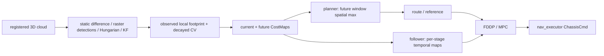

# HWS 与当前动态预测路线逐模块对照

日期：2026-10-03。版本、检索范围和真实连接见[迁移审计](hws_migration_audit_20261003.md)。当前实现指 `b5645ec` 的 native 实验路线，历史 V1 单独标注；正式 main 没有显式预测。本文不修改代码，不执行新对照，不用函数名、marker 或设计意图替代消费者证据。

## 1. 核心判断与证据等级

问题不能先写成“HWS 效果好，而我们迁移效果差”。**已证实的是 HWS 的源码闭环完整、两者模块语义不同，以及本地若干夹具试次失败；尚无同场景、同机器人、同控制器、同 oracle 的 HWS 对照效果数据。** 采用预测不等于证明预测有净收益。

当前最有证据支撑的解释是三个问题叠加：**可见观测锚点不是完整车辆中心；长 CV/名义支持不能覆盖真实换向运动；安全 raw 候选不会被原生 MPPI 必然选为最终安全命令。** 保守扩大几何可缓解漏覆盖，却增加无解/拒绝通行；本地尚未以统一 STVL 基线量化这种交换是否值得。

本文统一使用：

- **[证据]** 已读源码/真实参数/冻结运行与独立审计支持。
- **[假设]** 与数据相容的机制解释，但尚未隔离变量或证明因果。
- **[无证据]** 尚无对应采集/对照；不得升级为事实。

HWS 来源固定 `f5f941288197e14c867d711a4c4cd85bfd7a3194`，与原迁移 pin 的 map_server/nav_executor 无差异；参数来自[上游 params](https://github.com/Polyacetone/HWSentryNav26/blob/f5f941288197e14c867d711a4c4cd85bfd7a3194/map_server/config/params.yaml)。本地值来自实际选择的 YAML，而不是所有分支共用的一套默认。

公开HWS快照没有默认地图/PCD资产，本次未运行HWS；非空PCD路径加载失败会终止初始化。以下比较其**配置条件成立时的源码链**，不声称公开仓库直接启动即产生预测，也不以“上游采用”代替效果验证。

## 2. 动态障碍观测

| 项目 | HWS 实际实现 | 当前 native tracker | 影响与证据边界 |
|---|---|---|---|
| 传感输入 | `/small_glim/registered_cloud`，3D 点云；6 帧累积，0.02m voxel | 场地 shadow `/local_scan`；当前 sim `/scan`，2D LaserScan，不累积 HWS 的6帧 cloud | [证据] 输入密度、延迟和遮挡差异很大，不能复制阈值即称等价 |
| 静态剔除 | 全局 PCD KD-tree 最近邻，距离 >0.20m 留作候选 | `/map` 2D occupied 距离 >0.25m；拒绝地图外/unknown；另 centroid static tolerance=0.35m | [证据] 当前在墙边/窄道有额外漏检条件；是否解释特定失败需实际成员证据 |
| 无静态 PCD | normals `|nz|<0.3`、12邻域、台阶方向过滤；默认 **关闭预测** | 无 map/无 source-time TF 时 drop/wait；没有同等 normals 路径 | [证据] 两者降级分支不同；HWS 此分支仍不是 STVL |
| ROI / sparse filter | XY 0.4–8m、z −0.55–0.2m；SOR k12/std2；投影密度800点/m²、component area0.0075m² | scan 合法范围 +地图过滤，Euclidean tolerance0.20m、min3、最大XY extent1.50m | [证据] HWS按投影密度/面积，当前按点数/欧氏连通，不是同一个聚类算法 |
| 检测器 | tracker morphology close radius0.10m +8连通 connected components，tracking area0.0075m² | 空间桶 Euclidean connected clusters；默认 greedy association | [证据] HWS没有这里所说的 Euclidean+greedy 默认链 |
| 可见几何 | 局部 raster（最小2m奇数边长）保存连通域形状，旧/新形状对齐后 max 融合、旧值×0.8 | 在线公共消息仅 centroid/size；size采用0.7旧+0.3新，无公开轮廓/beam集合 | [证据] 输入点存在并不代表轮廓被在线消费者保留 |
| 近场遮挡 | 未见面不会自动补成标准车辆；6帧累积、close、旧栅格留存可填局部断裂，也会拖尾/合并 | 点数不足、unknown/static gate、cluster断裂会丢失/拆分；centroid/size随可见面变 | [假设] 单面切换可能产生伪速度；冻结 viewpoint/geometry 审计支持风险，但不能归因每次接触 |

HWS `preprocess_cloud` 使用 latest TF，不是点云 header stamp 查询；本地 tracker 明确使用 scan source stamp。HWS 的累积局部形状也可能包含移动拖影。**HWS 保留观测形状，并不等于完整隐藏车辆几何已知。** [源码](https://github.com/Polyacetone/HWSentryNav26/blob/f5f941288197e14c867d711a4c4cd85bfd7a3194/map_server/src/map_server_node.cpp#L336-L359)

## 3. 跟踪：相似状态模型，不同参数含义

| 项目 | HWS | 当前 tracker CV/v2 | 结论 |
|---|---|---|---|
| 创建 | 未匹配 detection 立即建 track，v=0 | 未匹配有效 cluster 立即建 tentative，v=0 | [证据] 均不要求先有可信速度 |
| 确认 | 连续3 hits，confirmed sticky；不要求位移 | 连续3 hits **且相对初始观测位移≥0.15m** | [证据] 静止目标可长期 tentative；由普通 current costmap 处理 |
| 关联 | centroid 距离 Hungarian，gate0.30m，接受严格小于门 | distance gated greedy，gate0.60m，允许等于门；可选全局分配未启用 | [证据] 不是同等关联；放大gate并不解决合并/错误质心 |
| KF | 一个4D `[x,y,vx,vy]`，Joseph covariance update | 两个轴独立2D position/velocity filter，普通协方差更新后对称化 | [证据] 数学模型同属 CV，不等于数值参数/实现完全一致 |
| 过程噪声 | `process_noise_std=3` → Q乘 **9** | `process_noise=3` 直接乘 **3** | [证据] 同名数值不能当同一加速度噪声 |
| 测量噪声 | std0.08 → R=**0.0064m²** | `measurement_noise=0.08` 直接用于 R=**0.08m²** | [证据] 相差12.5倍；当前更低测量增益可能影响响应，具体因果属[假设] |
| 初始P | position0.0064，velocity4.0 | 每轴 position/velocity initial_variance1.0 | [证据] 收敛、速度估计初态不同 |
| dt | callback steady-clock间隔，clamp0.01–0.5s | scan source-time差，KF dt有clip；lifecycle 用真实 source-time | [证据] bag速度/调度可改变 HWS filter dt；本地也须记录 source和处理延迟 |
| 丢帧 | lost_frames>3删除；保留 confirmed KF预测，localgrid每帧×0.8 | tentative misses>1删除；confirmed→coasting，距最近观测>0.60s删除 | [证据] 一个按帧，一个按秒；不能直接等价换算 |
| 重获 | sticky confirmed匹配后立即继续 | coasting重新满足连续hits等条件后恢复confirmed；此前仍以coasting输出 | [证据] public state 与HWS bool不同 |
| 速度可信度 | confirmed即进入motion prediction，speed clip2.4m/s；没有公开 covariance confidence 门 | confirmed/coasting均可消费；输入 speed>3m/s整体拒绝；没有公开 covariance/innovation confidence | [证据] 两者都没有“速度可靠”统计认证；确认不等于速度可信 |

历史实车已经给出具体前端缺口：原 D01/D07 静态误 track 约37/min；修复后静止误检0/min，但 D07_deskew运动约6.46/min、在线callback P95=28.156ms仍失败；D05 双目标 crossing有ID碎片化。该报告也说明底盘颤抖和 scan/TF 到达相位，**不是“所有新平台必然同样失败”的证据**。历史入口：`codex/dynamic-differential-risk:docs/hwsentry_migration/hwsentrynav26_phase1_linux_validation_report_20260824.md`。

## 4. 预测

| 项目 | HWS | 历史 V1 | 当前 native CV/v2 |
|---|---|---|---|
| 模型 | CV KF，渲染位移 `v·tau·(1-exp(-t/tau))` | public KF velocity CV +夹具box加速度扩张 | public velocity纯CV；v2 anchor为真实最后观测质心，coasting先外推到数组epoch |
| horizon/dt | 20×0.1=2s | 默认1s；按 MPPI dt计算评分前缀 | 30×0.1=3s；完整网格必须一致 |
| velocity decay | tau1.6s、speed≤2.4；在 **consumer使用的渲染** 生效 | 不使用 tracker display decay | 当前显式tau0/不clip display；critic仍自行重算CV |
| uncertainty | KF P增长，但 renderer不把 covariance变为时间膨胀 | 可见半宽+每侧完整已知box尺寸+0.5·0.555165·t²；仅夹具条件 | 固定圆/固定nominal D，无e/B/covariance随t增长的在线支持界 |
| 远期降权 | 本次未发现按时间风险权重衰减；速度衰减不是 cost confidence decay | 无统一 confidence降权；评分长度截断 | cost沿dt积分；coasting和confirmed同几何评分，未按置信度或远期降权 |
| 有效时间上限 | 生成2s；MPC超出时选末帧；未见 source-age丢弃策略 | horizon1s，source age≤0.4s；超过跳过 | future3s+source age≤0.4s；输入/观测超0.4s fail-closed |
| future空间union | renderer分帧；**planner对当前+未来窗口逐格max**；follower保留时序 | 每rollout同t检查；没有预测costmap层 | 每rollout同t检查；无future写入costmap/union |

衰减只是外推位移的限制：tau1.6 时 t=2s 的有效平移时间约1.142s。它可能减小错误长外推，也可能低估持续高速运动；**不是安全保守界，也不是 CA/转弯预测**。当前将0.5s/1s候选作为有限研究变量，不继续增设多个复杂运动模型。

## 5. 障碍几何：当前最重要差异

HWS 使用 **观测局部栅格形状平移**，包含局部历史融合/形态学影响；它没有从机器人类别表取得标准完整 footprint，也不以目标朝向旋转全尺寸模型。[shape与预测源码](https://github.com/Polyacetone/HWSentryNav26/blob/f5f941288197e14c867d711a4c4cd85bfd7a3194/map_server/src/object_tracker.cpp#L307-L385)、[renderer](https://github.com/Polyacetone/HWSentryNav26/blob/f5f941288197e14c867d711a4c4cd85bfd7a3194/map_server/src/prediction_cost_map_renderer.cpp#L83-L108)

当前需要区分三个已经存在的代理，不能统称完整车辆 footprint：

1. **visible_extent**：圆心为 public observation/filter anchor，`r=max(0.36,0.5·hypot(size_x,size_y))`。质心来自可见返回，并非物体中心；半对角围住可见AABB也不保证绕质心包含所有返回，更不包括隐藏面。size还经过平滑。
2. **nominal_diameter**：v2真实观测锚点，手册条件下四类地面机器人最大投影直径 D约1.6970562748477143m；代码把 **完整D作为半径**，不是D/2。原因是锚点可能在目标表面，若已知完整直径且锚点确属该物体，当前物体所有点可在距锚点D内。未知e、附件/载物、倾斜、2027适用和未来运动仍不被覆盖。这不是位于车辆中心的标准footprint。
3. **observed surface prototype**：保留实际source beam端点和连续可见线段、缺失区UNKNOWN；只有离线模块/审计，没有已经接入当前控制的C方案。

| 几何模式 | false positive来源 | false negative来源 | 已知限制 |
|---|---|---|---|
| HWS observed raster | close合并、6帧拖影、localgrid历史残留、inflation、planner union | 隐藏车辆面/附件、局部grid裁剪、稀疏过滤、转动但只平移、误关联 | 没有完整物体安全证书；HWS未提供本项目同oracle数据 |
| 当前 visible circle | min radius使小簇变大；圆代替狭长形状；质心偏移 | 单面尺寸小、锚点偏、size滞后、遮挡漏检，固定CV换向失配 | 已发生机械接触；并非整个检测失败已被证明 |
| 当前 nominal D circle | 从表面锚点向所有方向伸完整D；窄道/goal可能被覆盖；固定未来假运动 | 直径条件不成立、anchor不属同物体、e未知、未来速度/转向不受界 | 当前支持改善，未来2/3s支持仍不足；任务失败 |
| centered full nominal footprint（尚无此在线模型） | 类别最大尺寸比真实目标大、朝向未知 | 若错误把可见质心当中心，隐藏侧仍漏覆盖；类别/朝向错 | [无证据] 当前没有可靠完整中心/朝向输入，不能把D改为D/2当低耦合修复 |

因此，visible→nominal不是单纯“更精确大小”的开关，而是改变 **几何未知性处理**。HWS把观测形状送入时间图，本地把不完整观测锚点变成整圆；这一差异足以提出保守/漏覆盖机制，但不足以证明 HWS 方法能通过当前机械oracle。

## 6. 预测进入控制：时间与成本对象

实际图在[迁移审计](hws_migration_audit_20261003.md#4-实际数据流)。HWS 的 maps[0]为当前，maps[1..20]为未来，frame header均为输入cloud stamp；nav_executor拆开这些图。MPC 40×0.05s=2s，stage k选 `floor(k·0.05/0.1)`，包含t=0当前帧，采用不晚于该stage的最近帧，不做线性时间插值。

本地 Humble MPPI rollout 第0列已积分一个dt；新critic明确使用 `source_age+(k+1)·0.1`。初始化与score都检查步数/dt；原生消费重算已与实际300×30 tensor和成本累加关联。这证明相对时间和输入消费者，不证明所有时间口径一致。

| 时间/消费问题 | 已查结论 |
|---|---|
| HWS source time vs当前控制起点 | [证据] tracker用steady callback dt、TF用latest；`local_cost_maps_callback`存地图但未将header source age加入MPC选帧。相对网格对齐，绝对epoch补偿缺口存在 |
| 当前 source time | [证据] tracker scan按source stamp TF；critic age用node ROS now−array stamp；v2 coast位置先推进到array epoch，避免再把last-observation age重复加一遍 |
| 当前 robot rollout epoch | [证据] critic使用native tensor，不单独同步订阅pose；score-clock/source-pose epoch已分别审计。controller输入pose与node now差不能靠 `age` 自动消除 |
| 当前 TF | [证据] map→odom使用latest有年龄界的刚性世界变换，一次score固定；未证明期间relocalization correction无跳变 |
| 当前输出时间 | [证据] softmax/constraints/SG→smoother→guard不同阶段；guard将新鲜odom按measured twist推进到now。执行/传输/真实制动参数仍未认证 |
| horizon | [证据] HWS2s/MPC2s；当前3s/MPPI3s/消息30×0.1；guard只查0.5s响应+刹停尾段。只缩短未来有效段时应保留完整消息网格，不把dt/step mismatch门调松 |
| stale | [证据] 新critic0.4s source/observation限制超限fail-closed；旧V1丢弃预测并保留CostCritic；HWS未见同等感知source watchdog |
| future union | [证据] HWS planner会空间化未来，MPC保留分帧。本地新critic不union；不能把当前保守失败统一归因“预测写了静态墙” |

### footprint / inflation / safety margin 是否重复

HWS current/future maps对障碍形状膨胀（local full-cost0.2m、cutoff0.4m）；这是它自有MPC成本语义，不能直接搬到Nav2 footprint碰撞模型。

当前critic使用 `costmap_ros_->getRobotFootprint()` 的 **padded polygon**，动态圆加0.02m margin和0.4m influence；它没有再次对robot polygon做Nav2 inflation，也没有把dynamic circle写入costmap。但同一障碍的当前scan仍经过ObstacleLayer/inflation，再由CostCritic评分；guard另查raw203、map/uncertainty和刹停响应。**存在叠加代价与多道安全判定，[假设]可能加大等待/保守；不等于证明同一0.03m padding被重复几何膨胀两次。** 需实际成本分解和单变量比较；不删除安全门求通行。

## 7. 失败退化逐项比较

| 情况 | HWS实际路径 | 当前 native路线 | 判断 |
|---|---|---|---|
| tentative | 原始current mask保留；未被confirmed motion覆盖的区域复制到future fallback | critic/guard跳过tentative；普通current costmap保留 | 有current-only思想，但本地未提供显式“可信速度”级别 |
| velocity不可信 | hits确认、speed clip；无独立置信度门 | speed/finite/age/contract限制；高速度或坏消息令整个consumer失败 | 两者都没有完整创新/covariance可信度策略 |
| temporary occlusion | confirmed继续预测≤3lost帧，shape逐次×0.8 | coast≤0.6s，但观测age>0.4s已令consumer fail-closed；无coasting降权 | [证据] 发布寿命与消费有效期不同；有0.4–0.6s潜在拒绝区间 |
| stale prediction | 未见按source-age替换为空/丢弃未来；最新maps可以留存 | invalid快照替换旧缓存、critic fail flag、guard零输出 | 当前不会默默用旧预测，但也不会自动退回STVL通过 |
| starts inside predicted obstacle | planner窗口union可能包含起点；MPC lethal/stop路径存在 | penalty变高，guard从t=0检查，pass/brake没有escape规划 | 停车不保证躲开主动逼近障碍；须独立oracle检查 |
| 无安全候选 | FDDP rollout拒绝后stop/replan；stop/hold用current map | native CostCritic/all-collision或坏输入可能fail；动态评分本身为有限cost，guard可拒绝最终提案 | “高动态cost”不能当所有safe候选被硬过滤的证据 |
| stops | KF更新速度；future渲染速度逐时decay | KF速度可滞后；CV固定速度在长future仍运动 | [假设] 造成假future阻塞；尚无固定stop场景配对统计 |
| reverses | CV/decay不识别转向，只缓和外推 | CV不识别转向；旧CA也没有形成部署方案 | 固定正弦夹具长future失配已有证据 |
| sudden turn | 平移局部shape、不旋转完整车体 | 平移circle/anchor，不建朝向运动 | [无证据] 当前缺同条件突然转弯闭环数据 |
| perception完全断流 | 无全局PCD时走current-only模式；正常回调断流未见对应STVL/slow策略；chassis另有0.10s watchdog | tracker stop→source过期→fail/zero；无正式STVL fallback状态机 | 不把HWS模式开关或底盘watchdog误当感知故障保障 |

旧迁移设计曾提出 stale→skip dynamic score→普通costmap；最新实现主动选择fail-closed。这个设计漂移需要记录，而不是悄悄恢复fail-open。未来若评估分级退化，必须同时证明current occupancy、定位/控制数据仍有效；感知完全失效不能仅因动态topic清空就声称安全。该策略本次只是建议，不作为新增研究方向。

## 8. 实验现象与最可能原因

### 8.1 已有结果不是全负面，也不满足部署

历史 V1 四个候选均完成任务并改善夹具净空；重复phase0的QP/A*恢复数5/1违反原零恢复门，绕行比baseline增加约1.1–3.0m。随后相位未运行，不算完整矩阵。对应baseline有碰撞/净空不足，不能从此推导“STVL这四例安全可走，预测才堵死”。来源：`codex/dynamic-differential-risk:docs/dynamic_navigation/evidence/v1_mppi_ab_20260924/validation_20260924.md`。

最新v2 frozen scene：相同场景/机械oracle/35s窗口，但跨试次random实际noise不同，不是每条raw完全配对；baseline占据是ObstacleLayer。原始证据见[消费记录](../dynamic_obstacle_critic/observation_diameter_consumption_experiment.md)与[全三秒审计](../dynamic_obstacle_critic/dynamic_surface_reveal_experiment.md)。

| 指标 | visible | nominal D circle |
|---|---:|---:|
| 实际native消费周期 | 349 | 350 |
| risk double/after f32精确行 | 104700/104700 | 105000/105000 |
| 机械动态净空下界 | −0.006576701m，contact39.966s | 0.909401996m |
| raw203违反/可查物理样本 | 750/2264 | 0/2264（conditional） |
| 推进/goal | 4.943237802m /未成 | 3.379103096m /未成 |
| 完整actor支持0/1/2/3s | 0/285，各时域均无完整支持 | 284/284、284/284、192/284、98/284 |
| aggregate全3s同时条件安全 | 31/349 | 75/350 |
| 同时条件安全且正进展 | 31 | 59 |

这些结果排除了“只画了预测、没有被critic消费”的解释；仍不证明真实全地面机器人支持，也不以正下界替代任务接受。150ms窗口实际速度值匹配349/349、350/350（最大138/131ms），不能继续用早期已修复的错odom topic作为这两次结果的根因。

### 8.2 分现象归因

| 现象 | 已有证据 | 最可能机制（假设） | 尚无证据/不能下的结论 |
|---|---|---|---|
| `start blocked` | V1 QP重复30.19–30.59s全局端点拒收，本体间隙仍0.077m；本地V1预测未写costmap | 当前观测/inflation与绕行后重规划端点、T-DT可用性/局部行为协同 | 不能说新critic把future union进global map；未隔离预测导致姿态改变的间接作用 |
| predicted path过保守 | V1部分周期300/300预测碰撞；nominal D半径1.697m且goal失败 | 单面anchor+全D圆、旧t²扩张、长future对反向/等待不可行的假判定 | 哪一项造成多少false_block秒，缺同条件安全baseline和每次拒绝归因 |
| safe raw candidate存在却未采用 | 历史选定epoch38/300条件safe-progress；原生分成本/权重/SG/返回控制已经复算 | 总成本偏向task/path、softmax平均不保持非凸避障安全、限幅/SG改变raw路径、guard再拒绝 | 不能认定最高权重raw就是输出；38/300不是全部周期；不能将SG当唯一根因 |
| MPPI optimizer fail | native源码：invalid输入设fail；普通CostCritic有failure语义；历史原生fail trace存在 | 可能是source/grid/TF拒绝、current costmap all-collision，或后续重试/停滞，不同窗口不同因果 | 仅看日志“fail”不能指认dynamic未来碰撞；最新349/350消费不代表每次失败根因已标注 |
| 可见模式接触 | 实际机械contact与0/285完整支持；真实风险成本被消费 | 未知隐藏几何/anchor与长CV偏差叠加输出选择；停车后actor继续靠近也可能造成contact | reveal审计显示相关面早已可见、末次可靠观测在事件前33/35ms，不能说本次因首次揭示太晚；无完整实车B/e/制动认证 |
| nominal不碰撞但goal失败 | 单小box当前支持/较大净空；2/3s支持不足，推进3.379m、goal未成 | 大圆覆盖通路/目标，guard pass/brake缺逃逸和等待协同；假运动延长拒绝 | 当前物理净空不是全类别安全；未完成公平STVL/同noise对照，不能精确宣称净收益为负多少 |
| STVL能等待，预测却不可走 | 是待验证的核心命题；旧baseline部分本身不安全，最新无同条件STVL arm | future空间化（若引入）、长horizon/占据代理、无current-only退化可拒绝可等待解 | **目前不按此命题自动给最新trial贴实证false_block标签**；必须先取得baseline安全可执行或安全等待完成的证据 |

进一步结论：可信 raw 数量、最低dynamic cost、marker预测和最终执行净空是不同指标。不能用任一替代另一个；也不能靠调小尺寸、跳过guard或放松margin让结果“通过”。

## 9. 最小差异实验矩阵（计划，未执行）

只保留一个 active预测算法族：**原生时间评分critic + CV**。短horizon、decay、geometry为同一候选的有限消融，不是扩展到多个模型。所有arm保留同一 ordinary **STVL + MPPI**；不得将目前ObstacleLayer的trial换名为STVL baseline。

共用锁定fixture：同一个map/hash、init/goal、actor轨迹/起始相位、机械robot polygon/附件包络、MPPI全部参数/版本、vmax/amax、采样输入或可验证seed、传感路径/TF、safety oracle和时间预算。**当前没有用户级native MPPI seed已严格配对的证据**；`regenerate_noises=false`只固定单次实例，不保证跨进程noise相同。下一步需保存/校验实际noise身份或有界隔离fixture，否则只能报告场景配对统计，不能声称严格单变量因果。

| arm | 唯一差异 | 配对对象 | 必需边界 |
|---|---|---|---|
| A STVL baseline | 无显式future critic；普通STVL/标准MPPI | 全部候选的基线 | 同当前观测、safety oracle；不借真值控制 |
| B current-only critic | A上加同几何动态评分，但所有future位置固定在当前epoch；仍做source age补偿至当前 | A | 诊断纯几何/额外代价，不把“future时域设0导致检查消失”当current-only |
| C CV0.5s | B仅开启0<t≤0.5s的CV有效段 | B | tensor/message仍30×0.1；只变预测有效段，grid safety门不松 |
| D CV1.0s | C仅把有效段0.5→1.0s | C | 其余权重、cost归一化/普通current碰撞检查保持 |
| E velocity decay | D仅改future位移为tau1.6s衰减，并在实际consumer生效 | D | 不只改display prediction[]；source age补偿与futuredecay分开定义 |
| F observed geometry | D仅将visible-circle代理换为观测局部raster/surface | D | 当前无此在线契约，标NOT RUN；不把visible circle改名充当F，不为此新建公共接口 |
| G nominal full geometry proxy | D仅切既有v2 nominal D半径模型 | D（若F将来可用，另列F/G几何对照） | 同anchor/schema；不借中心/朝向truth。当前D circle非 centered full footprint，报告必须用真名 |

实现前固定score归一化：当前积分型cost裁掉future段会改变总cost，这是模型有效段消融的预登记语义，不能实验后补倍率“救效果”。如选择总时域归一化，所有预测arm统一预先锁定，并将其影响计为新协议，不能与旧3s试次伪配对。研究阶段只挑锁定的一套，不进行weight搜索。

B/C/D/E尚无现成的完整配套profile：本次只是预登记语义，不声称已经运行。允许的后续改动限于隔离实验的有界current-only/有效段/consumer decay开关，须保持完整消息网格和原输入/安全检查；未能在Week1预算内建立有效对照即退出C，不继续造控制框架。

最终guard不得成为隐含第二变量：A与预测arm使用同一执行约束/普通current-map停止策略和独立oracle；预测guard附加拒绝若保留，必须与预测功能作为一个明确候选整体比较，另以B诊断额外拒绝成本。**本次不关闭现有guard、不改main，也不建议直接在现有安全门下切无保护运行。** 若不能在预算内建立等价保护条件，停止矩阵并选C，而非声称公平A/B完成。

指标：physical collision、minimum **physical** clearance、action success、completion time（失败为右删失）、stop duration、recovery count、optimizer failures、no-valid-candidate rate、prediction false-block duration；另记录detour、stale usage、CPU、controller deadline。no-valid rate同时报告模型安全raw与原生fail两种口径，不能互换。false_block必须有安全baseline见证及future拒绝原因，不把正常安全停车计为假阻塞。精确定义、运行上限和淘汰规则见[退出计划](prediction_one_month_exit_plan.md)。

## 10. 对当前问题的重新选择

停止用“尚未迁移HWS后半段”作为继续增加模块的理由。既有前端和原生critic已经足够证明概念被实际消费；现在缺的是 **相对STVL的净收益证据**。不移植HWS FDDP、不增加temporal costmap/CA/IMM/学习模型、不新增surface接口作为必做项。

当前部署结论是 **C — RESEARCH FROZEN**：正式导航继续STVL + MPPI。允许的后续只是计划中有截止、有预算的一个候选比较；届时只能A/B/C三选一。已有局部净空改善值得保留为证据，不能用它替代稳定跨工况收益或继续无限扩展研究。
