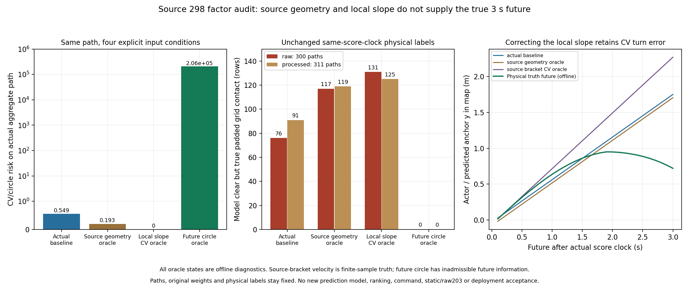

# 当前几何与未来CV支持：离线因子审计登记

2026-10-02，从8523d1f建立`experiment/cv-support-factor-audit`。
前序同raw与actual aggregate路径均有CV模型未预报的真实动态接触。
固定source298、原300 raw路径和原311处理后路径，下一阶段仅离线
隔离当前锚点/尺寸与未来运动假设的贡献。全部地面机器人范围保持；
本箱体oracle结果不认证真实赛场四类机器人或2027规则。

## 预定对照

1. **Actual baseline**：保留完整实际消费状态/参数/足迹/scoreclock，
   原300 risk/after必须逐位一致，311处理后baseline应逐字节等于
   已冻结C++输出，不重构实际SG历史。
2. **Source geometry oracle**：只在原消息源epoch将已按固定1m规则
   离线关联的actor track锚点改为真值物理几何中心，并用完整物理箱体
   的包围圆半径；原公开估计速度保留，其他tracks全部不变。这是诊断
   干预，不能写成原v1真实输入或在线感知输出。
3. **Source bracket-CV oracle**：在2的基础上，仅换为源epoch两侧
   原真值样本的局部平移斜率，继续严格CV至完整3s。该斜率来自有限
   采样/线性插值，不能冒称认证瞬时速度、最大物理速度或未来真值。
4. **Future circle oracle**：每个实际评分未来步直接用该时刻真值物理
   几何中心和完整包围圆，使用原polygon-circle/penalty算式与参数。
   真值未来只用于离线分离运动支持误差，不作为可上线预测器；不是
   CA模型、不恢复sampler/ranking、不向costmap写未来轨迹。

相同半径政策保留原minimum floor；尺寸oracle只修正可见簇的完整
物体解释。关联使用既有固定规则并保存ID、其他有效tracks数量；若
多目标影响risk，不删除未关联目标来挑好结果。true geometry / source
bracket / future数组均独立私有hypothesis格式，实际RMDYNRP1仍先核对
原raw位型，不用伪造风险或SG evidence flags让oracle变成actual。

## 证据和工程约束

完整300/311逐行risk/minimum_clearance/TTC、same-clock完整物理
动态支持标签及原native权重分别保存。只将原权重用于raw成本标签的
描述；新oracle cost不生成或执行新权重，不重选source周期，不把新
几何标签替代static/raw203/SG边界/完整原见证门。

先证明baseline数值与原记录一致，再比较actual aggregate/zero与全部
原始路径的变化。几何/时间/局部斜率采用独立标量对照，错误hypothesis
schema/ID/网格/finite/截断/尾字节必须拒绝。保留源码/输入/编译身份、
失败、图示和独立复算；只新增BUILD_TESTING离线目标，已有C++工具
与5个runtime ELF身份保持原值。

正式运动上界尚未建立；用户已被询问是否有四类目标的平移/转动/
机构展开速度依据，未提供前保持unknown，不取validator/display速度
阈值或本夹具最大观测值作为物理保证。条件不足时不得提出已认证的
3s支持或部署结论。即使oracle风险改善，也只定位缺口；真正输入修复
仍需公共契约、可获得的观测及unknown策略。main、research封存、TF、
在线参数及task/raw203/年龄FAILED、综合NOT ESTABLISHED均不变。

## 实现与独立核验

7b11884先登记。新增BUILD_TESTING-only `evaluate_cv_support_factors`
先核对原source298的300 actual risk/after位型，再读取私有有界
`RMDYNHX1`四组状态、30步未来中心和311条原SDK处理后路径。
实际上下文仍为RMDYNRP1；oracle数据不写公共消息或actual记录。
原5个runtime ELF及2个已有离线评分ELF前后SHA逐字节相同。
新目标仅O3/无fast-math，ELF SHA为
`934bd10451cd029910a03599207c0df308785051dd25c073c4a3c4609623ec89`。

19项实际C++检查通过：四组完整2444行；baseline的300 raw与311
processed risk/minimum/TTC位型全相同；将未来中心显式换成合成原CV
中心时，future-circle循环对全部611行逐位退化为原CV。此合成probe
另行标记，不是真值未来。格式、源、dt、ID、非finite、截断、尾字节、
已有输出、被篡改actual risk等负例均拒绝。

独立向量插值与准备端标量插值的当前/未来中心和局部斜率误差均0；
binary ledger与来源状态完全对应。额外6类同时篡改metadata/binary
的中心、局部/保留/基线速度、未来坐标和NaN反例均拒绝。2e-12仅是
数值核对容差，不修改物理门或认证误差界。

## 同一周期结果

source stamp47.917s，实际scoreclock48.004s，source age0.087s；
关联ID1，其他有效tracks为0，原30步约3.0000000447s不变。source
geometry将锚点改为物理中心(4.9,-0.1275021915)，尺寸为完整箱体
0.45×0.55m；原minimum radius floor0.36m仍支配包围圆。局部真值
斜率来自47.909→47.926s有限括号，为(0,0.775716288)m/s，不能写作
认证瞬时速度或未来速度上界。

| 离线输入条件 | 实际aggregate risk | 模型minimum clearance | 模型TTC | raw模型clear但padded网格接触 /300 | processed对应数 /311 |
|---|---:|---:|---|---:|---:|
| actual baseline | 0.549356769 | 0.114527361m | 无 | 76 | 91 |
| source geometry oracle | 0.193294599 | 0.198318481m | 无 | 117 | 119 |
| source bracket-CV oracle | 0 | 0.454222377m | 无 | 131 | 125 |
| future circle oracle | 205880.157195 | -0.163734526m | +2.600000039s | 0 | 0 |

所有路径和同scoreclock物理标签固定；原actual aggregate路径仍有机械/
padded接触，zero在四组下risk0且原动态几何门通过。模型clear定义仍
是原minimum clearance>0.02m，网格接触为同一30点真实padded距离0。
原native权重仅描述这些raw标签，baseline漏接触的权重约72.54%；
未按新risk生成softmax、优化序列、SG输出或command。

补足源时刻几何及有限局部速度没有修复本夹具三秒后的换向支持，
反而增加模型clear却真实接触的路径数。离线future circle能识别该周期
同网格接触，说明未来支持是这里的必要缺口；它使用不可在线获得的
未来真值，不能变成预测器、CA恢复依据或全时域/全场景安全证明。
source几何、速度、关联、遮挡及真实物理上界仍需可获得的公共条件。



## 冻结与复算

112文件、3,808,487字节归档`stage2_evidence/cv_support_factors/`，引用
原物理1685/SDK见证88/raw34/processed91文件manifest。保存完整输入、
2444行C++输出、标签、来源/独立核验、19项正反例、六类协调篡改
probe、源码依赖闭包、flags、ELF身份与日志；初版挤在一起的图标签
已缩短并视觉核验，初图保留。manifest SHA为
`b61cc5ad32bf692715b96b57888987c05f78ea14ca45a83ad39f2961bb435ccb`。

```bash
python3 -B src/rm_dynamic_obstacle_critic/tools/replay_cv_support_factors.py \
  docs/dynamic_obstacle_critic/stage2_evidence/cv_support_factors \
  /tmp/cv_support_factor_replay_new
```

首轮重建原processed输入、四组hypothesis及来源核验、负例、完整分析
和PNG/SVG，12项逐字节一致。`--cpp-output NEW_JSONL`可将独立重执行
的C++完整输出纳入复算；新增verification另行归档，不改变112文件
原始manifest。原task/raw203/年龄FAILED、综合NOT ESTABLISHED以及
motion bound unknown保持，未改main/research、在线参数、TF或接口。

使用复算新输入实际重执行C++全部2444行字节相同，再以新输出执行
13项复算全部通过。9文件独立verification位于
`stage2_evidence/cv_support_factors_replay/`；五个引用/本期archive共
2010文件身份核验通过，原112文件manifest没有变更。
