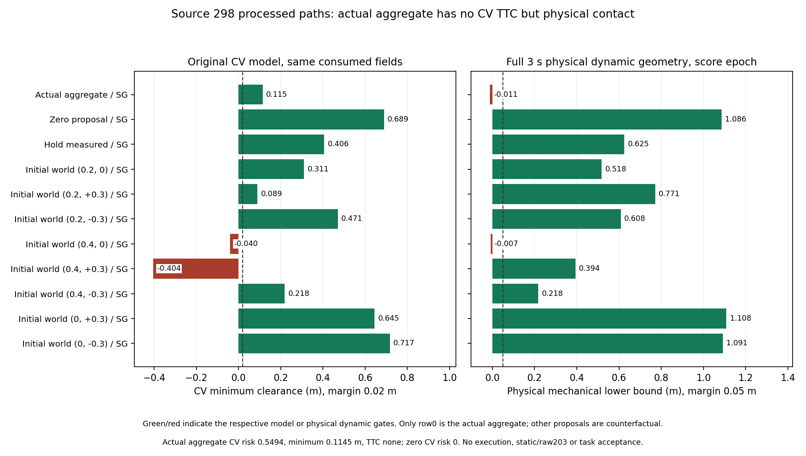

# 聚合/SG路径的纯CV目标：离线实验登记

2026-10-02，从1edb4ee建立`experiment/processed-cv-objective-audit`。
source298同raw路径已经发现真实动态接触而CV圆模型没有TTC；继续
固定同一周期，检验实际聚合/SG路径及原11提案/300条单条约束SG反事实
在**原实际消费CV输入**下的风险。真值仍只离线，不重排或执行提案。

## 运行前协议

1. 读取冻结1685文件物理archive和88文件SDK完整三秒条件见证，
   source298、实际scoreclock=48.004s、source pose=47.980s及原输入
   source_age/world transform/padded footprint/cost参数完全保留。
2. 单独导出实际消费RMDYNRP1子集和显式`RMDYNPX1`处理后路径。
   后者不伪装actual score证据；保留源ordinal、311×30原始SDK输出
   bytes、dt与各提案名字、原三项完整native数值验证标志/文件身份。
   实际aggregate行和反事实行必须区分，首速度不改、历史不清空。
3. 新BUILD_TESTING-only工具调用原`dyn::score`，采用runtime同一
   O3/无fast-math算式；不调用ROSnodes、TF、optimizer或command API。
   先核对该周期300条actual raw risk/after bits，再评估311条路径。
   原消费replay与新工具共用私有bounded reader，公共tracker类型保持
   原`rm_competition_interfaces`消息；不另建感知数据类型。
4. reader重构需原348周期104400 raw risk/after和既有4实际fixture输出
   逐字节回归；原one-ULP风险负probe仍需拒绝。新的处理后格式要求
   source ordinal与dt/网格匹配，错ordinal/dt/非finite/截断/尾字节拒绝。
   遇到错误不将部分输出认作PASS；保存完整失败/编译身份。
5. 保存311行risk/minimum_clearance/TTC；优先报告actual aggregate与
   zero在同一CV模型/scoreclock下的结果。对照原完整三秒physical标签
   要保留其pose源epoch，明确24ms差异；若再生成同scoreclock物理
   标签，使用前序独立几何核对方法，不替换原条件门或选择时刻。
6. 只编译/执行离线目标，记录5个运行ELF前后身份不变。参数/模型/
   sampler/optimizer/SG/guard/TF/public字段、main和research封存均不改。
   原task/raw203/全trace年龄FAILED和综合NOT ESTABLISHED保持。

本阶段不能通过成本数值推出安全、执行或coverage；若actual aggregate
本身在CV模型已有强风险，需要另检验目标加权/滤波的作用。若CV模型
继续漏真值动态接触，则优先追踪观测几何与长时预测支持条件，不凭
原39/300或新反事实数量恢复CA/sampler/ranking。

## 实现与回归

42d5213先登记。`dynamic_replay_input.hpp`在tools私有边界抽取原
RMDYNRP1有界读取/实际评分核对，不另建tracker类型。新
`evaluate_processed_cv`仅BUILD_TESTING构建，直接调用原`dyn::score`；
两目标均O3/无fast-math，运行库和原native SDK不重编译/安装。
实际原生路径与SG历史不通过新工具改变。

`prepare_processed_cv.py`校验原物理/见证manifest及完整consume/native
身份，导出单一实际上下文和311×30 SDK路径，保留实测速度首列。
actual输入SHA=`de3377636548e69f3062bedfa9cbf4e95f99abc5bef3d37892f3ad89ec5f24d6`，
processed路径SHA=`313f0bea1b81d5531f254e1e202c26e245bfadbd11b2792d7360b2a7ae1322ec`。
行0是已逐位核对的实际aggregate控制序列经原SDK重建的路径，其他
310行是反事实；新CV评分不冒充真实critic消费事件或新增native权重。

16项实际离线可执行检查全通过：完整348周期104400个risk/after与
原4次实际score夹具输出逐字节相同；原one-ULP风险probe保持exit2
且失败结果字节相同；311路径先验证所选300 actual raw位型。错源ID、
错dt、错网格/schema、超预算、非finite、截断、尾字节、已有输出和
被篡改的actual风险均拒绝，保留原输出/不产出有效处理后报告。

新增可选source ordinal导出时，默认完整input身份/bytes不变，SHA仍
`9f580407a07d47000d1fedeacec356e84b5cd9039247cba2a28dfa601ac008a5`。
标量geometry工具只加显式处理后路径入口；默认raw报告逐字节保留。
5个runtime ELF编译前后hash完全相同。离线ELF身份分别为
evaluate=`acb441d71fda18de7e4baeb3c635474b3d9bab5320eef340b655353e798c8763`，
replay=`927167c4849d74c18cbb046ee2fbb61ff4fdebb282a0601f04d98f75ef268148`。
离线reader重构更新此replay ELF；原冻结版本/结果不覆盖。

## 同一实际scoreclock的结果

评价时刻48.004s，原输入source_age=0.087s、model_dt≈0.1s，完整时域
3.0000000447s。独立物理标签含208时间点/max17ms，源pose47.980s
的敏感性标签含207点。源pose动态距离与原88文件冻结见证**数值误差0**；
两种epoch各9330个处理后网格姿态独立标量距离核对，最大差
1.110223e-16m且接触分类一致，2e-12仅作数值比较，不改物理门。

| 已登记路径 | 原CV risk | 原CV最低clearance | CV TTC | scoreclock物理动态结果 |
|---|---:|---:|---|---|
| 实际aggregate/SG重建路径 | 0.5493567687 | 0.1145273606m | 无 | base lower0.022735m<0.05，机械与padded接触 |
| zero提案/原SG历史 | 0 | 0.6892881576m | 无 | base/mechanical/padded lower1.105287/1.085623/1.014458m，动态门通过 |

实际aggregate的原网格第29点（+2.9000000432s、truth50.9040000432s）
首次padded接触；此点base间距0.068695m、全机械0.037641m、padded0，
后续机械距离也出现0。它是实际控制序列的条件native模型路径，不是
最终guard后闭环实际执行轨迹；原物理试次全几何通过/任务raw203失败
没有被重写。zero的原source-pose完整static/raw/bounds/progress条件
见证通过仍保留；本阶段scoreclock的新标签只认证动态几何条件。

311条处理后路径中，scoreclock动态门通过176条，CV模型clear但物理
动态门失败101条，其中91条在原处理后30点padded接触。源poseepoch
分别180/97/90；模型输入/时刻不能用敏感性标签替换。没有将这些
反事实赋予新增优化权重或再排名。



## 归档、复算和下一问题

91文件归档`stage2_evidence/processed_cv_objective/`约2.54MB，包含
实际与处理后私有输入、完整CPP输出、311两epoch标签、标量证明、
依赖闭包/头文件/CMake源码、compile flags、原16项正反输入/结果日志、
runtime前后身份及图示。数字标注加白底便于读取，初版图也保留；
不复制38MB完整实际输入或原1685/88文件数据，引用原manifest。

```bash
python3 -B src/rm_dynamic_obstacle_critic/tools/replay_processed_cv.py \
  docs/dynamic_obstacle_critic/stage2_evidence/processed_cv_objective \
  /tmp/processed_cv_replay_new
```

`--cpp-output NEW_CPP_OUTPUT`可核对独立重执行的C++处理后输出，并用
它再生成全部分析。复算重建输入/源码只写新私有目录，不启动ROS。

首轮9项输入/分析/标量/图示/历史默认报告逐字节通过；用重新生成的
输入实际重执行C++311路径，输出字节相同，再以该新输出重跑10项
全部通过。独立8文件verification保存在
`stage2_evidence/processed_cv_objective_replay/`；原91文件manifest仍为
`2347f4880fb531d2f218dac255711fa5cf94bde6792052c2dfdc0379b2437553`。

原CV模型对实际aggregate也没有TTC，而同路径动态物理支持失败；因此
本阶段尚不能把问题归到“正确风险经SG才消失”或全部sampler缺覆盖。
已经定位到原观测几何/未来CV支持不满足完整物体条件，仍未区分两者
各自贡献。下一步可用明确的离线geometry-only/源速度CV诊断对照，
检查补足当前尺寸是否足以修复未来支持；真值只诊断，不流入在线接口。
不改在线radius或恢复CA/sampler/ranking，不降低门。原task/raw203/
全trace年龄FAILED及综合见证NOT ESTABLISHED保持。
