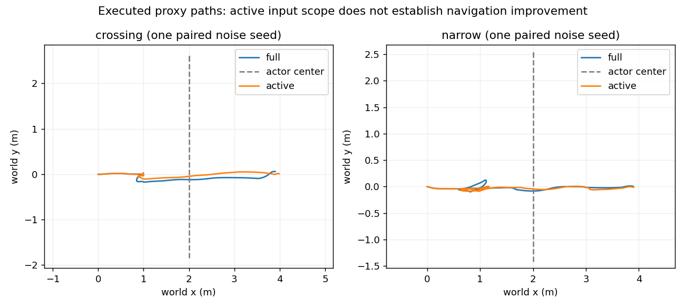

# Active输入范围的有限闭环对照（2026-10-15）

**裁决Modify；停止将单独active过滤工程化。** 四次软件导航闭环均通过原安全门限，但没有稳定效率或失败率收益。本轮没有证明预测信息价值增加，也没有关闭原C83接触。新的有效线索是“重新获得观测但尚未重新确认的coasting”与既有时间校验合同不一致。

## 固定对照与边界

研究基线 `63faca0dbafc74ac8d4e44814f499a0b12d88027`；同一 `codex/stvl-lifecycle-hold-20261014`。运行只读复用 `a880c7dc01cb424ea865e1fa0f33732396078670` 研究入口、其既有插件及Humble镜像。ROS/Nav2 1.1.20、STVL、RootCostProbe、tracker、简单CV、地图、原SDF/摩擦、smoother/stub及10Hz/300候选/30×0.1s约束保持一致；不改原生重试、异常或NoSafe处理。

full保留所有轨迹；active只从评分数组排除原消费者本来跳过的STATE_TENTATIVE。每个active字典的时间、位置、速度、尺寸及36点原子保留；ignored metadata保留被排除的完整字典，retained+ignored可重建原包。显式声明consumption_scope/source_complete/source_track_count/active_empty，duplicate ID使complete=false，未知状态保留给原校验器拒绝。空active的原反应保持，不把它称为环境安全证书。未新增速度、TF或tracker owner。

仅替换容器中现有research_prediction_adapter的只读文件视图，冻结checkout本身不写入。两组都使用相同额外诊断。源代码及生成文件身份保存在preparation.json；[协议](../../experiments/stvl_active_scope/protocol.json)在运行前固定横穿C13、狭窄C83各一对。实际观测由执行闭环产生，因此两组未来观测不同；不是冻结相同快照重评分。固定native噪声seed，历史Gazebo引擎seed未固定，不宣称逐位复现或因果隔离全部调度差异。

## 每场景、每种子的真实结果

硬门限沿用机械bbox净空≥0.047m、真实SDF base_collision投影净空≥0.005m、无contact/墙重叠、最终stub单owner、指令限速及native target各分量加速度≤2.01。base_collision直接从本次原SDF读取：0.60×0.50×0.18m、中心z0.17m，考虑实际roll/pitch。均为代理几何，不是新车CAD。

| 场景/seed | 输入 | 到达s | 机械净空m | base净空m | 路长m | 停等s | 原生失败 | safe0周期 |
|---|---|---:|---:|---:|---:|---:|---:|---:|
| 横穿13 | full | 13.858 | 0.40698 | 0.45881 | 4.28467 | 0.10 | 0 | 0 |
| 横穿13 | active | 16.337 | 0.46459 | 0.51459 | 4.37363 | 0.18 | 0 | 0 |
| 狭窄83 | full | 19.436 | 0.40520 | 0.45797 | 5.09447 | 2.70 | 4 | 3 |
| 狭窄83 | active | 18.766 | 0.34088 | 0.37947 | 5.03574 | 2.54 | 4 | 2 |

4/4到达且通过硬门限，0contact、0墙重叠、0输出越界，最终owner均1。native target最大约2.000000000000335，导航窗口坏行0；full狭窄在导航结束后的observer shutdown有一条不完整行，原字节保留并单列，不能伪称完整流无坏行。真值样本20ms间隔，四流导航覆盖完整。

横穿active观察到慢2.479s（约17.9%），路径也略长；狭窄快0.670s（约3.4%），但净空下降0.06432m、失败仍4次。只有一对seed/场景，不能将全部差异因果归为过滤，也不能挑狭窄的0.67s宣称稳定改进。原C83接触仍是未关闭历史负例。

## 输入拒绝没有得到预期的整体改善

横穿两组都没有时间拒绝。狭窄full两次anchor和两次stale；active一次anchor、两次stale、一次静态先失败未评分。后者仍有safe0后的新非零输出，原NoSafe合同没有改动。

**本轮full的两次anchor拒绝都来自active coasting的observed==source，不能把2→1归因为删去tentative。** 先前两个冻结tentative反例仍成立，但没有在这次匹配运行中成为被修复的失败来源。因此并未证明此输入过滤在当前闭环有必要收益。

保存的active c100原始上游消息：id2 state=COASTING、miss_count=0、observation_count=118、观测时刻与source都为13,861,000,000ns；tentative id3被单列ignored。原校验器要求coasting observed严格早于source，故拒绝。固定tracker源码在重新关联时会更新last observation并将misses清零；只有达到连续命中条件才改为confirmed，之前可合法保留coasting。这是源/消费者状态—时间关系的局部不一致，不能用改写观测时刻或强制state=confirmed掩盖。[原始负例](../../experiments/stvl_active_scope/evidence/active_anchor_negative.json)。

下一步只值得先验证这个等时边界；必须继续拒绝未来/过期观测，保留coasting可信度和风险处理，不改变CV/tracker。它也不能自动解决soft NoSafe或安全停车位置。

## 同周期计算与资源的实际边界

| 场景/输入 | controller包装内compute p99 ms | 入口→DDS发布p99 ms | 发布max ms | 频率告警 |
|---|---:|---:|---:|---:|
| 横穿/full | 47.359 | 50.293 | 56.733 | 0 |
| 横穿/active | 43.457 | 48.706 | 53.712 | 0 |
| 狭窄/full | 42.895 | 46.521 | 49.130 | 0 |
| 狭窄/active | 43.616 | 47.941 | 90.443 | 0 |

成功发布匹配分别139/165/162/157；该边界0次>100ms。入口前ROS调度、costmap及pose仍不完整，不将四次p99称为实时保证。projection core-before-log最大0.03922ms，排除序列化/日志/传输，不冒称整条adapter回调开销。

原计划“关闭shadow不导出完整候选”不成立：固定插件无条件导出binary candidates。首条raw约71MiB超出原60MiB预算，立即暂停新启动、无损压缩；实测gzip仍约35MiB。预算记录从60→110→200MiB修订，[资源登记](../../experiments/stvl_active_scope/resource_amendment.json)、[第二次修订](../../experiments/stvl_active_scope/resource_revision2.json)，原3GiB底线保持，运行guard为3.03GiB。四组保留同一导出路径，其实际开销纳入计时，未另做控制器构建。

active横穿110MiB guard在结束收口时触发，原goal_result、16337000000ns完整导航区间、supervisor0和最终owner证据均在；作为closeout incident保留，未丢弃或补跑成对结果。随后暂停并压缩再启动狭窄。最终本轮cache约157MiB，峰值约198MiB，磁盘全程≥约3.10GiB，最终约3.14GiB。不扩大新的live批次。

## 工程修复、保存与裁决

共5启动尝试：首个Python标准warnings被冻结目录warnings.py遮蔽，未启动任何进程/运动；通过入口先加载stdlib再runpy运行同一supervisor，冻结文件不改，保留失败。之后4有效导航；无seed/场景补跑。分析修复同名模块导入、从真实SDF读取base几何、将shutdown残行与导航窗口分开；评价门限不改。

精选约2.3MiB，包含完整物理观察/真值/命令、输入范围诊断、时序及所需costmap统计；selected控制保留pose/time/output/prediction，省略critic分数向量和未来U/aggregate。完整1msnative、全候选binary、完整control和原canonical预测消息是本地唯一数据，**未入小Git包，必须保存**。字节验证gzip后只删除已有同字节副本的本轮plain文件。pack生成的临时selected目录为可重建副本；历史raw、worktree、冷备、bundle未清理。

归档恢复复算覆盖四组到达、安全几何、效率、预测拒绝和DDS计时；不能冒称精选包复算了省略的完整1ms限制。完整native限制已从本地原始流验证。[入口](../../experiments/stvl_active_scope/README.md)、[配对数据](../../experiments/stvl_active_scope/evidence/paired_summary.json)。

本轮保留否定结果，停止把“去tentative”单独当作值得工程化的导航方案。整体Modify：下一个低成本局部问题是合法fresh-coasting输入合同，其后仍是NoSafe→可执行动作接受。没有理由因此新建MPC/R5/复杂预测。正式src、FAST-LIO、定位、MCU/V2/AUD-003不动；无push/merge/实车运动。完整HEAD和保护refs状态见持续检查点及实际Git。
