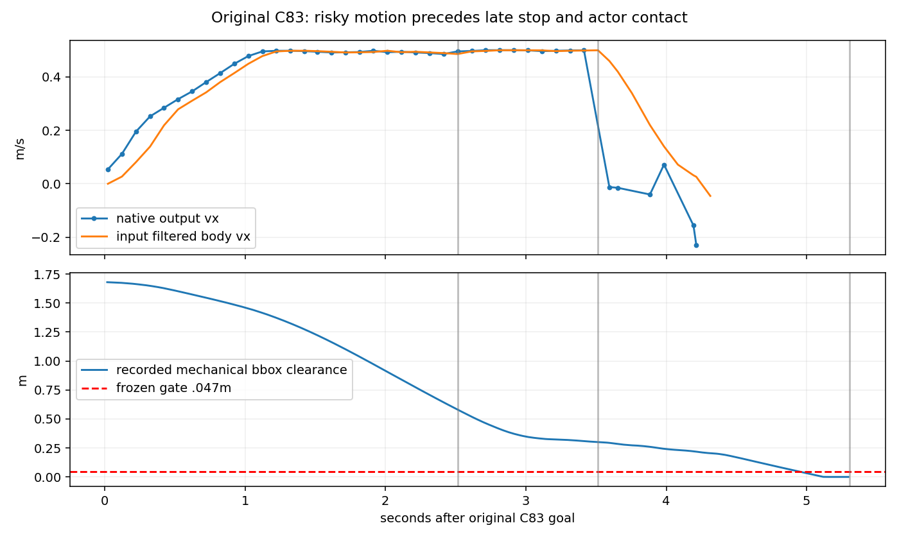
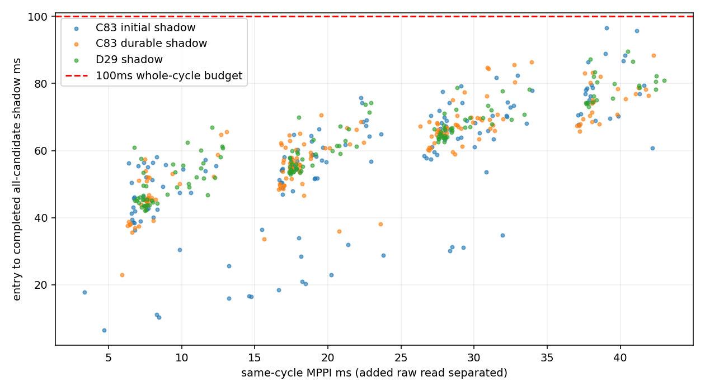

# C83 接触因果与 MPPI 同周期时序定向收口

**裁决：Modify。原 C83 的“已知风险仍前进→迟到回退→停在障碍扫掠区域”机制已有逐周期证据；
没有证实可在本轮权限内修好的生产算法缺陷。同步只读检查具有计算可行性，但外层频率/执行合同未闭合，不能进入 C′。**

本轮从 `dc7897e703ad4fd19fe1ab040c2419712b03cfff` 建立
`codex/stvl-c83-endtoend-20261014`，工作区
`/home/qihei/rm2027_navigation/build/stvl_c83_endtoend_20261014`。
完整最终HEAD见最终答复和 `build/c83_cache/final_closeout.json`。
已核对上一轮clean、报告、原始记录和适用AGENTS/开发/分级验证/Git资产/runtime/底盘/TF/topic规范。
本轮是 Research；旧main/new-car/old-car、R1–R4、MPC、所有历史raw保持。
FAST-LIO、定位、TF、V2、MCU、AUD-003不改，无push/merge/真实硬件输出或C′。

## 1. 实际阶段与边界

| 阶段 | 已运行证据 | 未宣称 |
|---|---|---|
| P0 | dc7897e与原C83 45周期、源SDF、预测/命令/原生应用与真值 | 不把错误namespace的旧四例算进正常模型 |
| P1 | 原逐周期重建、显示反演验证、162个新冻结候选输入旁路判定 | 没有原故障每周期raw，不能列出原每个候选得分 |
| P2 | 617个配对周期、605个成功输出DDS配对；最后C83 162/162完整 | 不是p99分项相加；不是完整外层线程或实车截止期限证明 |
| P3 | 只读影子快照/计时、诊断关闭时缓存尾周期修正 | 无新预测/权重/选择/制动算法 |
| P4 | 33/33既有判定、四次有效闭环与恢复复算 | 新重放通过不等于原C83修复 |

5次启动：1次在导航开始前因复用receipt工具路径未适配退出，保留；4次有效导航。
最初4次上限，审计发现诊断尾周期漏写后，在运行前保存durability_amendment，仅追加一次C83。
所有评价门限、频率、种子、速度、模型和代价固定，未按结果选场景。

## 2. C83 三种身份及完整条件

原历史039的C83曾通过；上一轮字节保留修正后的C83是本轮**原故障**：
`stvl_execution_realtime_20261014/build/realtime_cache/corrected_scene/runs/narrow_C_83_aligned`。
该记录goal=4.002s、Gazebo接触header=9.310s（相对5.308s），moving_obstacle碰front_right_wheel。
原所有source/receipt时间、命令与模型均保留。本轮复用相同assets和字节保留插入器，
未使用ns0改写模型；新增插件剥离后逐字节恢复原SDF，四轮`ignition:expressed_in`保持。
当前重放是相同定义的独立运行，ROS回调/物理调度与机器人反馈不同，不是原输入逐位重放。

实际环境Humble、Nav2 MPPI/smoother1.1.20、STVL2.3.4、Gazebo6.18；原353薄插件评分代码复制，
只新增只读观测。原生installed MPPI仍执行采样、Critic、gamma、softmax、SG及控制输出。
Release、double几何、無fast-math；仅增量编译该插件和小型离线工具，未构建完整ROS工作区。

- 场景narrow、种子83，机器人(0,0,0)静止到目标(4,0,0)。
- actor位于x≈2，实际box .45×.55×.8；t≤1保持，之后原slider目标−1.4+.3(t−1)，上限2.5。
  实际actor运动由物理反馈记录；不把目标函数当无误差真值。
- 原静态地图 .05m；corridor_revision=2、横向.70m开口。原SDF轮r=.075、L=.475。
- 控制10Hz、model_dt=.1、300候选×30步、1 iteration；vx[-.3,.5]/vy±.5/wz±1.2。
- 20Hz墙钟OPEN_LOOP smoother .8/.8/2；Gazebo原轮目标±2、实测physics dt=1ms。
- 计划矩形half .32/.27+padding .02；评价机械投影bbox .325/.300。均是代理，不是新车CAD。
- STVL decay=.5、inflation=.30；所有Critic权重、框架回退和观测设置不变。
- C为既有last_observation_cv、同source36点/3.5s；consumer为input_pose epoch、max_age=.4s。
- 原冻结gate：到达、零contact、动态bbox gap≥.047m、采样墙bbox零重叠。加速度/频率另列，不放宽gate。

相同narrow83的完整配对Oracle标定/闭环记录不存在；没有把D29或narrow29改名冒充83。
本轮不新增真值live控制。替代的107个**相同冻结输入**对照来自本轮C83同次记录的实际actor未来：
保持同pose、速度、候选、footprint、tracker ID/state/size、source/consume/候选epoch，只换36个points。
仅全3.5s实际记录完备的输入参与，未补造尾部。它测几何信息作用，不测重算MPPI或闭环执行收益。

## 3. 原故障的首次偏差与时间线

[逐周期证据](../../experiments/stvl_c83_endtoend/evidence/original_forensics.json)保存全部45周期、
消费时间、实际净空、命令publisher和旁路检查；[原预测误差](../../experiments/stvl_c83_endtoend/evidence/original_c83_cycles.json)
保留各时间点误差与有效覆盖。

| 相对goal时间 | 实际证据 | 因果含义 |
|---:|---|---|
| 1.123s / c11 | 当时没有active预测；事后同X对实际actor完整30步的circle参考首次≤.02 | 隐藏未来已有风险；不是当时控制器已拥有该信息，也不是必然碰撞 |
| 2.114–2.414s | track2 tentative；consumer明确跳过state1 | 有当前候选观测但未当active时空障碍 |
| **2.514s / c25** | confirmed；300个native动态safe=0；源age=.053、pose对齐age=.031s | 首次能从真实消费日志确认的决策风险 |
| 同周期 | robot(.986,−.029,−.163)，输出(.496,.255,.336) | 已识别风险仍保持强前进，并非信息未消费 |
| 同周期旁路 | selected static Safe/dynamic Unsafe、min≈−.641m，first_bad_step=6 | 联合几何可识别；没有影响实际选择 |
| 2.614–3.414s | 持续zero-safe、vx≈.5；c33以后selected静态也Unsafe | 风险没有变成hard可行性或等待条件 |
| **3.514s / c35** | 首次Optimizer fail；robot x≈1.472，y≈.128 | 原static fail/reset/BT开始，已较晚深入交会区域 |
| 3.755/4.083/4.314s | 三次进一步native fail，部分期间重新输出侧移/退让 | 回退非已证明的时空安全策略 |
| 4.329s以后 | controller发零；smoother/唯一stub之后保持零，actor继续运动 | 不能把最后停车当已避免移动障碍 |
| **4.958s** | 实测bbox gap .043287m，首次低于.047原gate | 实际安全余量首次失守，早于接触消息 |
| **5.138s** | 评价bbox gap首次0 | 代理评价包络交叠，不冒称物理contact时刻 |
| **5.308s** | Gazebo原生wheel contact | 真实仿真接触；原故障成立 |

SDK选定轨迹未记录原U，故由已知固定SDK公式反演显示控制，再按上一段航向重建只读名义X。
在本轮真实记录U的159个成功周期验证，最大控制分量误差2.23e-6（冻结容差1e-5）；
原第一条与实际Twist吻合。原完整轨迹是**反演诊断**，不是声称恢复原raw样本/真实执行。
原c25的动态危险在源码safe计数和该诊断上同时成立，远离数值门限；不靠反演制造结论。

没有证明何时进入不可避免碰撞集合。尤其原最后一个周期停在交会位置被actor扫过，
不能反推更早的制动/等待/退让也无效；当前缺完整可执行响应和可达集合同。
本轮不添加控制器或理想执行轨迹来假装证明可避免/不可避免。

## 4. 根因分级及反事实证据

| 分类 | 已证实 | 未证实/不做的推断 |
|---|---|---|
| A1预测输入 | 可见点云centroid及observed extents不等于整物体中心/尺寸；confirmed时0步中心差约.276m、1s约.257m | 不把这直接称KF速度失准；未证明它单独导致contact |
| A2时间消费 | input_pose对齐有效、未过期；动态成本min≈4.27e6/max≈1.34e7，safe=0，确实消费 | 未发现当前案例的确定性时钟/插值实现错误 |
| **A3候选/评分** | safe=0不置fail_flag；风险进入soft cost后仍输出前进，名义selected已Unsafe | 不是提高权重就能修；原raw没保存，不能给原各候选精确排名 |
| A4执行映射 | post-SG名义X缺发布/保持/smoother响应；停车后的实际位置仍被扫过 | 未证明纯粹smoother轴向/初始化错误是主因 |
| A5基础设施 | 本轮startup观测器路径及日志shutdown缓存尾部缺失已定位修正 | 原故障SDF字节正确，无ns0物理混淆证据；没有contact检测造假 |
| A6能力限制 | 无安全候选时缺可执行等待/退让证明，nominal rate常违例且complete Unknown | 未证明物理上无解或MPPI架构必然不可用 |
| A7证据不足 | 原各周期raw/成本、不可避免时刻及硬件响应缺失；原接触未稳定复现 | 保持多因果机制，不能宣称修复原碰撞 |

安装tracker的对应源码使用可见点集合centroid和max(extent,tolerance)，不是完整box中心估计；
尺寸约.224×.20，actor是.45×.55。consumer最小circle r=.36是原合同，未改。
因此位置偏差也包含形状/可见面语义，当前预测误差不能简单替代控制收益。

本轮无shadow C83冻结回放162个完整候选记录；active/失败周期检查全部300raw，其他周期selected。
107个同输入真值替换：**60个候选计数改变，选定轨迹joint geometry标签0个改变**。
首次active c24 CV与真值均300 Unsafe；c27 CV全部Unsafe、真值有1 Safe，但固定selected均Unsafe；
c29回退后CV有171 Safe、真值232 Safe，固定selected均Safe。
原生动态safe与联合static+sweep计数不同，不能混为同一指标。
有joint Safe候选时，这批数据中没有native最低成本/最终selected Unsafe的反例；
主要早期问题是安全候选不足与soft失败语义，未证明“现成安全候选被排序忽略”是原主因。
这些只是几何信息作用；真值未重新优化U，不能声称Oracle闭环改进为0。

## 5. 同周期计时合同与真实边界

复用原plugin名字但仅在隔离overlay加载新薄观测副本；无修改installed Nav2 optimizer。
InputTraceCritic只复制300×30 raw pose/velocity到独立容器，反复native scoring attempt计数保存。
每周期新预测与footprint；静态输入是原不变map-server occupancy，STVL当前层仍由原CostCritic处理。
Snapshot+原prepared::classify检查全300 raw及selected，potential每条30×11，Unsafe证据允许早停，
Safe/Unknown完整覆盖、double/.02/原reserve/unknown语义不变。**结果不改变Twist选择**。
失败static-first attempt未到Temporal时source为空，保持Unknown，不借旧预测冒充已消费。

cycle_id关联输入、raw、native输出、同周期check和DDS；steady_clock量时，sim clock只用于预测/物理。
互斥分项：T_input含新增raw读与snapshot；T_mppi为native调用扣该新增raw读（仍含原Trace）；
T_check为所有候选必要判定；T_other含原SDK/接口与其他观测准备。分项逐值相加等于T_total。
**T_total**从controller plugin入口到影子判定完成，包含新增raw复制，未扣除仪表负担。
实际wrapper另包含完整候选二进制导出、研究JSON写出；DDS出版配对包含后续server消息处理。
shadow自身会增加输出延迟，故不能声称闭环行为完全不变。

[固定Nav2 controller_server1.1.20](https://github.com/ros-navigation/navigation2/blob/1.1.20/nav2_controller/src/controller_server.cpp)
用10Hz WallRate，并在plugin调用前读取pose/速度、检查costmap current和更新path；它不是OS硬实时deadline。
本轮**未量到这些入口之前的外层等待/读取全过程**，不得用plugin→DDS值冒充完整外层线程时间。
DDS是发布，不是原生轮目标应用/MCU执行。轮目标/physics step与50Hz平均反馈复用原观测合同。

所有run相同host/镜像/CPU策略：i9-13900HX，32逻辑CPU可调度；live未固定单核，原checker的CPU0
离线p99不直接拿来与此比较。Release、不运行另一个sim；离线回放在全部live结束后。
各run第一调用cold、其余warm另存；少量周期经验分布不是硬实时置信保证。

| 运行 | 已测配对/实际control | T_total p50/p95/p99/max ms | plugin→DDS p99/max ms | 实测DDS>100 |
|---|---:|---|---|---:|
| C83 无shadow | 156/163 | 17.28/32.56/43.44/45.39 | 47.87/49.66 | 0/152 |
| C83 初次shadow | 156/160 | 57.93/80.10/91.98/96.52 | 94.92/**100.59** | **1/152=.658%** |
| D29 shadow | 143/147 | 61.30/80.58/86.91/89.48 | 90.03/94.06 | 0/143 |
| C83 durable shadow | **162/162** | 61.84/80.38/**85.91/88.44** | **90.40/92.70** | 0/158 |

T_total所有已测617周期0超100，**旧15个尾周期未测，不能算通过**。最后162个ID完全一一对应，
含4个native失败调用；其158个成功输出全部DDS配对。精确p50/p95/p99/max/cold/warm/
单周期分项和缺失编号保存在timing_summary及*_paired_cycles.json.gz。
最后C83分项p99为input1.49、MPPI41.80、check51.67、other.176ms；它们相加不等于总p99。
本轮确证必要几何计算可在这些场景同周期执行；未运行旧最坏D47/wait C13的在线叠加。

**仍有调度与延迟负例**：原线程no-shadow/D29零频率warning，初shadow3条、durable4条。
durable几条告警对应wrapper仅55–86ms，说明入口内快不等于外层WallRate及时；
暂不能排他定位为costmap等待、path更新、phase债务或调度，仅代码路径和对齐事件有证据。
控制入口间隔median≈100ms，恢复段最长约2.8s。严格interval>100的计数包含微小调度误差，
不能把约一半100.00xms间隔叫计算超时；所有间隔/恢复gap原值保留。
最初shadow输入pose→发布p99约101.26ms/max106.97ms；durable约94.80/96.66ms。
因此不能给“完整在线链的统一p99/精确deadline超时率”填一个伪造值：
可测plugin/输出边界如表；完整外层线程时间仍未验证，已有7条rate warning，保持Modify。

## 6. 定向回归、确定性修复和剩余风险

| 运行 | 原gate | 到达s | min动态gap m | wait s | native fail | zero-safe周期 |
|---|---|---:|---:|---:|---:|---:|
| 原C83 | 失败/contact | —（5.308终止） | 0 | .900 | 4 | 16 |
| 本轮C83无shadow | 通过 | 18.795 | .3766 | 2.400 | 4 | 3 |
| 本轮C83 shadow | 通过 | 18.592 | .2009 | 2.420 | 4 | 17 |
| 本轮C83 durable | 通过 | 19.095 | .3828 | 2.540 | 4 | 3 |
| 本轮D29 shadow | 通过 | 14.691 | .3995 | .140 | 0 | 0 |

本轮四例采样wall重叠0、速度超界0，轮目标±2.01超界0；实际50Hz body加速度max约
1.60–1.75m/s²、2rad/s²，仍高于smoother .8线加速度设置。不同目标限制/物理响应/平均窗
合同仍存在，不删除这些负例，也不把它们误称新轴向bug。首100ms名义与实际位置误差max约
.01–.05m（含原SDK显示和迟到，不作唯一失效原因），在execution_mapping保留分段与分量。
新C83更早在约2.8s触发static失败/reset，随后退让再通过；原失败到3.514s才开始回退。
这种相位和闭环输入变化足以使接触结果不同，但不是随机种子保证的逐输入对照。
没有改变生产控制；不能把三次新通过当本轮修好了原C83。

P3修复只有本轮基础设施：首次receipt路径错误；后续关闭时丢失7+4+4个timing尾周期及3个
二进制最终半记录。旧字节保留，partial理由/expected/preserved bytes与ID明确统计。
逐周期flush后同场景162个control/timing/raw完全对应、0半记录；原正常D29记录可恢复。
这是确定性诊断修复，不是碰撞修复；没有取消smoother或修改加速度。

33/33原定向/真实/更新输入重跑判定相同；未改prepared core或旧输入。
四例归档的11项原安全/效率指标已逐值复算一致，恢复入口见README。

## 7. C′准入与最小剩余工作

| 条件 | 状态 | 必要证据/缺口 |
|---|---|---|
| C83机制解释 | 部分已验证 | 原已知危险仍前进和晚停已确认；原raw/不可避免时刻未闭合 |
| 代理执行映射 | 未通过 | candidate X仍缺发布/保持/smoother与执行prefix响应 |
| 速度/加速度 | 部分/未通过 | 轮目标正确、速度界通过；body加速度合同不同 |
| 静态/动态/sweep | 受限已验证 | 33输入一致、原selected危险可识别；未知执行仍Unknown |
| 原危险识别 | 已验证受限范围 | 不是缺陷已干预/全场景安全保证 |
| 正常不系统误拒 | 受限已验证 | 本批有Safe时选择未发现Unsafe；真实物理可行性非零误拒证明 |
| 同周期budget | 几何有可行性/全链不足 | 162完整周期通过；旧100.59ms、外层rate warnings及最坏输入未测 |
| 极端延迟/故障 | 未通过 | 外层等待/恢复≈2.8s，无统一执行迟到界 |
| 无safe行为 | 未通过 | zero-safe仍soft选择，停止位置不保证未来避碰 |
| 不新增owner | 已验证 | 原stub唯一；新代码不输出速度/TF/ECM |
| 实车响应/授权/停止 | Wait | CAD、摩擦、MCU物理停止与授权验收不在本轮 |

**最小下一步**应先取得外层controller loop、costmap/path/pose读取与输出的同周期边界，
并为原无安全候选和停车位置建立有执行依据的prefix合同；需要用户另行决定研究性干预。
本轮不实现hard mask、CBF、安全过滤器、复杂预测或MPC。简单CV时间consumer继续保留为研究基线。
当前证据没有说明增加预测复杂度能解决soft失败/执行与调度合同，也没有证明必须换控制器。

## 8. 最终五问与资产

1. **C83为什么接触？** 更早未有active轨迹；有信息后已知危险仍前进，晚回退停在扫掠区。
   预测/几何语义影响候选，但未证明是单一根因。新运行未稳定复现接触，原负例始终成立。
2. **局部确定性软件缺陷？** 诊断路径和尾写出已修；当前未证实可局部修好的生产时钟/轴向错误。
   soft无safe语义改变属于禁止提前开展的控制干预，不偷偷修。
3. **预测状态为什么不等于执行？** raw首列是反馈、post-SG控制不同；输出迟到、墙钟平滑和
   sim轮目标/物理运动/10×1ms平均反馈是不同阶段，X缺完整执行合同。
4. **在线实际p99/最大/超时？** 完整可测162周期shadow总85.91/88.44ms；输出90.40/92.70ms、0/158。
   先前shadow输出100.59ms、1/152超时；外层有频率告警，其全线程p99/精确deadline比例未测。
5. **能进入C′吗？** 不能。已证明计算可行性的一部分，剩余外层deadline、执行prefix和zero-safe行为阻塞。

修改仅新`experiments/stvl_c83_endtoend/`、本报告及索引；完整清单/HEAD/clean和所有保护ref
核对在final_closeout。初始空闲约3.73GiB、checkout后约3.51；写入期间保持>3GiB。
本轮完整raw约177MiB cache（含工具/assets；峰值约225MiB），新增逐周期记录使初始缓存
启动检查与最终总量不同，未删除唯一数据。最终精确磁盘字节见closeout。

Git精选≤6MiB：所有实际truth/命令/反馈/消费预测/同周期时间、4例参数/SDF/门限、最后C83
完整1msnative、其他例20ms代表native、全部统计和负例。全候选二进制/完整成本/逐候选flags
仍唯一保存在 `build/c83_cache/{no_shadow_retry,shadow,shadow_durable,normal}/runs/` 的gzip与
compression_manifest；Git compact control不是原无损流替代。之前所有raw/错误SDF保持。
可再生plugin_build、offline输入/派生图、assets副本和/tmp审阅副本与唯一raw分开，未清其他worktree。
回退只需停本研究入口/检出dc7897e；正式软件无需回滚。本轮提交clean后暂停等待评审。
