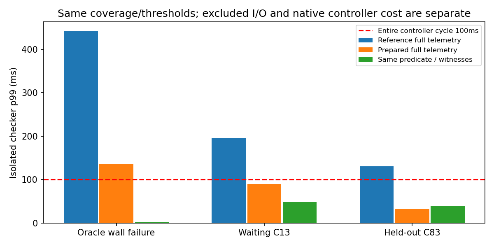
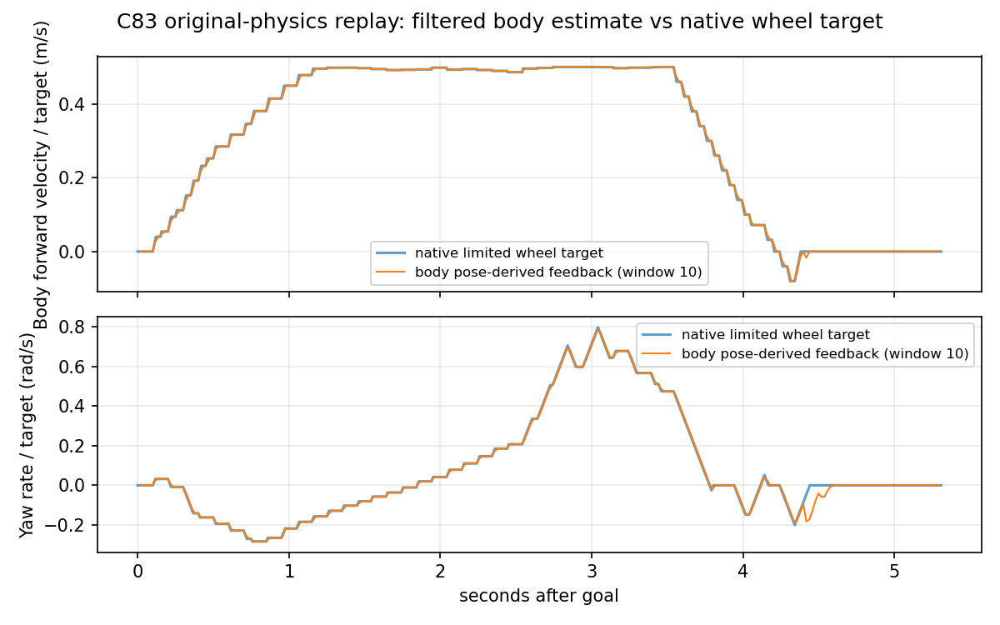

# RM2027：规划—执行一致性与联合检查实时性收口

**总体裁决：Modify。执行与反馈的数据来源已复原，诊断提速且判定保持一致；
执行安全/完整周期预算尚未闭合，不能进入 C′。**

本轮关闭了SDK显示投影、研究计时口径及本轮SDF适配错误，未改控制器。
33个只读输入、31次稳态计时/输入，8次有限启动全部保留；4次物理模型不可比，
4次可用于原模型导航对照。修正后D29正常通过，C83仍接触。没有用好结果覆盖坏结果，
没有预测算法、MPC、CBF、第二条速度链或硬件输出。本轮到此停止，等待评审。

## 1. 身份、规范与阶段

基线完整 HEAD **039273ae048edeff614199bae8c33583c4f64be6**，实际Git/clean/报告/raw核对
与用户给定一致；旧9次控制证据、20个候选快照和8个判别用例完整。
新分支 `codex/stvl-execution-realtime-20261014`，worktree
`/home/qihei/rm2027_navigation/build/stvl_execution_realtime_20261014`。
当前完整提交HEAD见最终答复、`git rev-parse HEAD`和`build/realtime_cache/final_closeout.json`。

已读适用AGENTS、开发流程、Research/Integration/Deployment分级、Git资产、workspace、
runtime与chassis/topic/TF规范。本任务为Research。正式main/new-car/old-car、R1–R4、
Temporal MPC及全部历史分支/raw不改；FAST-LIO、定位、TF、V2、MCU、AUD-003不改。

实际环境：已有Humble离线镜像，MPPI/smoother1.1.20、STVL2.3.4、Gazebo6.18.0、math6.16。
只读复用353最终controller DLL和R4依赖。四个小工具增量构建；无完整ROS/Jazzy构建。
CPU i9-13900HX，32逻辑CPU；性能进程固定CPU0、分析CPU2，仿真结束后才跑基准。
Release -O3 -DNDEBUG、不用fast-math，几何精度double未变。环境见
[environment](../../experiments/stvl_execution_realtime/evidence/environment.json)。

| 阶段 | 实际工作 | 边界 |
|---|---|---|
| P0 | 原HEAD/9运行/8测试/20快照、原计时范围复原 | 不重新全仓审计 |
| P1 | 旧9与新8逐周期映射、原生6运动fixture、原生轮目标与DDS观测 | 物理力矩/MCU未知；错误场景不能算公平对照 |
| P2 | 33输入初次热点、31次稳态分阶段/分配计数 | 仪表开销与plain调用分开 |
| P3 | 修正只读SDK视图、快照缓存、必要判定、捕获配置和SDF适配 | 无MPPI轨迹选择干预 |
| P4 | 相同输入一致性、保留83、正常/负例及恢复 | 未运行C′，不宣称预测执行安全保证 |

控制/动力学与原门限均固定：10Hz、dt=.1、300×30/一次迭代，20Hz OPEN_LOOP smoother；
vx[-.3,.5]/vy±.5/wz±1.2；smoother .8/.8/2、原Gazebo目标限幅±2。
plan half .32/.27+padding .02、评价bbox .325/.300、STVL decay .5、inflation .30。
原gate：goal、零actor contact、动态bbox gap≥.047m、采样wall bbox无重叠。
速度/加速度、计算尾延迟、等待另外记录，不放宽门限。

## 2. 真实数据流合同

| 边界 | 数据/参考系 | 时间与实际含义 |
|---|---|---|
| Gazebo模型状态 | 原机械代理世界pose | physics step实测1ms；没有新车CAD验收 |
| OdometryPublisher→原LIO adapter | pose是odom，twist是base_link | 每步pose差分后10样本平均，发布50Hz，header是当前pose时间 |
| controller输入 | TF pose、已有真实速度估计 | pose epoch与最近速度callback不同，不是期望速度或机器人未来真值 |
| 原候选U→Xraw | body vx/vy/wz，世界XY/yaw | 首列已有feedback，后续来自采样控制移一列；固定Omni传播 |
| Critic→选定序列 | 原static/temporal soft cost+gamma/softmax | 最低raw不是最终控制；动态全unsafe不是hard mask |
| SG/offset/shift→Twist | body速度 | 返回控制与实际post-shift首序列对应；未添加限幅或owner |
| SDK view | 重构选定序列的名义pose | 原显示有航向索引差异，也没有smoother/控制迟到合同 |
| smoother | 原20Hz墙钟，OPEN_LOOP目标增量 | 每tick .04/.04/.1；目标保持不等于物理瞬时加速度 |
| /cmd_vel→stub→bridge | 未Stamped Twist、原body约定 | 原recovery也能直接给/cmd_vel；末端stub唯一 |
| native Mecanum | 上一次受限命令→四轮JointVelocityCmd | 以sim dt限幅±2；原轮半径.075、L=.475；不是实际车体速度 |
| 物理推进→反馈 | 原friction/轮地接触、50Hz估计 | 不用理想执行替代；已记录轮目标组件与pose，但不是电机力矩 |

只读C++receipt记录DDS发布/接收、steady、system和ROS时钟及GID。DDS source是发布，
不能称决策或电机应用时间。系统时钟到steady用同一receipt配对，再与native步骤时钟对应；
重复Twist/异步callback仍有限制，不把这些观测写成可保证的迟到上界。
原native命令组件在PreUpdate读取，物理pose在PostUpdate读取；没有ECM写入或速度/TF发布者。
WorldVelocity组件未提供，`valid=0`指完整直接velocity观测缺失，不能误称轮目标/pose全未知。

固定 [Gazebo OdometryPublisher](https://github.com/gazebosim/gz-sim/blob/ignition-gazebo6_6.18.0/src/systems/odometry_publisher/OdometryPublisher.cc)
的平均发生在发布节流之前，因此是10个1ms更新，不是10个20ms发布样本。
按实际pose、cosf/sinf和角度float惯例复算，6条流最大分量误差 **1.72e-8**；
两个正确场景的native pose与同source时间的canonical odom位置逐值一致。
没有发现新轴向、canonical pose转换或全零运动反馈错误；source header新鲜不能把平均速度
自动当瞬时真实速度。先前零速度缺陷已修，此处是正确但需要声明的估计合同。

## 3. 首次偏差与最小修正

### 3.1 原生传播与SDK显示必须分开

直接调用实际安装库的6个fixture：静止启动、直行、制动、侧移、旋转平移、等待。
原候选传播与同反馈/同离散公式最大位置误差≤4.18e-7m，符合1e-6容差。
启动raw第一步保持反馈0，SDK则立即积分新控制；制动raw第一步还保留已有速度，
SDK立即显示0。这是两种时间/控制含义，不能把同Twist值当同执行轨迹。

旋转耦合稳态(.2,.1,.7)的SDK视图则有确定性显示索引问题：后续XY使用当前段末航向，
而原候选用上一段航向；3s最大XY差 **.037990m**。固定
[optimizer实现](https://github.com/ros-navigation/navigation2/blob/1.1.20/nav2_mppi_controller/src/optimizer.cpp)
与本地真实SDK调用一致。新`previous_yaw_view`采用原离散传播约定，修正只读显示。
没有修改实际raw、cost、SG、控制或上游SDK。六个正常/负例均运行，SDK直线/侧移仍在
数值容差；修正不是“执行误差归零”。尤其第一点不受后续航向索引修正影响。

20个选定视图中，2个joint geometry标志因显示修正改变；不是控制收益。
14个完备实际future robot轨迹与同一旧actor预测作旁路对比，2个geometry标志与SDK不同；
另6个运行在3s前终止，未伪造停止尾部，明确未运行。实际future轨迹只用于事后评价，
不输入A/C，不能作在线执行rollout。对照见SDK_view_safety、execution_geometry_summary。

### 3.2 研究计时未覆盖完整返回路径

旧Controller在SDK构造后记录compute_ms，随后才复制大矩阵/预测并同步dump到日志，
最后返回Twist。该值是**部分控制耗时**。捕获周期实测entry→DDS publication
73.60/93.42ms，对应旧计时50.57/66.64ms；额外约23/27ms有明确代码边界。
不能把旧“所有compute<100”解释为全链每周期及时。

新分析改名`controller_reported_partial_compute_ms`，增加实际发布时间；新研究入口默认
关闭大矩阵捕获（原配置开关begin/end=1000），各周期aggregate/消费/命令/反馈仍记录。
所有Critic、安全检查、采样、预测和动力学不变；旧捕获版仍可显式重现。
计时修正与配置单因素已运行，但其初次运动对照受到下面SDF适配问题影响；
不能据它宣称正常模型里的全部效率/安全改善。

### 3.3 本轮自己引入的场景适配错误

首次两次未加载逐run场景，native观测缺失，导航实际用原assets：缺观测、不是控制失效。
修正入口后，通用XML序列化把`ignition:expressed_in`改成`ns0:expressed_in`。
[DART读取机制](https://github.com/gazebosim/gz-physics/blob/ign-physics5/dartsim/src/SDFFeatures.cc)
按字面扩展名查摩擦参考系；同URI的别名前缀不能替代它。四轮roll=-π/2，忽略base_link
会改变摩擦方向解释。此为本轮确定性软件适配错误，不能叫MPPI缺陷。

这影响boundary_enabled/no_capture四次运行，均保留：其中两个C83实际contact，
但这四次不能作为原冻结物理条件的公平对照。
最小修正为只插入观测plugin；删掉该plugin后逐字节恢复原SDF，4个原扩展保持。
两个相同种子再次运行：D29正常通过；C83仍contact，说明原配置下也存在负例，
不能把所有接触归给namespace。修正后轮目标与反馈差异回到预期小尺度，
且Pose/feedback重建吻合；不再把错误模型的大响应偏差称为原代理能力限制。
原源码/raw/错误SDF保留，scene_adapter.json记录输入与原字节一致性。

### 3.4 A1–A6覆盖及问题分级

除6个原生独立fixture外，使用原9和物理可比新4运行分类，不增加6套运动平台。
有效周期分类计数：A1=156、A2=10、A3=486、A4=912、A5=598、A6=55，允许重叠，
不把周期数算独立试验数。分类阈值在protocol冻结，逐周期输入/next pose/速度/
命令/源/receipt/应用组件、误差和首次>1mm/1mrad边界均保留。

| 项目 | 归属/结论 | 是否关闭 |
|---|---|---|
| raw第一步/当前反馈、body轴向、canonical pose | 实际库和source观测吻合 | 此软件证据范围关闭 |
| SDK后续XY航向索引 | A：显示/诊断确定性差异 | 只读视图修正；非控制器修复 |
| compute字段漏后续同步诊断 | A：研究计时/诊断负担 | 正确标注、真实发布观测、默认关大捕获 |
| ns0摩擦扩展 | A：本轮场景适配错误 | 字节保留修正和同种子回归 |
| .8 smoother与2 native目标变化 | B：目标增量/轮目标/物理加速度的不同合同 | 分开解释，没改参数 |
| 10样本估计、发布时间/应用相位 | B：异步与估计合同 | 可测量，非所有未来迟到上界 |
| 球形轮/原摩擦代理、接触后的速度突变 | C：代理/接触力响应 | 非CAD实车模型，不能靠理想body ramp替代 |
| MCU响应、摩擦/滑移/新车尺寸 | D：硬件未知 | Wait，不推定真实参数 |

原生±2 limiter状态是**上次受限命令**，不是当前测得的body速度。
原旁路“由feedback初始化的2.0 body ramp”只是事后近似，不等于完整Mecanum执行系统。
原正确场景的轮目标可验证每step≤2.01，不能据此认证真实body瞬时≤smoother .8。
实际回退、反馈平均、迟到和碰撞力也必须纳入候选执行合同，当前checker仍输出Unknown。

## 4. 100ms的真实工作量与热点

原离线CLI每次检查**301条**（300raw+1 SDK）、每条30步/每段11点，99330个姿态，
footprint4顶点、.05静态栅格、多为1个active动态track、同刻插值与Lipschitz保留。
没有TF查询；每点polygon变换，原地图距离扫描局部矩形大量空格；每轨迹重复validation/
source copy，每点重复JSON取预测点。原total排除文件JSON读取、Grid构造的一部分和
最终序列化，包含native perimeter比较/诊断；并非已经集成控制周期测量。

| 初次实际热点 | 测量/判断 |
|---|---|
| 地图格访问 | 每批约3718万–4899万次；空图也昂贵 |
| static精确几何 | 最坏约78万次polygon-box，计时版static约378ms |
| dynamic重复JSON与几何 | 约65–66ms/批，1份预测被重复解析/匹配 |
| 重复分配 | plain约17.3万–98.5万次new/批 |
| 输入/JSON读取 | 约35–75ms/离线文件；非必须导出raw的线上输入路径 |
| 坐标/插值/采样 | 无TF；计时版约11ms，包含仪表扰动 |

计时用steady_clock。逐sample计时/计数本身使reference慢约40–52ms，因此
**plain调用用于预算**，instrumented只定位阶段，不把它直接当线上耗时。
冷是新进程首次调用、不是清OS文件缓存。31次稳态p50/p95/p99/max，分配次数/累计字节
及进程RSS均保存；RSS含JSON和比较缓冲，不冒称整个ROS内存。

## 5. 最小优化、正确性与预算

全诊断优化只做：每调用不可变snapshot、一次footprint/validation和330个时间插值；
按行缓存已占用/unknown格索引，保留原.1m搜索支持及unknown优先规则；复用polygon
缓冲；精确min已为0且unknown已检查时省掉后续几何。没有改R2距离、precision、dt/
点密度或margin。新的snapshot自动更新map/footprint/预测，不跨epoch复用。

33个输入 = 20真实快照（6020条轨迹）+8判别用例+5更新用例，共6033条；全诊断所有标志/
计数相同、数值差≤1e-12。8/8继续通过，更新map/footprint/过期source/wrong frame/
unknown-after-zero均保持原结果。没有同X判定新增漏检/误拒；不等于物理误判率0。

全诊断plain p99从约69–441ms降到25–135ms；正常预测批多为32–45ms，
wait相关仍86–95ms，最坏D29约135.47ms。完整结果最大135.62ms，不能叫满足总预算。

必要判定分支另冻结contract：只输出相同joint_geometry/joint_complete和Unsafe witness。
保留同一potential 30×11覆盖；Unsafe是原combine的吸收值，仅明确危险证据允许早停，
Unknown不能早停，Safe/Unknown必须扫完全时域。static仍查原unknown支持；复用原R2
分离轴距离下界，仅排除证明超过所需reserve的格。reserve≥原cap .1时保留Unknown，
不变成Safe。这是逻辑等价而非降采样，不输出被省略的精确净空/计数。

33/33三值逐条一致。真实批判定p99 **3.07–48.63ms**；D29当前已撞墙的每条只需一个
证据，因此3ms，不当作正常最坏值。wait C13仍约48.63ms。独立selected-only全诊断
p99≤.91ms，不能据它认证所有候选、softmax/SG的结果或无safe候选处理。

| 工作量 | 在线/离线意义 | 是否满足 |
|---|---|---|
| 文件raw JSON导出/读取、native对照、详细telemetry | 离线调查，不应每周期全量导出 | 不作为必需在线成本 |
| 全批完整净空/计数 | 最坏135ms，不适合全放实时链 | 否 |
| 全批相同三值必要判定 | 包含snapshot准备；可显著减少成本 | 单checker<100，尚非全链保证 |
| 最终selected名义验证 | 少量附加检查 | 快，但无硬优化/执行保证 |
| 动力学/迟到/反馈合同 | 必须先使X代表可执行运动 | 未闭合，不能靠上述快代码替代 |

100ms是10Hz**整个周期**。历史部分native compute p99+必要checker p99：18/20<100，
但D47 **100.161ms**、wait C13 **106.819ms**不通过；最大值相加3/20>100。
未提高budget或四舍五入变绿；还没计入dispatch、日志和执行不确定性。
这些是历史native与孤立单CPUchecker的经验筛查，未运行线上叠加，不能当调度证明。
完整33输入逐阶段p50/p95/p99/max与all-case表见performance_summary/table和
classification_summary。少量代表图用于读数，不按图筛选最终结果。

## 6. 八次启动、失败及安全/效率回归

初始4启动预算：2次缺native观测的有效导航+2次已加载但namespace错误的观测。
诊断计时局部消融追加2次（同错误namespace），发现物理适配错误后仅补原2种子，
最后8封顶。逐次amendment在运行前保存，没有新增种子、场景或代价调参。

| cohort / case | 物理可比 | goal/gate | 时间s（失败是终止时间） | gap m | wait s | 归属 |
|---|---|---|---:|---:|---:|---|
| receipt-only D29 | 是 | 1/1 | 14.708 | .372 | .140 | 原场景，native观测缺失 |
| receipt-only C83 | 是 | 1/1 | 26.417 | .392 | 7.500 | 原场景，较长等待 |
| boundary D29 | 否 | 1/1 | 14.901 | .253 | .200 | ns0模型，保留不公平对照 |
| boundary C83 | 否 | 0/0 contact | 4.509 | 0 | .100 | 同上 |
| no-capture D29 | 否 | 1/1 | 14.761 | .276 | .200 | 同上，不能宣称部署收益 |
| no-capture C83 | 否 | 0/0 contact | 4.878 | 0 | .120 | 同上 |
| byte-preserved D29 | 是 | 1/1 | 14.574 | .269 | .140 | 修正后正常回归 |
| byte-preserved C83 | 是 | 0/0 contact | 5.308 | 0 | .900 | 有效原物理模型负例 |

8次都发goal形成可记录导航epoch；4物理可比、4模型合同失效，分别统计。
所有sampled wall overlap=0，不意味连续静态安全；正确C83有4次native recovery、
16个动态zero-safe周期。输出仍由原Nav2/stub处理，不给contact作单因果判定。
实际接触、控制周期、预测时效/原回退/所有publisher和命令均保留。
接触后的body加速度/速度突变不能不加区分当规划加速度违例；smoother .8合同不关闭。

原9次全部保留并复读，旧wait退化仍是负收益证据。新receipt-only C83的7.5s等待及
最后C83接触不隐藏；成功D29耗时相近，不能用失败终止更早宣称效率提升。
Namespace修正恢复了原输入，但未使安全全绿：正确保留种子再次失败，故不得Go。
实际碰撞不是“只读诊断把动作拒绝”，本轮完全没有干预控制。

## 7. C′准入矩阵

| 条件 | 状态 | 证据/最小缺口 |
|---|---|---|
| 代理规划—执行可验证合同 | 部分 | 真实数据流/反馈已测；nominal X仍未包含控制发布/保持和执行响应 |
| 关键速度/加速度合同 | 未满足 | 目标/反馈/平均窗解释清楚；仍无候选body响应/接触力界 |
| 原危险识别 | 已满足受限范围 | 同X全部原标签保留，8定向用例；不是全场景安全率 |
| 正常轨迹不系统误拒 | 受限满足 | 相同谓词零差异；物理可行U仍Unknown，不能硬拒全部raw rate |
| 输入时间/几何 | 部分 | 原时域/帧/unknown保留；参考系适配错误已修，真实CAD/authority未验 |
| 在线必要budget | 未满足 | 2/20 p99加和超100、3/20 maxima超；非线上叠加测量 |
| 无safe候选处理 | 未满足 | 原soft risk/retry/BT，不是安全可执行制动证明 |
| 无新输出owner | 已满足 | 观测无速度/TF发布或ECM写，末端原stub唯一 |
| 原门限不放宽 | 已满足 | .047/contact/wall/goal保留 |
| 代理不外推实车 | 已满足；硬件Wait | 无实物CAD、摩擦/MCU响应/serial验收 |

本轮不实现C′。最小下一步若获授权：先将过滤速度的有效时间、完整控制发布时间、
命令保持与原生目标历史形成可在线使用的prefix执行合同；对C83的实际回退/zero-safe
负例定位消费/候选/执行的边界，并补齐两组预算。不要先增加预测复杂度或换控制器。
硬件取得后再校验实际响应，不能把模拟轮目标当真实底盘瞬时速度。

## 8. 最终十问

1. **为什么预测与执行不同？** raw反馈传播、post-SG/shift视图、迟到Twist、墙钟smoother、
   sim轮目标和平均后的feedback属于不同阶段，当前X不是完整执行响应。
2. **哪些是软件问题？** SDK只读视图索引、研究部分计时、大矩阵同步诊断；本轮
   SDF namespace改写已证实并修。未确认新的生产定位/轴向/初始化错误。
3. **哪些是模型/硬件未知？** 轮目标到body及碰撞力、实际车加速度/摩擦、MCU延迟/CAD；
   平均窗和不同目标限制是需要声明的合同，不能全归MPPI缺陷。
4. **为什么>100ms？** 约4000万空格扫描、近墙精确距离、重复JSON/预测插值及分配。
   原指标还包含离线对照，忽略读取和后输出，与真实线上total不同。
5. **如何划分？** 全量telemetry留离线；全候选相同谓词与最终输出分别测；
   selected快不等于candidate/hard选择安全；必须另有执行prefix合同。
6. **优化正确且够预算吗？** 全诊断全部flags/counters/数值保持，谓词33/33等价；
   性能显著下降但两组加和p99仍超总100，尚不能宣称整体实时闭合。
7. **能进C′吗？** 不能，预算、执行X与原模型C83接触/无safe回退仍阻塞。
8. **最小阻塞？** 真正可执行的prefix状态/时间合同，受控无候选行为与剩余静态检查预算。
9. **CV+时间MPPI保留吗？** 保留研究基线/最小consumer，原横穿收益没有被本轮否定；
   C83新负例说明它不能当稳定部署安全方案，不投入复杂预测掩盖消费问题。
10. **需要换控制器吗？** 仍无充分证据。MPC同样需要正确执行与时间合同，本轮未迁移。

## 9. 交付与资产

仅新 `experiments/stvl_execution_realtime/`、本报告及研究索引修改；全部旧分支/源码/raw
保持，FAST-LIO gitlink69f1070328c431f4c7b8bd586eca074141da3aae不改。
新研究提交后clean，不push/merge/实车输出，恢复入口见
[README](../../experiments/stvl_execution_realtime/README.md)。

初始4.00GiB、checkout后3.80GiB，所有步骤保持>3GiB；最终字节数/HEAD/完整修改清单在
final_closeout。唯一完整CSV/JSONL gzip逐字节验证保存在own cache；错误模型raw也保留。
Git精选≤8MiB，不含build或旧重复raw；错误模型native只选20ms代表点，原1ms完整流
仍在cache；正确场景native完整保存，所有8例评测truth/命令/feedback/consumed prediction
保留，精简control不是原完整矩阵替代。8例13项原gate/效率/计算指标恢复逐值一致。

可再生small_build、输入/派生统计/图片、assets复制和/tmp恢复副本可按预算清理；
本轮完整raw、原raw/其他worktree/冷备不可清。首次observer未加载、namespace错误、
一次构建自动审批超时（重试成功）、过大归档均记录，不冒充算法失败或删掉负例。
回退只需停本研究入口，保留分支或检出原039；正式软件无需回滚。本轮暂停等待评审。
