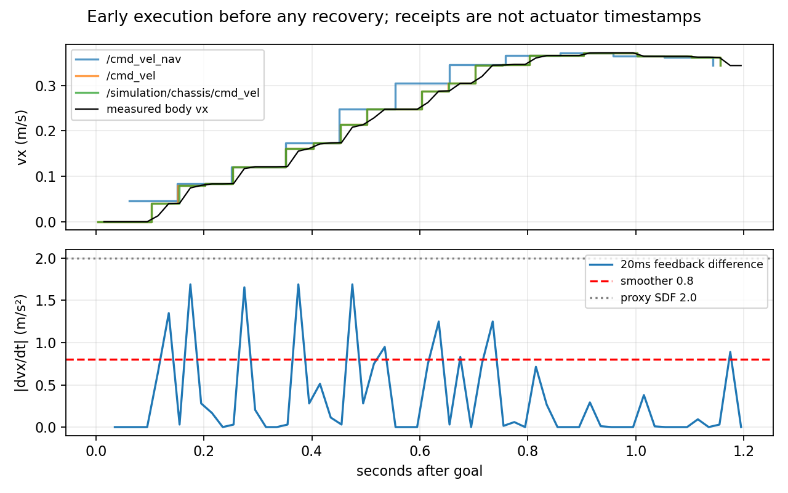
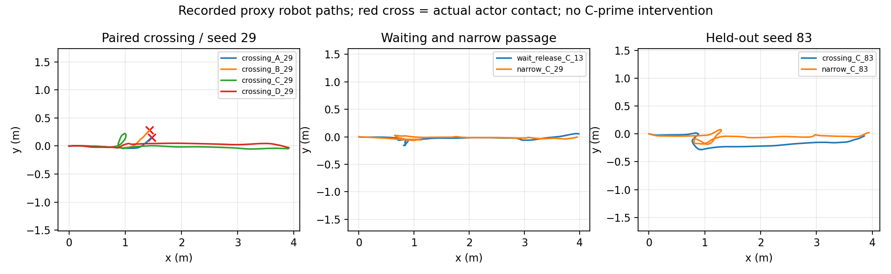

# RM2027：联合安全判定与规划—执行一致性研究

**裁决：Modify。保留简单 CV 时间消费研究资产；停止本轮控制干预。**
旁路检查可以识别已知名义危险并接受已知等待/制动参考，但尚不能证明它接受的控制
经过 smoother 和代理后仍满足相同轨迹合同。完整批检查超出100ms预算，固定 Humble
扩展也缺少逐候选硬有效集合及最终输出复查。没有实施 C′，不宣称闭环安全改善。

本轮实际完成历史/源码复核、只读联合诊断、执行偏差定量解释及9次有限闭环。
简单 CV 在固定横穿负例上仍有明确价值；复杂预测、MPC 替换和新安全 owner 没有得到
本轮支持。软件结论不能外推为新车实物安全。任务截至本报告停止，等待评审。

## 1. 阶段、身份与冻结范围

| 阶段 | 实际完成 | 未完成及原因 |
|---|---|---|
| P0 | 353源码、原48次记录、连接、门限和版本复核 | 没有重新审计整仓/真实车辆 |
| P1 | 8个判别用例；8历史快照2400 raw+8 SDK；12新快照3600 raw+12 SDK | 实际控制可执行性仍 Unknown，不能通过控制干预门槛 |
| P2 | 10历史运行与9新运行逐周期回溯，修正诊断投影的解释 | 未改运行时模型/执行链，执行 callback 与相位边界不足以形成有保证修复 |
| P3 | 固定接口和全无效行为核查 | 未运行；不重写 optimizer，不用极大有限权重冒充硬约束 |
| P4 | A/B/C/D同种子横穿，原等待/狭窄案例，新83保留场景 | C/C′消融未运行，不能估计联合控制干预收益 |

基线完整 HEAD `353fea2a54e6df858664a831dc394fb04e497223`，前前轮消费研究
`d2b5f0714585e1e71abaf20def932937057f644e`。研究分支
`experiment/stvl-joint-execution-20261014`；worktree
`/home/qihei/rm2027_navigation/build/stvl_joint_execution_20261014`。
当前研究提交身份见最终答复、`git rev-parse HEAD` 和本轮 `build/joint_cache/final_closeout.json`。

实际离线镜像 ID
`sha256:81b325bebf2f631d2f70ca72914873e0fee6df5b87977750cac17228def171c3`。
镜像内 XML 核对：Humble Nav2 MPPI/smoother **1.1.20**、STVL **2.3.4**。
旧 plugin DLL 的绝对路径/SHA256、全部保护 refs 和资源记录见
[版本资源](../../experiments/stvl_joint_execution/evidence/versions_resources.json)。
只读使用353最终修复 DLL和R4 adapter/profile，无新 MPPI DLL或完整 ROS 构建。
所引用上游代码是固定 **1.1.20** tag，不能代替本地运行证据或最新 Nav2 能力。

先读适用 AGENTS、development_workflow、分级验证、研究资产/Git、结构索引、runtime
和接口合同。Research级验证不等于 Integration/Deployment。用户“不push/merge”优先，
保护 FAST-LIO/定位/TF/V2/MCU/AUD-003。FAST-LIO gitlink仍为
`69f1070328c431f4c7b8bd586eca074141da3aae`。

`protocol.json` 与 `execution_audit_contract.json` 在相应结果计算前冻结，哈希已保存。
10Hz控制、dt=.1、30步、300候选、1迭代；20Hz OPEN_LOOP smoother；
vx[-.3,.5]、vy±.5、wz±1.2；smoother .8/.8/2，Gazebo MecanumDrive ±2代理加速度。
plan half-footprint .32/.27+padding .02，冻结评价bbox .325/.300；local map8m、.05m分辨率，
STVL decay .5、inflation .30。相同场景轨迹、扫描15Hz、KF/CV、预测刷新10Hz/3.5s/.4s年龄；
D仅替换已观测track的未来点，A/C看不到未来真值。

原硬门限保持：到达、无actor contact、动态full bbox净空≥.047m、采样wall bbox不重叠。
速度/加速度、连续扫掠、效率独立报告，**门限通过不等于动力学全通过**。
效率>25%成对到达耗时增加或新timeout为实质退化；小样本不作显著性声明。
本轮以八个冻结核心/保留用例为主样本；一次观测补跑独列，不拼接旧cohort平均值。

## 2. 历史失败核对

上一轮48启动 = 1 actor calibration + 1未发goal的map/prediction readiness缺失 +
4过程内适配器崩溃 + **42可评价控制运行**。不能把 calibration 称算法失效。
崩溃确由研究适配器 xtensor 替换32-byte原生cost buffer为16-byte存储造成，原地累加
已修；readiness缺失独占根因未证实。原失败、恢复和所有尝试仍保存。

最终9个增强case仅指：速度接入后的cross C29、narrow C29/D29/D47、stale C29、
wait C13/C29、narrow C61/D61通过原门限。A crossing29仍接触。此前几何修复后的
D61到达但bbox gap0，仍失败；不能将9例通过改写成恒成立安全保证。

原wait C29规划先穿墙，CostCritic中心捷径漏了完整footprint；已局部取消捷径。
原stale C29首次违例3.197s在stale注入4s之前，最近一次名义轨迹仅6.506mm墙净空，
下周期位置偏差14.066mm；更早还有危险计划，独占“纯执行原因”未证实。
三次Oracle实际接触为narrow D29 aligned、D47 aligned、D29 gap，消费真实发生，
首有效周期动态safe raw=0仍forward，不能归因于没有预测或预测精度不足。
原D13只是墙bbox负例而非第四次contact，未本轮重跑。
SDF实体投影与冻结bbox不同，bbox违例不自动等于固体接触；门限没有因而放宽。

零反馈是实验 composition 漏controller_server.odom_topic，已补 `/odometry/lio`；
不是已证明正式车同样配置错误。原290个诊断快照中仍有17个SDK墙危险、47个动态圆危险。
上述证据及精确原时刻见 [上一轮报告](stvl_temporal_failure_roots_20261014.md)，本轮未覆盖。

## 3. 现有安全机制矩阵

| 模块/接口 | 实际能力 | 合同缺口 |
|---|---|---|
| STVL + master costmap | 当前观测时效占用、膨胀，供空间cost与碰撞检查 | 未来不是time-indexed；非安全监督 |
| 原CostCritic | 有限碰撞/势场代价，全批collision设置fail_flag | 中心捷径原漏footprint；碰撞样本不逐条硬屏蔽 |
| RootCostProbe修复 | 同原方程/权重，全部离散pose调用安装checker | 仍是边界栅格/.1s/有限代价，非填充连续证明 |
| TemporalResearchCritic | source/input-pose绝对时间插值，同刻polygon-circle soft risk | 全动态unsafe没有fail_flag；缺joint mask和最终复核 |
| native footprint checker | 栅格polygon边界检查 | 内部障碍格、扫掠和未知输入另需合同 |
| optimizer fail_flag/retry | 全批失败重置/重试，终止则交原Nav2 BT recovery | 非逐轨迹集合，也不是安全制动生成器 |
| Omni motion model | 首列实际速度，后续列noised控制移一列，holonomic积分 | 没有本实验 .8/.8/2 加速度传播与smoother响应 |
| final bounds/SG/shift | 最终速度限幅、SG平滑、offset取Twist和序列shift | 软聚合/SG后的轨迹不自动继承原候选几何可行性 |
| smoother | 20Hz墙钟timer、每次目标增量按.8/.8/2频率约束 | OPEN_LOOP、零阶保持，非物理瞬时加速度保证；recovery可绕过 |
| chassis stub / Gazebo | 原末端命令转发、±2代理响应、50Hz状态 | 无新车响应证据，未记录实际apply callback时间 |
| 本轮joint_replay | 静态填充/扫掠、同刻动态、名义rate与Unknown执行映射 | 只读诊断，不是硬有效性或独立运动保护 |

固定 [optimizer](https://github.com/ros-navigation/navigation2/blob/1.1.20/nav2_mppi_controller/src/optimizer.cpp)
先评分再更新序列，之后才检查fail_flag；正常结果再SG/shift。硬屏蔽所有成本为∞时，
更新中的∞−∞可先产生NaN，不能依赖后面的fail_flag解决。Critic有一个全批fail_flag，
没有公开逐候选有效mask，也没有可复用的post-SG输出证书接口。
优化器的相关方法非virtual/非公开注入点；正确硬集成需明确有限权重集、全无效分支、
约束后的执行rollout与终端复查。继承一个Critic不能自动完成这些工作。

[固定motion model](https://github.com/ros-navigation/navigation2/blob/1.1.20/nav2_mppi_controller/include/nav2_mppi_controller/motion_models.hpp)
与本地原始速度矩阵相符。真正控制是softmax加权noised controls，并非最低raw轨迹；
SDK getOptimizedTrajectory在SG/shift之后重构，也不是执行积分。因此本轮没有把
“删掉危险raw之后的最低分”当控制安全证明，没有改采样、权重或优化流程。

## 4. 联合诊断合同及结果

输入：原X/U、input pose stamp、base_link速度、polygon、known static map、消费者实际
预测快照。只有原identity map=odom夹具成立时使用该参考系；不是任意TF自动转换。
静态图来自原map server occupied closed cells，复用冻结R2 polygon-box距离；
同一静态图上另调用真实安装Nav2 perimeter，**不把含当前STVL的master当同一谓词**。
动态沿source+0..3.5s插值，与机器人同一未来时刻比较，继承circle至少.36及margin .02；
不把未来占用取空间并集。source/observation新鲜度、覆盖、schema/frame/complete检查；
完整公共authority/count/身份认证未实现，不冒称生产接口。

每.1s段以.01s线性pose插值查碰撞；若最小间隙未超过机器人Hausdorff运动界与障碍
相对速度界×半采样间隔，则 Unknown，而不是把密集无碰撞当连续证明。
该界只认证名义分段线性X，不认证下游真实曲线；map未知支持、预测未覆盖当前前缀、
未来stamp/过期/反馈不一致也Unknown。碰撞容差1µm、速度1e-4、加速度.01。
名义U与.8/.8/2不符标nominal_rate Unsafe；缺smoother状态/phase/delay/实际apply证据时
mapped_execution Unknown，**不能因此拒绝所有Twist**。结构解析异常明确退出2。

八个预冻结独立用例8/8通过：安全等待、有界制动可接受；内部占用格的原生perimeter
漏检被识别；动态采样间切过corner，离散gap .047604m、连续样本 .019m，被正确识别；
运动中瞬间zero不是安全制动证书；未来预测、未知静态支持和未覆盖过去前缀为Unknown。
有界制动fixture是已知模型参考，不是Gazebo已执行备选动作。

| 历史快照（每行300raw） | geometry Unsafe / Safe / Unknown | SDK判定 | unsafe softmax质量 |
|---|---:|---|---:|
| diag wait C29，2.773s | 83 / 211 / 6 | geometry Safe、execution Unknown | .18820 |
| diag narrow D29，约4.1s | 300 / 0 / 0 | static Unsafe | 1.00000 |
| 最终 wait C13，约3.2s | 29 / 268 / 3 | geometry Safe、execution Unknown | 约0 |
| 最终 wait C29，约4.1s | 164 / 133 / 3 | geometry Safe、execution Unknown | .00096 |
| 最终 narrow D47，约3.8s | 20 / 280 / 0 | geometry Safe、execution Unknown | .00037 |
| 最终 narrow C29，约3.2s | 110 / 186 / 4 | geometry Safe、execution Unknown | .00064 |
| ABI-only D61，约4.2s | 286 / 12 / 2 | dynamic Unsafe | .16905 |
| 最终 D61，约4.2s | 67 / 229 / 4 | geometry Safe、execution Unknown | .00147 |

合计1059/2400名义几何Unsafe、1319 Safe、22 Unknown；所有2400 raw名义rate至少一项
违例。六个正常SDK几何可接受但完整执行Unknown，不是“检查正常控制全部失败”。
这八个定向快照不能构造真实全试验漏检率/误拒率。

同图native perimeter明确free而新静态Unsafe在这8批为0；不能宣称真实样本都有新的
填充漏检。历史动态离散safe而密集Unsafe仅1/2400（D61），同刻离散距离和原消费
最大差1.11e-16m，时间对齐复核成立。346条master hit但分离static/dynamic几何Safe，
由于master还有当前STVL占用，**只是可能重复/过保守，不能算已证实误拒**。
2个选定负例D29/D61名义危险均识别，不能把这个2/2推为识别全部历史失败。

12个新快照包含3600raw。A没有未来预测，dynamic/完整joint为Unknown是正确缺输入，
不表示A无安全能力；B29的2.8s SDK动态圆净空 .003688m仍被返回，实际之后接触；
wait C13的2.769s SDK动态圆净空−.025886m，但后来没有整段执行，真实本轮安全到达。
这再次区分危险计划和实际碰撞。新heldout在试后只诊断，没有据此调参。

首轮8批离线完整checker总耗时143–437ms，重跑143–439ms；新预测批140–201ms。
A缺动态输入的简化批约78ms不可作完整批基准。均不是集成运行时开销，也未用
离线计算预算替B/C加额外决策时间；当前实现不能接入100ms实时循环。
[历史汇总](../../experiments/stvl_joint_execution/evidence/history_summary.json)、
[新汇总](../../experiments/stvl_joint_execution/evidence/fresh_joint_summary.json)保存逐输入结果。

## 5. 执行偏差：已解释部分与未闭合部分

原链：MPPI→`/cmd_vel_nav`→smoother→`/cmd_vel`→原stub→仿真command；
原behavior可直接发布`/cmd_vel`。唯一末端producer仍stub。tap只是订阅，额外观测
墙钟receipt和endpoint；固定Humble rclpy的callback只有message，未得到每消息GID/DDS
时间。graph能说明多个native入口存在，不能给每条`/cmd_vel`归属；apply callback未知。
原recorder bootstrap publisher在goal前发零，goal后停止，未新增运动链。

[smoother固定实现](https://github.com/ros-navigation/navigation2/blob/1.1.20/nav2_velocity_smoother/src/velocity_smoother.cpp)
把每次目标变化按max_accel/frequency限制，再以目标Twist零阶保持。
.8/20=.04m/s的阶跃并不意味着物理执行瞬时≤.8。Gazebo自身容许2，能更快跟踪阶跃。
新D29前1.2s无任何恢复，实际body vx差分仍约1.7；历史10运行和新9运行的
恢复前都有线加速度>.81。故“都是恢复绕过smoother”已被反例否定。
OPEN_LOOP墙钟相位、目标保持和代理响应是可证实的共同不一致；恢复是额外入口。
2附近角加速度浮点误差按.01容差不报实质违例，线加速度1.55–2.0仍未关闭。

回溯固定：以input_pose_stamp为t0，actual feedback在t0+.1插值；SDK首pose作原模型；
另外用**已记录的后续仿真出口命令**、1ms积分、SDF每body分量2.0 ramp，固定0/20ms
receipt-delay敏感性，无拟合或选择最佳delay。不把未来实测命令输入C。

历史10运行：SDK下周期位置误差各运行p95为6.70–14.30mm；0ms回溯ramp为
.043–.100mm，固定20ms敏感性为1.28–1.75mm。新9运行：SDK p95为2.99–16.54mm；
0ms回溯ramp为.044–.133mm，20ms为.848–1.772mm。反馈与native实际速度基本一致，
历史最大分量差<.001，说明上一轮零速度修复确实生效。
这给出“预测的是立即可用序列，执行的是另一个响应”这一偏差的定量解释，
**不是可部署rollout已修复**：回溯使用未来已执行命令、receipt非apply、近似2.0模型
不是识别出的实车参数，也没有新C/C′闭环消融。

native计算均<100ms不等于连续输出每100ms都有：新narrow29/83有4/6次原生failure，
cmd_nav最长间隔约2.8/5.079s，等待C13有4次failure与2.799s间隔，原BT接管而非新fallback。
有效tap的正常控制receipt墙钟中位约100ms，sim钟也约100ms，RTF中位约1；
延迟/恢复尾部仍很大。state-source到receipt、input-pose年龄和速度差都保存，
不能用单一平均延迟声称时序完全一致。

## 6. 本轮闭环、可靠性与效率

九次启动全部形成可评价导航闭环；无新controller崩溃/启动缺goal。
前三次A/B/C29旁路tap失败，分别是use_sim_time已声明、固定rclpy不传MessageInfo；
兼容修正后D与其后场景正常。仅追加A29一次获取观测，仍contact。观测缺失不是导航
无效，不删除或更换种子；没有重跑B/C挑选成功。另有首次replay缺ROS动态库路径、
首版打包超12MiB和恢复缺launch.log，均属本轮工具问题，已修正并记录。

| 核心/保留场景 | goal/原gate | 时间s | 动态gap m | wait s / 启动数 | p95/p99计算ms |
|---|---|---:|---:|---:|---:|
| cross A29 | 0/0，contact | 3.814终止 | 0 | .080 / 1 | 37.46/38.35 |
| cross B29 ZOH | 0/0，contact | 3.893终止 | 0 | .060 / 1 | 46.84/66.01 |
| cross C29 CV | 1/1 | 14.502 | .378 | .080 / 1 | 41.81/43.63 |
| cross D29 Oracle | 1/1 | 14.580 | .376 | .120 / 1 | 40.48/43.28 |
| wait C13 | 1/1 | 20.170 | .509 | 2.700 / 4 | 37.81/41.36 |
| narrow C29 | 1/1 | 20.606 | .377 | 2.740 / 4 | 41.08/42.59 |
| 新cross C83 | 1/1 | 18.070 | .563 | 1.840 / 1 | 42.67/44.93 |
| 新narrow C83 | 1/1 | 25.629 | .196 | 6.980 / 3 | 31.72/37.50 |
| 观测补跑A29（独列） | 0/0，contact | 3.845终止 | 0 | .080 / 1 | 37.24/37.89 |

全部wall sampled overlap=0，原主样本6/8过gate；C/D六例6/6过gate，新heldout2/2。
全部native compute>100ms周期=0，仍记录代理动力学违例与危险名义未来，不能称全安全。
完整p50/p95/p99、预测拒绝、路径长度、重复启动和所有失败见
[逐试次结果](../../experiments/stvl_joint_execution/evidence/fresh_results.json)。

C29与D29到达时间只差.54%，无法支持“完美预测还值得大投入”的结论；B/C同消费
接口只换预测源，B contact/C安全提供未来运动信息的局部证据，不能代表全场景统计。
A/C差别还含新增consumer，不能全归为信息价值。

原wait C13：几何后16.221→接正确速度27.709s（+70.8%）负收益仍保留。
本轮20.170s不能与它拼成单因素改善：没有新执行修复，诊断窗口/调度不同。
现有wait在本轮有4次启动、2.7s低速停留，narrow83有6.98s停留、路径5.230m；
并未证明这些等待都必要或无意义。历史wait C13约3.2s有268/300几何safe名义样本，
master与分離timed占用有冲突，但缺执行认证，不能说它们一定能更早安全穿过。
未运行离线时空最优求解或等待干预，早通行窗口、侧向不足、重复评分的各自贡献仍未知。
新增联合诊断没有影响控制，故不能把效率变化归给它，也不能报告C′的等待改善。

## 7. 无安全候选的合同

| 已有证据 | 可作结论 | 本轮行为/边界 |
|---|---|---|
| 名义joint几何safe，但执行mapping未知 | 存在名义可行X；不能认证U | Unknown，不接过滤器 |
| 等待/有界制动独立参考通过 | 该明确模型下有可行参考 | 只读，不宣称Gazebo fallback验证 |
| 300raw全危险，离线brake参考几何safe | 候选不足不等于物理无动作 | 不发新的零速、不创建owner |
| 当前速度/制动/剩余gap无法闭合 | 不能保证避免碰撞 | Unknown/不可证明，不能承诺安全停止 |
| source过期/未来/反馈未知/覆盖缺口 | 输入合同失效 | 原消费者native fail/retry/BT；未证明回退安全 |

本轮能区分以上状态，但**没有实现安全可执行的运行时处理**。zero Twist经smoother和
代理需要时间，动态障碍仍可能撞来；原无safe candidate只有有限代价排序，B29也有
8个动态zero-safe周期且最后接触。真实保护继续由既有AUD-003/MCU/物理验收负责，未改。

## 8. 最终十问与最小下一步

1. **危险主要在哪里？** 原证据同时在评价/选择与执行。中心捷径和零反馈已局部修，
   有限动态风险、softmax/SG最终不继承安全以及实际响应映射仍未闭合。
2. **识别多少失败？** 定向8快照的两个名义危险输出D29/D61都识别；1059/2400raw几何
   unsafe，新B29和waitC13危险未来也被识别。不是全部历史失败检出率，不保证实际碰撞预测。
3. **有误拒吗？** 346条master冲突是不同谓词，不足以证实物理误拒；正常几何1319条
   接受。将所有raw的名义rate违例当真实命令无效，会系统性误用诊断；本轮没有这样过滤。
4. **现有接口小改能承担吗？** 诊断可复用，严格joint控制不能仅靠当前Critic/单fail_flag。
   需要执行rollout、有效集合/全无效和post-SG合同；当前不属于已证实的小改可闭合方案。
5. **是否退化？** 旧wait+70.8%明确保留，新wait/narrow仍反复停启和恢复；没有C′证据
   证明消除退化。零接触必须与到达、耗时、约束分别评价。
6. **无安全可执行候选能正确处理吗？** 离线可分类，实时安全处理未实现/未验证；
   原fail/recovery并非有界安全制动证书。
7. **与实车差异？** 旧四轮代理尺寸、2.0响应、墙钟timer、平面scan/无遮挡简化、identity
   map=odom、感知遗漏/噪声简化、apply时间、MCU响应与新CAD都不能作实车认证。
8. **保留CV有证据吗？** 有，原冻结研究与本轮C横穿及新holdout支持保留最小CV消费；
   不支持增加预测复杂度，也不保证狭窄场景实时安全。
9. **需要Temporal MPC吗？** 本轮仍无充分证据。未作共同消费者可执行对照，不迁移。
10. **最小有价值工作？** 若评审授权下一轮，先量化原smoother目标保持/相位及实际apply
    合同，建立可在线使用的执行rollout，让几何安全与实际可跟踪使用同一X；然后验证
    bounded批检查预算、全无效与post-SG输出接口。先有这两个证据才讨论过滤，
    不先研发更复杂预测、MPC或新输出owner。本轮不自动开展。

因此，对RM2027 **简单预测消费有局部实际价值，之前高估的是“准确未来信息会自动
转化为安全且高效执行”的能力**。此刻继续投入复杂预测不是有证据的优先方向。
软件侧Modify；新车动力学/实物安全的结论Wait，正式STVL+MPPI是否足够不能据代理全定。

## 9. 交付、资源与恢复

新增只在 `experiments/stvl_joint_execution/`，以及本报告和研究索引。
必要代码含只读kernel/CLI、场景provider复用入口、receipt tap、回溯、统计、压缩/恢复。
未修改正式src、导航默认配置、旧研究入口或raw。
复现/恢复命令见 [README](../../experiments/stvl_joint_execution/README.md)。

新增完整52个JSONL流gzip逐字节SHA256已验证；压缩后full raw仍在本轮fresh/observer_retry，
没有把完整控制大矩阵当缓存删除。Git精选约9.1MiB，包含九例精简control与完整评测
真值/命令/预测/反馈、5个代表性原输入、20个逐候选诊断输出、8个测试及失败日志。
九例从archive重算13项原安全/效率/计算指标**逐值一致**，见restore_check。
第一次归档25MiB超过12MiB预算后，改为上述精选，完整raw仍保留；第一次恢复缺launch
日志已补齐。记录为工具失败，不改算法成绩或统计口径。

本轮复用已有镜像/安装；没有全工作区build/下载/视频。初始可用空间约4.24GiB，
独立checkout后约4.1GiB，闭环及归档后约4.0GiB，保持3GiB保护线。
最终精确可用字节、own cache/Git产物与HEAD见final_closeout。可清：replay_build、
派生inputs/results/figures、资产复制和/tmp恢复副本；不可清：本轮唯一完整raw、旧raw、
Git冷备/其他worktree。旧证据只读，不在本轮重复制。

所有旧heads/remotes/tags逐ref对照开始快照保持不变，主线与冻结分支未移动。
新分支提交后clean；只读DLL/镜像、FAST-LIO gitlink、正式授权链不变，未push/merge。
回退为停止本研究入口，检出原353或独立保留当前分支；不需要正式软件回滚。
本轮停止，等待用户评审。
