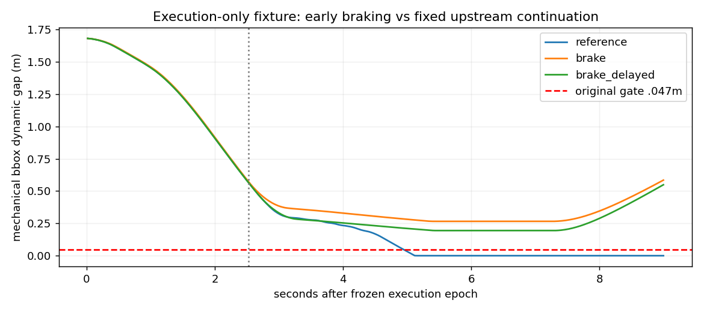
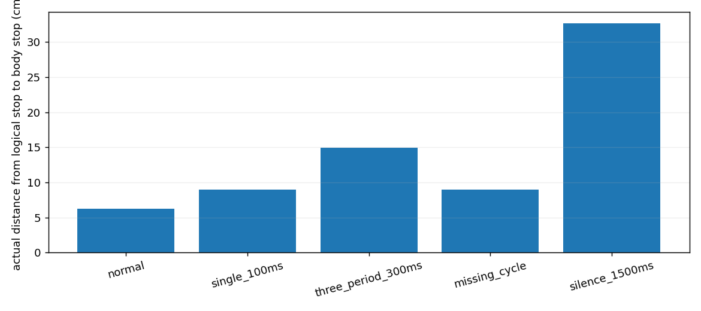

# MPPI 无安全候选与超时执行后果（2026-10-14）

裁决 **Modify**。原 C83 的继续前进主要来自每周期新生成的危险非零控制，随后回退和实际制动较晚；不是“优化器已将所有轨迹判为无效却一直复用旧 Twist”。已经建立受控延迟→旧决策继续作用→停车距离增加的执行证据，但原 C83 缺少同步入口计时，不能证明那次接触由 100ms 超时造成。发现两个原生失败处理局部问题，适合下一阶段小范围隔离验证；不具备部署准入。

用户随后授权离开期间逐阶段继续研究。本阶段完成后沿同一隔离分支继续必要局部验证；此前要求的正式主线、硬件、输出所有权和算法范围边界仍适用。[持续研究检查点](research_continuation_20261014.md)记录后续进度与总报告入口。

## 版本、运行边界和证据

- 基线：`codex/stvl-c83-endtoend-20261014`，`a880c7dc01cb424ea865e1fa0f33732396078670`，只读。
- 当前：`codex/stvl-lifecycle-hold-20261014`；工作区 `/home/qihei/rm2027_navigation/build/stvl_lifecycle_hold_20261014`。完整提交身份由此报告所属 commit 及检查点给出。
- 固定运行：既有 `rm2027_navigation:humble`，Nav2 MPPI 1.1.20、原 STVL 研究插件、原 velocity_smoother 和 chassis stub、Gazebo Mecanum 动力学。无完整 ROS/Gazebo 重建。
- 原始 C83 是 previous stage `corrected_scene/runs/narrow_C_83_aligned` 的45周期记录；162周期和100.590209ms分别来自上一阶段 durable/shadow 原始记录。三个来源独立列出，禁止拼成一条运行。
- 本轮执行夹具只有一个 `/cmd_vel_nav` 冻结生产者，沿实际 smoother→stub→native component→物理 odom 推进；没有在线 MPPI、BT、真实串口、定位或 TF 发布者。不是新导航闭环，也不是完整原 C83 确定性复现。
- 原模型SDF保持字节身份和摩擦 namespace。机器人机械代理 bbox 半长/半宽约0.325/0.300m；研究规划 footprint 半长/半宽0.34/0.29m；actor 0.45×0.55×0.8m。均不代表新车 CAD 校核尺寸。
- smoother 20Hz、OPEN_LOOP、加速度0.8/0.8/2.0、减速度0.8/0.8/2.0、速度上限0.5/0.5/1.2，timeout1.0s；stub watchdog0.5s；native limited target各分量每1ms最多变化0.002。实际车体速度另由物理反馈测量，不能把 target 当作车体速度。
- 在查看本轮结果前固定前缀误差≤0.05m/0.06rad/0.12m/s分量、actor≤0.03m、几何门限0.047m、时序注入容差15ms；原协议4次启动，首次ROS字段类型失败后书面追加一次重试。共5次启动，4有效、1无运动前的工程失败，全部保存。

数据入口：[实验说明](../../experiments/stvl_lifecycle_hold/README.md)、[协议](../../experiments/stvl_lifecycle_hold/protocol.json)、[逐周期表](../../experiments/stvl_lifecycle_hold/evidence/critical_cycle_table.json)、[候选语义](../../experiments/stvl_lifecycle_hold/evidence/candidate_semantics.json)、[执行汇总](../../experiments/stvl_lifecycle_hold/evidence/fixture_summary.json)。完整历史派生表以 `.json.gz` 保存；原始 raw 没有改写或删除。

## 零安全候选的准确语义

TemporalResearchCritic 在优化更新**之前**检查300条候选的30个未来离散点，把当前预测轨迹在同一未来时间索引的净空转换为软成本；`minclear>0.02m` 才计入 `safe_candidates`。这个二值数量只写 trace，数量为零不设置 `fail_flag`，不剔除全部候选。动态风险确实进入代价；“安全数量为零”并没有成为原生接受/拒绝合同。不是完全未消费预测，也不是只在事后发现风险。

MPPI 对所有仍可评分候选做权重更新，之后限幅、SG平滑和时间移位，最终输出不等于某一条 raw 的“最安全候选”。暖启动控制序列是后续采样中心，不等于复制上一条 Twist。原始 C83 c25 的完整 raw 候选未保存，不能补造其运动学、静态及联合通过数。

下表是本轮复算**新 durable 输入**的同快照300候选，不是原始 c25 的替代记录。`joint_complete` 包含执行映射未知，不能解释为物理不可能。

| durable周期 | 原生动态safe | 名义速度变化safe | 静态诊断safe | 动态扫掠safe | 联合几何safe | 完整safe | 有限优化分数 |
|---|---:|---:|---:|---:|---:|---:|---:|
| 0 | 300 | 0 | 299 | 300 | 299 | 0 | 300 |
| 24 | 0 | 0 | 262 | 0 | 0 | 0 | 300 |
| 25 | 0 | 0 | 194 | 0 | 0 | 0 | 300 |
| 26 | 0 | 0 | 45 | 0 | 0 | 0 | 300 |

名义控制变化不满足研究检查器的速率条件，不代表下游实际 target 加速度违例：原控制会经过 smoother 和物理执行。完整执行映射目前仍是 Unknown，这也是不能直接将旁路联合判定接入控制的原因。

| 层/状态 | 现有行为 | 空白与最小职责位置 |
|---|---|---|
| 正常、原生有效评分 | controller_server发布新Twist，smoother限速 | 原生有效不等于研究动态安全 |
| 动态safe=0但成本有限 | 风险软排序仍产生新非零Twist | 现有MPPI owner内缺少明确NoSafe处理合同 |
| 预测合同失效 | 研究Critic设置fail_flag，进入fallback | 与几何NoSafe区分；预测错误不可冒充全空间不可行 |
| 原生控制失败 | 实际抛runtime_error，外层异常处理发布零并终止FollowPath | 失败类型及重试清零有确定性局部问题 |
| 超过100ms仍成功 | 原生仍发布迟到Twist；WallRate仅告警 | 决策有效期没有成为接受条件 |
| 已请求制动 | smoother逐步减速、native target继续限加速度，车体尚运动 | 零Twist不代表已停车或停车位置安全 |
| 上游静默 | smoother先继续旧决策，超过1s再减速 | stub看到下游新消息不能识别旧上游决策年龄 |
| 时钟/反馈不可信 | 当前研究完整判定Unknown | 无法证明安全；本轮未开发新的状态机或生产机制 |
| 已失去保证 | 尚不能证明最晚可制动时刻 | 需执行模型及硬件证据；不能直接宣布碰撞不可避免 |

原生代码依据：[优化器1.1.20](https://github.com/ros-navigation/navigation2/blob/1.1.20/nav2_mppi_controller/src/optimizer.cpp)、[MPPI controller](https://github.com/ros-navigation/navigation2/blob/1.1.20/nav2_mppi_controller/src/controller.cpp)、[controller server](https://github.com/ros-navigation/navigation2/blob/1.1.20/nav2_controller/src/controller_server.cpp)。本地运行探针与源码一致。

## 原 C83 的控制生命周期

时刻为相对原 goal4.002s的仿真时间；DDS时间通过已有双时钟记录映射，原入口没有单调时钟 marker，映射发布时刻不是精确CPU开始/结束计时。

| 周期/锚点 | 相对时间s | 已观察到的行为 |
|---|---:|---|
| c24 | 2.414 | safe300；新Twist(0.48591,0.09680,0.20769) |
| c25输入/首次safe0 | 2.514 | pose(0.98554,−0.02940,−0.16335)，speed(0.48593,0.09670,0.20769)；预测在2.520消费 |
| c25新Twist发布 | 2.522493 | controller_server发布(0.49579,0.25456,0.33637)，非异常、非旧Twist |
| c25下游 | 发布后18.069ms | smoother变为(0.49579,0.13680,0.30769)；至下次NAV发布99.791ms，实际移动0.05105m |
| c26等 | 2.614起 | 新的危险非零指令继续；全部16个safe0周期均匹配新非零发布 |
| 首次原生失败 | 3.514 | “Optimizer fail to compute path”，FollowPath abort/清图/恢复；不是c25即失败 |
| 持续实际减速 | 3.618 | 距safe0 1.104s；直线位移0.55920m、路径0.56540m |
| 后期恢复 | 4.329起 | controller零速；4.344的behavior直接旋转脉冲与smoother交替，属于原始恢复链事实 |
| 车体近停 | 4.578 | 距safe0 2.064s；直线位移0.67190m、路径0.76309m，已停在后续扫掠区域 |
| 首次原几何门限不足 | 4.958 | bbox动态净空0.04329m |
| bbox接触/物理接触 | 5.138/5.308 | 后者由Gazebo轮子contact sensor记录 |

c25入口最近上游NAV命令年龄88.245ms；正常约100ms保持和下游减速真实存在，却不能把随后持续前进归为单一旧命令。生成非零控制的是MPPI/controller_server；smoother变换并保持，stub继续转发，native component限制 target，物理模型推进。关键失败是危险风险软排序继续形成新的动作、随后停止位置不安全。

原始保存可复算45/45控制记录，完整周期关联表在压缩历史派生表；缺少原c25完整候选和同步入口CPU计时，原接触的精确决定性反事实未闭合。

## 有制动机会吗：有限物理对照

原软件执行时序输入以首次safe0对应的实际DDS发布时间2.522493s触发制动，避免把尚未形成决策的入口时刻当成零输出。三个独立启动的前25个样本均满足预先冻结的前缀、速度、actor误差。

| 控制输出回放 | 实际零发布s | 开始车体明显减速s | 近停s | 锚点至停车距离m | 最小动态净空m | 接触/墙重叠 |
|---|---:|---:|---:|---:|---:|---|
| controller-only原序列 | 3.541 | 3.658 | 4.598 | 0.67111 | 0 | 有接触；后期墙重叠 |
| 同前缀早制动 | 2.523 | 2.597 | 3.117 | 0.14815 | 0.26558 | 均0 |
| 早制动再延迟约100ms | 2.624 | 2.737 | 3.257 | 0.21371 | 0.19433 | 均0 |

reference首次接触5.281s，原历史5.308s；3718是连续接触的消息数，不能写成3718次独立碰撞。reference继续至9s，墙重叠首发7.878s，发生在原记录终点之后，仍保留负例。

**这个对照只证明当前代理中、已校验相近前缀下存在早制动等待机会。** reference未再建原behavior direct Spin发布者，因此不是完整Nav2闭环或逐位重放。制动后保持安全至9s，不含恢复通行、到达目标或成功率提升证明。没有在线真值决策；物理真值仅在离线评价使用。

使用原c25消费的预测检查实际测得制动轨迹：即时/延迟制动动态净空分别0.13383/0.06366m，静态、动态、名义速率Safe，完整执行合同仍Unknown。不能把实际测得的未来当作可部署候选。结果支持“采样集合没有覆盖某个可行制动动作”，不能证明仅由采样不足造成全部失败；侧避能力、精确最晚制动时刻未证明。

100ms延迟使两次启动的停车距离差0.06555m；延迟组零发布前自身实测移动0.05029m，smoother发布响应46.305ms对即时14.631ms，相位差另有影响。不能把全部6.56cm归因于CPU延迟，也不能忽略前缀非零差异。

## 超时、旧决策和执行年龄

复算最新durable162：162入口→检查记录，158成功发布、4原生失败。入口→检查p99=85.913ms、max=88.438ms；入口→DDS发布p99=90.397ms、max=92.697ms。该边界0次超过100ms，但该运行外层有4次频率告警；其他历史运行另有3次。入口前costmap/path/pose及外层调度没有完整分段同步计时，不能从p99推导整个线程满足截止期限。

另一个历史shadow c75实际入口→发布100.590209ms，当时safe300、该次运行到达且无接触。上一NAV决策整段保持120.232936ms，车体整段移动0.0154098m；超过入口100ms的部分仅0.590209ms，50Hz反馈插值位移约0.0000792m，低于采样分辨率，不能视为精确额外位移。迟到控制仍发布，4.512ms后首个smoother新输出，下次NAV间隔84.926ms。**这是延迟链证据，不是原C83碰撞因果证据。**

空场0.3m/s实际smoother/stub/物理夹具，八个6s段在一个48s有效运行中推进：

| 注入 | 实际延迟ms | 从逻辑停请求至车体近停m | 比正常多移动m | 可解释行为 |
|---|---:|---:|---:|---|
| 正常 | 0 | 0.06258 | 0 | 有减速坡道和物理响应 |
| 一次延迟100ms | 100.680 | 0.08966 | 0.02708 | 新零输出迟到，旧决策继续 |
| 连续三个输出各迟300ms | 300.03–300.68 | 0.14966 | 0.08708 | 有序迟到发布，非重写控制器 |
| 缺一个周期 | 一周期 | 0.08966 | 0.02708 | 下一零输出到达前保持 |
| 上游静默1.5s | 15周期无新输出 | 0.32686 | 0.26428 | smoother最后新输入25.9s，26.916s先因自身超时开始减速，27.258s近停 |
| 普通停车坡道 | 0 | 0.05256 | 相位导致差异 | 发送零后仍非瞬停 |
| 反馈观察延迟 | observer age203ms | 0.05714 | 不作算法比较 | 只延迟记录观察，未测试闭环MPPI反馈延迟 |
| 恢复正常发布 | 0 | 0.05714 | 不作导航比较 | 之后重新启动仍经过原限加速度链 |

每个有效夹具上游/smoother/final owner均1；两制动组及reference的完整native分量target变化上限约2.0000000000003，低于容差2.01，无解析坏记录。空场时序组无接触，但没有导航目标成功评价。

smoother刷新消息的时间戳会让stub持续看到新传输，不能保证其收到的是新**决策**。需要区分上游决策生成/发布年龄、下游传输年龄、target可见时间和物理响应时间。[固定smoother源码](https://github.com/ros-navigation/navigation2/blob/1.1.20/nav2_velocity_smoother/src/velocity_smoother.cpp)支持这一边界。MCU的失联保护未运行，不能替代正常通信下的决策有效期。

## 确定性局部问题和本阶段修复

1. 原生 `Optimizer::fallback(true)`调用reset后，`critics_data_.fail_flag`仍true。[CriticManager](https://github.com/ros-navigation/navigation2/blob/1.1.20/nav2_mppi_controller/src/critic_manager.cpp)会在true时立即退出，因此下一重试可能跳过评分。实际4失败调用的trace评分attempts均1；2×3无节点探针直接调用已安装库复现保留true。
2. fallback耗尽抛 `std::runtime_error`，MPPIController不转换；controller_server内层failure_tolerance0.3s只捕获PlannerException，实际异常进入外层std异常处理并立即发布零/终止FollowPath。源码、探针与原abort日志一致。

两者影响**失败后的重试/恢复**，不解释最初几何safe0：safe0没有触发fail_flag。它们的最小设计是已有owner内重试前重置评分失败状态、明确原生失败的异常合同；是否应该保留立即abort或应用短暂容错必须与停车行为一起评价。本阶段没有修补安装库或生产控制器。

允许范围内修复了研究夹具ROS Float字段、异常原因记录、JSON NumPy转换、分析变量覆盖builtin的问题；首次失败原数据保留，原`wall_cap`字段错误由traceback纠正解释。无场景、安全门限、物理限制或正式配置改变。

## 八个最终问题与下一步

1. 2.514s是原生时间Critic离散净空通过数为零，风险仍进入软代价，不等于全部原生invalid。
2. 是。原始16/16零safe周期均生成新非零输出；c25输出及传递证据完整。
3. 有约100ms正常保持、20Hz smoother坡道和native限加速度；并非只有旧Twist。
4. 在校验相近前缀的原代理物理模型中，早制动两组均无接触，有安全等待机会；不是精确原始闭环或实车保证。
5. 至少存在集合未覆盖的制动机会；无法将全部原因归为采样，无法证明全空间物理不可行。
6. 会延长决策作用。受控100/300ms及缺周期都有实测停车距离增长；历史100.59ms的超预算部分只0.59ms。
7. 没有。原C83缺少同步入口单调计时，不得用另一次超时建立因果；已确认更直接的新危险输出及迟制动机制。
8. 优先验证现有MPPI重试标志与失败异常合同，再确定已有owner内的NoSafe/迟到决策接受边界。无需先换MPC、复杂预测或新速度owner；C′仍未准入。

动态预测目前仍只值得有限投入**简单CV的可靠消费与执行合同**。本轮没有新增预测信息价值实验，不改变此前“复杂预测尚无充分收益”的结论。继续改善预测精度不能自动补上safe0不约束决策的空白。

## 资产、复现和恢复

精选证据约1.79MiB，其中执行归档约1.34MiB；完整本轮缓存约6.8MiB。全部五次输入/观察/真值/事件纳入精选归档，两个制动组保留完整1msnative。空场与reference的完整1msnative仍有唯一原始时序证据，仅本地缓存保存，不能删除或冒称可再生同一次结果；构建目录和重新提取的副本可重建。

本轮原始流无损gzip后逐字节SHA验证，仅删除本轮有同字节恢复副本的plain文件；未触及历史raw/录包/冷备/其他worktree。恢复和指标复算见README。所有提交路径限本实验、此报告、检查点和索引。保护refs及基线clean复核结果由本地 `build/lifecycle_cache/final_closeout.json`和检查点记录；研究工作区阶段提交后clean，正式工作区原有无关改动保留。

资源起点3,577,970,688字节可用；收口实测在检查点记录，始终高于3GiB。回退入口为基线a880或本阶段commit，新工作区只读恢复即可；不要reset正式工作区。无push、merge、硬件运动、FAST-LIO/MCU/V2/AUD-003修改。
