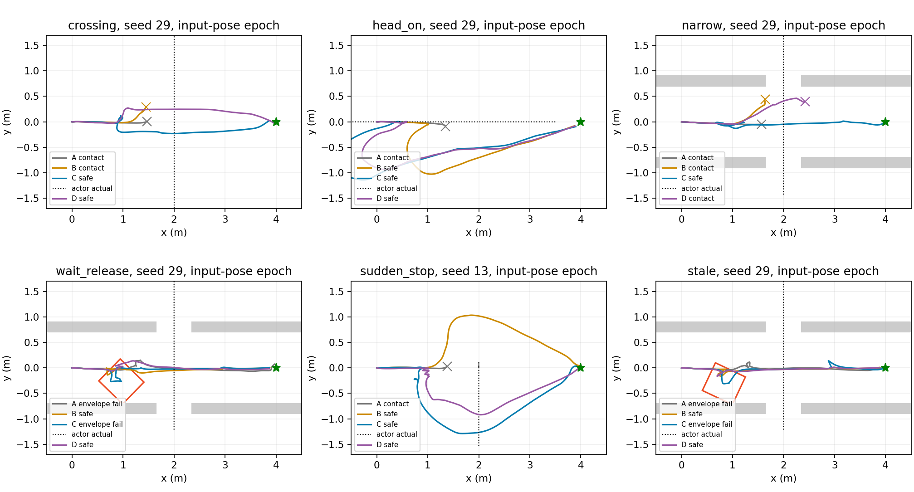

# RM2027：真实 STVL + MPPI 的时间消费闭环研究

2026-10-13，Research；完成 P0、P1、P2、一次有证据支持的 P3 和 P4，停止等待评审。

**裁决：Modify。保留 MPPI 上最小时间感知消费方向，不投入复杂预测或 Temporal MPC 迁移。**
本轮实际运行 STVL、Navfn、controller_server、原生 Omni MPPI、velocity_smoother、
既有 chassis stub 和 Gazebo 反馈。简单 CV 在横穿、迎面和可释放窄通道有可复现安全
收益，未来信息确实被消费。但零动态接触不等于满足全部安全条件：原消费 C 为
14/14 到达、12/14 通过冻结的四项安全/任务门；时间基准修正后的 C 为 21/21 到达、19/21 通过这四项门限。实际动力学仍有额外限制。
Oracle 仍出现窄通道碰撞，修正时间合同也未稳定改善效率。当前不能给部署 Go。

此前将“预测更准确”直接等价为“导航更好”，确实高估了它的价值；本轮证据支持的
投入对象是**可靠的时间消费与可执行安全输出**，不是更复杂的预测器或全控制器替换。
完整旧车低速仿真配置在这些场景中还不够；新车实物尺寸、MID360 感知与控制响应
仍待硬件，不能将这个结论外推为新车正式系统的能力或缺陷。

## 1. P0：来源、规范与实际基线

读取固定基线的开发流程、Research/Integration/Deployment 分级、研究资产/Git规范、
工作区治理、runtime_profiles、TF/topic/chassis 合同和新车阶段冻结；查阅 main 的
AGENTS（该稳定 checkout 没有根 AGENTS 文件）与 repository_workspaces。
采用最小科研验证，没有重新进行全仓审计。分支从核实的稳定软件保存点直接建立。

| 资产 | 实际完整身份 |
| --- | --- |
| 研究起点 / integration/new-car-dual-fixes-20261012 | 4541e3754242c5353e2e5316b44f181f5e9f2721 |
| integration/new-car-software-remote-20261012 | 41b12f2d7f823c6989c6aaddd2c7266be9f3e683 |
| integration/new-car-dual-candidate-20261012 | 412aa4915ca4af8a5d6a9a2a1e73ba84553dc080 |
| main | fcd9a05b03c9539b4b5ea44de0f09d30c4468455 |
| origin/main-new-car（缓存远端引用，无同名本地 head） | bd6cf689d3d5aca5c8edd430ff760ca5ceb27496 |
| origin/main-old-car（缓存远端引用，无同名本地 head） | 820179457b70789b0f46697758dbe3d947ec1d4a |
| PVT | 4d59854fb8a2937ab9cf884f684cdc286842932c |
| R2 代码提取 / 冷研究归档 | 9e08122a6df758b7f0131a5e2de5813a17f0e97c |
| R4 / 旧车物理夹具 / tracker | bdb8b8d00308be4384ea94e8b060d60fd2173d30 |
| R3 / 独立机械投影工具 | 04291a410f193c009e043af88e014cf420e1f68b |
| 本研究继承 FAST-LIO gitlink（未初始化/运行/修改） | 69f1070328c431f4c7b8bd586eca074141da3aae |
| 继承 Livox gitlink（未修改） | 2a2029a6e62a2196b280be6ec00bb2418065b8e0 |

这些是本地实查引用，不冒称重新查询了服务器。冷归档根目录仍在 9e08122a，其自身
FAST-LIO checkout 为 e7864a63a7e2a1ad62ec8fd75fcb9149db08e321，原样保留。

运行依赖为已有离线镜像 `rm2027_navigation:humble`：ROS2 Humble，GCC11.4，
MPPI `1.1.20-1jammy.20260607.083249`，STVL `2.3.4-1jammy.20260607.082704`。
只构建小型研究插件与检查程序。复用 R4 的 adapter install 和 profile_install，
未重新构建 Humble/Jazzy。安装中的 tracker 三个 Python 源文件逐一与 bdb8b8d0
一致，见 [实际来源身份](../../experiments/stvl_temporal/evidence/runtime_source_identity.json)。
二进制 chassis/description/localization 复用既有 R4 runtime prefix，未以当前新车
源码重新构建，不能把 superproject HEAD 冒称所有旧二进制的编译提交。

基线参数快照 [old_car_baseline.yaml](../../experiments/stvl_temporal/old_car_baseline.yaml)
原样来自 4541e375 的 `nav2_old_car_2026_left_stvl.yaml`：

- Omni；10Hz；dt=.1、30步、300候选、1迭代；std=.2/.2/.4、temperature=.3、gamma=.015。
- vx[-.3,.5]、vy±.5、wz±1.2；七个原标准 Critic，CostCritic 启用 footprint。
- 原 footprint 半尺寸 .32/.27、padding .02；local 8×8m/.05m，STVL linear decay .5s，inflation .30m/factor6；global StaticLayer/Navfn，inflation .65m。
- 原 OPEN_LOOP smoother 20Hz，速度同上，加减速度 .8/.8/2，velocity_timeout 1s；既有 chassis stub watchdog .5s。

这是旧车已有低速 STVL 实验 profile；不能证明现场一直使用相同参数。历史 full
launcher 默认 three_point_spin_test 的 3m/s、10rad/s 高风险设置，本轮没有启动。
新车保存版默认障碍层仍是 VoxelLayer，STVL 未默认验收。

本轮最小传感适配是同一 Gazebo 15Hz LaserScan 输入 STVL：mark min range .12m，
360°、.1rad 平面 clearing frustum、model_type1，其他 STVL 参数保留。没有直接
栅格化未来真值，没有以 Python 行为代理替代 Nav2。实测 current costmap 出现 actor
邻域 lethal cells（各试次计数在 metrics）；这证明 STVL 当前占用链实际运行，并不
证明其所有近场/遮挡情形都正确。与 PVT 的直接当前占用代理明确不同，也不是旧车
MID360 三维现场复现。几何为冻结旧车 SDF 和四轮球形接触代理，**不是新车 CAD 或
真实数字孪生**。全机械包络 .325/.300 与规划 footprint 分开评价。

## 2. 复用与不迁入矩阵

历史总因果矩阵继续以保留的 [PVT 报告](/home/qihei/rm2027_navigation/build/prediction_value_20261013/docs/research_history/prediction_value_20261013.md)
为入口；本轮不重新审计所有冻结代码，也不将历史推测升级为根因。

| 路线 | 已验证能力/缺陷 | 本轮复用 | 本轮未迁入 |
| --- | --- | --- | --- |
| R2 | 原生 pluginlib 时间评分/输出核对成立；历史完整几何覆盖不足、guard 堵住任务有实测 | geometry.hpp、model.hpp 的校验、source-age、连续 squared-hinge；model 只改 include | 独立 guard、nominal 大圆、第二消费者/输出 |
| R4 | 时间 stage、canonical tracker、Gazebo/Nav2链已运行；早期阳性受速度/圆几何混杂，A25基线更优，A26近目标路径退化有固定输入 | 冻结 KF tracker；旧车 SDF；launch/record/supervisor 的有限复制适配 | XY QP solver、WorldFollowAdapter、owner/lease、角委托控制替换 |
| R3 / Temporal MPC | solver 和执行重锚运行；历史制动模型、序列老化、输出观察时延有证据 | 只读独立机械投影与 polygon_distance | solver/worker、控制框架、定位/TF修改 |
| PVT | 代理共同消费者中的 oracle/CV/KF 安全阳性，但 oracle 无稳定效率优势 | 运动语义、种子/phase、成对与负例口径 | 代理 A 不作为本轮真实 STVL A |
| HWS / NEU | tracker/CV 时间思想、静态规划迁移有代码证据；并非本地动态控制收益证明 | 已有 canonical 状态估计与 source-time 语义 | 新 tracker、整套上游导航、Sfc/新全局架构 |

最小新增只有实验加载/预测源适配、原生 Critic 插件、只读诊断、场景与评价入口。
纯 R2 评分对每一步先取所有有效 track 的最小净空再积分，不按 track 个数重复相加；
这项一致性修正在正式 P2 前完成。没有 future occupancy 空间并集。

## 3. 实际时间消费与控制数据流

```text
同一 GZ LaserScan ──→ 真 STVL/Inflation ─────────────────→ 原 CostCritic
          └─→ 冻结 canonical tracker/KF → public-v2
                    → B:保持 / C:估计速度CV / D:独立actor GT replay
                    → 私有research点阵 → TemporalResearchCritic
同一当前位姿/速度 → 原生300×30候选 → 七标准评分 + 时间评分
                    → 原MPPI gamma/softmax加权、约束、SG、shift
                    → controller_server → 原smoother → 原chassis stub
                    → GZ物理反馈 → 下一周期
原Nav2恢复behavior_server ──→ /cmd_vel ──→ 同一stub（原既有旁路）
```

`Controller` 薄 subclass 直接调用安装的 MPPIController，仅设置噪声 seed 和诊断；
observer 不改变 costs。A 也使用相同只读 observer；B/C/D 只追加同一个时间 Critic。
原 optimizer、原回退、BT recovery 都实际运行，没有第二路控制 publisher。

私有输入为 `/research/time_predictions` String JSON：原 source_ns、processing_ns、
publish_ns、frame、complete、track id/state/observed_ns/position/velocity/size、
source+0..3.5s 的36个点。公共消息显示网格为15点，本研究从现有状态扩展 CV 网格；
不是重新跟踪。C 已用冻结 KF 估计速度，因此没有运行一个与 C 等价的 E。
D 仅替换已观察 track 的未来中心，不给予更完整检测、未来自车状态或理想执行。

消费者 mutex 拷贝一版完整消息；旧/重复 callback 不覆盖新消息，未来异常 source
清空并拒绝，不能污染可恢复 watermark。源和最近观测年龄上限 .4s；frame/schema/
完整性、状态/ID、尺寸速度、网格和 TF 边界由研究适配与 R2 validation 检查。原
source-age只补偿一次，按相同未来时刻线性插值；不将未来各位置写进 STVL。
无效预测设置原生 fail_flag；原 MPPI retry/exception、Nav2 failure_tolerance、
smoother 和 stub watchdog 处理，不直接发零速度或创建新 owner。

私有研究适配没有完整转交 public authority/schema/total_count 字段，不能称为生产
接口身份认证。固定单一 producer 的 **46,933条**实际公共包全部为 map / v2 anchor /
shadow_only / complete，数量一致，见 public_source_audit.json；这是本轮受控前提。
complete 空数组不是“现场没有障碍”的物理保证；tentative 未进入预测评分，STVL
继续当前占用。原 CostCritic 提前 fail 可能使时间 Critic 不被调用，最终统计明确记为
not_scored，不将空 trace 冒称成功消费。新增插件默认禁用，只能研究配置显式启用。

所有时钟使用 ROS /clock。原 P2 query=`consume_time+(k+1)dt`，但 robot raw rollout
来自固定输入 pose。实测 consume-entry 偏移约5–42ms；P3 唯一因素改为
`input_pose.header.stamp+(k+1)dt`，freshness 仍按真实 consume_clock 检查，未人为移
消息时间戳。新记录 input_pose_age p50≈5ms，所有已有效评分的 query epoch 与 pose
stamp 差为0。此修正消除一个明确的合同缺口，不证明它是原碰撞或低效的唯一根因。

最多6个预定诊断周期记录全部 raw300×30、逐 Critic 实际 float 增量、预测版本与
aggregate。aggregate 是原 SG/shift **之后**的返回计划投影，不是选中的某条 raw；
最低分 raw-before-gamma 仅诊断。固定版本确实使用加权控制与 SG/shift，见
[1.1.20 optimizer](https://raw.githubusercontent.com/ros-navigation/navigation2/1.1.20/nav2_mppi_controller/src/optimizer.cpp)。
没有记录真实 gamma 后所有权重，也没有独立前/后 SG 序列，不能声称完成全部聚合
因果消融。已安装 Omni 模型直接将前一控制写入下一速度，无独立加速度 ramp；实际
smoother 有 .8/.8/2 限制。这个执行模型差异有源码证据，其对特定失败的因果量未测。

## 4. 冻结实验、夹具修正和有效样本

[protocol.json](../../experiments/stvl_temporal/protocol.json) 在正式结果前提交：P2为
7场景×seed13/29×4组=56；P3前另提交 [单因素协议](../../experiments/stvl_temporal/p3_protocol.json)：
原56次复核，加未参与调参的47种子28次，共84。没有改速度、footprint、STVL、评分
权重、地图分组条件、候选数、控制频率或安全阈值，没有第二轮调参。

硬条件：真实 actor 接触0，50Hz全机械投影动态净空≥.05m（.003m数值容差），
无采样机械包络/静态墙重叠，完整 goal 成功。碰撞前运行时间不当到达时间；timeout
纳入失败；无接触但包络违例纳入安全失败。观测是离散采样，不是连续扫掠或实车认证。
效率口径为逐场景逐seed配对，C需在至少两场景两个seed一致提升安全完成，或至少
两场景时间≥10%改善且无新增安全/任务退化；n2只作探索，不声称统计显著。

运动为真实 GZ PID/物理推进，1ms积分；所有组同一目标(4,0)、scan15Hz、控制10Hz、
预测3s（source覆盖3.5s）、smoother20Hz。Gazebo CLI没有设置独立 RNG seed 的入口；
数字seed固定 MPPI噪声和运动phase(-.2/0/+.2s)，不能冒称全部物理随机性严格锁定。
不同反馈/retry后 raw 集自然不同；相同seed不是所有周期候选逐位一致。

P1共4次：empty_A_11未发goal的启动负例；empty_A_12安全到达9.528s；横穿C11
安全到达13.672s（137周期、39次非零时间代价），A11真实轮子接触，均保留。首次
新SDF与旧机械oracle轮偏置不匹配及Python时间API适配问题修正后，用冻结旧车SDF。

P2初始通道连续墙实际把 actor 卡在 y≈±.425，独立 CAL 与 D 同样饱和；不能把原
“未来将离开”场景的超时算作消费者打不开通道。保留10次算法试次和3次 CAL 原
夹具记录，统一修正3类场景所有组：墙在x1.65..2.35留.70m横向开口，物理与地图
一起改；actor .45m能离开，ego .65m与actor不能同时挤过开口。控制和运动参数不变。
修正后才形成完整56次 cohort。另保留1次迎面 CAL撞到静止ego的无效校准，用停车
(0,3)的 CAL替代，算法初始位置不改。

总计 **176个已启动记录**：140有效对照，10原无效通道算法记录，22 CAL（含原
夹具和失效校准），4 P1。没有缺失/未分类目录，没有损坏尾行；没有将 CAL timeout
算作算法失败。独立校准 replay 的已观察、未接触阶段，实际 actor 对齐最大误差
约1.3mm；D已观察对应试次最大<.9mm。未来超出试次终止时间或发生接触后的运动
没有完整实测支撑，D仍是**条件 oracle replay**，不是全环境完美预测/物理最优上界。
独立离线全局最优求解未运行，不能用D冒称可行性参考求解器。

## 5. P2 与 P3 实际结果

P2每格为「到达 / 完整安全 / actor接触」，每组n=2；时间为成功goal的中位数，
其安全失败仍列入安全分母，不能以该时间给不安全方案评优。

| 场景 | A | B保持 | C CV | D条件oracle | C/D到达中位s |
| --- | --- | --- | --- | --- | --- |
| empty | 2/2/0 | 2/2/0 | 2/2/0 | 2/2/0 | 10.265 / 10.335 |
| crossing | 0/0/2 | 0/0/2 | 2/2/0 | 2/2/0 | 14.721 / 13.754 |
| head_on | 0/0/2 | 2/2/0 | 2/2/0 | 2/2/0 | 19.883 / 16.276 |
| narrow（修正夹具） | 0/0/2 | 0/0/2 | 2/2/0 | 1/1/1 | 18.745 / 17.908 |
| wait_release（修正） | 2/0/0 | 2/2/0 | 2/1/0 | 2/2/0 | 17.162 / 18.730 |
| sudden_stop | 0/0/2 | 2/2/0 | 2/2/0 | 2/2/0 | 18.294 / 21.736 |
| stale（修正） | 2/0/0 | 2/2/0 | 2/1/0 | 2/2/0 | 22.560 / 21.989 |

A/C是完整增强系统收益；B/C才区分同消费者中的未来信息。横穿/窄通道B仍碰撞而
C成功，支持CV信息有边际安全价值；迎面和突然停止B已经安全，C更宽裕也更慢。
等待释放C速度收益不能掩盖seed29机械包络/墙违例；stale故障是goal+4..5.2s停发
预测、STVL扫描继续，C仍到达但不能宣称全部安全。A无接触通过等待/故障场景，
实际机械净空或安全距离仍失败，不将“contact=0”冒称安全。

P3后每组21次（原13/29加holdout47），A为6到达/3安全/15接触，B为15/14/6，
C为21/19/0，D为19/18/2。C的原两种子wait_release29、stale29墙包络违例仍在，
47所有7场景C满足采样安全条件；D的narrow29和47仍接触，narrow13另有墙包络违例。
B sudden_stop29净空.042m低于冻结门限，作为新增负例报告。

C原种子时间中位（P2→P3）：crossing14.721→13.909，head_on19.883→19.991，
narrow18.745→18.753，wait_release17.162→20.698，sudden_stop18.294→18.541，
stale22.560→23.187。时间修正关闭了合同缺口，**没有达到稳定效率改善**；不能将
小样本变化都归因于修正。holdout只有修正版本的共同A/B/C/D，没有未修正47组，
所以不能声称holdout直接证明时间修正优于旧版本。

完整逐seed数据/负例/配对见 [summary.json](../../experiments/stvl_temporal/evidence/summary.json)、
[全部分组表](../../experiments/stvl_temporal/evidence/table.md)、[原P2快照](../../experiments/stvl_temporal/evidence/p2_summary.json)。



图展示修正时间版本；通常seed29，sudden_stop选负收益seed13。红框为C最大侧向
机械投影，叉为真实actor接触。图只解释案例，所有统计包含全部冻结试次。

## 6. 评分、候选、执行与实时性解释

[固定ROS时钟pluginlib/DDS干预](../../experiments/stvl_temporal/evidence/deterministic_check.json)
使用相同当前位置、同一候选和零source-age：障碍未来横穿使前进风险4,927,387，
等待约.061；未来远离时两者为0。旧包覆盖、stale、未来时间、恢复和默认禁用检查
均通过。最终补充检查曾使用Humble不支持的to_msg而编译失败，局部改成标准转换
后通过；负例日志保留。这个修复只影响检查入口，没有重跑/改写已完成算法试次。

实际运行C有非零时间代价和不同控制行为；P2横穿C13 t≈4.02s，259/300候选通过
时间安全评分（诊断replay），而B13同刻0/300，B仍输出并最终接触。P3 C共1460次
非零时间代价。分项成本不是“预测只到订阅端却没有进入MPPI”的情况。

以下区分证据和假设：

| 问题 | 本轮证据 | 能得到的结论/限制 |
| --- | --- | --- |
| 全候选有动态风险仍出命令 | narrow D29/47接触前有效预测，safe_candidates=0，cost_min从数千到数百万，仍有非零command | Critic是软评分，没有动态全不安全的原生fail gate；这是消费缺口，不能称最终运动安全保证 |
| oracle为何失败 | 上述已观察运动replay误差<1mm；部分周期无confirmed/coasting track，实际全包络还越墙 | 更准未来中心不能补完整感知、静态几何、候选/执行；没有证实单一根因 |
| 候选空间 | sudden_stop D13 t4/6/8/10s分别194/196/191/192个安全候选，但诊断“3s内前进≥.5m且安全”均0 | 存在局部安全候选但缺少前进候选的固定片段；.5m只为解释，不是事后改成功标准；不是证明MPPI根本不可用 |
| 远期重复/过保守 | 评分按时间且每step取最小track风险，保留STVL；stop案例最低时间成本的近1s项也显著，远1..3s未统一主导 | 无证据支持仅降低远期权重；没有做该调参。两种安全成本覆盖不同信息，也可能重叠，但未做可移除近场保护的因果证明 |
| 控制和真实执行 | raw费用只影响加权控制，返回aggregate已SG/shift；smoother有加速度限制，模型没有同样ramp；实际墙包络失败 | 不能将最低分raw当作被执行轨迹；执行响应/全包络及最终命令验收是更小且更有证据的缺口，尚未量化各部分因果贡献 |
| 信息误差退化 | 突然停/释放后CV仍需新观测纠正；prediction_age/invalid reason与原回退实际记录；stale到达时间变长 | CV不是完美预测；预测失效会进入原Nav2恢复，fail_flag不是立即制动或新安全授权 |

完整 attribution/replay 见 [diagnostic_replay.json](../../experiments/stvl_temporal/evidence/diagnostic_replay.json)。
float增量相减在百万级成本有约.36绝对重放误差，未当作逐位一致。没有重新开发
proposal或轨迹库，没有修改optimizer，没有新增tracker。

P2每组计算p95约32.2/34.8/35.0/34.8ms；P3 A/B/C/D（21试次/组）如下：

| 组 | 计算p50 / p95 / p99 ms | >100ms周期 | 非零保持输出gap p95 / p99 / max ms |
| --- | --- | --- | --- |
| A | 12.627 / 32.652 / 35.126 | 0 | 52 / 55 / 69 |
| B | 22.162 / 35.342 / 37.337 | 0 | 54 / 100 / 103 |
| C | 15.795 / 34.789 / 36.695 | 0 | 53 / 100 / 106 |
| D | 15.607 / 34.433 / 36.452 | 0 | 53 / 99 / 103 |

compute_ms包含Critic/诊断构造，但在写盘前截取，不是硬件端到端延迟。所有组总
预算仍100ms，未因C/D慢降低控制频率。非零gap略超过100ms主要是原恢复spin的
约10Hz出口；零命令保持期间出现最长数秒的稀疏输出，不能直接冒称持续非零指令
无监管或MPPI计算超时。smoother和stub原timeout均保留，真实反馈另记。
P3 C有效预测年龄p50/p95/p99为81/148/213.46ms，最大390ms；失效包与未调用
评分分开计数。所有140有效试次输出速度界限违例0；实际速度/加速度、路径长度、
停启、反向次数、等待/最长stall、source/receipt/consume及故障回退在逐run metrics。
没有只拿计算平均值评价安全。原Humble navigation_launch中，恢复behavior_server
直接写/cmd_vel，正常MPPI则写/cmd_vel_nav经smoother；原生恢复没有统一经过这个
smoother。启动源码保存为native_navigation_launch.py。本轮没有改变这项共同条件。
实际P3 C反馈的最大有限差分加速度约1.93/1.75/2.00，超过smoother的.8/.8/2设定；
接触试次B/D有更大的冲击变化。各轴raw exceed计数写入metrics（未加事后容差），
不能将它们自动解释为真实驱动违反硬件限幅，也不能宣称全部动力学约束已满足。
因此“完整安全”表列仅指冻结的接触/动态净空/墙/到达四门，不包含实车动力学认证。

140个输出endpoint均为单publisher；4次发现工具没解析node名，原文本保留，不能
冒称4次都完成实名DDS确认。启动/代码唯一末端是已有chassis_interface_stub，
未发现双owner。3次container退出-11出现在关闭阶段，单独标记，不伪装成运行
算法失败，也不隐去；无硬件运动输出。

## 7. P4：七个问题与最小后续方向

1. **STVL+MPPI真实表现？** 本轮真实低速链空场稳定，但横穿/迎面/突然停/窄通道A发生接触；不能说这些场景已经足够。仅限平面传感旧车代理物理配置。
2. **简单CV有价值？** 有，B/C横穿和窄通道对照及独立seed支持未来运动信息的安全边际价值；复杂预测未有必要。
3. **MPPI能消费吗？** 能，原装Critic扩展与运行成本/输出证明，不需要替换控制器；时刻合同做了一次局部修正。
4. **减少等待绕行吗？** 部分场景有，等待释放的效率改善同时有安全负例；迎面、突然停止CV更慢，不能给总体效率胜出结论。
5. **主要瓶颈？** 已证实软风险全不安全仍输出、固定候选片段缺前进策略、规划/机械与smoother执行不等价；检测/公共身份与执行闭环合同仍有限。不是已证实“预测精度不够”或“MPPI根本失败”。
6. **最小Critic有工程收益？** 有可复现科研安全收益，但完整安全门未全过，当前为Modify，不是集成/部署验收。
7. **需要Temporal MPC吗？** 本轮没有证据要求迁移；也未做同预算新MPC对照。保留MPPI、CV和最小时间消费，暂不恢复冻结方案。

下一步若用户另行批准独立研究，最小方向是：在既有原生回退/唯一输出链内，研究
全候选不可安全时的处理，以及用全包络/实际smoother响应验收最终命令的最小合同。
先复用已有R2/R4工具，不创建第二输出owner；生产公共输入身份与新车真实几何须
另阶段确认。不能凭本轮自动进行该开发，也不开展R5、复杂预测或MPC迁移。

## 8. 复现、Git与资源收口

独立分支 `experiment/stvl-temporal-consumption-20261013`，worktree
`/home/qihei/rm2027_navigation/build/stvl_temporal_consumption_20261013`。
P2控制源码点4f37aab524027449b9486c6f1b5f51698a48f395；夹具修正点
713522dd32bf8400909adaf2f2702e3954966e4c；P3控制源码/协议点
1b6e0ffef648a35459cdf376f9060f4e68e4ba4a。最终完整HEAD及clean实查见本worktree
`build/stvl_temporal_closeout.json`，或执行 `git rev-parse HEAD`；避免文档自引用SHA。

[工程README](../../experiments/stvl_temporal/README.md) 包含实际运行/分析/恢复命令。
修改仅为 `experiments/stvl_temporal/`、本报告与文档索引；完整清单在
[evidence/changed_files.txt](../../experiments/stvl_temporal/evidence/changed_files.txt)。
`COLCON_IGNORE`阻止正式构建纳入；没有修改正式导航参数、FAST-LIO、定位、TF、
串口、MCU、AUD-003，没有修改旧研究源码或历史，未push/merge。
冷归档根原9个surface-member WIP、R4原dirty分析脚本与其他工作区原状态保持。

开始可用约6.06GiB；完整本轮缓存约854MiB，精简证据约129MiB，收口实际空间见
closeout（仍约5GiB，保护线3GiB）。已放弃277MiB的过大全量临时证据副本并按预算
重建，**未删除原始记录**。176个压缩试次保留所有命令、公共预测、消费payload、
aggregate、分项费用、真值、配置、事件、失败输入和日志；全部119个关键raw快照
覆盖解释案例和失败最后捕获帧。其他raw矩阵未全部入Git，完整原始版本仍唯一保留
在本轮 `build/stvl_cache/runs/*/control.jsonl`；评审前不要清理该缓存。可再生项仅
plugin_build/research_install、ROS工作日志、由prepare/amend派生的地图等。

只清理了本轮可重建的压缩副本，没有动冷备、录包、历史负例或其他worktree。旧资产
仍可能存在本机唯一数据，不能声称全仓已经无唯一记录。恢复选定证据用
restore_evidence.py；恢复代码可从本分支以detach建立新工作树，继续复用已保存
Humble依赖。回退是停止研究入口或检出4541e375；不需要生产导航回滚，因为正式
链没有本轮改动。全部具备前置条件的阶段已经完成，本轮到P4停止等待评审。
