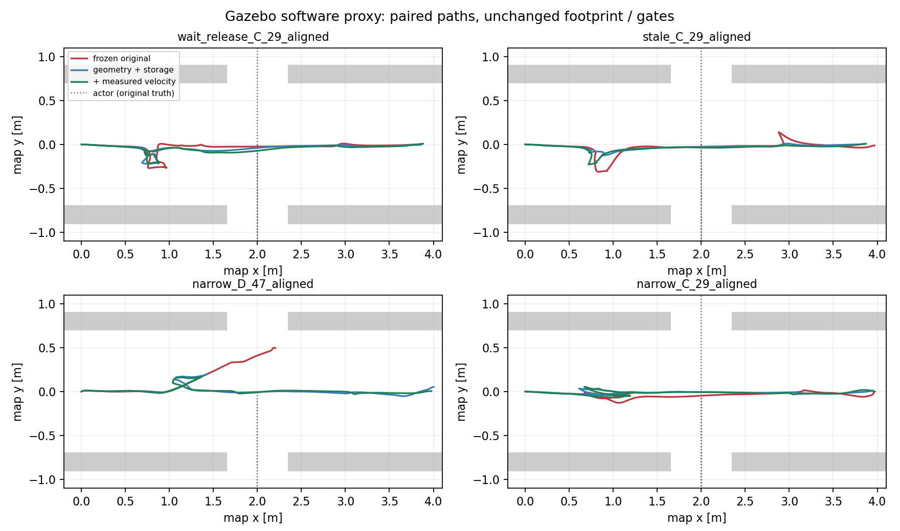
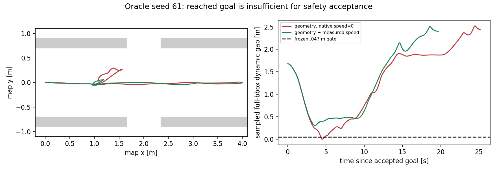

# RM2027：时间感知 MPPI 失败根因定位与最小闭环修复

**裁决：Modify。** 本轮关闭了可复现的 footprint 检查漏检，以及实验链没有把已有
里程计速度交给 controller_server 的配置错误。最终增强控制 9/9 通过原冻结门限，
但这不能证明完整动态安全合同成立：保留种子曾出现包络违例、正常等待明显变慢，
远期输出仍有危险段，代理执行的加速度合同也未闭合。停止扩张，等待评审。

2026-10-14；研究分支 `experiment/stvl-temporal-failure-roots-20261013`，路径日期后缀
沿用任务开始日。基线完整 HEAD `d2b5f0714585e1e71abaf20def932937057f644e`。
原报告和 140 次有效实验没有被覆盖。本轮不是 R5、MPC 迁移或生产参数修正。

## 1. 已核对的真实失败集合

原 C 组 21 次中，未过冻结门限的**两次都因采样墙 bbox 重叠**。加速度超限在这两次
及正常组均存在，是独立记录的模型合同问题，未被计入原 19/21 主门限；不能说它们
分别是一个墙失败和一个动力学失败。以下时刻以各次 goal accepted 为零点。

| 原 case ID | 首次墙 bbox 违例 s | 首次 actor contact s | 最大墙穿透代理 mm | 精确现象 / 最终分级 |
|---|---:|---:|---:|---|
| wait_release_C_29_aligned | 4.237 | 无 | 9.431 | 已输出远期轨迹先穿墙；Root Cause Confirmed（几何评分边界），Local Fix Verified（有限软件回归） |
| stale_C_29_aligned | 3.197 | 无 | 21.050 | 最近聚合轨迹安全但极近墙，执行偏离；共享速度输入错误确认，原失败本轮未稳定复现，独占因果为 Evidence Missing |
| narrow_D_29_aligned | 3.979 | 5.491（sensor source） | 50.331 | Oracle 有效消费后仍输出危险路径；Root Cause Confirmed（规划/评分合同缺口），Local Fix Verified（29/47有限回归） |
| narrow_D_47_aligned | 3.617 | 5.259（sensor source） | 50.112 | 同上；不能用预测误差解释原接触 |
| narrow_D_29_gap | 3.977 | 5.464（sensor source） | 50.136 | 原 P2 消费时间基准；共同缺陷确认，旧时间基准的独立贡献 Evidence Missing；未再跑旧 epoch |
| narrow_D_13_aligned | 4.277 | 无 | 2.619 | 额外 Oracle 墙包络负例，不能混入三次 actor contacts；未新增该种子的运动重跑，Model Limitation / Evidence Missing |

sensor source 与 trial end/receipt 差 1–2ms，不把两个时刻混用。
完整源 ns、姿态、指令、各 topic 与正常 B29 wait/stale、C29 narrow、C13 wait 见
[原失败清单](../../experiments/stvl_temporal_roots/evidence/original_inventory.json)。
它包含全部三个已记录 Oracle actor contacts，而不是只展示一种子。

## 2. 原关键周期：规划错误与执行错误并存

| 案例与周期 | MPPI 输入 pose (x,y,yaw) | MPPI 输入速度 | 实际已有里程计速度 (vx,vy,wz) | 原 Twist (vx,vy,wz) | SDK下一步位姿与实际位姿误差 |
|---|---|---|---|---|---|
| wait C29，4.223s | (.95597,-.26398,-.65567) | (0,0,0) | (.11257,.04045,-.37447) | (.03807,.02109,-.42912) | 5.637mm，yaw -0.003179rad |
| stale C29，3.122s | (.79972,-.28006,-.42457) | (0,0,0) | (.13532,-.17144,-.14681) | (.14421,.01401,-.08250) | 14.066mm，yaw +0.003381rad |

stale 下一步：SDK (.81344,-.28473,-.43282)，真实反馈
(.80726,-.29737,-.43620)，均按 input pose stamp+.1s 对齐，保存插值两端。
这个周期的规划 polygon 最小墙间隙 +6.506mm；首次 bbox 违例时规划 polygon 在实际
位姿的间隙 -0.534mm。因此其最近一次决策是类型 B 候选，但还有几何合同差异；
更早 1.822s 的已输出聚合路径又有 -109.803mm 墙间隙，不能把整次归为纯类型 B。
故障注入在 4..5.2s，**首次墙违例发生在注入前**。

wait 的 3.923s 聚合路径已穿墙约 11.8mm；4.123s 的 300 原候选中 284 条穿规划墙，
静态 Critic 中位代价仍是 0。它的规划风险先于 4.237s 实际 bbox 违例，属于类型 A
有直接证据。4.223s 的命令已返回和发布，不能拿未完成周期解释首次违例。

这里的“聚合路径”是固定 SDK 的 `getOptimizedTrajectory()`，在 native SG 与序列
shift **之后**重构，不是最低代价候选，不是执行动力学积分。原生优化是 softmax
加权 noised controls；本轮保存后 gamma 的真实总代价、temperature、原候选速度、
noised controls、真正的最终控制序列。290 个有效修复定向快照中，序列首控制全部
等于返回 Twist；这排除了把最低 raw sample 冒充最终控制的解释。

[逐周期测量](../../experiments/stvl_temporal_roots/evidence/causal_measurements.json)
保留生成/processing/publish/source/receipt/consume/pose epoch、track身份、实际消费
36点、各 Critic 范围、后 gamma 权重、平滑前后和模拟出口指令。
原生 OdomSubscriber 实际速度样本时间戳没有从 controller 内部另行导出；原始日志
以接收过的里程计记录和输入值比对，不能声称知道它每次 callback 的准确执行时刻。

## 3. 几何检查的确定性漏检及局部修复

原运行配置是多边形 `.32/.27 + padding .02`，并且 `consider_footprint=true`；
不是点机器人。其 circumscribed radius 为 .446878m，local inflation 仅 .30m。
固定版本 CostCritic 在中心格为自由空间时跳过检查；低中心代价也可能绕过 footprint。
[Nav2 1.1.20 实现](https://github.com/ros-navigation/navigation2/blob/1.1.20/nav2_mppi_controller/src/critics/cost_critic.cpp)
与本轮安装原生反例相符。

直接调用安装 DLL 与 InflationLayer 的反例：中心格代价 0，原生 footprint 检查 254，
两条相同动力学尺度轨迹“移到旋转角点碰墙”和“等待”。原 score 均为 0；最小修复
后危险轨迹 500、等待 0。全危险正例仍触发 native fail_flag。运行结果在
[几何回归](../../experiments/stvl_temporal_roots/evidence/geometry_check_final.json)。

诊断保持原 `CostCritic::score` 不变，实际 wait C29 某周期 full footprint 命中
207/300、shortcut仅71/300，漏掉1591个姿态检查，后 gamma softmax 的 .894 质量落在
full-footprint 危险样本上。stale 为146/300 vs27/300，漏1288，质量 .625；D29 为
292/300 vs275/300，质量1.000。后续窗口也可重复观察，非只有合成地图反例。

`RootCostProbe(check_all_poses=true)` 继承原初始化、原 collision checker、评分公式、
权重与 retry 语义，只取消 polygon 检查的中心捷径。没有改地图、inflation、机器人
尺寸、速度、安全门限或动态代价。原 `diag` 模式直接调用 native 原 score。
不是声称“没有正确配置可以解决”：足够 inflation 支撑也可能满足原 shortcut 前提，
但扩大它会改变空间代价和可通行宽度。本轮按用户限制，在保持既有势场的情况下验证
明确检查，未把膨胀或权重调整当成因果修复。

它仍是 native 栅格边界 footprint 检查、.1s 离散点与有限软代价，**不是连续或填充
多边形安全证明**。离线补算 .01s 线性扫掠会让部分负间隙更差；原主要负例在离散点
已经危险，不需要假设采样间穿墙才能解释。

## 4. 实验输入速度为零：第二个已确认边界缺陷

原配置仅给 bt_navigator 与 smoother 指定 `/odometry/lio`，漏了 controller_server。
固定安装 OdomSubscriber 默认订阅 `odom`，未收到时保留零 Twist。
[安装头文件](../../experiments/stvl_temporal_roots/evidence/native_odom_subscriber.hpp)
与原输入记录共同确认这一点。

原复现 928 个成功控制周期输入速度全零；几何/内存修复 cohort 的 1163 个记录周期
仍全零，而同时间已有 `/odometry/lio` 在运动。raw 候选的第一步速度因此为零，
没有真实运动状态衔接。最终两组记录 1578 周期，其中1564非零，停止时仍可真实为零；
参数与订阅记录确认 controller_server 接入已有 LIO adapter。

仅在每次独立实验 nav2.yaml 添加 `controller_server.odom_topic=/odometry/lio`，不改
定位、TF、接口代码或正式 profile。**这是本实验 composition 的缺陷，未审计或断言
正式车辆的 controller_server 也使用零速度。** 几何修复与接入速度分成不同 cohort，
其收益不能全部算给 Critic 或预测信息。

原生 Omni 后续速度主要来自采样控制，固定 Humble 实现没有这里所要求的未来 .8/.8/2
加速度传播合同。SDK 聚合积分、第一步反馈、SG/shift 与真实 smoother/Gazebo 响应也
不等价。本轮没有整体替换运动模型。

## 5. Oracle 为何仍然碰撞

三个原接触前的 Oracle snapshot 都确实被消费，schema/frame/完整性/新鲜度通过，
按 source 与 input pose未来同一时间索引；有处理与发布时间，非只有适配器发布计数。
接触前可观测的未来点与同次 actor truth 的误差主要为亚毫米；终止后的未来点不能用
该次未录到的真值验证。D 使用独立 actor calibration 的点，只替换已观测 track，
仍保留感知确认延迟；Oracle 没有理想机器人速度、无延迟输出或额外计算量。

| 原 Oracle | 首次有效 active 周期 s | 动态安全 raw 候选数 | 动态最低代价约 | 返回 vx m/s | 既有实际速度、.8/.8/2有界制动的离线圆净空 m |
|---|---:|---:|---:|---:|---:|
| narrow D29 aligned | 2.422 | 0 | 82043 | .440 | .230 |
| narrow D47 aligned | 2.222 | 0 | 70001 | .425 | .283 |
| narrow D29 gap | 2.421 | 0 | 127690 | 约 .44 | .248 |

有界等待/制动参考使用同一已记录里程计状态、同一 footprint 与现有约束；不加新策略
进控制器，不是 Gazebo 已执行策略，更不是真实车辆物理可行性证明。它只否定“300个
raw全危险，所以不存在任何代理安全动作”这一推论。候选空间、提前制动仍有研究价值。

消费问题已定位到具体合同：动态 Critic 给危险候选加有限软代价，**全动态危险不设置
fail_flag**，也没有静态/动态联合可接受集合或输出轨迹复查。softmax 仍能继续前进。
静态漏检、极不平衡的风险代价以及原零速度状态共同提供危险路线；原接触前已经有
墙与动态危险的输出路径。原接触全部在 front_right_wheel 与 actor collision 之间，
原 recorder 未存接触三维点；报告给最近真值姿态与 wheel平面位置，不伪造精确接触点。

这证明消费/规划合同不足，不能证明某个单因素独占全部接触因果，也不证明 MPPI
必须换成 MPC。[固定优化流程](https://github.com/ros-navigation/navigation2/blob/1.1.20/nav2_mppi_controller/src/optimizer.cpp)
与本轮真实后 gamma / SG / shift 记录一致。

## 6. 分阶段运行、工程负例与公平性

首先原 DLL 复现原参数：wait C29 墙失败、D29/D47接触均复现，四个原正常对照仍成功；
stale C29这次无墙失败。保持原 score 的只读探针 run 中 wait/stale也安全到达，D29
仍接触。这表明 DDS、仿真调度、跟踪和诊断负担会影响边界案例；未改噪声seed，
不把未重现的失败强行宣布已完全解释。

中间几何适配器引入了一个本轮自己的工程错误：用 xtensor vector `+=` 时替换了
native 32-byte SIMD 对齐成本数组。崩溃回溯落在 `updateControlSequence` 的对齐向量
读取；定向地址 run 实际观察到 before_mod32=0 -> after_mod32=16、storage replaced。
这与固定版本的 xsimd 编译/分配合同吻合。
[固定构建设置](https://github.com/ros-navigation/navigation2/blob/1.1.20/nav2_mppi_controller/CMakeLists.txt)。
修为逐元素原地累加，保留同一方程与数组；有效修复快照全部保留原存储。

这个错误造成4次过程内控制容器退出：repair C29、repair D47、heldout_repair D61、
crash_debug C29。两次 recorder 标成 timeout、两次标成 contact；全部保留，并追加
runtime loss 分类，不能拿它们推断正常优化器能力。地址探针 run 没崩溃但确实换为
16-byte地址，也保存；不能因它一次成功而否定内存缺陷。

另有一次 stale C61 在 map/prediction readiness 缺失时从未接受 goal；根因暂为
Evidence Missing，原记录保留，仅在另一个 cohort 重试一次，随后恢复两个未运行的
固定案例。没有通过换种子排除失败。

总计48启动尝试、47进入试验epoch（含calibration）、46导航goal接受；1个独立 actor calibration，4个上述runtime缺陷，
**42个可评价的正常控制闭环**。全部在
[全结果表](../../experiments/stvl_temporal_roots/evidence/all_attempts.md) 与
[机器结果](../../experiments/stvl_temporal_roots/evidence/all_attempts.json)。
初始24上限及各次有证据工程补充均保留在 protocol / amendment：额外诊断、适配器
修复回归、速度输入单因素、一次启动重试；最终48尝试上限未超出，没有新增场景调参。

以下单因素对照的源、地图、观测与实时预算相同。“几何”列均已修内存；“+速度”仅
再接正确话题。之后不再运行研究。

| case | 原DLL本轮复现 | 几何：safe / time s / gap m | +速度：safe / time s / gap m |
|---|---|---|---|
| crossing_A_29_aligned | actor_contact, safe=0, wall=0 | 0 / — / 0.000 | 0 / — / 0.000 |
| crossing_C_29_aligned | goal_result, safe=1, wall=0 | 1 / 14.179 / 0.431 | 1 / 14.29 / 0.472 |
| narrow_C_29_aligned | goal_result, safe=1, wall=0 | 1 / 16.259 / 0.394 | 1 / 16.809 / 0.309 |
| narrow_D_29_aligned | actor_contact, safe=0, wall=57 | 1 / 26.448 / 0.135 | 1 / 21.432 / 0.253 |
| narrow_D_47_aligned | actor_contact, safe=0, wall=56 | 1 / 17.71 / 0.170 | 1 / 20.378 / 0.230 |
| stale_C_29_aligned | goal_result, safe=1, wall=0 | 1 / 20.619 / 0.440 | 1 / 20.698 / 0.529 |
| wait_release_C_13_aligned | goal_result, safe=1, wall=0 | 1 / 16.221 / 0.397 | 1 / 27.709 / 0.407 |
| wait_release_C_29_aligned | goal_result, safe=0, wall=31 | 1 / 19.132 / 0.534 | 1 / 20.592 / 0.507 |

种子61：几何阶段 wait C / stale C重试 / narrow C 通过；narrow D到达25.217s但
动态bbox净空0、无sensor contact，首次低于.047在4.337s，冻结门限失败。补齐速度后
narrow D19.680s/净空.304m、narrow C20.989s/净空.297m通过。61是几何设计前固定的
保留样本；速度缺陷发现时已看过它，**不称为速度修复的新盲测**。

几何后同种子 wait C13 16.221s，补速度后27.709s，增加70.8%；D47增加15.1%，D29则
缩短19.0%。这些是单次配对观察，非统计显著性，不掩盖正常场景效率退化。
最终9个增强案例均达到原安全门限；A横穿仍接触。正常C narrow29回归通过，不能说
所有组“均无碰撞”。

## 7. 尚未闭合的合同

- 在290个有效几何/速度修复定向快照中，SDK输出远期规划仍有17个墙危险、47个动态
  圆危险。它们后来没被整段执行，不等于输出已经安全；不能把实际有限测试通过转成
  恒成立的安全保证。时间 Critic 的全危险接受与输出复核缺口没有在本轮改动。
- 最终10例各自计算 p95 的最大值50.251ms、p99最大62.831ms，无单周期>100ms。
  保持10Hz/300×30/1次，未以降低频率制造公平性。CPU时间在代理环境测得，无实车结论。
- 模拟最终输出只有已有 chassis stub 一个 publisher；原 Nav2 recovery 仍可能直接给
  `/cmd_vel`，绕过正常 `/cmd_vel_nav -> smoother` 路径。回退日志、source与出口已保留。
  没有新命令所有者或更改MCU安全授权。
- 最终原有限差分的线速度加速度可达约1.55–2.00m/s²，明显高于 smoother .8m/s²。
  body分量差分也受旋转影响，角加速度2附近的浮点超限不等于有效物理违规；需要统一
  坐标与回退路径再归因。Gazebo驱动本来允许2m/s²，native未来模型不传播这里的平滑
  动力学。没有证据将这套代理合同外推四全向轮实车响应。
- 规划半尺寸 .34/.29 与评价保守 bbox .325/.300并非同一形状。原C两次 SDF平面实体
  并集（.60×.50箱体 + 四个r.075轮球投影）的全程墙间隙约21.6mm与3.7mm，bbox角点
  重叠不等于发生了GZ实体墙碰撞。该实体并集审计省略轮关节/roll/pitch，不是CAD。
  门限仍照原bbox执行，未借审计放宽失败；需要先固定可审查的机器人几何合同。
- 当前接触 oracle 原日志没有3D接触点，旧失败的每一步 SG之前序列没有直接保留。
  本轮保存真实后gamma权重和后SG序列并可重构部分加权量，仍不强行分配全部失败比例。

## 8. 对前轮结论及下一步的回答

1. **MPPI生成不安全，还是执行变不安全？** 两者均有：wait/Oracle在评分及输出时
   已危险；stale首次近墙边界存在安全SDK路径执行偏离，并混有几何与更早规划风险。
   已确认零速度输入、静态漏检，未证明所有B类误差都由某一因素独占。
2. **Oracle为什么碰撞？** 有效预测仍进入全危险软排序，静态角点漏检、速度反馈缺失
   与有限候选使路径不满足联合安全；预测正确不修复机器人状态与执行响应。并非
   Oracle没被消费，也不能反推复杂预测模型必要。
3. **时间Critic的问题定位了吗？** 是：全动态危险不触发失败、联合静态/动态可接受性
   和最终输出复查缺位，属于消费合同。代价权重改变并未获验证，也未进行。
4. **局部修改能达到预期吗？** 可关闭两个确定性边界，并让选定失败及正常回归通过；
   尚不能承诺完整动态安全与效率目标。独立保留负例、等待退化和远期危险要求Modify。
5. **真正值得研究什么？** 优先对齐既有速度/几何/时间/回退合同，再评估有界制动候选
   与静态/动态联合可接受性。原数据不足以证明增加预测精度或更换MPC值得投入。

CV时间消费仍值得保留为**受限软件研究方向**：正确速度接入的横穿配对仍是A接触、
C安全；其他定向C成功。旧140次全部共享零速度实验边界，纯信息对照仍在那个消费者
条件内成立，但不能据此给正常速度反馈系统的普遍收益认证。需要先修消费和执行一致性，
无证据要求更换MPPI或解除Temporal MPC冻结，也不提出新预测模型开发。本轮到此停止。

## 9. Git、证据和恢复

已依适用 AGENTS、开发工作流、研究/集成/部署分层与研究资产Git管理原则完成隔离；
未重新审计仓库。适用规范仍在 docs 的原索引中，本轮仅追加这份研究结果。
保护检查见 [preservation.json](../../experiments/stvl_temporal_roots/evidence/preservation.json)：
除本研究分支，全部已有 heads/remotes/tags身份保持不变；原 d2b5 worktree clean。
原主工作区9个已有WIP条目未改，FAST-LIO、定位、TF、V2、MCU、AUD003均无本轮修改。

本轮修改只在 `experiments/stvl_temporal/{plugins.cpp,CMakeLists.txt,critics.xml}`、
新 `experiments/stvl_temporal_roots/` 与本文/研究索引。早期故障源码与失败测试已在
`ec8cb8681a32a17fe436c62311eeff3168dd4648` 检查点保留；最终完整HEAD在提交后的
`build/roots_cache/final_closeout.json`及交付消息，Git文件清单由该HEAD相对d2b5查询。
研究分支提交后保持clean，不push、merge、不迁入正式配置。

原完整runs目录现场测得约828MiB（原报告约856MiB是较宽缓存口径），保留在原worktree。
本轮完整owned cache约414MiB；源码和紧凑证据另算，Git对象共享，继承的约129MiB原
证据没有复制成新增archive。新紧凑包限45MiB，所有48尝试都有恢复包，13个定向完整
候选矩阵；其余完整矩阵、非关键ring输入是**本地唯一证据**，不可清理。
最终实测空间和字节数见closeout；研究期间可用空间始终大于3GiB，收口约4.2GiB。

`plugin_build` 是本轮可重建缓存，独立检查通过后已清掉8.3MiB；`research_install` 可
重新构建。源raw经逐字节校验gzip并记录解压SHA256，压缩不是删除实验数据。
恢复入口：[README](../../experiments/stvl_temporal_roots/README.md)，`archive_index.json`
校验每包；保留已有原worktree与R4安装前缀后，单案例用新复现标签运行。需要恢复旧
有缺陷几何适配器时使用ec8cb检查点另建worktree，绝不覆盖本轮或原worktree。

独立原生几何反例、固定时钟/旧消息/过期/未来消息/恢复/default-disabled回归全部通过；
Python语法、脚本语法、diff检查通过。48启动尝试的退出、未完成、超时及全部负例均
入表，不采用理想运行截图替代实验结果。**Modify，等待用户评审；不自动继续算法研究。**
